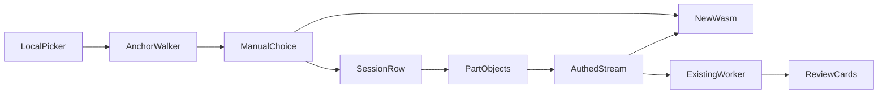

# כלים מקצועיים חיצוניים — תוכנית ביצוע

אישור התוכנית שומר את הבלופרינט. הוא אינו אישור לקוד, ל־Rust, ל־WASM, ל־Worker, למיגרציה, ל־Commit, ל־Push או ל־Deploy. מימוש מתחיל רק אחרי הודעה נפרדת של בעל המוצר.

הבסיס הוא [הדוח](docs/audits/EXLFY_EXTERNAL_DWG_VIEWER_AND_TAKEOFF_FEASIBILITY_2026-11-27.md), כולל חלק ג׳. זה העותק היחיד של התוכנית.

## החלטות שאושרו

- סשן 6 שעות, בלי `project_id`, בלי הארכה, בלי פרויקט מלאכותי.
- אחרי אישור זמני: אקסל בלי באנר טיוטה. אזהרות אמת נשארות.
- שתי הרשאות ארגוניות: צפייה, וכתב כמויות. לא נגזרות מהרשאת פרויקט.
- קטלוג וספריית סמלים לקריאה בלבד.
- DWG, PDF ו־DXF על המנועים הקיימים, כולל זיווג.
- בלי ספק ענן של הארגון. צפייה לא עולה לשרת.
- אזור «כלים מקצועיים» מחוץ לפרויקט, ומעבר מצפייה לניתוח בלי בחירה שנייה.
- חלופה 2: XREF מקונן נטען במציג ובמנוע הכמויות לפי זהות הורה, כולל התנגשות מפתח. אין השמטת רקע שנפתר. אין בחירה אוטומטית של קובץ שגוי.

אין החלטת מוצר פתוחה. מעבר של מציג הפרויקט אל הבינארי החדש הוא שער אישור נפרד בעתיד, לא חלק מהמימוש הראשון.

## זהויות

כל השכבות משתמשות באותן זהויות.

- קובץ מקור: `logicalId` שהלקוח מנפיק. לא שם ולא גודל.
- תוכן: `sha256` אחרי העלאה. שיתוף בתים מותר רק כשה־hash הוכח. שתי שורות לוגיות נשארות.
- הורה: `logicalId` של המסמך שממנו יצאה ההפניה, אחרי שהוא עצמו נפתר.
- הפניה: `(parentLogicalId, blockName, savedPath)`.
- שם בלוק ונתיב שמור נשמרים כמו שהם בקובץ.
- נתיב מנורמל הוא הנתיב היחסי להורה. נתיב מוחלט לא מחובר להורה.
- קובץ שנפתר: `logicalId` של קובץ בעץ שהועלה.
- מופע: INSERT נפרד, עם ידית, מיקום, סיבוב וקנה מידה. כמה מופעים חולקים הפניה אחת.
- שרשרת: רשימת `logicalId` מהמארח עד המסמך הנוכחי. מעגל הוא הופעה חוזרת בשרשרת הזו, לא הופעה שנייה כאח.

מפתח הבחירה הידנית הוא ההפניה, לא `(anchor, savedPath)` לבד. נתיב ריק ושני שמות בלוק באותו הורה הם שתי בחירות. לא מוסיפים מופע למפתח, כי שני INSERT של אותו בלוק הם אותו קובץ בשני מקומות. הבחירה נשמרת על הסשן וגם המציג וגם ה־Worker קוראים אותה. אין מצב שבו הציור והניתוח משתמשים בקבצים שונים.

## ארכיטקטורה

צפייה לא יוצרת שורה. ניתוח יוצר סשן ומעלה חלקים. `POST /v1/jobs` נשלח רק אם `/health` מכריז על `externalSessionV2`.

שלוש גרסאות העיצוב של האתר, `current`, `v9` ו־`v10`, הן אותו מסך. אין שלושה מימושים. ציר העיצוב הזה אינו שלוש גרסאות מציג ה־DWG, ואינו ציר הסגנון `classic` / `modern` / `premium`.

## WASM

המקור ב־`projectflow-cad-engine`. הבינארי החדש נבנה מאותו crate אל נתיב חדש ב־EXLFY: `/pf-cad/external/wasm/`. לא נוגעים בקבצים תחת `/pf-cad/v3/wasm/`, `/pf-cad/v2/wasm/` ו־`/pf-cad/v1/wasm/`. שומרים את ה־SHA הקיים שלהם ב־`version.json` שלהם, בלי לכתוב אותו מחדש.

הפונקציה הישנה `add_xref_dep(path, bytes)` נשארת בבינארי הישן. בבינארי החדש נוספות:

- `begin_host(host_path) -> doc_id`
- `add_xref_dep_in_parent(parent_doc_id, block_name, saved_path, bytes) -> doc_id`
- `lookup` פנימי: `(parent_doc_id, block_name, saved_path)`

אין `ref_key` שמחליף את השלשה. שני בלוקים באותו מסמך עם אותו נתיב שמור הם שתי הפניות, כי שם הבלוק שונה. אם המשתמש בחר קובץ אחר לכל אחד, לכל אחד יש רשומה משלו ובתים משלו. אם שניהם נפתרו לאותו קובץ, שני המפתחות מצביעים על אותו `doc_id`. שם בלוק ייחודי בתוך מסמך, ולכן השלשה ייחודית להגדרת הבלוק. כמה INSERT של אותו בלוק חולקים אותה ולא נמחקים.

AnchorWalker, המניפסט, ה־WASM, ה־Worker, מסך הסקירה והבחירה הידנית משתמשים כולם ב־`(parentLogicalId, blockName, savedPath)`. נתיב ריק נשמר כמחרוזת ריקה, לא מוחלף בשם הבלוק בתוך המפתח.

`expand_block` ממשיך לכפול את `xf` הקיים. לא משנים את חישוב המיקום. מעגל נבדק רק מול מחסנית האבות בזמן ההרחבה, לפי `doc_id`. רישום אותו קובץ דרך כמה הפניות מחזיר את אותו `doc_id` ולא דוחף אותו למחסנית. שני INSERT אחים אינם מעגל, כי המחסנית נפרקת בסוף כל הרחבה. מעגל אמיתי הוא `doc_id` שעדיין על המחסנית כשהחיפוש חוזר אליו.

`CadEngineClient.parseDwgFromStorage` בגרסה החדשה מקבל `resolvedDeps` שכל פריט בהם הוא `parentDocId`, `blockName`, `savedPath`, `logicalId`, `bytes`. הוא לא קורא ל־`collectXrefClosure`. `cad-engine.worker` קורא ל־`add_xref_dep_in_parent`. אם `version.json` אינו `abi: xref-parent-1`, הטעינה נכשלת ולא נופלת לבינארי אחר בשקט.

הקוד של גרסאות 1 ו־2 (`pf-cad-v3`, `pf-cad`) נשאר טעון את ה־URL הישן כשלא הועבר `wasmBaseUrl`. רק המעטפת החיצונית מעבירה `/pf-cad/external/wasm/`. פרויקט לא מעביר את ה־prop. הדגל `PF_EXTERNAL_WASM` כבוי מחזיר גם את הכלי החיצוני אל ה־URL הישן של גרסה 1.

גרסה 3 הקפואה, העץ `pf-cad-v1`, לא נערכת: לא מקור, לא WASM, לא worker, לא תצורה. `PfDwgVersionedViewer` כבר טוען אותה עם `url`, `scope` ו־`devCadIndexedFiles`. המעטפת החיצונית משתמשת בזה. כתובת `blob:` לא קוראת ל־`resolve-xrefs` של הענן. כשיש התנגשות, האינדקס שנמסר לגרסה 3 לא כולל את הקבצים המתנגשים, ומוצגת אזהרה: «גרסה 3 לא מפרידה בין קובצי רקע בעלי אותו מפתח. גרסה 1 מציגה אותם.» הגרסה נשארת בתפריט. ברירת המחדל היא גרסה 1.

ההבדלים שהמנוע חייב להוכיח בבדיקות:

- שני קבצים באותו שם: שני `doc_id`, שני מפתחות הורה.
- אותו שם בלוק בשני מסמכים: ההורה שונה.
- אותו נתיב יחסי בשתי תיקיות: ההורה שונה, ולכן המפתח שונה.
- כמה הפניות לאותו קובץ: `logicalId` אחד, כמה רשומות הפניה.
- כמה מיקומים: כמה INSERT, כל אחד עם `xf` משלו.
- קינון: הילד מחפש לפי ה־`doc_id` שלו, לא לפי המארח.
- מעגל: `doc_id` שכבר על המחסנית נעצר.
- נתיב מוחלט: לא מחובר לתיקיית ההורה.
- נתיב ריק: השלשה נשמרת עם נתיב ריק, ושני שמות בלוק באותו הורה נשארים נפרדים.
- אותו נתיב שמור לשני בלוקים באותו מסמך: שם הבלוק מפריד. בחירה ידנית נשמרת לכל שלשה, לא לנתיב לבד.
- כמה מארחים ואותו רקע: שרשרת נפרדת לכל מארח, בתים משותפים רק לפי `sha256`.

## מנוע הכמויות

השינוי רק כש־`options.resolveXrefByAnchor === true`. ניתוח פרויקט לא שולח את הדגל.

- לא משתמשים ב־`xref_paths[blockName]`.
- התור הוא `(parentLogicalId, blockName, savedPath)`.
- נתיב ריק כן קורא ל־fetch, עם שם הבלוק.
- תשובת ההורדה נושאת `X-Provider-File-Id` עם ה־`logicalId`. הילד הבא מקבל אותו כהורה.
- המרה פעם אחת למפת `converted[logicalId]`.
- מחסנית אבות לזיהוי מעגל. `XrefBudget.seen` לא משמש כדי לדלג על הפניה או על מופע.
- קשירה `(parent, blockName, savedPath) -> logicalId` לא נדרסת על ידי שם זהה אצל הורה אחר.
- `collect_merged_xref_inserts` ממשיך לעבור על כל INSERT של המארח. הקשר נלקח מהקשירה של המסמך הזה, לא ממילון גלובלי לפי שם. שני מיקומים מפיקים שתי רשומות, כל אחת עם הטרנספורמציה שלה.
- `dedupe` נשאר `(name, layer, x מעוגל לעשירית, y מעוגל לעשירית, rot מעוגל)`. לא משנים אותו.
- `is_symbol_insert`, החרגת שכבות ומקרא לא משתנים. לא מוסיפים ספירה רקורסיבית של כל מה שהמציג מצייר. סמל נספר אם הוא בתוך הקובץ שה־INSERT מצביע עליו ועובר את הכללים הקיימים.

בחירה ידנית שנשמרה על הסשן מוחזרת מנתיב ה־xref לפי אותה שלשה. המציג רושם את אותו `logicalId` תחת אותו הורה.

## בידוד הבינארי

לפני בנייה שומרים SHA256 של שלושת הבינאריים הקיימים ואת `engineCommitSha` מתוך ה־`version.json` שלהם, אל קובץ נעילה בריפו. הבנייה החדשה נכשלת אם אחד מהם השתנה. אין מחיקה. אין דריסה. אין ערבוב: המעטפת של גרסה 1 בלי `wasmBaseUrl` לא טוענת את התיקייה החדשה, והמעטפת החדשה לא טוענת בינארי ישן כשהדגל דולק וה־ABI תואם.

חזרה: לכבות `PF_EXTERNAL_WASM`. הקבצים החדשים נשארים על הדיסק ולא נטענים. מציג הפרויקט לא תלוי בדגל.

המנוע החדש משמש קודם רק קבצים חיצוניים. זו ההחלטה למימוש הראשון, כדי לא לגעת בפתיחת תוכניות מפרויקט. זה אותו crate, לא מנוע שני שאינו מתוחזק. צירוף הפרויקטים אליו דורש אישור נפרד אחרי השוואת הזהב.

## העלאה וזרם

תקרת ה־bucket לא נקראה, ואין אישור SQL לקרוא אותה. אין אובייקט מאוחד ואין `sealed_key` של הקובץ השלם.

כל קובץ עולה בחלקים של 4MB אל מפתח העלאה. אחרי checksum של החלק השרת מעתיק רק את החלק הזה למפתח נעול. למפתח הנעול אין כתובת העלאה, והוא לא נפתח ל־overwrite. המציג וה־Worker קוראים רק מפתחות נעולים, כלומר את הבתים שאומתו. מפתח ההעלאה נשאר ביומן עד סוף חלון השעתיים ונמחק, גם אם PUT מאחר יצר אותו מחדש. checksum של הקובץ המלא רץ על המפתחות הנעולים לפי הסדר. חלק חסר או hash לא תואם משאיר את הקובץ לא קריא ומסמן את מפתחות ההעלאה למחיקה.

אותה מדיניות על JSON, PNG ותוצר. תוצאה שנכנסת בחלק אחד ננעלת כחלק אחד. תוצאה גדולה יותר נשמרת כחלקים נעולים, לא כאובייקט אחד.

זרם אינו מבטל את מגבלות Vercel. גוף בקשה מוגבל, וזמן הפונקציה מוגבל לכל בקשה. לכן אין פונקציה אחת שמחזיקה קובץ של 250MB עד שהלקוח מסיים. `GET .../bytes` מקבל `partIndex`. כל בקשה בודקת הרשאה, רושמת זרם בטבלה, ומזרימה חלק נעול אחד. מופע שרת אחר רואה את הזרם כי הרשומה במסד, לא בזיכרון. אם המופע קורס, הרשומה פגה אחרי 60 שניות בלי חידוש. ה־Worker כותב כל חלק לדיסק ומשרשר שם. כשל באמצע משאיר `failed` ולא מוחק חלק נעול לפני שנרשם ביומן.

רישום קובץ דורש `logicalId`, נתיב יחסי ו־`idempotencyKey` שהוא ה־`logicalId`. שם וגודל זהים עם מפתח אחר הם שתי שורות. שיתוף בתים רק אחרי `sha256` שחושב בשרת, בלי למזג את השורות.

## הרשאות הורדה

כתובת חתומה של הספק לא ניתנת לביטול. לכן היא לא בשימוש עבור מקור, XREF, JSON, PNG, PDF או ייצוא. כל מקטע בזרם בודק מחדש. ביטול סשן, תפוגת 6 שעות, ביטול הרשאה, הסרת משתמש או ביטול מענק סוגרים את הזרם במקטע הבא, לא רק את הבקשה הבאה. אסימון מקור של ה־Worker נבדק באותו אופן. חיבור שכבר התחיל לא ממשיך אחרי שהבדיקה נכשלת.

ארבעת האסימונים נשמרים על השורה: `source_token_hash`, `result_token_hash`, `progress_token_hash`, `terminal_token_hash`. התקדמות מאריכה lease רק בסשן חי. סיום לא מוחלף בביטול ואינו קורא בתים.

## ניקוי

הגישה נחתכת ב־`expires_at`. אין הארכה.

מצבים נפרדים. סיום משימה (`terminal`) מעביר ל־`ready` ושומר את הקבצים. `reviewed` הוא אישור זמני. סיום יזום, ביטול ותפוגה הם מה שמתיר מחיקה. Callback של ה־Worker אינו מוחק סשן שהמשתמש עדיין עובד בו.

מחיקה פיזית מותרת רק אחרי סיום יזום, ביטול או `expires_at`, ואחרי שחלון ההעלאה עבר ואין שורת זרם עם `lease_until` עתידי. פקיעת lease של הניתוח לבדה לא מוחקת.

- כשהמחיקה הותרה וה־Worker זמין, הניסיון הצפוי הוא בתוך 5 דקות.
- כשל מפעיל ניסיון נוסף אחרי 5 דקות ואז אחרי 10. אם כולם נכשלים היומן נשאר עם `purge_error`. 15 דקות אינן הבטחה שהמחיקה הצליחה.
- כשה־Worker כבוי, הריצה היומית היא הגיבוי. אם היא נכשלת, היומן נשאר לריצה הבאה. 24 שעות אינן הבטחה.
- כניסה לאזור מנקה את הארגון גם כשהדגל כבוי, ורק אובייקטים שכבר מותר למחוק.

העבודה ננעצת למופע ה־Worker שענה ל־`POST /v1/jobs`. `/health` של מופע אחר שמחזיר רשימה ריקה אינו הוכחה שהמשימה מתה. תיקיית העבודה המקומית של ה־Worker נמחקת אחרי סיום המשימה או אחרי 20 דקות בלי heartbeat כשהמופע הנעוץ אינו עונה. זה לא מוחק את קובצי הסשן. בהפעלה מחדש כל מופע מוחק רק תיקיות `takeoff_job_*` מקומיות בנות יותר מ־6 שעות שאינן בזיכרון שלו. לא את `TAKEOFF_DWG_CACHE`.

העלאה שהסתיימה אחרי ביטול או אחרי פקיעת הכתובת אצל הספק נתפסת כי המפתח עדיין ביומן. מוחקים, ואם האובייקט נוצר מחדש מוחקים שוב אחרי סוף החלון. יומן האובייקטים לא נמחק במדורג עם משתמש או ארגון.

גיבוי מנוהל של Postgres לא אומת. אי אפשר להבטיח מחיקה ממנו.

## ZIP

`fflate` תותקן רק במימוש. לא `unzipSync`. משתמשים ב־`Unzip` הזורם בתוך Worker של הדפדפן, כדי לא לחסום את הממשק ולא להחזיק את כל הארכיון. נפרסים רק DWG, DXF, PDF ו־CTB. המונה הוא בתים שנכתבו בפועל. עוצרים ב־150MB, ב־32 קבצים, בעומק 8 וביחס 100:1. `..` ונתיב מוחלט נדחים. שם כפול דורש בחירה. עברית לפי דגל UTF-8. בלי הדגל מציגים את השם הגולמי ולא מנחשים קידוד. אחרי שקובץ עבר לאינדקס משחררים את הבאפר שלו.

## שלוש גרסאות עיצוב

המצב בקוד עכשיו, לא במיפוי הישן:

- הגרסאות הן `current`, `v9`, `v10` ב־[config.ts](src/shared/theme/design/config.ts). ברירת המחדל היא `current`.
- העוגייה היא `pf-ui-design`. המאפיין על המסמך הוא `data-pf-design`.
- המעבר ב־[design-provider.tsx](src/shared/theme/design/design-provider.tsx) משנה את המאפיין וכותב עוגייה. אין רענון של הנתיב ואין `key` על המסגרת.
- [DesignProductFrame](src/shared/theme/design/design-product-frame.tsx) עוטף את שלוש המעטפות: האתר הראשי, העובדים והקבלנים.
- משפחת `engine` שומרת את הקנבס. משפחת `list` מקבלת ב־v9 וב־v10 פס מבני נוסף, בלי להחליף את גוף העמוד.
- הטוקנים של v9 ו־v10 יושבים ב־`design-v9.css` ו־`design-v10.css`. הסגנון `classic` / `modern` / `premium` הוא ציר נפרד ונשאר פעיל יחד איתם.

התוכנית עד כאן הסתמכה על הניווט בלי הציר הזה. התיקון: מסך אחד, שלוש תצוגות.

משותף, פעם אחת: בחירת קבצים, ZIP, עץ XREF, בחירה ידנית, סשן, API, הרשאות, Worker, ייצוא, וכל חיווי. הרכיב קורא `useDesignPreference` רק כדי לא להציב `key` לפי הגרסה. הוא לא משכפל לוגיקה.

התאמת תצוגה, בלי קובץ עיצוב חדש:

- הפריט «כלים מקצועיים» נכנס פעם אחת לכל מעטפת ניווט. שלוש הגרסאות מציגות אותו כי הן חולקות את אותו תפריט.
- כרטיסי הכניסה, הדיאלוגים, ההתקדמות והאזהרות משתמשים בטוקנים הקיימים, לא בצבע קבוע של `current`.
- מסך הכניסה ממוין כ־`list`, ולכן פס ה־v9 וקיפול ה־v10 הקיימים חלים עליו.
- מסך הצפייה ומסך הסשן מסווגים כ־`engine` ב־[route-family.ts](src/shared/theme/design/route-family.ts), כמו כתב הכמויות הקיים. כך פס הרשימה לא נכנס מעל הקנבס.
- אי ה־CAD נשאר `data-pf-style="classic"` כמו המציגים הקיימים. המעטפת סביבו עוקבת אחרי גרסת העיצוב הפעילה. גודל הסמן והזום לא משתנים.
- מסך ההרשאות הקיים הוא משפחת `settings`. שני המתגים נוספים לאותו פאנל, בלי מסך הרשאות שני.

מעבר גרסה באמצע עבודה לא יוצר סשן, לא מעלה קובץ, לא מפעיל ניתוח ולא מאריך תוקף. קבצים מקומיים נשארים בזיכרון הרכיב כי המסגרת לא מורכבת מחדש. יציאה מהמסך עדיין מבטלת Object URLs. אסור להוסיף `key={design}` על המציג או על הסשן.

בחירת גרסת מציג DWG נשארת אותה בחירה בכל שלוש גרסאות העיצוב: 1 ברירת מחדל, 2 זמינה, 3 קפואה עם האזהרה שכבר הוגדרה.

## ממשק

במחשב: שני כרטיסים, «פתיחת תוכנית» ו־«כתב כמויות». בחירת קובץ, תיקייה או ZIP. רשימת רקע עם נמצא, חסר, או בחירה כשיש כמה התאמות. אחר כך המציג, וסרגל «הפק כתב כמויות» רק למי שיש הרשאה.

במובייל: אותו זרם בטור. בורר הקבצים של מערכת ההפעלה. תיקייה רק אם הדפדפן נותן אותה. אין גלילה אופקית של הדף, של כרטיס או של טבלה. מסך הסקירה החיצוני מתחת ל־768px הוא כרטיס לכל פריט: שם, כמות, שכבה, ואזהרה אם יש. שדות משניים מקופלים. טקסט נשבר. RTL. כפתור טעינה נעול אחרי לחיצה עד תשובה. כפתור דבוק לתחתית לא מכסה את הכרטיס האחרון. מיקוד באביזר נשאר על המציג הקיים.

גרירת השרטוט, זום ומדידה הם בתוך הקנבס. זו לא גלילה של הממשק.

`TakeoffWorkspace` ו־`TakeoffDwgPlan` של הפרויקט לא משנים התנהגות. `TakeoffDwgPlan` היום טוען את `CadEngineClient` של `pf-cad-v3` ומבקש רקע מ־`/background?name=`, שזה מפתח שם בלוק. במסלול החיצוני נוסף prop אופציונלי `externalPlan`. כשהוא חסר, הקוד הקיים רץ כמו היום, כולל רדיוס הסמן, זום המיקוד ו־`attachCadViewportInteraction`. כשהוא קיים, הלקוח טוען את הבינארי החדש ומעביר את אותה שלשת הפניה ששמורה בסשן, בלי `background?name=`. הסימונים נשארים על `x`, `y` והטרנספורמציה שחזרו מהניתוח. מסך הפרויקט לא מעביר את ה־prop.

עריכה אחרי `reviewed_at` מוחקת את חותם האישור ומחזירה את הסטטוס ל־`ready`. הייצוא הבא שוב עם באנר, עד אישור חדש. לא נוצרת משימת Worker נוספת. `POST analyze` עם אותו `requestId` בסשן שכבר `queued`, `running` או `ready` מחזיר את המשימה הקיימת ולא פותח עוד אחת.

## סכמה, בלי קובץ מיגרציה

אין `project_id`. RLS דלוק ואין policy ל־`authenticated` או ל־`anon`. כל כתיבה ב־`service_role`. משתמש לא משנה סטטוס, תוקף, אישור, מפתח, בעלות או אסימון. מחיקת משתמש או ארגון נעצרת ב־`restrict` עד שהיומן ריק מאובייקטים חיים.

`external_tool_sessions`:

- `id uuid` מפתח.
- `organization_id uuid not null` אל `organizations`, `on delete restrict`.
- `created_by_user_id uuid null` אל `profiles`, `on delete restrict`.
- `actor_kind text not null` — `member` או `contractor`.
- `principal_id uuid null`.
- `status text not null`.
- `expires_at timestamptz not null`.
- `worker_lease_until timestamptz null`.
- `last_heartbeat_at timestamptz null`.
- `worker_instance_id text null`.
- `source_token_hash text null`.
- `result_token_hash text null`.
- `progress_token_hash text null`.
- `terminal_token_hash text null`.
- `revision integer not null default 1`.
- `stage text null`, `percent integer null`, `message text null`.
- `reviewed_at timestamptz null`.
- `analysis_finished_at timestamptz null`.
- `closed_at timestamptz null`.
- `result_sha256 text null`, `result_stored_at timestamptz null`.
- `terminal_received_at timestamptz null`, `terminal_outcome text null`.
- `worker_job_id text null`, `analyze_request_id text null`.
- `purge_attempts integer not null default 0`, `purge_error text null`.
- `created_at timestamptz not null default now()`.

ייחודי `(id, analyze_request_id)` כשהבקשה לא null. אינדקס `(organization_id, expires_at)` ו־`(status, worker_lease_until)`.

`external_tool_files`:

- `session_id uuid not null` אל הסשן, `on delete restrict`.
- `logical_id uuid not null`.
- מפתח `(session_id, logical_id)`.
- `relative_path text not null`.
- `idempotency_key text not null`.
- ייחודי `(session_id, idempotency_key)`.
- `role text not null`.
- `size_bytes bigint not null`, `sha256 text null`.
- `upload_state text not null`, `upload_url_issued_at timestamptz null`.
- `part_size_bytes integer not null default 4194304`, `part_count integer null`.
- `created_at timestamptz not null`.

אין ייחודיות על שם או גודל. `logical_id` לבד אינו מפתח, כדי ששני סשנים לא יתנגשו.

`external_tool_parts`:

- מפתח `(session_id, logical_id, part_index)`.
- `session_id` ו־`logical_id` אל הקובץ.
- `offset_bytes bigint not null`. ייחודי `(session_id, logical_id, offset_bytes)`.
- `size_bytes bigint not null`.
- `upload_key text not null`, `locked_key text null`.
- `sha256 text null`, `state text not null`.

`external_tool_xrefs`:

- `id uuid` מפתח.
- `session_id uuid not null`.
- `host_logical_id uuid not null`, `parent_logical_id uuid not null`.
- `block_name text not null`, `saved_path text not null default ''`.
- ייחודי `(session_id, parent_logical_id, block_name, saved_path)`.
- `resolved_logical_id uuid null`.
- `wasm_doc_id text null`, `display_state text not null`.

`external_tool_edits`:

- מפתח `(session_id, seq)`.
- `op jsonb not null`, `revision_after integer not null`, `created_at timestamptz not null`.

`external_tool_objects`:

- `id uuid` מפתח.
- `organization_id uuid not null` בלי cascade.
- `session_id uuid null`.
- `storage_key text not null` ייחודי.
- `kind text not null` — `upload`, `locked`, `result`.
- `issued_at timestamptz not null`, `delete_not_before timestamptz not null`.
- `deleted_at timestamptz null`, `last_error text null`.

שורה נמחקת רק אחרי מחיקה מוצלחת ואחרי `delete_not_before`.

`external_tool_streams`:

- מפתח `(session_id, stream_id)`.
- `lease_until timestamptz not null`.
- `part_index integer not null`.

מעבר סטטוס: `update ... where id = ? and status = ? and revision = ?`. אפס שורות הן 409.

## נתיבים

שני הקידומות `/api/tools/external` ו־`/api/contractor/tools/external` קוראות לאותו use case. זר מקבל 404.

- `POST /sessions`. קלט: בלי בתים. פלט: `sessionId`, `expiresAt`. הרשאה: takeoff, לא דמו. 403. כל קריאה יוצרת סשן. מצב: אין.
- `POST /sessions/:id/files`. קלט: `logicalId`, נתיב, גודל, מספר חלקים. פלט: אותה שורה. מצב: `uploading`. 409 אחרת. אותו `logicalId` הוא 200 בלי שורה חדשה. 404 אם הסשן לא שלו.
- `POST /sessions/:id/files/:logicalId/upload-url`. קלט: `partIndex`. פלט: כתובת למפתח העלאה בלבד. 409 אם החלק כבר נעול.
- `POST /sessions/:id/files/:logicalId/complete`. קלט: `sha256`. השרת מחשב מחדש ונועל חלקים. 422 אם חסר חלק או שה־hash לא תואם. אותו hash אחרי הצלחה הוא 200 בלי העתקה שנייה.
- `POST /sessions/:id/xrefs`. קלט: השלשה וה־`logicalId` שנבחר. פלט: הרשומה. כפילות של אותה שלשה מעדכנת רק אם הסטטוס `uploading` או `ready` ולפני ריצה. בזמן `running` חוזר 409.
- `POST /sessions/:id/analyze`. קלט: `requestId`, מארח. מצב מותר: הקבצים נעולים והסטטוס `uploading` או `failed`. פלט: `workerJobId`. 503 בלי `externalSessionV2`. אותו `requestId` אחרי `queued`, `running` או `ready` הוא 200 עם המשימה הקיימת.
- `GET /sessions/:id`. פלט: סטטוס, אחוז, שלשות, בלי hashes. 410 אחרי תפוגה או סגירה. 403 אחרי ביטול הרשאה.
- `GET /sessions/:id/files/:logicalId/bytes?partIndex=`. חלק נעול אחד. בודק הרשאה ורושם זרם. 410 כשהסשן לא תקף.
- `POST /sessions/:id/edits`. קלט: `expectedRevision`, הפעולה. פלט: `revision`. 409 אם ה־revision לא תואם. אם היה `reviewed_at`, הוא מתאפס. אותו `seq` הוא 200 בלי כתיבה שנייה.
- `POST /sessions/:id/review`. מצב: `ready`. פלט: `reviewedAt`. קריאה שנייה מחזירה את אותו זמן.
- `GET /sessions/:id/export`. אקסל. באנר רק כשאין `reviewed_at`. 410 אחרי תפוגה.
- `POST /sessions/:id/close`. סיום יזום. מעביר לניקוי בלי למחוק לפני שהזרמים פגו. קריאה שנייה היא 200.
- `POST /sessions/:id/cancel`. מבטל ניתוח רץ ומחליף אסימוני מקור ותוצאה. לא מוחק לפני סיום בטוח. קריאה שנייה היא 200 בלי החלפה נוספת.
- `GET /worker/file/:sessionId/:logicalId?partIndex=` ו־`GET /worker/xref/:sessionId`. אסימון מקור. ה־xref מקבל את השלשה ומחזיר `X-Provider-File-Id`. 401 אחרי ביטול או אם הסטטוס אינו `queued` או `running`.
- `POST /worker/progress/:sessionId`. אסימון התקדמות. אחרי ביטול 200 בלי lease.
- `POST /worker/result/:sessionId` ו־`POST /worker/artifact/:sessionId`. אסימון תוצאה. כותב חלקים נעולים. נדחה אחרי ביטול או תפוגה. כפילות אחרי `result_stored_at` היא 200 ריק.
- `POST /worker/terminal/:sessionId`. אסימון סיום. מעביר ל־`ready` או ל־`failed`. לא מוחק קבצים ולא סוגר סשן. כפילות אחרי `terminal_received_at` היא 200 ריק.
- `POST /internal/external-tools-cleanup`. סוד פנימי. רץ גם כשהדגל כבוי. מוחק רק מה שמותר.

## שלבים

הסוכן הראשי מחזיק את חוזה הזהויות, את ה־ABI, את כללי הספירה, את מספר המיגרציה ואת האינטגרציה. במקביל, אחרי שהחוזה קפוא, אפשר לתת לסוכן אחד את האינדקס וה־ZIP ולסוכן אחר את ההרשאות והניווט. אי אפשר במקביל על `engine.py`, על `xref.rs` ועל סכמת הסשן.

### 1. בסיס

מטרה: לשמור פלט לפני שינוי. קבצים חדשים תחת `tests/fixtures/external-tools/baseline/`. קיימים: לא נערכים. פונקציות: הרצת המציג הקיים ומנוע הכמויות הקיים על 3643, 1545, 7155, 3096. תלות: אין. במקביל: לא. בדיקה: רשימת XREF, גיאומטריה, שכבות, טקסט, עברית, גיליונות, model, paper, normal, plot, CTB, צבעים, סוגי קו, מדידה, חיפוש, בחירה, זום, מיקוד, וכמויות עם מיקום וטרנספורמציה. קבלה: הקבצים נשמרים וה־SHA של הבינאריים ננעל. סיום: אין שינוי מוצר. סיכון: הרצה שכותבת מטמון DXF. עושים אותה בתיקיית עבודה של הבדיקה. נסיגה: למחוק את תיקיית הבסיס.

### 2. חוזה זהויות

מטרה: הטיפוסים המשותפים. קבצים חדשים: מודול זהויות ב־EXLFY. קיימים: [contracts.ts](src/modules/electrical-takeoff/contracts.ts), [models.py](takeoff-worker/takeoff_worker/models.py) בשדות אופציונליים בלבד. פונקציות: טיפוס ההפניה והבחירה. תלות: שלב 1. במקביל: לא עם שלב 4. בדיקה: בקשת פרויקט בלי השדות זהה. קבלה: `resolveXrefByAnchor` כבוי כברירת מחדל, וארבעת שמות האסימונים מוגדרים. סיום: אין שינוי התנהגות. נסיגה: להסיר את השדות.

### 3. עץ ו־ZIP

מטרה: אינדקס וחילוץ זורם. קבצים חדשים בלבד. תלות: `fflate` רק כשמתחילים לממש, ושלב 2. במקביל: כן, מול שלב 5, אחרי החוזה. בדיקה: ZIP bomb, עברית, שם כפול, `..`, עומק, שחרור באפר. קבלה: אין `unzipSync` ואין החזקה של כל הארכיון. נסיגה: לא לטעון את המודול.

### 4. ABI בריפו המנוע

מטרה: הפונקציות החדשות בלי לשנות את התנהגות `add_xref_dep` הישן. ריפו: `projectflow-cad-engine`, `crates/pf-cad-wasm/src/lib.rs`, `xref.rs`, `entity.rs`. לא עורכים את הבינאריים ב־EXLFY בשלב הזה. פונקציות: `begin_host`, `add_xref_dep_in_parent`, חיפוש לפי הורה. תלות: שלב 2. במקביל: לא עם שלב 5. בדיקה: יחידה על שני קבצים באותו שם, נתיב ריק, מעגל, נתיב מוחלט. קבלה: `expand_block` משתמש באותו `xf`. נסיגה: לא לפרסם את ה־commit אל EXLFY.

### 5. בינארי נפרד

מטרה: לבנות אל `/pf-cad/external/wasm/` עם `abi: xref-parent-1`. קבצים חדשים בלבד. קיימים: נעילת SHA, בלי כתיבה לתיקיות הישנות. תלות: שלב 4. בדיקה: שלושת ה־SHA הישנים לא זזו, וטעינה עם ABI שגוי נכשלת. קבלה: פרויקט עדיין מצביע על ה־URL הישן. נסיגה: לא להפנות אף מעטפת לתיקייה החדשה.

### 6. מעטפת

מטרה: הכלי החיצוני על הבינארי החדש, וגרסה 3 דרך props קיימים, בשלוש גרסאות העיצוב. קבצים: מעטפת חדשה אחת, `wasmBaseUrl` אופציונלי ב־[pf-cad-v3](src/modules/external-storage/ui/cad/pf-cad-v3/pf-dwg-viewer.tsx) וב־[pf-cad](src/modules/external-storage/ui/cad/pf-cad/pf-dwg-viewer.tsx), וסיווג `engine` ב־[route-family.ts](src/shared/theme/design/route-family.ts). לא נוגעים ב־[pf-cad-v1](src/modules/external-storage/ui/cad/pf-cad-v1) ולא ב־`design-v9.css` או `design-v10.css`. תלות: שלבים 3 ו־5. במקביל: כן מול שלב 7. בדיקה: התנגשות מצוירת בגרסה 1, גרסה 3 מציגה אזהרה, והחלפת `current` / `v9` / `v10` לא מרכיבה מחדש את המציג. קבלה: קורא בלי ה־prop לא מחליף URL, ואין `key` לפי גרסת עיצוב. נסיגה: הדגל. סיכון: סיווג שגוי כ־`list` יכניס פס v10 מעל הקנבס.

### 7. הרשאות וניווט

מטרה: שני מפתחות, מתג קבלן עם `project_id` ריק, דגל, ופריט ניווט אחד בכל מעטפת. קבצים: [catalog.ts](src/shared/permissions/catalog.ts), [role-templates.ts](src/shared/permissions/role-templates.ts), [capabilities.ts](src/shared/external/capabilities.ts), [contractor-access-manager.tsx](src/modules/contractor-access/ui/contractor-access-manager.tsx), ושלושת קבצי הניווט. לא בונים תפריט נפרד ל־v9 או ל־v10. תלות: אין על המנוע. במקביל: כן. בדיקה: עובד בלי מתג, קבלן עם מענק פרויקט, דמו, והפריט נראה ב־`current`, ב־`v9` וב־`v10` במחשב ובמובייל. קבלה: 404 בלי הרשאה, ואותו יעד ניווט בשלוש הגרסאות. נסיגה: הדגל. סיכון: פריט שנוסף רק למעטפת אחת.

### 8. מיגרציה

מטרה: הטבלאות. לא מריצים בלי אישור SQL נפרד. תלות: החוזה. בדיקה: journal סטטי. קבלה: אין `project_id`, יש `progress_token_hash`, אין ייחודיות על שם וגודל. נסיגה: לא להריץ.

### 9. חלקים וזרם

מטרה: העלאה והורדה מאומתת. לא נוגעים ב־`putChunk`. תלות: שלב 8 אחרי הרצה מאושרת. בדיקה: חלק חסר, checksum שגוי, ביטול באמצע זרם, כשל באמצע שרשור. קבלה: אין אובייקט מאוחד ואין כתובת ספק לדפדפן. נסיגה: הדגל.

### 10. Worker

מטרה: טעינה לפי הורה, heartbeat, מטמון בתיקיית העבודה, עצירת `dwg2dxf` רק בעבודה חיצונית. קבצים: [pipeline.py](takeoff-worker/takeoff_worker/pipeline.py), [engine.py](takeoff-worker/takeoff_worker/dwg_engine/engine.py) בתוך `_load_xrefs` ובקריאת המיזוג, [server.py](takeoff-worker/takeoff_worker/server.py). לא נוגעים ב־`dedupe` וב־`is_symbol_insert`. תלות: שלבים 2 ו־9. במקביל: לא. בדיקה: אותו שם בלוק, שני מיקומים, מעגל, נתיב ריק, והבסיס של ארבעת הקבצים בלי הדגל זהה. קבלה: מופע שני לא נעלם, ואין כתיבה ל־`TAKEOFF_DWG_CACHE` במסלול החיצוני. נסיגה: לא לשלוח את הדגל.

### 11. סקירה, PDF ו־DXF

מטרה: אותו מודל תצוגה, כרטיסים במסך צר, מציגי PDF ו־DXF קיימים. תלות: שלב 10. בדיקה: אין גלילה אופקית ב־375px, וזיווג DWG+PDF. קבלה: מסך הפרויקט לא השתנה. נסיגה: הדגל.

### 12. אישור וייצוא

מטרה: `reviewed_at` ו־Excel בלי באנר, עם אזהרות. תלות: שלב 11. בדיקה: לפני אישור יש באנר, אחריו אין, אזהרת חוסר נשארת. קבלה: אין `takeoff_approvals`. נסיגה: הדגל.

### 13. ביטול וניקוי

מטרה: ארבעת האסימונים, נעיצת מופע, לולאת 5 דקות, גיבוי יומי. תלות: שלב 10. בדיקה: ביטול באמצע המרה, מופע Worker שני עם health ריק, העלאה מאוחרת, תיקייה נטושה. קבלה: אין מחיקה בלי התנאים, והזרם נסגר במקטע הבא. נסיגה: הדגל חוסם חדש, הניקוי נשאר.

### 14. השוואה

מטרה: הבינארי החדש מול הבסיס, והמסלול החיצוני מול מנוע הכמויות. תלות: כל השלבים. פיקסצ'רים חדשים להתנגשות מפתח. קבלה: על 3643, 1545, 7155 ו־3096 אין ספירה שונה כשאין התנגשות. על התנגשות משווים לתוצאה נכונה ידועה, לא להתנהגות השגויה הישנה. אין ניתוח Production. נסיגה: שני הדגלים.

שערי אישור נפרדים בעתיד, לא בשלבים האלה: הרצת המיגרציה, בניית ה־Worker, חשיפת `PF_EXTERNAL_TOOLS`, והפניית מציג הפרויקט לבינארי החדש.

נסיגה כללית: לכבות את שני הדגלים. הבינאריים הישנים נשארים. סשן קיים לא נגיש אחרי 6 שעות ומנוקה. דיווח סיום וניקוי לא תלויים בדגל.

## בדיקות

לפני שלב 4 ושלב 10 הבסיס כבר שמור. משווים זהויות, מיקומים, מופעים וטרנספורמציות, לא רק ספירה סופית.

המציג החדש מול הישן, על אותו קובץ ואותם רקעים: טעינה, רשימת XREF, גיאומטריה, שכבות, טקסט, עברית, גיליונות, model, paper, normal, plot, CTB, צבעים, סוגי קו, רקעים, מדידה, חיפוש, בחירה, זום, מיקוד, מובייל, זמן, זיכרון ושחרור.

חמישה ערוצים: מציג פרויקט ישן, מציג פרויקט חדש רק אם יוחלט בעתיד להפעילו, מציג חיצוני חדש, מנוע כמויות, מסך סקירה. במימוש הראשון ערוץ הפרויקט החדש לא רץ, כי הפרויקט נשאר על הישן.

פיקסצ'רים: אותו שם קובץ, אותו שם בלוק בשני מסמכים, אותו נתיב יחסי בשתי תיקיות, שני מיקומים של אותו קובץ, קינון, מעגל, נתיב מוחלט, נתיב ריק, שני מארחים על רקע אחד.

הרשאות, בידוד, חלקים, checksum, זרם אחרי ביטול, תפוגה, קריסה, ניקוי, מובייל בלי גלילה אופקית, ורגרסיה של מציגי הפרויקט, של מנוע הכמויות בלי הדגל, של `putChunk`, של אישור פרויקט, של דף הקבלן ושל מרשם התוכניות.

שלוש גרסאות העיצוב, כל אחת במחשב ובמובייל, ורק אחרי הרצה אמיתית: ניווט, פתיחה, בחירת מציג DWG, XREF, כתב כמויות, סקירה ומיקוד, סיווג והחרגה, אישור וייצוא, הרשאות, שגיאות וטעינה, והחלפת גרסה באמצע צפייה, באמצע העלאה, באמצע ניתוח ובאמצע סקירה. אין סימון שעבר לפני ההרצה. גרסת מציג 3 נבדקת בכל שלוש גרסאות העיצוב עם האזהרה על התנגשות, בלי לצפות שהיא תצייר את ההתנגשות.

## מה המשתמש יכול לעשות

לבחור קובץ, כמה קבצים, תיקייה כשהדפדפן נותן אותה, ו־ZIP. במחשב גם גרירה. להוסיף XREF חסר אחרי האזהרה. לעבור בין תוכניות באותו עץ. לעבור מצפייה לניתוח בלי לבחור שוב. לפתוח DWG, PDF ו־DXF, וכמה תוכניות עם זיווג כפי שהמנוע הקיים כבר יודע. לסקור, לתקן, לסווג ולהחריג. לרענן ולחזור לסשן תקף. לאשר זמנית ולייצא. לבטל ולסגור. במובייל אותו מסלול, בלי גלילה אופקית. יציאה מהמסך משחררת זיכרון ומבטלת Object URLs.

הרשאות נפרדות. קטלוג וספרייה לקריאה בלבד. אין עקיפת דמו ואין שינוי במסכי הפרויקט.

## Definition of Done

הפיצ'ר מוכן רק כאשר כל אלה הוכחו:

- נפתח DWG מהמחשב ומהמובייל, כולל קובץ, כמה קבצים, תיקייה ו־ZIP לפי מה שהפלטפורמה נותנת, וגרירה במחשב.
- XREF חסר אפשר להשלים. מעבר בין תוכניות ומעבר מצפייה לניתוח לא דורשים בחירה שנייה.
- XREF מקונן נטען במציג המשודרג וב־`TakeoffDwgPlan` החיצוני, לפי השלשה, כולל אותו שם בלוק, כולל אותו נתיב שמור לשני בלוקים, וכולל קבצים שונים באותו שם.
- מופע שני נשמר. מעגל אמיתי נעצר. אין רקע שגוי ואין השמטה של רקע שנפתר.
- הציור, הניתוח ומסך הסקירה משתמשים באותה בחירה, באותו בינארי, ובסימונים על המיקומים שחזרו מהניתוח. גודל הסמן והזום הקיימים לא השתנו.
- יש כתב כמויות בלי פרויקט, על DWG, PDF ו־DXF, כולל זיווג קיים. הסקירה מאפשרת תיקון, סיווג והחרגה.
- אחרי אישור זמני יוצא אקסל בלי באנר, והאזהרות נשארות. עריכה אחרי האישור מחזירה את הבאנר.
- צפייה לא מעלה קובץ. אין שמירה קבועה, אין מטמון DXF גלובלי במסלול החיצוני, ואין כתיבה לספרייה.
- הסשן לא נגיש אחרי 6 שעות. סיום Worker לא מוחק סשן תקף. מחיקה מצליחה רק כשהיומן רושם הצלחה.
- הבתים הנקראים הם החלקים הנעולים. אין אובייקט מאוחד. אין כתובת ספק שנשארת אחרי ביטול.
- אין עקיפת הרשאות, בידוד או דמו. הבינאריים הישנים נשארו. גרסה 3 לא נערכה ונשארה בתפריט עם אזהרה.
- אין רגרסיה במציג הפרויקט, ב־`TakeoffDwgPlan` בלי ה־prop, ובמנוע הכמויות בלי הדגל.
- אין גלילה אופקית בממשק החיצוני. יציאה משחררת זיכרון ומבטלת Object URLs.
- אותו מסלול עובד ב־`current`, ב־`v9` וב־`v10`, במחשב ובמובייל. החלפת גרסה לא יוצרת סשן, לא מעלה קובץ מקומי, לא מפעילה ניתוח ולא מאבדת עריכה.
- השוואת 3643, 1545, 7155 ו־3096 עברה, ופיקסצ'ר ההתנגשות הושווה לתוצאה נכונה ידועה.

פתיחת מציג או תוצאת Worker לבדן אינן סיום.

## תכולה ומחוץ לתכולה

בתכולה: הכלי בשלוש המעטפות לפי הרשאה, הבינארי החדש לקבצים חיצוניים, והניקוי של המסלול החדש.

מחוץ לתכולה: החלפת מציג הפרויקט, מדידה ליניארית, XREF במסלול הפרויקט הזמני, שינוי overlay, שינוי החרגת שכבות, שינוי תקרות, עמודי OneDrive, שער המסמכים בדף הקבלן, ומרשם התוכניות. גופן פרטי ו־Share לא מובטחים.

## סיכונים ומגבלות

- ABI לא תואם עלול לערבב מעטפת ובינארי. השער הוא סירוב טעינה.
- דליפת הדגל אל עבודת פרויקט. השער הוא היעדר השדה ובדיקת הבסיס.
- מופע Worker אחר שמדווח ריק. השער הוא נעיצה למופע.
- תקרת bucket לא ידועה. אין אובייקט מאוחד, ולכן התקרה לא חוסמת את הזרם.
- גיבוי Postgres לא מובטח.
- גרסה 3 לא מציירת התנגשות. זה מתועד על המסך, לא מובטח.
- סיווג המסך כ־`list` במקום `engine` יכניס את פס v9 או v10 מעל הקנבס. השער הוא הסיווג ב־`route-family.ts`.
- `key` לפי גרסת עיצוב יאבד קובץ מקומי. השער הוא היעדר ה־`key`. אין העלאה כדי לשמר קובץ במעבר גרסה.
