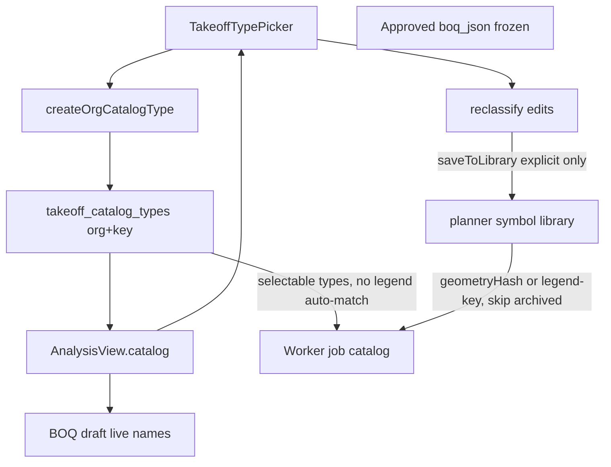

# קטלוג אביזרים ארגוני בכתב כמויות

תוכנית מימוש בלבד עד אישור הרצה נפרד. אין קוד, SQL, Commit, Push או Deploy בסבב הזה. כלי אבחון ה־401 נשאר בהמתנה בנפרד.

עותק יחיד: `.cursor/plans/takeoff_org_custom_catalog.plan.md`

הבהרות 1–3 להלן סגורות ומחייבות במימוש. שאר דרישות התוכנית בעינן.

## מה כבר קיים — מרחיבים, לא בונים מחדש

התשתית כמעט מוכנה. החסר הוא מוצר: ממשק, כללי כפילות/ארכוב בטוח, הרשאה מדויקת, ושיגור קטלוג ל־Worker **בלי למידת סיווג לא מכוונת**.

- קטלוג מערכת: [`src/modules/electrical-takeoff/domain/catalog.default.json`](src/modules/electrical-takeoff/domain/catalog.default.json) — 84 סוגים, `key` יציב (למשל `control.switch.single`), `nameHe` לתצוגה. קטגוריית מפסקים = `control` («מפסקים»).
- מיזוג ארגוני: טבלה `takeoff_catalog_types` (מיגרציה 0205), `loadCatalogForOrg` ב-[`get-analysis-view.ts`](src/modules/electrical-takeoff/application/get-analysis-view.ts), `mergeCatalog` ב-[`catalog.ts`](src/modules/electrical-takeoff/domain/catalog.ts).
- API קיים בלי UI: `listCatalog` / `saveCatalogType` ב-[`use-cases.ts`](src/modules/electrical-takeoff/application/use-cases.ts) + [`actions.ts`](src/modules/electrical-takeoff/actions.ts) + [`api-binding.ts`](src/modules/electrical-takeoff/ui/api-binding.ts).
- בוחר סוג: [`takeoff-type-picker.tsx`](src/modules/electrical-takeoff/ui/takeoff-type-picker.tsx) — חיפוש + שבבי קטגוריה; אין «הוסף אביזר».
- סיווג: `reclassify` / `saveToLibrary` / `save_legend` דרך `applyEdits`. היקף מופע/קבוצה/ספרייה כבר קיים במסך בקרה ובגיליון.
- תצוגה וייצוא כבר לפי `nameHe` של הקטלוג הממוזג: כמויות, בקרה, XLSX, PDF. ניתוח **מאושר** שומר `takeoff_approvals.boq_json`.

דוגמת 3643 («לחצן חדר מדרגות» תחת מפסקים) היא **בדיקת קבלה**, לא סוג מקודד. אותו מסלול לכל קטגוריה.

## החלטות סגורות לפני מימוש

### 1. הוספת שם לקטלוג אינה למידת סיווג

הוספת סוג ארגוני עושה אותו **זמין לבחירה ידנית** בכל פרויקטי הארגון. היא **אינה** אישור לסווג אוטומטית סמלים בקבצים אחרים, בניתוחים אחרים, או לפי שם בלוק זהה.

מקורות סיווג אוטומטי נשארים רק אלה שכבר קיימים:

- מקרא מובנה: התאמת `keywordsHe` של **סוגי מערכת** (`builtIn`) לפי `legend_map` הקיים, כולל דילוג על סתירה (`uncertain_legend_signatures` / `legendConflictOnDetection`).
- ספריית מתכנן: רק אחרי `saveToLibrary` / `save_legend` מפורשים, עם `takeoff.library.manage`, ורק לפי `geometryHash` זהה או `legend-key` של טקסט מנורמל — לא לפי שם בלוק בלבד.

בסבב הזה סוג מותאם **לא נכנס להתאמת מקרא אוטומטית**:

- `keywordsHe` של סוג מותאם חדש נשמר **ריק** (או לא בשימוש ב־Worker). אין למלא `[nameHe]` כברירת מחדל לשיגור, כדי שמשפט המקרא לא יהפוך לסוג בלי אישור.
- בשיגור עבודה: הקטלוג ל־Worker הוא מובנה + סוגים מותאמים **פעילים**, עם `keywordsHe` מרוקן למותאמים. כך ה־Worker מכיר את המפתח אם הספרייה מצביעה עליו, בלי `match_legend_text` על השם החדש.
- אין לשנות את מנוע מניעת סיווגי השווא (סתירת מקרא, אי-החלת ספרייה על סתירה, `geometryHash`).
- שיפור עתידי של התאמת מקרא לסוגים מותאמים יישאר אפשרי (למשל דגל מפורש `legendAutoMatch` או מילות מפתח באישור נפרד) בלי להחליש את מנגנון הסתירה. **לא בסבב הזה.**

הוספה מתוך הבוחר בוחרת את הסוג בשדה הנוכחי בלבד. החלת הסיווג נשארת ב«החל סיווג» / «אישור», עם היקף מופע / קבוצה / ספרייה כמפורט בסעיף 6.

### 2. שינוי שם, כתבי כמויות קיימים, וארכוב

`typeKey` לא משתנה. אין `UPDATE` לזיהויים, לעריכות או ל־`boq_json` בגלל שינוי שם או ארכוב. אין שינוי ספירה גיאומטרית.

**שינוי שם תצוגה (`nameHe` על אותו מפתח):**

- **טיוטה / בעיבוד / בבקרה:** המסכים והייצוא החיים פותרים תווית לפי הקטלוג הנוכחי. שינוי שם מתעדכן מיד בכתב הכמויות הפתוח, בלי דריסת `typeKey`.
- **מאושר:** התוויות קפואות לפי `takeoff_approvals.boq_json` שנשמר באישור. צפייה וייצוא של ניתוח מאושר משתמשים בתוויות ה־snapshot, לא בשם החדש. אין לשכתב את ה־snapshot. אחרי פתיחה מחדש (`reopen`) החישוב חוזר לקטלוג החי.
- סיווגים שמורים לא נדרסים. רק מחרוזת התצוגה בטיוטה משתנה.

**ארכוב סוג מותאם:**

- ארכוב רך בלבד. אין מחיקת שורה. `archived: true` בטבלה וב־payload.
- הסוג נשאר ב־`loadCatalogForOrg` לצורך פתרון תווית היסטורית (טיוטה עם `typeKey` הזה, וגם שורות ב־snapshot שכבר מכילות `label`).
- נעלם מהבוחר ומהפילטרים, חוץ מסוג שכבר נבחר בשדה הנוכחי.
- **לא נשלח** ל־Worker כסוג פעיל, ו־`keywordsHe` שלו לא רלוונטי.
- **ספרייה:** `symbolLibraryForWorker` מדלג על רשומות ש־`type_key` שלהן בארכיון בארגון. אישור ישן בספרייה **לא** מחיל את הסוג בניתוח חדש כל עוד הוא בארכיון. השורה בספרייה לא נמחקת; אחרי שחזור הסוג, כללי הספרייה הקיימים חוזרים לחול (כולל `geometryHash`).
- `persistLibraryFromReclassify` דוחה שמירה לסוג בארכיון.
- שחזור מותר רק אם אין כפילות שם פעילה.

### 3. הרשאות מול Service Role, וכפילות במקביל

כתיבה ל־`takeoff_catalog_types` היום עוברת `asServiceRoleWrite` ולכן **עוקפת RLS**. ההרשאה חייבת להיאכף **באפליקציה לפני** כל כתיבה, לא להסתמך על המדיניות בלבד.

- `create` / `update` / `archive` / `restore`: `assert` ל־`takeoff.library.manage` (פנימי) או `ext.takeoff.library.manage` (קבלן) **לפני** `asServiceRoleWrite`. בלי הרשאה — אין upsert. היום `saveCatalogTypeUseCase` מקבל גם `takeoff.manage`; לצמצם.
- אין מסלול כתיבה אחר (action, repository ישיר מהלקוח, mock פרודקשן) שמדלג על ה־assert.
- יישור RLS ב־0216 (כתיבה = `takeoff.library.manage`) הוא הגנה שנייה למשתמש authenticated; הוא **לא** תחליף ל־assert מול service role.

**כפילות שם:**

- בדיקת UX מקדימה מול הקטלוג הממוזג הפעיל (מובנים + מותאמים, שם מנורמל: NFC, trim, רווחים כפולים).
- בנוסף, אחרי מיגרציה 0216: עמודה `name_norm` (השרת כותב את אותו נירמול) + אינדקס ייחודי `(organization_id, name_norm) WHERE archived = false`. יצירה מקבילית עם אותו שם נכשלת ב־unique violation; ה־use-case מחזיר שגיאת כפילות בעברית.
- באותה טרנזקציית כתיבה: `pg_advisory_xact_lock` לפי ארגון, כדי שמרוץ מותאם-מול-מובנה (שאין לו שורת DB) גם יישאר סדרתי.
- כפילות מול שם מובנה נבדקת באפליקציה תחת אותו מנעול; כפילות מותאם-מול-מותאם גם באינדקס.

## כללי מוצר

1. **מזהה יציב ≠ שם תצוגה.** `typeKey` לא משתנה בשינוי שם. ניתוחים, עריכות, ספרייה ואישורי BOQ ממשיכים לפי המפתח.
2. **סוג מובנה:** מותר רק שם תצוגה ארגוני על אותו `key`. אין שינוי `catalog.default.json` ואין מחיקה/ארכוב של סוג מערכת.
3. **סוג מותאם:** מפתח חדש בשרת בלבד: `custom.{category}.{12hex}`. `role` לפי קטגוריה (`fixture` לתאורה, `linear` לכבל/תעלות, `equipment` ללוחות, אחרת `device`). צבע מקטגוריה קיימת. `keywordsHe` בסבב זה ריק ולא משמש להתאמת מקרא.
4. **כפילות:** שם מנורמל ייחודי בארגון בין סוגים פעילים, כולל שמות מובנים, עם אינדקס + מנעול כמפורט בהחלטה 3.
5. **ארכוב בלבד** למותאמים, לפי החלטה 2. אין מחיקה קשיחה.
6. **היקף סיווג** נשאר כמו היום, בלי הרחבה לקבצים אחרים:
   - מופע בודד.
   - קבוצה בניתוח הנוכחי רק בסימון מפורש; ברירת מחדל בקבוצה **כבויה** כשיש סתירת מקרא (`legendConflictOnDetection`).
   - שמירה לספרייה רק עם `takeoff.library.manage` + סימון מפורש + גבולות `geometryHash` / `legend-key` הקיימים. אין החלה לפי שם בלוק זהה בלבד. הוספת סוג לקטלוג **אינה** שמירה לספרייה.
7. **ניתוחים ישנים:** אין ריצה מחדש, אין דריסת `typeKey`. תווית חיה בטיוטה; קפואה במאושר. ארכיון לא מוחק היסטוריה.
8. **עבודות Worker חדשות:** קטלוג ממוזג פעיל בלי ארכיון, בלי `keywordsHe` למותאמים, בלי רשומות ספרייה לסוג בארכיון. בלי שינוי מנוע DWG, זיהוי, XREF או שיוך גיליונות.

## נתונים ומיגרציה

**אין טבלה חדשה.** `takeoff_catalog_types` + uniqueness `(organization_id, key)` + RLS org כבר קיימים.

שינויי אפליקציה חובה:

- לאחד `loadCatalogForOrg` / `listCatalogUseCase` / `mergeCatalog`: סוגים בארכיון **נשארים** במפה עם `archived: true` (היום `loadCatalogForOrg` מוחק אותם — זה שובר תוויות היסטוריות).
- הבוחר והפילטרים מדלגים על `archived`, חוץ מהסוג שכבר נבחר.
- יצירת סוג: השרת מקצה `key`; הלקוח שולח `category` + `nameHe` בלבד.
- עריכה: `key` קיים + `nameHe` / `archived`. אסור להחליף מפתח מובנה במפתח חדש. אין חשיפת עריכת `keywordsHe` למותאמים בסבב זה.
- כפילות: בדיקה + `name_norm` + advisory lock, כמפורט בהחלטה 3.
- `symbolLibraryForWorker` / `persistLibraryFromReclassify`: דילוג / דחייה על `typeKey` בארכיון.
- צפייה/ייצוא מאושר: לקרוא תוויות מ־`boq_json` ולא לחשב מחדש מ־catalog חי.

**מיגרציית SQL מתוכננת, לא לריצה עד אישור נפרד:**

- קובץ הבא אחרי 0215, למשל `0216_takeoff_catalog_types_library_write.sql`.
- תוכן:
  - החלפת מדיניות הכתיבה של `takeoff_catalog_types` מ־`takeoff.manage` ל־`takeoff.library.manage`.
  - עמודה `name_norm text` (nullable עד backfill של שורות קיימות, אם יש; בארגון ריק אפשר `NOT NULL` עם default `''` רק לשורות חדשות — בפועל השרת תמיד יכתוב). אינדקס ייחודי חלקי `(organization_id, name_norm) WHERE archived = false AND name_norm <> ''`.
- בלי נגיעה בניתוחים, בלי דריסת `boq_json`.
- אחרי הכנת הקובץ: דוח `SQL / MIGRATION PREPARED` ועצירה. אישור מימוש הקוד **אינו** אישור להריץ SQL.

## הרשאות ושלושה משטחים

אין הרשאה חדשה. אין שער לפי `employeeApp` / `external`.

- צפייה בשמות (כולל מותאמים): `takeoff.view` / `ext.takeoff.view` — כבר ב־`AnalysisView.catalog`.
- שינוי סיווג: `takeoff.manage` / `ext.takeoff.manage` — `canEdit` הקיים.
- הוספה / עריכת שם / ארכוב קטלוג: **רק** `takeoff.library.manage` / `ext.takeoff.library.manage` (`canManageLibrary`), עם assert לפני service role (החלטה 3).
- משתמש עם `manage` בלי `library.manage` בוחר סוגים קיימים (כולל מותאמים שכבר נוספו) אך לא יוצר/עורך קטלוג.
- רכיב אחד: `TakeoffTypePicker` (+ דיאלוג הוספה/עריכה). מעטפת המשטח רק מזרימה `view.permissions`.
- עדכון שורה במטריצה [`docs/product/electrical-takeoff-three-surface-parity-matrix.md`](docs/product/electrical-takeoff-three-surface-parity-matrix.md): ניהול קטלוג אביזרים ארגוני = אותה יכולת בשלושת המשטחים מאחורי `takeoff.library.manage`.

## ממשק

בתוך הבוחר הקיים, בלי מסך הגדרות נפרד ובלי גלילה אופקית במובייל (chips ב־`flex-wrap`, דיאלוג `max-w-[100vw] overflow-x-hidden`, עברית RTL כבר ב־`TakeoffShell`).

- כפתור «הוסף אביזר חדש» כשיש `canManageLibrary` ואינו `readOnly`. אם נבחרה קטגוריה (לא «הכל») היא ממולאת מראש; אחרת חובה לבחור קטגוריה בדיאלוג.
- חיפוש בלי תוצאה: קישור «הוסף "{query}"» לאותו דיאלוג.
- חיפוש ב־`nameHe` ו־`key`; `keywordsHe` של מובנים נשאר לחיפוש. אין להציג מילות מפתח כמסלול למידה למותאם.
- עריכת שם מותאם: פעולה ליד הסוג הנבחר. לסוג מובנה: «שם תצוגה בארגון» בלבד.
- אחרי שמירה: הסוג החדש נבחר מיד בבוחר; החלת הסיווג נשארת ב«החל סיווג» / «אישור» הקיימים. סימון «שמור לספרייה» נשאר פעולה נפרדת.
- אותו בוחר גם במקרא שלא פוענח ב-[`takeoff-workspace.tsx`](src/modules/electrical-takeoff/ui/takeoff-workspace.tsx) (להחליף את ה־`<select>` השטוח).
- מחרוזות ב־`src/locales/he-IL/takeoff.json` ועותקי en/ar/ru שנגעו בהם.

## תצוגה, כמויות, ייצוא

אין שינוי במנוע כמויות או במספור.

- טיוטה: [`boq-display.ts`](src/modules/electrical-takeoff/ui/boq-display.ts) / [`boq-engine.ts`](src/modules/electrical-takeoff/domain/boq-engine.ts) פותרים `nameHe` חי.
- מאושר: תוויות מ־`boq_json` (החלטה 2). XLSX/PDF של ניתוח מאושר מאותו snapshot.
- סוג בארכיון עדיין מוצג בשורות טיוטה לפי `nameHe` השמור ב־payload, ובמאושר לפי ה־snapshot.

## מחוץ לסבב

- מנוע DWG, זיהוי גיאומטרי, XREF, שיוך גיליונות, צופי WASM.
- הוספת «לחצן חדר מדרגות» לקטלוג הגלובלי.
- התאמת מקרא אוטומטית לסוגים מותאמים (`legendAutoMatch`).
- חקירת/פריסת 401, החלפת קונטיינר Worker, Commit/Push/Deploy, הרצת SQL.
- הרשאות/secrets חדשים, קטגוריות enum חדשות, מנגנון ספרייה מקביל.

## בדיקות קבלה ממוקדות

- דומיין: מפתח יציב; שינוי שם לא מחליף `key`; כפילות נדחית; ארכוב נשאר ב־merge לתצוגה ונעלם מהבוחר; override מובנה לא משנה JSON מערכת.
- אין למידה: אחרי יצירת סוג מותאם, שיגור Worker עם `keywordsHe` ריק למותאם; `match_legend_text` לא מחזיר את המפתח החדש ממשפט זהה; בלי `saveToLibrary` קובץ שני של אותו מתכנן נשאר בלי הסוג האוטומטי.
- ספרייה+ארכיון: רשומת ספרייה קיימת לסוג בארכיון לא נשלחת ל־Worker ולא מוחלת בניתוח חדש; אחרי שחזור — כללי hash/legend-key הקיימים בלבד.
- מאושר: שינוי `nameHe` לא משנה תוויות ב־`boq_json` ולא בייצוא של ניתוח מאושר; בטיוטה התווית מתעדכנת.
- הרשאות: בלי `library.manage` ה־use-case נכשל לפני הכתיבה גם אם ה־DB הוא service role; `manage` בלי ספרייה לא כותב קטלוג; ארגון ב' לא רואה סוג של א'; קבלן/עובד עם אותה הרשאה כן.
- כפילות מקבילית: שני create עם אותו שם — אחד מצליח, השני שגיאת כפילות (אינדקס / מנעול).
- UI: הוספה ממפסקים → בחירה מיידית בלי שמירת ספרייה; חיפוש ריק → הוספה; מקרא משתמש באותו בוחר; מובייל בלי גלילה אופקית.
- סיווג: מופע / קבוצה / ספרייה כמפורט; סתירת מקרא לא מחילה קבוצה אוטומטית.
- שיגור: אין שינוי במספר הזיהויים הגיאומטריים.
- רגרסיה: אין דריסת ניתוח ישן; `typeKey` שמור נשאר.

דוגמת זהב ידנית אחרי מימוש (לא בסבב התוכנית): בניתוח כמו 3643, תחת מפסקים להוסיף «לחצן חדר מדרגות», לסווג מופע, לראות בכמויות, לפתוח ניתוח אחר באותו ארגון ולמצוא את השם **לבחירה** בלי סיווג אוטומטי, לוודא שארגון אחר בלי השם.

## הפעלה אחרי אישור מימוש נפרד

1. לממש לפי התוכנית (בלי 401).
2. בדיקות ממוקדות בלבד.
3. להכין 0216, לדווח `SQL / MIGRATION PREPARED`, לעצור.
4. Commit / Push / Deploy / החלפת Worker / ניתוח DWG / הרצת SQL — רק באישור נפרד לכל אחד.
