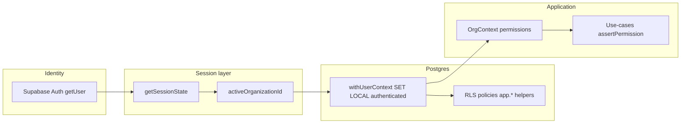

# AGENT 01 — Architecture, Database, Tenancy, RLS, Auth & Security Boundaries

| Field | Value |
|--------|--------|
| **Audit date** | 2026-10-11 |
| **Repository** | `projectflow` |
| **Inspected commit** | `35e2ff0f7f12d0a3ec94ea0aed23b8c97b6bb00e` |
| **Commit message** | `test: expect migration 0179 as latest in journal unit test` |
| **Domain** | Drizzle schema, migrations (through `0179_connected_projects`), org tenancy, RLS, Supabase Auth, app permissions, API/worker boundaries |
| **Method** | Static code + SQL review, targeted greps, `npm run db:check-journal`, `vitest` migration-journal unit test. **No** SQL execution, **no** production DB/PostgREST probes, **no** app code changes. |
| **Production** | **NOT VERIFIED** (no Owner DB read, no live RLS bypass test on shared Supabase). |

---

## 1. Executive summary

ProjectFlow’s security architecture is **deliberately layered**: Supabase Auth holds identity only; **organizations are the tenant boundary**; every browser/server mutation is expected to run through an **RLS-bound** `OrgContext.db` executor (`withUserContext` → `SET LOCAL role authenticated` + `app.user_id`); permissions are **application-defined** (`permissions` catalog + org roles) with increasing **SQL parity** via `app.has_org_permission`, `app.has_project_permission`, and `app.can_access_project` (notably `0051`, `0073`, `0174`).

**Repo health (static):** Migration journal parity is **green** at **178 SQL files**, last tag **`0179_connected_projects`**. Schema surface is large (**~360 `pgTable` definitions**, **48 `pgEnum`** across **67** schema modules).

**Primary risk (external):** **24 migrations** in-repo carry **`PREPARED ONLY — Owner applies after review`**, including security-sensitive **`0174_audit_events_contracts_select_rls`**, **`0173_force_rls_five_tables`**, and cross-org **`0179_connected_projects`**. Without Owner confirmation that Production `schema_migrations` matches repo HEAD, **RLS and schema in Production are NOT VERIFIED** and may still reflect pre-0174 policies (e.g. membership-only `audit_events` SELECT from `0001_rls_security.sql`).

**Confidence:** **High** for documented patterns and journal parity; **medium-low** for “Production matches repo”; **high** that PGlite integration tests (when run in CI) enforce post-0174 RLS semantics for audit/contracts.

---

## 2. Evidence executed (this agent)

| Check | Command / artifact | Result | Confidence |
|--------|-------------------|--------|------------|
| Journal parity | `npm run db:check-journal` | `journal parity ok { files: 178, last: '0179_connected_projects' }` | **VERIFIED** |
| Journal unit rules | `npx vitest run tests/unit/database/migration-journal.test.ts` | **12/12 pass** | **VERIFIED** |
| HEAD SHA | `git rev-parse HEAD` | Matches `35e2ff0f…` | **VERIFIED** |
| Schema counts | Node scan `drizzle/schema/*.ts` | 67 files, 360 `pgTable`, 48 `pgEnum` | **VERIFIED** |
| RLS EXEC (referenced, not re-run) | `tests/integration/audit-verification/rls-permission-gaps.test.ts` | Documents SEC-001/002/003/006 expectations for **0174** helpers | **SUSPECTED green in CI** if full migration chain applied to test DB |

---

## 3. Drizzle schema map

### 3.1 Entry point and conventions

- **Barrel:** `drizzle/schema/index.ts` — `server-only`; re-exports all domain modules (Lead-owned; modules consume via repositories).
- **Shared helpers:** `drizzle/schema/_shared.ts` (`primaryId`, `timestamps`, money/currency helpers).
- **Tenancy contract:** `drizzle/schema/tenancy.ts` documents **`organization_id NOT NULL`** on tenant-owned tables + RLS (docs 72–73).

### 3.2 Module inventory (tables by schema file)

| Schema module | ~Tables | Primary domain |
|---------------|--------:|----------------|
| `identity.ts` | 2 | `profiles`, `user_preferences` (active org preference) |
| `tenancy.ts` | 8 | Organizations, memberships, invitations, module prefs, saved views |
| `rbac.ts` | 4 | Global `permissions`, org `roles`, `role_permissions`, `role_assignments` (`project_id` nullable) |
| `audit.ts` | 1 | Append-only `audit_events` |
| `projects.ts`, `clients.ts`, `vendors.ts`, `contracts.ts`, `changes.ts` | 6–3 each | Core PM/commercial graph |
| `expenses.ts`, `ap.ts`, `billing.ts`, `billing-plans.ts`, `tax.ts`, `banking.ts`, `ops-finance.ts` | 1–8 | Financial actuals, AR/AP, tax, banking |
| `workforce.ts`, `employee-app.ts` | 12, 4 | Time, attendance, employee app grants |
| `tasks.ts`, `workspaces.ts`, `planning.ts` | 25, 7, 2 | UWM tasks/boards/workspaces |
| `boq.ts`, `procurement.ts`, `field-ops.ts` | 10–11 | BOQ, PO, field ops |
| `platform-ops.ts`, `dg-*` (15 files) | 5–10 each | Developer/GC track: claims, RFI, submittals, coordination, field, safety, etc. |
| `connected-projects.ts` | 4 | Cross-org Mode B (mirrors `0179`) |
| `portal.ts`, `dg-external-identity.ts` | 4+4 | Contractor principals, external identity |
| `api-platform.ts`, `external-storage.ts`, `invoicing-integration.ts`, `ocr.ts`, `quick-capture.ts` | 1–4 | Integrations & platform |
| `next-gen.ts`, `next-gen-ops.ts`, `next-gen-experience.ts` | 14–15 | Experience / ops extensions |
| `enums.ts` | — | **48** `pgEnum` definitions (status vocabularies, cost families, etc.) |

**Relations:** Declared via Drizzle `relations()` in schema files (e.g. `rbac.ts`, `tenancy.ts`) for ORM graph navigation; **FK enforcement** is in SQL migrations (composite `(id, organization_id)` FKs common on financial/DG tables).

### 3.3 Schema hygiene note

- **`drizzle/schema/index.ts`** exports `./connected-projects` **twice** (lines 34 and 78). Harmless at runtime (duplicate export) but confusing for integrators — see **A01-006**.

---

## 4. Migrations review (0000 → 0179)

### 4.1 Journal facts

| Metric | Value |
|--------|--------|
| Journal entries | **178** (idx 0–177) |
| First tag | `0000_foundation` |
| Last tag | **`0179_connected_projects`** |
| Numeric gap | No `0003_*` file (0002 → 0004) — historical, journal consistent |

### 4.2 Thematic timeline (selected)

| Range | Representative tags | Security / tenancy relevance |
|-------|---------------------|------------------------------|
| 0000–0006 | foundation, **`0001_rls_security`**, **`0006_rls_hardening`** | Baseline RLS, `app.is_org_member`, append-only audit |
| 0050–0051 | wave3 ops, **`0051_review_integrity_closure`** | `app.can_access_project`, project-column RLS helpers |
| 0070–0073 | financial classification, **`0073_financial_rls_permission_gates`** | Permission-gated financial table policies |
| 0088–0124 | employee app, storage RLS, **`0124_employee_operational_rls_alignment`** | Employee vs owner DB semantics |
| 0149–0179 | DG wave + UWM + **`0174`**, **`0173`**, **`0179`** | GC capabilities, audit/contracts RLS fix, FORCE RLS, **cross-org connected projects** |

### 4.3 `0179_connected_projects` (static review)

- **Purpose:** Developer org issues hashed connection codes; contractor org links projects; certified claim NET flows to contractor cash projections.
- **Tables:** `engagement_connection_invitations`, `connected_project_mappings`, `cross_org_sync_outbox`, `connected_claim_cash_projections`.
- **RLS model:** Strict org isolation; **authenticated** mostly **SELECT** on own side; **DML on secrets/outbox/projections via `service_role` only** (see migration §5).
- **Status:** Header **`PREPARED ONLY`** — schema/RLS in repo **NOT VERIFIED** on Production until applied.

### 4.4 PREPARED ONLY migrations (Owner apply gate)

**24 files** contain `PREPARED ONLY` (including **`0174`**, **`0173`**, **`0179`**, and DG **`0155`–`0167`** subset). These are **additive in intent** but **Production apply state is NOT VERIFIED** by this agent.

---

## 5. RLS policies — where they live and how they work

### 5.1 Canonical location

| Layer | Location | Role |
|-------|----------|------|
| **Policies & grants** | `drizzle/migrations/*.sql` | `ENABLE/FORCE ROW LEVEL SECURITY`, `CREATE POLICY`, `REVOKE`/`GRANT` |
| **SQL helpers** | Same migrations, `app.*` functions | `SECURITY DEFINER`, `STABLE`; e.g. `has_org_permission`, `can_access_project`, `has_project_capability` |
| **Runtime identity** | `src/shared/db/client.ts` | `withUserContext`: `request.jwt.claim.sub`, `app.user_id`, `SET LOCAL role authenticated` |
| **Contractor DB** | `src/modules/contractor-access/data/rls-executor.ts` | Separate external principal binding (not `OrgContext`) |

Grepping `CREATE POLICY` across migrations yields **hundreds** of policies (BOQ, UWM, DG, financial gates). **There is no separate `supabase/policies` tree** — Postgres RLS is **migration-authoritative**.

### 5.2 Baseline vs hardened SELECT (audit / contracts)

**Expected (product):** Org members **without** `audit.read` / `contracts.read` cannot read sensitive rows, including via raw SQL/PostgREST.

**Actual in `0001_rls_security.sql` (baseline until overridden):**

```383:385:drizzle/migrations/0001_rls_security.sql
CREATE POLICY audit_events_member_select ON public.audit_events
  FOR SELECT TO authenticated
  USING (organization_id IS NOT NULL AND app.is_org_member(organization_id));
```

**Remediation in repo (not Production-verified):** `0174_audit_events_contracts_select_rls.sql` replaces SELECT policies to require `app.has_org_permission(..., 'audit.read')` and contracts.read + project access / `has_project_permission`.

**Integration proof (when test DB applies full chain):** `tests/integration/audit-verification/rls-permission-gaps.test.ts` expects **0 rows** for under-privileged raw `SELECT` — see **A01-002**, **A01-003**.

### 5.3 Financial and project capability gates

- **`0073_financial_rls_permission_gates.sql`** — large policy set tying financial mutations/reads to permission keys (aligns with app `assertPermission`).
- **`0051_review_integrity_closure.sql`** — project access mode, `can_access_project`, generic project-parent RLS applicators.
- **DG modules (0163+)** — policies reference `app.has_project_capability` for RFI/submittals/etc.

---

## 6. Org tenancy and organization switching

### 6.1 Resolution pipeline

```text
Supabase getUser() → loadCachedSessionDb → preferred org id (user_preferences)
  → validate membership in session list → activeOrganizationId
withOrgContext / runInOrgContext → withUserContext(userId) → resolveOrgContext (membership + loadEffectivePermissions)
  → optional scopeOrgContextToProject(projectId) [0174 app parity comment in session.ts]
  → optional enrichOrgContextWithEmployeeApp
```

**Key files:**

- `src/shared/auth/session.ts` — `getSessionState`, `withOrgContext`, `setActiveOrganization`, nested tx frame + authz memoization.
- `src/modules/tenancy/application/resolve-org-context.ts` — **re-checks active membership every request**; URL/cookie is never proof of tenancy.
- `src/modules/identity/application/ensure-profile.ts` — `setActiveOrganizationPreference` in `user_preferences`.

### 6.2 Switching UX

- UI: `src/components/shell/organization-switcher.tsx` → `switchOrganizationAction`.
- Server: `src/shared/auth/actions.ts` → `setActiveOrganization` → membership allow-list → preference write → `revalidateTag` session + org authz caches → redirect home.

**Expected:** User cannot switch into an org they do not belong to.  
**Actual:** `setActiveOrganization` throws `AuthenticationRequiredError` if org ∉ `session.memberships` — **VERIFIED** in `session.ts`.

---

## 7. Server actions, route handlers, and authorization patterns

### 7.1 Pattern summary

| Surface | Typical gate | Notes |
|---------|--------------|-------|
| Owner `(app)/*` server actions | `withOrgContext` wrapper + use-case `assertPermission` / domain checks | Hundreds of call sites; **dominant pattern** |
| Employee shell pages | `authorize(context, { permission, resource? })` from `src/shared/permissions/authorize.ts` | Employee-aware project/document scope |
| Project routes | `withProjectOrgContext` / `{ projectId }` option | Merges project-scoped role permissions |
| API `/api/v1/*` | `requireApiKeyAuth` + `withApiKeyOrgContext`; **rejects client org override** | See `src/app/api/v1/projects/route.ts` |
| User-facing API (storage, PDFs) | `requireSession` + `runInOrgContext(session.user.id, session.activeOrganizationId, …)` | Session-bound tenant |
| Internal workers | `isInternalWorkerAuthorized` → Bearer `CRON_SECRET` / `OCR_WORKER_SECRET` | Fails closed if secret unset |
| Contractor portal | `requireExternalContext()` → **`ExternalContext`**, never `OrgContext` | `src/modules/contractor-access/application/session.ts` |

### 7.2 Grep inventory (authorize / org context)

| Pattern | Approx. prevalence (static) |
|---------|----------------------------|
| `withOrgContext(` | **473+** files under `src/` (pages, actions, modules) |
| `await authorize(` | **Concentrated in employee `(shell)` pages** (~7 page files); not the owner-app primary gate |
| `assertPermission` / `requirePermission` | **385+** files in application/use-case layer |
| `requireOrgRow` | Safety module tenant guard (`src/modules/safety/domain/scope.ts`) — pattern for org-id row checks |

**Assessment:** Architecture **intentionally** keeps **`authorize()`** in shared layer for employee flows while owner app standardizes on **`assertPermission` in use-cases** — **VERIFIED**; consistency is maintained by catalog keys, not a single function name (**A01-010**).

### 7.3 Privileged executors (boundary)

- **`getAdminDb()`** — migrations, API key lookup, workers, some invitation/portal paths; must **never** serve arbitrary user requests without explicit org targeting.
- **`set local role service_role`** — e.g. `src/modules/external-storage/data/storage-admin-write.ts`, test seeds, worker drains.

**Expected:** Admin paths are narrow and org-scoped in application code.  
**Actual:** Documented in `client.ts`; wide call graph — **SUSPECTED** mis-use risk on new features without review (**A01-011**).

---

## 8. Supabase integration

| Concern | Implementation | Status |
|---------|----------------|--------|
| Auth provider | `@supabase/ssr` server client; **`getUser()` only** (not `getSession()` for identity) | **VERIFIED** `src/shared/supabase/server.ts` |
| Session refresh | `src/shared/supabase/middleware.ts` — cookie refresh on matched routes | **VERIFIED** static |
| Authorization | **Not** Supabase RLS on auth tables for app data; Postgres RLS on business tables via app user id | **VERIFIED** design |
| Config gating | `isSupabaseConfigured()` / `isDatabaseConfigured()` → setup/anonymous flows | **VERIFIED** `session.ts` |

**Region / pooler:** Not changed in this audit (Owner policy: `eu-west-1`, Vercel `dub1`).

---

## 9. Findings registry (A01-xxx)

| ID | Severity | Title | Expected | Actual | Status |
|----|----------|-------|----------|--------|--------|
| **A01-001** | **BLOCKER** (Production) | Production migration apply state vs repo HEAD | Production `schema_migrations` includes through **`0179`** (or Owner-documented subset) | Only repo journal verified (**178** files); **24× PREPARED ONLY**; no Owner DB read | **NOT VERIFIED** (Production) |
| **A01-002** | **HIGH** | Audit events SELECT vs `audit.read` | Members without `audit.read` cannot `SELECT audit_events` | **`0001`** policy = membership only; **`0174`** fixes in repo | **SUSPECTED** gap on Production if 0174 not applied; **VERIFIED** gap in baseline SQL |
| **A01-003** | **INFO** | 0174 RLS fix covered by integration test | Under-privileged raw SELECT returns 0 rows | `rls-permission-gaps.test.ts` SEC-001/002 | **VERIFIED** (test spec); **NOT VERIFIED** Production |
| **A01-004** | **HIGH** | PREPARED ONLY migration backlog | Owner-reviewed apply before relying on DG/security features | **24** migrations flagged PREPARED ONLY incl. 0173/0174/0179 | **VERIFIED** static |
| **A01-005** | **INFO** | Migration journal integrity | Strict increasing idx/tags | `db:check-journal` + vitest **12/12** | **VERIFIED** |
| **A01-006** | **LOW** | Duplicate schema barrel export | Single export of `connected-projects` | `drizzle/schema/index.ts` exports module **twice** | **VERIFIED** |
| **A01-007** | **INFO** | Tenant boundary documentation | Org-scoped tables + RLS | `tenancy.ts` header + pervasive `organization_id` | **VERIFIED** |
| **A01-008** | **INFO** | Org switch membership enforcement | No cross-tenant switch | `setActiveOrganization` membership check + cache invalidation | **VERIFIED** |
| **A01-009** | **INFO** | Project-scoped RBAC SQL helpers | `has_project_permission` aligns with app project permission load | SEC-003 test in `rls-permission-gaps.test.ts` | **VERIFIED** (test spec) |
| **A01-010** | **MEDIUM** | Authorization API surface split | Consistent permission enforcement | Owner: `assertPermission`; Employee pages: `authorize()` | **VERIFIED** (by design); onboarding risk for new routes |
| **A01-011** | **MEDIUM** | Admin DB / service_role sprawl | Admin executor only on trusted, scoped code paths | Many modules import `getAdminDb()` / service_role | **SUSPECTED** review needed per new feature; pattern **VERIFIED** |
| **A01-012** | **INFO** | Internal worker authentication | Workers reject missing/ wrong Bearer secret | `internal-worker-auth.ts` returns false if env secret empty | **VERIFIED** |
| **A01-013** | **INFO** | Supabase identity hardening | Server uses validated user | `getSupabaseUser` → `auth.getUser()` | **VERIFIED** |
| **A01-014** | **INFO** | Contractor vs owner context separation | Contractor session cannot obtain `OrgContext` | `requireExternalContext` separate loader | **VERIFIED** |
| **A01-015** | **HIGH** | Cross-org Connected Projects (0179) | Cross-org writes only via trusted server; tenants isolated at RLS | SQL: authenticated **SELECT-only** on own side; outbox **service_role** | **VERIFIED** SQL; end-to-end provisioning/worker **NOT VERIFIED** |
| **A01-016** | **MEDIUM** | FORCE RLS on selected tables (0173) | Five tables FORCE RLS | Migration **`0173_force_rls_five_tables.sql`** PREPARED ONLY | **NOT VERIFIED** Production |
| **A01-017** | **MEDIUM** | Statutory PDF public share route | Token-bound share without broad data leak | `share/[token]/pdf` verifies token, then **`runInOrgContext` as org owner** via admin lookup | **VERIFIED** code path; token entropy / rate limits **NOT VERIFIED** |
| **A01-018** | **INFO** | Schema scale | Documented module ownership | ~**360** tables, **48** enums | **VERIFIED** |
| **A01-019** | **MEDIUM** | API v1 tenant binding | API key pins org; no header override | `assertNoClientOrganizationOverride` + `withApiKeyOrgContext` | **VERIFIED** static |
| **A01-020** | **LOW** | Default project access mode | Restrictive default for new orgs without setting | SEC-006 test: `app.project_access_mode` → **`selected`** when unset | **VERIFIED** (test spec) |

---

## 10. Cross-module handoffs (other audit agents)

| Topic | Hand to | Why |
|-------|---------|-----|
| **Production `schema_migrations` / PREPARED apply list** | Lead / Owner / **OPS agent** | **A01-001** blocks security sign-off for 0173/0174/0179 |
| **Financial RLS (`0073`) vs app permissions** | **Financial / FIN agent** | Permission-gated tables; overlap with SEC-010 style drift |
| **0179 connected projects provisioning, outbox worker, cash projections** | **Subcontracts / DG / Cash-flow agent** | Cross-org logic spans `connected-projects` module + claims/payables |
| **DG migrations 0155–0170 (mostly PREPARED)** | **DG / Field agent** | Large RLS surface (`has_project_capability`) |
| **Employee app RLS 0088, 0124, 0122** | **Employee / WF agent** | Distinct from owner `OrgContext` enrichment |
| **Statutory share token + owner impersonation** | **Integrations / SUMIT agent** | **A01-017** |
| **RLS integration tests** | **Security verification agent** | Re-run `rls-permission-gaps.test.ts` + tenant-isolation suites after Owner confirms 0174 applied |
| **Execution nav / GC profile URL gates (SEC-004 class)** | **Routes / UX agent** | App-layer gates beyond DB; not fully re-audited here |
| **Internal workers (`/api/internal/*`)** | **OPS / Cron agent** | Bearer secret rotation, Vercel cron exposure |

---

## 11. Architecture diagram (request path)



---

## 12. Conclusion

The **repository** presents a **coherent multi-tenant architecture**: Supabase for identity, Postgres RLS for data plane enforcement, and a **single `OrgContext` permission set** for application logic. Static checks confirm **migration journal parity through 0179**. The dominant **open security question** is not code structure but **deployment truth**: whether Production has applied **`0174`** and subsequent **PREPARED** migrations. Until Owner verifies DB apply state, treat **audit/contracts RLS**, **FORCE RLS (0173)**, and **cross-org connected projects (0179)** as **NOT VERIFIED** on Production even though fixes and tests exist in-repo.

---

*End of AGENT_01 report.*
