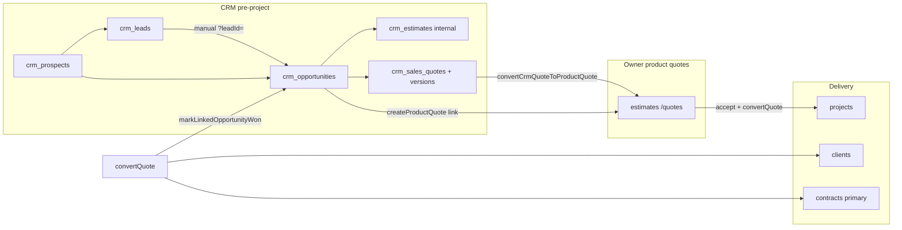

# AGENT 02 — CRM / Sales (Clients, Leads, Opportunities, Quotes, Contracts, Project Conversion)

| Field | Value |
|--------|--------|
| **Agent ID** | AGENT_02 |
| **Domain** | CRM / commercial pre-project → delivery handoff |
| **Audit date** | 2026-10-11 |
| **Repository** | `projectflow` |
| **Inspected commit** | `35e2ff0f7f12d0a3ec94ea0aed23b8c97b6bb00e` (matches `docs/audits/2026-10-full-system-audit/README.md` baseline) |
| **Mode** | **AUDIT ONLY** — no code changes, migrations, or commits |
| **Production UI / DB** | Not exercised (static + local PGlite integration only) |

---

## 1. Executive summary

ProjectFlow implements a **deliberate two-layer sales model**: CRM pipeline entities (`crm_*` tables) for prospects/leads/opportunities and optional **internal CRM sales quotes** (`crm_sales_quotes`), versus **owner product quotes** on the `estimates` table (`/quotes`). **Winning and creating Client + Project + primary Contract is authoritative only through an accepted product quote** (`convertQuote` in `src/modules/quotes/application/convert-quote.ts`), which then syncs the linked opportunity via `markLinkedOpportunityWon`.

**Strengths (verified locally):** Domain rules block manual `status: won`, CRM-only acceptance cannot spawn projects, idempotent conversion, CRM→product quote bridge prefers `acceptedVersionId`, and quote convert without `crm.manage` still marks opportunity won (CRM-001 regression tests pass).

**Gaps:** No CRM-dedicated tenant-isolation integration suite; employee CRM is opportunity-only; `/contracts` is an org list (contracts are created on project conversion, not as a standalone CRM step); **no Playwright journey for the full prospect→project chain**; orphan `convertWonOpportunityAction` (no UI consumer); stale schema field `salesQuoteVersionId` on `convertWonOpportunitySchema` that does not match product-quote conversion behavior.

**Finding count (this agent):** 2 HIGH-adjacent operational gaps, 6 MEDIUM, 5 LOW, 4 INFO — **17 IDs** (`C02-001` … `C02-017`).

---

## 2. Scope & method

| In scope | Out of scope |
|----------|----------------|
| Routes under `(app)/crm`, `(app)/clients`, `(app)/quotes`, `(app)/contracts`; employee CRM/quotes/clients/contracts shells | SUMIT billing, AR, post-project billing chain (downstream of contract) |
| Server actions: `crm/actions.ts`, `clients/actions.ts`, `quotes/actions.ts` | Contractor portal contract pages (subcontract agreements) |
| Modules: `src/modules/crm`, `clients`, `quotes`, `commercial` (contracts list) | Mutating production SQL |
| Drizzle schema: `drizzle/schema/crm.ts`, `clients.ts`, `contracts.ts`, `next-gen.ts` (`estimates`) | Full Playwright regression (not run) |

**Evidence executed this session**

| Command | Result |
|---------|--------|
| `npx vitest run --project unit tests/unit/crm tests/unit/quotes` | **62/62 pass** (13 files) |
| `npx vitest run --project integration tests/integration/crm tests/integration/audit-verification/crm-001-002-convert-edges.test.ts tests/integration/clients/tenant-isolation.test.ts` | **11/11 pass** (3 files) |

---

## 3. Business chain trace (Client → Lead → Opportunity → Quote → Contract → Project)

### Step-by-step (as implemented)

| Step | User/system action | Code / table | Notes |
|------|---------------------|--------------|-------|
| 1. Prospect | Create at `/crm/prospects` | `createProspect` → `crm_prospects` | Optional `converted_client_id` set later on win |
| 2. Lead | Create at `/crm/leads` | `createLead` → `crm_leads` | Optional `prospect_id`; statuses manual until win |
| 3. Opportunity | Create at `/crm/opportunities/new` or from lead link | `createOpportunity` → `crm_opportunities` | `leadId` / `prospectId` optional FKs |
| 4a. Internal estimate | Form on opportunity detail | `crm_estimates` | Internal costing; **not** the commercial bid |
| 4b. CRM sales quote | Form on opportunity detail | `crm_sales_quotes` + versions/lines | Version issue/accept; **does not** create contract |
| 4c. Bridge (optional) | “Convert to product quote” | `convertCrmQuoteToProductQuote` | Draft `estimates` row; `source_crm_quote_id` (migration 0135) |
| 5. Product quote | `/quotes/new?opportunityId=` or bridge | `createQuote` → `estimates` | Authoritative commercial document |
| 6. Accept | Quote lifecycle | `transitionQuoteStatus` → `accepted` | Required before conversion |
| 7. Convert | `/quotes/[id]` convert action | `convertQuote` | Creates project (+ client if needed), primary **contract** net from quote |
| 8. CRM sync | Automatic on convert | `markLinkedOpportunityWon` in `convert-quote.ts` | Sets opp `won`, links client/project/contract; marks lead/prospect converted |

**Alternate API path (no UI):** `convertWonOpportunity` (`src/modules/crm/application/convert-won-opportunity.ts`) wraps `convertQuote` when an accepted product quote exists for the opportunity — used in integration tests; **`convertWonOpportunityAction` has no UI caller** (see C02-012).

**Explicit guardrails (verified by tests):**

- Manual `updateOpportunity({ status: 'won' })` → `DomainRuleError` (`opportunity-quote-conversion-flow.test.ts` case C).
- Accepted CRM sales quote alone → `convertWonOpportunity` rejects (`case D`).
- Pipeline stage `won` in follow-up form does **not** set status won (`statusForMovedStage` returns `undefined` for `won`).

---

## 4. Route inventory

### 4.1 Owner `(app)`

| Area | Routes (`page.tsx`) | Module / view |
|------|---------------------|---------------|
| **CRM hub** | `/crm` | `CrmOpportunitiesHubView` (pipeline) |
| **Prospects** | `/crm/prospects`, `/crm/prospects/new`, `/crm/prospects/[prospectId]` | CRM shell + forms |
| **Leads** | `/crm/leads`, `/crm/leads/new`, `/crm/leads/[leadId]` | Lead detail + link to `opportunities/new?leadId=` |
| **Opportunities** | `/crm/opportunities/new`, `/crm/opportunities/[opportunityId]` | `CrmOpportunityDetailView` |
| **Clients** | `/clients`, `/clients/new`, `/clients/[clientId]` | `clients` module |
| **Quotes (product)** | `/quotes`, `/quotes/new`, `/quotes/[quoteId]`, `/quotes/settings` | `quotes` module (`estimates`) |
| **Contracts** | `/contracts` | `ContractsOrgListView` (`commercial` module) — **list only** |

**Server actions file:** `src/app/[locale]/(app)/crm/actions.ts` — prospect/lead/opportunity CRUD, CRM sales quote lifecycle, bridge, mark lost, **`convertWonOpportunityAction` (unused by UI)**.

**CRM surface routing helper:** `src/modules/crm/ui/crm-surface-routes.ts` — employee quotes base `/employee/quotes`, owner `/quotes`.

### 4.2 Employee `(shell)`

| Routes | Gap vs owner |
|--------|----------------|
| `/employee/crm`, `/employee/crm/opportunities/new`, `/employee/crm/opportunities/[opportunityId]` | **No** employee routes for prospects, leads, or in-app CRM sales quote forms |
| `/employee/clients`, `/employee/clients/new`, `/employee/clients/[clientId]` | Parity with owner list/detail |
| `/employee/quotes` | List entry; detail/create paths delegate to shared product-quote paths where wired |
| `/employee/contracts` | List |

Employee CRM actions: `src/app/[locale]/employee/(shell)/crm/actions.ts` — **create opportunity only**.

### 4.3 E2E coverage (CRM-specific)

| Spec | CRM chain coverage |
|------|-------------------|
| `tests/e2e/authenticated/project-centric-money-chain.spec.ts` | Redirect `/sales` → `/quotes`; **not** full CRM pipeline |
| `tests/e2e/audit/verification-route-*.spec.ts` | Route matrix personas; **no** dedicated CRM flow assertion found in grep |

**Status:** Owner CRM pages → **NOT VERIFIED** in browser this session.

---

## 5. Server actions & permissions (summary)

| Action surface | Key permissions |
|----------------|-----------------|
| CRM reads | `PERMISSIONS.CRM_READ` |
| CRM writes / pipeline | `PERMISSIONS.CRM_MANAGE` |
| Product quotes | `QUOTES_READ` / `QUOTES_MANAGE` |
| Convert quote → project | `QUOTES_MANAGE`, `PROJECTS_CREATE`, `PROJECTS_UPDATE`, `CONTRACTS_MANAGE` (+ `SERVICE_MANAGE` for work orders) |
| `convertWonOpportunity` | Above + `CLIENTS_MANAGE`, `CRM_MANAGE` |
| Clients | `CLIENTS_READ` / `CLIENTS_MANAGE` (via clients module) |

**Win sync without CRM manage:** Integration test proves `convertQuote` updates opportunity to `won` when actor has quotes/projects/contracts but not `crm.manage` — see C02-008.

---

## 6. Database model (CRM-relevant)

| Table | Purpose |
|-------|---------|
| `crm_prospects`, `crm_prospect_contacts` | Pre-client parties |
| `crm_leads` | Top-of-funnel; optional prospect link; catalog `lead_source_id` (migration 0060) |
| `crm_opportunities` | Pipeline; conversion FKs: `converted_client_id`, `converted_project_id`, `converted_contract_id`, `converted_at` |
| `crm_opportunity_notes` | Note log |
| `crm_estimates` | Internal opportunity estimates (**not** `estimates`) |
| `crm_sales_quotes`, `_versions`, `_lines` | Versioned CRM bids |
| `clients`, `client_contacts`, … | Post-sale party master |
| `estimates`, `estimate_line_items` | Product quotes; `opportunity_id`, `source_crm_quote_id` |
| `contracts`, `contract_value_events` | Primary contract on project; CCV events |

**RLS (CRM):** Migration `0009_wave2_foundations.sql` enables **org-member** policies on all `crm_*` tables (`app.is_org_member(organization_id)`). **No** `crm.read` / `crm.manage` predicate at DB layer (see C02-014).

**RLS (contracts):** `0051_review_integrity_closure.sql` — `app.apply_project_column_rls('contracts', 'project_id', …)` (project-scoped, not CRM-specific).

---

## 7. Test coverage matrix

| Layer | Location | Count (this domain) | Verdict |
|-------|----------|---------------------|---------|
| Unit CRM | `tests/unit/crm/*.test.ts` | 8 files, 35 tests | Domain rules, pipeline, conversion helpers |
| Unit quotes | `tests/unit/quotes/*.test.ts` | 5 files, 27 tests | Lifecycle, convert integrity, estimates table |
| Integration CRM flow | `tests/integration/crm/opportunity-quote-conversion-flow.test.ts` | 4 tests | **Core chain A–D** |
| Integration audit edges | `tests/integration/audit-verification/crm-001-002-convert-edges.test.ts` | 2 tests | Permission + version pick |
| Integration clients | `tests/integration/clients/tenant-isolation.test.ts` | 5 tests | Client RLS; **not** CRM entities |
| E2E | — | 0 CRM-dedicated | **Gap** (C02-007) |

---

## 8. Capability status (CRM sales slice)

| Capability | Status | Evidence |
|------------|--------|----------|
| Prospect / lead / opportunity CRUD | **PARTIAL** | Code + unit; UI **NOT VERIFIED** |
| Pipeline board + next action | **PARTIAL** | `pipeline-board.test.ts`, schema columns present |
| CRM sales quote versioning | **VERIFIED (engine)** | `sales-quote-version-rules.test.ts`, integration bridge |
| Product quote + accept + convert | **VERIFIED (integration)** | `opportunity-quote-conversion-flow.test.ts`, `convert-quote.ts` |
| Client + primary contract on convert | **VERIFIED (integration)** | Same; contract via `createProject` |
| CRM → product quote bridge | **VERIFIED (integration)** | CRM-002 test + flow B |
| Employee full CRM | **PARTIAL** | Opportunities only (C02-004) |
| Org contracts directory | **PARTIAL** | List view; creation tied to projects |
| End-to-end browser CRM chain | **NOT VERIFIED** | No spec (C02-007) |

---

## 9. Findings register

Columns: **ID | Severity | Area | Finding | Evidence | Disposition**

| ID | Sev | Area | Finding | Evidence | Disposition |
|----|-----|------|---------|----------|-------------|
| **C02-001** | INFO | Architecture | Two quote systems by design: `crm_sales_quotes` (CRM UI) vs `estimates` ( `/quotes` commercial). Conversion comments in `convert-won-opportunity.ts` L30–32, `next-gen.ts` L22–27. | Static | Document for operators; not a defect |
| **C02-002** | INFO | Conversion | Accepted **product** quote is the sole path to project/contract; CRM accept alone insufficient. | `opportunity-quote-conversion-flow.test.ts` D | Working as designed |
| **C02-003** | MEDIUM | Testing | **No** integration test file for CRM tenant isolation (clients have `tenant-isolation.test.ts`; CRM lacks equivalent). | `tests/integration/` grep | Test gap; RLS relies on org membership only |
| **C02-004** | MEDIUM | Employee UX | Employee app exposes CRM **opportunities only** — no `/employee/crm/leads` or prospects. | Route glob vs owner 12 CRM pages | PARTIAL product surface |
| **C02-005** | LOW | Schema/docs | `convertWonOpportunitySchema.salesQuoteVersionId` documents CRM version selection but `convertWonOpportunity` uses **product** quotes only; field unused in `convert-won-opportunity.ts`. | `validation/schemas.ts` L194–197; implementation | Stale API contract |
| **C02-006** | LOW | Lead lifecycle | Lead `converted` status set in `markLinkedOpportunityWon` on project conversion, **not** when opportunity is created from lead. | `convert-quote.ts` L386–392; lead page only links to new opp | List hygiene; manual status until win |
| **C02-007** | MEDIUM | E2E | No Playwright spec traverses prospect → opportunity → quote → project; money-chain spec only checks `/sales` → `/quotes`. | `tests/e2e/authenticated/project-centric-money-chain.spec.ts` | NOT VERIFIED UI |
| **C02-008** | INFO | Regression | Prior audit **CRM-001** (“convert without CRM perm leaves opp open”) **contradicted** by current code/tests: `markLinkedOpportunityWon` runs from `convertQuote`; test passes without `crm.manage`. | `crm-001-002-convert-edges.test.ts` | **Resolved / verify closed** |
| **C02-009** | INFO | Regression | Prior **CRM-002** (bridge uses draft CRM version) **resolved**: bridge uses `acceptedVersionId` when set. | Same integration file, case CRM-002 | **Resolved** |
| **C02-010** | LOW | UX | Follow-up form still lists pipeline stage **won** while status cannot become won until product conversion — may confuse users. | `opportunity-detail-actions.tsx` L68–74; `statusForMovedStage` | Cosmetic / copy |
| **C02-011** | MEDIUM | Contracts | `/contracts` is org-wide **list** (`ContractsOrgListView`); primary contract creation happens inside `convertQuote` / `createProject`, not a CRM “create contract” step. | `contracts/page.tsx`, `convert-quote.ts` L181–194 | PARTIAL UX expectations |
| **C02-012** | MEDIUM | Dead code | `convertWonOpportunityAction` exported from `crm/actions.ts` but **no** component imports it; UI `ConvertWonForm` only deep-links to product quote. | Grep: only `actions.ts` references action | Orphan action; real path is `/quotes` convert |
| **C02-013** | LOW | Bridge | `convertCrmQuoteToProductQuote` sets `clientId` only if opportunity already has `convertedClientId` — pre-win bridge often creates quote **without** client. | `convert-crm-quote-to-product-quote.ts` L122–128, L149–151 | Editable draft; not blocking |
| **C02-014** | MEDIUM | Security | CRM RLS is **membership-wide** (SELECT/INSERT/UPDATE/DELETE for any org member), not permission-key scoped. App layer enforces `crm.read`/`crm.manage`. | `0009_wave2_foundations.sql` L399–445 | Align with SEC domain review |
| **C02-015** | LOW | Data model | `crm_estimates` vs product `estimates` naming collision risk for operators; schemas are separate tables. | `crm.ts` vs `next-gen.ts` | Documentation / training |
| **C02-016** | INFO | Idempotency | `convertWonOpportunity` + `convertQuote` both implement idempotent retry when conversion FKs or `converted` quote exist. | `resolveCompletedConversion`, integration case A | VERIFIED |
| **C02-017** | LOW | Clients | Client module tested for tenant isolation; CRM entities rely on same RLS pattern but **lack** dedicated proof. | C02-003 | See C02-003 |

---

## 10. Cross-reference to October 2026 master audit (2026-10-09)

| Legacy ID | This agent assessment |
|-----------|----------------------|
| CRM-001 | **Closed** — executable proof in `crm-001-002-convert-edges.test.ts` (C02-008) |
| CRM-002 | **Closed** — accepted version precedence (C02-009) |
| CRM-003 | **Still plausible** — lead not auto-converted on opportunity create (C02-006); severity LOW |

Flow **E** (Lead → … → project) in `PROJECTFLOW-FULL-SYSTEM-AUDIT-2026-10-09.md` remains **PARTIAL** due to billing/SUMIT and UI verification gaps; **engine portion through contract** is **VERIFIED (integration)** at commit `35e2ff0`.

---

## 11. Recommended follow-ups (audit recommendations only — not implemented)

1. Add `tests/integration/crm/tenant-isolation.test.ts` (or extend audit-verification) for `crm_opportunities` / `crm_sales_quotes` cross-org denial.
2. Add one Playwright journey: prospect → opportunity → product quote accept → convert → assert project + opportunity won (C02-007).
3. Remove or rewire orphan `convertWonOpportunityAction`; align `convertWonOpportunitySchema` with product-quote semantics (C02-005, C02-012).
4. Document operator playbook for **CRM sales quote vs /quotes** and optional bridge (C02-001).
5. Decide employee CRM scope: opportunities-only vs parity with owner leads/prospects (C02-004).

---

## 12. Agent sign-off

| Check | Result |
|-------|--------|
| Routes inspected | Yes — §4 |
| Server actions traced | Yes — §5, chain §3 |
| DB tables mapped | Yes — §6 |
| Tests run | Yes — §2 (73 unit+integration in CRM/quotes/client isolation scope) |
| Fixes applied | **No** (audit-only mandate) |

**Agent 02 status:** **Complete**
