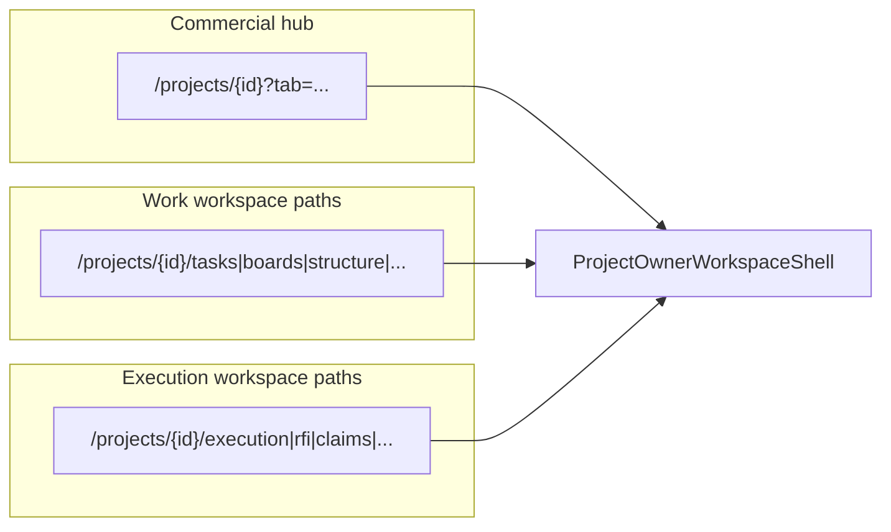
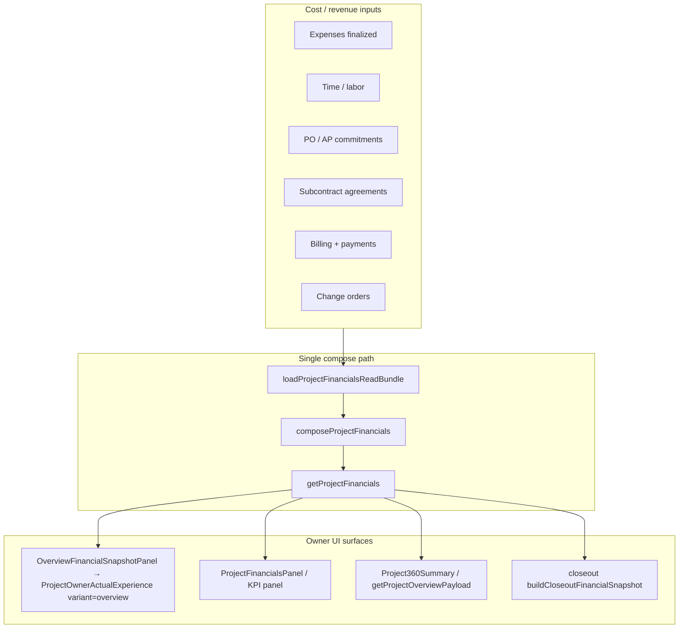

# AGENT 03 — Standard project lifecycle

| Field | Value |
|--------|--------|
| **Agent** | AGENT_03 (standard projects) |
| **Domain** | Create, client link, budget, milestones, team, status, close/reopen, project hub tabs |
| **Inspected commit** | `35e2ff0f7f12d0a3ec94ea0aed23b8c97b6bb00e` |
| **Method** | Static route/action inventory, hub-tab wiring read, profitability compose-path trace. E2E spec **read only** (not executed; no production). |
| **Out of scope** | Developer/GC execution surfaces (`/developer/*`, contractor portal parity, job/work-order shells) except where they share `[projectId]` routes. |

---

## 1. Executive summary

Owner **standard projects** (`workKind === 'project'`) center on a single commercial workspace URL `/[locale]/projects/[projectId]` with **five hubs** (overview, money, work, documents, details) and legacy **`?tab=`** deep sections. Create → launch provisions workspace/board, optional team-at-create, and optional billing-plan redirect. **Profitability** is centralized in `getProjectFinancials` / `ProjectOwnerActualExperience` and reused on overview + financials tab.

**Verification posture:** Money-chain Playwright covers create + contract + cross-org money flows + overview/financials KPIs for scenario 1; it does **not** exercise budgets, milestones, close/reopen, archive, or capability-based `/team`. **52 owner `[projectId]` page routes** exist beside the hub model (execution/PM); most are **NOT VERIFIED** at UI level.

| Severity | Count (P03 IDs) |
|----------|-----------------|
| HIGH | 0 |
| MEDIUM | 6 |
| LOW | 4 |
| INFO | 3 |
| **Total** | **13** |

---

## 2. Standard project workspace model

### 2.1 Commercial hub navigation

Source: `src/app/[locale]/(app)/projects/[projectId]/project-hub-order.ts`, `project-tab-order.ts`, `layout.tsx`, `project-owner-workspace-shell.tsx`.

| Hub key | Hebrew label (via `projects.workspace.hubs`) | Inner sections (`?tab=`) |
|---------|-----------------------------------------------|---------------------------|
| `overview` | Overview | `overview` |
| `money` | Money | `financials`, `expenses`, `billing`, `billingPlan`, `budgets` |
| `work` | Work | `work`, `boq`, `changes`, `team`, `time`, `schedule`, `usage` |
| `documents` | Documents | `documents` |
| `closeout` / `warranty` / `details` live under **details** hub | Details | `details`, `closeout`, `warranty` |

Legacy alias: `?tab=contracts` → details hub with contract focus (`shouldFocusProjectContracts`).

**Visibility:** Each section is gated by org module flags + permissions in `layout.tsx` (e.g. `PROJECT_FINANCIALS_READ` / `CONTRACTS_READ` for money KPIs, `WORKFORCE_READ` for team/time, `BUDGETS_READ` + `modules.budgets` for budgets).

**Three chrome modes** (same `projectId`, different path prefixes):

Jobs/work orders use a reduced layout (360 summary only) — **not** standard project lifecycle.

### 2.2 Tab panel → module mapping (`page.tsx`)

| `?tab=` | UI entry | Primary server/domain |
|---------|----------|------------------------|
| `financials` | `ProjectFinancialsPanel` | `getProjectFinancials`, KPI panel |
| `expenses` | `ProjectExpensesPanel` | expenses module |
| `changes` | `ProjectChangesPanel` | commercial |
| `boq` | `ProjectBoqPanel` | BOQ |
| `billing` | `ProjectBillingPanel` | billing |
| `billingPlan` | `ProjectBillingPlanPanel` | billing-plan |
| `budgets` | `ProjectBudgetPanel` | budgets |
| `team` | `ProjectTeamPanel` (workforce) | workforce roster + link to `/team` |
| `time` | `ProjectTimePanel` | workforce |
| `schedule` | `ProjectSchedulePanel` | planning |
| `usage` | `ProjectUsagePanel` | assets/materials |
| `documents` | `DocumentsTab` | project files / OneDrive |
| `closeout` | `ProjectCloseoutPanel` | closeout SQL + readiness |
| `warranty` | `ProjectWarrantyPanel` | warranty |
| `overview` | `OverviewTab` | setup checklist, milestones slot, financial snapshot |
| `work` | `WorkTab` | WP/phases/milestones structure |
| `details` | `DetailsTab` | client, status, contract fields, connected developer |

**Legacy redirect:** `/projects/[projectId]/financials` → `?tab=financials` only (`financials/page.tsx`).

---

## 3. Route inventory — `projects/[projectId]/*`

Counts from `page.tsx` under `src/app` @ inspected commit.

### 3.1 Owner `(app)` — 57 routes

| Category | Routes |
|----------|--------|
| **Hub root** | `[projectId]` |
| **Legacy tab redirect** | `financials` |
| **Capability team (standalone)** | `team` |
| **Work management** | `tasks`, `boards`, `boards/[boardId]`, `structure`, `timeline`, `calendar`, `plans`, `plans/[drawingId]` |
| **Execution / PM** | `execution`, `execution-planning`, `execution-contracts`, `execution-quality`, `cost-control`, `boq-measure`, `unpriced-work`, `activity` |
| **Field / site** | `site-log`, `site-log/[logDate]`, `site-meetings`, `site-meetings/[meetingId]`, `site-safety`, `coordination`, `coordination/[eventId]`, `deliveries`, `defects`, `defects/[defectId]`, `inspections`, `inspections/[inspectionId]`, `instructions`, `instructions/[instructionId]` |
| **Commercial / subs** | `contractors`, `contractors/[agreementId]`, `contractors/.../lines`, `contractors/.../changes`, `contractor-payments`, `contractor-access`, `contractor-compliance`, `contractor-closeout`, `contractor-warranty`, `deductions`, `tenders`, `tenders/[packageId]`, `claims`, `claims/[claimId]`, `rfi`, `rfi/[rfiId]`, `submittals`, `submittals/[submittalId]` |
| **Developer link (GC)** | `developer`, `developer/documents`, `developer/plans`, `developer/rfi`, `developer/tasks` |
| **Billing plan print** | `billing-plan/cycles/[cycleId]/print` |

**Standard lifecycle primary surfaces:** hub `?tab=*`, `projects/new`, `/team` (capabilities), closeout/warranty tabs — not the 40+ execution/PM deep links unless profile enables them via `loadProjectExecutionNav`.

### 3.2 Employee `(shell)` — 44 routes

Parallel operational routes (no owner-style `?tab=` hub on root). Overview at `/employee/projects/[projectId]` uses `EmployeeProjectHubNav` + task overview (`employee-app`). Includes `board`, `files`, `meetings` naming deltas vs owner.

### 3.3 Contractor `(portal)` — 27 routes

Separate portal tree under `[locale]/contractor/(portal)/projects/[projectId]/*` — client link is **not** owner CRM client; connection is via connected-projects / agreements.

---

## 4. Lifecycle actions (owner)

| Stage | UI / route | Server action / application | Permissions / notes |
|-------|------------|----------------------------|---------------------|
| **Create** | `/projects/new` | `createProjectAction` → `launchProject` → `createProject`, workspace, optional `applyProjectCreateTeam`, templates | Redirect to `?tab=billingPlan` when billing plan mode set |
| **Client link** | `?tab=details`, header link in `layout.tsx` | `updateProjectAction` (`clientId`, `primaryContactId`, inline `createClientContact`) | Create form supports inline new client (`parseProjectCreateForm`) |
| **Contract / budget value** | Create form + details | `contractValueAmount` on create/update; `upsertPrimaryContractAmount` via project module | `ORIGINAL_AMOUNT_LOCKED_MESSAGE_KEY` on locked opening |
| **Budget (BOQ-style project budget)** | `?tab=budgets` | `createProjectBudgetAction`, `reviseProjectBudgetAction` → `createProjectBudget` / `reviseProjectBudget` | Module + `BUDGETS_*` |
| **Milestones** | Overview / work tab / `milestones-panel` | `createMilestoneAction`, `updateMilestoneStatusAction`, `archiveMilestoneAction` | Phases/WP: `createPhaseAction`, `updatePhaseScheduleAction`, structure templates |
| **Team (workforce assignment)** | `?tab=team` | Workforce team actions (`workforce/team/actions` via roster) | `WORKFORCE_READ`; roster ≠ cost |
| **Team (capabilities)** | `/projects/[id]/team` | `addProjectMemberAction`, `setProjectMemberCapabilitiesAction`, … (`project-team/ui/actions.ts`) | `PROJECT_CAPABILITIES`; employee app uses capabilities for hub links |
| **Project access grants** | `?tab=team` panel | `ProjectScopedAccessPanel` | Org access mode + grants |
| **Status** | `?tab=details` | `updateProjectAction` (`status`: draft/active/on_hold/completed/cancelled/archived) | Distinct from closeout pipeline |
| **Closeout** | `?tab=closeout` | `startCloseoutAction`, `markCloseoutReadyAction`, `closeProjectAction`, `reopenProjectAction` → SQL `app.start_project_closeout` etc. | `assertCloseoutEligibleWorkKind`; jobs excluded |
| **Archive** | Header | `archiveProjectAction` / `restoreProjectAction` | `PROJECTS_ARCHIVE`; archive redirects to list |
| **Developer connection (not client CRM)** | Details / banner | `connected-projects/.../actions.ts`, `connect-developer/actions.ts` | Invitation codes, provisioning retry |
| **Forecast override** | Financials | `setProjectExpectedRemainingCostAction` | Revalidates project + financials |
| **Setup checklist** | Overview | `ProjectSetupChecklistPanel` | Hidden for `job`; links to details/contracts/team/expense/billingPlan |

**Planning actions:** `projects/planning-actions.ts` (schedule-level updates) — colocated with project shell.

---

## 5. Profitability hooks

### 5.1 Data flow (standard project)

| Hook | Location | Behavior |
|------|----------|----------|
| Overview snapshot | `overview-financial-snapshot-panel.tsx` | Explicit comment: same compose as Financials; no partial Actual |
| Overview payload | `get-project-overview-payload.ts` | `canReadProfit` = `PROJECT_PROFIT_READ`; financials null without `PROJECT_FINANCIALS_READ` |
| KPI display / open price | `resolve-kpi-display.ts`, `project-financials-kpi-panel.tsx` | `data-testid="price-not-set-banner"` / snapshot test ids |
| Owner story | `project-owner-actual-experience.tsx` | Margins, forecast, breakdown; profitability mode from org |
| 360 summary | `get-project-360-summary.ts` | Copies financial truth; does not recalculate profit |
| Team tab labor hint | `ProjectLaborActualSummary` | Surfaces labor **actual** on team tab (read-only story) |

**Permissions split:** Financial totals vs profit KPIs (`PROJECT_FINANCIALS_READ` vs `PROJECT_PROFIT_READ`).

---

## 6. E2E comparison — `project-centric-money-chain.spec.ts`

**File:** `tests/e2e/authenticated/project-centric-money-chain.spec.ts`  
**Harness (documented in spec):** PGlite, `he-IL`, owner auth — **not run in this audit.**

| Spec scenario | Standard lifecycle coverage | Gap vs AGENT_03 scope |
|---------------|----------------------------|------------------------|
| **1 Full chain** | `/projects/new` (client inline + contract), redirect to project hub, overview `סיכום כספי`, `gotoProjectTab(..., 'financials')`, KPIs margin/committed | Labor/PO/subcontract/billing via **org routes** (`/workforce`, `/procurement`, `/vendors`, `/billing`) — not `?tab=team/budgets`. No milestone/phase actions. |
| **3 No contract** | Create without contract; setup heading + `price-not-set` on financials | Aligns with setup checklist + profitability guard |
| **5 Subcontract forecast** | Seeded project **overview** subcontract heading | Does not open `?tab=financials` commitments drill-down exclusively |
| **6 Setup checklist** | Partial: title + contract step visible | Does not click through team/budget/closeout steps |
| **8 / reconciliation** | Overview + financials + `/reports` + dashboard | Budgets tab, closeout, archive, status transitions **absent** |
| **2, 4, 7** | Expense/AP overlap, worker permissions, simple nav | Adjacent; not lifecycle completeness |

**Fixtures:** `tests/e2e/fixtures/project-workspace.ts` — `gotoProjectTab` uses `?tab=` (legacy section labels), consistent with hub implementation.

---

## 7. Feature status matrix (standard owner lifecycle)

| Capability | Code present | Unit / integration signal | E2E (money-chain) | UI runtime verified |
|------------|--------------|---------------------------|-------------------|---------------------|
| Create + client inline | Yes | parse/launch tests (module) | Scenario 1 | NOT VERIFIED (beyond spec intent) |
| Hub tabs / modules | Yes | Nav grouping units elsewhere | Scenarios 1, 3, 8 | NOT VERIFIED |
| Client link + contact | Yes | CRM module tests | Scenario 1 (display) | NOT VERIFIED |
| Project budget tab | Yes | budgets module | **No** | NOT VERIFIED |
| Milestones / schedule | Yes | projects domain | **No** | NOT VERIFIED |
| Team (workforce tab) | Yes | workforce | **No** | NOT VERIFIED |
| Team (capabilities `/team`) | Yes | project-team | **No** | NOT VERIFIED |
| Status update | Yes | projects | **No** | NOT VERIFIED |
| Close / reopen | Yes | `owner-sql-review-0055-0058` integration | **No** | NOT VERIFIED |
| Archive / restore | Yes | archive application | **No** | NOT VERIFIED |
| Profitability overview = financials | Yes | financial unit suites | Scenarios 1, 3, reconciliation | NOT VERIFIED |
| Developer connection | Yes | connected-projects | **No** | NOT VERIFIED |

---

## 8. Findings register (P03-xxx)

| ID | Severity | Title | Evidence | Recommendation |
|----|----------|-------|----------|----------------|
| **P03-001** | MEDIUM | Close/reopen/archive absent from money-chain E2E | No closeout tests in `project-centric-money-chain.spec.ts`; closeout covered only in SQL integration tests | Add owner E2E: start closeout → close → reopen on disposable project, or document as manual release gate |
| **P03-002** | MEDIUM | Dual team UX (tab vs `/team`) | `?tab=team` → workforce roster; `/team` → capability members; linked from panel | Product copy or hub section rename; ensure checklist/onboarding explains both |
| **P03-003** | LOW | Setup checklist “team” = workforce roster only | `project-setup-checklist-panel.tsx` uses `listProjectTeamMembers`, not `project-team` members | Align checklist with capability team or split into two steps |
| **P03-004** | MEDIUM | 52 owner deep routes outside hub tabs | Inventory §3.1; execution/work paths bypass `?tab=` | Profile-gated nav audit per business profile; mark execution routes NOT VERIFIED in release matrix |
| **P03-005** | INFO | Financials legacy URL preserved | `financials/page.tsx` redirect to `?tab=financials` | Keep redirect; optional link cleanup in docs |
| **P03-006** | MEDIUM | Budgets milestone not in financial proof path | Money chain scenario 1 never opens `?tab=budgets` | Extend E2E or add unit bridge test budget vs `getProjectFinancials` |
| **P03-007** | MEDIUM | Milestone CRUD not E2E-covered | Actions exist in `projects/actions.ts`; no Playwright | Lightweight E2E: create milestone → achieve → overview schedule summary |
| **P03-008** | LOW | Employee project hub differs from owner hubs | Employee overview + link list vs owner five-hub shell | Document parity expectations for employee app |
| **P03-009** | LOW | Team tab hidden without `WORKFORCE_READ` | `layout.tsx` `showTeamTab` | Users with project-team only may miss `/team` unless linked elsewhere |
| **P03-010** | LOW | Money chain labor step may skip approved cost | Spec comment: “Labor cost may remain pending approval” | Assert financials after approval or seed approved time in harness |
| **P03-011** | INFO | Open-price guard tested | Scenario 3 + `price-not-set-*` test ids | Keep as regression anchor |
| **P03-012** | INFO | Overview/financials compose path explicitly unified | `get-project-overview-payload.ts`, overview panel comment | Preserve invariant in refactors |
| **P03-013** | MEDIUM | Operational verification history: money-chain **failed** env | `docs/audits/PROJECTFLOW-OPERATIONAL-VERIFICATION-2026-10-09.md` (setup-owner timeout) | Treat green money-chain as release prerequisite, not assumed |

---

## 9. Suggested follow-ups (audit-only)

1. Run `project-centric-money-chain.spec.ts` locally on PGlite harness and attach pass/fail to parent audit report.  
2. Add targeted E2E for closeout + budget tab + milestone status (P03-001, P03-006, P03-007).  
3. Clarify team onboarding copy (P03-002, P03-003).  

---

## 10. Key file index

| Concern | Path |
|---------|------|
| Hub order / legacy tabs | `src/app/[locale]/(app)/projects/[projectId]/project-hub-order.ts` |
| Tab panels | `src/app/[locale]/(app)/projects/[projectId]/page.tsx` |
| Layout / permissions | `src/app/[locale]/(app)/projects/[projectId]/layout.tsx` |
| Project CRUD + milestones | `src/app/[locale]/(app)/projects/actions.ts` |
| Closeout actions | `src/app/[locale]/(app)/projects/closeout-actions.ts` |
| Budget actions | `src/app/[locale]/(app)/projects/budget-actions.ts` |
| Financial compose | `src/modules/financials/application/get-project-financials.ts` |
| Overview payload | `src/modules/projects/application/get-project-overview-payload.ts` |
| E2E money chain | `tests/e2e/authenticated/project-centric-money-chain.spec.ts` |

---

*End of AGENT_03 report.*
