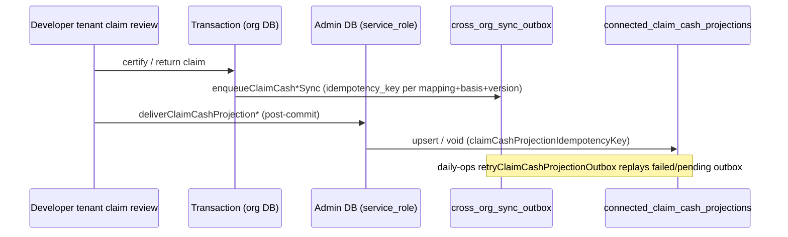

# AGENT_05 — Subcontractors: Guest Portal & Connected Projects (0179)

| Field | Value |
| --- | --- |
| **Agent** | AGENT_05 |
| **Domain** | Mode A guest contractor portal; Mode B connected ProjectFlow orgs (`0179_connected_projects`); invitations; mappings; cross-org sync outbox; claim cash projections; idempotency |
| **Repo baseline** | `35e2ff0f7f12d0a3ec94ea0aed23b8c97b6bb00e` (matches audit README) |
| **Audit date** | 2026-10-11 |
| **Method** | Static read of migration SQL, Drizzle schema, `src/modules/connected-projects`, `src/modules/contractor-portal`, `src/app/[locale]/contractor/(portal)/**`, claim-review delivery hooks; targeted unit tests (see §8) |
| **E2E / production** | **NOT VERIFIED** — no Playwright or production smoke for connected-project flows was executed in this audit run |

---

## 1. Executive summary

ProjectFlow implements a **dual-mode subcontractor product**: **Mode A** (`/contractor/**`, external principal + grants) and **Mode B** (org session + connection code → `connected_project_mappings`). Certified claim **NET** amounts are designed to flow into **cash-flow forecasts** (guest portal via developer-tenant reads; registered org via `connected_claim_cash_projections`), not into payment or income posting.

Application code for Mode B is largely present and unit-tested at the domain/application layer, with **graceful no-op** when migration tables are missing (`42P01` / `42703` handlers). However, **migration `0179_connected_projects.sql` is marked PREPARED ONLY** and **does not match several application assumptions** (mapping `status` vocabulary, `vendor_id` on mappings). If 0179 were applied as written today, **`mapping.repository.ts` would fail on `m.vendor_id`** and connected context resolution would silently return `null`, breaking embedded developer workflows and layout banner for otherwise valid connections.

The guest portal route table is **frozen and enforced** by unit tests (no dead links). Connected-project **accept / provision / retry** paths show thoughtful idempotency for provisioning; claim cash uses **inline delivery + outbox enqueue + daily ops retry**.

**Top risks before production enablement:** schema–app alignment (K05-001, K05-002), Mode B dependency on **both** mapping and **guest-equivalent grants** (K05-003), and absence of integration/E2E coverage (K05-006).

---

## 2. Architecture map

### 2.1 Mode A — Guest contractor portal

| Layer | Location | Notes |
| --- | --- | --- |
| Routes | `src/app/[locale]/contractor/(auth)/**`, `(portal)/**` | Layout: external session only — `loadPortalSession` → `requireExternalContext` |
| Route registry | `src/modules/contractor-portal/domain/routes.ts` | 40+ routes; `routes.test.ts` asserts `implemented` ↔ page files on disk |
| Session | `load-portal-session.ts` | Union of grants → `resolvePortalProjects`; capability-gated nav |
| Finance / cash forecast | `certifiedCashFlowProvider` | Reads **developer tenant** certified receipt forecast via external context; capability `PAYMENT_VIEW` |
| Mobile hubs | `work`, `finance`, `more`, `projects` | 5-tab UX (TODAY = `(portal)/page.tsx`) |

Auth is **mutually exclusive** with org app session (0156); connected Mode B does not merge logins — org ↔ org link on engagement records (per master plan).

### 2.2 Mode B — Connected organizations (0179)

| Table (0179) | Purpose |
| --- | --- |
| `engagement_connection_invitations` | Developer-issued single-use codes (`code_hash` SHA-256); one open per agreement |
| `connected_project_mappings` | Developer engagement ↔ contractor org project; provisioning lifecycle |
| `cross_org_sync_outbox` | Durable queue; **service_role** only at RLS |
| `connected_claim_cash_projections` | Contractor-org **forecast** rows from developer certified payables |

| Application module | Key flows |
| --- | --- |
| `create-invitation.ts` | Issue code (service_role write), revoke open invites per agreement |
| `preview-code.ts` / `accept-code.ts` | Hash lookup via admin DB; consume invite; provision via `launchProject` |
| `retry-provision.ts` | Failed mapping retry without new code |
| `sync-claim-cash-projection.ts` | Enqueue outbox + `deliver*` inline from claim review |
| `retry-claim-cash-projection-outbox.ts` | Batch worker (daily ops) |
| `resolve-connected-context.ts` | Mapping + **external grants** → capabilities (grant parity with guest) |
| Developer embed | `(app)/projects/[projectId]/developer/**` + `requireConnectedDeveloperSession` |
| Contractor connect UI | `(app)/projects/connect-developer` |
| Developer issue UI | `(app)/projects/[projectId]/contractor-access` + `connected-projects/actions.ts` |

### 2.3 Claim cash projection pipeline



- **Guest portal forecast:** `listContractorCertifiedReceiptForecast` on developer data (not projection table).
- **Registered org forecast:** `listActiveClaimCashProjectionsForOrg` → `connectedClaimProjectionCashItems` in `get-project-cash-flow-forecast.ts` / org-level forecast.

---

## 3. Migration 0179 — deep read

**File:** `drizzle/migrations/0179_connected_projects.sql`  
**Header:** PREPARED ONLY — Owner applies after review; additive.

### 3.1 Schema strengths

- Composite FKs to `(id, organization_id)` on projects, agreements, vendors, claims, payable bases — consistent with tenancy patterns.
- **Invitation integrity:** single-use check, expiry, unique `code_hash`, partial unique one-open-invite per agreement.
- **Mapping integrity:** distinct orgs, unique contractor project when set, partial unique active mapping per agreement+contractor org.
- **Idempotency:** unique indexes on `cross_org_sync_outbox.idempotency_key` and `connected_claim_cash_projections.idempotency_key`; unique `(mapping_id, developer_payable_basis_id)` on projections.
- **RLS:** strict split — developer managers SELECT invitations; each org SELECT own side of mappings; contractor SELECT projections; **no authenticated DML** on secrets/outbox; `service_role` ALL on sensitive tables; GRANT/REVOKE explicit.

### 3.2 Supporting index (pre-table)

Creates `subcontract_claim_payable_bases_id_organization_id_uq` if not exists — required for projection FK to payable bases.

### 3.3 Mapping status vocabulary (migration)

CHECK: `'pending' | 'provisioning' | 'active' | 'failed' | 'revoked'`.

Application **write paths** (`accept-code`, `retry-provision`) use **`provisioning` → `active`** and **`failed`** — aligned with migration.

### 3.4 Gaps vs application `SCHEMA_REQUEST.md` / `domain/types.ts`

| Topic | 0179 SQL | Application expectation |
| --- | --- | --- |
| Mapping `status` | pending, provisioning, active, failed, revoked | Also documents `accepted`, `sync_degraded`, `suspended`, `archived` in `CONNECTED_PROJECT_STATUSES` / `SCHEMA_REQUEST.md` |
| `vendor_id` on mapping | **Not a column** (only on invitation) | `mapping.repository.ts` SELECT `m.vendor_id`; `ConnectedProjectMappingView.vendorId` required for grant bridge |
| `pending` in layout filter | Valid DB status | SQL filter uses `'accepted'` not `'pending'` (see K05-002) |

Drizzle `connected-projects.ts` aligns with **0179**, not with `domain/types.ts` CONNECTED_PROJECT_STATUSES.

---

## 4. Application code review (connected projects)

### 4.1 Connection code security

- `connection-code.ts`: plausible length/charset; SHA-256 hash at rest; TTL for expiry.
- `preview-code.ts`: admin DB read; does not consume.
- `accept-code.ts`: permission `PROJECTS_CREATE`; confirm org; idempotent replay when provisioning succeeded; conflict if another invite already linked same agreement; marks consumed via service_role.

### 4.2 Provisioning

- `provision-contractor-project.ts`: `launchProject` + client named after developer org; **does not block** on external storage (Owner correction A).
- Failed provision sets mapping `failed` / provisioning `failed`; UI retry on `connect-developer` page.

### 4.3 Grant bridge (Owner correction B)

- `grant-bridge.ts`: capabilities = union of covering `external_access_grants` only; org RBAC never substitutes.
- `grant-parity.test.ts`: registered capabilities match guest for same mock grants; nav tab keys align.

### 4.4 Mapping load path (critical)

`findConnectedProjectMappingForContractorProject`:

- Filters `status in ('accepted', 'provisioning', 'active', 'sync_degraded')`.
- Selects **`m.vendor_id`** — column absent in 0179.
- On `42703`, returns `null` (same as “not connected”).

**Impact:** Post-migration, connected banner, `resolveConnectedContext`, developer embed routes, and financial projection scoping by mapping may **never activate** even when rows exist.

**Fix direction (for implementers, not done in audit):** JOIN `engagement_connection_invitations` or `subcontract_agreements_store` for `vendor_id`; align status filter with 0179; map DB status to view model if UI needs richer states.

### 4.5 Sync outbox & idempotency

| Layer | Key shape | Behavior |
| --- | --- | --- |
| Outbox enqueue | `subcontract.claim.cash_projection.upsert:{mappingId}:{payableBasisId}:{sourceVersion}` | Duplicate `23505` ignored in repository |
| Projection row | `claim-cash:{mappingId}:{payableBasisId}` | Upsert supersedes prior active row for same basis |
| Worker | `retryClaimCashProjectionOutbox` in `daily-ops-worker.ts` | Max 5 attempts, exponential backoff; only two event types |

Inline `deliverClaimCashProjection*` uses admin DB immediately after claim review transaction; outbox covers retry / offline delivery.

Repositories **no-op** when tables missing — safe pre-migration, **masks** post-migration SQL errors that surface as missing features (K05-010).

### 4.6 Developer-side invitation UX

- `contractor-access/page.tsx` embeds `DeveloperConnectionSection` + server actions for issue/revoke.
- Authority: `requireConnectionCodeIssueAuthority` / `can_manage_contractor_access` mirror RLS intent.

---

## 5. Contractor portal routes (portal group)

**Layout:** `(portal)/layout.tsx` — metadata robots noindex; `ContractorPortalShell`.

**Coverage:** All entries in `PORTAL_ROUTES` marked `implemented: true` except none unimplemented — **48 routes** including auth, hubs, project modules (tasks, schedule, documents, RFI, claims, payments, safety, tenders, handover, etc.).

**Capability gating:** Project nav built from `buildPortalProjectNav(projectId, capabilities)`; finance hub composes sections from registry (`cashFlowForecast` ← certified receipts).

**Notable UX issue:** `(portal)/more/page.tsx` promotes “Connect ProjectFlow org” with `href="/projects/connect-developer"` — **org app route**, unreachable under external session without switching product surface (K05-004).

---

## 6. RLS & security posture (0179)

- Invitations: authenticated **SELECT only** for developers with `app.can_manage_contractor_access`; no authenticated INSERT/UPDATE (service_role for mutations).
- Mappings: developer and contractor **SELECT** disjoint predicates; contractor policy requires non-null `contractor_project_id` and project access.
- Outbox: **no** authenticated grants — worker/service only.
- Projections: contractor SELECT with org + project access; writes service_role only.

**Cross-org read:** Authenticated users cannot read other org’s rows; cross-org data movement is intended via service_role application code, not RLS bypass by contractors.

**Preview/accept code paths** correctly use `getAdminDb()` for cross-tenant invitation lookup (not user JWT).

---

## 7. Plan vs implementation status

Master plan: `.cursor/plans/contractor_portal_product_completion.plan.md` — todos largely **pending**; implementation ahead of plan checkboxes for core 0179 module, portal routes, claim cash hooks, and unit tests.

**Explicit owner constraint still in force:** Production SQL for 0179 **not authorized** in plan text; deploy of schema-dependent features blocked until migration applied.

---

## 8. Test evidence (local unit)

**Command (2026-10-11):**

```text
npm run test:unit -- --run tests/unit/connected-projects tests/unit/contractor-portal \
  tests/unit/financials/connected-claim-cash-flow.test.ts \
  tests/unit/subcontract-claims/certified-receipt-cash-flow.test.ts \
  tests/unit/database/migration-journal.test.ts
```

**Result:** 14 files, **68 tests passed** (~62s).

| Area | Files | What is covered |
| --- | --- | --- |
| Connected projects | 6 | accept-code idempotency/expiry, connection-code hash, lifecycle, grant-bridge, grant-parity |
| Contractor portal | 7 | routes on disk, nav, mobile tabs, registry, dashboard providers, cash-flow provider |
| Financials | 1 | `connectedClaimProjectionCashItems` mapping |
| Subcontract claims | 1 | `claimCashProjectionIdempotencyKey` stability |
| Migration journal | 1 | `0179_connected_projects` is latest tag |

**Not found:** `tests/integration/**` specs for connection accept, outbox replay, or projection upsert against PGlite; **no E2E** spec referencing `connect-developer` or 0179 tables.

---

## 9. Findings register (K05-xxx)

| ID | Sev | Title | Evidence | Recommendation |
| --- | --- | --- | --- | --- |
| **K05-001** | **BLOCKER** | Mapping query references nonexistent `vendor_id` column | `mapping.repository.ts` L58; 0179 `connected_project_mappings` has no `vendor_id` | Additive migration column **or** JOIN invitation/agreement for vendor; remove silent `42703` swallow for logic errors once schema stable |
| **K05-002** | **HIGH** | Mapping status filter / view model out of sync with 0179 | SQL filter uses `accepted`, `sync_degraded`; 0179 CHECK uses `pending`…`revoked`; `connection-lifecycle.ts` uses DB-aligned statuses | Unify on 0179 enums in SQL filters and `CONNECTED_PROJECT_STATUSES`; update `SCHEMA_REQUEST.md` |
| **K05-003** | **HIGH** | Mode B developer embed requires external portal grant | `requireConnectedDeveloperSession` → `notFound()` without `externalContext` + covering grant | Product: document that connection code alone is insufficient for embedded developer tabs; ops must issue matching grants (by design B) or auto-provision grants in a future wave |
| **K05-004** | **MEDIUM** | Portal “connect org” CTA targets org app URL | `(portal)/more/page.tsx` L106 `/projects/connect-developer` | Hide for external session, deep-link to marketing/sign-up, or explain dual login; use locale-aware `Link` |
| **K05-005** | **MEDIUM** | Migration 0179 not applied in production policy | SQL header PREPARED ONLY; repos no-op on missing tables | Owner review/apply 0179 before Mode B go-live; run journal + SQL guard tests after apply |
| **K05-006** | **MEDIUM** | No integration/E2E tests for connected flows | Grep `tests/integration`, `tests/e2e` — no connect-developer / 0179 coverage | Add PGlite integration: issue→accept→provision→certify→projection; optional Playwright smoke |
| **K05-007** | **MEDIUM** | `SCHEMA_REQUEST.md` stale vs 0179 | Documents vendor_id on mapping + different status set | Replace with 0179 as source of truth or delete after alignment |
| **K05-008** | **LOW** | Dual idempotency key schemes (outbox vs projection) | `sync-claim-cash-projection.ts` vs `claimCashProjectionIdempotencyKey` | Document intent (versioned enqueue vs basis-level upsert); ensure worker replays remain safe |
| **K05-009** | **LOW** | No dedicated static SQL guard test for 0179 | Unlike some migrations, no `0179*.test.ts` content assertions | Add test file mirroring pattern for RLS policy names, idempotency indexes, CHECK constraints |
| **K05-010** | **INFO** | Graceful degradation pre-migration | `isMissingRelationError` in mapping/outbox/projection repos | Keep for deploy ordering; add structured metric/log when suppression happens post-migration |
| **K05-011** | **LOW** | `isConnectedMappingVisible` uses non-DB statuses | `grant-bridge.ts` includes `accepted`, `sync_degraded` | Align with `mappingIsActive` / 0179 or map statuses at repository boundary |
| **K05-012** | **INFO** | Outbox scope limited to claim cash events | `retry-claim-cash-projection-outbox.ts` event type filter | Expected for W1; broader sync domains remain plan W2 |
| **K05-013** | **INFO** | Unit coverage present for core invariants | 68 passing tests (§8) | Extend to repository SQL against PGlite with 0179 schema applied |

---

## 10. Verification matrix

| Check | Status |
| --- | --- |
| Migration 0179 journal entry | **Verified** (unit test) |
| Migration 0179 applied to production DB | **NOT VERIFIED** (prepared-only policy) |
| Mode A portal routes match filesystem | **Verified** (unit test) |
| Mode B accept/provision idempotency (mocked) | **Verified** (unit test) |
| Grant parity guest vs connected (mocked) | **Verified** (unit test) |
| Claim cash idempotency key stability | **Verified** (unit test) |
| End-to-end connection + certification + forecast UI | **NOT VERIFIED** |
| Production / Vercel smoke contractor + connected | **NOT VERIFIED** |

---

## 11. Suggested remediation order (for integrator)

1. Resolve **K05-001** + **K05-002** before any 0179 apply (or apply only after code fix lands in same release).
2. Owner review/apply **0179** (separate SQL approval per project rules).
3. Add **integration tests** (K05-006) with 0179 schema on PGlite.
4. Clarify operational playbook for **grants + connection** (K05-003).
5. Fix portal **connect CTA** (K05-004) to avoid dead-end UX for guest users.

---

## 12. Files examined (primary)

- `drizzle/migrations/0179_connected_projects.sql`
- `drizzle/schema/connected-projects.ts`
- `src/modules/connected-projects/**` (application, data, domain, ui, validation)
- `src/modules/contractor-portal/**`
- `src/modules/contractor-access/**` (session load references)
- `src/app/[locale]/contractor/(portal)/**`, `(auth)/**`
- `src/app/[locale]/(app)/projects/connect-developer/**`, `[projectId]/developer/**`, `connected-projects/actions.ts`, `contractor-access/page.tsx`
- `src/modules/subcontract-claims/application/review.ts` (delivery hooks)
- `src/modules/financials/application/get-*-cash-flow-forecast.ts`
- `src/modules/ops/application/daily-ops-worker.ts`
- `tests/unit/connected-projects/**`, `tests/unit/contractor-portal/**`, related financials/claims tests

---

*End of AGENT_05 report.*
