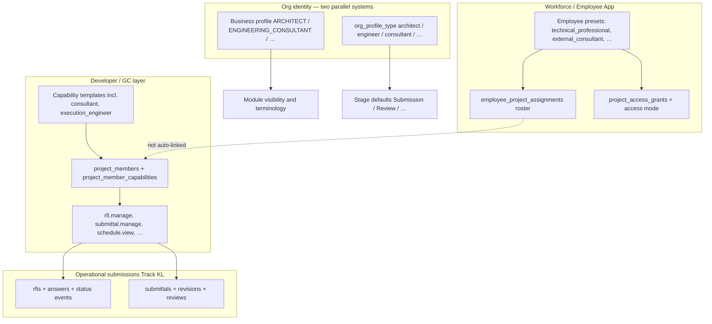

# AGENT 06 — Consultants, project roles, team & plan submissions

| Field | Value |
|--------|--------|
| **Agent** | AGENT_06 (consultants / roles / coordination / submittals) |
| **Audit program** | ProjectFlow Full System Audit — October 2026 |
| **Repository baseline** | `35e2ff0f7f12d0a3ec94ea0aed23b8c97b6bb00e` (main) |
| **Method** | Static code discovery, schema/migration read, targeted test inventory. **No** production browser session. **No** DB mutations. |
| **Finding ID prefix** | `R06-xxx` |
| **Related prior audits** | `docs/audits/PROJECTFLOW-EMPLOYEE-CONTRACTOR-ACCESS-WORKFLOW-AUDIT-2026-10-10.md` (§10 consultants), capability map “Consultant PARTIAL FIT” |

---

## 1. Scope

This report covers how ProjectFlow models and serves:

- **Consultants and design/engineering professionals** (org identity, navigation, workforce presets).
- **Project roles** (informational org role on a project, CRM/vendor engagement roles, GC **project capabilities** and templates).
- **Team** (two roster models: workforce assignments vs Developer/GC `project_members`).
- **Professional coordination** (coordination events, schedule, meetings including consultant meeting type).
- **Plan / submission workflows** (UWM project stages vs Track KL **RFI/Submittals** vs documents/drawings).

Out of scope: contractor portal money flows, full CRM, generic workforce payroll (touched only where it blocks consultant access).

---

## 2. Architecture map (how the pieces fit)

**Takeaway:** A “consultant” in product language can mean **five different mechanisms** (business profile, UWM org profile, employee preset, project capability template, vendor `engagement_role`). They are related by convention, not one unified “consultant role” entity.

---

## 3. Inventory — code anchors

| Area | Primary locations | Role for consultants |
|------|-------------------|----------------------|
| GC project capabilities | `src/modules/project-team/domain/capabilities.ts` | Per-user, per-project authority (RFI, submittals, coordination, documents). |
| Capability templates | `src/modules/project-team/domain/templates.ts` | Starting sets; **`consultant`** template = view docs, manage RFI/submittals, view schedule (no financial caps). |
| Project team CRUD | `src/modules/project-team/application/manage-project-team.ts`, migration `0154_project_team_capabilities.sql` | Internal users only on `project_members`; RLS via `app.has_project_capability`. |
| Workforce “project team” | `src/modules/workforce/application/project-team.ts` | **`employee_project_assignments`** — labor roster, time/expense scope; **does not** write `project_members`. |
| Employee presets | `src/modules/employee-app/application/presets.ts` | **`external_consultant`**: `granted_projects` read for projects/tasks comment/docs/meetings; no RFI/submittal org permissions. **`technical_professional` / `professional_employee`**: `assigned_only` + time; latter adds `planning.read`. |
| Project access resolution | `src/modules/employee-app/application/project-scope.ts`, `src/modules/projects/data/project-access.repository.ts` | Employee visibility = assignments, **grants**, legacy `role_assignments`; **not** `project_members`. |
| RFI | `src/modules/rfi/*`, `drizzle/schema/dg-rfi-submittals.ts` | Assignees must be active **`listProjectTeam`** members (`assertProjectAssignee`). |
| Submittals | `src/modules/submittals/*` | Internal create **requires** `subcontractAgreementId` (contractor/vendor lane); lifecycle mirrors GC submittal practice. |
| Coordination | `src/modules/coordination/application/authorization.ts` | Read: `schedule.view` **or** `contractor.coordinate`; manage: `schedule.manage` **or** `contractor.coordinate`. |
| UWM stages (“Submission”) | `src/modules/tenancy/application/seed-org-defaults.ts` | `engineer` / `consultant` profiles seed stages `… Coordination, Submission, Review, Approved` — **project stage labels**, not submittal records. |
| Business profiles | `src/modules/tenancy/domain/business-profiles.ts` | `ARCHITECT`, `ENGINEERING_CONSULTANT`, `SAFETY_INSPECTION_CONSULTANT`, etc. — nav, cost categories, task template seeds. |
| Org profile (UWM) | `src/app/[locale]/(app)/settings/org-profile/org-profile-domain.ts` | Separate enum; default in DB schema often **`contractor`** until owner sets adoption. |
| Informational project role | `drizzle/schema/projects.ts` (`project_role` text) | Org’s role on the project (e.g. “consultant”) — **not** enforced for authorization. |
| Vendor engagement | `drizzle/schema/vendors.ts` (`engagement_role_id`), catalog `engagement_role` / `consultant` | AP/vendor classification; optional vs free-text `role`. |
| Site meetings | `drizzle/schema/dg-field.ts` (`consultant` meeting type) | GC site ops; template **`consultant`** lacks `meetings.manage` unless customized. |
| Employee GC routes | `src/app/[locale]/employee/(shell)/projects/[projectId]/rfi|submittals|coordination/page.tsx` | Reuse owner screens; capability checks on **mutations** and `canManage` in loaders. |

---

## 4. Persona capability matrix (intended vs enforced)

| Persona | How admitted | Sees project (Employee) | GC RFI/submittal **manage** | Coordination **manage** | Typical gap |
|---------|----------------|-------------------------|-----------------------------|-------------------------|-------------|
| Owner / `project_team.admin` | Org permission | All | Yes | Yes | — |
| Internal **`consultant`** template | `project_members` | Membership list + caps | Yes (if template applied) | No (view schedule only) | Must be added to **project_members**, not only workforce roster |
| **`execution_engineer`** template | `project_members` | Same | Yes | Yes (`contractor.coordinate`) | GC-biased naming |
| Employee **`technical_professional`** | `employee_project_assignments` | Assigned list | No (no `project_members` unless also added) | No | No `planning.read` vs `professional_employee` |
| Employee **`external_consultant`** | Grants + `granted_projects` | Grants/assignments; memberships if also `project_members` | Only with **`project_members`** caps | Only with caps | Preset has **no** RFI/submittal employee permissions |
| External vendor consultant | `externalPrincipals` + grants | Contractor portal | Submit own RFI draft / submittal packages | N/A | Not same as internal consultant employee |
| **`ARCHITECT` / `ENGINEERING_CONSULTANT`** org (business profile) | Signup / settings | Owner app modules (documents, quotes, billing, work) | Only on **Developer/GC** projects with team setup | GC modules hidden unless project mode + membership | Submittals module is **contractor-package** oriented |

**Status legend used below:** **CONNECTED** = code paths and guards align; **PARTIAL** = exists but split across models or profile-dependent; **NOT IMPLEMENTED** = no first-class product object; **NOT VERIFIED** = no E2E/browser proof in this audit.

---

## 5. Workflow assessment

| Workflow | Status | Evidence |
|----------|--------|----------|
| Assign internal consultant on GC project (template) | **CONNECTED** | `addProjectMember` + `consultant` template; integration `tests/integration/project-team/project-team.test.ts` |
| Consultant answers / triages RFI | **CONNECTED (code)** | `RFI_MANAGE` + assignee from `listProjectTeam`; integration `tests/integration/rfi-submittals/rfi.test.ts` |
| Consultant reviews contractor submittal | **CONNECTED (code)** | `SUBMITTAL_MANAGE`; integration `tests/integration/rfi-submittals/submittals.test.ts` |
| Workforce roster engineer “on project” without `project_members` | **PARTIAL** | RFI assignee validation uses **project_members** only (`rfi/application/support.ts`) |
| External consultant employee (preset) collaboration | **PARTIAL** | Tasks comment, docs, meetings read; GC workflows need extra membership |
| Design firm “submit plans to municipality / client” | **NOT IMPLEMENTED** as submittal type | UWM stages + documents/tasks; no authority/permit submission entity |
| Engineer org stage “Submission” ↔ Submittal module | **NOT CONNECTED** | Stages in `seed-org-defaults.ts`; submittals tied to vendor/agreement |
| Professional coordination calendar | **PARTIAL** | `consultant` template: read coordination, not manage |
| Client coordinator operational approve | **CONNECTED** | `tests/integration/project-team/o-03b-client-coordinator-operational-approve.test.ts` |
| Cross-org consultant (connected projects) | **PARTIAL** | Document share patterns; not consultant-role specific (see connected-projects module) |

---

## 6. Test & verification coverage

| Layer | Coverage | Notes |
|-------|----------|-------|
| Project team capabilities | Integration + unit | Escalation, financial separation, `team-surfaces.test.ts` |
| RFI / Submittals | Integration | Lifecycle, RLS, contractor isolation; **no** test named for `consultant` template |
| Employee personas | Unit | `management-office-personas.test.ts` — `external_consultant` nav only |
| Browser E2E consultant field | **NOT VERIFIED** | Prior audit W5: “CONNECTED (code) NOT VERIFIED browser” |
| i18n | **CONNECTED** | `projectTeam.json`, `submittals.json`, `siteOps.json` consultant strings (en/he/ar/ru) |

---

## 7. Findings register (`R06-xxx`)

| ID | Severity | Status | Summary |
|----|----------|--------|---------|
| **R06-001** | **HIGH** | PARTIAL | **Two project-team rosters without sync:** workforce `employee_project_assignments` (`workforce/application/project-team.ts`) vs GC `project_members` (`project-team/*`). Workforce add does **not** create capabilities. RFI assignees must appear in **`listProjectTeam`** (`rfi/application/support.ts`). Risk: consultant appears “on project” for time/tasks but cannot be assigned RFIs or hold submittal review authority. |
| **R06-002** | MEDIUM | PARTIAL | **`granted_projects` access ignores `project_members`:** `listAccessibleProjectIdsForUser` unions grants, assignments, `role_assignments` only (`project-access.repository.ts`). Employee **`external_consultant`** with **only** `project_members` row may see membership card but not grant-scoped project list consistency. |
| **R06-003** | MEDIUM | PARTIAL | **`external_consultant` preset underpowers GC workflows:** grants read/comment only (`presets.ts`); no org-level path to RFI/submittals. GC features require **`project_members`** + template (e.g. `consultant`). Onboarding/docs do not state this dual setup. |
| **R06-004** | MEDIUM | PARTIAL | **Parallel org identity systems:** legacy **business profile** (`business-profiles.ts`) vs **UWM** `org_profile_type` (`org-profile-domain.ts`, `seed-org-defaults.ts`) vs DB default **`contractor`** (`drizzle/schema/tenancy.ts`). Consultant/engineer stage defaults apply only after adoption; can diverge from signup profile. |
| **R06-005** | MEDIUM | PARTIAL | **No architect / discipline-specific GC templates:** templates include `consultant` and `execution_engineer` only (`templates.ts`). No structural/MEP/safety architect templates; titles are custom `title` field on membership. |
| **R06-006** | MEDIUM | NOT IMPLEMENTED (product) | **Submittals = contractor package track, not consultant plan submission:** internal `createSubmittal` requires `subcontractAgreementId` (`internal-submittals.ts`, validation schema). Types are product/equipment/shop drawing (`SUBMITTAL_TYPES`), not permit/design submission to authority. |
| **R06-007** | LOW | PARTIAL | **UWM “Submission/Review” stages decoupled from Submittals module:** same word, different subsystems (`seed-org-defaults.ts` vs `dg-rfi-submittals.ts`). |
| **R06-008** | LOW | INFO | **`projects.project_role` free text** is informational (`projects.ts`); not tied to templates, `engagement_role` catalog, or capabilities. |
| **R06-009** | LOW | CONNECTED | **Consultant/engineer UWM module defaults** disable procurement/materials/BOQ (`seed-org-defaults.ts`) — aligns with light consultant UX. |
| **R06-010** | MEDIUM | PARTIAL | **`ENGINEERING_CONSULTANT` business profile** emphasizes quotes, documents, billing, task seeds (`business-profiles.ts`, `profile-task-template-seeds.ts`); **no** bridge to RFI/submittals unless org runs Developer/GC projects and sets up team caps. |
| **R06-011** | MEDIUM | PARTIAL | **Consultant template coordination asymmetry:** template grants `schedule.view` but not `schedule.manage` or `contractor.coordinate` (`templates.ts`); can **read** coordination (`authorization.ts`) but not create/manage events unless caps extended. |
| **R06-012** | LOW | PARTIAL | **Consultant site meeting type vs capabilities:** meeting type `consultant` exists (`dg-field.ts`); **`consultant` template** lacks `meetings.manage` — minutes/decisions remain with PM/site roles unless customized. |
| **R06-013** | MEDIUM | PARTIAL | **Employee RFI/submittal routes gate on `project.view` only** (`employee/.../rfi/page.tsx`, `submittals/page.tsx`); UI hides create when `canManage` false (`rfi/screen.tsx`). Viewers can open lists — acceptable but may confuse users with assignment-only access (**R06-001**). |
| **R06-014** | MEDIUM | NOT IMPLEMENTED | **Retainer / recurring consulting commercial product** called out as gap in capability map (“Time + billing + CRM exist; no retainer product”). No contradicting implementation found in this scope. |
| **R06-015** | LOW | PARTIAL | **Vendor `engagement_role` = consultant** (`business-catalog`, migration `0060`) supports AP/vendor semantics; not wired to project consultant coordination or `project_members`. |
| **R06-016** | LOW | NOT VERIFIED | **End-to-end consultant persona E2E** (employee + consultant template + RFI answer + submittal review) not covered by dedicated integration test or browser run in this audit. |
| **R06-017** | LOW | INFO | **`technical_professional` vs `professional_employee`:** latter includes `planning.read` for classic planning surfaces; former does not — affects in-org engineers on non-GC projects. |
| **R06-018** | LOW | CONNECTED | **External contractors never become `project_members`** (migration comment `0154`) — correct isolation; internal consultants must be org members with membership row. |

---

## 8. Recommendations (audit-only — no implementation)

1. **Unify operator mental model in UX copy:** When adding workforce project team, prompt to add **GC project member** (or link actions) if project uses Developer/GC mode and consultant needs RFI/submittal/coordination write access (**R06-001**, **R06-003**).
2. **Optional automation (product decision):** On `addProjectTeamMember` (workforce), offer “mirror to project capabilities” with template picker — would reduce **R06-001** failure mode.
3. **Consultant-firm track:** If target users are engineering/architecture consultancies (not only GC-side reviewers), define whether **plan submission** lives in documents + stages, or extend submittals with internal/non-vendor packages — **R06-006**, **R06-007**.
4. **Template pack:** Add `architect`, `discipline_consultant` (or metadata on `consultant`) with explicit `meetings.manage` / `documents.share` toggles — **R06-005**, **R06-012**.
5. **Adoption alignment:** Single settings surface linking business profile ↔ UWM `org_profile_type` with preview of stages and disabled modules — **R06-004**.
6. **QA:** One integration test: user with `consultant` template creates RFI, assigns second consultant member, completes review; one browser smoke on employee mirror routes — **R06-016**.

---

## 9. Severity rollup (this agent)

| Severity | Count |
|----------|------:|
| HIGH | 1 |
| MEDIUM | 10 |
| LOW | 7 |

**Domain readiness (consultants & professional coordination):** **PARTIAL** — strong **GC-side** RFI/submittal/coordination stack when `project_members` and templates are configured; **weaker** for standalone consultant firms, external consultant employee preset, and unified “project team” semantics.

---

## 10. Agent sign-off

| Item | Value |
|------|--------|
| Deliverable | `docs/audits/2026-10-full-system-audit/subagents/AGENT_06_consultants_roles.md` |
| Blocking issues for integrator | **R06-001** (dual roster) should surface in master report cross-module matrix (Workforce ↔ Project team ↔ RFI). |
| SQL / migrations | None prepared or executed |
