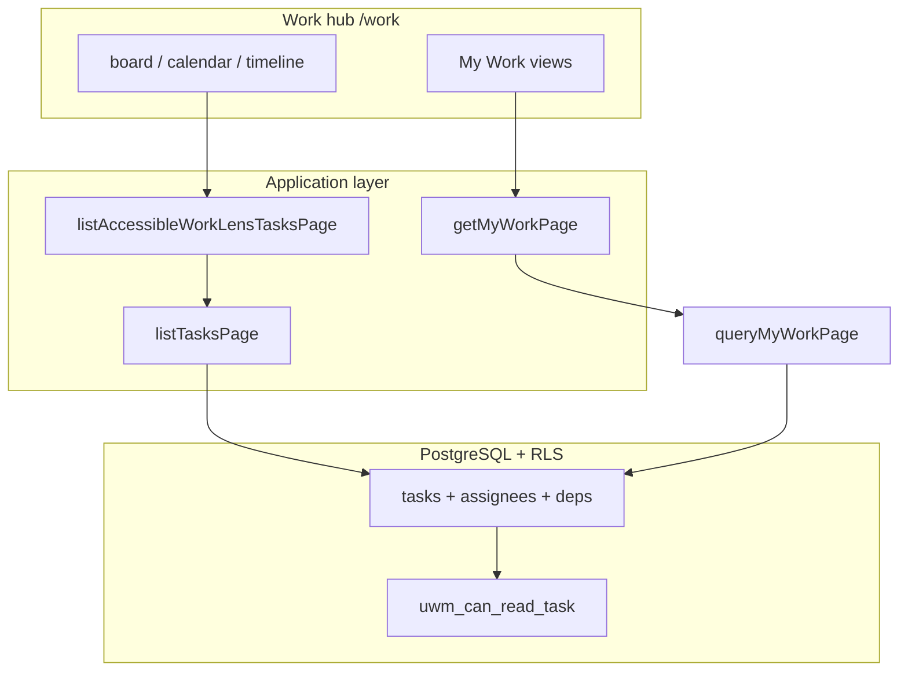

# AGENT 07 — Tasks, Work Hub, UWM & Microsoft Planner Parity

| Field | Value |
|--------|--------|
| **Agent** | AGENT_07 (tasks / Work hub / UWM / Planner comparison) |
| **Audit program** | ProjectFlow Full System Audit — October 2026 |
| **Audit date** | 2026-10-11 |
| **Repository commit** | `35e2ff0f7f12d0a3ec94ea0aed23b8c97b6bb00e` (main; matches [README](../README.md) baseline) |
| **Method** | Read-only: `src/modules/tasks/`, `/work/*`, UWM schema/migrations, `.cursor/plans/*planner*`, `*uwm*`, cross-check Oct-9 product-fit. **No** production load test, **no** browser E2E, **no** SQL apply. |
| **Plan authority** | [planner_plus_multi_industry_master.plan.md](../../../.cursor/plans/planner_plus_multi_industry_master.plan.md) (claims **implementation complete** @ `2f13eec6` + release train `3138c1fa`); annexes: `work_hub_planner_plus_wave1`, `work_hub_saved_views_filters`, `tasks_uwm_scale_pagination`, `task_integration_planning_calendar`, `universal_work_management_fe4f363f`, `planner_plus_release`. |
| **Prior audits** | [PROJECTFLOW-PRODUCT-FIT-TASK-MANAGEMENT-2026-10-09.md](../../PROJECTFLOW-PRODUCT-FIT-TASK-MANAGEMENT-2026-10-09.md) §B–§O (baseline `2f13eec6`; **partially stale** vs HEAD — see §2, §7). |
| **Finding ID prefix** | `T07-xxx` |

---

## Executive summary

ProjectFlow ships a **mature UWM task engine** (canonical `tasks` table, workspaces/boards/buckets, My Work, cross-project lenses, dependencies, recurrence, templates, workload, portfolio/insights) with **material Planner+ closure** since the Oct-9 gap analysis: lazy My Work, SQL JOINs for assignee/following views, URL-backed filters + **`listKey=tasks` saved views** on board/calendar/timeline, `clientId` filtering, real workload reassignment, optional **planning↔task** link UI, and Today/calendar **dedupe** when a planning row points at a UWM task.

**Microsoft Planner daily-hub parity remains incomplete:** no org-wide **Grid/List** tab in `/work`, global board grouped by **status** (not plan/bucket), **Schedule** affordances (unscheduled pool, drag-to-date on calendar), **saved views on My Work**, and **dependency enforcement** on status moves. Scale hardening migration **0177** remains **prepared only** (Owner SQL gate).

**Vitest (local, this audit):**

| Command | Result |
|---------|--------|
| `npm run test:unit -- tests/unit/tasks` | **PASS** — 17 files, 58 tests (~25s) |
| `npm run test:integration -- tests/integration/tasks` | **PASS** — 3 files, 21 tests (~201s) |

Not run (out of “fast” scope): `tests/integration/collaboration/contractor-tasks.test.ts`, `tests/integration/migration/uwm-*`, Playwright `/work` smoke.

**Finding counts (this agent only):**

| Severity | Count |
|----------|------:|
| HIGH | 2 |
| MEDIUM | 8 |
| LOW | 4 |
| INFO | 4 |
| **Total** | **18** (`T07-001` … `T07-018`) |

---

## 1. Scope & routes

### 1.1 Work hub (`work_management` module + `TASKS_READ`)

| Route | Purpose | Server data | Client views |
|-------|---------|-------------|--------------|
| `/work` | My Work hub | `getMyWorkPage` — **single active tab** (`?view=`) | `MyWorkView` → `TaskListView` per tab |
| `/work/board` | Cross-project board | `listAccessibleWorkLensTasksPage` (cap **500**) | `GlobalBoardView` — **status columns**, DnD status |
| `/work/calendar` | Task calendar lens | Same list API + filters | `TaskCalendarView` (month/week) |
| `/work/timeline` | Task timeline lens | Same | `TaskTimelineView` + **due-date edit** |
| `/work/insights` | Charts / aggregates | `getTaskInsights` | `TaskInsightsView` |

Shared chrome: `WorkHubNav` preserves `WORK_TASK_QUERY_KEYS` across tabs; lenses use `WorkLensChrome` → `WorkTaskFiltersBar` + `SavedListViewsBar` **`listKey="tasks"`**.

Gate: `work/layout.tsx` and each page require `PERMISSIONS.TASKS_READ` and `shell.modules.work_management`.

### 1.2 Project / workspace task surfaces (UWM)

| Route | Views |
|-------|--------|
| `/projects/[projectId]/tasks` | List (+ sheets); links to project boards |
| `/projects/[projectId]/boards/[boardId]` | Kanban **buckets**, group-by, DnD |
| `/workspaces/[workspaceId]/boards/...` | Org/team boards |
| `/tasks/[taskId]` | Full detail (deps, comments, approvals, related work) |
| `/workload` | Team capacity + **inline reassign** → `assign-task.ts` |
| `/portfolio` | Cross-project rollup (separate from Work hub) |
| Project `?tab=schedule` | **Gantt-style** `planning_work_items` (not `/work/timeline`) |

### 1.3 Employee / contractor

| Surface | Notes |
|---------|--------|
| `/employee/.../tasks` | Scoped mobile shell; not full Work hub |
| Contractor portal `/contractor/.../work` | External scoped tasks (`contractor-tasks.test.ts` — not re-run here) |

### 1.4 UWM architecture (data + access)

**Workspace envelope:** `resolveAccessibleWorkspaceIds` + `resolveAccessibleProjectIds` on My Work and accessible list paths (`my-work.ts`, `work-lens-task-list.ts`). **Authoritative row filter:** RLS `tasks_select` → `app.uwm_can_read_task` (migrations `0100`, `0124` employee alignment).

---

## 2. Plan reconciliation (`.cursor/plans/` vs HEAD @ `35e2ff0`)

| Master / annex intent | Plan todo status in file | Code @ HEAD | Audit note |
|----------------------|--------------------------|-------------|------------|
| Lazy My Work, `?view=` | Master **completed**; wave1 annex **pending** | `work/page.tsx` one view; `fetchMyWorkViewAction` on tab change | **Delivered** — annex stale |
| Saved views + URL filters on lenses | Master **completed**; saved-views annex **pending** | `work-lens-chrome.tsx`, `SAVED_LIST_KEYS` includes `tasks` | **Delivered** |
| `clientId` filter | Master **completed** | EXISTS join on `projects.client_id` in `tasks.repository.ts` | **Delivered**; unit: `list-tasks-client-filter.test.ts` |
| JOIN `assigned_to_me` / `following` | Master **completed**; scale annex **pending** | `my-work.repository.ts` innerJoin + `limit+1` | **Delivered** |
| Upcoming **14 days** | Owner Decision 1 | `addDays(today, 14)` in `upcoming` case | **Delivered** |
| Completed window **30d** | Master WP-A | `completed` case in `my-work.repository.ts` | **Delivered** |
| Workload reassign | Master **completed** | `workload-expandable-rows.tsx` + `workload/actions.ts` | **Delivered** |
| Planning↔task link + dedupe | Master **completed** | `planning.ts` `taskId`; calendar skip in `source-dates.repository.ts` | **Delivered**; unit: `dedupe-command-center-items.test.ts` |
| Migration **0177** indexes | Master prepare; **NOT** Production apply | `drizzle/migrations/0177_tasks_uwm_scale_indexes.sql` | **Prepared only** — **T07-005** |
| UWM master (`universal_work_management_fe4f363f`) | All waves **pending** in YAML | Full UWM in tree | **Historical contract** — superseded by shipped stack + Planner+ master |
| My Work RBAC integration test | `planner_plus_release` WP-B **planned** | No `getMyWorkPage` in `tests/integration/**` | **Not delivered** — **T07-018** |

**Documentation drift:** Annex YAML todos still **pending** while master marks same items **completed** — **T07-013**.

---

## 3. Microsoft Planner comparison (workflow-level)

Reference: Product-fit §B ([Planner support articles cited there](../../PROJECTFLOW-PRODUCT-FIT-TASK-MANAGEMENT-2026-10-09.md)). Status reflects **HEAD**, not Oct-9 snapshot.

| Planner capability | ProjectFlow @ `35e2ff0` | Evidence | Gap vs Planner |
|--------------------|-------------------------|----------|----------------|
| Plan buckets + Kanban | **HAS** (project/workspace board) | `board-view.tsx`, bucket move | Global `/work/board` = **status**, not buckets — **T07-003** |
| Group by assignee/label/priority | **HAS** (project board) | `board-view.tsx` | Not on global board |
| Labels + filter | **HAS** | `task_labels`, `WORK_TASK_QUERY_KEYS` | — |
| My Tasks (all plans) | **PARTIAL** | `/work` My Work tabs | No separate **My Day**; `/today` mixes planning + DG sources |
| Personal hub **Board** | **PARTIAL** | `/work/board` | Status columns, not “plans” |
| **Grid / spreadsheet** | **PARTIAL** | `task-list-view.tsx` on My Work + project tasks | **No `/work/list` hub route** — **T07-001**; fixed columns — **T07-010** |
| **Schedule** + unscheduled | **PARTIAL** | `/work/calendar` | No unscheduled sidebar; **no drag-to-date** — **T07-004** |
| Timeline / Gantt (Planner sense) | **PARTIAL** | `/work/timeline` = task grouping | Project **Gantt** = planning tab — **T07-007** |
| Saved filter views | **HAS** (lenses) | `SavedListViewsBar` on board/calendar/timeline | **Not** on My Work — **T07-008** |
| Dependencies | **HAS** storage + UI | `task-dependencies-section.tsx` | **No enforce** on transition — **T07-002** |
| Charts | **PARTIAL** | `/work/insights` | Planner-lite |
| Workload | **HAS** (beyond Planner) | `/workload` | Reassign **implemented** (was stub @ Oct-9) |
| Teams/Outlook ingestion | **MISSING** | — | Owner **declined** PM-012 |
| Recurring | **PARTIAL** | recurrence worker | Copy gaps — **T07-012** |

**Semantic difference (intentional):** My Work tabs `today|overdue|this_week|…` (except `assigned_to_me|following`) aggregate **team-visible open work** within allowed workspaces, not “only my assignments” — aligns with PM hub, can surprise field users expecting Planner “My Tasks” assignee-only calendar (**INFO** in `planner_plus_release` §1).

**Intentional PF strengths (not Planner parity targets):** financial/project linkage, Employee App + time on tasks, FS dependency model, separate schedule/Gantt layer, portfolio/operations/meetings integration (**T07-016**).

---

## 4. UWM core (tasks module) — static capability check

| Area | Status | Notes |
|------|--------|--------|
| CRUD + lifecycle | **Implemented** | `lifecycle.ts`, `update-task.ts`; archive not hard delete |
| Multi-assignee, checklist, subtasks | **Implemented** | Integration: `project-tasks-ux.test.ts` |
| Dependencies (FS + blocked_by) | **Implemented** storage; **not enforced** on status | Cycle prevention: `task-dependency-cycle.test.ts`; no refs in `lifecycle.ts` |
| Recurrence | **Partial** | `recurrence-idempotency.test.ts` |
| Templates | **Implemented** | `org-project-task-templates.test.ts` (14 cases) |
| Comments, attachments, approvals | **Implemented** | `task-attachments.test.ts` |
| Access / RLS / project scope | **Implemented** | Unit: `my-work-access-isolation.test.ts`, `task-project-access-filter.test.ts` |
| Related work / entity links | **Implemented** | `task-related-work-href.test.ts` |
| Search | **Partial** | Title ILIKE in `listTasksPage`; trigram index **only after 0177 apply** |
| Assignee/label filters in SQL | **Implemented** | EXISTS subqueries **before** LIMIT in `tasks.repository.ts` (Oct-9 B8 fixed @ HEAD) |

---

## 5. Automated test execution

| Command | Result (2026-10-11) |
|---------|---------------------|
| `npm run test:unit -- tests/unit/tasks` | **PASS** — 17 files, 58 tests |
| `npm run test:integration -- tests/integration/tasks` | **PASS** — 3 files, 21 tests |

**Related (not under `tests/unit/tasks`):** `tests/unit/command-center/dedupe-command-center-items.test.ts` — planning/task Today dedupe.

**Gaps:** No tests referencing `WorkLensChrome`, `compactWorkTaskQuery`, saved view apply for `listKey=tasks`, or end-to-end My Work prefetch vs RLS (**T07-009**, **T07-018**).

---

## 6. Findings register

| ID | Severity | Title |
|----|----------|-------|
| **T07-001** | **HIGH** | Work hub has no org-wide **List/Grid** lens (Planner “Grid”) |
| **T07-002** | **HIGH** | Task dependencies are not enforced on status transitions |
| **T07-003** | MEDIUM | Global `/work/board` is status Kanban, not plan/bucket board |
| **T07-004** | MEDIUM | Calendar Schedule parity missing (unscheduled pool, drag reschedule) |
| **T07-005** | MEDIUM | Migration **0177** scale/search indexes prepared but not applied |
| **T07-006** | MEDIUM | Work lenses SSR up to **500** tasks — enterprise scale unproven |
| **T07-007** | MEDIUM | Dual schedule UX: project Gantt vs `/work/timeline` |
| **T07-008** | MEDIUM | My Work hub lacks URL filters and saved views |
| **T07-009** | MEDIUM | No automated tests for work-lens filters / saved views |
| **T07-010** | LOW | Task list fixed columns — no Planner-style hide/reorder |
| **T07-011** | LOW | No department dimension in task filters (schema gap) |
| **T07-012** | LOW | Recurring occurrences omit some copied fields (reminders/attachments) |
| **T07-013** | LOW | Planner annex `.plan.md` todos stale vs master “completed” |
| **T07-014** | INFO | Planner+ wave items verified in code @ baseline |
| **T07-015** | INFO | Task-focused Vitest subsets green (58 unit + 21 integration) |
| **T07-016** | INFO | Construction-relevant advantages over Planner documented |
| **T07-017** | INFO | Full CPM/Gantt claims disclaimed (`planning/LIMITATION.md`) |
| **T07-018** | MEDIUM | No integration test for My Work cross-project / RLS aggregation |

---

### T07-001 — Work hub missing List/Grid lens

**Severity:** HIGH  
**Planner reference:** “Grid” view with sortable columns across all plans.  
**Evidence:** `work-hub-nav.tsx` routes: My Work, board, calendar, timeline, insights — **no** `/work/list`. `TaskListView` is used inside `MyWorkView` and project tasks, not as a filtered cross-project hub lens with `WorkLensChrome`.  
**Impact:** PMO users expecting a single dense spreadsheet across all projects must use My Work tabs (date/assignee slices) or board/calendar with **500-row cap**, not a dedicated grid.  
**Recommendation:** Add `/work/list` reusing `listAccessibleWorkLensTasksPage` + `TaskListView`, same URL filter contract as other lenses.

---

### T07-002 — Dependencies not enforced on workflow

**Severity:** HIGH  
**Evidence:** `lifecycle.ts` / `update-task.ts` — transitions validated by status graph only; **no** read of `task_dependencies` before `done` / `in_progress`. UI exposes deps in `task-dependencies-section.tsx`. Product-fit §B noted PF **ahead** of Planner on FS modeling but **without auto-block**.  
**Impact:** Boards and My Work can show tasks as actionable while FS predecessors are open — schedule integrity relies on manual discipline.  
**Recommendation:** Optional org flag: block transition to `in_progress`/`done` when open FS/blocking deps exist (clear error + link to predecessor).

---

### T07-003 — Global board ≠ Planner “plan board”

**Severity:** MEDIUM  
**Evidence:** `_global-board-view.tsx` header: grouped by **STATUS**; drag updates status, not bucket. Bucket Kanban remains on project/workspace boards.  
**Impact:** Cross-project “one board” does not match Planner’s bucket semantics within a plan.  
**Recommendation:** Product copy + optional “group by project/board” mode, or document as intentional status rollup.

---

### T07-004 — Schedule view parity

**Severity:** MEDIUM  
**Evidence:** `task-calendar-view.tsx` — month/week grid, open task on click; **no** drag handlers, **no** unscheduled sidebar. `TaskWorkSurfaceClient` sets `timelineDateEdit` only on `/work/timeline`, not calendar.  
**Impact:** Weaker “plan my week” flow vs Planner Schedule.  
**Recommendation:** Phase 2 per product-fit §N — drag-to-date on calendar for tasks only (Owner out-of-scope in master “Out of scope: calendar drag optional later”).

---

### T07-005 — Migration 0177 not applied

**Severity:** MEDIUM  
**Evidence:** `0177_tasks_uwm_scale_indexes.sql` header **PREPARED ONLY**; `tasks_org_board_active_idx`, `task_followers_org_member_idx`, `task_assignees_org_member_task_idx`, conditional `idx_tasks_title_trgm`.  
**Impact:** Production may retain seq scans on large orgs for board lens, following, assignee JOINs, and `%title%` search until Owner approves SQL apply.  
**Recommendation:** Staging EXPLAIN + Owner SQL approval per release preflight policy — **no agent apply**.

---

### T07-006 — Work lens list cap & scale

**Severity:** MEDIUM  
**Evidence:** `TASK_LIST_MAX_LIMIT` = 500 in `list-window.ts`; board/calendar/timeline use it. My Work uses `MY_WORK_VIEW_LIMIT` = 100 + lazy tab fetch. Offset pagination via `loadMoreWorkLensTasksAction` / `loadMoreMyWorkAction`.  
**Impact:** Orgs with thousands of active tasks see truncated lenses; latency unmeasured @ 700+ projects (product-fit theme). Lazy My Work fixes Oct-9 **9×100 prefetch** egress issue.  
**Recommendation:** Staging load test; consider lower default cap + explicit load-more UX; apply **0177** after review.

---

### T07-007 — Dual schedule surfaces

**Severity:** MEDIUM  
**Evidence:** Project schedule: `planning_work_items` + Gantt UI (`project-schedule-panel.tsx`, `planning.json` subtitle disclaims MS Project/CPM). Work hub timeline: UWM due dates only. Link optional via `taskId`; calendar dedupes linked rows (`source-dates.repository.ts`).  
**Impact:** Users must learn two timelines; mitigated for linked rows, not for unlinked planning.  
**Recommendation:** PM-011 copy discipline; deep links from task Related work to schedule when linked.

---

### T07-008 — My Work hub filter/saved-view gap

**Severity:** MEDIUM  
**Evidence:** `/work` `searchParams` only `view` (`work/page.tsx`); no `WorkLensChrome`. Saved-views annex deferred My Work v1. Lenses share filters via `WORK_TASK_QUERY_KEYS` but My Work tabs are orthogonal predicates.  
**Impact:** Planner-style “save my filtered overdue + client ACME view” cannot span My Work tabs.  
**Recommendation:** Wave 2 — URL filters on hub or `listKey=work_my` if product requires.

---

### T07-009 — Test coverage gap for Work lens UX

**Severity:** MEDIUM  
**Evidence:** Grep `tests/**` for `WorkLensChrome`, `WORK_TASK_QUERY_KEYS`, `SavedListViewsBar` + `tasks` — **no** dedicated tests. Saved list views covered in migration hardening, not tasks lens wiring.  
**Recommendation:** Unit tests for `compactWorkTaskQuery` + one integration test applying a saved view query on work lens list SQL path.

---

### T07-010 — List column customization

**Severity:** LOW  
**Evidence:** `task-list-view.tsx` — fixed sort fields; no column visibility prefs.  
**Recommendation:** Defer unless PMO requests parity.

---

### T07-011 — Department filter

**Severity:** LOW  
**Evidence:** `WORK_TASK_QUERY_KEYS` has no department; product-fit §O criterion 7 still accurate for dept.  
**Recommendation:** Schema + HR join if PMO requires.

---

### T07-012 — Recurring copy gaps

**Severity:** LOW  
**Evidence:** `recurrence-idempotency.test.ts` covers worker idempotency; product-fit notes weak copy of reminders/attachments on generated occurrences.  
**Recommendation:** Align worker copy policy with source task template.

---

### T07-013 — Plan file drift

**Severity:** LOW  
**Evidence:** Annex YAML todos **pending** (`work_hub_planner_plus_wave1`, `tasks_uwm_scale_pagination`) while master lists same items **completed**.  
**Recommendation:** Sync annex banners/todos to master on next doc pass (no runtime impact).

---

### T07-014 — Planner+ deliveries verified

**Severity:** INFO  
Lazy My Work (`work/page.tsx` comment + single `getMyWorkPage`); lens filters/saved views; `clientId` SQL; JOIN views; 14-day upcoming; 30-day completed; workload reassign; planning link + dedupe; My Work tab labels **visible on mobile** with truncate (`my-work-view.tsx` `max-w-[5.5rem] truncate`); he-IL `myWork.pageTitle` = **"המשימות שלי"** (fixed vs Oct-9 “היום” mismatch).

---

### T07-015 — Test evidence

**Severity:** INFO  
Task unit + integration suites green at audit time (§5).

---

### T07-016 — PF vs Planner (construction)

**Severity:** INFO  
Workload, portfolio, project financial context, Employee App, execution entity links, FS dependencies (data model), separate Gantt layer, WIP/billing adjacency — deliberate differentiation from generic Planner.

---

### T07-017 — CPM scope

**Severity:** INFO  
`planning/LIMITATION.md` and locale copy — no true CPM product claims; `/work/timeline` is task-centric grouping, not MS Project.

---

### T07-018 — My Work cross-project integration test missing

**Severity:** MEDIUM  
**Evidence:** `planner_plus_release.plan.md` WP-B lists **planned** integration: two projects, restricted workspace, user A vs B — My Work counts match RLS-visible rows. Grep `tests/integration` for `getMyWorkPage` / `queryMyWorkPage` — **zero** matches. Existing coverage is **unit**-level workspace envelope (`my-work-access-isolation.test.ts`) and project filter (`task-project-access-filter.test.ts`), not DB RLS end-to-end for My Work.  
**Impact:** Regression risk on prefetch + RLS interaction after permission migrations (0174–0176 assumed applied).  
**Recommendation:** Add PGlite integration test mirroring release plan WP-B before next Planner+ touch.

---

## 7. Product-fit §O criteria — delta @ `35e2ff0`

| # | Criterion (Oct-9) | Was | Now |
|---|-------------------|-----|-----|
| 7 | Filters client/project/employee/dept/… | Partial (no client/dept) | **clientId + URL filters on lenses**; dept still missing (**T07-011**) |
| 8 | board/list/calendar/timeline context | Partial | **Query preserved across `/work/*` nav**; list hub still missing (**T07-001**) |
| — | Saved views on tasks | Missing | **On board/calendar/timeline** |
| — | My Work 9× prefetch | HIGH risk | **Lazy single tab** |
| — | Workload reassign stub | MEDIUM | **Real assign path** |
| — | Saved views on `/work` hub | HIGH | Still **missing** (**T07-008**) |
| — | assignee filter after LIMIT | MEDIUM (B8) | **Fixed in SQL** @ HEAD |

---

## 8. Recommendations (priority)

1. **T07-001** — Cross-project list lens with shared filters.  
2. **T07-002** — Optional dependency enforcement on transitions.  
3. **T07-005** — Owner review → apply 0177 on approved environment only.  
4. **T07-018** — My Work RLS integration test (release plan WP-B).  
5. **T07-004** — Calendar drag reschedule (tasks-only; product gate).  
6. **T07-009** — Regression tests for saved views + URL filters on lenses.  
7. **T07-013** — Align annex plan todo status with master.

---

## 9. Agent sign-off

| Item | Value |
|------|--------|
| **Deliverable** | `docs/audits/2026-10-full-system-audit/subagents/AGENT_07_tasks_planner.md` |
| **Blocking for integrator** | **T07-001**, **T07-002** for “Planner parity” narrative; **T07-005** for scale at large orgs; **T07-018** for release confidence |
| **SQL / migrations** | None prepared or executed in this audit (0177 already in repo — apply is Owner-only) |
| **Domain readiness** | **PARTIAL–GOOD** — strong UWM + Work hub for construction PM; **not** full Microsoft Planner daily-hub or enterprise list scale without follow-ups above |

---

*End of AGENT_07 report.*
