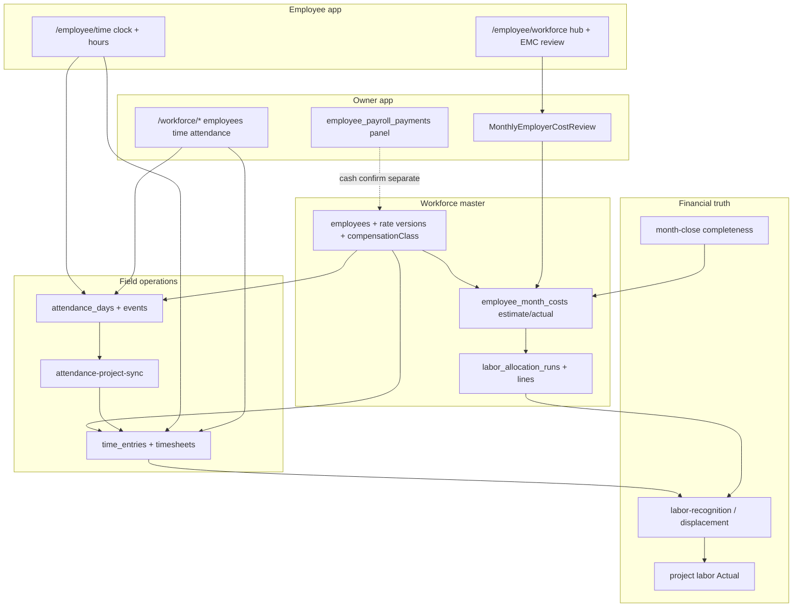

# AGENT 08 — Workforce, attendance, hours, payroll & employer cost

| Field | Value |
|--------|--------|
| **Agent** | AGENT_08 (workforce / payroll domain) |
| **Audit program** | ProjectFlow Full System Audit — October 2026 |
| **Repository** | `projectflow` |
| **Inspected commit** | `35e2ff0f7f12d0a3ec94ea0aed23b8c97b6bb00e` (main) |
| **Method** | Static code discovery, product/plan cross-check, PGlite integration + unit tests (this session). **No** production browser session. **No** DB migrations executed. |
| **Scope** | Employees master data, employee app workforce surfaces, attendance, project hours / timesheets, monthly employer cost (estimate + **exact actual** entry), labor Actual / displacement, owner–manager exemptions, payroll **cash obligation** (non-statutory). |
| **Out of scope** | Statutory payroll engine, SUMIT payroll export, exhaustive browser E2E on all `/employee/*` routes. |
| **Finding ID prefix** | `W08-xxx` |
| **Related prior audits** | `docs/audits/LAB-AUDIT-2026-09-05.md`, Oct-9 WF-001…WF-010 / FIN2-007 ledger, `docs/product/workforce-labor-cost-alignment.md`, `.cursor/plans/employee_contractor_all_roles_completion_master.plan.md`. |

---

## 1. Executive summary

**Monthly exact employer cost entry is implemented end-to-end**, not merely planned: `employee_month_costs.actual_amount`, `known_quality = 'actual'` when a positive actual is saved, `deriveKnownEmployerCost()` (actual wins when `> 0`), apply/correct/revert flows in `employer-month-costs.ts`, UI on owner `(app)` and employee app `/employee/workforce/employees/[id]`, and **6/6 PASS** in `employee-actual-employer-cost.test.ts`. Post-0021 gate `EMPLOYEE_MONTH_COSTS_READY` is **`true`** in `monthly-cost-gates.ts`.

ProjectFlow remains **not** statutory payroll (`docs/01-PRODUCT-PRINCIPLES.md`); in-repo “payroll” means **labor accrual + optional employer-pool actual + manual `employee_payroll_payments` confirmation** on the owner employee page—not NET salary or payslips.

**Test health (this session):** `tests/integration/workforce` + `tests/unit/workforce` → **347/350 PASS** (3 failures, all explainable — see **W08-007**, **W08-012**). Related audit/exec suites (OPS-B-002, WF-004, WF-006, WF-007, labor-expense-integrity) **all PASS**.

**Domain readiness:** **PARTIAL** — strong labor-cost engine and EMC actual path; gaps in auth error semantics, test drift vs default attendance→time policy, month-close strictness on actual quality, and payroll-cash UX limited to owner shell.

---

## 2. Architecture map



**Design anchors:** Attendance does **not** create labor Actual by itself; approved project time (Mode B) and/or applied monthly employer pool (Mode C displacement) do. Attendance may sync **draft** project hours unless org `attendanceProjectTimeApproval = auto_approve`.

---

## 3. Planned vs implemented — monthly exact employer cost (primary question)

| Aspect | Planned (product / plans) | Implemented @ `35e2ff0` | Verdict |
|--------|---------------------------|-------------------------|---------|
| Persist monthly employer row per employee-month | PRE-0021 / master plan: `employee_month_costs`, allocation runs | `drizzle/migrations/0021_workforce_contacts_and_allocations.sql`, `drizzle/schema/workforce.ts` | **IMPLEMENTED** |
| Owner enters **exact** monthly employer total (actual) | Optional “actual employer cost this month”; actual overrides estimate | `deriveKnownEmployerCost()`; `saveMonthlyEmployerCostDraft`, `correctMonthlyEmployerCostActual`, `returnMonthlyEmployerCostToEstimate` | **IMPLEMENTED** |
| Feature gate / readiness | Historical docs showed `EMPLOYEE_MONTH_COSTS_READY = false` | `EMPLOYEE_MONTH_COSTS_READY = true`; `areEmployeeMonthCostsAvailable()` | **IMPLEMENTED** (**W08-011** doc drift) |
| Owner UI | Monthly review on employee detail | `(app)/workforce/employees/[employeeId]/page.tsx` + `MonthlyEmployerCostReview` | **IMPLEMENTED** — browser **NOT VERIFIED** |
| Employee app mirror (LAB-WF-002) | Plan listed PARTIAL | `/employee/workforce`, `/employee/workforce/employees/[employeeId]` + `employeeMonthlyEmployerCostReviewActions` | **IMPLEMENTED** (**W08-005**) |
| Apply allocation → project labor Actual | Displacement of time snapshots | `applyMonthlyEmployerCostAllocation`, `labor-recognition` | **IMPLEMENTED** (financials cross-agent) |
| Retro actual after apply/close | WF-EMP-05 / OPS-B-002 | Supersede + adjustment; month-close coupling | **IMPLEMENTED** — OPS-B-002 **1/1 PASS** (**W08-009**) |
| Post-payroll batch “confirm actuals” wizard | LAB audit desired UX | Manual EMC entry; Today may surface missing attendance, not missing actual | **NOT IMPLEMENTED** (**W08-004**) |
| Import actual from external payroll | Not V1 | No connector | **N/A** |
| Statutory NET / payslips | Out of V1 | None | **BY DESIGN** (**W08-002**) |

**Conclusion:** The **optional exact monthly employer cost capability is implemented and integration-verified**. Remaining gaps are workflow polish, month-close policy, test alignment with default attendance sync, and non-statutory payroll cash UX—not missing the actual-amount field or persistence path.

---

## 4. Domain capability matrix

| Capability | Primary code | Routes / surfaces | Test / evidence | Status |
|------------|--------------|-------------------|-----------------|--------|
| Employee CRUD, compensation class | `application/employees.ts`, `ui/employee-form.tsx` | `(app)/workforce/employees/*` | `owner-manager-create.test.ts` **PASS** | **IMPLEMENTED** — UI NOT VERIFIED |
| Attendance clock & days | `application/attendance.ts` | `(app)/workforce/attendance`, `/employee/time` | `attendance-workday-overtime.test.ts` **PASS** | **IMPLEMENTED** |
| Attendance → project hours sync | `attendance-project-sync.ts` | Org `attendanceProjectTimeApproval` default **`draft`** | WF-006 **PASS**; atomicity A/B **FAIL** (stale expectations — **W08-012**) | **IMPLEMENTED** — test drift |
| Time entry, submit, approve | `timesheets.ts`, `scoped-operational-approval.ts` | `(app)/workforce/time`, `/employee/time` | `timesheet-approval.test.ts` **3/4**; WF-007 **PASS** | **PARTIAL** (**W08-007**) |
| Approved hours → labor Actual | `labor-recognition.ts` | Project financials | `approve-time-sum-project-labor-cost.test.ts` **PASS** | **VERIFIED (engine)** |
| Monthly estimate employer pool | `monthly-cost-recompute.ts` | Auto for MONTHLY employees | Unit `monthly-accrual.test.ts` etc. | **IMPLEMENTED** |
| **Monthly exact actual employer cost** | `employer-month-costs.ts`, `monthly-employer-cost-review.tsx` | App + employee app employee detail | **6/6** `employee-actual-employer-cost.test.ts` | **VERIFIED** (**W08-001**) |
| Accrual math (WDM denominator) | `monthly-accrual.ts` `recognizeMonthlyEmployerPoolToDate` | Profitability preview | WF-004 **PASS** (documents sensitivity) | **CONNECTED** (**W08-013**) |
| Owner/manager attendance exemption | `attendance-requirement.ts`, `compensationClass: owner_manager` | Calendars, collectors | **3/3** `owner-manager-attendance-exemption.test.ts` | **VERIFIED** (**W08-006**) |
| Owner/manager company-only EMC | `employer-month-costs.ts`, allocation | `company_only` remainder | Integration owner_manager case in EMC suite | **VERIFIED** |
| Payroll due / paid (cash) | `payroll-payments.ts`, `employee-payroll-month-panel.tsx` | Owner employee page only | Unit payroll tests | **PARTIAL** (**W08-010**) |
| Month-close: missing actual | `completeness.repository.ts` | `/month-close` | Unit `completeness.test.ts` | **CONNECTED** (**W08-003**) |
| Double-count workforce vs payroll expenses | `labor-expense-integrity.ts` | Expense classification | Unit **6/6** | **GUARDED** — misclassification risk **W08-008** |
| Employee period summary (attendance/hours/cost) | `employee-period-summary.ts`, panel on employee page | `(app)/workforce/employees/[id]` | Unit `employment-period-report.test.ts` | **IMPLEMENTED** (closes part of LAB gap — **W08-014**) |
| Missing attendance today (Today) | `command-center/data/collect-sources.ts` | Today + deep links | Static + prior audits | **PARTIAL** (not full calendar absent rows — **W08-015**) |

---

## 5. Route inventory (owner + employee)

### Owner `(app)/workforce`

| Route | Purpose |
|-------|---------|
| `/workforce` → `/workforce/employees` | Redirect hub |
| `/workforce/employees`, `/new`, `/[employeeId]` | Roster, compensation, EMC review, payroll month panel, period summary |
| `/workforce/time`, `/new`, `/approvals` | Hours, bulk approve, filters |
| `/workforce/attendance` | Day list, clock panels, monthly calendar pages under subtree |
| `/workforce/reports/monthly` | Workforce reporting |

### Employee app (workforce-relevant)

| Route | Purpose | Gates |
|-------|---------|-------|
| `/employee/time` | Clock, hours, approvals section | `attendance.self`, `time.*` |
| `/employee/hours` | Redirect → `/employee/time#hours` | — |
| `/employee/workforce` | Cost-permission hub | `WORKFORCE_COST_READ` / `MANAGE` |
| `/employee/workforce/employees/[employeeId]` | `MonthlyEmployerCostReview` | Same + `loadMonthlyEmployerCostReview` |
| `/employee/attendance` | History / correction entry points | Preset-dependent |

Shell: `get-employee-shell.ts` links `/employee/workforce` when cost permissions granted.

---

## 6. Evidence executed (this agent)

| Command / artifact | Result | Notes |
|--------------------|--------|-------|
| `vitest run tests/integration/workforce tests/unit/workforce` | **347/350 PASS** | 58 files; **3 failures** (below) |
| `vitest run tests/integration/workforce/employee-actual-employer-cost.test.ts` | **6/6 PASS** | Exact actual, retro, revert, owner_manager |
| `vitest run tests/integration/workforce/owner-manager-attendance-exemption.test.ts` | **3/3 PASS** | Collectors + EMC without attendance |
| `vitest run tests/integration/workforce/timesheet-approval.test.ts` | **3/4 PASS** | Fail: `requires time.approve to approve` |
| `vitest run tests/integration/workforce/attendance-project-atomicity.test.ts` | **6/8 PASS** | Fail: A, B expect `projectTimeApprovedCount === 1` |
| `vitest run tests/integration/audit-verification/ops-b-002-month-close-displacement.test.ts` | **1/1 PASS** | EMC + month close |
| `vitest run tests/unit/audit-verification/workforce-wf-004-accrual-exact-amounts.test.ts` | **1/1 PASS** | WDM sensitivity |
| `vitest run tests/integration/audit-verification/workforce-wf-006-attendance-auto-approve.test.ts` | **1/1 PASS** | Default **draft** sync |
| `vitest run tests/integration/audit-verification/workforce-wf-007-dual-approval-paths.test.ts` | **1/1 PASS** | Entry vs timesheet approval |
| `vitest run tests/unit/financials/labor-expense-integrity.test.ts` | **6/6 PASS** | Double-count guards |
| `vitest run tests/unit/employee-app/employee-navigation.test.ts` | **8/8 PASS** | Mobile/management nav |
| `vitest run tests/integration/employee-app/active-org-multi-tenant-login.test.ts` | **4/4 PASS** | Login scope (adjacent employee app) |

### Failure analysis (3 tests)

1. **`timesheet-approval` — `requires time.approve to approve`:** Worker has `time.manage` but not `time.approve`. `approveTimesheet` loads the sheet via `findTimesheetByIdForUpdate` **before** permission checks in `assertCanApproveSubmittedTimeEntries`; RLS yields **`NotFoundError('Timesheet')`** instead of **`AuthorizationError`** (**W08-007**).

2. **`attendance-project-atomicity` A & B:** Expect `projectTimeApprovedCount === 1` and immediate labor Actual after attendance sync. Org default `attendanceProjectTimeApproval` is **`draft`** (WF-006 **PASS** documents this). Tests predate or ignore the default — **test drift**, not necessarily product regression (**W08-012**).

---

## 7. Data model — employer cost actual (reference)

```text
employee_month_costs
  estimated_amount  — from rates / recompute
  actual_amount     — owner-entered exact employer total (nullable)
  known_amount      — derived: actual if present and > 0 else estimate
  known_quality     — 'estimated' | 'actual'
  status            — draft → applied → closed (+ supersede for corrections)

labor_allocation_runs + lines — project split; company_only for owner_manager remainder
```

Month-close `missing_employer_cost_actual`: active employees with **recorded time** in month (or any EMC row) and **no** EMC row with `known_quality = 'actual'` (`countMissingEmployerCostActual` in `completeness.repository.ts`).

---

## 8. Findings register (`W08-xxx`)

| ID | Severity | Area | Summary | Planned | Implemented | Evidence | Recommendation |
|----|----------|------|---------|---------|-------------|----------|----------------|
| **W08-001** | INFO (+) | Employer cost | **Exact monthly employer actual entry** — field, derivation, persist, apply, retro, UI (app + employee app) | Optional actual PRE-0021 | Yes | `employer-month-costs.ts`, UI, **6/6** integration | Mark **VERIFIED** in master ledger; optional browser smoke save→apply |
| **W08-002** | INFO | Payroll scope | Not statutory payroll; cash obligation separate from EMC | V1 principles | Matches | `payroll-payments.ts`, product principles | No “full payroll” without product decision |
| **W08-003** | MEDIUM | Month close | Completeness requires `known_quality = actual` for in-scope employees — estimate-only months still flag | By SQL design | Yes | `countMissingEmployerCostActual` | UX copy: estimate vs close checklist; optional org policy |
| **W08-004** | LOW | UX | No post-payroll batch “confirm actuals” / wizard (LAB expectation) | Desired | Manual EMC only | LAB-AUDIT-2026-09-05 | P2 Today filter → employees missing actual |
| **W08-005** | INFO (+) | Employee app | EMC review on `/employee/workforce/*` with cost permissions | LAB-WF-002 PARTIAL in plan | Yes | Employee workforce pages | Update plan status to IMPLEMENTED |
| **W08-006** | INFO (+) | Owner exemption | `owner_manager` skipped for missing-attendance signals; company-only EMC path | WF-EMP-02 | Yes | **3/3** integration | **PRESERVE** |
| **W08-007** | MEDIUM | AuthZ | `approveTimesheet` without `time.approve` → **`NotFoundError`**, not **`AuthorizationError`** | Explicit deny preferred | RLS hide-first | `timesheet-approval.test.ts` fail; `timesheets.ts` ~594+ | Assert `TIME_APPROVE` before load **or** document RLS semantics; fix test if intentional |
| **W08-008** | HIGH | Financial integrity | Workforce labor Actual + misclassified **`internal_employee_payroll`** expenses can double-count | Guard via classification | Partial (code guards) | `labor-expense-integrity.test.ts` **6/6** | Enforce classification in UI; **PRESERVE** regression |
| **W08-009** | INFO (+) | Month close | OPS-B-002 EMC displacement coupling | WF-003 | Yes | **1/1** ops-b-002 integration | **VERIFIED** @ this commit |
| **W08-010** | MEDIUM | Payroll cash | `employee_payroll_payments` + confirm UI on **owner** employee page only | Owner closure notes | API + owner UI | No employee-app payroll panel | Accept PARTIAL or extend employee shell |
| **W08-011** | LOW | Docs | `_PRE0021-AGENT3-UX.md` still describes gate false / draft-only EMC | Historical | Code `true` | `monthly-cost-gates.ts` | Update product doc |
| **W08-012** | MEDIUM | Tests / policy | `attendance-project-atomicity` A/B expect auto-approved sync; product default is **draft** (WF-006) | Default draft documented | Tests stale | **6/8** atomicity; WF-006 **PASS** | Fix tests (set org `auto_approve` in setup **or** expect draft counts); avoid false CI red |
| **W08-013** | MEDIUM | Accrual math | Low `workingDaysPerMonth` **front-loads** recognized employer pool vs calendar WDM (WF-004) | Known business sensitivity | By formula | WF-004 **PASS** (3250 vs 2215.91 for 5 days) | Owner education in EMC preview; optional cap policy |
| **W08-014** | INFO (+) | Employee detail | `EmployeePeriodSummaryPanel` on owner employee page (days/hours/missing dates/cost) | LAB audit gap | Yes | `employee-period-summary.tsx`, unit tests | Update LAB audit “no summary page” as **closed** |
| **W08-015** | LOW | Attendance UX | Today `missing_attendance_today` exists; flat list still no full “absent row” expansion per employee-month (LAB) | includeAbsent view | Partial | `collect-sources.ts`; no `includeAbsent` on list API | Optional read-model for gap days on attendance monthly |

**Severity counts:** CRITICAL 0 · HIGH 1 · MEDIUM 5 · LOW 3 · INFO 5  

**Cross-reference (prior IDs):** WF-001 ≈ **W08-008**; WF-003 ≈ **W08-009**; WF-004 ≈ **W08-013**; WF-006 aligns with **W08-012**; LAB-WF-002 ≈ **W08-005**; FIN2-007 ≈ **W08-008**.

---

## 9. Owner / manager exemption (summary)

| Rule | Implementation |
|------|----------------|
| Attendance not required | `compensationClass === 'owner_manager'` in `attendance-requirement.ts` |
| Missing-attendance collectors | Excluded — `owner-manager-attendance-exemption.test.ts` |
| Employer cost without clock | Monthly EMC + `company_only` allocation paths |
| Manual project hours | Allowed; monthly recognition without attendance |
| Calendar / missing-day UX | Missing workdays not flagged when not attendance-required |

---

## 10. Payroll terminology (audit disambiguation)

| Term in repo | Meaning | Exact employer cost? |
|--------------|---------|----------------------|
| **Labor Actual / True Cost** | Approved project time ± monthly allocation displacement | Uses rates / pool; not payslip NET |
| **Monthly employer cost (EMC)** | Org employer burden for month | **Yes — `actual_amount` is the exact entry point** |
| **Payroll obligation / payment** | `employee_payroll_payments` — due date, confirm paid | Separate from EMC actual |
| **Expense `internal_employee_payroll`** | Mode B lump payroll-like expense | Excluded from Actual when workforce path active |

---

## 11. Recommendations (audit-only)

1. **Integrator:** Carry **W08-001**, **W08-007**, **W08-008**, **W08-012** into master annex (CI may show 3 failing workforce tests until **W08-012** / **W08-007** resolved).
2. **QA:** Browser smoke — save EMC actual → apply allocation → month-close checklist item clears.
3. **Docs:** Refresh PRE-0021 UX gate doc (**W08-011**) and employee_contractor master plan EMC mirror (**W08-005**).
4. **Tests:** Align `attendance-project-atomicity` with WF-006 default or explicit org setting in fixture (**W08-012**).

---

## 12. Severity rollup & domain readiness

| Severity | Count |
|----------|------:|
| HIGH | 1 |
| MEDIUM | 5 |
| LOW | 3 |
| INFO | 5 |

**Workforce / employer-cost readiness:** **PARTIAL** — core roster, attendance, hours, EMC **exact actual**, and owner_manager rules are **code-complete and largely test-green**; payroll cash and statutory scope intentionally narrow; **3 test failures** and auth/attendance-policy drift need hygiene before calling CI workforce suite fully green.

---

## 13. Agent sign-off

| Item | Value |
|------|--------|
| Deliverable | `docs/audits/2026-10-full-system-audit/subagents/AGENT_08_workforce_payroll.md` |
| Primary audit question | Monthly exact employer cost — **IMPLEMENTED + integration-verified** (**W08-001**) |
| Blocking for integrator | **W08-008** (financial double-count risk); **W08-012** (CI test drift) |
| SQL / migrations | None prepared or executed |

**Agent status:** Complete (audit-only; single file).
