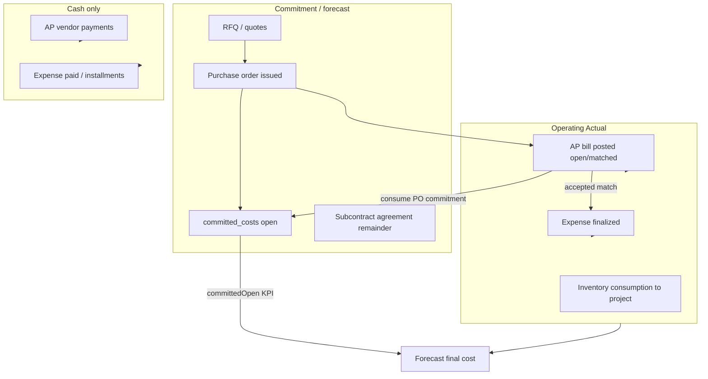

# AGENT 09 — Procurement, vendors, expenses & project cost allocation

| Field | Value |
|--------|--------|
| **Agent** | AGENT_09 (procurement / expenses) |
| **Domain** | Vendors, procurement (RFQ/PO/receiving/AP), materials catalog, material marketplace, expenses, commitments vs invoices vs payments, allocation to projects |
| **Inspected commit** | `35e2ff0f7f12d0a3ec94ea0aed23b8c97b6bb00e` |
| **Method** | Static trace of financial compose path (`getProjectFinancials` → `composeProjectFinancials`), AP/procurement/expense domain modules, schema (`drizzle/schema/procurement.ts`, `ap.ts`, `expenses.ts`, `vendors.ts`), unit tests (read, not executed). |
| **Out of scope** | Applying SQL/migrations, live production data sampling, full E2E money-chain run. |

---

## 1. Executive summary

ProjectFlow implements a **layered vendor cost model** that is largely explicit in code: **PO issue → committed cost (forecast only)**, **posted vendor bill → operating Actual**, **vendor payment → cash only**, **finalized expense → operating Actual** unless linked to a recognized bill via **accepted `ap_po_matches`**. Project totals are composed in one path (`loadProjectFinancialsReadBundle` → `composeProjectFinancials`).

**Double-counting** is the primary audit lens. The codebase has **strong dedupe mechanics when expense↔bill links are accepted and amounts align**, but several paths **warn without blocking**, **recognize full bill NET while deducting partial match amounts from expenses**, or **aggregate budget/cost-code views with narrower rules than project financials**.

| Severity | Count (V09 IDs) |
|----------|-----------------|
| HIGH | 2 |
| MEDIUM | 6 |
| LOW | 4 |
| INFO | 3 |
| **Total** | **15** |

---

## 2. Economic ladder (as-built)

| Stage | Tables / modules | Enters project **Actual**? | Enters **committedOpen**? | Enters **cash** forecast? |
|-------|------------------|----------------------------|---------------------------|---------------------------|
| Vendor master | `vendors`, engagements, subcontracts | No | Subcontract remainder (net of PO) | No |
| RFQ / quote | `procurement_rfqs`, `supplier_quotes` | No | No | No |
| PO issued | `purchase_orders`, `committed_costs` | **No** (`committed-cost.ts`) | Yes | Optional open-commitment rows |
| AP bill draft | `ap_bills` draft | No | No | No |
| AP bill posted | `ap_bills` open/partially_matched/matched | Yes (`vendor-cost-recognition`) | Consumes PO when linked | Open AP payable |
| Expense finalized | `expenses`, `expense_allocations` | Yes (unless bill-linked dedupe) | No | Unpaid expense rows |
| Bill ↔ expense match | `ap_po_matches` accepted | Dedupes expense slice | May consume PO on accept | Expense row dropped from op-cash if any match |
| Vendor payment | `ap_payments`, applications | **No** | No | Yes |
| Stock purchase | `inventory_stock_purchase` on bill/expense | Via inventory layers / consumption, not duplicate op-expense | N/A | AP / expense cash rules |

**Canonical compose:** `src/modules/financials/application/compose-project-financials.ts` applies `applyLinkedExpenseDeductionsToContributions` then `withRecognizedVendorBills`.

---

## 3. Vendors & subcontract commitments

| Area | Implementation | Double-count notes |
|------|----------------|-------------------|
| Vendor 360 / AP panel | `src/modules/ap/ui/vendor-ap-360-panel.tsx`, vendor lists | Bills and payments surfaced separately from Actual |
| Subcontract agreements | `src/modules/vendors/domain/subcontract-commitment.ts` | **Remaining commitment** = agreement value − recognized AP actual, **minus open PO once per vendor** (avoids PO + subcontract double forecast) |
| Subcontract → AP | `subcontract-claims` creates **draft** bills only | Does not post Actual until AP post |
| Vendor portal candidates | `src/modules/portal/application/submit-vendor-ap-candidate.ts` | Review does not post bills (explicit guard in review flow) |

---

## 4. Procurement & materials catalog

| Capability | Routes / modules | Financial hook |
|------------|------------------|----------------|
| Org procurement hub | `/procurement`, RFQ, PO, receiving | `issuePurchaseOrder` → `committed_costs` |
| Materials catalog | `/procurement/materials`, `material_items`, `material_vendor_prices` | Price list only; **does not** post Actual |
| PO receiving | `receive-purchase-order.ts`, `po-receive-form` | Quantity/receiving; commitment consumption tied to **AP**, not receipt alone |
| DG closeout | `drizzle/schema/dg-procurement-closeout.ts`, migration 0167 | Field lock / audit; not a second Actual engine |
| Contractor tenders | `src/modules/contractor-procurement/` | Parallel tender/bid flow; award rules separate from org PO ledger |

**Rule (enforced in domain):** `src/modules/procurement/domain/committed-cost.ts` — `CommittedCost != Expense`; issue PO must not create expense.

**PO → bill → commitment consumption:**

- On post with header `purchase_order_id`: `consumePoCommitmentForPostedBill` (`bills.ts`) uses `consumeAmountForPostedPoBill`.
- On match accept: `shouldConsumeCommitmentOnMatchAccept` skips second consume when bill header already linked same PO.
- Full bill match to PO: `shouldReleaseRemainingCommitmentOnSettlement` closes remaining open commitment (under-bill variance).

---

## 5. Material marketplace (macro monitor)

| Item | Detail |
|------|--------|
| Module | `src/modules/material-market/` (FRED/CBS adapters, pressure snapshots) |
| UI | `/material-market`, trade detail panels |
| Ops | `runMaterialMarketRefresh` in `daily-ops-worker.ts` |
| Link to procurement | **None automatic** — catalog `material_items.trade` tags vendor prices for org signals; marketplace does not write PO lines or Actual |

Marketplace is **decision support**, not a second procurement ledger (see `docs/21-PROCUREMENT-MATERIALS-INVENTORY.md` planning doc vs implemented Wave 3 foundations).

---

## 6. Expenses & project allocation

| Mechanism | Source | Project Actual behavior |
|-----------|--------|-------------------------|
| Direct project expense | `expenses.project_id` | Full NET (or installment recognition) via `loadProjectExpenseContributions` |
| Multi-project allocation | `expense_allocations` + optional `allocation_runs` | Allocated slices; gross lines scaled to NET |
| Allocation intent | `allocation_intent` enum + `resolveExpenseAllocationIntent` | Routes overhead vs auto-pool vs project_allocate |
| Integrity audit | `expense-integrity-audit.ts` | Detects `project_id_with_multi_allocations`, intent mismatches, NET not conserved |
| Ops-linked expense | `ops-finance/create-linked-expense.ts` | Draft only; no silent Actual from ops metadata |
| Overlap UX | `expense-ap-overlap-warning.tsx` | Similarity warnings; **not** a hard gate (see V09-001) |

**Inventory stock purchases:** finalized expenses with `inventory_stock_purchase` are **excluded** from operating expense contributions; material Actual expected from consumption path (`expenses.repository` filters).

---

## 7. AP: bills, matches, payments, credits

| Concept | Behavior |
|---------|----------|
| Recognition statuses | `open`, `partially_matched`, `matched` → Actual; `draft`, `void` excluded |
| Multi-project bills | `ap_bill_project_allocations` — header `project_id` ignored when allocation rows exist (`vendor-bill-project-attribution.ts`) |
| Bill ↔ PO ↔ expense match | `ap_po_matches` (name legacy: includes expense target) |
| Partial matching | Multiple accepted matches per bill; status derived from summed match amounts |
| Credits | Reduce recognized Actual per `vendor-credits.ts` / `netProjectSliceAfterCredits` |
| Payments | Never added to Actual (`isVendorPaymentRecognizedActual`) |
| Stock lines | Operating Actual slice reduced by stock line NET (`inventory-stock-purchase.ts`) |

---

## 8. Double-counting risk matrix

| Scenario | Intended behavior | Residual risk |
|----------|-------------------|---------------|
| PO + posted bill (linked) | Actual = bill; commitment consumed | LOW if PO linked at post or match |
| PO open + bill without PO link | Actual + open commitment until linked | MEDIUM forecast inflation (V09-007) |
| Expense + same vendor bill (no match) | Should warn/block | **HIGH** — guards no-op (V09-001) |
| Expense + bill with **partial** accepted match | Unit test expects bill slice = match amount | **HIGH** — loader uses full bill NET (V09-002) |
| Expense + bill with **full** match | Expense dropped; bill counts | LOW when match sum ≥ expense NET |
| Header `project_id` + allocation lines | Single attribution | MEDIUM if finalized (V09-003) |
| Bill split across projects + linked expense | Per-project bill slices + expense dedupe | MEDIUM in budget cost-code path (V09-004) |
| Stock expense + stock bill + consumption | Single economic cost | MEDIUM if mis-tagged (V09-011) |
| AP payment + expense both marked paid | Cash only paths | LOW for Actual; watch cash double (V09-006) |
| Subcontract remainder + PO same vendor | PO nets once | LOW (explicit domain) |

---

## 9. Findings register (V09-xxx)

| ID | Severity | Title | Evidence | Recommendation |
|----|----------|-------|----------|----------------|
| **V09-001** | HIGH | Expense/AP “block overlap” is a no-op at runtime | `assertNoUnlinkedExpenseApOverlap` returns immediately (`expense-ap-overlap.ts`); called from `assertExpenseFinalizeHasNoUnlinkedApOverlap` / `assertApBillHasNoUnlinkedExpenseOverlap` (`assert-expense-ap-overlap.ts`) and `finalizeExpense` / `promoteDraftApBillToOpen` | Implement throw on `hitCount > 0` unless `confirmDistinctCosts`, or rename docs/comments to “warn only” and enforce UI confirm on post/finalize |
| **V09-002** | HIGH | Partial expense↔bill match can inflate Actual | Dedupe subtracts `matchedAmount` only (`expense-ap-dedup.ts`); recognition loads **full** bill project slice in `loadRecognizedVendorBillsForProject` / `foldRecognizedVendorBillsFromApBundle`. Unit compose test uses `billAmounts: ['6000']` with `linkedExpenseDeductions: 6000` on 10k expense — **not** proven against SQL loader | Cap recognized bill contribution to matched expense links per bill, or recognize bills only up to unmatched remainder; add integration test with real `ap_po_matches` row |
| **V09-003** | MEDIUM | Header project + allocation lines can double-count Actual | `loadExpenseContributions` loads **both** direct (`expenses.project_id`) and `expense_allocations` without mutual exclusion; integrity audit flags `project_id_with_multi_allocations` but `finalizeExpense` does not reject | Block finalize when header project + project allocation lines; or exclude direct header amount when allocations exist |
| **V09-004** | MEDIUM | Budget cost-code Actual diverges from project financials for split bills | `loadActualAmountsByCostCodeForProject` filters AP lines by `ap_bills.project_id` only; linked expense exclusion uses `apBills.projectId = projectId` only (`cost-code-attribution.repository.ts`) | Reuse `resolveVendorBillProjectAmounts` + allocation-aware linked expense ids (same as `committed-costs.repository`) |
| **V09-005** | MEDIUM | Vendor Actual breakdown panel ≠ compose dedupe rules | `loadProjectVendorActualBreakdown` excludes **entire** expense if any org-wide accepted match (`loadLinkedExpenseIds`); bills add full slices — inconsistent with partial match economics | Align panel with `applyLinkedExpenseDeductionsToContributions` or document as approximate |
| **V09-006** | MEDIUM | Cash forecast drops matched expenses entirely | `loadOperatingExpenseCashRows` `notExists` any accepted match on recognized bill — partial match removes whole expense from op-cash while AP cash still flows (`cash-flow-sources.repository.ts`) | Exclude only matched gross/net portion or tie to `expenseRemainingAfterMatches` |
| **V09-007** | LOW | Open PO commitment overlaps recognized bill until PO link | By design when bill posts without PO; forecast = Actual + `committedOpen` | Operational: require PO on bill create or surface “unlink commitment” in UI |
| **V09-008** | LOW | Material marketplace not wired to PO/catalog pricing | Separate modules; catalog trades feed org vendor price signals only | Product doc: marketplace is monitor, not procurement engine |
| **V09-009** | LOW | `ap_po_matches` naming | Table holds bill+PO+**expense** links | Rename in docs/UI to “AP match” to reduce audit confusion |
| **V09-010** | INFO | Single Actual compose engine | `composeProjectFinancials`, `vendor-cost-recognition.ts`, `committed-cost.ts` comments | Preserve in refactors |
| **V09-011** | MEDIUM | Stock purchase triple path | Expense stock flag excluded from op Actual; AP stock lines stripped; consumption adds material Actual | Guardrails on finalize/post; E2E stock purchase once |
| **V09-012** | INFO | Subcontract vs PO commitment net | `computeVendorSubcontractRemainingNet` | Keep when extending forecast |
| **V09-013** | INFO | Test coverage anchors | `tests/unit/procurement/committed-cost.test.ts`, `tests/unit/financials/expense-ap-dedup.test.ts`, `tests/unit/ap/vendor-cost-recognition.test.ts` | Extend with partial-match integration (V09-002) |
| **V09-014** | LOW | Overlap similarity uses float ratios | `amountsMayOverlap` in `expense-ap-overlap.ts` uses `Number()` for ratio | Use money helpers for tolerance |
| **V09-015** | INFO | E2E money chain touches overlap | `project-centric-money-chain.spec.ts` scenario 2 (expense/AP overlap) — not run in this audit | Run harness per parent audit |

---

## 10. Allocation to projects (summary)

| Source | Attribution rule |
|--------|------------------|
| Expense direct | `expenses.project_id` |
| Expense shared | `expense_allocations.target_type = project` (+ weight runs) |
| Vendor bill | Header project **or** `ap_bill_project_allocations` lines (never both) |
| Bill line economic target | Line-level `project_id` in recognized atom loader |
| PO commitment | `committed_costs.project_id` |
| General / overhead pool | Auto allocation runs → project slices (separate from vendor AP) |

**Remainder:** AP bills may have unallocated vendor remainder (`vendor-general-remainder.ts`); expenses support `remainder_allocation_intent` on AP header (schema 0084).

---

## 11. Suggested follow-ups (audit-only)

1. Fix or wire **V09-001** before relying on overlap asserts in compliance reviews.  
2. Add integration test proving **V09-002** against `loadRecognizedVendorBillsForProject` + accepted partial match.  
3. Align **budget cost-code** loaders with financial compose (**V09-004**).  
4. Run `project-centric-money-chain.spec.ts` scenario 2 on PGlite and attach result to parent audit.  

---

## 12. Key file index

| Concern | Path |
|---------|------|
| Committed vs expense | `src/modules/procurement/domain/committed-cost.ts` |
| Vendor recognition | `src/modules/ap/domain/vendor-cost-recognition.ts` |
| Bill project split | `src/modules/ap/domain/vendor-bill-project-attribution.ts` |
| Expense/AP dedupe | `src/modules/financials/domain/expense-ap-dedup.ts` |
| Overlap (warn) | `src/modules/financials/domain/expense-ap-overlap.ts` |
| Overlap assert callers | `src/modules/financials/application/assert-expense-ap-overlap.ts` |
| Project compose | `src/modules/financials/application/compose-project-financials.ts` |
| Recognized bill rollup | `src/modules/financials/data/committed-costs.repository.ts` |
| Expense contributions | `src/modules/financials/data/expenses.repository.ts` |
| AP match accept | `src/modules/ap/application/matches.ts` |
| Post bill | `src/modules/ap/application/bills.ts` |
| Expense integrity | `src/modules/expenses/application/expense-integrity-audit.ts` |
| Cost-code budget Actual | `src/modules/budgets/data/cost-code-attribution.repository.ts` |
| Cash sources | `src/modules/financials/data/cash-flow-sources.repository.ts` |
| Material marketplace | `src/modules/material-market/` |
| Schema | `drizzle/schema/procurement.ts`, `drizzle/schema/ap.ts`, `drizzle/schema/expenses.ts` |

---

*End of AGENT_09 report.*
