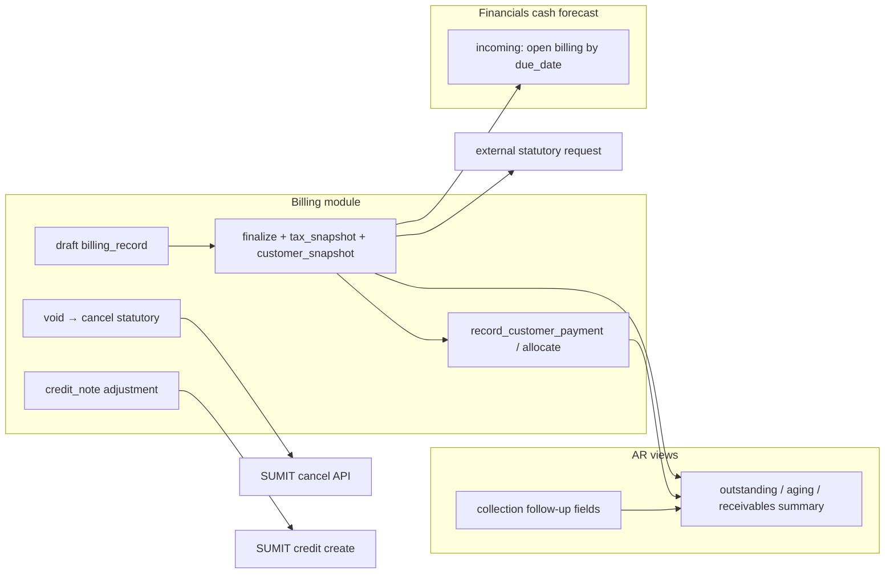

# AGENT 10 — AR, billing, collections, cash flow & SUMIT statutory integration

| Field | Value |
| --- | --- |
| **Agent** | AGENT_10 |
| **Domain** | Accounts receivable, invoicing, collections, customer payments & allocation, cash-flow forecast inflows, SUMIT external statutory documents (tax invoice, receipt, credit, cancel), expense ingestion from SUMIT |
| **Inspected commit** | `35e2ff0f7f12d0a3ec94ea0aed23b8c97b6bb00e` |
| **Plan reference** | `.cursor/plans/sumit_integration_phase_0.plan.md` (read; not modified) |
| **Method** | Static trace of `src/modules/billing`, `src/modules/invoicing-integration`, `src/modules/financials` (cash forecast), `src/modules/expense-ingestion` (SUMIT), Drizzle migrations `0093`/`0094`/`0134`, settings UI; **executed** targeted Vitest (no live SUMIT API) |
| **Out of scope** | Production SUMIT calls, Owner test-org credentials, full E2E money-chain / Playwright, applying SQL to shared DB |

---

## 1. Executive summary

ProjectFlow separates **internal billing** (amounts, payments, AR aging) from **external statutory issuance** (SUMIT). The SUMIT Phase 0 plan’s core invariants—**issuance lock**, **three outcomes** (`confirmed_rejected` / `confirmed_created` / `ambiguous`), **blocking partial unique index**, **orthogonal reconciliation**—are implemented in application code, schema, and unit tests. Milestones **beyond** the plan’s “A only / B pending” state are largely **already built in code**: receipts after payment, credit notes, cancel-on-void, PDF archival, expense polling, and server actions for credit/cancel/refresh.

**Primary residual risks** are (1) **FIN-005-style line mapping** where default billing lines store **gross** in `lineTotal` but SUMIT items treat that field as **net**, producing systematic **reconciliation mismatch** for typical single-line invoices; (2) **incomplete ambiguous recovery** when create times out **without** `DocumentID`—the plan’s **list + ExternalReference scan** and **manual admin link** are not implemented, and the daily recovery worker only calls `refreshExternalStatutoryStatus`, which **requires** an existing provider id; (3) **no server-side proof** that connected credentials belong to a SUMIT **test configuration** org—safety relies on Owner discipline and SUMIT’s single API host.

| Severity | Count (B10 IDs) |
| --- | ---: |
| HIGH | 2 |
| MEDIUM | 6 |
| LOW | 3 |
| INFO | 4 |
| **Total** | **15** |

---

## 2. Architecture map

### 2.1 Internal AR (ProjectFlow ledger)

| Concern | Location | Notes |
| --- | --- | --- |
| Lifecycle | `src/modules/billing/domain/lifecycle.ts`, `finalize-billing-record.ts` | Finalize captures `tax_snapshot` (+ optional `vatRatePercent`) and `customer_snapshot` when client present |
| Payments | `record-customer-payment.ts`, `allocate-customer-payment.ts` | Cash application; triggers statutory scheduling via `schedule-statutory-for-allocations.ts` |
| Collections | `update-collection-follow-up.ts`, `collection-follow-up.ts` | **Non-financial** follow-up columns only (contacted / next follow-up / promise / note) |
| AR aging | `get-receivables-aging.ts`, `domain/aging.ts` | Up to 5k records; credit notes net into totals |
| Void + statutory | `void-billing-record.ts` | Calls `cancelIssuedStatutoryDocumentsForBillingVoid` (addresses prior FIN-002) |
| Adjustments | `create-billing-adjustment.ts` | Calls `issueStatutoryCreditForBillingAdjustment` (addresses prior FIN-004) |

### 2.2 External statutory (SUMIT)

| Layer | Key paths |
| --- | --- |
| Orchestration | `request-external-document.ts` (committed lock + outcomes), `refresh-external-status.ts`, `credit-or-cancel-external.ts`, `trigger-statutory-after-payment.ts` |
| Provider | `providers/sumit/sumit-statutory-provider.ts`, `sumit-http-client.ts`, `sumit-create-payload.ts` |
| Persistence | `data/external-documents.repository.ts`, migrations `0093_invoicing_sumit_hardening.sql`, `0094_statutory_receipt_payment_link.sql`, `0134_sumit_pdf_archival.sql` |
| Credentials | `manage-provider-connection.ts`, `data/credentials.repository.ts`, sealed API key |
| UI | `settings/integrations/sumit-panel.tsx`, `ui/external-statutory-panel.tsx`, `ui/statutory-document-card.tsx`, `ui/actions.ts` |
| Ops | `sumit-recovery-ops-worker.ts` (daily ops), `app/api/internal/sumit-expense-worker/route.ts` |
| AP bridge (future in plan, present in code) | `src/modules/expense-ingestion/**` |

**Host guard:** Only `https://api.sumit.co.il` is allowed (`sumit-provider-environment.ts`). SUMIT test and production orgs share this host; test orgs are distinguished by **CompanyID** credentials, not URL.

### 2.3 Collection modes

| Mode | Detection | Behavior |
| --- | --- | --- |
| Collection only | `isCollectionOnlyMode` | AR/payments in PF; no external issuance |
| Accounting + collection | `isAccountingInvoicingMode` | SUMIT (when connected) for statutory docs; PF remains non-issuer |

---

## 3. Phase 0 plan alignment

| Plan item | Plan status (file) | Code reality (this commit) | Gap |
| --- | --- | --- | --- |
| Milestone A — test connection | completed | Connect UI, vault, mocked tests | — |
| Milestone B — one live tax invoice | **pending** | Full create + reconciliation + UI + persistence tests | Plan todos **stale**; live verification still Owner-gated |
| Milestone C — receipt | deferred | `request-external-statutory-for-payment.ts`, blocking indexes on payment | Shipped in code |
| Milestone D — credit | deferred | `creditDocument`, adjustment hook, UI actions | Shipped in code |
| Expense / AP SUMIT | future phase | Expense worker + `listExpenseDocuments` | Shipped in code |
| No PDF download in PF | stated | `getDocumentPdf` + `saveStatutoryPdfToStorage` + project folder archive | **Superseded** by DOC-012-style archival (see B10-011) |
| Production impossible in MVP | required | Host allowlist only; **no** test-org fingerprint | See B10-006 |
| Ambiguous recovery: list scan + manual UI | mandatory | Partial: worker + refresh; **no** list scan, **no** manual link | B10-002, B10-003, B10-004 |
| Safe retry / blocking index | mandatory | `assert-issuance-eligible.ts`, partial unique indexes | Covered by tests |

---

## 4. Issuance & reconciliation (as-built)

### 4.1 Happy path

1. User with `BILLING_MANAGE` → `requestExternalStatutoryDocumentCommitted` (server action).
2. `prepareIssuanceLock`: assert eligibility, insert/reopen row with `issuance_outcome=in_flight`.
3. Provider `createDocument` → on success `confirmed_created`, reconcile NET/VAT/GROSS (`reconcile-external-amounts.ts`).
4. Best-effort PDF archive scheduled (`scheduleStatutoryPdfToProjectFolders`).

### 4.2 Three-outcome model

| Outcome | Persistence | Re-issue allowed? |
| --- | --- | --- |
| `confirmed_rejected` | `status=cancelled` | Yes, via reuse of same row (`findReusableRejectedDocument`) |
| `confirmed_created` | `status=issued` (typical) | **No** (blocking) |
| `ambiguous` | `status=pending` | **No** (blocking) |

### 4.3 Reconciliation

Orthogonal field `reconciliation_status`: `pending` / `matched` / `mismatch` / `not_available`. UI shows mismatch banner on `statutory-document-card.tsx`. Amount mismatch **does not** flip document to `failed` (matches plan).

---

## 5. Cash flow & collections

| Source | Module | Tied to SUMIT? |
| --- | --- | --- |
| Open billing inflows | `financials/data/billing.repository.ts` → `get-organization-cash-flow-forecast.ts` | **No** — uses PF outstanding/due dates |
| Customer payments (historical) | `loadCashFlowPayments` | Cash actuals in forecast |
| Collection follow-up | Billing record columns | CRM-style; **no** auto email/SUMIT send from collection status |
| Statutory send | `send-external-statutory-document.ts` | Optional SUMIT `send` from document card |

Collections **do not** block or drive statutory issuance; statutory panel is gated on finalize + customer snapshot + non-blocking tax invoice row.

---

## 6. Automated tests executed (no production SUMIT)

| Suite | Command scope | Result |
| --- | --- | --- |
| SUMIT-named unit tests | 13 files (`sumit-*`, `fin-003/004/005`, settings validation, expense ingestion) | **49/49 pass** |
| Billing + invoicing-integration unit | 38 files under `tests/unit/invoicing-integration/` + `tests/unit/billing/` | **170/170 pass** |
| Invoicing persistence (PGlite) | `tests/integration/invoicing-integration/persistence.test.ts` | **2/2 pass** |

**Not run in this audit:** Playwright money-chain, live demo scripts (`scripts/live-demo-statutory-flows-bc.ts`), full `test:integration` billing matrix.

---

## 7. Findings register

| ID | Severity | Area | Observation | Evidence | Risk if ignored | Suggested direction |
| --- | --- | --- | --- | --- | --- | --- |
| **B10-001** | **HIGH** | VAT / SUMIT payload | Default billing lines set `lineTotal` from header **`totalAmount` (gross)** while statutory bridge maps `lineTotal` → **`lineNet`** and SUMIT `Items[].TotalPrice`. Header subtotal/tax stay correct, but **line items sent to SUMIT are inflated** under exclusive VAT → **`reconciliation_status=mismatch`** on typical single-line invoices. | `create-billing-record.ts` `buildLines` (gross in `lineTotal`); `build-statutory-bridge.ts` `mapLines`; `fin-005-gross-line-sumit-mapping.test.ts` documents behavior | Owners cannot trust “matched” for default invoices; manual SUMIT fixes | Store **net** on lines at create, or split gross→net in bridge before `buildSumitCreatePayload` |
| **B10-002** | **HIGH** | Ambiguous recovery | Phase 0 plan requires **list by date/type + scan `ExternalReference`** when create is ambiguous **without** `DocumentID`. HTTP client exposes **`listExpenseDocuments` only** (types 15–21); **no** invoice list+scan helper. | Plan § recovery; `sumit-http-client.ts` (no invoice list); grep shows no recovery scan in invoicing-integration | Timeout without partial ID → **permanent block** unless ops intervenes in SUMIT UI | Implement `listAccountingDocuments` + ExternalReference matcher; wire into recovery worker |
| **B10-003** | **HIGH** | Ops worker | `runSumitRecoveryOpsWorker` resolves ambiguity via `refreshExternalStatutoryStatus`, which **throws** when `externalId` is null. Ambiguous rows **without** partial DocumentID never refresh. | `refresh-external-status.ts` L44–48; `sumit-recovery-ops-worker.ts` `processOrg` | Automated recovery **no-op** for worst-case ambiguous | Combine B10-002 scan **or** manual link API before refresh |
| **B10-004** | MEDIUM | Manual resolution UX | Plan mandates admin **manual resolution** (enter DocumentID or Type+Number). UI exposes **refresh** on cards but **no** “link external document” flow for null-id ambiguous rows. | Plan § ambiguous recovery step 4; UI grep — no manual link action | Stuck billings require DB/support intervention | Admin action + `getdetails` by Type+Number |
| **B10-005** | MEDIUM | Error taxonomy | On committed path, non-`SumitAmbiguousCreateError` throws from `createDocument` are persisted as **`ambiguous`** (L239–246), not `confirmed_rejected`. Transient bugs could **block** re-issue incorrectly. | `request-external-document.ts` `executeProviderCreateAndPersistOutcome` | False ambiguous blocks billing | Narrow ambiguous to classified provider/network errors only |
| **B10-006** | MEDIUM | Production safety | Plan: “production impossible in MVP.” Code allows **any valid** SUMIT `CompanyID`/key on live API—**no** validation of test-org markers (e.g. VAT 999999998 / name “בדיקות”). | `connectSumitTestConfiguration`; `sumit-provider-environment.ts` | Real statutory docs if production keys connected | Owner process + optional test-org probe; document in runbook |
| **B10-007** | MEDIUM | Plan hygiene | `sumit_integration_phase_0.plan.md` todos still show B/C/D **pending/deferred** while code implements them. | Plan frontmatter vs `sumit-credit-cancel-and-payment-plan.test.ts`, migrations 0094 | Release/process confusion | Update plan todos or add “implementation superseded” note |
| **B10-008** | LOW | i18n | Error key `productionBlocked` text describes **host allowlist**, not test-vs-prod org. | `locales/en/invoicingIntegration.json` | Operator misreads connection errors | Rename key / clarify copy |
| **B10-009** | LOW | Statutory PDF | Plan said metadata-only / view in SUMIT; product now **downloads PDF** (`getpdf`) and archives to project storage. | `save-statutory-pdf-to-storage.ts`, migration 0134 | Extra storage/egress; otherwise intentional | Treat as accepted product change; update plan/docs |
| **B10-010** | LOW | Phase 6 allocation | `allocateReference` remains **unsupported** for SUMIT (ITA allocation). | `sumit-statutory-provider.ts` `unsupported('SUMIT allocation')` | Expected until Phase 6 | Keep blocked until OpenAPI-backed endpoint |
| **B10-011** | INFO | Regression vs Oct audit | Prior **FIN-002/003/004** (void decoupling, credit UI, adjustment hook) appear **wired** in current tree. | `void-billing-record.ts`; `ui/actions.ts`; `create-billing-adjustment.ts` | — | Close FIN items in parent audit if not already |
| **B10-012** | INFO | Test depth | Strong unit coverage for connect, payload, reconciliation, ambiguous durability, receipt idempotency, credentials seal. | `tests/unit/invoicing-integration/**` | — | Add integration test for B10-002 when built |
| **B10-013** | INFO | Live verification | No agent run used live SUMIT; Milestone B **Owner gate** (test org keys) still applies. | Plan “before live test” | — | Owner smoke per plan after keys connected |
| **B10-014** | INFO | Expense ingestion | SUMIT expense poll path implemented (worker route + unit tests)—outside Phase 0 “record only” deferral. | `expense-ingestion/sumit-*`, `sumit-expense-worker` | Scope creep documented | Product decision: keep AP ingestion enabled |

---

## 8. SUMIT integration checklist (plan test matrix)

| Plan test | Covered in repo? | Notes |
| --- | --- | --- |
| T1 Ambiguous timeout → no second create | **Yes** | `issuance-durability.test.ts`, milestone invariants |
| T2 Confirmed rejection → retry after close | **Yes** | `findReusableRejectedDocument`, milestone-a |
| T3 Amount mismatch → issued + mismatch | **Yes** | `sumit-reconciliation.test.ts` |
| T4 ExternalReference list recovery | **No** | **B10-002** |
| T5 Blocking index | **Yes** | Integration persistence + schema partial indexes |

---

## 9. Suggested follow-ups (audit-only)

1. Fix **B10-001** before promoting SUMIT reconciliation as a release gate for default invoices.  
2. Implement plan recovery path (**B10-002** + **B10-004**) and re-point ops worker (**B10-003**).  
3. Owner live smoke: one test-config tax invoice + receipt + void/cancel (**B10-013**).  
4. Refresh Phase 0 plan todos to match shipped scope (**B10-007**).  
5. Run Playwright `project-centric-money-chain` billing segment when parent audit requests E2E proof.

---

## 10. Key file index

| Concern | Path |
| --- | --- |
| Issuance lock & outcomes | `src/modules/invoicing-integration/application/request-external-document.ts` |
| Eligibility / blocking | `src/modules/invoicing-integration/domain/assert-issuance-eligible.ts` |
| Reconciliation | `src/modules/invoicing-integration/domain/reconcile-external-amounts.ts` |
| SUMIT HTTP | `src/modules/invoicing-integration/providers/sumit/sumit-http-client.ts` |
| Payload / VAT lines | `src/modules/invoicing-integration/providers/sumit/sumit-create-payload.ts` |
| Connect / vault | `src/modules/invoicing-integration/application/manage-provider-connection.ts` |
| Recovery worker | `src/modules/invoicing-integration/application/sumit-recovery-ops-worker.ts` |
| Billing finalize snapshots | `src/modules/billing/application/finalize-billing-record.ts` |
| Default line amounts | `src/modules/billing/application/create-billing-record.ts` |
| Cash forecast inflows | `src/modules/financials/application/get-organization-cash-flow-forecast.ts` |
| Collections | `src/modules/billing/application/update-collection-follow-up.ts` |
| Schema | `drizzle/schema/invoicing-integration.ts`, migrations `0093`, `0094`, `0134` |
| OpenAPI reference | `docs/integrations/sumit-openapi-reference.md` |
| Phase 0 plan | `.cursor/plans/sumit_integration_phase_0.plan.md` |

---

*End of AGENT_10 report.*
