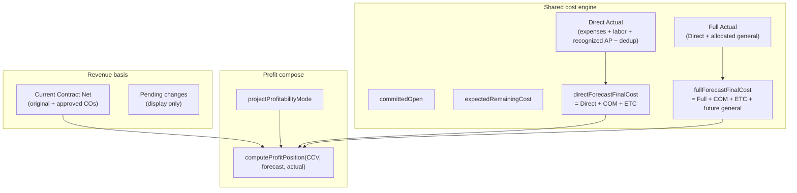

# AGENT 11 — Budgets, profitability, financial reports

| Field | Value |
|--------|--------|
| **Agent** | AGENT_11 (budgets & profitability) |
| **Domain** | Budgets, profitability engines, dashboards, org/project financial reports, VAT vs net monetary basis, contract value (CCV) vs actual / forecast |
| **Inspected commit** | `35e2ff0f7f12d0a3ec94ea0aed23b8c97b6bb00e` |
| **Method** | Static trace of compose/rollup/report paths; budgets overlay vs `CostPosition`; VAT/net tests via Vitest (unit). No production DB, no E2E execution. |
| **Out of scope** | Billing document lifecycle UI, full AP posting, month-close SQL application, Sumit/OCR pipelines (touched only where they affect net contract or net cost). |

---

## 1. Executive summary

ProjectFlow’s **economic truth** for a project is composed once in `composeProjectFinancials` from loaded slices (commercial, billing, expenses, labor, commitments, recognized AP, general allocation, month-close corrections). **Budgets** are a control overlay: they never recompute Actual; they consume the same `CostPosition` and optional line-level expense slices (`mapBudgetLineActuals`).

**Profitability presentation** is org-configurable (`direct` | `include_general` | `both`) via `projectProfitabilityMode`. Budget totals and margin snapshots respect this mode; several **downstream consumers still read `cost.estimatedFinalCost`**, which is explicitly aliased to **Direct Forecast** only (`cost-aggregation.ts`), creating **basis drift** when `include_general` is active.

**VAT:** Contract value and profitability math use **net** commercial amounts; billing KPIs expose both net (revenue basis) and gross (AR/collection). Unit tests guard net vs gross separation and change-order net subtotals.

**Unit verification (this audit):** **99 test files, 777 tests passed** (see §8). Vitest name-pattern grep with `\|` failed on Windows `npx.cmd` (pipe treated as shell operator); tests were run via explicit path lists equivalent to the requested financial/profitability scope.

| Severity | Count (F11 IDs) |
|----------|-----------------|
| HIGH | 0 |
| MEDIUM | 5 |
| LOW | 4 |
| INFO | 4 |
| **Total** | **13** |

---

## 2. Architecture — contract value vs actual vs forecast

Canonical formula reference: `docs/financial/PROJECT-PROFITABILITY-FORMULA.md`.

| Metric | Source | Notes |
|--------|--------|-------|
| **CCV** | `commercial.repository` → `CommercialPosition.currentContractValue` | Pending CRs excluded; CO events net (VAT excluded on CO via quote subtotal — `contract-value.ts`) |
| **Direct Actual** | `CostPosition.actualCostToDate` / `directActualCostToDate` | Committed PO **not** in Actual |
| **Full Actual** | `fullActualCostToDate` | Attribution of general pool; not second recognition |
| **Forecast** | `directForecastFinalCost` / `fullForecastFinalCost` | Open AP payable **not** in forecast (cash-only) |
| **Actual / forecast margin** | `profit.ts` | Null margin when CCV is zero; `priceNotSet` suppresses fake loss |

**Single compose path:** `loadProjectFinancialsReadBundle` → `composeProjectFinancials` → `getProjectFinancials`. Owner dashboard, business profitability page, client profitability, closeout snapshot, and budget workspace all reuse this stack (budgets pass `cost` + `profitabilityMode` into `composeBudgetControlPosition`).

---

## 3. Budgets module

| Layer | Path | Role |
|-------|------|------|
| Domain variance | `src/modules/budgets/domain/variance.ts` | Budget − Forecast; mode selects `fullForecastFinalCost` when `include_general` |
| Line overlay | `src/modules/budgets/domain/map-line-actuals.ts` | Category / WP / cost-code / discipline slices; unmapped remainder |
| Application | `src/modules/budgets/application/queries.ts` | `getProjectBudgetWorkspace` wires engine + mode |
| UI | `src/modules/budgets/ui/project-budget-panel.tsx` | Labels switch to “full” forecast/variance copy in `include_general` |
| Actions | `src/app/[locale]/(app)/projects/budget-actions.ts` | Create / revise budget revisions |

**Variance sign:** Positive variance = under budget (favorable). Tests: `tests/unit/budgets/variance.test.ts` (includes **remediated** `include_general` full-forecast case — prior audit PRJ-001).

**Line-level forecast:** Per-line “forecast” for mapped lines is **Actual + line `etcAmount` (planning)** when set, **not** the project Forecast Final Cost. Project commitment + project ETC appear on the engine total row only (`map-line-actuals.ts` header comment). This is intentional but easy to misread in advanced budgets.

**Cost-code attribution:** Migration-backed `costCodeId` on lines and contributions (`cost-code-attribution.repository.ts`, test `cost-code-attribution-0074.test.ts`).

---

## 4. Profitability engines & dashboards

| Surface | Entry | Engine reuse |
|---------|-------|----------------|
| Project financials tab | `ProjectFinancialsPanel` / KPI panel | `resolveProjectKpiDisplay` + `resolveForecastCostBasis` |
| Project budgets tab | `ProjectBudgetPanel` | Same cached financials + `composeBudgetControlPosition` |
| Home / owner dashboard | `getHomeDashboard` | Org rollups via `getOrganizationProjectRollup`, aggregates in `aggregate-org-report.ts` |
| Business profitability | `/financials/business-profitability` | `getBusinessProfitability` — **composes existing dashboard only** (no new formulas) |
| Org reports | `/reports?section=*` | `getOrganizationReportsAnalytics` + `reports-analytics-view.tsx` |
| Client profitability | `get-client-profitability.ts` | Per-project `getProjectFinancials` roll-up |
| Margin trend (budget tab) | `captureCurrentMarginSnapshot` | `marginSnapshotFromComposed` — **mode-aware** direct vs full pair |
| Early warnings | `getProjectEarlyWarnings` | `evaluateEarlyWarnings` on mapped inputs |
| Command center / management | `composeManagementAnalytics` | Risk rows from warning evaluator on rollup rows |

**Org setting UI:** `settings/features/project-profitability-mode-panel.tsx` (`direct` / `include_general` / `both`).

**Display vs economics:** `project-profitability-mode-economics.test.ts` asserts stored cost fields unchanged across modes; only primary display selection moves.

---

## 5. VAT and net monetary basis

| Area | Behavior | Test signal |
|------|----------|-------------|
| **Billing on project KPIs** | Revenue-style KPIs use **net invoiced**; gross exposed for AR/collection | `billing-net-vs-gross-revenue.test.ts` |
| **Early warnings — collection risk** | Uses **gross** billed share vs outstanding (avoids mixing VAT outstanding with net billed) | `evaluate-warnings.test.ts` (“collection risk uses GROSS billed share”) |
| **Change orders → CCV** | Approved CO uses quote **subtotal** (net), not total with VAT | `contract-value.ts` + commercial unit tests |
| **AP / bills in Actual** | Recognized vendor cost at **net**; bill tax modules separate | `bill-tax.test.ts`, expense/AP dedup tests |
| **Billing finalize** | VAT mode invariants on finalize | `billing-vat-finalize-invariant.test.ts`, `vat-mode-tax.test.ts` |
| **Profitability** | CCV and cost engines documented **no VAT** in margin | Formula doc + compose tests |

**UX labels:** `financial-basis-labels.test.ts` (large suite) encodes basis copy for net vs gross vs cash.

---

## 6. Contract value vs actuals — reconciliation points

| Check | Status |
|-------|--------|
| CCV excludes pending changes | Enforced in commercial domain |
| Actual never includes open commitment | `committed-vs-actual.test.ts`, procurement domain |
| Bill-linked expense dedup | `expense-ap-dedup.test.ts` |
| Breakdown sums to total Actual | `project-actual-breakdown.test.ts` |
| Open-price jobs | `priceNotSet` — no profit claimed; tests in profitability display |
| Export CSV | Uses composed financials; forecast column still named via deprecated `estimatedFinalCost` field |
| BOQ compare | `compare-boq-financials.ts` reads `estimatedFinalCost` (direct alias) |

---

## 7. Regression vs September 2025 deep audit

Reference: `docs/audits/financials-subcontractors-budgets-profitability-audit.md`.

| Prior ID | Topic | Oct 2026 status |
|----------|-------|-----------------|
| PRJ-001 | Budget variance ignored `include_general` | **Fixed** — `variance.ts` + `variance.test.ts` |
| PRJ-002 | Cost-code lines unmapped | **Partially fixed** — `costCodeId` mapping; discipline still heuristic |
| PRJ-003 | Subcontract advances missing | **Fixed** — `subcontract-advances` domain + `manage-advances.ts` |
| PRJ-005 | `/overhead` redirect only | **Still open** — F11-005 |
| PRJ-004 | Budget overrun alerts | **Partial** — forecast warnings exist; budget panel still passive — F11-006 |

---

## 8. Automated verification (Vitest)

**Environment:** Node 22 (`.tools/node-v22.23.2-win-x64`), `vitest run --project unit`.

| Run | Scope | Result |
|-----|-------|--------|
| A | `tests/unit/financials/**`, `tests/unit/budgets/**`, `tests/unit/billing/*vat*`, `tests/unit/commercial/contract-value.test.ts`, `tests/unit/clients/client-profitability.test.ts`, `tests/unit/tax/resolve.test.ts`, `tests/unit/ap/bill-tax.test.ts`, `tests/unit/ux/financial-basis-labels.test.ts`, `tests/unit/forecast/**` | **82 files, 687 tests passed** (~112s) |
| B | Remaining budgets/commercial/tenancy profitability + `cost-code-attribution-0074.test.ts` | **17 files, 90 tests passed** (~71s) |
| **Combined** | — | **99 files, 777 tests passed** |

**Not executed:** Playwright money-chain / reports UI, integration migration suites, production smoke.

**Windows note:** `npx vitest run -t "profitability|financial|..."` failed because `|` is interpreted by the shell when invoked through `npx.cmd`. Equivalent coverage was obtained by explicit test path lists.

Representative high-value suites for this domain:

- `compose-project-financials.test.ts`, `forecast-engine.test.ts`, `true-cost-acceptance.test.ts`
- `project-profitability-display.test.ts`, `project-profitability-mode-economics.test.ts`
- `business-profitability-company-actual.test.ts`, `org-report-aggregate.test.ts`
- `variance.test.ts`, `map-line-actuals.test.ts`
- `billing-net-vs-gross-revenue.test.ts`, `evaluate-warnings.test.ts`

---

## 9. Findings register (F11-xxx)

| ID | Severity | Title | Evidence | Recommendation |
|----|----------|-------|----------|----------------|
| **F11-001** | MEDIUM | Early warnings use Direct Forecast only | `map-financials-to-warning-input.ts` sets `forecastFinalCostAmount: financials.cost.estimatedFinalCost.amount`; `estimatedFinalCost` = `directForecastFinalCost` in `cost-aggregation.ts`. Budget workspace compares full forecast when `include_general`. | Map warnings through `resolveForecastCostBasis(mode, cost)` (and mode-aware actual for over-budget actual checks). Add unit test with allocated general + budget overrun on **full** basis. |
| **F11-002** | MEDIUM | Management analytics risk ranks on Direct Forecast | `compose-management-analytics.ts` passes `row.estimatedFinalCost` into `evaluateEarlyWarnings` | Same as F11-001 for org rollup rows; expose `primaryForecastFinalCost` on rollup DTO. |
| **F11-003** | MEDIUM | Reports rollup column `estimatedFinalCost` is always Direct | `get-organization-project-rollup.ts` stores `financials.cost.estimatedFinalCost` while `estimatedProfit` / margins come from mode-aware compose | Rename/report dual columns (`directForecastFinalCost`, `fullForecastFinalCost`) or populate primary column from `resolveForecastCostBasis`. Update `reports-analytics-view` labels. |
| **F11-004** | MEDIUM | KPI drilldown breakdown shows Direct forecast line | `project-financials-kpi-panel.tsx`: headline `kpis.forecastCost` (mode-aware) but fallback drill line uses `financials.cost.estimatedFinalCost` | Use `kpis.forecastCost` / `kpis.fullForecastCost` consistently; mode-specific label keys. |
| **F11-005** | MEDIUM | No dedicated overhead / GCM hub | `src/app/[locale]/(app)/overhead/page.tsx` redirects to `/expenses?costFamily=business_overhead` | Build overhead hub (pool, allocations, unallocated) per prior PRJ-005; link from business profitability KPIs. |
| **F11-006** | LOW | Budget panel passive on overrun | `budget-variance-summary.tsx` renders numbers only; warnings live in forecast module / command center | Add conditional alert styling or link to `getProjectEarlyWarnings` when variance &lt; 0; align marketing copy with surfaced UX on budget tab. |
| **F11-007** | LOW | Discipline budget lines use categoryKey proxy | `map-line-actuals.ts` matches `contribution.categoryKey === line.disciplineKey`; test documents behavior | Product: either add true discipline on expenses or label discipline rows as “maps via category key” in UI. |
| **F11-008** | LOW | Stale `ProfitPosition` JSDoc vs compose | `types.ts` describes `actualProfit` as CCV − Direct Actual; `compose-project-financials.ts` uses `actualForProfit` = Full when `include_general` | Update type docs; optional rename to `primaryActualProfit` in a future wave. |
| **F11-009** | LOW | Deprecated `estimatedFinalCost` still widely consumed | UI drilldowns, exports, BOQ compare, forecast mapper, rollup columns | Structured deprecation: lint or helper `getPrimaryForecast(cost, mode)`; reduce direct field reads. |
| **F11-010** | INFO | Budget ↔ engine mode parity restored | `composeBudgetControlPosition` + `project-budget-panel.tsx` labels + unit tests | Keep invariant on refactors; extend E2E to open `?tab=budgets` under `include_general`. |
| **F11-011** | INFO | Subcontract advance tracking present | `vendors/domain/subcontract-advances.ts`, `manage-advances.ts` | Document cash vs recognized actual in subcontract UI audits (separate agent). |
| **F11-012** | INFO | Strong unit coverage for financial compose | 777 passing tests in scoped runs | Maintain; add mode-aware warning tests (F11-001). |
| **F11-013** | INFO | `SCHEMA_REQUEST.md` understates cost-code mapping | File still says cost-code “stay unmapped”; code maps via `costCodeId` | Refresh budgets schema doc to match 0074/0141 behavior. |

---

## 10. Suggested follow-ups (audit-only)

1. Fix F11-001–F11-004 as one “forecast basis consistency” patch (domain helper + tests).
2. Extend `project-centric-money-chain.spec.ts` (or new spec) to assert budget variance under non-zero allocated general.
3. Re-run org reports screenshot/matrix after rollup column clarification (F11-003).

---

## 11. Key file index

| Concern | Path |
|---------|------|
| Project compose | `src/modules/financials/application/compose-project-financials.ts` |
| Cost / forecast math | `src/modules/financials/domain/cost-aggregation.ts` |
| Forecast basis selector | `src/modules/financials/domain/resolve-forecast-cost-basis.ts` |
| Profit arithmetic | `src/modules/financials/domain/profit.ts` |
| Budget variance | `src/modules/budgets/domain/variance.ts` |
| Budget line actuals | `src/modules/budgets/domain/map-line-actuals.ts` |
| CCV / CO net | `src/modules/commercial/domain/contract-value.ts` |
| Business profitability page data | `src/modules/financials/application/get-business-profitability.ts` |
| Org reports | `src/modules/financials/application/get-organization-reports-analytics.ts` |
| Early warnings | `src/modules/forecast/application/get-project-warnings.ts` |
| KPI display | `src/modules/financials/ui/resolve-kpi-display.ts` |
| Formula doc | `docs/financial/PROJECT-PROFITABILITY-FORMULA.md` |

---

*End of AGENT_11 report.*
