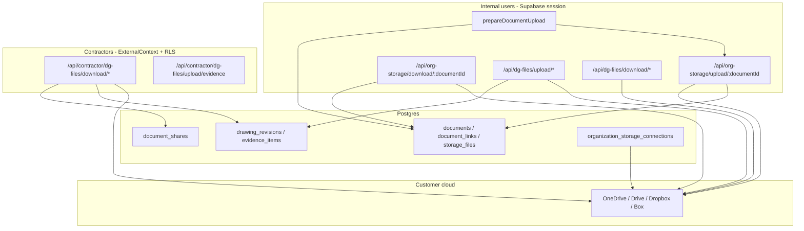

# AGENT 12 — Documents, Drawings/Plans, External Storage & dg-files

| Field | Value |
| --- | --- |
| **Audit** | ProjectFlow Full System Audit — October 2026 |
| **Agent** | 12 (Documents & storage domain) |
| **Repository baseline** | `35e2ff0f7f12d0a3ec94ea0aed23b8c97b6bb00e` (main) |
| **Mode** | Audit only — no code or schema changes |
| **Reference (read-only)** | [EXTERNAL-STORAGE-INVENTORY-2026-09-14.md](../../EXTERNAL-STORAGE-INVENTORY-2026-09-14.md), [EXTERNAL-ORGANIZATION-STORAGE.md](../../../implementation/EXTERNAL-ORGANIZATION-STORAGE.md) |

---

## 1. Scope

This report covers:

- **Documents module** — prepare/finalize upload, versions, folders, visibility, legacy Supabase reads, attachment surfaces via `document_links`.
- **External organization storage** — OAuth (Google Drive, OneDrive, Dropbox, Box), connection lifecycle, semantic folders, browser/provisioning, token sealing.
- **Developer/GC track (0162)** — evidence items, drawing register & revisions, contractor document shares, acknowledgements.
- **HTTP file APIs** — `/api/org-storage/*`, `/api/dg-files/*`, `/api/contractor/dg-files/*`.
- **Cross-org** — connected-project explicit “save copy to my storage” (not sync).

Out of scope: branding-only Supabase assets, full OCR pipeline (except storage read path), invoicing PDF archival details.

---

## 2. Executive summary

ProjectFlow’s **production upload path is external org storage only** (`prepareDocumentUpload` → `/api/org-storage/upload/[documentId]` or domain-specific **dg-files** byte routes). Metadata lives in Postgres; bytes live in the customer’s cloud. The design is **coherent and heavily tested at the unit layer** (provider adapters, browser scope, OAuth binding, semantic folders).

**Contractor-facing plans and shared documents** combine application checks (`requireExternalProjectCapability`, entity-access resolvers) with **RLS on `document_shares` / drawings** (migration `0162`). Integration tests demonstrate **agreement-scoped share isolation** between contractors on the same project.

**Residual risks** are mostly operational and coverage gaps: **legacy `supabase_legacy` rows**, **hard dependency on a connected primary storage connection** for all new business files, **no E2E against real providers or dg-files routes**, and a few **defense-in-depth / resource** notes (in-memory cross-org copy, draft revision download for internal viewers).

**Overall posture:** **Strong for a B2B construction SaaS** with clear separation of internal session routes vs contractor external context; no BLOCKER findings in static review. Production readiness assumes **0087+0162 applied**, **`STORAGE_TOKEN_ENCRYPTION_KEY` set**, and per-provider OAuth apps configured.

---

## 3. Architecture (data flow)

**Two byte pipelines (by design):**

| Pipeline | Routes | Typical use |
| --- | --- | --- |
| **Document registry** | `org-storage` upload/download | Entity attachments, versions, company/project browser, task comments |
| **DG project files** | `dg-files` (+ contractor mirror) | Evidence photos/docs, drawing revision PDFs, shared-document download for portal |

Both ultimately use **`ProjectFileStore` / `uploadDocumentToExternalStorage`** with **service-role provider access after authorization** in the use-case layer.

---

## 4. Key modules & routes

| Area | Location | Notes |
| --- | --- | --- |
| Documents | `src/modules/documents/` | Upload prep, visibility, stream content (external + legacy) |
| External storage | `src/modules/external-storage/` | OAuth, adapters, browser, provisioning, file-service |
| Evidence | `src/modules/evidence/` | Evidence lifecycle + `routes.ts` handlers |
| Project plans | `src/modules/project-plans/` | Drawings, revisions, shares, contractor portal queries |
| Connected projects | `save-copy-to-my-storage.ts` | Opt-in cross-org copy into contractor storage |
| Route inventory | `docs/audits/2026-10-full-system-audit/MODULE_ROUTE_INVENTORY.json` | Lists all org-storage + dg-files route files |

**OAuth:** `GET /api/org-storage/oauth/{provider}/start` (org context + `SETTINGS_MANAGE`), callback binds **session user to signed state** (`completeStorageOAuth`).

**Contractor downloads:** `requireExternalContext()` → RLS-bound DB → capability checks → `projectFileDeps.store.open` (provider stream).

---

## 5. Strengths (verified)

| ID | Topic | Evidence |
| --- | --- | --- |
| **S12-01** | Single external upload product | Inventory doc; `prepareDocumentUpload` requires primary connection; no Supabase fallback for new business writes |
| **S12-02** | Four providers | `providers/{onedrive,google-drive,dropbox,box}.ts`, registry, env vars, extensive unit tests |
| **S12-03** | OAuth session binding | `completeStorageOAuth` rejects state/user mismatch; integration `oauth-callback-binding.test.ts` |
| **S12-04** | Production crypto guard | `STORAGE_TOKEN_ENCRYPTION_KEY` required when `APP_ENV=production` (`server.ts`) |
| **S12-05** | Upload authorization | `uploadDocumentToExternalStorage` calls `assertDocumentManagePermission`; version upload requires `DOCUMENTS_MANAGE` |
| **S12-06** | Browser scope | `assertFolderWithinProjectTree`, `assertProjectBrowserUploadFolder`, org folder scope on company upload |
| **S12-07** | Contractor share isolation | RLS `document_shares_select`; integration test agreement A vs B (`evidence-and-plans.test.ts`) |
| **S12-08** | Share immutability | DB trigger `document_shares_guard` — only revocation updates |
| **S12-09** | Cross-org copy policy | Explicit user action + audit; no automatic sync (`save-copy-to-my-storage.ts` comment + implementation) |
| **S12-10** | Drawing revision integrity | Publish/supersede rules + integration tests; superseded history frozen at DB |

---

## 6. Findings

Severity legend: **BLOCKER** · **HIGH** · **MEDIUM** · **LOW** · **INFO**

| ID | Sev | Title | Summary |
| --- | --- | --- | --- |
| M12-001 | MEDIUM | Legacy Supabase document reads | Historical rows remain on `supabase_legacy`; dual read path in `streamDocumentContent` |
| M12-002 | MEDIUM | Storage connection hard gate | Orgs without usable primary connection cannot complete new uploads anywhere in the documents pipeline |
| M12-003 | LOW | OAuth state secret fallback (non-prod) | HMAC secret can fall back to DB URL / service role when `STORAGE_TOKEN_ENCRYPTION_KEY` unset |
| M12-004 | LOW | “Visible” share/revision queries rely on RLS | `findVisibleDocumentShare` / contractor list queries do not encode audience in SQL; safe today via RLS-bound external DB |
| M12-005 | MEDIUM | No E2E for dg-files or live OAuth | E2E uses in-memory `/e2e-storage`; provider OAuth and byte routes not exercised end-to-end |
| M12-006 | LOW | Cross-org save loads full file in memory | `saveCopyToMyStorageAction` buffers entire stream before re-upload |
| M12-007 | LOW | Internal draft revision download | `openInternalRevisionFile` allows any project member with `documents.view` to stream draft revisions once `fileReady` |
| M12-008 | INFO | Dual API surface complexity | Operators must monitor org-storage and dg-files routes, provision failures, and reconnect states separately |
| M12-009 | LOW | Provider tests are mock-only | Adapters well unit-tested; no scheduled contract tests against sandbox tenants |
| M12-010 | INFO | Inventory alignment | Sep 2026 inventory still accurate: 30+ owner types via documents; branding/OCR tails on legacy/external reads |

### M12-001 — Legacy Supabase document reads (MEDIUM)

**Description:** `documents.storage_backend = 'supabase_legacy'` still streams via `getStoragePort()` in `stream-document-content.ts`. New uploads are external-only, but **long-tail legacy rows** keep Supabase Storage in the read path (OCR, old attachments).

**Impact:** Operational continuity requirement; potential egress/cost if legacy volume is large; two code paths for security reviews.

**Recommendation:** Metrics on legacy vs external counts; planned migration/backfill or explicit “legacy read-only” runbook.

---

### M12-002 — Storage connection hard gate (MEDIUM)

**Description:** `assertOrganizationStorageAvailable` / `isOrganizationStorageConfigured` block `prepareDocumentUpload` and DG file stores with `externalStorage.errors.notConnected`.

**Impact:** Correct security/product choice, but **single point of failure** — token expiry, quota, provisioning failure, or `reconnect_required` disables uploads org-wide.

**Recommendation:** Dashboard surfacing of connection status (settings exist); alerting on `reconnect_required`; runbook for provision worker / `kickStorageProvision`.

---

### M12-003 — OAuth state secret fallback (LOW)

**Description:** `oauth-state.ts` `stateSecret()` prefers `STORAGE_TOKEN_ENCRYPTION_KEY` but falls back to service role key, `DATABASE_URL`, or a static local string.

**Impact:** Production blocked without proper key; **dev/staging misconfiguration** could weaken OAuth state binding if env mirrors production poorly.

**Recommendation:** Fail fast in staging when key missing; never deploy preview without `STORAGE_TOKEN_ENCRYPTION_KEY`.

---

### M12-004 — RLS-dependent “visible” fetches (LOW)

**Description:** Contractor file open uses `findVisibleDocumentShare(db, shareId)` without org id in the WHERE clause. Isolation depends on **external principal RLS** (`document_shares_select` audience rules).

**Impact:** Safe with current `loadExternalContext` + RLS executor; **regression risk** if a future caller passes service-role `db` into the same helpers without re-checking audience.

**Recommendation:** Code comment or assert `db` is RLS-bound in external routes; optional app-layer audience check for defense in depth.

---

### M12-005 — No E2E for dg-files or live OAuth (MEDIUM)

**Description:** Route handlers in `src/modules/evidence/routes.ts` and `src/modules/project-plans/routes.ts` are covered by **integration tests with fake `ProjectFileStore`**, not Playwright. OAuth flows have unit/integration tests but not browser E2E against real IdPs.

**Impact:** Regressions in cookie/session edge cases, Content-Type handling, or route wiring may slip until production.

**Recommendation:** Minimal E2E: connect storage (mock OAuth server), upload via org-storage, publish drawing revision, contractor download shared document (portal auth stub).

---

### M12-006 — Cross-org save buffers full file (LOW)

**Description:** `saveCopyToMyStorageAction` reads `opened.stream` into `Uint8Array` before `uploadDocumentToExternalStorage`.

**Impact:** Large shared PDFs/plans could spike memory on contractor org during explicit copy (user-initiated).

**Recommendation:** Stream-through upload if provider adapter supports streaming for large bodies; cap size with user-visible error.

---

### M12-007 — Internal draft revision download (LOW)

**Description:** `openInternalRevisionFile` checks `documents.view` but not revision status — **draft** revisions with `fileReady=true` are downloadable internally.

**Impact:** Likely intentional for PM QA before publish; viewers with project document access may see unpublished plans.

**Recommendation:** Product confirmation; optionally restrict drafts to `documents.share` / manage capability.

---

### M12-008 — Dual API surface (INFO)

**Description:** Internal apps must use correct upload URL (`/api/org-storage/...` vs `/api/dg-files/upload/drawing-revision/...`). Contractor portal uses separate prefix.

**Impact:** Developer confusion; easier to wire wrong client path when adding features.

**Recommendation:** Keep route inventory generated; document in module README (partially done in implementation doc).

---

### M12-009 — Mock-only provider tests (LOW)

**Description:** Large adapter test suites (Google Drive, Dropbox, etc.) mock HTTP; no CI job hits vendor sandboxes.

**Impact:** Provider API drift discovered late (especially Box/Dropbox edge cases).

**Recommendation:** Optional weekly sandbox smoke with stored refresh tokens in CI secrets (Owner-maintained).

---

### M12-010 — Inventory alignment (INFO)

**Description:** [EXTERNAL-STORAGE-INVENTORY-2026-09-14.md](../../EXTERNAL-STORAGE-INVENTORY-2026-09-14.md) states all new business uploads go external; documents module matches. Branding remains Supabase; OCR reads external + legacy.

**Impact:** None for audit; confirms migration narrative.

---

## 7. Cross-org sharing model

| Mechanism | Direction | File copy? | Storage |
| --- | --- | --- | --- |
| **document_shares** | Developer org → contractor principals | No — metadata share + download via developer connection | Developer’s cloud |
| **saveCopyToMyStorage** | Developer share → contractor org library | Yes — explicit opt-in | Contractor’s cloud |
| **Connected project portal** | Developer project visibility | N/A | Reads developer storage via grants |

Contractor **listing** dedupes multiple shares of the same document (`listContractorSharedDocuments`). **Revocation** is final (trigger + tests).

---

## 8. Security checklist (static)

| Control | Status |
| --- | --- |
| Session required on internal org-storage / dg-files | Yes (`requireSession` / `withOrgContext`) |
| Contractor routes use external context | Yes (`requireExternalContext`) |
| OAuth callback user = state user | Yes |
| Tokens at rest encrypted (production) | Required env |
| Provider file download after document/share authorization | Yes (use-case then `store.open`) |
| Project browser downloads scoped to tree | Yes (`assertFileScope`, semantic folder access) |
| SQL RLS on shares / evidence / drawings | Yes (`0162`) |
| IDOR on share UUID without grant | Mitigated by RLS SELECT policies (tested B cannot open A’s share) |

---

## 9. Test coverage snapshot

| Layer | Documents / DG | External storage |
| --- | --- | --- |
| **Unit** | `revisions.test.ts`, sharing domain | ~40 test files under `tests/unit/external-storage/` |
| **Integration** | `evidence-and-plans.test.ts` (8 cases), `migration.test.ts` | OAuth callback binding, upload folder resolution |
| **E2E** | Not targeted | Harness `/e2e-storage` only |

**Notable integration scenarios covered:** evidence internal vs contractor, share acknowledge idempotency, revoke + RLS tamper rejection, revision publish/supersede, contractor plan acknowledgement.

**Gaps:** HTTP route layer, real provider latency/errors, company-files tab + org-browser-upload UI, connected-project save copy, all four OAuth providers in one flow.

---

## 10. Recommendations (prioritized)

1. **M12-005** — Add one smoke E2E path: storage connected (stub) → document upload → contractor shared download.
2. **M12-002** — Operational monitoring for connection status and provision backlog; clear UX when uploads blocked.
3. **M12-001** — Legacy document inventory and retirement plan (read-only metrics first).
4. **M12-006** — Streamed cross-org copy or size limit for save-to-my-storage.
5. **M12-007** — Confirm draft revision visibility policy with product; tighten capability if needed.

---

## 11. Files reviewed (representative)

- `src/modules/documents/application/upload-document.ts`, `stream-document-content.ts`
- `src/modules/external-storage/application/{connection-service,file-service,oauth-state,browser-service,org-browser-service}.ts`
- `src/modules/evidence/{routes.ts,server.ts,application/file-store.ts}`
- `src/modules/project-plans/{routes.ts,application/manage-drawings.ts,contractor-plans.ts,document-sharing.ts}`
- `src/app/api/org-storage/**`, `src/app/api/dg-files/**`, `src/app/api/contractor/dg-files/**`
- `drizzle/migrations/0162_dg_documents_plans.sql` (RLS section)
- `tests/integration/dg-documents/evidence-and-plans.test.ts`

---

*End of AGENT 12 report.*
