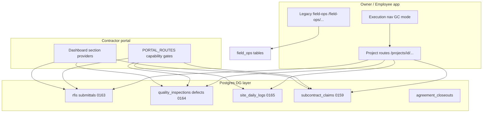

# AGENT 13 — Execution Management Quality Audit

| Field | Value |
| --- | --- |
| **Agent** | AGENT_13 (Execution management) |
| **Repo baseline** | `35e2ff0f7f12d0a3ec94ea0aed23b8c97b6bb00e` (per audit README) |
| **Audit date** | 2026-10-11 |
| **Mode** | Static code + test inventory (no Production DB read, no migration apply) |
| **Finding prefix** | `E13-xxx` |

## Executive summary

ProjectFlow’s **Developer / GC execution layer** (Tracks KL, MN, O, F, Q) is **substantially implemented** in application code: modular domains under `src/modules/{rfi,submittals,inspections,defects,site-log,subcontract-claims,contractor-closeout}`, project-scoped routes under `/projects/{projectId}/…`, contractor portal routes under `/contractor/projects/{projectId}/…`, and **Vitest integration suites** for the core lifecycles. Lifecycle rules in TypeScript **mirror DB triggers** documented in migrations `0163`–`0165` and `0159`.

**Primary risks** are not “missing stubs” but **operational fragmentation and verification gaps**:

1. **Dual field stack** — legacy `field_ops` (`daily_logs`, org-permission RLS) coexists with DG tables (`site_daily_logs`, `quality_inspections`, `defects`, …). Classic workspace shortcuts still deep-link to **field-ops**, while GC mode uses **project execution routes**.
2. **Navigation vs authorization mismatch** — flat execution nav (`EXECUTION_ROUTE_CATALOG`) exposes RFI/submittals/quality/site-log links to anyone with `project.view`, while hub children and write paths require granular capabilities (`rfi.manage`, `quality.manage`, …). Reads are intentionally broad; **UX and least-privilege expectations may diverge**.
3. **Production schema state** — SQL files for `0163`–`0165` retain **PREPARED ONLY** headers; this audit **cannot confirm** they are applied in Production.
4. **Browser proof** — E2E smoke exercises **claims** and **milestones** on the contractor portal but **not** RFI, submittals, defects, inspections, site-log, or handover flows.

**Overall maturity (codebase):** **B+** for domain depth and tests; **B−** for end-user path coherence (nav duality, handover UX split) and release verification.

---

## Scope

| Domain | Primary modules | Schema (migrations) | Internal routes | Portal routes |
| --- | --- | --- | --- | --- |
| **RFI** | `src/modules/rfi` | `0163_dg_rfi_submittals.sql` | `/projects/{id}/rfi` | `/contractor/projects/{id}/rfi` |
| **Submittals** | `src/modules/submittals` | `0163` | `/projects/{id}/submittals` | `/contractor/projects/{id}/submittals` |
| **Inspections** | `src/modules/inspections` | `0164_dg_inspections_defects.sql` | `/projects/{id}/inspections` | `/contractor/projects/{id}/inspections` |
| **Defects / punch** | `src/modules/defects` | `0164` | `/projects/{id}/defects` | `/contractor/projects/{id}/defects` |
| **Daily site log** | `src/modules/site-log` (+ legacy `field-ops`) | `0165_dg_daily_log_meetings_instructions.sql` + `field-ops` | `/projects/{id}/site-log` | `/contractor/projects/{id}/site-log` |
| **Milestones** | `src/modules/projects` (milestones), portal provider | `project_milestones` (core) | Project tab `?tab=schedule` / planning hub | Dashboard + project home metrics |
| **Handover / closeout** | `src/modules/contractor-closeout` | `0167` procurement closeout (related) | `/projects/{id}/contractor-closeout`, agreement 360 panel | `/contractor/projects/{id}/handover` |
| **Subcontract claims** | `src/modules/subcontract-claims` | `0159_dg_claims.sql` (+ `0173` RLS hardening) | `/projects/{id}/claims` | `/contractor/projects/{id}/claims` |

**Out of scope for this agent:** Payroll, owner billing, SUMIT, generic task/collaboration (except cross-links), full procurement tender economics.

---

## Method

1. Traced **route catalogs**: `execution-route-catalog.ts`, `execution-hubs.ts`, `contractor-portal/domain/routes.ts`, `projects/domain/workspace-links.ts`.
2. Reviewed **lifecycle** pure functions vs migration comments (`rfi`, `submittals`, `defects`, `subcontract-claims`).
3. Inventoried **tests** under `tests/integration/{rfi-submittals,dg-quality,dg-field,dg-claims}` and `tests/unit/{rfi,submittals,dg-quality,subcontract-claims}`.
4. Sampled **UI wiring** (evidence on detail pages, handover surfaces, employee route parity).
5. Cross-checked prior ops notes on migration **PREPARED ONLY** and RLS (`0173_force_rls_five_tables.sql` for `subcontract_claim_sequences`).

No SQL was executed against Production or shared databases.

---

## Architecture notes (condensed)

- **GC gating:** `selectExecutionNavLinks` returns links only when `isDeveloperGcMode(deliveryProfile)` (`select-execution-nav-links.ts`). Non-GC projects rely on classic tabs and **field-ops** module flags.
- **Capabilities:** Org permissions (`field_ops.read`) vs project capabilities (`rfi.manage`, `claim.certify`, …) are **intentionally separate** vocabularies (`project-team/domain/capabilities.ts`).
- **External access:** Portal routes declare `EXTERNAL_CAPABILITIES` (e.g. `ext.rfi.raise`, `ext.defect.work`, `ext.claim.submit`); integration tests use grant fixtures (`dg-fixtures-rfi`, `externalContextFor`).

---

## Domain maturity matrix

| Domain | Domain logic | RLS / triggers (designed) | Internal UI | Portal UI | Integration tests | Unit tests | E2E smoke |
| --- | --- | --- | --- | --- | --- | --- | --- |
| RFI | Strong | 0163 | Yes + evidence | Yes + evidence | `rfi.test.ts` | `lifecycle.test.ts` | No |
| Submittals | Strong | 0163 | Yes + evidence | Yes + evidence | `submittals.test.ts` | `lifecycle.test.ts` | No |
| Inspections | Strong | 0164 | Yes | Yes (read) | `quality.test.ts` | `quality-domain.test.ts` | No |
| Defects | Strong | 0164 | Yes + evidence | Yes + work | `quality.test.ts` | Partial (domain in dg-quality) | No |
| Daily log (DG) | Strong | 0165 | Yes | Contractor submit | `dg-field/field.test.ts` | `dg-field/domain.test.ts` | No |
| Daily log (legacy) | Mature | field-ops schema | `/field-ops/logs` | No | field-ops unit/integration elsewhere | Yes | Partial (photo attach) |
| Milestones | Mature (read/scheduling) | Core project | Tab + planning hub | Provider + smoke | Indirect (tasks/portfolio) | Templates | **Yes** (portal) |
| Handover | Moderate | Closeout tables | List + agreement panel | Checklist page | **None dedicated** | `closeout-rules.test.ts` | No |
| Claims | Strong | 0159 + 0173 RLS | Full review/certify | Submit + view | `claims.test.ts` | Multiple unit | **Yes** (owner create + portal list) |

---

## Positive observations

| ID | Note |
| --- | --- |
| E13-P01 | **Lifecycle parity:** RFI/submittal/claim/defect TypeScript state machines document matching DB guard triggers (e.g. `rfi/domain/lifecycle.ts`, `submittals/domain/lifecycle.ts`, `defects/domain/lifecycle.ts`, `subcontract-claims/domain/lifecycle.ts`). |
| E13-P02 | **Append-only audit trails:** Answers, submittal reviews, inspection outcomes, defect cycle records, claim assessments designed as immutable histories (migration comments + repository patterns). |
| E13-P03 | **Evidence integration:** RFI, submittal, and defect detail screens mount `EvidenceGallery` / `EvidenceUploader` (`src/modules/evidence/ui`) on owner and portal surfaces. |
| E13-P04 | **Portal registry discipline:** `PORTAL_ROUTES` + `routes.test.ts` pattern prevents dead contractor links; execution entities (RFI, defects, claims) registered with explicit capabilities. |
| E13-P05 | **Claims depth:** Integration tests cover draft → submit → review → certify → reassess, with financial side-effects isolated in application layer (`subcontract-claims/application/review.ts`). |
| E13-P06 | **Employee parity:** Employee shell re-exports owner screens for RFI, submittals, inspections, defects, claims, site-log (`employee/(shell)/projects/...`). |
| E13-P07 | **Command center / events:** DG event catalog links site-log and related entities for notifications (`dg-events/domain/event-catalog.ts`). |

---

## Findings register

Format: **ID · Severity · Title · Evidence · Impact · Direction**

### Release / schema

| ID | Sev | Title | Evidence | Impact | Direction |
| --- | --- | --- | --- | --- | --- |
| **E13-001** | **HIGH** | DG execution migrations marked **PREPARED ONLY** — Production apply state unknown | Headers in `drizzle/migrations/0163_dg_rfi_submittals.sql`, `0164_dg_inspections_defects.sql`, `0165_dg_daily_log_meetings_instructions.sql` | Without applied schema, GC routes fail at runtime regardless of code completeness | Owner confirms journal vs Production; apply via separate approved migration window |
| **E13-002** | **MEDIUM** | Claims sequence RLS was a known gap; fix exists in repo but must be deployed with migration set | `0173_force_rls_five_tables.sql`; prior **OPS-B-003** in operational verification | Stale Production without `0173` leaves `subcontract_claim_sequences` outside FORCE RLS | Treat `0173` as part of execution/financial release bundle verification |

### Dual stack / navigation

| ID | Sev | Title | Evidence | Impact | Direction |
| --- | --- | --- | --- | --- | --- |
| **E13-003** | **HIGH** | **Two inspection/defect/daily-log worlds** — field-ops vs DG quality/site-log | `0164` comment: legacy `inspections` / punch untouched; `workspace-links.ts` pushes `inspections` → `/field-ops/inspections`; GC routes use `/projects/{id}/inspections` and `/projects/{id}/defects` | Users on classic profiles log internal inspections in **employee-scoped field-ops**; GC contractors use **capability-scoped DG tables** — data does not unify | Product decision: redirect field-ops links for GC profiles; or document mutual exclusion; align `workspace-links` with MN routes (per `dev-gc-track-mn-report.md` follow-up) |
| **E13-004** | **MEDIUM** | Flat execution nav uses **`project.view`** for RFI/submittals/inspections/defects/site-log; hub children require **`rfi.manage` / `quality.manage` / …** | `execution-route-catalog.ts` vs `execution-hubs.ts` `EXECUTION_HUB_CHILDREN` | Users see nav entries they cannot action; conversely hub hides routes from `documents.view`-only roles that flat nav would show | Align `EXECUTION_ROUTE_CATALOG.required` with hub `anyOf` sets, or document read-only mode in UI copy |
| **E13-005** | **MEDIUM** | **Execution nav hidden** unless Developer/GC delivery profile | `shouldShowExecutionNavGroup` → `isDeveloperGcMode` | Subcontractor-heavy orgs on non-GC profiles never see `/projects/{id}/rfi` nav though modules may exist | Ensure persona onboarding sets GC profile where product expects DG execution |
| **E13-006** | **LOW** | Classic **project workspace** omits RFI, submittals, claims, defects, site-log shortcuts | `workspace-links.ts` keys stop at field_ops / punch / inspections (field-ops path) | Discoverability gap for mixed orgs using overview tiles instead of execution hub | Extend workspace link keys or defer to execution dashboard only for GC |

### Handover / milestones

| ID | Sev | Title | Evidence | Impact | Direction |
| --- | --- | --- | --- | --- | --- |
| **E13-007** | **MEDIUM** | **Handover UX split** — owner list page is status-only; rich panel on agreement 360 | `contractor-closeout/screen.tsx` (list + badge); `AgreementHandoverPanel` on `contractors/[agreementId]/screen.tsx`; portal `handover/page.tsx` checklist | Owners may not find checklist management from execution nav closeout route | Link closeout list rows to agreement 360 `#handover` or embed panel on closeout route |
| **E13-008** | **MEDIUM** | **No integration tests** for contractor closeout / portal handover flows | Only `tests/unit/procurement/closeout-rules.test.ts` imports `assertCloseoutCompleteness` | Regressions in handover submit/approve paths likely slip past CI | Add `tests/integration/dg-closeout/` covering ensure → submit item → complete |
| **E13-009** | **LOW** | **Milestones** not grouped with quality/execution hub; portal shows metrics separately | `milestonesProvider`; schedule via `?tab=schedule` / `execution-planning` | Acceptable architecturally; may confuse “execution milestone” vs “billing milestone” | Copy/labels in `projectWorkspace` locales |

### Authorization / data exposure

| ID | Sev | Title | Evidence | Impact | Direction |
| --- | --- | --- | --- | --- | --- |
| **E13-010** | **MEDIUM** | Internal **RFI read** requires only `project.view` (writes need `rfi.manage`) | `getRfi` / `listProjectRfis` in `rfi/application/internal-rfi.ts` | Matches “transparent project” model but **broader than** `rfi.manage` capability name suggests | Document in project-team templates; optional future `rfi.view` capability if customers need hide |
| **E13-011** | **LOW** | Portal **submittals route** gated on `SUBMITTAL_SUBMIT` only | `contractor-portal/domain/routes.ts` | Contractors granted view-only document access may lack nav entry even for approved submittals | Consider `{ anyOf: [SUBMITTAL_SUBMIT, DOCUMENT_VIEW] }` if product requires read-only submittal history |

### Claims (submission / approval)

| ID | Sev | Title | Evidence | Impact | Direction |
| --- | --- | --- | --- | --- | --- |
| **E13-012** | **MEDIUM** | **Certification fans out** to payable basis, AP draft, cash projection sync — failure partially swallowed | `review.ts` `deliverCertifiedCashProjectionUpsert` logs errors without failing certify | Certified claim may desync connected-project projections | Monitor logs; add integration assertion on projection delivery |
| **E13-013** | **LOW** | External claim transitions **narrower** than internal (by design) | `subcontract-claims/domain/lifecycle.ts` `EXTERNAL_TRANSITIONS` | Contractors cannot cancel submitted claims without return flow | Confirm UX explains returned → draft path |
| **E13-POS** | **INFO** | Claims capability separation **`claim.view` / `claim.review` / `claim.certify`** enforced in application | `internal-claims.ts`, `review.ts` | Strong financial boundary for execution audit | Keep employee financial hiding tests aligned (`dg-auth-smoke.mjs`) |

### Quality (inspections / defects)

| ID | Sev | Title | Evidence | Impact | Direction |
| --- | --- | --- | --- | --- | --- |
| **E13-014** | **LOW** | **Defect lifecycle** lacks standalone unit file (unlike RFI/submittals) | No `tests/unit/defects/`; coverage via `tests/integration/dg-quality/quality.test.ts` | Higher cost to refactor lifecycle | Extract `tests/unit/defects/lifecycle.test.ts` mirroring domain file |
| **E13-015** | **LOW** | **Inspection templates** — catalog in code, optional DB templates | `0164` header comment; `inspections/domain/catalog.ts` | Custom templates per org/project supported in schema; UX depth not verified in this audit | Product review template management UI completeness |
| **E13-016** | **INFO** | Defect ↔ inspection linking in UI | Detail screens cross-link inspection/defect IDs | Good traceability for fail inspection → punch item | — |

### Daily logs

| ID | Sev | Title | Evidence | Impact | Direction |
| --- | --- | --- | --- | --- | --- |
| **E13-017** | **MEDIUM** | **Two daily log products** — `field-ops` daily logs vs `site_daily_logs` | `field-ops` module + `site-log` module; `0165` compatibility note | Duplicate training/support; risk of logging to wrong store | Persona matrix: self-perform → field-ops; GC → site-log |
| **E13-018** | **LOW** | Site-log **write** correctly requires `daily_log.manage`** | `site-log/application/daily-log.ts` | Good write gate | Match nav capability (E13-004) |

### Verification / CI

| ID | Sev | Title | Evidence | Impact | Direction |
| --- | --- | --- | --- | --- | --- |
| **E13-019** | **HIGH** | **E2E smoke skips** most execution entities | `tests/e2e/harness/dg-auth-smoke.mjs` — claims + milestones only among scoped domains | Production deploy could break RFI/submittal/quality/handover routes undetected | Extend smoke with seeded RFI/defect/submittal IDs (fixtures exist in `.audit-route-fixtures.json`) |
| **E13-020** | **MEDIUM** | Audit route fixtures use **placeholder IDs** equal to `projectId` | `tests/e2e/.audit-route-fixtures.json` | Route-existence audits may not reflect real FK rows | Seed dedicated entities in harness `seed.ts` for 404 vs 200 discrimination |

### i18n / surfaces

| ID | Sev | Title | Evidence | Impact | Direction |
| --- | --- | --- | --- | --- | --- |
| **E13-021** | **LOW** | Execution namespaces registered for scans | `tests/unit/i18n/scan-referenced-translations.ts` includes `handover`, modules locales `rfi`, `submittals`, `inspections`, `defects`, `subcontractClaims` | Reduces orphan strings | Maintain on new execution screens |
| **E13-022** | **INFO** | Employee quick-create FAB includes RFI/submittal/defect/inspection labels | `dg-auth-smoke.mjs` Hebrew regex | Good field UX signal | — |

---

## Severity summary

| Severity | Count |
| --- | --- |
| HIGH | 3 |
| MEDIUM | 10 |
| LOW | 7 |
| INFO / Positive | 2 findings + 7 positive rows |

---

## Recommended verification checklist (Owner / QA)

1. **Schema:** Confirm Production has `0163`, `0164`, `0165`, `0159`, and `0173` applied (`npm run db:check-journal` locally + Supabase migration history).
2. **GC project smoke:** On a Developer/GC profile project, walk owner paths: RFI create → answer → close; submittal submit → review; inspection fail → defect assign → contractor complete → verify; site-log open day → close; claim draft → certify (staging).
3. **Portal smoke:** Mirror contractor paths for the same entities; handover checklist submit.
4. **Classic profile control:** Confirm field-ops logs/inspections still work for non-GC persona and **do not** appear mixed with DG lists.
5. **Capability matrix:** User with only `project.view` — confirm UI disables manage actions on RFI/quality (read-only), not silent 500s.
6. **CI gap close:** Add E13-019 routes to `dg-auth-smoke.mjs` or dedicated Playwright spec.

---

## File index (high-signal)

| Area | Paths |
| --- | --- |
| Execution nav | `src/modules/project-workspace/domain/execution-route-catalog.ts`, `execution-hubs.ts`, `select-execution-nav-links.ts` |
| Legacy nav | `src/modules/projects/domain/workspace-links.ts` |
| Portal routes | `src/modules/contractor-portal/domain/routes.ts`, `application/registry.ts` |
| RFI / Submittals | `src/modules/rfi/**`, `src/modules/submittals/**`, `drizzle/schema/dg-rfi-submittals.ts` |
| Quality | `src/modules/inspections/**`, `src/modules/defects/**` |
| Site log | `src/modules/site-log/**`, `src/modules/field-ops/**` |
| Claims | `src/modules/subcontract-claims/**`, `drizzle/schema/dg-claims.ts` |
| Handover | `src/modules/contractor-closeout/**` |
| Tests | `tests/integration/rfi-submittals/`, `dg-quality/`, `dg-field/`, `dg-claims/` |

---

## Agent sign-off

Execution management code is **feature-rich and test-backed** for core lifecycles. The main quality debt is **product coherence** (dual field stacks, nav/capability alignment, handover discoverability) and **release proof** (migration apply state, E2E coverage). Addressing **E13-003**, **E13-004**, **E13-007**, and **E13-019** yields the largest user-visible improvement per engineering week.

*End of AGENT_13 report.*
