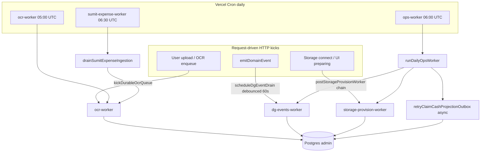

# AGENT 14 — Automations, Cron & Internal Workers

| Field | Value |
|--------|--------|
| **Domain** | Vercel crons, internal HTTP workers, outbox consumers, retries, self-HTTP kicks |
| **Repository baseline** | `35e2ff0f7f12d0a3ec94ea0aed23b8c97b6bb00e` (per audit README) |
| **Method** | Static code review only (no production cron execution, no DB mutation) |
| **Finding prefix** | `O14-xxx` |

---

## Executive summary

ProjectFlow runs background work through **five internal API routes** under `/api/internal/*`, plus **three Vercel Cron entries** in `vercel.json` (daily, Hobby-compatible). Request-driven **HTTP kicks** (`after()` + `fetch`) drain OCR and DG domain events promptly; **storage provisioning** uses a dedicated secret and a multi-hop chain inside `waitUntil`. The **daily ops bundle** (`runDailyOpsWorker`) consolidates 11 sub-jobs with bounded concurrency and partial error isolation.

**Strengths:** SKIP LOCKED domain-event consumption, idempotent OCR claiming via `app.claim_ocr_job`, separate auth for storage provision, explicit Hobby cron unit test, ops route `maxDuration = 300`, observability hooks (`inferWorkerTrigger`, usage diag).

**Primary risks:** DG event draining depends on kicks + once-daily safety net (no sub-daily cron in repo); **cross-org sync outbox** has no emit-time kick and recovery is fire-and-forget after the ops response; **OCR / SUMIT expense routes lack `maxDuration`**; ops wall-clock budget can be exceeded with many orgs; **document storage orphan retry** is not scheduled; shared `CRON_SECRET` / `OCR_WORKER_SECRET` across most workers.

---

## 1. Inventory

### 1.1 Vercel Cron (`vercel.json`)

| Schedule (UTC) | Path | Local intent (Israel ~ UTC+3) |
|----------------|------|--------------------------------|
| `0 5 * * *` | `/api/internal/ocr-worker` | 08:00 — OCR queue recovery |
| `0 6 * * *` | `/api/internal/ops-worker` | 09:00 — daily ops bundle |
| `30 6 * * *` | `/api/internal/sumit-expense-worker` | 09:30 — SUMIT expense poll + OCR drain |

**Not cron-scheduled in repo:** `/api/internal/dg-events-worker`, `/api/internal/storage-provision-worker`.

Enforced by `tests/unit/ops/vercel-hobby-crons.test.ts` (exactly three crons, all once-per-day).

### 1.2 Internal worker routes

| Route | Auth | `maxDuration` | Primary entry |
|-------|------|---------------|---------------|
| `ops-worker` | `CRON_SECRET` or `OCR_WORKER_SECRET` | **300** | Vercel cron + operator POST/GET |
| `ocr-worker` | same | *default* | Cron recovery + upload kicks |
| `sumit-expense-worker` | same | *default* | Vercel cron |
| `dg-events-worker` | same | **60** | `scheduleDgEventDrain` kick + ops safety net |
| `storage-provision-worker` | `STORAGE_PROVISION_WORKER_SECRET` | **300** | HTTP chain + ops recovery kick |

Cron detection for logging: `x-vercel-cron: 1` → `inferWorkerTrigger` returns `cron` (`src/shared/observability/runtime-usage-diag.ts`).

All listed workers expose **GET delegating to POST** (compatible with Vercel Cron GET invocations).

### 1.3 Outbox / queue systems

| Store | Producer | Consumer | Retry model |
|-------|----------|----------|-------------|
| `domain_events` + `domain_event_retries` | `emitDomainEvent` (same TX as state change) | `runDgEventConsumer` via dg-events worker / ops | Exponential backoff; **8 attempts** then dead-letter (`DG_MAX_ATTEMPTS`) |
| `ocr_extraction_jobs` | Upload / ingestion paths | `drainDurableOcrQueue` (`claim_ocr_job`) | Lease reclaim + `OCR_WORKER_MAX_ATTEMPTS` |
| `cross_org_sync_outbox` | `enqueueCrossOrgSyncEvent` on claim certify/return | `retryClaimCashProjectionOutbox` (ops tail only) | **5 attempts**; exponential backoff to 6h cap |
| (inline) SUMIT ambiguous docs | Issuance timeouts | `runSumitRecoveryOpsWorker` inside ops | Daily poll per org |

### 1.4 Daily ops bundle (`runDailyOpsWorker`)

Sub-jobs (≤ **4 concurrent** via `runWithMaxConcurrency`, **~280s** soft budget):

1. `generateDueRecurringDrafts` — recurring expenses + auto payments  
2. `runTaskRecurrenceOpsWorker`  
3. `runTaskReminderOpsWorker`  
4. `runNotificationScanOpsWorker` — full scanner suite, **8s maxMs per org**  
5. `recoverStorageProvisionViaWorker` — conditional HTTP kick  
6. `runMaterialMarketRefresh` — external source fetches  
7. `runSumitRecoveryOpsWorker` — ambiguous statutory + archive retry  
8. `runQuoteExpiryScan`  
9. `runMaterialPressureAlertScan`  
10. `runMarginSnapshotOpsWorker`  
11. `runDgEventsOpsWorker` — budget `min(45s, remaining ops budget)`  

**After** parallel completion: `retryClaimCashProjectionOutbox()` is started **without await** (fire-and-forget).

---

## 2. Architecture (control flow)

---

## 3. Findings register

Severity: **CRITICAL** = data loss / security breach; **HIGH** = user-visible failure or stuck money/docs; **MEDIUM** = degraded SLA / ops burden; **LOW** = hygiene / test gap; **INFO** = documented behavior.

| ID | Sev | Title | Evidence | Impact | Recommendation |
|----|-----|-------|----------|--------|----------------|
| **O14-001** | HIGH | DG domain events have **no Vercel cron**; drain relies on debounced HTTP kick (60s) + daily ops safety net (~45s) | `vercel.json` omits dg-events; `kick.ts` debounce; `daily-ops-worker.ts` dg budget | Backlog under burst traffic or kick failures (missing `APP_URL`, network, secret) delays notifications/CC until next day; dead-letter backlog grows | Monitor `deadLetterBacklog` in ops JSON; consider Pro sub-daily cron or queue-backed worker if SLA &lt; 24h required |
| **O14-002** | INFO | Hobby cron policy locked to **3 daily** schedules | `tests/unit/ops/vercel-hobby-crons.test.ts` | Prevents accidental sub-daily crons that fail on Hobby | Keep test when adding crons; document plan tier requirement for `dg-events` */5 noted in dev plans |
| **O14-003** | MEDIUM | **`ocr-worker` has no `maxDuration`** | `src/app/api/internal/ocr-worker/route.ts` | Default function timeout may kill mid-batch (up to **25** jobs/run via `limit`; kick uses **5**) | Set `maxDuration` aligned with Azure OCR latency × batch size |
| **O14-004** | MEDIUM | **`sumit-expense-worker` has no `maxDuration`** | `sumit-expense-worker/route.ts`; sequential org loop in `drain-sumit-expense-ingestion.ts` | Large tenant count → timeout mid-poll; partial org coverage | Cap orgs per run + `maxDuration` 300 or split cron |
| **O14-005** | HIGH | **Cross-org sync outbox** not kicked on enqueue; only daily async retry | `sync-outbox.repository.ts`; `retry-claim-cash-projection-outbox.ts`; no kick on enqueue | Pending rows until next ops cron if inline delivery fails | Add kick pattern (mirror dg-events) or await retry in ops with metrics in payload |
| **O14-006** | MEDIUM | `retryClaimCashProjectionOutbox` **not awaited** in ops worker | `daily-ops-worker.ts` lines 198–200 | Serverless freeze may abort in-flight retries; silent cross-org projection lag | `await` with timeout budget or dedicated worker route + cron |
| **O14-007** | LOW | Dual path: **inline `deliverClaimCashProjection*`** post-commit + outbox enqueue in TX | `review.ts` certify/return flows | Outbox is backup; redundant but correct if inline succeeds | Document operational source of truth; alert on outbox depth |
| **O14-008** | MEDIUM | **Shared bearer secret** for OCR, ops, SUMIT, dg-events | `internal-worker-auth.ts` | Secret leak compromises all workers | Prefer per-worker secrets or Vercel OIDC cron auth when available |
| **O14-009** | HIGH | Missing `CRON_SECRET` / `OCR_WORKER_SECRET` → **401 for all crons** | `isInternalWorkerAuthorized` returns false if unset | Silent total automation failure in misconfigured deploy | Deploy checklist + alert on cron 401 in Vercel logs |
| **O14-010** | MEDIUM | Ops bundle **wall-clock risk**: notification scan **sequential per org** (8s each) runs parallel with other jobs but total ops can exceed **280s** safe budget | `notification-scan-ops-worker.ts`; `OPS_WORKER_SAFE_BUDGET_MS` | Incomplete dg drain / skipped tail work when function hits 300s cap | Stagger scanners across days, org batching, or separate cron slots |
| **O14-011** | MEDIUM | DG drain in ops shares **min(45s, remainder)** while 10 other jobs compete for 4 slots | `daily-ops-worker.ts` | Daily safety net may process **&lt; 1 full consumer batch** under load | Dedicated dg cron or increase kick reliability |
| **O14-012** | MEDIUM | **Document storage orphan cleanup** (`retryFailedDocumentCleanups`) **not** in ops bundle | `manage-document.ts` export; absent from `daily-ops-worker.ts` | Deleted docs with failed storage cleanup accumulate orphaned bytes | Add bounded scan to ops-worker (prior audit M10) |
| **O14-013** | LOW | DG kick **coalesces** per request (`scheduled` flag) + **60s debounce** | `kick.ts` | High event rate within one invocation OK; cross-request bursts debounced | Accept or reduce debounce for critical event types |
| **O14-014** | INFO | OCR **dual kick** (local `after()` + remote POST on `VERCEL=1`) | `kick-queue.ts` | Mitigates unreliable `after()` on Vercel | Keep; monitor `[ocr-kick]` warnings |
| **O14-015** | INFO | Storage provision **chain** uses separate secret, `waitUntil`, HTTP next-hop, lease | `provision-batch.ts`, `storage-provision-worker/route.ts` | Strong isolation from CRON secret; resumable batches | Ensure `STORAGE_PROVISION_WORKER_SECRET` + URL in all envs |
| **O14-016** | MEDIUM | DG events **dead-letter at 8 attempts** — no automated replay | `backoff.ts`, `consume.ts`, `countDeadLetteredDomainEvents` | Stuck notifications until operator intervention | Runbook + admin replay tool or SQL repair (Owner-approved) |
| **O14-017** | MEDIUM | Cross-org outbox **`failed` after 5 attempts** — no operator replay path in app | `retry-claim-cash-projection-outbox.ts` | Contractor cash projections stale | Dashboard/metric on `cross_org_sync_outbox` status |
| **O14-018** | LOW | Cross-org retry **no SKIP LOCKED claim** | Select pending rows then update `processing` | Theoretically racy if multiple retry runners; mitigated by single daily fire-and-forget | Add `FOR UPDATE SKIP LOCKED` if kick becomes frequent |
| **O14-019** | LOW | **`enqueueCrossOrgSyncEvent` swallows missing table** (`42P01`) | `sync-outbox.repository.ts` | Pre-migration envs skip sync silently | Ensure migration 0179 applied before connected-projects launch |
| **O14-020** | LOW | Ops route test **mocks bundle** — no integration test of real sub-workers | `tests/integration/ops/ops-worker-harness.test.ts` | Regressions in sub-worker wiring undetected | Extend harness with PGlite smoke for one sub-job |
| **O14-021** | INFO | DG consumer integration **strong** (idempotency, RLS notifications) | `tests/integration/dg-events/consumer.test.ts` | Reduces regression risk for outbox core | Maintain when changing handlers |
| **O14-022** | LOW | `sumit-expense-worker` uses **synthetic worker user** UUID | `drain-sumit-expense-ingestion.ts` `WORKER_USER_ID` | Auditing shows system principal; ensure permissions sufficient | Document in security matrix |
| **O14-023** | INFO | OCR cron default batch **5** (cron body `{}`); recovery cap **25** | `drain-queue.ts`, `ocr-worker/route.ts` | Daily cron clears at most 25 jobs unless operator POSTs higher `limit` | Accept for Hobby; scale kicks for backlog |

---

## 4. Auth & configuration matrix

| Variable | Workers |
|----------|---------|
| `CRON_SECRET` or `OCR_WORKER_SECRET` | ocr, ops, sumit-expense, dg-events |
| `STORAGE_PROVISION_WORKER_SECRET` | storage-provision only |
| `APP_URL` / `NEXT_PUBLIC_APP_URL` / `VERCEL_URL` | Required for self-HTTP kicks (OCR, DG, storage) |

**Failure modes**

- Kick skipped when URL or secret missing → reliance on daily cron paths (O14-001, O14-009).
- Storage ops recovery returns `{ kicked: false, detail: ... }` without failing ops JSON — operators must read `storageProvision` sub-key.

---

## 5. Retry semantics (reference)

| System | Max attempts | Backoff | Terminal state |
|--------|--------------|---------|----------------|
| DG `domain_events` | 8 | 30s × 4^(n-1), cap 6h | `attempts >= 8`, still unprocessed |
| OCR jobs | `OCR_WORKER_MAX_ATTEMPTS` (cost control) | Re-queue via claim reclaim | `failed` with error code |
| Cross-org outbox | 5 | 60s × 2^(n-1), cap 6h | `status = failed` |
| SUMIT ambiguous | unbounded daily polls | 5 min grace before first poll | Resolved or still_ambiguous |

---

## 6. Test coverage (this domain)

| Area | Tests | Gap |
|------|-------|-----|
| Vercel cron shape | `vercel-hobby-crons.test.ts` | — |
| Ops route auth + JSON keys | `ops-worker-harness.test.ts` | Bundle logic mocked |
| DG kick debounce | `dg-events-kick-debounce.test.ts` | — |
| DG consumer | `integration/dg-events/consumer.test.ts` | Requires WIP migration flag for 0169 |
| Storage provision auth | `storage-provision-worker-auth.test.ts` | — |
| Cross-org outbox retry | *none found* | O14-020 |

---

## 7. Recommended priority (audit-only — no implementation)

1. **P0 ops/config:** Verify production `CRON_SECRET`, `STORAGE_PROVISION_WORKER_SECRET`, and app URL for kicks (O14-009, O14-015).  
2. **P1 reliability:** Address DG drain SLA (O14-001, O14-011) and cross-org outbox delivery (O14-005, O14-006).  
3. **P2 capacity:** `maxDuration` on OCR/SUMIT routes (O14-003, O14-004); ops time budgeting (O14-010).  
4. **P2 hygiene:** Schedule document storage cleanup (O14-012); dead-letter runbooks (O14-016, O14-017).  

---

## 8. Key file index

| Concern | Path |
|---------|------|
| Cron config | `vercel.json` |
| Ops orchestration | `src/modules/ops/application/daily-ops-worker.ts`, `src/app/api/internal/ops-worker/route.ts` |
| Worker auth | `src/shared/http/internal-worker-auth.ts`, `src/modules/external-storage/application/storage-provision-worker-auth.ts` |
| DG outbox + consumer | `src/shared/domain-events/index.ts`, `src/modules/dg-events/application/consume.ts`, `src/modules/dg-events/application/kick.ts` |
| OCR queue | `src/modules/ocr/application/drain-queue.ts`, `src/modules/ocr/application/kick-queue.ts` |
| SUMIT ingestion | `src/modules/expense-ingestion/application/drain-sumit-expense-ingestion.ts` |
| Cross-org outbox | `src/modules/connected-projects/data/sync-outbox.repository.ts`, `src/modules/connected-projects/application/retry-claim-cash-projection-outbox.ts` |
| Storage chain | `src/modules/external-storage/application/provision-batch.ts`, `src/modules/external-storage/application/kick-storage-provision.ts` |

---

*End of AGENT 14 report. No code or infrastructure changes performed.*
