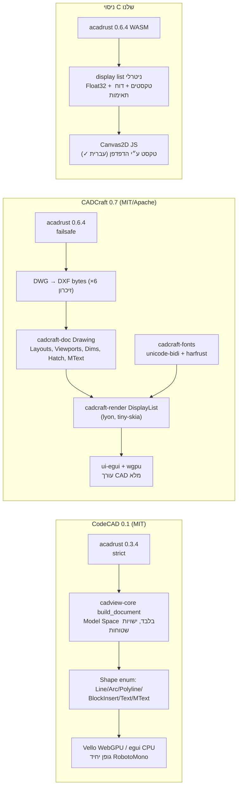
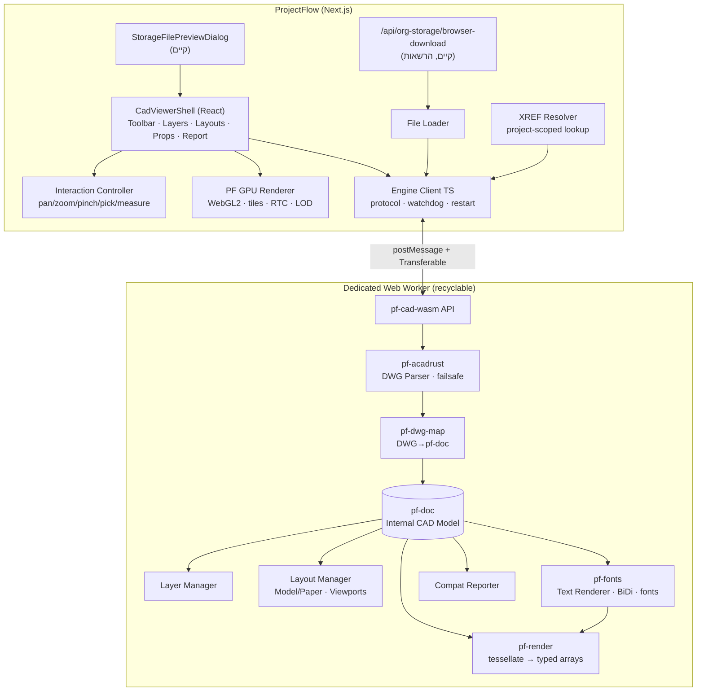

# ProjectFlow CAD Viewer: מחקר הנדסי, הכרעת ארכיטקטורה ותוכנית פיתוח

**תאריך:** 2026-10-15
**סוג:** מחקר R&D ותוכנית פיתוח. **לא בוצע שום שינוי במוצר.** לא נגעתי בקוד ProjectFlow, ב־DB, ב־`package.json`, ב־commit, ב־push או ב־deploy.
**סביבת הניסויים:** `C:\Users\ERAN YOSEF\Desktop\final projects\cad-viewer-rnd` (מחוץ למאגר). Rust 1.99 הותקן שם בבידוד, ב־`toolchain\`.
**דוחות קודמים:** `CAD_DWG_DWF_PREVIEW_FEASIBILITY_2026-10.md`, ‏`CAD_FREE_OPTIONS_CODECAD_APS_DWF_2026-10.md`, ‏`CAD_CADCRAFT_DWG_EVALUATION_2026-10.md`.
**דוחות סוכני משנה (מקור):** `cad-viewer-rnd\research\report_cadcraft.md`, ‏`report_acadrust_alternatives_licensing.md`, ‏`report_hebrew_fonts.md`.

מקרא אמינות:
- **[ניסוי]** הורץ בפועל ונמדד.
- **[קוד]** נקרא בקוד המקור עם הפניה לקובץ ולשורה.
- **[מקור]** תיעוד רשמי או טקסט רישיון.
- **[הערכה]** הסקה הנדסית שלא נבדקה.

---

## 1. תקציר מנהלים

1. **אפשר לבנות מציג DWG עצמאי בדפדפן, בלי שרת ובלי המרה.** ספריית הפענוח בקוד פתוח **acadrust 0.6.4** קומפלה ל־WebAssembly לדפדפן ללא שינוי, ופענחה DWG מזיכרון בכרום אמיתי **[ניסוי]**. נבדקו קבצים בגרסאות R14 עד 2018. גודל הספרייה: 2.2MB, ‏0.9MB בדחיסה.
2. **הבסיס הנכון הוא acadrust ישירות.** ‏CodeCAD אינו בסיס מתאים: המודל שלו מאבד מידע הנדסי. מידות ו־Hatch הופכים לקווים, רוב ה־MText נעלם, אין Layouts, ו־R14 נפתח ריק בלי שגיאה **[ניסוי + קוד]**.
3. **CADCraft הוא מקור קוד מצוין לשאילה, לא מוצר לאמץ.** המודל ההנדסי שלו, הרינדור והטקסט (כולל BiDi לעברית) ברישיון MIT/Apache ואינם תלויים בממשק. פתיחת DWG בגרסת הדפדפן שלו דרשה תיקון של 24 שורות **[ניסוי]**. הממשק שלו הוא עורך CAD מלא, ולא מתאים לנו.
4. **הרינדור חייב להיות GPU, והפענוח חייב לרוץ ב־Worker עמיד לקריסות.**
   - Canvas2D לא צייר כלל 2.2 מיליון מקטעים, בלי שגיאה **[ניסוי]**.
   - קריסה (panic) בתוך ה־WASM אינה ניתנת ליירוט, והורגת את המופע **[קוד]**.
   - בקובץ של 345K ישויות המסלול הניסיוני צרך 640MB **[ניסוי]**.
5. **עברית: הפענוח כמעט פתור.** ‏acadrust מטפל ב־Unicode וב־ANSI_1255 **[קוד]**. גם התצוגה פתורה ב־TrueType **[ניסוי]**. הבעיה האמיתית היא שרטוטים ישראליים ישנים בגופני SHX, שבהם הטקסט שמור כאותיות לטיניות או כקודי DOS.
6. **רישוי: מותר לשימוש מסחרי סגור, בלי תשלום.**
   - ‏acadrust ב־MPL-2.0: אם נשנה קבצים שלו, חובה לפרסם את קבצי acadrust ששונו, ולא את קוד ProjectFlow.
   - נדרשות הודעות זכויות יוצרים (NOTICE).
   - שתי שאלות דורשות בדיקה משפטית קצרה: מקור הקוד של acadrust (תרגום של ACadSharp ללא קרדיט, והפניות ל־LibreDWG).
7. **סיכון מרכזי: בשלות.** כל הפרויקטים צעירים מאוד:
   - CADCraft בן 8 ימים.
   - ‏acadrust בן 9 חודשים, עם 33 גרסאות.
   - בגרסה 0.6.4 יש רגרסיה: 70 מתוך 351 קבצים אמיתיים שנפתחו ב־0.6.3 נכשלים **[מקור: issue #134]**.

   לכן חובה: נעילת גרסה, אוסף שרטוטים אמיתיים לבדיקת תאימות, ו־fork שבבעלותנו.
8. **החלטה: GO מותנה.** לאשר את שלב 0 ואת שלב 1 במסגרת זמן תחומה (כ־4–6 שבועות), עם שער הכרעה על אוסף שרטוטים אמיתיים. **לא** להתחייב עכשיו לכל המנוע (כ־4–6 חודשים בתרחיש הסביר). אם השער ייכשל, נשארים עם המציג הנוכחי ועם חלופה מסחרית.

---

## 2. מפת הארכיטקטורה של המנועים שנבדקו



| רכיב | CodeCAD | CADCraft | ניסוי C שלנו |
|---|---|---|---|
| גרסת acadrust | 0.3.4, strict (`dwg.rs:31`) | 0.6.4, failsafe (`crates/dwg/src/lib.rs:76`) | 0.6.4, strict ואז failsafe |
| מעבר מפענוח לרינדור | `Document{entities: Vec<DrawEntity{shape}>}` | DXF bytes → `Drawing` → `DisplayList` | segments f32 + texts JSON + report |
| מידע הנדסי שנשמר | נמוך | גבוה | בינוני (בהתאם למה שמומש) |
| Worker | אין, ה־parse על ה־main thread | אין | אין (בניסוי) |
| ישויות לא נתמכות | נזרקות בשקט (`dwg.rs:1653 _ => continue`) | Unknown נשמר ב־DXF, אבל custom/proxy מ־DWG נעלמים בגשר | נספרות ומדווחות לפי סוג |
| רינדור | Vello/egui | wgpu (WebGPU/WebGL2) דרך egui | Canvas2D |
| הפרדה בין מנוע ל־UI | חלקית (`cadview-core` נפרד) | **טובה מאוד**: ‏doc, render, fonts ו־io ללא egui | מלאה |

---

## 3. ניתוח CodeCAD

**נבדק:** commit `64ca454`. הקוד (`crates/`) כולל כ־18.3K שורות, מתוכן `cadview-core` 13.9K.

| נושא | ממצא |
|---|---|
| קריאת DWG | `load_dwg_bytes` → `DwgReader::from_stream(cursor).read()`, ללא failsafe (`dwg.rs:29-32`) **[קוד]** |
| מודל הזיכרון | `Shape` enum: ‏Line, Circle, Arc, Polyline, LwPolyline, SolidFill, CurvePath, Ellipse, Spline, BlockInsert, Text, MText. **אין** Dimension, Hatch, Table, MLeader, Viewport או Layout **[קוד]** |
| Model Space בלבד | `build_document` מסנן בלוקים שמתחילים ב־`*` חוץ מ־`*D`, ולכן Paper Space לא נטען **[קוד]** |
| טקסט | `RobotoMono.ttf` יחיד (`text.rs:13`), בלי fallback, BiDi או shaping. עברית נעלמת **[קוד + ניסוי]** |
| WASM | ‏`cadview-core` רץ לבד ב־WASM (`wasm32-wasip1`) ומייצא מודל serde/JSON **[ניסוי A]** |
| מה אובד, `example_2018.dwg` | ‏acadrust: ‏211 ישויות (10 Dimension, 18 MText, Hatch, Table, MLeader, Viewport). CodeCAD: ‏390 ישויות, מתוכן 351 Line, ‏1 MText, ‏0 Dimension **[ניסוי A]** |
| R14 | ‏0 ישויות, ללא שגיאה **[ניסוי A]** |

**שאלה מרכזית: האם CodeCAD הוא בסיס מעשי?**

**לא.** כדי להפוך אותו למקצועי צריך להחליף את המודל, את גרסת acadrust ואת מנגנון הטקסט, ולהוסיף Layouts ודיווח תאימות. כלומר כמעט את כל `cadview-core`. מה שנשאר לשימוש חוזר: רעיון ה־BezPath cache וה־frustum culling, וזה מעט.

---

## 4. ניתוח CADCraft

**נבדק:** commit `fc4e983`, גרסה 0.7.0.

### 4.1 גרף הרכיבים **[קוד, מתוך report_cadcraft]**
```
geom, color, dxf, doc, fonts, render, dwg, io   ← ללא UI (נקיים)
engine (68.8K שורות, פקודות עריכה)              ← לא נחוץ לצפייה
ui-egui (22.2K), apps/cadcraft-web              ← UI מלא, לא מתאים
```

### 4.2 מה נדרש לפתיחת DWG בדפדפן
- **החסם לא היה טכני.** ‏acadrust 0.6.4 כבר מוציא את `memmap2` ואת `rayon` מ־wasm32, עם גרסה סדרתית (`parallel.rs`). ‏CADCraft כבר קורא מזיכרון (`lib.rs:76`). ההערה "memory-maps files" אינה נכונה **[קוד]**.
- **בוצע בפועל [ניסוי B2]:** ‏patch של +1 ו־−23 שורות ב־`crates/dwg`. ‏`cadcraft_io::read()` פתח DWG ב־WASM בכל הגרסאות, Layouts נשמרו (`SHEET_A1` עם viewport), ו־345K ישויות נקראו ב־4.1 שניות.
- **מה עוד חסר למוצר:**
  - Worker עם מחזור חיים.
  - גבולות גודל לדפדפן. ברירת המחדל היא 512MB DWG ו־1GB DXF.
  - טיפול ב־abort של WASM.
  - בנייה מחדש של UI הדפדפן (לא נבדק).

### 4.3 עלויות הגשר DWG→DXF
| עלות | פירוט |
|---|---|
| זיכרון וזמן | טקסט DXF ביניים בגודל של כ־×6 מה־DWG |
| ישויות custom/proxy | נעלמות בלי ספירה (`section_writer.rs:3626-3637` ב־acadrust) **[קוד]** |
| proxy graphics | לא מצוירות, למרות ש־acadrust יודע לפענח אותן |

**מסקנה:** הגשר מקובל לגרסה ראשונה, ומיפוי ישיר מ־acadrust ל־doc עדיף לייצור.

### 4.4 מה שווה לשאול מ־CADCraft
| רכיב | תוכן | שורות קוד |
|---|---|---|
| `doc` | Drawing, ‏Layout, ‏Viewport (clip, per-VP freeze), ‏Dimension (overrides, `*D` block), ‏Hatch (islands, gradient), ‏MText raw, ‏Table, ‏MLeader, ‏Wipeout, ‏Unknown | 9.8K |
| `render` | DisplayList (verts/tris/prims עם handle, צבע, lineweight), ‏linetypes, ‏hatch patterns, ‏viewport_content/clip | 7.2K |
| `fonts` | ‏unicode-bidi, ‏harfrust shaping, ‏MText layout (stacks, columns), ‏stroke font | 4.2K |
| `geom`, ‏`color`, ‏`dxf` | גיאומטריה בסיסית | 5.7K |
| `ui-egui/src/gpu.rs` | **רפרנס** ל־WebGL: ‏RTC origin ו־instanced wide lines | 915 |

---

## 5. שילוב CodeCAD ו־CADCraft

**לא מומלץ.**
- **המודלים לא תואמים.** ב־CodeCAD יש `Shape` שטוח עם BezPath. ב־CADCraft יש `EntityKind` עשיר עם `Common` ו־styles.
- **כיוון אחד לא אפשרי.** תרגום מ־CodeCAD ל־CADCraft לא יכול לשחזר מידות, Hatch או Layouts שכבר נמחקו.
- **הכיוון ההפוך מיותר.** תרגום מ־CADCraft ל־Vello של CodeCAD לא מוסיף יכולת, כי ל־CADCraft כבר יש display list ו־GPU.
- **שני הפרויקטים תלויים ב־acadrust**, אבל בגרסאות שונות (0.3 לעומת 0.6.4) עם API שונה. שילוב יכפיל את עלות התחזוקה.

**ההחלטה:** לא "CodeCAD + CADCraft", אלא **acadrust → doc/render/fonts משלנו (fork מ־CADCraft) → renderer משלנו**.

---

## 6. חלופות **[מתוך report_acadrust_alternatives_licensing]**

| חלופה | רישיון | יתרון מהותי? | הערכה |
|---|---|---|---|
| **acadrust 0.6.4** (מפענח) | MPL-2.0 | כן: ‏48 סוגי ישויות, ‏R12 עד 2018, ‏WASM, ‏failsafe, ‏notifications | **הבסיס שנבחר**, עם נעילת גרסה |
| **@node-projects/acad-ts** | MIT, עם קרדיט נכון ל־ACadSharp | כן: ‏TypeScript, אותו מקור (ACadSharp) | **מפענח השוואתי ב־CI** וחלופת חירום, לא במוצר |
| ACadSharp (C#) | MIT | מקור רפרנס | ‏.NET WASM כבד, לא מתאים |
| LibreDWG ו־libredwg-web | GPL-3.0 | — | **פסול** לשימוש סגור |
| cadkit (Rust, clean-room) | MIT/Apache | provenance נקי | צעיר מדי (נוצר ב־2026-10-01) |
| mlightcad renderer ו־data-model | MIT | UI צפייה מוכן, ‏SHX parser, מדידה, three.js | **Plan B**: מקבל converter חיצוני |
| מפענח mlightcad מסחרי | ‏$3,000 ו־$1,500 לשנה | איכות DWG גבוהה יותר (מוצהר) | נקודת ייחוס מסחרית |
| ODA Drawings/Web SDK | ‏$7,500, ואחר כך $4,500 לשנה | תאימות התעשייה | נקודת ייחוס איכות |
| Vello | Apache/MIT | 2D איכותי | ה־compute renderer מוגדר "experimental", ולא נחוץ |
| lyon | MIT/Apache | tessellation ל־Hatch ו־fills | **נשתמש** (כבר בתוך render) |
| three.js | MIT | — | קווים ברוחב 1px בלבד, ‏float32 |

---

## 7. תוצאות הניסויים

| # | ניסוי | הוכח | נכשל או מגבלה |
|---|---|---|---|
| B | ‏acadrust ב־`wasm32-unknown-unknown` + `wasm-bindgen --target web` בכרום | ✅ כל הגרסאות R14 עד 2018, ‏211 ישויות בכל קובץ, init של 37ms, ‏parse של 9–158ms | ‏strict נכשל על 2000, ‏2007 ו־R14 (רשומה 0x396). ‏failsafe פותר ומדווח Error |
| B | עומס, parse בלבד (opt-level=z, V8) | 23K → ‏0.11 שנ׳ / 22MB. 115K → ‏1.4 שנ׳ / 106MB. 345K → ‏6.6 שנ׳ / 296MB | צמיחה על־ליניארית: ×3 ישויות → ×4.8 זמן |
| B2 | ‏CADCraft io + DWG ב־WASM (wasip1) אחרי patch | ✅ כל הגרסאות, Layouts נשמרו, ‏345K ב־4.1 שנ׳ | UI הדפדפן לא נבנה מחדש |
| A | ‏cadview-core (CodeCAD) ב־WASM | ✅ רץ לבד, מייצא JSON | מודל מאבד מידע, ‏R14 ריק |
| C | ‏acadrust → display list שלנו → Canvas2D | ✅ שרטוט מלא: בלוקים מקוננים, מידות דרך `*D`, ‏attributes, ‏Fit חכם ודוח skipped | Hatch, ‏Spline, ‏MLeader, ‏Table ו־Wipeout לא מומשו (דווחו) |
| C | עברית | ✅ אותיות ו־BiDi תקינים דרך `fillText` של הדפדפן | כיוון פסקה (first strong) עדיין לא מוגדר |
| C | עומס, נתיב מלא (opt-level=3) | ‏345K ב־2.18 שנ׳ ל־parse+build | **640MB** זיכרון WASM |
| C | Canvas2D ב־2.2M מקטעים | — | ❌ לא צויר כלום, בלי שגיאה. ‏148K מקטעים צוירו תקין |
| C | ‏Fit עם חריגים | ✅ אלגוריתם percentile לפי ישויות top-level | בקובץ הדוגמה: ישויות ב־±2.6M יחידות ו־attribute ב־(−320K, 972K) |

הקבצים: `cad-viewer-rnd\experiments\{a_codecad_core, b_acadrust_wasm, b2_cadcraft_io_wasm, c_display_list}`. הדגימות: `cad-viewer-rnd\samples`, ציבוריות או סינתטיות בלבד.

---

## 8. פערי תמיכה ב־DWG ומפת יכולות

**מקרא עמודות:**
- **acadrust** — מפוענח במודל של acadrust.
- **CADCraft** — מיוצג ומרונדר בקוד של CADCraft.
- **אצלנו** — המצב בניסוי C.
- **מאמץ** — ק = קטן, ב = בינוני, ג = גדול.
- **סיכון** — סיכון לאובדן מידע בתצוגה.

### 8.1 גיאומטריה בסיסית
| יכולת | acadrust | CADCraft | אצלנו | מאמץ | סיכון | הערה |
|---|---|---|---|---|---|---|
| Line, Polyline, LWPolyline (bulge) | ✅ | ✅ | ✅ | ק | נמוך | |
| Arc, Circle, Ellipse | ✅ | ✅ | ✅ | ק | נמוך | חלוקת קשתות לפי זום (LOD) |
| Spline | ✅ | ✅ | ❌ | ק | בינוני | De Boor קיים ב־CADCraft וב־CodeCAD |
| Polygon | ✅ (LWPolyline) | ✅ | ✅ | ק | נמוך | |
| Hatch (דוגמאות, איים, solid, gradient) | ✅ | ✅ | ❌ | ב | **גבוה** | דוגמאות `.pat` שאינן בספריה → fallback ל־solid ואזהרה |
| קווים מקווקווים, עובי, צבע | ✅ | ✅ (מוטבע בגיאומטריה) | צבע בלבד | ב | בינוני | ‏linetype בזום עמוק דורש rebuild או shader |

### 8.2 אובייקטים הנדסיים
| יכולת | acadrust | CADCraft | אצלנו | מאמץ | סיכון |
|---|---|---|---|---|---|
| Blocks, Insert, Nested | ✅ | ✅ (MAX_BLOCK_DEPTH, expansion budget) | ✅ (עומק 16) | ק | נמוך |
| MINSERT (מערכים) | ✅ | ✅ | ❌ | ק | בינוני |
| Attributes | ✅ | ✅ | ✅ (בסיסי) | ק | נמוך |
| Dimensions | ✅ (עם `block_name`) | ✅ (‏`*D`, ‏regen אם אין בלוק) | ✅ (‏`*D`) | ק | נמוך כשיש `*D` |
| Leader, MultiLeader | ✅ | ✅ | ❌ | ב | בינוני |
| Tables | ✅ | ✅ | ❌ | ב | בינוני |
| Text, MText (codes, stacks, columns) | ✅ | ✅ | מפושט | ב | בינוני |
| Wipeout | ✅ | ✅ (Mask) | ❌ | ק | נמוך |
| Dynamic Blocks | ✅ (graph) | ✅ (state נוכחי) | — | ב | בינוני: מוצגים לפי המצב השמור ב־INSERT |
| Proxy entities | ✅ (proxy graphics decoder) | ❌ (נעלמים בגשר) | נספרים | ב | **גבוה**: חובה מיפוי ישיר כדי לצייר proxy graphics |
| Raster images | ✅ | מסגרת בלבד | — | ב | בינוני (דורש XREF-like resolver) |
| 3D Solids, ‏ACIS | חלקי | wireframe | — | **לא משתלם** | — |

### 8.3 מבנה השרטוט
| יכולת | מצב | מאמץ | הערה |
|---|---|---|---|
| Model Space | ✅ | — | |
| Paper Space ו־Layouts | acadrust ✅, ‏CADCraft ✅ (נבדק ב־B2) | ב | נדרש viewport clip עם stencil ב־WebGL2 |
| Viewports (scale, clip, per-VP freeze) | CADCraft ✅ במודל וב־render | ב | ב־web של CADCraft clip לא נתמך (אין stencil); אצלנו נממש |
| קנה מידה ויחידות (INSUNITS) | header | ק | מדידה רק כשיש יחידות וקנה מידה אמינים |
| שכבות (on/off/freeze/lock, צבע) | ✅ | ק | |
| קואורדינטות רחוקות | — | ק | RTC origin per tile (f64→f32) |
| XREF | acadrust: ‏`is_xref`, ‏`xref_path` ✅. CADCraft: טעינה דרך FS בלבד | ב | resolver דרך האחסון של ProjectFlow (סעיף 12) |
| גופנים והגדרות | styles ✅ | ב | ראו עברית |

### 8.4 תאימות
| יכולת | מצב | סיכון |
|---|---|---|
| DWG ישן (R12–R2004) | ‏0.6.4 תומך מ־R12. ‏R14 ו־2000 דורשים failsafe בקובץ הדוגמה | בינוני |
| DWG עדכני (AC1032) | ✅, אבל **רגרסיה #134 ב־0.6.4** | **גבוה**: נעילת גרסה ואוסף קבצים |
| קובצי AutoCAD אמיתיים | **לא נבדקו** (אין אוסף מאושר) | **גבוה**: שער שלב 0 |
| שרטוטים גדולים | ‏345K ישויות סינתטיות עבדו. אמיתיים לא נבדקו | בינוני־גבוה |
| ישויות לא נתמכות | notifications ‏+ ספירת skipped (בניסוי) | ראו "פתיחה ללא שגיאה עם חוסרים" |

**פתיחה ללא שגיאה עם חוסרים: מנגנון זיהוי חובה.** הוא בנוי משלוש שכבות:
1. notifications של acadrust (Error, NotImplemented).
2. ספירת ישויות שפוענחו אבל לא רונדרו, לפי סוג.
3. בלוקים חסרים, XREF חסר, ‏proxy בלי graphics, ‏Hatch עם דוגמה לא ידועה, וגופן מוחלף.

הניסוי הוכיח שזה אפשרי. בקובץ הדוגמה זוהו 17 סוגים שלא רונדרו.

---

## 9. עברית **[מתוך report_hebrew_fonts + ניסוי C]**

| שכבה | מצב | רמה |
|---|---|---|
| Unicode ‏(2007+) | ‏acadrust מפענח UTF-16 | פתור **[קוד]** |
| ANSI_1255 ו־ISO-8859-8 | ‏acadrust: ‏`code_page.rs:184, 197, 253` → ‏`encoding_rs` | פתור. חסר DOS862 (טבלה של 128 תווים) |
| ‏`\U+XXXX` | נתמך, כולל surrogates | פתור |
| RTL ו־BiDi | CADCraft: ‏`unicode-bidi` ‏(`bidi.rs:12`), ‏first-strong ‏(`:37-43`). בניסוי C, ‏Canvas של הדפדפן עבד | פתור ל־TTF |
| מעורב עברית, אנגלית ומספרים | ✅ בניסוי | צריך LRI/PDI סביב `<>` במידות וסביב stacks |
| SHX עבריים ישנים | הטקסט שמור כאותיות מקלדת לטיניות או כקודי CP862, ולפעמים הפוך | **הקושי האמיתי** |

**כלל זהב:** להפעיל BiDi רק על סגנונות TTF. טקסט ב־SHX מצויר משמאל לימין, כמו ב־AutoCAD, אלא אם חל עליו כלל תרגום עברי מוכר. אחרת "תיקון" BiDi יהפוך שרטוטים ישנים.

| Tier | תכולה | מאמץ | גרסה |
|---|---|---|---|
| 1 | גופן Noto Sans Hebrew מוטמע (OFL, subset של כ־20–40KB; כבר קיים ב־ProjectFlow לדוחות PDF), ‏fallback, וכלל "SHX = ללא BiDi" | 1–3 ימים | **v1** |
| 2 | ‏BiDi מלא לפי שורה, ‏isolation למידות, ‏`DIMTXTDIRECTION`, ‏override לכל שרטוט | 1–2 שבועות (בסיס CADCraft) | v1.1 |
| 3 | ‏DOS862 וזיהוי code page שגוי | 3–6 ימים | v1.1 |
| 4 | מיפוי SHX עבריים: מקלדת, CP862, ‏final-letter test, רשימת גופנים (miryl, ‏mirym, ‏hebtxt, ‏sivan_m, ‏oron…). ‏SHX parser אופציונלי (`@mlightcad/shx-parser` ‏MIT) | 3–7 שבועות | מתקדם, **רק** אחרי ניתוח אוסף ישראלי אמיתי |

---

## 10. הכרעת הארכיטקטורה

### 10.1 ההמלצה
```
DWG bytes (מ־browser-download הקיים, עם ההרשאות)
  → [Worker] acadrust (fork נעול) — failsafe + notifications
  → [Worker] Mapper ישיר acadrust→pf-doc (במקום DXF)
  → [Worker] pf-render: tessellation לפי tile ו־LOD → typed arrays
  → [Main] PF GPU Renderer (WebGL2, ‏WebGPU בהמשך)
  → [Main] React Viewer Shell (ProjectFlow, ‏RTL)
```

### 10.2 מה לפתח ומה לשאול
| רכיב | מקור | פעולה |
|---|---|---|
| מפענח DWG | **acadrust** (MPL) | fork ציבורי ונעול (`pf-acadrust`). שינויים רק בקבצים שלו, ותרומה upstream כשאפשר |
| מודל CAD פנימי (`pf-doc`) | **CADCraft `doc`, ‏`geom`, ‏`color`** (MIT/Apache) | vendoring של snapshot, ניקוי מה שקשור לעריכה ו־constraints, והוספת `CompatReport` |
| מעבר מ־DWG למודל | **חדש**: ‏`pf-dwg-map` | **שלב 1:** הגשר של CADCraft (מוכח, מהיר להגיע). **שלב 2:** מיפוי ישיר שסופר הכל ומצייר proxy graphics |
| Display list ו־tessellation | **CADCraft `render`** + ‏lyon | התאמה: ‏tiles, ‏LOD, ‏RTC origin, פלט typed arrays |
| טקסט | **CADCraft `fonts`** | הטמעת Noto Sans Hebrew, ‏gate ל־SHX, ובהמשך Tier 2–4 |
| API ל־WASM | **חדש**: ‏`pf-cad-wasm` | ‏wasm-bindgen, ‏handle-based, ‏transferable buffers |
| Worker ומחזור חיים | **חדש** (TS) | watchdog, ‏restart, ‏budgets |
| GPU Renderer | **חדש** (TS + WebGL2) | ‏`gpu.rs` של CADCraft כרפרנס |
| UI | **חדש** (React, ‏ProjectFlow) | השראה ויזואלית מ־CADCraft, בלי כלי עריכה |
| בדיקות השוואה | **acad-ts** (MIT) | השוואת ספירות ישויות ב־CI |

**מה לא לוקחים:** `engine` ו־`ui-egui` של CADCraft (90K+ שורות של עריכה), ואת CodeCAD.

### 10.3 מניעת אובדן מידע
1. **failsafe תמיד**, עם `notifications` ו־`read_with_stats`.
2. **מיפוי ישיר** (שלב 2), שמשמר `Unknown` עם `dwg_type_code` ומצייר proxy graphics.
3. **`CompatReport` לכל קובץ:** ספירות מפוענח, מרונדר, מדולג ומקורב (לפי סוג), בלוקים או XREF חסרים, גופנים מוחלפים, ישויות חריגות שהוצאו מה־Fit, ושכבות כבויות.
4. **רגרסיה מול אוסף קבצים** בכל עדכון acadrust: ספירות לפי סוג מול baseline, ‏golden PNG, והשוואה ל־acad-ts.

---

## 11. ארכיטקטורה מפורטת ותרשים רכיבים



### 11.1 הרכיבים
| רכיב | אחריות | שפה |
|---|---|---|
| File Loader | ‏fetch עם credentials מה־route הקיים, ‏`ArrayBuffer`, בדיקת גודל וזיהוי פורמט (magic `AC10xx`) | TS |
| Engine Client | ‏spawn ל־Worker, פרוטוקול בקשות, watchdog (timeout ו־heartbeat), ‏terminate ו־respawn אחרי abort | TS |
| pf-cad-wasm API | `open(bytes, opts) → docId, report`, `layers()`, `layouts()`, `tiles(space, lod, bbox) → buffers`, `pick(x,y)`, `close(docId)` | Rust |
| DWG Parser | ‏acadrust fork, ‏failsafe, ‏limits | Rust |
| Mapper | שלב 1: גשר CADCraft. שלב 2: מיפוי ישיר | Rust |
| Internal Model | ‏pf-doc: ישויות, ‏styles, ‏blocks, ‏layouts | Rust |
| Geometry Renderer | ‏tessellation מ־pf-render ל־**tiles**: ‏(lines u32 idx + f32 RTC, tris, wide-lines) לכל tile ולכל LOD | Rust |
| Layer Manager | ‏on/off/freeze. שינוי visibility כ־mask ב־GPU, בלי rebuild | Rust + TS |
| Layout Manager | Model/Paper, ‏viewports, ‏clip (stencil), ‏scale | Rust + TS |
| Text Renderer | שלב 1: טקסט כגיאומטריה מ־pf-fonts (עקבי בזום), ‏fallback של Canvas overlay | Rust |
| Interaction Controller | עכבר, מגע, ‏pinch, ‏inertia, ‏pick דרך ‏spatial index (R-tree ב־WASM) | TS |
| Compat Reporter | ‏`CompatReport` (סעיף 13) | Rust → TS UI |
| React Viewer Wrapper | ‏`CadViewerShell`, שמשתלב ב־`StorageFilePreviewDialog` כמו `PdfJsViewer` | TS/React |

### 11.2 זרימת הנתונים, מהקובץ למסך
1. `browser-download` (הרשאות קיימות) → `ArrayBuffer` ב־main.
2. ‏`postMessage(bytes, [bytes])` (העברת בעלות, בלי עותק) → Worker.
3. ‏WASM: ‏`alloc`, ‏copy ו־`open` → parse failsafe → mapping → `pf-doc`. **ה־`CadDocument` של acadrust משוחרר מיד** אחרי המיפוי.
4. ‏`report`, ‏`layers` ו־`layouts` חוזרים כ־JSON קטן.
5. ה־Renderer מבקש את ה־tiles הנראים ב־LOD המתאים. ‏Rust מייצר typed arrays ומעביר אותם כ־Transferable.
6. ‏WebGL2 מעלה VBOs. ‏pan ו־zoom משנים רק uniforms. החלפת LOD מבקשת tiles חדשים ברקע.
7. סגירה: `close(docId)` ‏+ `worker.terminate()`. הזיכרון כולו חוזר למערכת, כי WASM לא מקטין memory.

### 11.3 הפרדת מנוע הפענוח ממנוע הרינדור
**כן.** גבול חוזה אחד: **typed arrays של tiles ו־`CompatReport`**. מאפשר:
- להחליף את ה־renderer (WebGL2 → WebGPU) בלי לגעת ב־Rust.
- לשדרג את acadrust בלי לגעת ב־TS.
- לבדוק כל צד עם fixtures.

---

## 12. XREF כולל הרשאות

- **זיהוי:** `BlockRecord.flags.is_xref` ו־`Block.xref_path` **[קוד, נבדק בניסוי C]**.
- **resolver ב־host:**
  - הנתיב מנורמל: נלקח שם הקובץ, ובהמשך נתיב יחסי לתיקיית ה־DWG.
  - החיפוש נעשה **רק בתוך אותו פרויקט** (‏scope=project, ‏projectId זהה), דרך `browser-download` הקיים, ולכן אותן בדיקות `DOCUMENTS_READ`, ‏scope ו־semantic folder.
- **אסור:** חיפוש חוצה ארגונים או פרויקטים, ונתיבים מוחלטים ל־FS.
- **XREF חסר או ללא הרשאה:** אזהרה "קובץ מקושר לא זמין", ציור placeholder, והמשך העבודה.
- **מגבלות:** עומק nested ≤ 4, ‏N קבצים ≤ 20, ותקציב גודל משותף.
- **גרסה:** **מתקדמת** (v1.1). ב־v1 מוצגת אזהרה בלבד.

---

## 13. טיפול בקבצים בעייתיים ודוח תאימות

| מצב | זיהוי | תגובה למשתמש |
|---|---|---|
| קובץ פגום | strict נכשל וגם failsafe נכשל | "לא ניתן לפתוח את הקובץ", כפתור הורדה |
| פורמט לא נתמך | magic לא `AC10xx`, או גרסה < R12 | "גרסת DWG לא נתמכת (Rxx)" |
| גרסה שלא ניתן לפענח | ‏Err מ־reader | כנ"ל, עם הצעה לפתוח ב־AutoCAD |
| שרטוט שנפתח ריק | ‏0 ישויות מרונדרות במודל ובכל ה־Layouts | **לא להציג הצלחה.** "השרטוט נפתח ללא תוכן גלוי" עם פירוט |
| ישויות חסרות | ‏skipped / (rendered+skipped) > סף (למשל 2%), או Error notifications > 0 | תג "תצוגה חלקית" ופאנל פרטים |
| גבולות שגויים וקואורדינטות רחוקות | ‏Fit לפי percentile של ישויות top-level (מומש בניסוי C) | ‏Fit אוטומטי לתוכן העיקרי, ו־"הצג הכל" |
| שכבות מוסתרות | שכבות off/frozen עם ישויות | חיווי "X שכבות מוסתרות" |
| גופן חסר | style font לא נמצא, ‏SHX | "גופן הוחלף", מוצג פעם אחת |
| XREF חסר | סעיף 12 | אזהרה ו־placeholder |
| שרטוט כבד מדי | גודל לפני parse, ‏entity count אחרי parse, ‏memory budget | "השרטוט גדול מדי למכשיר הזה", עם הצעה לפתוח במחשב או להוריד |
| קריסת WASM | ‏worker `error` או abort, ‏watchdog | "שגיאה בפענוח", ‏restart ל־Worker, והקובץ לא נפתח שוב אוטומטית |

**עקרון התצוגה:**
- **אזהרה מרוכזת אחת** בשפה פשוטה, עם "פרטים" מתקפלים.
- **לעולם לא "הצלחה"** כשחסר תוכן משמעותי.
- פרטים טכניים (סוגי ישויות, notifications) רק בפאנל הפרטים, ולמנהל.

---

## 14. ביצועים

### 14.1 מדידות קיימות (Chrome/V8, מחשב הפיתוח בלבד, single thread)
| מדד | ערך | הערה |
|---|---|---|
| ‏init של WASM | 24–37ms | מקומי |
| ‏parse ‏(opt=z): ‏23K, ‏115K ו־345K ישויות | ‏0.11, ‏1.4 ו־6.6 שנ׳ | זיכרון 22, ‏106 ו־296MB |
| ‏parse+build ‏(opt=3), ‏345K | 2.18 שנ׳ | זיכרון **640MB** (מודל, ‏segments f64 ועותק f32) |
| ‏CADCraft io ב־wasip1, ‏345K | 4.1 שנ׳ | כולל גשר DXF |
| ‏draw ב־Canvas2D, ‏74K ו־148K מקטעים | 2–4ms | תקין |
| ‏Canvas2D, ‏2.2M מקטעים | **לא צויר** | ללא שגיאה |
| גודל WASM ‏(parser בלבד) | 2.2MB, ‏0.9MB gzip | ‏opt=z |
| גודל WASM ‏(parser + display list) | 3.7MB | ‏opt=3 |

**הערה:** אלה קבצים סינתטיים, ו־**לא** נמדד מכשיר נייד.

### 14.2 צעדים להורדת הזיכרון מ־640MB
1. שחרור `CadDocument` מיד אחרי המיפוי. כרגע הוא חי לצד המודל.
2. display list ב־**f32 RTC בלבד**, ללא עותק f64 (חיסכון של כ־60%).
3. tessellation **לפי tile** ולפי צורך, לא לכל השרטוט מראש.
4. ‏LOD: מספר הסגמנטים במעגל לפי גודל בפיקסלים (במקום 64 קבוע), מה שמקטין 2.2M מקטעים פי 5–10.
5. מיפוי ישיר (בלי DXF של ×6) בשלב 2.
6. ‏`--max-memory` ל־WASM ‏(למשל 1.5GB במחשב ו־512MB במובייל), עם כשל מבוקר במקום קריסת לשונית.

**[הערכה]** יעד ריאלי: ≤ 2.5KB זיכרון לישות בשיא.

### 14.3 יעדי ביצועים (עתידיים, לאימות בשלב 5)
| סוג מכשיר | קובץ טיפוסי (≤ 5MB, ≤ 100K ישויות) | קובץ גדול (≤ 20MB, ≤ 400K) | זיכרון שיא | זום והזזה |
|---|---|---|---|---|
| מחשב (i5/M1, ‏Chrome/Edge/Safari) | תמונה ראשונה ≤ 3 שנ׳ | ≤ 10 שנ׳ עם progress | ≤ 800MB | ‏≥ 50fps |
| טאבלט (iPad M1 או Galaxy Tab S8) | ≤ 5 שנ׳ | ≤ 20 שנ׳ או סירוב מבוקר | ≤ 500MB | ‏≥ 30fps |
| טלפון בינוני (2023+) | ≤ 8 שנ׳ | **סירוב מבוקר** מעל תקציב | ≤ 350MB | ‏≥ 30fps |
| בכל המכשירים | ה־UI לא נתקע (main thread long tasks < 100ms) | כנ"ל | — | — |

### 14.4 מניעת קריסת דפדפן
- תקציב גודל לפני fetch, לפי `navigator.deviceMemory` ו־UA.
- ‏`max-memory` ל־WASM, וטיפול ב־OOM כשגיאה רגילה.
- ‏watchdog (timeout לפי גודל).
- ‏Worker נפרד לכל קובץ, ‏terminate בסגירה.

### 14.5 GPU
- **WebGL2 כבסיס** (Safari 15+, כל הדפדפנים), ו־**WebGPU אופציונלי** כשקיים.
- **fallback:** בלי WebGL2, או ב־context lost חוזר: Canvas2D רק לקבצים קטנים (≤ 300K מקטעים), אחרת "המכשיר לא תומך".
- **טכניקות:**
  - ‏instanced wide lines (רוחב קו אמיתי).
  - ‏RTC לכל tile (דיוק בקואורדינטות רחוקות).
  - ‏frustum culling לפי tile.
  - batching לפי צבע ועובי.
  - ‏layer visibility כ־uniform/bitmask, בלי rebuild.

---

## 15. ממשק משתמש

| כלי | v1 | הערה |
|---|---|---|
| חלון גדול, רקע כהה CAD (מתג בהיר) | ✅ | ‏aci7 מתהפך לפי רקע |
| Zoom In/Out, ‏Zoom to Fit, ‏Pan | ✅ | ‏Fit חכם, ו־"הצג הכל" |
| מסך מלא | ✅ | ‏Fullscreen API כמו ב־PdfJsViewer |
| Layers (חיפוש, הצג/הסתר, "בודד") | ✅ | |
| מעבר Layouts | ‏v1: ‏Model ו־Layouts. ‏v1.1: ‏viewport clip | |
| בחירת אובייקט ומאפיינים (סוג, שכבה, צבע, ערכי מידה, טקסט) | ✅ בסיסי | ‏pick דרך R-tree ב־WASM |
| מדידה | ‏v1.1, **רק** עם INSUNITS ו־scale אמינים, אחרת מוסתר | |
| חיווי טעינה עם progress (callback של acadrust 0..1000) | ✅ | |
| שגיאות ואזהרות (CompatReport) | ✅ | |
| עכבר, מגע ו־pinch, ‏double-tap ל־fit | ✅ | |
| RTL במעטפת ProjectFlow | ✅ | ה־canvas עצמו ניטרלי |
| כלי יצירה או עריכה | ❌ | לא בתכולה |

**React ל־UI, ו־WASM למנוע בלבד: כן.** המנוע לא יודע על DOM, וה־UI משתמש ברכיבי ProjectFlow, כולל i18n ו־RTL.

**חוויה אחידה עם DWF/DWFX:** ‏`CadViewerShell` מגדיר interface של `ViewerEngine`, עם ‏`zoomIn`, ‏`zoomOut`, ‏`fit`, ‏`fullscreen`, ‏`layers?`, ‏`layouts?`, ‏`report?` ו־`capabilities`. יש לו שני adapters: `PfCadEngine` (DWG/DXF) ו־`ApsDwfEngine` (Autodesk Viewer Local, כבר בעבודה המקבילה). אותו toolbar ואותה מסגרת, וכפתורים לא נתמכים מוסתרים לפי `capabilities`.

---

## 16. רישוי, בעלות ותחזוקה

### 16.1 סיכום
| רכיב | רישיון | נבדק | מה מחייב |
|---|---|---|---|
| acadrust | MPL-2.0 (מ־0.2.0; עד 0.1.8 ‏MIT) | ✅ ‏LICENSE, ‏crates.io | ראו 16.2 |
| CADCraft | MIT OR Apache-2.0 | ✅ ‏NOTICE | שמירת LICENSE ו־NOTICE. **הסרת מותג ArtCraft** (`docs/brand/LICENSE-brand.txt`). מומלץ גם שם אחר מ־"CADCraft" |
| CodeCAD | MIT | ✅ | לא נשתמש |
| ACadSharp (מקור acadrust) | MIT | ✅ | **להוסיף את הודעת ACadSharp בעצמנו**, כי acadrust 0.6.x הסיר את הקרדיט |
| lyon, ‏skrifa, ‏unicode-bidi, ‏harfrust, ‏encoding_rs | MIT / Apache / BSD | ✅ ‏crates.io | הודעות |
| תלויות CADCraft (484) | כולן מתירניות, חוץ מ־acadrust ו־colored (MPL) | ✅ ‏audit | ‏colored רק ב־CLI, לא ב־WASM |
| Noto Sans Hebrew | OFL-1.1 | ✅ | מותר להטמיע. ‏subset הוא שינוי: לבדוק Reserved Font Name |
| Hebrew SHX ו־Autodesk SHX | לא ברור | — | **לא להפיץ.** תרגום קודים ל־Unicode ושימוש ב־TTF שלנו |
| Culmus | GPL ‏(+exception לחלק) | ✅ | להימנע |

### 16.2 MPL-2.0 בהפצה ללקוחות ב־WASM
- **הגשת WASM לדפדפן היא "הפצה"** (MPL FAQ Q17). בצד שרת היא לא.
- **חובות:**
  - להנגיש את קוד המקור של קובצי acadrust שמוטמעים ב־WASM, שהשתנו או לא (§3.2(a)), ולהודיע למשתמשים היכן הוא נמצא.
  - פתרון: **repo ציבורי `pf-acadrust`** וקישור מעמוד "רישיונות קוד פתוח" במוצר.
- **שינוי קבצים של acadrust:** הקבצים ששונו נשארים MPL וחייבים להתפרסם.
- **הקוד שלנו נשאר סגור (§3.3, ‏Larger Work)**, כל עוד הוא בקבצים נפרדים ולא מעתיק קוד מ־acadrust אליהם. העתקת קוד לקובץ שלנו הופכת את **הקובץ הזה** ל־MPL.
- **אסור** להסיר הודעות (§3.4). אין זכויות סימן מסחרי (§2.3).

### 16.3 תשובות
| שאלה | תשובה |
|---|---|
| fork פרטי? | כן לשימוש פנימי. ברגע שמגישים WASM, חובה לפרסם את קבצי acadrust. ‏CADCraft (MIT/Apache) ‏fork פרטי מלא |
| מותר לשנות את הקוד? | כן |
| מה מחייב פרסום? | רק קבצי acadrust, וקבצים חדשים שמכילים קוד acadrust |
| ProjectFlow נשאר סגור? | כן |
| NOTICE נדרש? | כן: עמוד third-party notices עם MIT, ‏Apache NOTICE, ‏MPL source offer, ‏OFL ו־ACadSharp |
| מיתוג משלנו? | כן. בלי "ArtCraft" ובלי "DWG" בשם המוצר. מותר לכתוב "פותח קובצי .dwg" |
| תלות בספק? | אין ספק מסחרי. יש תלות במתחזק יחיד של acadrust, שממותנת ב־fork ובאוסף רגרסיה |
| רישיון בתשלום? | **לא נדרש** |

**שאלות לעו"ד** (שעה–שעתיים ייעוץ):
1. האם השמטת הודעת ACadSharp ב־acadrust משפיעה עלינו, או שמספיק שנוסיף אותה?
2. האם ההפניות ל־`dwg2.spec` של LibreDWG ‏(GPL) מעוררות סיכון?
3. איזו צורת source offer מספקת לפי MPL כשה־WASM מוגש למשתמשים מחוברים?
4. ניסוח "DWG" בשיווק בישראל ובאיחוד האירופי.

### 16.4 אסטרטגיית תחזוקה
- **מבנה:** **repo נפרד `projectflow-cad-engine`** ‏(Rust + TS), עם CI שבונה WASM ומפרסם artifact בגרסה (`public/cad/pf-engine-x.y.z/`), כמו `pdf.worker`. ‏**אין Rust ב־build של Vercel.**
- **acadrust:**
  - fork ציבורי, נעילת `=x.y.z`.
  - עדכון רק אחרי מעבר על אוסף הרגרסיה: ספירות לפי סוג, ‏golden images, השוואה ל־acad-ts.
  - תיקונים נתרמים upstream כ־PR, כדי לא להיתקע עם fork שונה.
- **CADCraft:** ‏vendoring חד־פעמי של snapshot, ‏**בלי מעקב קבוע**. ‏cherry-pick ידני של תיקונים רלוונטיים (רינדור, טקסט) פעם ברבעון.
- **אבטחה:**
  - הקוד ב־Rust הוא memory-safe. הסיכונים הם DoS: ‏allocation ענק (#123) ו־panic (#124).
  - ממותנים ב־max-memory, ‏watchdog, ‏fuzzing ‏(cargo-fuzz על native, בלילה), ובידוד ב־Worker.
  - אין רשת מתוך ה־Worker.
- **מניעת היתקעות:** שכבת ה־mapper מבודדת את ה־API של acadrust, כך ששינוי ב־acadrust נוגע בקובץ אחד.

---

## 17. תוכנית הפיתוח בשלבים

**הנחת צוות:** סוכן ראשי (Lead/Integrator) ו־3–5 סוכני משנה במקביל, עם בעל בית שמאשר שערים. ההערכות הן בשבועות קלנדריים.

| שלב | מטרה | תוצר עובד | מורכבות | אופטימי / סביר / מורכב | שער מעבר |
|---|---|---|---|---|---|
| **0: בסיס ואוסף** | הכרעה על אוסף אמיתי | repo מנוע, אוסף קבצים, ‏harness של ספירות ו־PNG, החלטת גרסת acadrust | בינונית | 1 / 2 / 3 שבועות | ‏≥ 90% מהקבצים נפתחים. אין קריסות לא מבוקרות. ההחלטה: CADCraft‑doc או ‏mlightcad (Plan B) |
| **1: מנוע DWG בסיסי בדפדפן** | פתיחה, גיאומטריה בסיסית, שכבות, טקסט, זום | ‏POC פנימי: ‏Worker, ‏WASM, ‏WebGL2, ‏Fit חכם, ‏CompatReport בסיסי | בינונית | 2 / 4 / 6 | 20 קבצי אוסף נראים "נכון" בבדיקה ויזואלית מול PDF. בלי freeze. זיכרון ≤ 1.5KB לישות |
| **2: אמינות פענוח** | Blocks, ‏Hatch, ‏Dimensions, ‏MText, ‏MLeader, ‏Tables, ‏Wipeout, ‏proxy, מיפוי ישיר | כיסוי ≥ 98% מהישויות במודל של האוסף | גבוהה | 3 / 5 / 8 | ‏skipped ≤ 2% בממוצע. דוח תאימות מדויק (0 false-success) |
| **3: גיליונות** | Paper Space, ‏Layouts, ‏Viewports (clip), ‏scale | מעבר Layouts תקין | בינונית־גבוהה | 2 / 3 / 5 | 10 קבצי Layout תואמים לפלוט PDF |
| **4: ממשק מקצועי** | ‏CadViewerShell מלא, מובייל, ‏props ו־pick | UI שלם, ‏RTL | בינונית | 2 / 3 / 4 (מקביל ל־2–3) | בדיקות מגע ו־pinch בטאבלט ובטלפון אמיתיים |
| **5: ביצועים** | ‏tiles, ‏LOD, תקציבי זיכרון, ‏WebGPU אופציונלי | יעדי סעיף 14.3 | גבוהה | 2 / 3 / 5 (חלקית מקביל) | עמידה ביעדים על אוסף גדול |
| **6: עברית** | ‏Tier 1 ב־v1, ‏Tier 2–3 אחר כך | ‏Tier 1 ו־2 | בינונית | 1 / 2 / 3 (‏Tier 4 בנפרד: 3–7) | 20 שרטוטים עבריים ‏(TTF). ‏SHX לא משתבש |
| **7: שילוב ב־ProjectFlow** | **רק באישור בעלים** | החלפה הדרגתית ב־`StorageFilePreviewDialog` מאחורי flag | בינונית | 1 / 2 / 3 | ‏PDF וסוגים אחרים ללא שינוי. ‏smoke על 3 ספקי אחסון |

**סדר מומלץ:** 0 → 1 → (2 ‖ 4 ‖ 6‑Tier1) → 3 → 5 → 7. ‏UI ו־Tier 1 של עברית מתחילים במקביל, עם fixtures.

**סה"כ עד v1 מלא (שלבים 0–5, ‏Tier 1–2):**
- **אופטימי:** כ־10–12 שבועות.
- **סביר:** כ־16–22 שבועות.
- **מורכב:** כ־6–9 חודשים.

**לא משתלם לפתח:**
- 3D, ‏ACIS ו־solids.
- עריכה ושמירה.
- OLE.
- רינדור SHX מקורי (במקום תרגום).
- 100% תאימות לכל דוגמאות ה־hatch המותאמות.
- dynamic blocks אינטראקטיביים.
- פלוט ו־PDF (מחוץ לתכולה, לפי הדרישה).

---

## 18. חבילות עבודה לסוכנים

**כללי עבודה:**
- כל חבילה **מחזיקה תיקיות בלעדיות**. רק ה־Lead נוגע בחוזים המשותפים (`contracts/`).
- כל העבודה ב־repo `projectflow-cad-engine`, חוץ מ־WP‑11.
- ה־Lead מאחד את הענפים ומריץ את אוסף הרגרסיה.

| WP | מטרה ותוצר | בעלות על קבצים | תלויות | מקביליות | מורכבות וסיכון | זמן (סביר) | תנאי קבלה |
|---|---|---|---|---|---|---|---|
| **WP‑0 Corpus & Harness** | אוסף קבצים ‏(ציבורי + מאושר בעלים), ‏`corpus-runner` (native): ספירות לפי סוג, ‏notifications, זמן, זיכרון, ‏PNG | `corpus/`, `tools/corpus-runner/` | אישור בעלים לקבצים | מתחיל ראשון | ב׳. סיכון: מחסור בקבצים אמיתיים | 1–2 שב׳ | ‏≥ 60 קבצים מסווגים, עם baseline נשמר |
| **WP‑1 Repo & Vendoring** | ‏workspace, ‏fork ל־`pf-acadrust` (ציבורי), ‏vendoring ל־doc/geom/color/dxf/render/fonts, ‏CI ל־wasm, מחולל NOTICE | `Cargo.toml`, `vendor/`, `.github/`, `LICENSES/` | — | מקביל ל־WP‑0 | ק׳ | 3–5 ימים | ‏build ל־wasm32 ירוק. ‏NOTICE נוצר אוטומטית |
| **WP‑C Contracts (Lead)** | ‏`contracts/`: פרוטוקול Worker, פורמט tiles (typed arrays), ‏schema של `CompatReport`, ‏fixtures | `contracts/`, `fixtures/` | WP‑1 | מאפשר מקביליות | ב׳ | 3–4 ימים | ‏fixtures נטענים גם ב־Rust וגם ב־TS |
| **WP‑2 Mapper** | שלב א: גשר CADCraft (ה־patch שהוכח). שלב ב: מיפוי ישיר acadrust→pf-doc עם ספירות | `crates/pf-dwg-map/` | WP‑1, ‏WP‑C | מקביל ל־3, ‏4 ו־7 | ג׳. סיכון: שינויי API ב־acadrust | א: שבוע. ב: 5–8 שב׳ | שלב ב: ספירות ≥ גשר, ‏unknown נספרים, זיכרון ≤ ‏½ מהגשר |
| **WP‑3 WASM API & Worker** | ‏`pf-cad-wasm` ‏(wasm-bindgen), ‏`engine-client` (TS): ‏watchdog, ‏restart, ‏max-memory, ‏panic hook, ‏progress | `crates/pf-cad-wasm/`, `ts/engine-client/` | WP‑C | מקביל | ב׳. סיכון: OOM ו־abort | 2–3 שב׳ | קובץ זבל או ענק לא מקריס לשונית. ‏restart ≤ 1 שנ׳ |
| **WP‑4 Tessellation/Tiles** | התאמת `render`: ‏tiles, ‏LOD, ‏RTC f32, פלט typed arrays, ‏R-tree ל־pick | `crates/pf-render/` | WP‑1, ‏WP‑C | מקביל | ג׳ | 3–4 שב׳ | ‏345K ישויות: build ≤ 3 שנ׳, ‏≤ 1.5KB לישות |
| **WP‑5 GPU Renderer** | ‏WebGL2: ‏VBO לכל tile, ‏instanced wide lines, ‏tris, ‏stencil ל־viewport clip, ‏layer mask, ‏context-lost | `ts/renderer/` | ‏WP‑C (‏fixtures) | **מקביל מהיום הראשון** | ג׳ | 3–5 שב׳ | ‏2.2M מקטעים ‏≥ 50fps במחשב, ו־≥ 30fps בטאבלט |
| **WP‑6 Text & Hebrew** | ‏pf-fonts: ‏Noto Sans Hebrew subset, ‏fallback, ‏gate SHX→no BiDi, ‏Tier 2 (isolates, ‏DIMTXTDIRECTION), ‏DOS862 | `crates/pf-fonts/` | WP‑1 | מקביל | ב׳ (‏Tier 4: ג׳) | ‏T1: 3 ימים. ‏T2–3: 2–3 שב׳ | 20 שרטוטים עבריים ‏(TTF) תקינים. 0 היפוכים ב־SHX |
| **WP‑7 Viewer UI** | ‏`CadViewerShell` (React): ‏toolbar, ‏layers, ‏layouts, ‏props, פאנל report, מחוות, ‏RTL, ‏ViewerEngine interface ל־DWF | `ts/viewer-shell/` | ‏WP‑C (‏mock engine) | **מקביל** | ב׳ | 3–4 שב׳ | ‏a11y בסיסי. מגע ו־pinch במכשירים אמיתיים |
| **WP‑8 Layouts** | ‏Paper Space, ‏viewports, ‏clip, ‏scale, ‏per-VP freeze | `crates/pf-render/layout/`, `ts/renderer/stencil/` | WP‑4, ‏WP‑5 | אחרי 4 ו־5 | ב׳־ג׳ | 2–3 שב׳ | 10 קבצי Layout תואמים לפלוט |
| **WP‑9 Robustness & Perf** | ‏fuzz ‏(native), ‏budgets לפי מכשיר, מדידות במכשירים, ‏WebGPU ניסיוני | `fuzz/`, `bench/` | ‏WP‑2 עד WP‑5 | אחרי ‏v0 | ב׳ | 2–3 שב׳ | עמידה ביעדי 14.3 |
| **WP‑10 XREF Resolver** | ‏resolver ב־host לפי פרויקט והרשאות, ‏placeholder ו־limits | `ts/engine-client/xref/` ‏(+ חוזה ל־host) | WP‑3 | v1.1 | ב׳. סיכון: הרשאות | 1–2 שב׳ | אין גישה חוצת פרויקט. ‏XREF חסר = אזהרה |
| **WP‑11 ProjectFlow Integration** | **באישור בעלים בלבד**: ‏`StorageFilePreviewDialog` ‏+ feature flag, ‏artifact ב־`public/cad/` | בעלות **בלעדית** של ה־Lead | הכל | אחרון | ב׳ | 1–2 שב׳ | ‏PDF ושאר הסוגים ללא שינוי. ‏smoke על Drive, ‏OneDrive, ‏Dropbox ו־Box |
| **WP‑12 Compliance** | ‏repo ציבורי ל־`pf-acadrust`, עמוד third-party notices, ייעוץ משפטי | `LICENSES/`, תוכן העמוד | WP‑1 | מקביל | ק׳ | שבוע | ‏checklist משפטי סגור |

**מקביליות מקסימלית:** אחרי WP‑1 ו־WP‑C (כשבוע), ‏WP‑2א, ‏3, ‏4, ‏5, ‏6‑T1 ו־7 רצים במקביל (5–6 סוכנים), כל אחד בתיקייה שלו. ה־Lead מאחד פעם בשבוע מול WP‑0.

---

## 19. אומדן משאבים ועלויות

### 19.1 זמן (בהנחת Lead וסוכני AI, עם זמן בעלים לשערים)
| רכיב | אופטימי | סביר | מורכב |
|---|---|---|---|
| R&D שנותר (שלב 0, כולל אוסף) | 1 שב׳ | 2 שב׳ | 3 שב׳ |
| מנוע (WP‑1 עד 4, ‏6, ‏8) | 6 שב׳ | 10–12 שב׳ | 18–24 שב׳ |
| ממשק (WP‑7) | 3 שב׳ | 4 שב׳ | 6 שב׳ (מקביל) |
| ‏Rust ו־WASM (חלק מהמנוע) | — | — | עקומת למידה כש־Lead ללא ניסיון Rust: ‏+20–40% |
| תחזוקת fork ואוסף (שוטף) | 1 יום/חודש | 2–3 ימים/חודש | שבוע/חודש בתקופות של שינויי acadrust |
| בדיקות תאימות DWG | בתוך WP‑0 ו־WP‑9 | +2 שב׳ | +4 שב׳ |

### 19.2 תשתית
| פריט | עלות |
|---|---|
| ‏WASM ‏(צפוי 3–6MB gzip) כ־asset סטטי ב־Vercel CDN | ‏immutable cache, זניח |
| תעבורת קובצי DWG | עוברת כבר היום דרך `browser-download`, ללא שינוי. ‏Fast Origin Transfer לפי גודל הקובץ |
| פענוח | **בדפדפן, ‏$0 בשרת** |
| אחסון | אין תוספת. אין cache בשרת. ‏cache מקומי אופציונלי ב־IndexedDB |
| CI לבניית WASM | ‏GitHub Actions בדקות חינמיות או זולות |
| בהתרחבות למשתמשים רבים | העלות לא גדלה עם צפיות, חוץ מתעבורה שקיימת ממילא |

### 19.3 שימוש בסוכני AI
- **מתאים מאוד:** מיפוי ישויות, ‏tessellation, ‏UI, ‏fixtures ובדיקות. ‏CADCraft עצמו נבנה כך (אומדניו ב־"agent-hours").
- **פחות מתאים:** הכרעות ויזואליות מול AutoCAD. אלה דורשות עין אנושית ואוסף אמיתי.
- **[הערכה]** זמן Lead נדרש: 30–50% מהקלנדר.

---

## 20. השוואה כלכלית מול פתרון מסחרי (3 שנים)

| | מנוע עצמאי (ההמלצה) | ‏mlightcad + מפענח מסחרי | ‏ODA Web SDK | ‏APS (Autodesk) |
|---|---|---|---|---|
| רכישה | $0 | $3,000 | $7,500 | ‏$0 בכניסה |
| עדכונים | $0 (זמן תחזוקה) | $1,500/שנה (אופציונלי) | $4,500/שנה | תשלום לכל המרה, ‏~$1–3 **[לא אומת]** |
| זמן פיתוח עד v1 | 16–22 שב׳ (סביר) | 4–8 שב׳ | 8–16 שב׳ (‏C++, ‏SDK כבד) | 3–6 שב׳ |
| איכות צפייה | בינונית־גבוהה, תלוי באוסף | גבוהה (מוצהר) | הגבוהה ביותר | גבוהה |
| עברית | **בשליטתנו** | לא מתועד (‏RTL) | טובה | לא אומת |
| תלות בספק | אין (מתחזק acadrust) | מתחזק יחיד, ללא SLA | ‏ODA. ‏SaaS דורש מנוי פעיל | ‏Autodesk והקובץ נשלח לענן |
| הרחבה עתידית (סימון, מדידה, AI) | מלאה | חלקית (MIT renderer) | מלאה | מוגבלת |
| סיכון פרויקט | **גבוה** (שלב 0 ממתן) | נמוך־בינוני | בינוני | נמוך טכנית, גבוה מבחינת מדיניות |
| עלות 3 שנים (כסף) | ‏$0 | ‏$3,000–$6,000 | ‏$16,500 | משתנה |
| עלות 3 שנים (זמן) | **הגבוהה ביותר** | נמוכה | בינונית־גבוהה | נמוכה |

**מסקנה כלכלית כנה:** מנוע עצמאי **אינו זול יותר** בזמן. ההצדקה היא אסטרטגית:
- שליטה מלאה ועברית.
- ‏$0 לצפייה בכל קנה מידה.
- אין שליחת קבצים לצד שלישי.
- התאמה ל־ProjectFlow (הרשאות, XREF בתוך פרויקט).
- בסיס לפיצ'רים עתידיים: סימון, השוואת גרסאות, חילוץ כמויות.

אם אלה לא נחוצים, ‏mlightcad עם המפענח המסחרי הוא הדרך המהירה.

---

## 21. טבלת החלטה

ציון 1–5, כאשר 5 הוא הטוב ביותר.

| קריטריון | A: הרחבת CodeCAD | B: התאמת CADCraft כמות שהוא | C: שילוב CodeCAD+CADCraft | **D: acadrust + רכיבי CADCraft + renderer שלנו** | D′: ‏acadrust + mlightcad MIT renderer | E: המציג הנוכחי ושיפור הדרגתי |
|---|---|---|---|---|---|---|
| היתכנות טכנית | 3 | 4 (‏B2) | 2 | **5 (‏B, ‏B2, ‏C)** | 4 (לא נבדק) | 5 |
| איכות פענוח צפויה | 2 | 4 | 2 | **4–5** | 4 | 2 |
| DWG | 3 | 4 | 3 | **4–5** | 4 | 3 |
| עברית בעתיד | 2 | 4 | 3 | **5** | 3 | 2 |
| Layouts | 1 | 4 | 2 | **4** | 4 | 1 |
| ביצועים | 3 | 2 (גשר ×6, ‏egui) | 2 | **4** | 3 (מודל JS) | 3 |
| מורכבות פיתוח | 2 | 3 | 1 | **3** | 3 | 5 |
| מורכבות תחזוקה | 2 | 2 (90K שורות לא רלוונטיות) | 1 | **3** | 3 | 4 |
| רישוי | 4 | 4 | 4 | **4** | 4 | 4 |
| עלויות | 3 | 3 | 2 | **3** | 3 | 5 |
| סיכון מרכזי | מודל מאבד מידע | ‏UI עורך, ‏repo בן 8 ימים | שני API שונים | בשלות acadrust | ‏Hebrew RTL, זיכרון JS | איכות נמוכה, ‏R14 ריק |

**ההמלצה: D.**
- **D′ הוא Plan B** שייבחן ב־spike של עד שבוע בשלב 0, ורק אם WP‑4 או WP‑5 יתקשו.
- **E** (המציג שהסוכן המקביל משלב, CodeCAD) נשאר **פתרון ביניים** עד שה־v1 שלנו עובר את השערים. **שימו לב:** ‏NOTICE של CodeCAD ב־`public/cad/codecad-v0.1.0/` מפנה לקישור מקור שבור (404). זה צריך תיקון לפני הפצה, לפי MPL.

---

## 22. החלטת GO / NO-GO

**GO מותנה:**
- ✅ **GO** לשלב 0 ולשלב 1. תקציב זמן תחום של כ־4–6 שבועות, ללא שינוי ב־ProjectFlow.
- 🚦 **שער 1** (בסוף שלב 1). כל התנאים חייבים להתקיים:
  - ‏≥ 90% מקובצי האוסף האמיתי נפתחים.
  - ‏≥ 85% מהם נראים נכון בהשוואה לפלוט PDF.
  - 0 קריסות לשונית.
  - יעדי ביצועים של מחשב ב־14.3 עבור קבצים טיפוסיים.
- ❌ **NO-GO** אם השער נכשל: עוצרים, נשארים עם E, ושוקלים את המפענח המסחרי.
- ⏸ שלב 7 (שילוב) **לא מתחיל** בלי אישור נפרד.

---

## 23. מה נדרש מהבעלים כדי להתחיל

1. **אישור לאוסף קבצים:** 50–100 שרטוטים אמיתיים, עם פלוט ה־PDF התואם לכל אחד. הם יישמרו מחוץ למאגר, לא יועברו לצד שלישי, ויכסו גרסאות, גדלים, Layouts, ‏Hatch, עברית ו־XREF.
2. **אישור repo נפרד** `projectflow-cad-engine` (פרטי), ו־**repo ציבורי** `pf-acadrust` לצורך MPL.
3. **אישור ייעוץ משפטי קצר** על 4 השאלות בסעיף 16.3.
4. **אישור התקציב לשלב 0–1**, ושער החלטה בסופו.
5. **מכשירים לבדיקה:** טאבלט וטלפון אמיתיים (iPad ו־Android).
6. **החלטה** אם המציג הנוכחי (CodeCAD, מהסוכן המקביל) נשאר כפתרון ביניים.

תוכנית העבודה (todos) שמורה גם ב־`.cursor/plans/projectflow_cad_viewer_engine.plan.md`.
