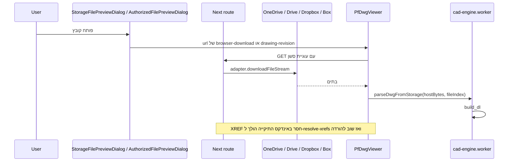
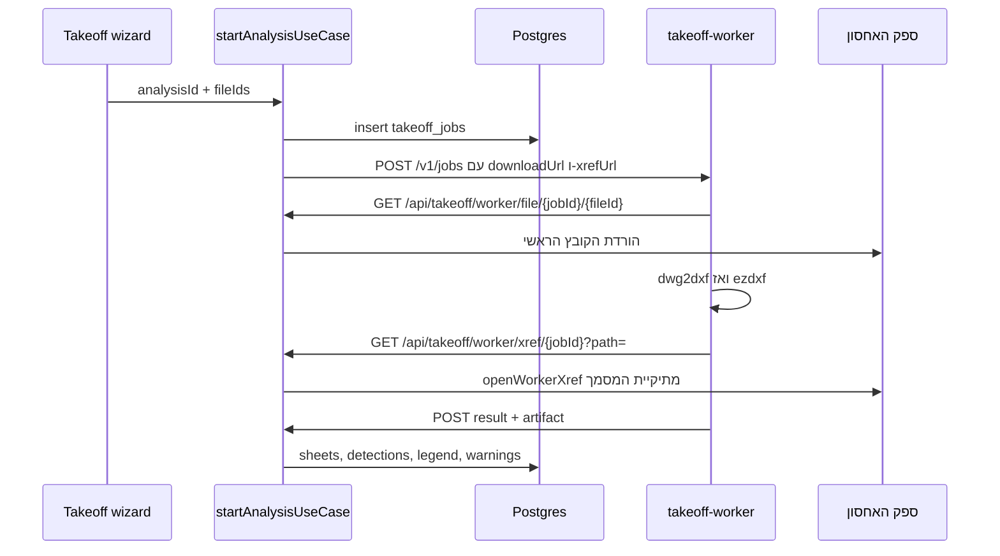

# EXLFY — מציג DWG חיצוני וכתב כמויות מקובץ חיצוני

בדיקת ארכיטקטורה והיתכנות. קריאה בלבד. לא בוצע פיתוח, תיקון, SQL, העלאה, commit, push או deploy.

תאריך הבדיקה: 26 בנובמבר 2026. השלמה: 27 בנובמבר 2026. שם הקובץ לפי הבקשה.

סטטוס: חלק א׳ הוא מיפוי הבסיס. חלק ב׳ משלים את מחזור החיים ואת עשרת הממצאים. חלק ג׳ סוגר את הפערים שנמצאו בסקירת תוכנית הביצוע. התוכנית עצמה יושבת ב־`.cursor/plans/exlfy_external_professional_tools_final_implementation_2026-11.plan.md` וממתינה לאישור בעל המוצר. אין מימוש.

הממצאים להלן נקראו מהקוד בפועל בריפו הזה, וממקור ה־Rust של מנוע ה־CAD בשכנו `projectflow-cad-engine` (קריאה בלבד). לא פורק הבינארי של ה־WASM, לא הורצו דפדפנים על מכשירים, ולא הורץ ניתוח על קובצי 3643 / 1545 / 7155 / 3096.

## סיווג בשימוש בדוח

| סימון | משמעות |
|---|---|
| נתמכת כבר כיום | ההתנהגות קיימת בקוד הפעיל |
| אפשרית באמצעות התאמה | המנוע הקיים מקבל את הקלט, חסרה שכבת חיבור דקה |
| דורשת פיתוח חדש | אין מסלול מוצר שמקיים את הדרישה |
| מוגבלת בדפדפן | הפלטפורמה לא מעניקה את הגישה, בלי קשר לקוד |
| דורשת החלטת מוצר | יותר ממסלול טכני אחד תקין |
| לא ניתן לאמת כעת | לא הורץ במכשיר, בבינארי או על קובץ אמיתי בסבב הזה |

---

## 1. תקציר מנהלים

שני המנועים הקיימים יכולים לשרת קובץ חיצוני. אין צורך במציג חדש ובמנוע כמויות חדש.

המציג כבר מפרש בתים. `CadEngineClient.parseDwgFromStorage` מקבל `Uint8Array` ואינדקס קבצים בזיכרון. הוא לא מקבל `projectId`, לא שורת תוכנית, ולא מזהה אצל ספק האחסון. מה שקשור לפרויקט הוא המעטפת: דיאלוג התצוגה, נתיב ההורדה `/api/org-storage/browser-download`, ונתיבי `resolve-xrefs`. קובץ מקומי יכול להיכנס לאותו מנוע דרך כתובת `blob:` ואינדקס הקבצים שהמשתמש כבר אישר. זה אפשרי בלי העלאה לשרת ובלי ספק אחסון מחובר.

כתב הכמויות לא יכול לרוץ כולו בדפדפן. LibreDWG (`dwg2dxf`) ו־ezdxf רצים רק בקונטיינר ה־Worker. העתקתם לדפדפן תהיה מנוע מקביל, וזה נוגד את המטרה. מסלול המוצר הקיים (`createAnalysisUseCase` → `startAnalysisUseCase`) דורש `project_id` שהוא `NOT NULL` וזר למפתח אל `projects`. מצב ephemeral הקיים עדיין כותב שורות לארגון ולפרויקט, ולא יודע לטעון XREF כי `openWorkerXref` יוצא כשאין `storageDocumentId`.

חוזה ה־Worker כבר יודע לקבל קובצי רקע מוכנים: `files[].xrefs[].downloadUrl`. האפליקציה לא ממלאת את השדה היום. זה נקודת ההתאמה לכתב כמויות חיצוני: אותה סגירת קבצים שהמציג כבר מרכיב, העלאה זמנית רק של מה שנפתר, ומילוי החוזה הקיים. תוצאת הניתוח, הסקירה והאקסל יכולים להישאר מחוץ לטבלאות הפרויקט, כי `applyEdits`, `computeBoq` ו־`exportTakeoffBoqXlsx` הם פונקציות על אובייקטים, לא על מזהה ניתוח.

המלצה ארכיטקטונית: צפייה מקומית בדפדפן (אפשרות A) וניתוח זמני ב־Worker הקיים (אפשרות C). שכבת המקור המשותפת היא אינדקס קבצים בזיכרון למציג, ואותה סגירה כהעלאה זמנית לחוזה ה־Worker. לא מרחיבים את סט ספקי הענן, לא יוצרים פרויקט מלאכותי, ולא משכפלים את מנגנון הספירה.

מה שלא נסגר בלי החלטת בעל המוצר: האם תוצאת ניתוח זמנית מותרת להשאיר עקבות עד פקיעת תוקף, והאם ניקוי אמין בלי טבלת סשן (כלומר בלי מיגרציה). צפייה מקומית לא תלויה בהחלטה הזו.

---

## 2. מיפוי הארכיטקטורה הקיימת

שלוש שכבות נפרדות, ואין ביניהן מקור קבצים משותף.

```text
מציג (דפדפן)
  מעטפת אחסון / גרסת שרטוט / כתב כמויות
    → fetch של כתובת באפליקציה
    → CadEngineClient (בתים)
    → Worker של WASM
    → build_dl
    → WebGL

כתב כמויות (שרת + קונטיינר)
  createAnalysisUseCase (שורת פרויקט)
    → העלאה או קישור לענן
    → startAnalysisUseCase (שורת job + bearer)
    → POST /v1/jobs
    → Worker מוריד GET /api/takeoff/worker/file/...
    → dwg2dxf → ezdxf → ספירה
    → callback שומר sheets / detections / legend / warnings
    → המסך בונה תצוגה מהמסד

XREF
  תצוגה: נתיב מתוך BlockRecord ב־WASM, ואז אינדקס מקומי או resolve-xrefs מול תיקיית הספק
  ניתוח: נתיב מתוך ezdxf, ואז GET /api/takeoff/worker/xref מול אותה הליכה בענן
         או files[].xrefs[].downloadUrl אם הבקשה מילאה אותו (היום ריק)
```

ברירת המחדל של המציג היא הכפתור «גרסה 1». הכפתור והעץ הפוכים בכוונה.

```2:7:src/modules/external-storage/ui/cad/cad-viewer-engines.ts
export const CAD_VIEWER_TREES = {
  v1: 'pf-cad-v3',
  v2: 'pf-cad',
  v3: 'pf-cad-v1',
} as const;
```

`DEFAULT_CAD_VIEWER_VERSION` הוא `'v1'` (`cad-viewer-version-select.tsx` שורות 5–7). `PfDwgVersionedViewer` טוען לפי זה את `pf-cad-v3` (`pf-dwg-versioned-viewer.tsx` שורות 26–29). ה־WASM של העץ הזה הוא `/pf-cad/v3/wasm/`, ו־`public/pf-cad/v3/wasm/version.json` מצהיר על commit `8749c95d793cca26f082c9c5062d7e9315b50387`. גרסה 2 (`pf-cad`, `/pf-cad/v2/wasm`) וגרסה 3 הקפואה (`pf-cad-v1`, `/pf-cad/v1/wasm`) הן עותקים של מעטפת ה־JS. ל־v1 אין `engineCommitSha` בקובץ הגרסה. כתב הכמויות לא עובר במתג הגרסאות: `TakeoffDwgPlan` בונה `CadEngineClient` מהעץ `pf-cad-v3` בלבד.

מקור ה־Rust אינו בריפו הזה. הוא ב־`projectflow-cad-engine`. הבינארי שמפורסם לא פורק בסבב הזה. מה שאומת הוא קוד המקור: `block_record_xref_path` קורא קודם את `BlockRecord.xref_path`, ורק אם הוא ריק נופל לישות BLOCK (`crates/pf-cad-wasm/src/xref.rs` שורות 71–88).

---

## 3. תרשימי זרימת מידע קיימים

### פתיחת DWG מתיקיית פרויקט או מגרסת שרטוט



כתובת ההורדה נבנית ב־`storage-file-urls.ts`. הדפדפן לא מקבל כתובת חתומה של הספק. הסשן חייב ארגון פעיל. בתיק פרויקט נדרש גם `projectId` (`browser-download/route.ts`).

### ניתוח כתב כמויות מתוך פרויקט



`startAnalysisUseCase` (`use-cases.ts` שורות 322–348) שולח רק `downloadUrl` של הקובץ הראשי. `xrefs` נשאר ברירת המחדל `[]` (`contracts.ts` שורות 204–214). `pipeline.py` שורות 182–190 מוריד `xrefs[].downloadUrl` אם הרשימה לא ריקה, ורק אחר כך קורא ל־`xrefUrl`.

### הבדל תצוגה מול ספירה בכתב כמויות

במציג האחסון הסגירה רצה בלקוח (`collectXrefClosure`). במסך כתב הכמויות הסגירה הזו כבויה:

```501:507:src/modules/electrical-takeoff/ui/viewer/takeoff-dwg-plan.tsx
        const parsed = await client.parseDwgFromStorage({
          fileName,
          hostBytes,
          fileIndex: EMPTY_INDEX,
          skipXrefClosure: true,
          cachedDeps: deps,
        });
```

הרקע שם מגיע רק משמות שכבר נשמרו על הגיליון, דרך `GET {source}/background?name=`. `backgroundRequestAllowed` מסרב לשם שלא נרשם בניתוח (`architectural-background.ts` שורות 15–21). שכבות עם קידומת של קובץ הרקע מסומנות כרקע אדריכלי לתצוגה (`displayArchitecturalLayerIndexes`). זו תצוגה, לא כלל הספירה.

---

## 4. מיפוי תלויות במערכת

| תלות | מציג מתיקיית פרויקט | מציג גרסת שרטוט | מציג כתב כמויות | ניתוח כתב כמויות |
|---|---|---|---|---|
| סשן וארגון | כן, בנתיב ההורדה | כן | כן | כן |
| `project_id` | כן ב־scope של פרויקט | כן במסמך | כן, דרך הניתוח | כן, `NOT NULL` |
| שורת תוכנית (`drawings`) | לא לקובץ תיקייה | כן לגרסה | לא | לא |
| ספק אחסון מחובר | כן | כן | כן במצב persistent; לא במצב ephemeral לקובץ הראשי | כן ל־XREF; לא לקובץ ראשי במצב ephemeral |
| Worker | לא | לא | לא | כן, `TAKEOFF_WORKER_URL` |
| Postgres לתוצאה | לא | לא | לקריאת הניתוח | כן |
| Supabase | לא לבתים של התוכנית | רק למסמך ישן שאינו external | לתצוגות מקדימות | לתצוגות מקדימות ול־ephemeral על Vercel |

פתיחת גרסת שרטוט רשומה דורשת חיבור ענן. `externalProviderFileStore` זורק `externalStorage.errors.notConnected` כשאין חיבור ראשי. אין נפילה ל־Supabase במסלול הזה.

ניתוח חדש בלי ספק אחסון כבר קיים, אבל רק בתוך פרויקט: `resolvePersistenceModeForNewAnalysis` (`takeoff-persistence.ts` שורות 23–27) מחזיר `ephemeral` כשהארגון לא מחובר. הבייטים הולכים לדיסק `{TEMP}/projectflow-takeoff/{orgId}/{fileId}.bin` או, על Vercel, ל־`{orgId}/takeoff-ephemeral/{fileId}/source.bin`. תוקף ברירת המחדל 6 שעות (`purge-ephemeral-takeoff.ts` שורות 22–30). הניקוי רץ ב־cron `15 5 * * *` (`vercel.json` שורות 59–62).

אזור `dub1` נקבע ב־`vercel.json`. ה־Worker אינו פונקציית Vercel. `takeoff-worker/Dockerfile` מריץ Python 3.12 על פורט 8765. האפליקציה קוראת לו ב־HTTP.

---

## 5. רשימת קבצים, רכיבים ופונקציות

### מציג

| נתיב | סמל | תפקיד | שימוש לקובץ חיצוני |
|---|---|---|---|
| `src/modules/external-storage/ui/cad/cad-viewer-engines.ts` | `CAD_VIEWER_TREES` | כפתור → עץ | כמו שהוא |
| `src/modules/external-storage/ui/cad/cad-viewer-version-select.tsx` | `DEFAULT_CAD_VIEWER_VERSION` | ברירת מחדל `v1` | כמו שהוא |
| `src/modules/external-storage/ui/cad/pf-dwg-versioned-viewer.tsx` | `PfDwgVersionedViewer` | טעינה עצלה של שלושת העצים | התאמה: להעביר `url` ו־`devCadIndexedFiles` |
| `src/modules/external-storage/ui/cad/pf-cad-v3/pf-dwg-viewer.tsx` | `PfDwgViewer` | fetch, אינדקס, ציור | התאמה. `url` ו־`scope` חובה בטיפוס |
| `pf-cad/pf-dwg-viewer.tsx`, `pf-cad-v1/pf-dwg-viewer.tsx` | אותו סמל | גרסה 2 וגרסה 3 קפואה | אותו hook `devCadIndexedFiles` קיים בשלושתם |
| `pf-cad-v3/cad-engine-client.ts` | `parseDwgFromStorage`, `dispose` | בתים → worker | כמו שהוא |
| `pf-cad-v3/cad-engine.worker.ts` | `build_dl`, `add_xref_dep` | WASM | כמו שהוא |
| `pf-cad-v3/xref-resolver.ts` | `collectXrefClosure`, `lookupInIndex` | סגירת תצוגה | כמו שהוא לנתיב יחסי שנמצא באינדקס |
| `resolve-storage-xref-client.ts` | `createStorageXrefResolver` | כתובת → API | לא לקרוא לקובץ מקומי. על `blob:` הוא מחזיר `undefined` (שורות 121–125, 144–150) |
| `storage-cad-preview.tsx` | `StorageCadPreview` | DWG / DXF / DWF | צמוד לאחסון |
| `storage-file-preview-dialog.tsx` | דיאלוג תיקייה | כניסה | צמוד לאחסון |
| `authorized-file-preview-dialog.tsx` | דיאלוג גרסה | כניסה | צמוד למסמך |

שלושת העצים חוזרים על `cad-engine-client.ts`, `cad-engine.worker.ts`, `xref-resolver.ts` ו־`pf-dwg-viewer.tsx`. שינוי מנוע צריך לקרות בשלושתם או במעטפת המשותפת בלבד. מעטפת חיצונית שלא נוגעת בקבצים האלה שומרת על שלוש הגרסאות.

### כתב כמויות

| נתיב | סמל | תפקיד | שימוש לקובץ חיצוני |
|---|---|---|---|
| `application/use-cases.ts` | `createAnalysisUseCase`, `startAnalysisUseCase` | שורה + job | לא בלי פרויקט |
| `application/takeoff-persistence.ts` | `resolvePersistenceModeForNewAnalysis` | ephemeral מול persistent | לא מספיק: עדיין FK לפרויקט, ובלי XREF |
| `application/takeoff-architectural-background.ts` | `openWorkerXref` | הורדת רקע ל־Worker | יוצא בלי `storageDocumentId` (שורה 80) |
| `domain/contracts.ts` | `workerFileSchema.xrefs` | חוזה רקע מוכן | נקודת ההתאמה. היום ריק |
| `takeoff-worker/takeoff_worker/pipeline.py` | `fetch_xref`, לולאת `wf.xrefs` | הורדה ואז מנוע | כמו שהוא |
| `takeoff-worker/takeoff_worker/dwg_engine/engine.py` | `DwgEngine.analyze`, `_load_xrefs` | גיאומטריה | כמו שהוא. מקבל נתיב מקומי |
| `domain/edits.ts` | `applyEdits` | יומן תיקונים טהור | כמו שהוא על תוצאה בזיכרון |
| `domain/boq-engine.ts` | `computeBoq` | חישוב כמויות | כמו שהוא |
| `application/export-xlsx.ts` | `exportTakeoffBoqXlsx` | אקסל מאובייקט | כמו שהוא. לא דורש `analysisId` |
| `application/get-analysis-view.ts` | `buildAnalysisView` | קריאה מהמסד | צמוד לניתוח שמור |
| `ui/takeoff-workspace.tsx` | `TakeoffWorkspace` | סקירה ומיקוד | צמוד ל־API של ניתוח |
| `ui/local/apply-edits-local.ts` | `applyEditsLocal` | מראה ישנה למוק | לא לשימוש. יש `Set` מודולי של מחיקות |

### XREF בשרת

| נתיב | סמל | תפקיד |
|---|---|---|
| `domain/xref-folder-walk.ts` | `isLocalAbsoluteCadPath`, `xrefNameKey` | נתיב יחסי, דיסק מוחלט, אותיות לטיניות |
| `domain/xref-resolve.ts` | `resolveXrefTwoPhase` | נתיב שמור ואז חיפוש שם בעומק 4 |
| `application/resolve-storage-xref.ts` | `resolveStorageXrefPath` | הזרקת `listFolder` של הספק, כולל `anchorPath` |
| `project-plans/domain/contractor-xref-access.ts` | `contractorMayAccessUnlinkedXrefFile` | תמיד `false` |
| `providers/registry.ts` | `STORAGE_PROVIDER_KEYS` | onedrive, google_drive, dropbox, box |

הליכה הזו מקבלת `listFolder` מוזרק. היא לא יודעת אם המקור הוא Graph או מפה בזיכרון. זו שכבת ה־adapter הקיימת, לא מנגנון חדש.

---

## 6. מיפוי מציג DWG

### גרסאות וכניסות

| כפתור | תווית | עץ | WASM | מי משתמש |
|---|---|---|---|---|
| `v1` ברירת מחדל | גרסה 1 | `pf-cad-v3` | `/pf-cad/v3/wasm/` | תיקיות, גרסאות, וגם בסיס כתב הכמויות בלי המתג |
| `v2` | גרסה 2 | `pf-cad` | `/pf-cad/v2/wasm/` | רק דרך המתג |
| `v3` קפואה | גרסה 3 | `pf-cad-v1` | `/pf-cad/v1/wasm/` | רק דרך המתג |

כניסות שנמצאו:

- קבצי פרויקט, קבצי חברה, ודפדפן העובד: `StorageFilePreviewDialog` → `StorageCadPreview` → `PfDwgVersionedViewer`.
- תוכנית אצל קבלן וקובץ בתיקיית קבלן: `AuthorizedFilePreviewDialog` → אותו מציג.
- מרשם התוכניות הפנימי (`internal-drawing-revisions-panel.tsx` שורה 21): תצוגה מוטמעת רק כשה־MIME הוא PDF. DWG שם הוא קישור הורדה, לא המציג.
- פיתוח: `/dev/pf-cad-viewer` קורא קבצים מתיקיית התהליך. `notFound()` בפרודקשן. זה לא בוחר קובץ מהמכשיר.
- DXF הולך ל־`MlightcadDxfViewer`. DWF/DWFX הולך ל־`AutodeskDwfViewer`. מחוץ למנוע ה־DWG.

### טעינה, WASM, זיכרון, שחרור

1. `fetchStoragePreviewBytes` קורא את כל הגוף. יש כותרות Range בנתיבי ההורדה. המציג לא משתמש בהן.
2. `parseDwgFromStorage` (`cad-engine-client.ts` שורות 223–320) מעתיק ל־`ArrayBuffer`, מריץ סגירת XREF אלא אם `skipXrefClosure` או `cachedDeps`, ואז שולח parse סופי.
3. ה־worker מעתיק לזיכרון WASM וקורא `build_dl` (`cad-engine.worker.ts` סביב 142–159). האתחול של WASM מקבל כתובת של הבינארי, לא את קובץ השרטוט.
4. `dispose` הורג את ה־worker (שורות 322–327). סגירת המציג גם מבטלת את ההורדה. `cad-webgl-renderer` מוחק buffers ב־`destroy`.
5. מה שלא משתחרר היום: מטמון בתים מודולי לפי מזהה קובץ אצל הספק (`storage-cad-file-index`), ו־`URL.createObjectURL` של רסטרים בלי `revokeObjectURL` במציג. באג קיים. לתעד, לא לתקן כאן. מעטפת חיצונית שתיצור `blob:` חייבת לבטל אותו בסגירה, כי המטמון הזה לא יעשה זאת.

אין במציג prop של `File`. כל פתיחה בייצור היא `fetch(url)`. `blob:` עובר את אותו `fetch`. זה אומת מול `createStorageXrefResolver`: בלי `fileId` ובלי נתיב גרסה הפונקציה מחזירה `undefined`, ולכן קובץ מקומי לא יפנה ל־API של האחסון.

`scope: StorageBrowserScope` עדיין חובה בטיפוס (`pf-dwg-viewer.tsx` שורה 156), גם כש־`devCadIndexedFiles` תופס את האינדקס (שורות 252–255). זו התאמת טיפוס, לא תלות ריצה, כל עוד לא קוראים ל־`buildStorageCadFileIndex`.

### יכולות המציג שנשמרות אם נשארים על אותו קומפוננטה

המתג גרסה 1/2/3, Model/Plot, שכבות, מרחבים, גיליונות, טקסט, התראות, וסרגל הכלים כבר יושבים בתוך `PfDwgViewer`. מעטפת שמגישה לו בתים לא צריכה לממש אותם מחדש. כתב הכמויות משתמש בנתיב צר יותר (`TakeoffDwgPlan`): בלי מתג גרסאות, עם טבעת מיקוד במקום התאמת מצלמה לתיבה. מיקוד הסקירה היום הוא על התצוגה הזו ועל תצוגת הרסטר (`plan-viewer.tsx`), לא על כל סרגל המציג המלא.

מגבלה: לא נמדד כאן אילו כפתורים בסרגל מניחים אחים מתיקיית הספק (גופנים, CTB). אם כפתור כזה קורא שוב ל־API, מעטפת מקומית תצטרך להזין גם אותם לאינדקס. לא מוצה בסבב הזה מעבר ל־XREF ול־CTB שכבר עוברים כ־`plotCtbBytes` בחוזה ה־parse.

---

## 7. מיפוי מנגנון כתב כמויות

המנוע עצמו רץ בלי מסד ובלי פרויקט. `DwgEngine.analyze` מקבל נתיב דיסק ו־`xref_paths`. סקריפטים מקומיים (`dump_3643_legend_identity.py`, `_dwg_3096.py`, `test_corpus_7155.py`) קוראים לו כך. הם לא הורצו בסבב הזה.

מסלול המוצר לא יכול לעשות זאת.

`createAnalysisUseCase` (`use-cases.ts` שורות 156–172) דורש `projectId` והרשאת manage. `takeoff_analyses.project_id` הוא `uuid NOT NULL` עם מפתח זר אל `(project_id, organization_id)` (`drizzle/migrations/0205_electrical_takeoff.sql` שורות 136, 157–158). אותו אילוץ חוזר על `takeoff_files`, `takeoff_jobs` וילדיהם.

### עשרים השלבים

| # | שלב | מה קורה בקוד | תלות קשיחה |
|---|---|---|---|
| 1 | בחירת מקור | העלאה באשף, או קישור קובץ ענן רק במצב persistent ולשחקן פנימי | ארגון, פרויקט, הרשאה |
| 2 | קובץ ראשי ורקע | הקובץ הראשי נשמר כמסמך ענן או כקובץ ephemeral. הרקע לא מצורף לבקשה | XREF דורש `storageDocumentId` ותיקיית אב בענן |
| 3 | יצירת משימה | `insertJob` לפני הקריאה ל־Worker. bearer ל־4 שעות | Postgres, סוד Worker |
| 4 | העברה ל־Worker | `POST /v1/jobs`. הקובץ יורד מ־`/api/takeoff/worker/file/{jobId}/{fileId}` | האפליקציה נגישה מהקונטיינר |
| 5 | LibreDWG | `convert.py`: `dwg2dxf -y`, timeout 600 שנ'. נתיב לא־ASCII מועתק ל־`input.dwg` | בינארי על ה־Worker |
| 6 | ezdxf | `DocContext` על ה־DXF. DXF קלט מדלג על LibreDWG | חבילת ezdxf בקונטיינר |
| 7 | גיאומטריה | איסוף INSERT בתוך viewports | אין מסד |
| 8 | Layouts | גיליונות נייר עם viewport. `Model` רק אם אין גיליון נייר. `layout1` / `layout` מושמטים כשיש גיליון עם שם | אין מסד |
| 9 | מקרא | `find_legend_layout` ואז זיווג בלוק לטקסט. שורת מקרא מסווגת ולא מוסיפה סמל | אין מסד |
| 10 | סמלים | `is_symbol_insert` ואז מיזוג מ־XREF | אין מסד |
| 11 | כפילויות | `dedupe` לפי בלוק, שכבה, מיקום 0.1 וסיבוב. תג `possible_duplicate` | אין מסד |
| 12 | קטלוג | פעם במנוע מול קטלוג ברירת מחדל, ופעם ב־`pipeline.py` מול קטלוג הארגון וספריית המתכנן | קטלוג הארגון אופציונלי. בלי שורות נטען קובץ ברירת המחדל |
| 13 | סיווג | קונפליקט על אותו בלוק מנקה את הסוג ומוסיף `type_ambiguous`. זהות עברית רצה שוב בבניית התצוגה | טהור אחרי שיש תוצאה |
| 14 | תוצאות | `ingestWorkerResult` כותב sheets, detections, legend, warnings. לא כותב `result.linear` | Postgres כ־`service_role` |
| 15 | סקירה | `buildAnalysisView` משחזר מיומן `takeoff_edits` | שורת ניתוח |
| 16 | סימון במציג | `highlightedDetectionIds` ב־`takeoff-workspace.tsx`. טבעת ב־`TakeoffDwgPlan`. הרדיוס בפיקסלים | הורדת המקור |
| 17 | תיקון ואישור סיווג | פעולות ביומן, כולל `reclassify`, `confirm`, `set_boq_excluded` | שורה + revision |
| 18 | החרגה | `counting-policy.ts`: `legend_zone`, `drawing_noise`, `user_excluded`, ו־`pdf_only` לא מאושר | אותה תוצאה |
| 19 | אקסל | `GET /api/takeoff/export/{analysisId}` קורא תצוגה ואז `exportTakeoffBoqXlsx` | היום דורש ניתוח. הפונקציה עצמה מקבלת אובייקטים |
| 20 | סיום ומחיקה | מחיקת ניתוח מוחקת ילדים ב־cascade. מסמך ענן ותצוגות PNG לא נמחקים. ephemeral נמחק ב־cron אחרי 6 שעות. תיקיית העבודה של ה־Worker נמחקת ב־`finally`. מטמון DXF לפי SHA נשאר | ראו סעיף 13 |

`takeoff_linear` ו־`takeoff_areas` קיימים בסכמה (`drizzle/schema/electrical-takeoff.ts` שורה 267 לטבלת הליניארי). `ingestWorkerResult` (`takeoff.repository.ts` שורות 315–427) לא מייבא ולא מכניס ל־`takeoffLinear`. מדידות ליניאריות שהמנוע מחשב נזרקות. זה באג קיים או פער קיים. לא תוקן.

אישור (`use-cases.ts` סביב 510–538) דורש `TAKEOFF_APPROVE`, סקירת תוכנית, ושומר `takeoff_approvals`. ניתוח ephemeral לא נפתח מחדש אחרי אישור. שמירה לספריית הסמלים כותבת שורה ארגונית שנשארת גם אחרי מחיקת הניתוח.

דמו: `assertNotDemoOrganization` חוסם `startAnalysisUseCase`. ארגון דמו לא מריץ ניתוח אמיתי. דף `/dev/electrical-takeoff` הוא מוק בדפדפן וחסום בפרודקשן אלא אם `PF_DESIGN_SPECIMEN=1`.

שלוש מעטפות לאותו מודול: בעלים ועובד על `/api/takeoff/...`, קבלן על `/api/contractor/takeoff/...`. `TakeoffShell` מחליף רק את קידומת הנתיב. דף הקבלן (`contractor/(portal)/projects/[projectId]/takeoff/page.tsx` שורות 14–20) מחזיר 404 בלי `ext.document.view` או `ext.document.upload`, גם אם יש `ext.takeoff.view`. זה שער דף קיים, לא שער של הרזולבר. הרזולבר `resolveTakeoffPermissions` נותן אותו דגל לאותה עובדה בשלוש המעטפות.

---

## 8. מיפוי מנגנון XREF

שני צינורות. הם חולקים את הליכת התיקיות בענן. הם לא חולקים קורא DWG ולא את כלל הספירה.

### תצוגה

הנתיב נקרא במקור מ־`BlockRecord.xref_path` (`projectflow-cad-engine`, `tables.rs` בקריאת כותרת הבלוק, מועתק ב־`dwg_document_builder.rs`, ונבחר ב־`block_record_xref_path`). `probe_xrefs` (`xref.rs` שורות 92–113) מכניס למפה את הנתיב הגולמי, גם אם הוא ריק. המפתח המנורמל מחושב ולא בשימוש כערך. הדוח שהמציג קורא הוא `report.xrefs: Record<string, string>` (שם בלוק → נתיב גולמי או מחרוזת ריקה).

אם הערך ריק, הלקוח מחליף בשם הבלוק וב־`{name}.dwg` (`xref-resolver.ts` שורות 151–164).

`lookupInIndex` (שורות 91–117):

- קודם מפתח יחסי מדויק אחרי חיבור לתיקיית הקובץ המארח.
- נתיב עם תיקייה שלא נמצא → `null`. אין נפילה לשם הקובץ.
- נפילה לשם הקובץ רק כשאין תיקייה בנתיב השמור, ורק כשיש בדיוק התאמה אחת.
- `X:` או נתיב שמתחיל ב־`/` מוחזרים כמו שהם באותיות קטנות (`resolveXrefPath` שורות 32–36) ולא מחוברים לתיקיית המארח.

`collectXrefClosure` (שורות 176–254) תמיד מחפש מול נתיב הקובץ הראשי, לא מול תיקיית ה־XREF שדיווח על הילד. תקרות: 32 קבצים, 150MB כולל המארח, 250MB לקובץ, 600 שניות, 4 הורדות במקביל. מארח מעל 150MB מחזיר סגירה ריקה. המארח עצמו עדיין מפורש.

עומק ציור ב־WASM: דילוג `XREF_CIRCULAR` ועומק 16. זה בקוד המקור (`entity.rs` סביב הבדיקה של דגלי xref). לא אומת מול הבינארי המפורסם byte־אחר־byte.

אינדקס האחים בייצור נבנה מרשימת התיקייה הפתוחה בלבד (`buildStorageCadFileIndex`). מה שלא שם הולך ל־`resolveMissing`, כלומר ל־API, ורק אם כתובת העמוד היא קובץ אחסון, גרסה, או מסמך.

### ניתוח

`DocContext._list_xrefs` (`doc_context.py` שורות 65–84) קורא `b.block.dxf.xref_path` ודגל 4 דרך `is_xref_block` (`blocks.py` שורות 8–17). דגל overlay (ביט 8) לא נבדק. הבדל קיים מול ה־WASM, שבודק גם `is_xref_overlay`. לא הורץ קובץ שמוכיח overlay בלבד.

`fetch_xref` (`pipeline.py` שורות 191–194) לא קורא ל־`xrefUrl` אם `saved_path` ריק. המציג כן מחפש לפי שם הבלוק כשהנתיב ריק. הבדל קיים.

`_load_xrefs` (`engine.py` שורות 545–670) מכניס ילד לתור רק אם `inserted > 0`, והעוגן של הילד הוא הנתיב השמור של האב (שורה 669). השרת, ב־`resolve-storage-xref.ts` שורות 109–125, מתחיל את החיפוש מתיקיית העוגן ולא משורש החיבור.

תקרות זהות: 32 קבצים, 250MB, 150MB, 600 שניות, ועוד 50,000 INSERT.

### כלל הספירה שחייב להישמר

INSERT של בלוק XREF על הקובץ הראשי אינו סמל:

```90:97:takeoff-worker/takeoff_worker/dwg_engine/doc_context.py
    def is_symbol_insert(self, ins: Insert, *, layout_name: str = "") -> bool:
        if self.rules.is_excluded_block(ins.dxf.name):
            return False
        if is_xref_block(self.doc, ins.dxf.name):
            return False
```

הגיאומטריה הפנימית נכנסת רק דרך `collect_merged_xref_inserts` (`xref_merge.py` שורות 33–76). כל INSERT פנימי עובר שוב את `is_symbol_insert`. השכבה מקבלת קידומת `שםבלוק|שכבה` אם אין בה כבר `|`.

`LayerRules.is_symbol_layer` (`rules.py` שורות 86–95) בודק את תבניות ההחרגה על המחרוזת המלאה, כולל הקידומת. `(?i)XREF`, `(?i)ARCH`, `(?i)WALL` ואחרות (שורות 28–44) חלות גם על שם הבלוק. סמל על שכבת `תאורה` בתוך בלוק ששמו מכיל `ARCH` או `XREF` נדחה. זו ההתנהגות הקיימת. מקור קבצים חדש חייב להעביר את אותם בתים לאותה פונקציה, לא לסנן אחרת. שינוי הכלל הזה ישנה גם ניתוח מפרויקט.

אחר כך `dedupe` מקפל עותקים באותו מקום.

### מה ממומש מול מה שרק בתוכניות

ממומש בקוד, בשני הצדדים או בצד שצוין:

- נתיב יחסי, `..` עד שורש שנקבע, רווחים.
- נתיב Windows מוחלט ו־UNC: בשרת דילוג על ההליכה היחסית וחיפוש לפי שם הקובץ (`isLocalAbsoluteCadPath`, `xref-folder-walk.ts` שורות 36–43). במציג אין את הנפילה הזו כשהנתיב מכיל תיקייה.
- עברית: בשרת `NFC` והקטנה של A–Z בלבד (`xrefNameKey`). במציג `toLowerCase()` על כל המחרוזת. אותיות עברית לא משתנות בשניהם.
- אותו שם בשתי תיקיות: בשרת `ambiguous` (409, בלי בחירה אוטומטית). במציג `null` כשיש יותר מהתאמה אחת בלי תיקייה, או פספוס שקט כשיש תיקייה.
- XREF מקונן: ב־Worker עם עוגן. במציג החיפוש תמיד מול המארח.
- מעגליות: דילוג ב־WASM וסיבת `cycle` בתקציב ה־Worker.
- קובץ חסר: אזהרה `xref_missing`, גיליון `partial`, בלי המצאת גיאומטריה.
- קבלן: קובץ בלי שרטוט חשוף נדחה (`contractorMayAccessUnlinkedXrefFile` מחזיר `false`). נתיב הרקע מוסר מהתשובה לקבלן. השם ו־`loaded` נשארים.

לא ממומש:

- פתיחת ZIP של חבילת שרטוט. אין ספריית zip ב־`package.json`, ואין חילוץ ב־`src/modules/external-storage` או ב־Worker.
- בחירת תיקייה מהדפדפן. אין `webkitdirectory` ואין `showDirectoryPicker` ב־`src`.
- הפניית `resolve-xrefs` אל `FileList`. הנתיב צמוד ל־`fileId` של ספק.

התוכנית `.cursor/plans/xref_resolution_fix.plan.md` עדיין מתארת קריאה של ישות BLOCK ריקה. בקוד המקור הנוכחי הסדר הפוך. הבינארי של v3 מצהיר על אותו commit. לא פורק.

---

## 9. בדיקת היתכנות לכל דרישת מוצר

### א. צפייה

| דרישה | סיווג | ראיה |
|---|---|---|
| אותו מציג ואותן יכולות | אפשרית באמצעות התאמה | `PfDwgVersionedViewer` + `parseDwgFromStorage` על בתים |
| בלי פרויקט, בלי שורת תוכנית, בלי העתקה לאחסון הארגון | אפשרית באמצעות התאמה | החתימה לא כוללת אותם. המעטפת הנוכחית כן |
| מחשב ומובייל | מוגבלת בדפדפן ל־XREF מתיקייה; הקובץ הבודד נתמך | אין בקוד בורר תיקייה. `<input type="file">` לא מומש עדיין אבל הוא ה־API האוניברסלי. לא הורץ על מכשיר |
| גרירה במחשב | דורשת פיתוח חדש במעטפת | אין drop של DWG מקומי בקוד |
| OneDrive / Drive / Dropbox מתוך בורר מערכת ההפעלה | מוגבלת בדפדפן | הבורר מחזיר `File` אחד. הוא לא מחזיר אחים. ספק שמסונכרן כדיסק מקומי נראה לדפדפן כמו קובץ מקומי |
| בלי ספק אחסון מחובר | אפשרית באמצעות התאמה | מסלול הבתים לא קורא ל־adapter |
| שחרור בסגירה | אפשרית באמצעות התאמה | `dispose` קיים. מעטפת חדשה חייבת `revokeObjectURL` |

### ב. כתב כמויות

| דרישה | סיווג | ראיה |
|---|---|---|
| אותו מנוע: מקרא, סמלים, כפילויות, קטלוג, החרגה, אקסל | אפשרית באמצעות התאמה | `DwgEngine` + `applyEdits` + `computeBoq` + `exportTakeoffBoqXlsx` |
| בלי יצירת פרויקט | דורשת פיתוח חדש | FK `NOT NULL` |
| בלי שמירה קבועה של הקובץ ושל התוצאה | דורשת פיתוח חדש | ephemeral שומר שורות עד TTL, ו־persistent שומר מסמך ענן שלא נמחק עם הניתוח |
| אחסון זמני לצורך הניתוח | אפשרית באמצעות התאמה חלקית | חנות ephemeral ו־chunk של 4MB קיימים, אבל צמודים לשורת פרויקט |
| סקירה, מיקוד, תיקון, ייצוא, ואז מחיקה | דורשת פיתוח חדש במעטפת | הפונקציות הטהורות קיימות. המסך והנתיבים צמודים ל־`analysisId` |
| אישור ששומר `takeoff_approvals` | דורשת החלטת מוצר | אישור הוא רשומה קבועה. «בלי שמירה» סותר אישור ארגוני |

### ג. XREF

| מקרה | תצוגה על אינדקס מקומי קיים | ניתוח אם מזינים `xrefs[].downloadUrl` לפי שם הבלוק | ניתוח דרך `openWorkerXref` על העלאה זמנית |
|---|---|---|---|
| אותה תיקייה, נתיב יחסי בלי תיקייה | נתמכת כבר כיום, אם הקובץ באינדקס | אפשרית באמצעות התאמה | לא, אין `storageDocumentId` |
| תת־תיקייה, נתיב יחסי שמור | אפשרית באמצעות התאמה, אם המפתח באינדקס הוא הנתיב היחסי (`webkitRelativePath`) | אפשרית באמצעות התאמה אחרי שהמציג פתר | לא |
| נתיב מוחלט / Windows / UNC | דורשת התאמה ל־`resolveXrefTwoPhase` | אותה התאמה, ואז מילוי החוזה | לא על קובץ זמני. בענן זה כבר חיפוש לפי שם |
| עברית, רווחים | נתמכת כבר כיום בשני המנרמלים, לא הורץ קובץ | אותו דבר | לא הורץ קובץ |
| מקונן | פער: החיפוש במציג הוא מול המארח, לא מול האב | אם המציג פתר נכון והחוזה מולא לפי שם בלוק, ה־Worker לא מחפש שוב | ה־Worker כן מעביר עוגן, אבל רק מול ענן |
| אותו שם בשתי תיקיות | `null` באינדקס כשיש שתי התאמות בלי תיקייה | צריך את תוצאת `ambiguous` הקיימת, לא בחירה אוטומטית | ממומש בענן |
| מעגליות | דילוג קיים | דילוג קיים | דילוג קיים |
| קובץ חסר | דילוג שקט במציג | אזהרה `xref_missing` אם לא סופק | אזהרה |
| הוספה אחרי הפתיחה | דורשת פיתוח חדש במעטפת | אותה סגירה מחדש | אין מסלול |
| ZIP | דורשת פיתוח חדש | דורשת פיתוח חדש | אין |
| בחירת תיקייה / כמה קבצים | דורשת פיתוח חדש במעטפת, ומוגבלת בדפדפן | אחרי שהאינדקס קיים, אותו חוזה | לא |

ספירה כפולה של אביזרי רקע: אם אותם בתים מגיעים ל־`DwgEngine`, הכלל הקיים הוא שרץ. מקור הקבצים לא משנה את הספירה. זה התנאי להוכחה ההשוואתית בסעיף 18.

---

## 10. השוואת חלופות

### אפשרות A — הכול בדפדפן

היתכנות למציג: גבוהה. המנוע כבר על בתים.

היתכנות לכתב כמויות: לא, בלי מנוע שני. LibreDWG ו־ezdxf אינם בתוך ה־WASM של המציג. ה־WASM מצייר. הוא לא מסווג מקרא ולא כותב כתב כמויות.

| | מציג | כתב כמויות |
|---|---|---|
| יתרון | בלי העלאה, בלי שמירה, עובד בלי ספק אחסון | אין |
| חיסרון | זיכרון המכשיר. מארח מעל 150MB בלי XREF | שכפול מנוע שנבדק |
| מורכבות | נמוכה למעטפת | גבוהה, ונוגדת את המטרה |
| מובייל | קובץ בודד סביר. חבילה של 150MB בסיכון OOM. לא נמדד | לא רלוונטי |
| אבטחה | הקובץ נשאר במכשיר. WASM רץ אצל המשתמש | הרצת DWG לא מהימן אצל הלקוח לא מחליפה את בדיקות המנוע |
| עלות | אפס שרת | לא |
| רגרסיה | נמוכה אם לא נוגעים בנתיב האחסון | גבוהה |
| התאמה | טובה | לא |

### אפשרות B — העלאה זמנית גם לצפייה

היתכנות: אפשרית, ולא נדרשת לצפייה. היא מחזירה את התלות בסשן, בארגון, בתקרת הגוף של Vercel ובניקוי, בלי יכולת שהמציג חסר.

חיסרון מול דרישת המוצר: הקובץ כן עוזב את המכשיר. יתרון יחיד: XREF מוחלט היה יכול לרוץ על הליכת השרת, אבל אותה פונקציה יודעת לרוץ על מפה בזיכרון.

לא מומלץ כמסלול הצפייה.

### אפשרות C — צפייה מקומית, העלאה רק לניתוח

היתכנות: זו ההתאמה לקוד.

המציג מרכיב סגירה מ־`collectXrefClosure` ומהליכה מקומית של `resolveXrefTwoPhase`. רק הקבצים שנפתרו עולים. הבקשה ל־Worker ממלאת `files[].xrefs[]` בשם הבלוק מ־`report.xrefs` ובכתובת הורדה זמנית. `pipeline.py` כבר מוריד את זה לפני `xref_fetch`. `openWorkerXref` לא משתתף, ולכן אין צורך בתיקיית ענן.

יתרון: מנוע אחד, ספירה אחת, צפייה בלי עקבות, ניתוח רק כשהמשתמש ביקש כתב כמויות.

חיסרון: חלון שבו הבייטים יושבים בענן הזמני. מובייל צריך להחזיק את הקובץ גם בזיכרון וגם להעלותו. כשל באמצע ההעלאה דורש ניקוי.

מורכבות: בינונית. רוב העבודה היא מעטפת, אסימון הורדה, וחיבור תוצאת ה־Worker למסך בלי `insertJob` הקיים.

רגרסיה: נמוכה אם `startAnalysisUseCase` נשאר כמו שהוא לקריאות פרויקט, והמסלול החיצוני הוא קריאה נפרדת שבונה את אותו `workerJobRequestSchema`.

עלות: אחסון זמני ותעבורת Worker שכבר קיימים. אין שירות חדש.

### אפשרות D — מקור אחיד

היתכנות: חלקית, וכדאי לאמץ אותה כצורה של C ולא כפרויקט נפרד.

כבר קיימים שני חיבורים:

- מציג: `CadIndexedFile { name, getBytes }` ו־`FileIndex`.
- שרת XREF: `resolveXrefTwoPhase` עם `listFolder` מוזרק.
- Worker: או `downloadUrl` של קובץ ראשי, או `xrefs[].downloadUrl`.

מקור מקומי, ZIP, ותיקייה שנבחרה כולם הופכים לאותו אינדקס. אחסון פרויקט נשאר על הנתיב הקיים ולא עובר דרך האינדקס המקומי. לא מאחדים את הורדת הענן עם קריאת `File`, כדי לא לשנות את נתיב הפרויקט.

---

## 11. טבלת דפדפנים ומובייל

לא הורצו Chrome, Edge, Safari, Android או iPhone בסבב הזה. העמודה «בקוד EXLFY» היא עובדה. העמודה «יכולת פלטפורמה» היא מצב ידוע של ה־API, לא מדידה על מכשיר. לכן כל שורת פלטפורמה מסומנת גם «לא ניתן לאמת כעת» עד בדיקת מכשיר.

| יכולת | בקוד EXLFY היום | Chrome / Edge מחשב | Safari מחשב | Android Chrome | iPhone Safari | PWA |
|---|---|---|---|---|---|---|
| קובץ בודד | לא נבנה בורר | נתמך בפלטפורמה | נתמך בפלטפורמה | נתמך בפלטפורמה | נתמך בפלטפורמה | אותו דף |
| כמה קבצים (`multiple`) | לא נבנה | נתמך | נתמך | נתמך | נתמך | אותו דף |
| תיקייה (`webkitdirectory`) | אין שימוש | נתמך בפלטפורמה | נתמך בגרסאות חדשות. לא אומת | נתמך חלקית. לא אומת | לא להניח שקיים | לא משנה את מגבלת Safari |
| File System Access (`showDirectoryPicker`) | אין שימוש | נתמך בפלטפורמה | לא נתמך | לא להניח תיקייה | לא נתמך | רק Chromium מותקן |
| גרירה | אין ל־DWG מקומי | נתמך, כולל תיקייה דרך `webkitGetAsEntry` | קבצים נתמכים. תיקייה לא אומתה | לא אמין | לא אמין | כמו הדפדפן |
| ZIP שהמשתמש בוחר | אין חילוץ ואין ספרייה | הקובץ עצמו נבחר. החילוץ דורש קוד | אותו דבר | אותו דבר | אותו דבר | אותו דבר |
| אחים אוטומטיים אחרי בחירת DWG אחד | לא, וגם הדפדפן לא נותן | לא | לא | לא | לא | לא |
| בורר מערכת עם OneDrive / Drive / קבצים / הורדות / וואטסאפ | לא מחובר | אם התיקייה מסונכרנת, הקובץ מגיע כ־`File` בלי אחים | קבצים / iCloud כקובץ בודד | מסמך בודד מתוך הספק | קובץ בודד מתוך Files | לא `share_target` |
| שיתוף / Open With ממייל או וואטסאפ | אין `share_target` ואין `file_handlers` ב־`web-manifest.ts` | עתידי, לא קיים | לא יכולת אתר אמינה | עתידי ב־Chromium, לא קיים בקוד | המשתמש שומר לקבצים ובוחר | ה־SW לא קולט קבצים (`public/sw.js` מאחסן אייקונים ו־offline בלבד) |

PWA הקיים: `display: standalone`, `scope: /`, בלי יעד שיתוף (`web-manifest.ts` שורות 74–95).

מסלול שעובד גם בלי תיקייה, כולל iPhone: בחירת כמה קבצים, או ZIP אחד, או פתיחת ה־DWG ואז «הוסף רקע חסר». שלושתם משתמשים ב־`input type=file` בלבד. תיקייה מלאה היא קיצור במחשב, לא תנאי.

---

## 12. פתרונות לטעינת קובצי רקע

הסדר תואם את המנגנון הקיים. לא מחליפים אותו.

1. המשתמש מעניק קבוצת קבצים: תיקייה, כמה קבצים, או ZIP. כל קובץ נכנס ל־`FileIndex` עם הנתיב היחסי אם יש (`webkitRelativePath` או נתיב בתוך ה־ZIP), ואם אין — עם שם הקובץ בלבד.
2. `collectXrefClosure` רץ כמו היום על נתיב יחסי שנמצא במפתח.
3. מה שנשאר, כולל נתיב מוחלט וילד של XREF, עובר ל־`resolveXrefTwoPhase` על עץ בזיכרון שנבנה מאותה קבוצה. הפונקציה כבר מחזירה `found` / `missing` / `ambiguous` / `incomplete`, כבר לא בוחרת לבד כשיש שני שמות, וכבר מחפשת שם בעומק מוגבל. `listFolder` מוזרק. אין כאן resolver חדש.
4. `ambiguous` מוצג למשתמש עם התיקיות היחסיות, כמו תשובת 409 בענן. אין בחירה אוטומטית.
5. חסר: המציג נשאר פתוח, והמשתמש מוסיף קבצים. האינדקס גדל והסגירה רצה שוב. זה פיתוח מעטפת. ה־WASM לא משתנה.
6. לכתב כמויות נשלחים רק קבצים שכבר נפתרו, בשם הבלוק מ־`report.xrefs`, אל `files[].xrefs[].downloadUrl`.

מגבלות שנשארות גם אחרי זה, כי הן במנוע ולא במקור:

- מארח מעל 150MB: בלי XREF.
- מעל 32 קבצים, 250MB לקובץ, או 150MB מצטבר: העצירה הקיימת והאזהרה הקיימת.
- נתיב מוחלט שלא הופיע בין הקבצים שהמשתמש נתן: `not_found`. הדפדפן לא הולך לדיסק מעבר למה שנבחר.
- דגל overlay בניתוח: עדיין לא נקרא ב־ezdxf. לא משנים את זה במסגרת מקור הקבצים.

ZIP: אחרי החילוץ בזיכרון, אותה פונקציה. חובה לתקרא כניסות, עומק, וגודל פרוס לפני שמעבירים ל־WASM או ל־Worker. אין היום הגנה כי אין חילוץ. זו עבודת מעטפת חדשה, לא עבודת מנוע.

---

## 13. אחסון זמני

צפייה: אין אחסון. `blob:` מת ב־`revokeObjectURL` ובסגירת הלשונית.

ניתוח: ה־Worker יודע רק להוריד כתובת (`server.py` מוריד עם bearer). אי אפשר לדחוף 150MB בגוף אחד דרך Vercel. התקרה המעשית בקוד היא chunk של 4MB (`TAKEOFF_CHUNK_BYTES`). הלקוח דוחה קובץ מעל 120MB (`upload-client.ts` שורה 96). השרת דוחה מעל 250MB (`takeoff.repository.ts` שורה 24). סגירת ה־XREF נעצרת ב־150MB. שלוש תקרות שונות. מעטפת חדשה צריכה להציג את תקרת המנוע (150MB לסגירה), לא להמציא תקרה רביעית בשקט.

מה כבר קיים ואסור להשתמש בו כמו שהוא:

- שורת `takeoff_analyses` ephemeral עדיין דורשת פרויקט.
- `openWorkerXref` לא רואה את דיסק ה־ephemeral.
- מחיקת הניתוח לא מוחקת PNG ב־Supabase ולא מסמך ענן.
- מטמון `{sha256}.dxf` על דיסק ה־Worker נשאר אחרי המשימה.
- `saveToLibrary` כותב קטלוג ארגוני קבוע.

מסלול שתואם את הדרישה «בלי שמירה קבועה» ובלי מנוע חדש:

1. הדפדפן מעלה את הסגירה בחלקים אל אובייקט זמני תחת קידומת ארגון, בדומה ל־`{organizationId}/takeoff-ephemeral/...`, אבל בלי שורת פרויקט.
2. כתובת ההורדה ל־Worker היא נתיב אפליקציה עם אסימון חתום קצר, לא כתובת ספק ולא כתובת Supabase חשופה ללוג ארוך. אותו דפוס כמו `sealJobToken`, בלי שורת `takeoff_jobs` אם רוצים להימנע ממיגרציה.
3. תוצאת ה־Worker חוזרת ללקוח ונשארת בזיכרון הלשונית. `applyEdits` ו־`computeBoq` רצים עליה. אקסל נבנה מ־`exportTakeoffBoqXlsx` ונזרק כהורדה.
4. בסיום, בכשל, או בנטישה: מחיקת האובייקטים. סגירת דפדפן לא מגיעה לשרת. בלי דופק, רק TTL מנקה.

פער אמיתי: הניקוי הקיים סורק `ephemeral_expires_at` בטבלה, לא את תאריך האובייקט. בלי שורת סשן אין לקוד הנוכחי ממה לדעת מה פג. שתי דרכים, ושתיהן החלטה:

- טבלת סשן בלי `project_id`. זו מיגרציה. לא מכינים אותה עכשיו.
- סריקת אובייקטים לפי שם שכולל זמן. לא ממומשת, ולא אומת כאן אם ל־API של האחסון יש גיל אמין בלי טבלה.

עד ההחלטה הזו אי אפשר להבטיח מחיקה אחרי סגירת דפדפן.

מה נשאר גם במסלול הנקי, אם לא מוסיפים מחיקה מפורשת:

| עקבה | נשארת? |
|---|---|
| בייטים בדפדפן אחרי סגירה | לא, אם בוטל ה־blob ואין שמירה ל־IndexedDB. אין שמירה כזו היום |
| אובייקט זמני | כן, עד מחיקה או TTL |
| מטמון DXF על ה־Worker | כן, היום, גם לניתוח פרויקט. החלטה אם סשן חיצוני ידלג על המטמון או ישתמש בתיקייה שנמחקת עם המשימה |
| לוגים | אסור שיכללו נתיב מקומי או גוף קובץ. כבר יש הקשחה לשם הבינארי של LibreDWG ב־`persistable-job-stats` |
| ספריית סמלים אם המשתמש שמר | כן, וזו שמירה מפורשת. צריך לכבות אותה בסשן חיצוני או לבקש אישור |

משימת Worker שננטשה: היום stall אחרי 12 דקות בלי התקדמות (`TAKEOFF_JOB_PROGRESS_STALL_MS`). בלי שורת job אין את העדכון הזה. ביטול צריך לקרוא ל־`DELETE /v1/jobs/{id}` הקיים (`server.py`) ולמחוק את האובייקטים. אם התהליך מת, תיקיית `takeoff_job_*` נמחקת רק אם ה־`finally` רץ. אחרי קריסה התקציב הוא TTL של האובייקט באפליקציה, לא של דיסק ה־Worker.

---

## 14. אבטחה ופרטיות

צפייה יכולה להסתיים בלי שהקובץ יעזוב את המכשיר. זה אומת מול חתימת `parseDwgFromStorage` ומול `createStorageXrefResolver` על כתובת שאינה אחסון.

העלאה נדרשת רק ברגע שהמשתמש מפיק כתב כמויות, ורק לקבצים שנכנסו לסגירה.

בידוד: כל מפתח זמני מתחיל ב־`organizationId`, כמו החנות הקיימת. אסימון ההורדה נקשר לסשן אחד. נתיב ה־Worker הקיים מחזיר 404 בלי bearer של אותו job (`handleWorkerXref`). מסלול חדש חייב אותו כלל, לא פחות.

קבלן ותוכנית פנימית: הכלל הקיים לא משתנה. XREF בענן בלי חשיפה מפורשת נשאר חסום. קובץ שהקבלן בחר מהמכשיר שלו אינו תוכנית פנימית של הארגון. אסור שמסלול חיצוני יקרא `browser-download` או `openWorkerXref` עם מזהה שניחש. המסלול המקומי לא מחזיק מזהה כזה.

Path traversal: אסור להעביר מחרוזת מתוך ה־DWG אל מערכת הקבצים של השרת. האינדקס המקומי קורא רק `File` שהמשתמש נתן. `xrefPathParts` כבר דוחה יציאה מעל השורש בהליכת הענן. עץ בזיכרון צריך את אותה פונקציה.

ZIP bomb: אין קוד. כשיהיה חילוץ, תקרה על מספר כניסות, עומק, יחס דחיסה, וסכום הפריסה, לפני WASM ולפני Worker.

קובץ פגום: המציג זורק מ־`scene.error`. המנוע מחזיר `dwg_convert_failed` בלי להמציא סמלים. אותו מסלול.

DWG עוינת: אותו Worker שכבר מריץ קבצים שהועלו לפרויקט. לא נוסף מפרש חדש. לא שולחים את הקובץ לספק חיצוני חדש.

לוגים ומטמון קבוע: לא לכתוב נתיב מקומי, שם תיקייה פרטית, או גוף. מטמון ה־DXF לפי SHA הוא תוכן הקובץ על דיסק ה־Worker. להחלטה אם סשן חיצוני נכנס אליו.

צפייה בלי ספק אחסון לא משנה את `externalProviderFileStore` ולא את מדיניות תוכניות הפרויקט.

---

## 15. ביצועים ועלויות

אין צורך בשרת נוסף, בתור חדש, או בספק אחסון חדש.

| רכיב | השפעה |
|---|---|
| Vercel | צפייה: אפס. ניתוח: אותם chunks של 4MB. לא מעלים את גוף ה־DWG בבקשה אחת |
| Worker | אותה קריאת `/v1/jobs` ואותו `dwg2dxf`. עומס כמספר הניתוחים שהמשתמשים יריצו |
| Supabase | רק אם נבחר אובייקט זמני. היום כבר משמש ל־ephemeral על Vercel ול־PNG |
| Postgres | אפס אם אין שורות סשן. עם טבלת סשן: שורות קצרות, בלי detections אם התוצאה נשארת בדפדפן |
| תעבורה | צפייה: אפס. ניתוח: העלאה אחת של הסגירה והורדה אחת אל ה־Worker |
| זיכרון דפדפן | הקובץ המלא על התרד הראשי ועותק ב־WASM. כפול XREF עד התקרה הקיימת |
| מובייל | לא נמדד. הסיכון הוא OOM מתחת לתקרת 150MB, לא מעבר לה |
| מקבילות | ה־Worker הוא תהליך אחד עם מילון `_jobs` בזיכרון. משימות מקבילות כבר קיימות לניתוחי פרויקט. לא נוספה תשתית |

זמן עיבוד נשאר timeout של 600 שניות להמרה ועוד 600 שניות לסגירת XREF. לא נמדד על קובץ חיצוני.

עלות נוספת שדורשת הצדקה: אין, כל עוד נשארים על ה־Worker והאחסון הקיימים. עלות שולית היא אחסון זמני ותעבורה לפי שימוש. לא חושב כאן מספר.

העלאת chunk של ephemeral ב־Supabase היום מורידה וכותבת מחדש את כל האובייקט בכל חלק (`takeoff-ephemeral-supabase-file-store.ts`). זה יקר לחבילה גדולה. מסלול חדש עדיף שיוסיף חלק בלי לשכתב את כולו. זו הערת ביצוע עתידית, לא שינוי עכשיו.

---

## 16. סיכוני רגרסיה

המסלול החיצוני נשאר לצדו של המסלול הקיים. הנקודות שאסור שיזוזו:

| יכולת | מה נועל אותה היום | סיכון אם מאחדים בטעות |
|---|---|---|
| פתיחת תוכנית מפרויקט | `browser-download` + `PfDwgVersionedViewer` | שינוי חובת `url` / `scope` שובר את הדיאלוג |
| שלוש גרסאות, כולל v1 הקפואה | שלושה עצים ומתג | תיקון WASM או worker רק בעץ אחד |
| XREF בענן | `resolveXrefTwoPhase` | שינוי סדר «נתיב שמור ואז שם» או בחירה אוטומטית ב־ambiguous |
| תוכנית פנימית מול קבלן | `contractorMayViewDrawing` + `contractorMayAccessUnlinkedXrefFile` | מסלול חיצוני שקורא את אותם נתיבים עם מזהה מהלקוח |
| ספקי אחסון | ארבעה מפתחות, נעולים ב־`storage-policy-invariants.test.ts` | הוספת «local» לרשימת הספקים |
| ניתוח פרויקט | `startAnalysisUseCase` שולח `xrefs: []` | שינוי ברירת המחדל ישנה משימות קיימות |
| סיווג, כפילויות, מקרא | המנוע והמדיניות | סינון שונה לקובץ חיצוני |
| סקירה ומיקוד | יומן עריכות + `TakeoffDwgPlan` | החלפת `applyEdits` ב־`applyEditsLocal` |
| אקסל | `exportTakeoffBoqXlsx` | בניית גיליון אחר לסשן חיצוני |
| דמו | `assertNotDemoOrganization` | סשן חיצוני שעוקף את השומר על ארגון דמו |
| ephemeral קיים | cron ו־TTL | שינוי משמעות `persistenceMode` לניתוחי פרויקט |

באגים קיימים שתועדו ולא תוקנו:

- `takeoff_linear` לא נכתב ב־ingest.
- העלאה ephemeral לא טוענת XREF.
- אינדקס המציג לא נופל לשם קובץ כשהנתיב השמור כולל תיקייה, ולא מחפש מול תיקיית האב.
- `is_xref_block` לא בודק overlay.
- החרגת שכבה רצה על `שםבלוק|שכבה`, ולכן שם בלוק שמכיל ARCH / XREF / WALL מוריד סמלים.
- תקרת לקוח 120MB מול תקרת שרת 250MB מול תקציב מנוע 150MB.
- מטמון בתים של אחים לא מתנקה בסגירת המציג.
- רשימת OneDrive נעצרת אחרי 25 עמודים בלי לסמן `page_limit` (ממצא קוד של הליכת הספק, לא הורץ מחדש מול Graph בסבב הזה).
- דף כתב כמויות לקבלן דורש הרשאת מסמך, לא רק הרשאת כתב כמויות.
- מרשם התוכניות הפנימי לא פותח DWG במציג.

---

## 17. הצעת חוויית משתמש

אין כאן מיקום סופי בתפריט. נקודות קיימות שאפשר לחבר אליהן מאוחר יותר, בלי להזיז ניווט עכשיו:

- ליד פתיחת קובץ מתיקיית פרויקט, כפעולה נפרדת «פתיחה מהמכשיר».
- ליד אשף כתב הכמויות, כפעולה נפרדת שלא קוראת ל־`createAnalysisUseCase`.
- כלי ארגוני מחוץ לדף פרויקט. לעובד ולקבלן אין היום דף בית בלי פרויקט. זו החלטת מוצר, ובכל מקרה ההרשאה לא תהיה לפי סוג האפליקציה.

תהליך מוצע, על הרכיבים הקיימים:

1. קובץ בודד: בורר או גרירה. `URL.createObjectURL`. `PfDwgVersionedViewer` עם האינדקס של הקובץ הזה. חיווי השלבים שכבר קיים (הורדה / xref / parse).
2. קובץ עם XREF: אחרי ה־probe, אם חסרים קבצים, הודעה עם השמות מ־`report.xrefs` ובקשה להוסיף קבצים, תיקייה או ZIP. לא לחפש לבד בדיסק.
3. תיקייה: במחשב, כשהדפדפן נותן `webkitRelativePath`, האינדקס מלא והסגירה רצה לבד. אם יש `ambiguous`, רשימת מועמדים.
4. ZIP: אותו אינדקס אחרי חילוץ בזיכרון, עם תקרות.
5. רקע חסר: כפתור הוספה. הסגירה רצה שוב. בלי כפתור אין הודעת כשל עמומה.
6. מעבר לתוכנית אחרת: `dispose`, ביטול blob, ואז הקובץ הבא. מונע שתי טעינות במקביל באותו מסך.
7. כתב כמויות: כפתור אחד אחרי שהתוכנית על המסך. אם חסר רקע, קודם שואלים. אחר כך העלאה עם מניעת לחיצה כפולה, ואז אותו מסך סקירה: גיליונות, מקרא, ספירה, מיקוד, תיקון, החרגה.
8. ייצוא: אקסל מ־`exportTakeoffBoqXlsx` על התצוגה שבזיכרון. בלי לשמור ניתוח.
9. סגירה: ביטול blob, הריגת worker, מחיקת אובייקטים זמניים אם הייתה העלאה.
10. שגיאה: קובץ לא DWG, המרה שנכשלה, תקציב, רקע חסר, שני מועמדים, ניתוק באמצע העלאה. טקסט קצר בעברית, בלי נתיב דיסק מלא של המשתמש.

עקרונות שנשמרים כי נשארים על אותם רכיבים: RTL, מובייל, בלי גלילה אופקית במסכי כתב הכמויות הקיימים, חיווי טעינה, נעילת כפתור בזמן פעולה. מעטפת חדשה חייבת לעמוד באותם כללים. לא עוצבה כאן.

אישור ארגוני ושמירה לספרייה לא נכנסים לזרימה הזו, אלא אם בעל המוצר יחליט שסשן חיצוני כן נשמר.

---

## 18. מטריצת בדיקות

השוואה היא אותו בתים, שני מקורות. לא מריצים את זה על Production.

| מזהה | מה כבר קיים | מה להשוות כשיהיה מסלול | תוצאה צפויה |
|---|---|---|---|
| 3643 | דף dev `dwg-3643`, סקריפט `dump_3643_legend_identity.py` שמצפה לקובץ מקומי ויוצא אם הוא חסר, מבחן ביטויי מקרא על JSON שמור | אותם DWG ואותם XREF בתת־תיקיות: פעם מתיקיית ענן ופעם מאינדקס מקומי | אותם `report.xrefs`, אותה ספירה, אותם `xrefRefs.loaded` |
| 1545 | צפיות מיקוד קשיחות ב־`takeoff-dwg-1545-check.tsx`. שם `1545-Xref-all-02` במבחני אזהרה. אין DWG בריפו. המספרים 1394 ו־0 סיווג הם קבועים במבחן, לא ריצה | אם הקובץ והרקע זמינים מקומית: סגירה מקומית מול סגירה מהענן | אותה אזהרת חוסר אם הרקע לא סופק. אותה ספירה אם סופק |
| 7155 | `real7155-worker.json` ו־`test_corpus_7155.py` (מדלג בלי `7155-A1.dwg`). מספרים צפויים: תאורה ג 219, תאורה ד 92, חשמל ג 51, חשמל ד 29, לוחות 24 | מנוע על נתיב מקומי מול אותו קובץ אחרי העלאה זמנית | אותו JSON גיאומטרי, עד כדי סדר |
| 3096 | `tests/local/cad-normal-plot-3096.test.ts` ו־`.proof-run/_dwg_3096.py` על `3096-EL.dwg` אם הקובץ קיים במכונה | Normal מול Plot לא משתנה בגלל מקור הבתים | אותו טקסט במציג |
| גיליונות מרובים | לוגיקת `layout1` ב־`engine.py` | אותו קובץ משני מקורות | אותם מפתחות גיליון |
| כפילות והחרגה | `dedupe`, `counting-policy`, יומן `set_boq_excluded` | הפעלה של `applyEdits` על אותה תוצאה | אותה כמות אחרי אותן פעולות |
| אקסל | `exportTakeoffBoqXlsx` | אותו אובייקט תצוגה | אותו חוכן גיליונות |
| קבלן | מבחני `contractor-xref-access` | ניסיון לקרוא XREF פנימי דרך המסלול החיצוני | נדחה. המסלול המקומי לא נוגע בנתיב הזה |
| דמו | `assertNotDemoOrganization` | ניתוח חיצוני מארגון דמו | נדחה כמו ניתוח פרויקט |
| שלוש מעטפות | `permissions.test.ts`, `surface-parity.test.ts` | אותו משתמש עם אותה הרשאה | אותו דגל. בלי שער `employeeApp` |
| רגרסיית אחסון | `storage-file-urls.test.ts`, `xref-resolve.test.ts` | אחרי מעטפת חדשה, בלי שינוי הנתיבים | אותן כתובות ואותם תקציבי חיפוש |
| סגירה | אין מבחן blob היום | פתיחה וסגירה | worker מת, blob בוטל, אין בקשת resolve לענן |

קבצי ה־DWG עצמם אינם בריפו, מלבד JSON שמור של 7155 ודמפ מקרא של 3643. אי אפשר בסבב הזה להוכיח שוויון מספרי על הקבצים החיים. המבחנים הקיימים מוכיחים חוזים, לא ריצה חיה.

---

## 19. המלצה ארכיטקטונית

להרחיב את המנועים הקיימים בשכבת מקור, לא לבנות מערכת שנייה.

צפייה: אפשרות A. מעטפת שמגישה `blob:` ו־`devCadIndexedFiles` אל `PfDwgVersionedViewer`. המנוע, שלוש הגרסאות, וה־WASM נשארים. נתיב יחסי עם מבנה תיקיות נפתר ב־`lookupInIndex`. נתיב מוחלט, כפילות שמות, ו־XREF מקונן נפתרים ב־`resolveXrefTwoPhase` על עץ בזיכרון, כי זו הפונקציה שכבר מגדירה את הכללים בענן.

כתב כמויות: אפשרות C. אחרי אותה סגירה, ורק אם המשתמש ביקש ניתוח, מעלים את הקבצים שנפתרו וממלאים את `files[].xrefs[].downloadUrl` שכבר בחוזה. ה־Worker, LibreDWG, ezdxf, המקרא, הסיווג, הכפילויות וההחרגות לא מועתקים. `openWorkerXref` ו־`createAnalysisUseCase` לא משתתפים, כי הראשון דורש מסמך ענן והשני דורש פרויקט.

תוצאה: חלק א׳ השאיר אותה בלשונית. חלק ב׳ ממליץ לשמור אותה על שורת סשן זמנית עד ה־TTL, כי רענון וקריסת Worker מוחקים תוצאה שחיה רק בזיכרון. הסקירה עדיין `applyEdits` ו־`computeBoq`. האקסל עדיין `exportTakeoffBoqXlsx`. לא `applyEditsLocal` ולא `applyEditsUseCase`, כי ה־use case כותב ספריית סמלים ושורות פרויקט.

לא מאמצים אפשרות B לצפייה. לא מאמצים אפשרות A לניתוח.

שכבת האחסון הזמני והניקוי אחרי נטישה תלויות בהחלטה בסעיף 20. עד אז הצפייה עומדת בפני עצמה.

---

## 20. שאלות פתוחות והחלטות

1. ניקוי אחרי סגירת דפדפן: טבלת סשן ומיגרציה, או מוסכמת שמות וסריקה בלי טבלה. בלי אחת מהן נשארים אובייקטים זמניים.
2. האם סשן חיצוני נכנס למטמון ה־DXF של ה־Worker.
3. האם «אישור» ו«שמירה לספריית סמלים» קיימים בלי פרויקט. שניהם כותבים רשומה קבועה היום.
4. איפה הכפתור יושב, ואיזו הרשאה פותחת אותו לעובד ולקבלן כשאין פרויקט. לא לפי סוג אפליקציה.
5. האם ארגון בלי ספק אחסון מקבל גם כתב כמויות חיצוני (ה־Worker כן, הענן לא) או רק צפייה.
6. תקרת גודל אחת מול המשתמש: 120, 150 או 250MB. המנועים כבר עוצרים ב־150MB לסגירה.
7. האם להציג `ambiguous` ולבקש בחירה, או רק «כמה קבצים באותו שם» בלי בחירה. השרת היום לא בוחר לבד.
8. האם כתב כמויות חיצוני כולל גם PDF, או רק DWG. המנוע יודע PDF באותו job. הדרישה דיברה על DWG.
9. אימות על מכשיר אמיתי: תיקייה ב־Safari וב־iPhone, זיכרון בתוכנית גדולה, ושוויון 3643 / 1545 / 7155 / 3096 מול הענן. לא בוצע כאן.
10. האם לפענח את בינארי v1 הקפוא לפני שמבטיחים שגם גרסה 3 קוראת `BlockRecord.xref_path`. המקור וה־version של v3 כן. v1 לא פורק.

השאלות האלה נענות כהמלצה בחלק ב׳. מה שנשאר החלטת בעל מוצר מסומן שם במפורש, ולא כפער טכני שלא נבדק.

אחרי אישור הממצאים אפשר לכתוב תוכנית ביצוע. אין תוכנית ביצוע במסמך הזה.

---

# חלק ב׳ — השלמה

החלק הזה נשען על חלק א׳. הוא לא מחליף את מיפוי המציג ואת מיפוי המנוע. כל סעיף מפריד עובדה מאומתת, המלצה, מגבלה קיימת, החלטת בעל מוצר, ובדיקה שאפשר להריץ רק אחרי פיתוח.

## ב.1 מחזור חיים של ניתוח חיצוני

### עובדות

ה־Worker לא קורא את `takeoff_jobs`. `POST /v1/jobs` (`takeoff-worker/takeoff_worker/server.py` שורות 196–264) מקבל `WorkerJobRequest`, שומר אותו במילון בזיכרון התהליך, ומריץ `run_job`. בסיום הוא מוחק את תיקיית `takeoff_job_*`. מה שדורש את שורת ה־job הוא צד האפליקציה: `inspectWorkerCallbackAuth` (`worker-callbacks.ts` שורות 33–48) בודק את ה־HMAC ואז טוען שורה עם `findJob`. בלי שורה הסיבה היא `job_missing`.

`sealJobToken` (`worker-token.ts` שורות 10–17) הוא HMAC על `jobId` ותאריך תפוגה. האימות של החתימה לא צריך מסד. מה שצריך מסד היום הוא שמירת `token_hash` והתקדמות.

`GET /v1/jobs/{id}` (שורות 267–273) מחזיר את כל השורה שבזיכרון, כולל גוף הבקשה ובו אסימון ה־callback. `DELETE /v1/jobs/{id}` (שורות 276–280) מסמן ביטול ומוחק את השורה מהמילון. העבודה הרצה בודקת את הביטול רק בתוך `progress` (שורות 206–208). אחרי קריסת התהליך המילון ריק. אין שחזור.

התקדמות שנכשלת נרשמת בלוג והעבודה ממשיכה (שורות 217–218). תוצאה נשלחת עד 6 ניסיונות (שורות 241–255). אם כולם נכשלים, `callbackStatus` הוא `failed` והתוצאה נשארת בזיכרון עד שהתהליך מת. אין זיהויים חלקיים: התוצאה אחת, בסוף.

ניקוי ephemeral הקיים בוחר שורות `takeoff_analyses` לפי `ephemeral_expires_at` (`purge-ephemeral-takeoff.ts`). הוא לא סורק אובייקטים לפי קידומת.

`ensure_dxf` (`corpus_cache.py` שורות 39–84) כותב `{sha256}.dxf` ו־`{sha256}.meta.json` למטמון קבוע. שדה `source` ב־meta הוא נתיב הדיסק של הקובץ שהומר. אין דגל בבקשת ה־job שמדלג על המטמון.

### למה בלי טבלה זה לא אמין

| כשל | בלי טבלה | עם שורת סשן |
|---|---|---|
| סגירת דפדפן באמצע ניתוח | אין מי שיבטל או ימחק | `expires_at` וה־cron |
| קריסת Worker לפני callback | התוצאה נעלמת. אין מידע שהעבודה רצה | השורה נשארת `running` עד stall, ואז `failed` |
| callback נכשל והתהליך עוד חי | רק `GET /v1/jobs` אצל מי שמחזיק את סוד ה־Worker. התשובה כוללת את האסימון | השרת משלים מה־GET אל השורה, בלי להחזיר את האסימון ללקוח |
| שני instances של Vercel | אין זיכרון משותף להתקדמות | השורה היא המצב |
| מחיקה בזמן שהעבודה רצה | אין מנעול | cron לא נוגע ב־`uploading` / `queued` / `running` |
| אובייקט שהועלה והשורה לא נכתבה | יתום בלי מצביע | המפתח נכתב לשורה לפני שמחזירים כתובת העלאה |
| מחיקת אובייקט נכשלה | אין ניסיון חוזר | השורה נשארת עם `purge_error` |

המלצה: טבלת סשן זמנית, בלי `project_id`, בלי שורות `takeoff_*` של פרויקט. זו מיגרציה עתידית. לא מכינים אותה עכשיו. בלי הטבלה אי אפשר לעמוד יחד בנטישה, בקריסה, ובמניעת מחיקה של קובץ שעוד בשימוש.

### נתונים מינימליים על השורה

המלצה, לא סכמה שרצה:

- זהות: `id`, `organization_id`, `created_by_user_id`, סוג שחקן.
- מצב: `status` מתוך `uploading`, `queued`, `running`, `ready`, `failed`, `cancelled`, `expired`.
- התקדמות: `stage`, `percent`, `message`, `worker_seen_at`.
- אבטחה: `token_hash` בלבד. לא את ה־bearer.
- זמן: `expires_at`, תקרת הארכה.
- קבצים: מערך מפתחות שכבר הוקצו. לכל מפתח שם תפקיד (`host` או `xref`), שם בלוק, נתיב יחסי, גודל, sha256. בלי נתיב דיסק של המשתמש.
- תוצאה זמנית: JSON של `WorkerResult`, ויומן העריכות של הסשן. נמחקים עם השורה.
- ניקוי: `purge_attempts`, `purge_error`.

אין `takeoff_detections`, אין `takeoff_approvals`, אין `takeoff_artifacts`. תצוגות PNG הן אובייקטים תחת אותו סשן, והמפתח שלהן יושב על אותה שורה.

### מהלך

1. יצירה. משתמש מאומת, אחרי `assertNotDemoOrganization` (`guards.ts` שורות 19–26). נכנסת שורה `uploading` עם תפוגה. מפתח כל קובץ נכתב לשורה לפני שמוחזרת כתובת העלאה. כך אין אובייקט בלי שורה.
2. העלאה. כתובת חתומה אחת לקובץ דרך `createUploadUrl` (`storage.ts` סביב 157), ישר מהדפדפן אל Supabase. לא דרך `putChunk` של ephemeral, שקורא את כל האובייקט וכותב אותו מחדש בכל חלק (`takeoff-ephemeral-supabase-file-store.ts` שורות 16–39).
3. Job. אותה בקשת `POST /v1/jobs`. `jobId` הוא מזהה הסשן. `downloadUrl` ו־`xrefs[].downloadUrl` מצביעים לנתיב אפליקציה שמאמת את אותו HMAC מול `token_hash` של הסשן ומזרים את האובייקט. `xrefUrl` של הענן לא נשלח. ה־Worker לא משתנה כדי להתחיל עבודה.
4. התקדמות. Callback חדש מעדכן את השורה. הלקוח קורא אותה כמו `getJobProgress`. עדכון התקדמות מאריך את `expires_at` עד תקרה קשיחה, כדי ש־cron לא ימחק עבודה חיה.
5. נטישה. אין התקדמות 12 דקות (`TAKEOFF_JOB_PROGRESS_STALL_MS` ב־`use-cases.ts` שורה 369) במצב `queued` או `running`: השורה עוברת ל־`failed`. `uploading` שעבר את התפוגה עובר ל־`expired`.
6. Timeout וניתוק. המרת DWG עד 600 שניות. סגירת XREF עד 600 שניות. הורדה ב־Worker עד 300 שניות (`server.py` שורה 129). ניתוק הדפדפן לא מבטל את העבודה. היא רצה עד סיום, ביטול, stall, או תפוגה.
7. קריסה. Worker מת: המילון נעלם, השורה נשארת `running` עד stall. אם ה־callback כבר נכתב, התוצאה על השורה שורדת את הקריסה. אם ה־callback נכשל והתהליך עוד חי, השרת משלים מ־`GET /v1/jobs/{id}` ושומר רק את התוצאה.
8. ביטול. הפעולה הקיימת `DELETE /v1/jobs/{id}`, ואז סימון `cancelled` על השורה, ואז מחיקת האובייקטים. `finally` של ה־Worker מוחק את תיקיית העבודה גם בביטול.
9. מחיקה. קודם אובייקטים שמפתחותיהם על השורה, כולל PNG. רק אחרי הצלחה נמחקת השורה. cron לא נוגע ב־`uploading` / `queued` / `running`.
10. כשל מחיקה. השורה נשארת, `purge_error` בלי תוכן קובץ ובלי נתיב מקומי, וה־cron מנסה שוב. השורה לא נמחקת כל עוד אובייקט שרשום עליה עוד קיים.
11. יתומים. לא אמורים להיווצר, כי המפתח נרשם לפני ההעלאה. גיבוי: אותו cron שמוצא שורה `expired` בלי אובייקטים מוחק אותה. אין היום סורק קידומות. לא להסתמך עליו.
12. בידוד. כל שורה וכל מפתח מתחילים ב־`organization_id`. קריאה למשתמש רק לסשן שלו בארגון שלו. Callback רץ כ־`service_role` עם bearer שקשור למזהה הסשן, כמו היום ל־job. אסור להחזיר ללקוח את גוף `GET /v1/jobs`, כי הוא מכיל את האסימון.
13. Cron. לא משנים את מחיקת ניתוחי הפרויקט. מוסיפים פונקציה שנייה על אותו אימות פנימי, או נתיב אח נוסף. `vercel.json` כבר מזמן את ניקוי ה־ephemeral ב־`15 5 * * *`.
14. הפעלה מחדש של Worker. עבודות בזיכרון נעלמות. שורות `ready` נשארות עד התפוגה. שורות `running` נכשלות ב־stall. מטמון ה־DXF הגלובלי לא נמחק בהפעלה מחדש.
15. מטמון DXF. המלצה מחייבת למימוש, ועדיין לא בקוד: סשן חיצוני יקרא ל־`ensure_dxf` עם תיקיית העבודה של ה־job, לא עם `TAKEOFF_DWG_CACHE`. התיקייה נמחקת ב־`finally`. בלי השינוי הזה הקובץ החיצוני כן נכתב למטמון הקבוע, כולל הנתיב בשדה `source`. זה שינוי עתידי נקודתי ב־Worker. לא מבצעים אותו עכשיו.

החלטת בעל מוצר שנשארה: אורך ה־TTL הקשיח. ברירת המחדל הקיימת ל־ephemeral היא 6 שעות, וה־bearer של job הוא 4 שעות. ההמלצה היא תקרה קשיחה של 6 שעות, עם הארכה רק כל עוד יש התקדמות ובתוך התקרה.

בדיקה אחרי פיתוח: ביטול באמצע המרה, הריגת תהליך Worker באמצע callback, ומחיקת אובייקט שנכשלת פעם אחת.

## ב.2 תוצאה וסקירה בלי פרויקט

### עובדה: איך התוצאה מגיעה היום

ה־Worker שולח POST ל־`callback.resultUrl` עם ה־bearer (`server.py` שורות 241–248). `applyWorkerResult` (`worker-callbacks.ts` שורות 71–88) טוען את שורת ה־job. בלי שורה הוא יוצא ולא שומר כלום. אחר כך `ingestWorkerResult` כותב sheets, detections, legend ו־warnings אל טבלאות עם `project_id`.

PNG נשלח בנפרד ל־`artifactUrl`. `applyWorkerArtifact` (שורות 99–129) דורש שורת job עם `projectId` וכותב ל־`{organizationId}/takeoff-artifacts/{jobId}/...` ולטבלת `takeoff_artifacts`.

`buildAnalysisView` (`get-analysis-view.ts` שורות 47–149) קורא את הטבלאות ואז מריץ, בלי לכתוב: `applyEdits`, `applyLegendZonePolicy`, `enrichDetectionsWithLegendIdentity`, `computeBoq`. הקטלוג נטען ברמת ארגון (`loadCatalogForOrg`).

`TakeoffWorkspace` לא מקבל תצוגה מוכנה. הוא קורא `api.getAnalysisView(analysisId)` (שורה 110), `api.applyEdits` (שורה 205), ובונה את כתובת המציג מ־`sourceApiBase` + `sheet.fileId` (שורות 744–758). הרקע הוא `${url}/background?name=`, ורק לשמות שכבר על הגיליון. ספריית הסמלים נטענת ב־`api.listLibrary`. שמירה לספרייה קורית רק ב־`applyEditsUseCase` כש־`saveToLibrary` או `save_legend` (`use-cases.ts` שורות 428–442), ורק אם יש `takeoff.library.manage`.

הממשק `TakeoffClientApi` (`contracts.ts` שורות 682–731) הוא מה שהמסך מכיר. `createProductionTakeoffApi` ממפה אותו לפעולות שכותבות פרויקט. מוק הדמו מממש את אותו ממשק בזיכרון.

`exportTakeoffBoqXlsx` מקבל אובייקטים, כולל `approvedAtIso` אופציונלי. הוא לא פותח ניתוח.

גודל תוצאת הפיקסטור `real7155-worker.json` שנמדד מקומית: 515,738 בתים. זה מתחת לתקרת גוף בקשה מקובלת של הפלטפורמה. אין בקוד חלוקה של תוצאת ה־Worker לחלקים. תוצאה גדולה בהרבה לא נמדדה.

### המלצה: אותו מסך, מימוש API אחר

לא מעתיקים את `TakeoffWorkspace`. סשן מממש את אותן פעולות שהמסך קורא להן:

| פעולת המסך | מימוש סשן | מה לא קורה |
|---|---|---|
| `getAnalysisView` | בונה `AnalysisView` מה־JSON שעל השורה, באותם צעדים כמו `buildAnalysisView` משורה 59 | אין קריאה ל־`takeoff_detections` |
| `getJobProgress` | קורא stage/percent מהשורה | אין `takeoff_jobs` |
| `applyEdits` | מריץ את `applyEdits` הטהור, שומר את היומן על השורה, מחשב `computeBoq` מחדש | לא קורא ל־`applyEditsUseCase` ולכן לא כותב ספרייה |
| `listCatalog` / `listLibrary` | קריאה בלבד מהארגון | אין `saveCatalogType` ואין `deleteLibraryEntry` |
| `requestExport` xlsx | `exportTakeoffBoqXlsx` על התצוגה. הקובץ יורד לדפדפן ולא נשמר | אין שורת אישור |
| מיקוד DWG | `sourceApiBase` של הסשן מזרים את הבייטים שכבר הועלו. `background?name=` מגיש xref לפי שם הבלוק שעל השורה | לא `openArchitecturalBackground` |
| מקרא, גיליונות, החרגה, סיווג | שדות על `AnalysisView` אחרי הפונקציות הקיימות | אין יומן `takeoff_edits` |
| PNG | ה־callback שומר את הבייטים תחת מפתח הסשן ומציב `previewUrl` על הגיליון | אין שורת `takeoff_artifacts` |
| אישור זמני | דגל על השורה שמכבה את באנר הטיוטה בייצוא | אין `takeoff_approvals` |
| `approveAnalysis` / `reopenAnalysis` של הפרויקט | לא ממומשים. `canApprove` בתצוגה יכול לסמן רק את הדגל הזמני | אין רשומה קבועה |
| `canManageLibrary` | `false` בתצוגה. תיבת «שמור לספרייה» כבר תלויה בדגל (`takeoff-workspace.tsx` שורות 693, 911, 1151) | אין כתיבה אוטומטית |

תוצאה חלקית: אין כזו בצינור. עד POST התוצאה המסך מראה התקדמות בלבד. כשל המרה הוא תוצאה במצב `failed`, כמו היום, בלי זיהויים מומצאים.

אחרי סיום, כל עוד השורה `ready` ולא פגה, רענון מחזיר את אותה תצוגה. אחרי מחיקה אין שחזור. זה ההבדל מ«רק בלשונית».

תלות שנשארת בארגון, בקריאה בלבד: קטלוג וספריית סמלים. בלי ספק אחסון הן עדיין נטענות, כי הן ב־Postgres ולא בענן הקבצים.

החלטת בעל מוצר: האם דגל «נסקר» הזמני מספיק כדי להוריד את באנר הטיוטה באקסל, או שהייצוא תמיד מסומן טיוטה.

בדיקה אחרי פיתוח: אותו `WorkerResult` של 7155 דרך `buildAnalysisView` הקיים ודרך בונה הסשן, והשוואת שורות ה־BOQ.

## ב.3 XREF — השלמה

### עובדות על החוזה

`XrefRef` הוא `name` ו־`downloadUrl` בלבד (`models.py` שורות 71–73, `contracts.ts` שורות 212–213). `pipeline.py` שורות 182–190 ממלא מילון `xref_paths[name]`. כפילות שם: האחרון דורס.

`engine.py` שורות 595–600 מחפש קודם לפי שם הבלוק במילון. רק אם אין קובץ, ואם `saved_path` לא ריק, הוא קורא ל־`xref_fetch` עם העוגן. ילד נכנס לתור עם העוגן של אביו (שורה 669), ורק אם `inserted > 0`.

לכן רשימה שטוחה של `downloadUrl` מייצגת סגירה מקוננת באופן חד־משמעי רק כששם הבלוק ייחודי בכל הסגירה של אותו קובץ ראשי. שמות בלוק ייחודיים בתוך קובץ DWG אחד. בשני מסמכים מקוננים אותו שם יכול לחזור. אין בחוזה שדה הורה. המודל מתעלם משדות לא מוכרים (`extra="ignore"`), אז הוספת שדה אופציונלי לא שוברת לקוח ישן, אבל ה־Worker לא ישתמש בה בלי שינוי קוד.

המלצה: לא מרחיבים את החוזה למימוש הראשון. לפני השליחה בודקים התנגשות שמות. אם אין התנגשות, כל בלוק בסגירה נכנס ל־`xrefs[]` וה־Worker לא צריך `xrefUrl`. אם יש התנגשות, העבודה נעצרת עם הודעה, בלי לבחור קובץ לבד. הרחבת חוזה עם הורה ונתיב היא עבודה נפרדת, רק אם יופיע קובץ אמיתי עם התנגשות.

סגירת המציג אינה סגירת ה־Worker. `collectXrefClosure` מחפש כל נתיב מול הקובץ הראשי (`xref-resolver.ts` שורה 216), לא מול תיקיית האב. ה־Worker מעביר עוגן. לכן אסור לשלוח ל־Worker רק מה שהמציג מצא באינדקס הפשוט. צעד הפתרון שרץ לפני ההעלאה הוא `resolveXrefTwoPhase` עם `anchorPath`, על עץ הקבצים שהמשתמש נתן.

`resolveXrefTwoPhase` יושב ב־`src/modules/external-storage/domain/xref-resolve.ts`, לא בעץ `pf-cad-v1`. קריאה חדשה אליו לא משנה את נתיבי הענן ולא את הגרסה הקפואה. נתיבי הענן ממשיכים לקרוא לאותה פונקציה עם `listFolder` של הספק.

נתיב ריק: אם הקובץ כבר במילון לפי שם הבלוק, ה־Worker טוען אותו בלי `xref_fetch`. המציג, כשהנתיב ריק, מחפש את שם הבלוק (`xref-resolver.ts` שורות 154–163). אותו מפתח.

Overlay: `is_xref_block` בודק רק ביט 4 (`blocks.py` שורות 8–17). ה־WASM בודק גם `is_xref_overlay` ו־`is_external` (`xref.rs` שורות 96–97). לא נמצא בסבב הזה קובץ שהוא overlay בלי ביט 4. זו מגבלה מאומתת בקוד, לא באג שהוכח על 3643, 1545 או 7155.

קובץ חסר: אזהרת `xref_missing` הקיימת. הוספה מחדש היא עדכון האינדקס והרצה נוספת של `resolveXrefTwoPhase`, ואז עדכון המפתחות על השורה לפני ניתוח חדש. אין טעינה אוטומטית מהדיסק.

כמה תוכניות ראשיות בתיקייה: המשתמש בוחר מארח אחד לסשן. השאר נשארים מועמדים ל־XREF. שתי תוכניות ראשיות הן שני סשנים, או שני `WorkerFile` עם רשימת `xrefs` נפרדת לכל אחד. המילון לא משותף בין קבצים ב־job.

אותו שם קובץ בשתי תיקיות: `ambiguous` מהפונקציה הקיימת. אין בחירה אוטומטית. זו גם התנהגות הענן.

ZIP: אין מחלץ במוצר. אחרי חילוץ בזיכרון, עם תקרת כניסות וגודל פרוס, העץ נכנס לאותה `resolveXrefTwoPhase`. מבנה התיקיות נשמר אם שומרים את הנתיב שבתוך ה־ZIP כמפתח. אין ספריית zip ב־`package.json`.

`resolveXrefTwoPhase` על עץ מקומי לא מחליף את סגירת הציור של ה־WASM. המציג עדיין מקבל `FileIndex` ו־`collectXrefClosure` לציור. הניתוח מקבל את קבוצת הקבצים שאחרי שני הצעדים: קודם האינדקס, ואחר כך הפונקציה עם עוגן, כדי שהקבוצה שנשלחת לא תהיה קטנה ממה שה־Worker היה טוען בענן.

בדיקה אחרי פיתוח, על הקבצים המקומיים שאומתו בסעיף ב.9, בלי Production: 3643 עם נתיב יחסי לתת־תיקייה, 1545 עם קובץ רקע באותה תיקייה, 7155 עם נתיב לתת־תיקייה. משווים את רשימת השמות שנפתרה מקומית לרשימה ש־`openWorkerXref` היה מחזיר מאותה תיקייה בענן, בלי להעלות כלום לענן.

## ב.4 פרטיות ומחיקה

דרישה: אין שמירה קבועה של תוכנית חיצונית או של תוצאת ניתוח חיצוני.

| מקום | מה קורה היום לקובץ פרויקט | מה אפשר להבטיח לסשן חיצוני |
|---|---|---|
| Supabase, קובצי מקור | ephemeral נמחק עם השורה. persistent נשאר מסמך ענן | מחיקה מיידית בסיום, בביטול ובכשל ניקוי חוזר. עד אז TTL. אין lifecycle אוטומטי של הספק בקוד |
| Supabase, PNG | `takeoff-artifacts` לא נמחק עם מחיקת הניתוח | אותם מפתחות סשן. לא נכנסים לקידומת `takeoff-artifacts` |
| Postgres | שורות פרויקט עד מחיקה ידנית או TTL של ephemeral | שורת הסשן וה־JSON שעליה בלבד. נמחקת אחרי האובייקטים. גיבוי מנוהל של Supabase לא נבדק כאן. מחיקה לוגית אינה מחיקה מגיבוי |
| תיקיית Worker | `rmtree` ב־`finally`, גם בביטול ובחריגה | מיידי ביחס לתיקיית ה־job, אם `finally` רץ. קריסה קשה באמצע עלולה להשאיר `takeoff_job_*` עד ניקוי מערכת ההפעלה. לא נמדד |
| מטמון DXF | נשאר, כולל נתיב ב־`source` | לא מיידי בלי שינוי `ensure_dxf`. ההמלצה: תיקיית ה־job בלבד. עד השינוי אי אפשר להבטיח שהקובץ לא ייכנס למטמון |
| JSON תוצאה | בטבלאות הפרויקט | על שורת הסשן עד המחיקה. לא ב־`takeoff_detections` |
| לוגים | callback 401 חותך גוף ל־180 בתים (`server.py` שורות 46–50). התקדמות שנכשלת נרשמת כחריגה | אסור לרשום נתיב מקומי, bearer, או גוף קובץ. `purge_error` בלי תוכן |
| Cache-Control של הדפדפן | ה־SW מאחסן אייקונים ו־`offline.html` בלבד (`public/sw.js` שורות 11–16). ניווטים network-first | קובץ `blob:` לא נכנס ל־SW. חובה `revokeObjectURL` בסגירה. אין היום שמירת DWG ב־Cache Storage |
| IndexedDB | טיוטות ומסמכי דמו (`draft-store.ts`, `attachment-store.ts`). המציג לא כותב לשם | לא לכתוב את הסשן ל־IndexedDB. אין קוד שעושה זאת היום |
| Object URL | המציג לא מבטל רסטרים | המעטפת החדשה מבטלת את ה־blob של הקובץ החיצוני. זה מיידי בדפדפן |
| מטמון שרת / CDN | הורדת תוכנית היא דינמית עם סשן | נתיב הסשן חייב `Cache-Control: no-store`. אין היום כותרת כזו על נתיב שעוד לא קיים |
| גיבוי ספק | לא מוגדר בקוד | אי אפשר להבטיח מחיקה מגיבוי מנוהל. זו מגבלת ספק, לא באג. לא אומת מול לוח הבקרה |

מחיקה מיידית שאפשר להבטיח בקוד, אחרי המימוש: אובייקטי הסשן, שורת הסשן, תיקיית ה־job אם `finally` רץ, ו־blob בדפדפן.

אפשר להבטיח רק ב־TTL ובניקוי משלים: סגירת דפדפן בלי ביטול, קריסת Worker באמצע, כשל מחיקה ראשון, ומטמון DXF עד שייכתב לתיקיית ה־job.

צפייה בלבד, בלי כתב כמויות: אין שורה, אין אובייקט, אין Worker. הבייטים נשארים במכשיר עד ביטול ה־blob.

## ב.5 תקרות וביצועים

אין תקרה חדשה. שלוש התקרות הקיימות מודדות דברים שונים.

| תקרה | מה היא מודדת | איפה | ערך |
|---|---|---|---|
| 120MB | קובץ אחד בבורר ההעלאה של האשף | `upload-client.ts` שורה 96 | הלקוח מסרב לפני בקשה |
| 250MB | קובץ אחד בשרת, וגם קובץ XREF בודד בהליכה | `TAKEOFF_MAX_FILE_BYTES`, `XREF_MAX_FILE_BYTES` | אחרי שהבתים הגיעו |
| 150MB | מארח ועוד כל קובצי הרקע שכבר התקבלו | `collectXrefClosure`, `XrefBudget` | מארח מעל זה: בלי רקע, המארח עדיין נפתח |
| 32 קבצים | גודל הסגירה, לא גודל בבתים | אותו תקציב | עצירה עם אזהרה |
| 4MB | גוף בקשת chunk דרך Vercel | `TAKEOFF_CHUNK_BYTES` | לא גודל התוכנית |
| גוף פלטפורמה | לא קבוע ב־`vercel.json` | תיעוד פלטפורמה, לא מדידה כאן | ה־chunk של 4MB נכתב כדי להישאר מתחתיו |
| תוצאת JSON | אין תקרה בקוד | הפיקסטור 7155 הוא 516KB | תוצאה גדולה עלולה להיכשל ב־POST אחד. לא נמדד על קובץ חי |
| זיכרון מובייל | אין מספר בקוד | לא נמדד | הקבצים המקומיים בסעיף ב.9 קטנים מהתקרה: 3643 כ־2.0MB, הרקעים כ־2.3MB ו־3.1MB, 1545 כ־2.9MB והרקע כ־10.5MB, 7155 כ־1.2MB, 3096 כ־0.5MB |
| Supabase | אין תקרת אובייקט בקוד | לא נמדד | ההעלאה החתומה הקיימת היא המנגנון |
| Worker | timeout 600 שנ׳ להמרה, מקבילות ברירת מחדל 2 (`TAKEOFF_WORKER_CONCURRENCY`) | `server.py` שורה 29 | אין תור חיצוני |

העלאת chunk הנוכחית של ephemeral קוראת את כל האובייקט וכותבת אותו מחדש בכל חלק. לקובץ של 120MB זה סדר גודל של סכום 4+8+… בתעבורה פנימית. ההמלצה לא משנה את האשף הקיים. סשן חיצוני משתמש ב־`createUploadUrl` פעם אחת לקובץ, מהדפדפן, בלי לעבור בפונקציית Vercel עם הגוף. זו תשתית קיימת. אין תקרה חדשה ואין שירות חדש.

אם קובץ יחיד גדול מ־250MB, או סגירה גדולה מ־150MB, המנוע הקיים כבר עוצר. הממשק צריך להציג את האזהרה הקיימת (`xref_budget`), לא מספר חדש.

בדיקה אחרי פיתוח: העלאה חתומה של 1545 כולל הרקע של 10MB, בלי לקרוא את מסלול `putChunk`, ומדידת זיכרון על טלפון. לא נקבעה כאן תקרת מובייל.

## ב.6 חוויית משתמש

המלצה, בלי שינוי ניווט עכשיו.

אזור «כלים מקצועיים» ברמת הארגון, מחוץ לדף פרויקט. שתי פעולות על אותה מעטפת:

1. פתיחת תוכנית. נשארת במכשיר.
2. הפקת כתב כמויות. מופיעה אחרי שהתוכנית פתוחה, על אותם בתים ועל אותה סגירת רקע. אין בחירה שנייה ואין העלאה שהמשתמש מרכיב ידנית. ההעלאה הזמנית רצה מהקבצים שכבר נפתרו.

בחירה שנשמרת: קובץ אחד, כמה קבצים, תיקייה איפה שהדפדפן נותן אותה, ZIP, גרירה במחשב, והוספת רקע חסר. במובייל בלי תיקייה נשארים הקובץ הבודד, הבחירה המרובה, ה־ZIP, והוספת החסר.

פתיחה מתוך המסכים הקיימים, מאוחר יותר, היא כפתור נוסף שפותח את אותה מעטפת. לא מציג שני ולא אשף שני. `TakeoffWorkspace` נשאר מסך הסקירה דרך מימוש ה־API של הסשן.

שלוש מעטפות: אותו דגל הרשאה. לא שער לפי `employeeApp` או `external`. לקבלן אין היום דף בלי פרויקט. זו החלטה, לא חוסר במציג.

אין עיצוב ואין מיקום סופי במסמך הזה.

## ב.7 הרשאות וספריית סמלים

### עובדות

`takeoff.view`, `takeoff.manage`, `takeoff.approve` ו־`takeoff.library.manage` הם מפתחות בקטלוג הארגון (`catalog.ts` שורות 133–136). `authorizeTakeoffProject` (`access.ts` שורות 32–36) מוסיף עליהם שער `project.view` לפרויקט מסוים. אצל קבלן הכיסוי הוא מענק על פרויקט (`externalGrantCovers` עם `projectId`).

הקטלוג וספריית הסמלים נטענים לפי `organizationId`, לא לפי פרויקט (`loadCatalogForOrg`, `listLibrary`).

כתיבה לספרייה אינה אוטומטית. היא רק כשעריכה נושאת `saveToLibrary` או `save_legend`, ורק עם `takeoff.library.manage` (`use-cases.ts` שורות 433–442).

`assertNotDemoOrganization` חוסם התחלת ניתוח בארגון דמו. הוא לא בודק סוג אפליקציה.

פתיחת קובץ מקומי לא קוראת ל־`externalProviderFileStore` ולא ל־`contractorMayAccessUnlinkedXrefFile`.

### המלצה

- הכלי בודק את מפתח הארגון `takeoff.manage` לצפייה־ואז־ניתוח, ו־`takeoff.view` אם בעל המוצר רוצה צופים בלי הרצה. לא קוראים ל־`assertProjectCapability`.
- לא מוסיפים מפתח חדש, אלא אם בעל המוצר רוצה להפריד «ניהול כתב כמויות בפרויקט» מ«כלי חיצוני». היום מי שיש לו `takeoff.manage` יקבל גם את הכלי, כי זה אותו מפתח בלי שער הפרויקט.
- קטלוג וספרייה: קריאה בלבד.
- `canManageLibrary: false` בתצוגת הסשן, והנתיב לא קורא ל־`persistLibraryFromReclassify`.
- אישור הוא דגל על השורה. אין `approveAnalysisUseCase`.
- בלי ספק אחסון: צפייה לא צריכה אותו. ניתוח צריך את Supabase של הפלטפורמה לאובייקט הזמני, לא את OneDrive / Drive / Dropbox / Box של הארגון. זה כבר ההבדל בין ephemeral ל־persistent.
- אין קריאה למסמכי הפרויקט מתוך הסשן.
- `assertNotDemoOrganization` רץ לפני יצירת סשן, כמו לפני `startAnalysisUseCase`.

החלטות שנשארו:

1. האם `takeoff.manage` בלי פרויקט מספיק, או שצריך מפתח נפרד.
2. האם קבלן עם מענק `ext.takeoff.manage` על פרויקט כלשהו, או רק מענק עם `projectId` ריק, נכנס לכלי הארגוני.
3. האם עובד בלי `project.view` על אף פרויקט, אבל עם `takeoff.manage` בארגון, נכנס. ההמלצה היא כן, כי השער הוא ארגוני.

## ב.8 PDF חיצוני

עובדה: `sourceKindSchema` כולל `pdf`, `dwg` ו־`dxf` (`contracts.ts` שורה 21). `pipeline.py` מריץ `PdfVectorEngine` על קובץ ממין `pdf` באותו job, לפני ה־DWG, כולל זיווג אם הבקשה מכילה `pairing`. אין מנוע PDF שני.

היתכנות: אותו סשן זמני, `kind: pdf`, אותה העלאה חתומה, אותו callback. אין XREF ל־PDF. הסקירה של עמוד PDF במסך הקיים נשענת על PNG מה־artifact ועל תיבת הזיהוי. ייצוא PDF מסומן קורא שוב ל־Worker ומוריד את המקור (`server.py` שורות 284–303), אז כתובת הסשן צריכה להיות בתוקף בזמן הייצוא. אקסל לא צריך את זה.

המציג של DWG לא מציג PDF. זו לא יכולת חדשה של מנוע.

החלטת בעל מוצר: האם המימוש הראשון כולל PDF, או רק DWG. טכנית אין מנוע חדש בשני המקרים.

בדיקה אחרי פיתוח: PDF מקומי בודד דרך אותו חוזה, בלי לגעת ב־`PdfVectorEngine`.

## ב.9 מה אומת עכשיו, ומה לא

לא הורץ מנוע על הקבצים. הרצה הייתה כותבת למטמון ה־DXF. לא בוצעה העלאה.

### קבצים מקומיים, קיום בלבד

| מקרה | נתיב שנבדק | תוצאה |
|---|---|---|
| 3643 | `Downloads\3643-EL - Standard\3643-EL.dwg` וגם עותק OneDrive | קיים, 2,003,534 בתים. בתיקייה גם `02.06.26\…Layout1.dwg` ו־`15.06.26\vtk-103_….dwg` |
| 1545 | `OneDrive\ProjectFlow\פרויקטים\…\1545-all-01 - Bitzua\1545-all-01.dwg` | קיים, 2,896,759 בתים. `1545-Xref-all-02.dwg` באותה תיקייה, 10,459,846 בתים |
| 7155 | `OneDrive\ProjectFlow\7155-A1 - Standard\7155-A1.dwg` וגם עותק Downloads | קיים, 1,203,159 בתים. יש DWG בתת־תיקייה. השם במסוף יצא מקולקל בקידוד. הקובץ עצמו לא נפתח |
| 3096 | `tmp-3096-el\3096-EL.dwg` בתוך הריפו | קיים, 524,687 בתים. באותה תיקייה עוד כמה DWG. לא נותחו |
| תוצאה שמורה | `real7155-worker.json` | 515,738 בתים. זה לא ריצה חדשה |
| מקרא שמור | `docs/audits/3643-legend-identity-dump-2026-11-21.json` | 27,558 בתים. זה לא ריצה חדשה |

אפשר לאמת בלי פיתוח, וכבר קיים כמבחן: ביטויי מקרא על דמפ 3643, בניית תצוגה מ־JSON של 7155, ומבחן Normal מול Plot ל־3096 כשמריצים אותו ידנית (`tests/local/cad-normal-plot-3096.test.ts`). הוא לא הורץ בסבב הזה. אין מבחן שמשווה מקור ענן למקור מקומי, כי המסלול המקומי לא קיים.

### בינארי המציג

| עץ | קובץ | SHA-256 | גודל | מול המקור |
|---|---|---|---|---|
| v1 קפוא, כפתור «גרסה 3» | `public/pf-cad/v1/wasm/pf_cad_wasm_bg.wasm` | `C99C606F116937A1ED6CD05A2466AD8E53D83E381349B7E43A6C7883B02AC458` | 4,369,229 | `version.json` בלי commit. לא פורק. לא נבנה מחדש |
| v2, כפתור «גרסה 2» | `public/pf-cad/v2/wasm/…` | `C9A5BB4229A484DCC4C802E3540FDD379FFD16360FC82775DC8FF8D405C8822D` | 5,874,217 | `version.json` מצהיר `8749c95…` |
| ברירת מחדל, כפתור «גרסה 1» | `public/pf-cad/v3/wasm/…` | אותו hash כמו v2 | 5,874,217 | אותו commit בקובץ הגרסה |
| `public/pf-cad/wasm/` | לא נטען מאף `pf-cad-config` | אותו hash כמו v2 | 5,874,217 | לא בשימוש המציג |

מקור ה־Rust ב־`projectflow-cad-engine`: `HEAD` הוא `8749c95d793cca26f082c9c5062d7e9315b50387`. לא נבנה WASM מהמקור בסבב הזה, ולכן ההתאמה היא הצהרת `version.json` מול `HEAD`, לא הוכחה שהבינארי הוא תוצר הבנייה של הקומיט. באותו `HEAD`, `block_record_xref_path` קורא קודם את `BlockRecord`. הגרסה הקפואה לא נגענו בה ולא פורקה.

### דפדפנים

לא נפתח Chrome, Edge, Safari, Android, iPhone או PWA. אין שורת «עבר» במטריצה.

מה בקוד, וזו עובדה: אין `showDirectoryPicker`, אין `webkitdirectory`, אין `share_target`, אין `file_handlers`. ה־SW לא שומר DWG.

מה יידרש אחרי פיתוח, על מכשיר, לפני שמסמנים תמיכה:

1. מחשב Chrome ו־Edge: קובץ, כמה קבצים, תיקייה, גרירה, ZIP.
2. Safari מחשב: קובץ וכמה קבצים. תיקייה רק אם נפתחת בפועל.
3. Android Chrome: קובץ וכמה קבצים מתוך הורדות ומהספק שמופיע בבורר. לא לצפות לתיקייה.
4. iPhone Safari: קובץ אחד וכמה קבצים מתוך הקבצים. תיקייה נכשלת עד שתוכח אחרת.
5. PWA מותקן: אותה בחירת קובץ. שיתוף מוואטסאפ לא קיים עד שיוסיפו `share_target`, וגם אז רק איפה שהפלטפורמה מכבדת אותו.
6. זיכרון: 1545 עם הרקע של 10MB על טלפון. לא על 150MB.

## ב.10 עשרת הממצאים

אף ממצא לא תוקן.

### 1. `takeoff_linear` לא נכתב

התנהגות: הטבלה קיימת (`drizzle/schema/electrical-takeoff.ts` שורה 267). `ingestWorkerResult` לא מייבא אותה ולא מכניס אליה (`takeoff.repository.ts` שורות 315–427). `computeBoq` נקרא עם `linear: []` (`get-analysis-view.ts` שורה 144).

סיווג: פער מאומת בין סכמה למנוע. לא הוכח כאן שהמנוע מחשב כמויות ליניאריות שהמשתמש מצפה לראות. זו לא החלטת מוצר שנמצאה כתובה ליד הטבלה.

השפעה על הכלי החדש: בונה הסשן יתנהג כמו `buildAnalysisView` ויעביר `linear: []`. התוצאה תישאר זהה לניתוח פרויקט.

חסם: לא. טיפול בפיצ׳ר החדש: לא. לדחות לטיפול עצמאי. רגרסיה אם מתקנים באמצע: כתיבה לטבלה בלי מסך שקורא אותה לא שוברת את הקיים, אבל זו עבודה אחרת.

### 2. העלאה ephemeral לא טוענת XREF

התנהגות: `openWorkerXref` יוצא כשאין `storageDocumentId` (`takeoff-architectural-background.ts` שורה 80). מצב ephemeral לא יוצר מסמך ענן (`use-cases.ts` שורות 222–238 רצות רק ב־persistent).

סיווג: מגבלה מאומתת של המסלול הקיים. לא באג של קובץ ענן עם מסמך.

השפעה: סשן חיצוני לא יעבור ב־`openWorkerXref`. הוא ימלא `xrefs[].downloadUrl`. ניתוח פרויקט ephemeral נשאר בלי רקע עד טיפול נפרד.

חסם לכלי החדש: לא, אם לא משתמשים בפונקציה הזו. חסם אם מנסים «רק להפעיל ephemeral בלי פרויקט». טיפול בפיצ׳ר: לעקוף, לא לתקן את ephemeral. לדחות את תיקון ephemeral. רגרסיה אם משנים את `openWorkerXref`: ניתוחי ענן עלולים להתחיל לטעון קבצים לא נכונים.

### 3. אינדקס המציג לא נופל לשם קובץ כשיש תיקייה בנתיב, ולא מחפש מול האב

התנהגות: `lookupInIndex` (`xref-resolver.ts` שורות 104–105) מחזיר `null` כשהנתיב השמור מכיל תיקייה ואין מפתח מדויק. `collectXrefClosure` תמיד מעביר את נתיב המארח (שורה 216).

סיווג: התנהגות מאומתת. בענן זה לא סופי, כי `resolveMissing` קורא ל־`resolveXrefTwoPhase`, שכן מחפש לפי שם וכן מקבל `anchorPath`.

השפעה: בכלי המקומי אין `resolveMissing` של הענן. בלי קריאה מפורשת ל־`resolveXrefTwoPhase` על העץ המקומי, 3643 (רקע בתת־תיקייה) ו־XREF מקונן יישארו חסרים במציג גם כשהקבצים נבחרו.

חסם: כן, עד שהמעטפת קוראת לפונקציה הקיימת. לא חסם של WASM. טיפול בפיצ׳ר: כן, כקריאה נוספת, בלי לשנות את `lookupInIndex` של שלושת העצים. שינוי `lookupInIndex` בגרסה הקפואה הוא רגרסיה אסורה. לדחות שינוי האינדקס עצמו. רגרסיה אם משנים אותו: תוכניות פרויקט עלולות להתחיל לבחור קובץ אחר.

### 4. `is_xref_block` לא בודק overlay

התנהגות: ביט 4 בלבד (`blocks.py` שורות 8–17). WASM בודק גם overlay.

סיווג: הבדל מאומת בין שני הקוראים. לא באג שהוכח על קובץ. ייתכן ש־overlay תמיד מגיע גם עם ביט 4. לא אומת.

השפעה: אם יופיע overlay בלי ביט 4, הניתוח לא יטען אותו והמציג כן. הספירה לא תכפיל. היא תחסיר.

חסם: לא, עד שיופיע קובץ כזה. טיפול בפיצ׳ר החדש: לא. לדחות לטיפול עצמאי במנוע. רגרסיה אם מתקנים עכשיו: שינוי ספירה בכל ניתוח קיים.

### 5. החרגת שכבה רצה על `שםבלוק|שכבה`

התנהגות: `is_symbol_layer` בודק את תבניות ההחרגה על המחרוזת המלאה (`rules.py` שורות 86–92). הקידומת מתווספת ב־`xref_merge.py` שורות 58–60. `(?i)ARCH`, `(?i)XREF`, `(?i)WALL` חלות גם על שם הבלוק.

סיווג: התנהגות מנוע מאומתת. זו לא תקלה שנפתחה בסבב הזה. היא משנה ספירה אם משנים אותה.

השפעה: סשן חיצוני חייב להעביר את אותם בתים לאותה פונקציה. אז התוצאה זהה לניתוח פרויקט על אותם קבצים.

חסם: לא. טיפול בפיצ׳ר: לא. לדחות. רגרסיה אם «מתקנים» כדי לספור סמלים מתוך רקע אדריכלי: כל כתבי הכמויות הקיימים זזים.

### 6. שלוש תקרות: 120, 250, 150

התנהגות: ראו ב.5. הלקוח 120MB לקובץ באשף. השרת 250MB לקובץ. המנוע 150MB לסגירה.

סיווג: שלוש החלטות קיימות במקומות שונים, לא באג יחיד. האשף מסרב מוקדם יותר מהשרת. המנוע עוצר את הרקע מוקדם יותר משניהם כשהסכום עובר 150MB.

השפעה: סשן חדש לא מאמץ 120MB, כי זו בדיקת האשף בלבד. הוא נעצר במספרים שהמנוע כבר אוכף, ומציג את האזהרה הקיימת.

חסם: לא. טיפול: להציג את האזהרה, לא לשנות קבועים. לדחות איחוד תקרות. רגרסיה אם מעלים את 120 או מורידים את 250: העלאות פרויקט קיימות משתנות.

### 7. מטמון בתים של אחים לא מתנקה בסגירת המציג

התנהגות: `storage-cad-file-index` מחזיק מפה מודולית לפי מזהה קובץ אצל הספק. `dispose` הורג worker ולא את המפה. צוין בחלק א׳ אחרי קריאת המציג.

סיווג: באג מאומת של שחרור, במסלול האחסון. לא במסלול `devCadIndexedFiles`, שקורא `getBytes` מה־`File` ולא מהמפה הזו.

השפעה: סשן מקומי לא נכנס למפה אם הוא לא קורא ל־`buildStorageCadFileIndex`. חובה לבטל `blob:` במעטפת.

חסם: לא. טיפול בפיצ׳ר: ביטול blob בלבד. את המפה לדחות. רגרסיה אם מנקים את המפה באמצע צפייה בפרויקט: טעינת XREF חוזרת על הורדות.

### 8. רשימת OneDrive נעצרת אחרי 25 עמודים בלי `page_limit`

התנהגות: תועדה בקוד הספק בחלק א׳. לא הורצה מול Graph בסבב הזה.

סיווג: מגבלה מאומתת בקוד של ספירת העמודים, לא שוחזרה מול רשת. עלולה לסמן «לא נמצא» במקום «החיפוש לא הושלם» כשתיקייה גדולה נחתכת.

השפעה: על כלי מקומי אין קריאת Graph. על ניתוח פרויקט בענן המגבלה נשארת.

חסם לכלי החדש: לא. לדחות לטיפול בספק. רגרסיה אם משנים את ספירת העמודים: חיפושי XREF בענן נהיים ארוכים יותר.

### 9. דף כתב כמויות לקבלן דורש הרשאת מסמך

התנהגות: `contractor/(portal)/projects/[projectId]/takeoff/page.tsx` שורות 14–20 מחזיר 404 בלי `ext.document.view` או `ext.document.upload`, לפני שהרזולבר של כתב הכמויות רץ.

סיווג: שער דף קיים. הרזולבר עצמו לא תלוי בסוג האפליקציה.

השפעה: כלי ארגוני חדש לא יעבור בדף הזה. אם קבלן אמור להיכנס, השער שלו צריך להיות הרשאת כתב הכמויות, לא הרשאת מסמך. לא משנים את דף הפרויקט במסגרת הזו.

חסם: לא לכלי נפרד. חסם אם תולים את הכלי על הדף הזה. לדחות את תיקון הדף. רגרסיה אם מורידים את שער המסמך: קבלן בלי הרשאת מסמך ייכנס לכתב כמויות של הפרויקט.

### 10. מרשם התוכניות הפנימי לא פותח DWG במציג

התנהגות: `internal-drawing-revisions-panel.tsx` שורה 21 מציג הטמעה רק כשה־MIME הוא PDF. DWG הוא קישור הורדה. קבצי הפרויקט ודף הקבלן כן פותחים את `PfDwgVersionedViewer`.

סיווג: הבדל מוצר קיים בין שני מסכים. לא באג של המציג.

השפעה: הכלי החיצוני נפתח מהמעטפת החדשה, לא ממרשם התוכניות. אין צורך לשנות את המרשם כדי שהכלי יעבוד.

חסם: לא. לדחות. רגרסיה אם מחליפים את קישור ההורדה במציג בלי בדיקת הרשאות הגרסה: שינוי במסך שלא קשור לקובץ חיצוני.

## ב.11 מה מאושר כהמלצה, ומה עדיין החלטה

המלצה ארכיטקטונית אחרי ההשלמה:

1. צפייה מקומית על `PfDwgVersionedViewer`, בלי העלאה.
2. פתרון רקע מקומי ב־`resolveXrefTwoPhase` עם עוגן, בלי לגעת בענן ובלי לגעת בגרסה הקפואה.
3. ניתוח רק אחרי בקשת המשתמש, ב־Worker הקיים, עם `xrefs[].downloadUrl` כשאין התנגשות שמות.
4. שורת סשן זמנית בלי `project_id`, מפתח לפני העלאה, cron נפרד ממחיקת ניתוחי הפרויקט, מטמון DXF רק בתיקיית ה־job.
5. אותו `TakeoffWorkspace` דרך מימוש `TakeoffClientApi` שלא כותב ספרייה, אישור קבוע, או שורות פרויקט.
6. קריאה לקטלוג ולספרייה. `canManageLibrary` כבוי.
7. `assertNotDemoOrganization` לפני הסשן.
8. בלי תקרה חדשה. העלאה חתומה אחת לקובץ.
9. PDF אפשרי על אותו מסלול, וממתין להחלטה אם נכנס למימוש הראשון.

החלטות בעל המוצר, אחרי שהטכניקה נבדקה:

1. TTL קשיח. ההמלצה: 6 שעות.
2. באנר טיוטה באקסל מול דגל «נסקר» זמני.
3. האם `takeoff.manage` הארגוני מספיק, כולל עובד בלי פרויקט וקבלן בלי מענק על פרויקט.
4. האם המימוש הראשון כולל PDF.
5. מפתח הרשאה נפרד, רק אם רוצים שניהול פרויקט לא יפתח את הכלי החיצוני.

בדיקות שאפשר להריץ רק אחרי פיתוח: שוויון 3643 / 1545 / 7155 מול הענן על אותם בתים, ביטול וקריסה, מחיקה שנכשלת וחוזרת, דפדפנים על מכשיר, וזיכרון של 1545 עם הרקע על טלפון.

ההחלטות שבסעיף הזה אושרו אחר כך על ידי בעל המוצר ונרשמו בחלק ג׳. תוכנית הביצוע יושבת מחוץ למסמך הזה.

# חלק ג׳ — סגירת פערים אחרי סקירת תוכנית הביצוע

תאריך: 27 בנובמבר 2026. חלק א׳ וחלק ב׳ נשארים כתיעוד היסטורי של המיפוי. ההמלצות הישנות שהוחלפו: תוצאה שנשארת רק בלשונית, עצירה על התנגשות שם, השמטת רקע במציג, אובייקט מאוחד אחרי checksum, ומחיקה בגלל סיום Worker. במקומן עומדות ההחלטות שבחלק הזה ובתוכנית `.cursor/plans/exlfy_external_professional_tools_final_implementation_2026-11.plan.md`. אין מימוש.

שבע החלטות המוצר נשארות: סשן 6 שעות בלי `project_id`, אקסל בלי באנר טיוטה אחרי אישור זמני, שתי הרשאות ארגוניות נפרדות, קריאה בלבד לקטלוג ולספרייה, DWG+PDF+DXF על המנועים הקיימים, עבודה בלי ספק ענן, ואזור «כלים מקצועיים».

## ג.1 שלוש זהויות, ושני מנועים שלא חולקים אותן

זהות קובץ היא מפתח האובייקט שהועלה. זהות מסמך הורה היא מפתח הקובץ שממנו יצאה ההפניה, אחרי שהוא עצמו נפתר. זהות הפניה היא השלשה (הורה שנפתר, שם בלוק, נתיב שמור). אותו שם בלוק עם הורה אחר או נתיב אחר הוא הפניה אחרת. אותו קובץ יכול לקבל כמה הפניות.

המציג הקיים לא מכיר זהות הורה. `parseDwgFromStorage` ב־`pf-cad-v3/cad-engine-client.ts` מקבל `cachedDeps` ומעביר אותם ל־WASM בלי להריץ שוב את `collectXrefClosure`. `add_xref_dep` רושם כל קובץ לפי `normalize_xref_path(path, host)` בלבד (`projectflow-cad-engine/crates/pf-cad-wasm/src/xref.rs`, `xref_register_dep`). החיפוש אחר כך (`lookup_xref_doc`) מצליח במפתח המלא, ואם הוא מחטיא הוא לוקח את שם הקובץ מהאינדקס בלי לבדוק שהוא יחיד. הרישום האחרון של אותו שם דורס את הקודם. אין פרמטר של מסמך הורה. אותה חתימה קיימת בשלושת העצים, כולל `pf-cad-v1`.

הזנת `cachedDeps` תחת המפתח הישן פותרת רק מקרה שבו המפתח יחיד. היא לא מציירת שני קבצים שנפלו לאותו מפתח. בעל המוצר דחה את ההשמטה הזו. הפתרון המאושר הוא בינארי WASM חדש, בנתיב נפרד, שהחיפוש בו הוא `(מזהה מסמך הורה, נתיב או שם בלוק)`. הבינאריים הקיימים נשארים. פתיחת תוכנית מפרויקט ממשיכה לטעון אותם עד אישור נפרד.

הגרסה הקפואה לא משתנה. אפשר לפתוח אותה על קובץ חיצוני בלי לגעת בקוד שלה: `PfDwgViewer` ב־`pf-cad-v1` כבר מקבל `url`, `scope` ו־`devCadIndexedFiles`. כתובת `blob:` לא מפעילה את פותר הענן. אי אפשר להעביר לה זהות הורה בלי לערוך את העץ או את ה־WASM שלה, כי `add_xref_dep` שלה מקבל רק נתיב ובתים, ו־`cachedDeps` אינו prop ציבורי. לכן גרסה 3 נשארת בתפריט. כשיש התנגשות מפתח היא מקבלת אינדקס בלי הקבצים המתנגשים, ומוצגת אזהרה שהגרסה הזו לא מפרידה ביניהם. אין בחירה שקטה ואין הבטחה שהיא מציירת אותם.

מנוע הניתוח היום לא משתמש בהורה שנפתר. `_load_xrefs` ב־`engine.py` מדלג אם שם הבלוק כבר ב־`loaded` (שורה 582), ודוחף ילד עם העוגן `saved_path` הגולמי (שורה 669), לא עם מזהה הקובץ שחזר מ־`xref_fetch`. `fetch_xref` ב־`pipeline.py` כן קורא קובץ `.xid` אם ההורדה כתבה `X-Provider-File-Id` (`server.py` שורות 143–144), אבל הערך הזה נכנס רק לתקציב הגודל. הוא לא הופך לעוגן של הילד. שני מסמכים עם אותו נתיב שמור נראים לאותו עוגן, ושני בלוקים באותו שם לא נטענים שניהם.

נתיב ריק: `fetch_xref` יוצא מיד כש־`saved_path` ריק (pipeline שורה 193). שני שמות בלוק שונים על אותו עוגן לא נפתרים היום, גם אם השמות שונים.

התיקון שנכנס לתוכנית, ורק כש־`options.resolveXrefByAnchor` כבוי כברירת מחדל: מפתח התור הוא (עוגן שנפתר, שם בלוק, נתיב שמור). אחרי fetch, העוגן של הילד הוא מזהה הקובץ מהכותרת, לא הנתיב הגולמי. נתיב ריק כן קורא ל־fetch, והשאילתה כוללת את שם הבלוק. ניתוח פרויקט לא שולח את הדגל, ולכן הספירה, המקרא, הכפילויות וההחרגות נשארים. זו הרחבת טעינת הרקע, לא שינוי נוסחת הכמות. בלי השינוי הזה אי אפשר לקיים את החלטת המוצר על אותו שם בלוק בשני מסמכים.

## ג.2 ניקוי בלי שירות חדש

ה־Worker הוא תהליך ארוך, לא cron. אין בו היום לולאת ניקוי. `finally` מוחק את `takeoff_job_*` של אותה עבודה בלבד. כל ה־crons ב־`vercel.json` יומיים. לא נבדקה מכסת cron של החשבון, ולא מניחים שאפשר להוסיף cron דקתי.

השילוב שנבחר:

- גישה נחתכת ב־`expires_at` בלי cron ובלי Worker.
- ה־Worker החדש, רק אחרי שהוא מכריז על היכולת, קורא לניקוי כל 5 דקות.
- כניסה לאזור הכלים מנקה את הארגון הנוכחי.
- הריצה היומית ב־`15 5 * * *` נשארת גיבוי ולא נוגעת ב־`takeoff_analyses`.

כשה־Worker כבוי, שתי הראשונות שתלויות בו לא רצות. הגישה עדיין חסומה בשעה השישית. המחיקה הפיזית מחכה לכניסה של משתמש או לריצה היומית. אין שירות חדש ואין שינוי תוכנית תשלום.

סיום משימת הניתוח אינו סיום הסשן. הקבצים והתוצאה נשארים כל עוד הסשן תקף. מחיקה פיזית מותרת רק אחרי סיום יזום, ביטול או `expires_at`, וגם אז רק כשאין זרם פעיל.

בתנאים תקינים, אחרי שהמחיקה הותרה וה־Worker זמין, הניסיון הראשון צפוי בתוך 5 דקות. כשל מפעיל ניסיון נוסף. 15 דקות אינן הבטחה להצלחה אם כל הניסיונות נכשלו. הריצה היומית היא גיבוי כשה־Worker כבוי. 24 שעות אינן הבטחה אם הריצה עצמה נכשלה. היומן נשאר עד מחיקה שהצליחה. בתוך כל החלון הזה אין גישה אחרי שהסשן נסגר.

## ג.3 Lease אינו הוכחת סיום

`convert_dwg_to_dxf` קורא ל־`subprocess.run` עד 600 שניות בלי progress. ביטול היום רק מוסיף את המזהה ל־`_cancelled`, והבדיקה מתבצעת ב־`progress` הבא. המתנה בתור לא שולחת אות חיים. כשל רשת ב־progress נבלע.

לכן פקיעת lease לא מוחקת קבצים, וגם callback הסיום של ה־Worker לא מוחק סשן שהמשתמש עדיין עובד בו. הוא רק מעביר את המשימה ל־`ready`. מחיקת הקבצים ממתינה לסיום יזום, לביטול או לתפוגה, ואחרי שאין זרם עם `lease_until` עתידי. זרם רשום בטבלה, לא בזיכרון של מופע שרת. Heartbeat כל 30 שניות יוצא מלולאה נפרדת, גם בזמן המרה ובזמן תור. עבודה חיצונית שנבנית מחדש הורגת את תהליך ה־`dwg2dxf` בביטול. עבודת פרויקט נשארת על הביטול הקיים.

## ג.4 ארבעה אסימונים, בלי סתירה

ה־Worker הקיים שומר אסימון אחד מתוך `callback.token` ולא קורא אסימון חדש מכותרת תשובה. אי אפשר לתכנן חידוש שהוא לא יודע לצרוך.

הפיצול:

- אסימון מקור: קריאת קבצים ו־XREF. נדחה אחרי ביטול, תפוגה, או סטטוס שאינו `queued`/`running`. מוחלף בביטול.
- אסימון תוצאה: כתיבת JSON ו־PNG. נדחה אחרי ביטול או תפוגה.
- אסימון התקדמות: מאריך lease רק כשהסשן חי. אחרי ביטול מתעלמים ממנו בלי לכתוב.
- אסימון סיום: לא מוחלף בביטול או בתפוגה. מתקבל רק בנתיב הסיום, פעם אחת, ואינו קורא בתים ואינו כותב תוצאה.

`createUploadUrl` ב־`src/shared/ports/storage.ts` קורא ל־`createSignedUploadUrl(key)` בלי ארגומנט תוקף. השעתיים הרשומות ב־`expiresAt` מחושבות באפליקציה ולא נשלחות לספק. לכן 15 דקות אינן אכיפות על כתובת ההעלאה עצמה. מה שאכיף: דחיית `complete` אחרי 15 דקות, שמירת שורת המפתח עד שעתיים מהנפקה, ומחיקה חוזרת של המפתח הישן גם אם PUT מאחר יוצר אותו מחדש.

## ג.5 יתומים

רישום מפתח לפני הנפקת כתובת לא מספיק אם השורה נמחקת בעוד הכתובת בתוקף. טבלת מעקב אובייקטים נשארת גם כששורת הסשן נעלמת. אין עליה מחיקת מדורגת ממשתמש או מארגון. שורה נמחקת רק אחרי מחיקת אובייקט מוצלחת, ורק אחרי חלון שעתיים מהנפקת הכתובת. אחרי checksum של כל חלק השרת מעתיק את החלק, לבד, למפתח נעול שלא מקבל כתובת העלאה. הקוראים ניגשים רק למפתח הנעול. מפתח ההעלאה נשאר ביומן עד סוף החלון ונמחק. אין העתקה לקובץ אחד גדול. JSON, PNG ותוצר גדול מטופלים באותה שיטה. אם תוצאה לא נכנסת באובייקט אחד היא נשמרת בחלקים נעולים.

`file_size_limit` של ה־bucket לא נקרא. אין מסלול שתלוי במספר הזה. זרם של קובץ שלם דרך פונקציה אחת לא מתבטל ממגבלת הזמן: כל בקשה מזרימה חלק אחד של 4MB אחרי בדיקת הרשאה.

## ג.6 הרשאות

`external_access_grants` כבר מתיר לקבלן `project_id` ריק כשיש `vendor_id` (מיגרציה 0155). `externalGrantCovers` דוחה מענק עם פרויקט כשהיעד הוא בלי פרויקט. לכן `ext.tools.viewer` ו־`ext.tools.takeoff` נבדקים רק מול יעד בלי פרויקט, ורק מענק ארגוני פותח אותם. מענק `ext.takeoff.manage` על פרויקט לא פותח את הכלי. המפתחות לא נכנסים לתבניות ברירת המחדל. הם כן נכנסים לרשימת המתגים, כדי שבעלים יוכל להדליק אותם. ארגון קיים מקבל את מפתחות הבעלים במיגרציה עתידית, לא אוטומטית לשאר התפקידים.

ביטול הרשאה חוסם את הקריאה הבאה של המשתמש. השורה נשארת לניקוי ולדיווח סיום. תוצאה שמגיעה אחרי הביטול לא נשמרת כתוצאה עסקית.

הרשאת כתב כמויות בלי הרשאת צפייה פותחת את הקבצים של אותו סשן בתוך מסך הסקירה. היא לא פותחת את מסך הצפייה הנפרד. הרשאת צפייה לא קוראת ל־`POST analyze`.

## ג.7 ZIP

אין ב־`package.json` ספריית ZIP, ואין דרישה להימנע מאחת. קורא עצמאי על `DecompressionStream` לא מפרש central directory, נכשל על deflate64, ודורש טיפול ידני בשמות עבריים. `fflate` היא הבחירה. החילוץ הוא `Unzip` זורם בתוך Worker של הדפדפן, לא `unzipSync`. לא מתקינים אותה בשלב התכנון. מגבלות: 32 קבצים, עומק 8, פריסה 150MB, יחס 100:1, דחיית `..` ונתיב מוחלט, ובלי דריסת שם כפול.

## ג.8 חלופה 2 אושרה

בעל המוצר בחר בחלופה 2. אין להשמיט רקע שנפתר רק בגלל מפתח WASM. רקע זמין וחד־משמעי מצויר ומנותח. רקע חסר או באמת עמום מציג אזהרה ובחירה ידנית. אין בחירה אוטומטית של קובץ שגוי.

הבינארי החדש נבנה אל `/pf-cad/external/wasm/` ולא דורס את `/pf-cad/v3/wasm/`, את `/pf-cad/v2` או את `/pf-cad/v1`. `version.json` החדש נושא `abi: xref-parent-1` ו־commit. המעטפת מסרבת לטעון אם ה־ABI לא תואם. פרויקטים נשארים על הבינארי הישן. הדגל `PF_EXTERNAL_WASM` מכבה את הבינארי החדש ומחזיר את הכלי החיצוני אל הבינארי הקיים של גרסה 1, בלי למחוק קבצים.

`expand_block` ב־`entity.rs` כבר כופל את טרנספורמציית ה־INSERT לפני שהוא מצייר את המסמך שנמצא. השינוי הוא רק איזה מסמך חוזר מ־`lookup`. מתמטיקת המיקום, הקנה מידה והסיבוב לא נפתחת.

## ג.9 ספירה מול טעינה

`collect_merged_xref_inserts` רץ על כל INSERT של XREF במסמך המארח, ומחיל את ה־insert, הסיבוב והקנה מידה של אותו מופע. שני מיקומים של אותו בלוק כבר נספרים פעמיים, אלא אם `dedupe` מאחד אותם לפי שם, שכבה, מיקום מעוגל לעשירית וסיבוב. את המפתח הזה לא משנים.

`XrefBudget.seen` היום מסמן זהות קובץ כמעגל. אם אותה זהות תשמש גם כדי לדלג על הפניה שנייה, המופע השני ייעלם. לכן במסלול החיצוני מפרידים שלושה מבנים: מחסנית אבות לזיהוי מעגל, מפה של קובץ שכבר הומר כדי לא להמיר פעמיים, וטבלת קשירה `(הורה, שם בלוק, נתיב) -> קובץ` שלא נמחקת רק כי הקובץ כבר הומר. `docs[name]` לא נשאר המפתח, כי שם בלוק זהה בשני מסמכים דורס הקשר.

מיזוג הסמלים נשאר ברמה הקיימת: סמלים בתוך הקובץ שה־INSERT מצביע עליו, אחרי `is_symbol_insert` והחרגת השכבות. לא מוסיפים לולאה חדשה שסופרת כל מה שהמציג מצייר. כך רקע לא נספר פעמיים, וגם לא נעלם בגלל התנגשות שם.

## ג.10 העלאה בלי אובייקט ענק

`file_size_limit` של ה־bucket לא נקרא. אין אישור SQL לקריאה הזו. לכן אין שלב שמאחה חלקים לאובייקט אחד. אחרי checksum כל חלק מועתק למפתח נעול בלי כתובת העלאה. הקוראים ניגשים רק אליו. בקשת הורדה אחת מזרימה חלק אחד של 4MB, כי פונקציה ב־Vercel מוגבלת בזמן לכל בקשה וזרם של קובץ שלם לא מבטל את המגבלה. זרם פעיל נרשם בטבלה, לא בזיכרון של מופע.

## ג.11 הורדה ותפוגה

`createSignedUrl` לא ניתן לביטול אחרי ההנפקה. לכן דפדפן לא מקבל כתובת ספק לקובץ מקור, XREF, JSON, PNG, PDF או ייצוא. כל בית עובר בנתיב שבודק סשן, הרשאה ותפוגה לפני כל מקטע. ביטול באמצע זרם נבדק בין המקטעים וסוגר את התשובה. אסימון התקדמות נוסף לשדות הסשן כ־`progress_token_hash`.

## ג.12 ZIP

`unzipSync` מחזיק את כל הארכיון בזיכרון. במימוש משתמשים במחלקת `Unzip` הזורמת של `fflate`, בתוך Worker של הדפדפן, ורק על קבצי DWG, DXF, PDF ו־CTB. המונה הוא בתים שנפרסו בפועל, לא שדה בגודל מהכותרת. לא מתקינים עכשיו.

## ג.13 ממשק

במובייל מסך הסקירה החיצוני הוא כרטיסי פריט, לא טבלה עם גלילה אופקית. גרירת השרטוט נשארת בתוך הקנבס. מסכי הסקירה של הפרויקט לא משתנים.

`TakeoffDwgPlan` של הפרויקט ממשיך לבקש רקע לפי שם. המסלול החיצוני מעביר prop אופציונלי עם אותה שלשה ואת הבינארי החדש. בלי ה־prop אין שינוי בסמן, בזום או במיקוד.

המפתח בכל השכבות הוא `(parentLogicalId, blockName, savedPath)`. אין מפתח שהוא רק נתיב או רק שם בלוק. אותו `doc_id` שנרשם מכמה הפניות אינו מעגל. מעגל הוא `doc_id` שעדיין על מחסנית ההרחבה.

אין החלטת מוצר פתוחה. גיבוי מנוהל של Postgres לא אומת ולא מובטח.

## ג.14 שלוש גרסאות עיצוב

אלה אינן שלוש גרסאות מציג ה־DWG. בקוד העדכני ציר העיצוב הוא `current`, `v9` ו־`v10` (`src/shared/theme/design/config.ts`). ברירת המחדל `current`. העוגייה `pf-ui-design`. המעבר ב־`design-provider.tsx` משנה `data-pf-design` בלי רענון נתיב ובלי `key` על המסגרת. `DesignProductFrame` עוטף את מעטפת האתר, העובדים והקבלנים.

ציר נפרד, `classic` / `modern` / `premium`, נשאר פעיל במקביל. אין לבנות את הכלים רק לאחד מהם.

משפחת `engine` שומרת את הקנבס. משפחת `list` מוסיפה ב־v9 וב־v10 פס מבני בלי להחליף את גוף העמוד. מסך הכניסה לכלים יכול להיות `list`. מסך הצפייה ומסך הסשן חייבים להיות `engine`, אחרת פס ה־v10 יישב מעל השרטוט.

החלפת גרסה לא מרכיבה מחדש את הילדים. קובץ מקומי נשאר בזיכרון. אין סיבה להעלות אותו. סשן, ניתוח ועריכות יושבים בכתובת ובשרת, לא בגרסת העיצוב. אסור `key` לפי הגרסה.

התוכנית המקורית נכתבה לפני שהציר הזה נכנס לניווט. ההשלמה היא רכיב אחד ושלוש תצוגות, לא שלושה מימושים.

