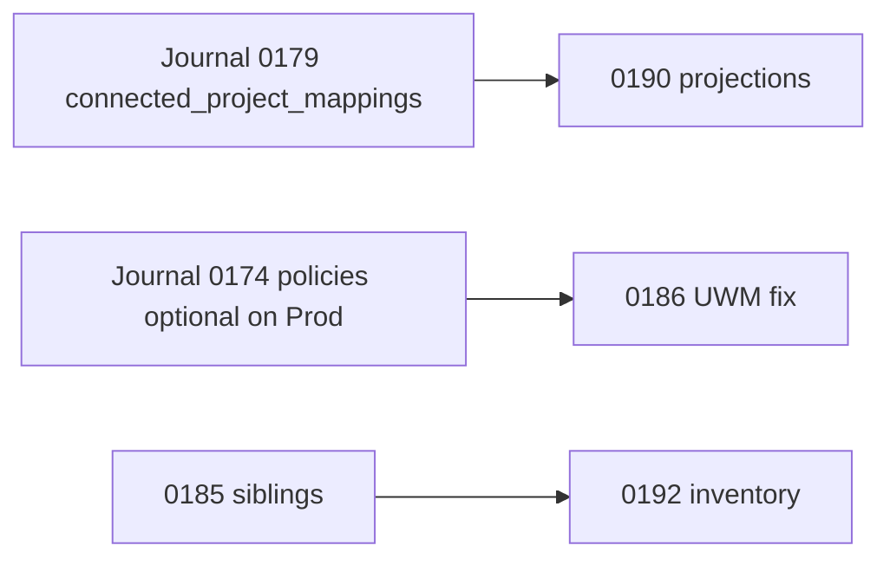

# Gate B migration packet — pending `drizzle/migrations/0183–0192`

**Date:** 2026-10-14 (paths updated per Owner file layout)  
**Repo HEAD context:** Journal ends at **`0182_expense_installment_payments_grants`** (idx 180). SQL files **`0183`–`0192` live in `drizzle/migrations/` but are not in** `drizzle/migrations/meta/_journal.json` until Owner approves each apply.  
**This packet:** SQL content review + disposable PGlite apply only. **Not** Production apply. **No** `npm run db:migrate` against shared DB.

**Related:** [2026-10-14-o02-prepared-migrations-sql-review.md](./2026-10-14-o02-prepared-migrations-sql-review.md), [PHASE2_production_migration_verification.md](./2026-10-full-system-audit/resolution/PHASE2_production_migration_verification.md), `tests/setup/pending-journal-migrations.ts`.

---

## 1. EB-1 — Production read-only checklist (NOT Gate B apply)

**Purpose:** Resolve UNKNOWN migration state (0160–0182, especially **0174**, **0177**, **0179**, **0182**) before Owner approves **EB-2 / Gate B write apply**.

**Approval:** Separate from Gate B. Owner must explicitly approve read-only access in the current message.

**Safety (mandatory):**

1. Confirm `DATABASE_URL` / Supabase project hostname — abort if Production/shared unless approved.
2. Session: `BEGIN TRANSACTION READ ONLY` (or role with `default_transaction_read_only=on`).
3. **Only** `SELECT`, `to_regclass`, catalog reads — **no** `db:migrate`, **no** prepared SQL, **no** DML/DDL.

| # | Check | Query / action | Fills |
|---|--------|----------------|-------|
| E1 | Drizzle ledger vs journal | `SELECT id, hash, created_at FROM drizzle.__drizzle_migrations ORDER BY created_at DESC LIMIT 25` — compare to `drizzle/migrations/meta/_journal.json` tags **0177–0182** | Pending vs skipped (`when` ordering) |
| E2 | **0179** connected projects | `to_regclass` for `connected_project_mappings`, `engagement_connection_invitations`, `cross_org_sync_outbox`, `connected_claim_cash_projections`; column list on `connected_project_mappings` | K02 / K08 |
| E3 | **0177** task indexes (OD-19) | `to_regclass` for index names in `0177_*`; `SELECT count(*) FROM tasks` (size before apply) | OD-19 |
| E4 | **0173** FORCE RLS | `relrowsecurity`, `relforcerowsecurity` on five tables from `0173_force_rls_five_tables.sql` | S03 |
| E5 | **0174 applied?** (critical) | Policies on `audit_events`, `contracts`; whether SELECT uses `has_org_permission` vs `uwm_has_permission` | S02 regression if 0174 live without 0186 |
| E6 | **0182** grants | Privileges on `expense_installment_payments` (and related) per migration file | F04 / installments |
| E7 | **0180** already in journal | Confirm ledger hash matches `drizzle/migrations/0180_*` (no duplicate in `prepared/`) | OD-75 |
| E8 | Prepared objects **absent** on Prod (pre–Gate B) | `to_regclass('public.statutory_document_share_links')`, `connected_contract_value_projections`, columns `expenses.paid_after_period_close`, `projects.cover_image_key` | Expect NULL/false until EB-2 |
| E9 | Impact counts (read-only) | R1, R2, F06, DATA-F1–F5, DATA-T2/T3/T6 per master plan §2 | Scope for EB-3 |

**Report template:** PHASE2 doc §4 (`PRODUCTION MIGRATION READ = …`).

**EB-1 approval ≠ Gate B approval.**

---

## 2. Gate B — write apply (Owner SQL approval required)

### 2.1 What Gate B covers in this packet

| Order | Tag | Kind | DML on existing rows |
|------:|-----|------|----------------------|
| 1 | `0184_crm_permission_rls` | RLS policies (9 CRM tables) | None |
| 2 | `0185_rls_0009_0011_sibling_tables` | Function + RLS (siblings; **excludes** `inventory_*`) | None |
| 3 | `0186_contract_value_events_rls_and_0174_grants` | RLS policy replace (3 tables) | None |
| 4 | `0187_statutory_document_share_links` | Table + trigger + RLS | None (no legacy backfill) |
| 5 | `0188_task_collaboration` | 4 tables + RLS | None |
| 6 | `0189_expenses_closed_period_guard_payment_columns` | Column + triggers + functions | Default column only |
| 7 | `0190_connected_contract_value_projections` | Table + FKs + RLS | None |
| 8 | `0191_project_cover_image` | Nullable columns + CHECK on `projects` | None |
| 9 | `0192_inventory_rls` | RLS on `inventory_items`, `inventory_movements` | None |

**Recommended apply order:** numeric **0184 → 0192** (0190 requires **0179** `connected_project_mappings` on target DB).

### 2.2 Journal pending blockers (Drizzle migrator)

`npm run db:migrate` applies **all** journal entries with `when` greater than last ledger row in **one run** (`§9.4`). Prepared 0184+ are **not** applied by Drizzle until promoted into `drizzle/migrations/` + journal entry.

Before any Production migrate that includes prepared promotions, Owner must decide **`MIGRATION_APPROVED_TAGS`** for pending journal tags (typically **0177–0182** subset) per `drizzle/scripts/migrate.ts` and `migration-approval-gate.ts`.

**This prep did not edit the journal.**

### 2.3 Local / CI verification path (allowed without Production)

| Step | Command |
|------|---------|
| Static prepared inventory | `npx vitest run --project unit tests/unit/database/prepared-dir-consistency.test.ts` |
| PGlite apply 0184–0192 | `npx vitest run --project migration tests/integration/migration/gate-b-prepared-apply.test.ts` |
| Wrapper | `node scripts/local-audit/gate-b-pglite-apply.mjs` (delegates to Vitest) |

Mechanism: `tests/setup/pending-journal-migrations.ts` → `applyPendingJournalMigrations(db, tags)` with `RESET ROLE` before policy DDL (PGlite owner).

**PGlite result (2026-10-14):** PASS — full chain applied once, **second pass idempotent**, ~6.8s test time (snapshot clone ~5.3s).

Post-apply smoke checks in test:

- `statutory_document_share_links` exists
- `expenses.paid_after_period_close` exists
- `inventory_items` has ≥4 policies

Integration tests that apply **Gate A SEC subset only** (0184+0185): `tests/integration/crm/*.test.ts`, `tests/integration/audit-verification/rls-0009-0011-siblings.test.ts`.

### 2.4 Production promotion (after per-file Owner approval)

Per file (or batched promotion commit):

1. File already at `drizzle/migrations/<tag>.sql` — add journal entry + `migration-journal.test.ts` when Owner approves apply
2. Add journal entry + update `tests/unit/database/migration-journal.test.ts`
3. Set `MIGRATION_APPROVED_TAGS` to **exact** pending journal list; Production requires `--owner-approved=…`
4. Run migrate once — **not** raw execution of prepared folder on shared DB outside migrator

---

## 3. SQL content review (0184–0192)

### 3.1 Stream summary

| Stream | Files | RLS / security notes |
|--------|-------|----------------------|
| **S04 CRM** | 0184 | `uwm_has_permission` `crm.read` / `crm.manage`; member + permission on all CRUD |
| **S01 siblings** | 0185, 0192 | 0185: custom fields helper + compliance, API, EAG, assets, field_ops; 0192: inventory UWM (OD-51) |
| **S02 contracts / audit** | 0186 | Fixes 0174-style policies to **`uwm_has_permission`** + project context on `contract_value_events`, `contracts`, `audit_events` |
| **B04 / S06 share** | 0187 | FORCE RLS; authenticated billing read/manage; **service_role SELECT + UPDATE only**; REVOKE DELETE |
| **P04–P07 tasks** | 0188 | Task-scoped mentions; self-service prefs/tokens; deliveries read-only for authenticated |
| **F13 closed month** | 0189 | `expenses_closed_period_guard_v2` replaces trigger on `expenses`; new guards on installment payments + AP matches |
| **K08 connected** | 0190 | Contractor SELECT only; **service_role ALL**; authenticated INSERT/UPDATE/DELETE revoked |
| **U12 UI** | 0191 | Nullable cover metadata; dimension CHECK; **no RLS change** on `projects` |

### 3.2 Per-file review notes

**0184 — CRM permission RLS**  
- Idempotent: `DROP POLICY IF EXISTS` + recreate for nine tables.  
- Risk: users with membership but without `crm.read` lose CRM visibility (intended).  
- Rollback: restore prior policy definitions from pre-0184 migration era (manual SQL); no schema drop.

**0185 — 0009/0011 siblings**  
- Adds `app.custom_field_value_row_allowed` (SECURITY DEFINER, GRANT authenticated/service_role).  
- Entity-type matrix matches app gates (client/project/vendor/employee/opportunity/expense).  
- API tables use `has_org_permission(..., 'api.manage')` (org-wide roles only).  
- Rollback: `DROP FUNCTION` + restore old policies (heavy); function can remain if policies reverted.

**0186 — contract_value_events + 0174 parity**  
- **Apply after** confirming 0174 state on Production (EB-1 E5): if 0174 live, this migration is **required** to restore worker grant parity (`uwm_has_permission`).  
- Rollback: policy-only revert to 0174 definitions.

**0187 — statutory share links**  
- Additive table; integrity trigger enforces org/document/creator/immutability.  
- Aligns with §9.5: no DELETE policy; narrow service_role.  
- Rollback: `DROP TABLE statutory_document_share_links CASCADE` (loses issued links only).

**0188 — task collaboration**  
- **Finding (MEDIUM):** `FOR ALL TO service_role` on four new tables — broader than 0187 pattern; acceptable if workers need full CRUD.  
- Authenticated: mentions insert/select; prefs self-write; deliveries SELECT-only; calendar tokens no DELETE.  
- Rollback: drop four tables (new data only).

**0189 — closed period guards**  
- Adds `paid_after_period_close` with trigger-managed set when paying in open month for closed expense month.  
- Rebinds `expenses_closed_period_guard` to `expenses_closed_period_guard_v2`; adds installment + AP match triggers.  
- Does **not** alter 0037 function bodies.  
- Rollback: rebind trigger to prior function from journal era; `DROP COLUMN paid_after_period_close` optional after trigger revert.

**0190 — connected contract value projections**  
- FK to `connected_project_mappings` + `projects` composite keys — **fails on PGlite/Prod without 0179 tables** (PGlite journal includes 0179; verify on Prod via EB-1).  
- **Finding (MEDIUM):** `service_role` ALL — mirror 0187 narrowing if workers do not need DELETE.  
- Rollback: `DROP TABLE connected_contract_value_projections`.

**0191 — project cover image**  
- Nullable columns + positive dimension CHECK.  
- Rollback: drop columns + constraint (non-destructive to core project rows).

**0192 — inventory RLS**  
- ENABLE + FORCE RLS; assets.read/manage + project context on movements.  
- Supersedes org-only 0011 / 0051-style movement policies.  
- Rollback: policy-only revert to previous inventory policies.

### 3.3 Cross-file ordering dependencies



- **0190** depends on **0179** schema on the target database.  
- **0186** should be applied when **0174** is present (repair path).  
- **0192** logically follows **0185** (inventory explicitly excluded from 0185).

---

## 4. Rollback strategy (Gate B)

| Class | Files | Rollback approach | Data impact |
|-------|-------|-------------------|-------------|
| Policy-only | 0184, 0185, 0186, 0192 | Redeploy previous policy SQL from git history; may need maintenance window | None |
| Additive DDL | 0187, 0188, 0190 | `DROP TABLE … CASCADE` | Loses rows created after apply |
| Trigger/column | 0189 | Restore previous trigger function binding; drop new column if unused | Column default false safe |
| Column-only | 0191 | `ALTER TABLE projects DROP COLUMN …` | Loses cover metadata only |

**Production:** prefer forward-fix additive migration over editing applied files. Prepared files remain the spec until promoted.

---

## 5. Open items for Owner (Gate B sign-off)

| ID | Severity | Item |
|----|----------|------|
| O02-M1 | MEDIUM | Align 0188/0190 `service_role` breadth with 0187 minimal pattern (if workers allow) |
| O02-L1 | LOW | Confirm 0174 on Production before scheduling 0186 |
| O02-L2 | LOW | 0189 coordination with F04 / installment ledger (0180/0182 state via EB-1) |
| EB-1 | BLOCKER | Production read-only matrix §1 incomplete until Owner run |
| Journal | BLOCKER | Pending **0177–0182** decision before Drizzle migrator can include promoted 0184+ |

---

## 6. SQL PREPARED gate (Production — do not run from this packet)

```
SQL / MIGRATION PREPARED = YES
FILES = drizzle/migrations/0183_expense_installment_payments_rls_permissions.sql … 0192_inventory_rls.sql (journal pending)
PURPOSE = Gate B SEC/FIN/task/connected/inventory + F13 closed-month DB guards
DATA MUTATION = 0189 adds column default false; triggers only thereafter
SCHEMA MUTATION = 0187/0188/0190 new tables; 0191 columns; policy/trigger replacements elsewhere
RISK = MEDIUM (0189 financial guards; 0186 permission narrowing if 0174 misaligned)
PGlite APPLY = PASS (2026-10-14, idempotent)
JOURNAL EDITS = NONE in this prep
READY FOR OWNER REVIEW = YES
```

**Owner explicit approval required** before `npm run db:migrate` or any SQL against Production/shared DB.
