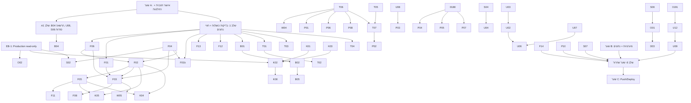

# ProjectFlow — תוכנית ההשלמה הסופית האחת (Master Completion Plan)

**גרסה:** 2.1 — **FINAL — שער A מאושר (14.10.2026)**  
**תאריך:** 14.10.2026  
**בסיס קוד:** `main` @ `92497d18` (נקודת התחלת ביצוע; HEAD עשוי להתקדם במהלך הביצוע).  
**מסמך מקור (14.10):** `docs/plans/PROJECTFLOW_ONE_MASTER_COMPLETION_PLAN_2026-10-14.md` (מספור F/B/W/T/P/K/S/U/D/O והחלטות 1–12). **מסמך ביצוע:** v2.1 להלן (§5).  
**מצב ביצוע:** **שער A = מאושר** — קוד ובדיקות מקומיות; קבצי SQL **0183–0192** ב-`drizzle/migrations/` **ללא** רשומת journal עד שער B. **לא מאושר:** EB-1 (Production read-only), שער B (החלת SQL/מיגרציות/הסבות), שער C (commit/push/deploy), SUMIT חי, OAuth חיצוני.

**הבהרות בעלים מחייבות (Gate A, 14.10.2026):**

| נושא | החלטה |
|---|---|
| **OD-51 / S01 — מלאי** | `inventory_items` ו-`inventory_movements` **בהיקף S01** (לא פריט המשך נפרד). חובה: מיפוי קוראים/כותבים, השפעה על AP/הוצאות/פרויקטים, RLS, בדיקות בידוד, מיגרציה **0192** אם נדרשת — **הכנה בלבד** עד שער B. |
| **OD-36 — עלות הבעלים** | שכר בסיס 18,000 ₪ + 50% מעסיק = **27,000 ₪** `company_only` כברירת מחדל. **אין** התראה חודשית שמחייבת הזנה מחדש. עלות אמיתית שהוזנה ידנית מחליפה לפי הכללים; אין המרה אוטומטית estimated→actual. |

**מסמך זה הוא התוכנית המלאה.** כל פריטי העבודה בפועל — עם קבצים, תלויות, בדיקות קבלה ומזהי ממצאים — נמצאים כאן ב-§5. קובץ המעקב `.cursor/plans/projectflow_one_master_completion.plan.md` הוא רק מצביע לשלבים ואינו תחליף.

**שינויים ב-2.1 (תיקון ממוקד לפי סקירת האישור; שאר הפריטים ללא שינוי):**

| # | נושא | מה השתנה | איפה |
|---|---|---|---|
| 1 | OD-04 | ברירת המחדל היא עכשיו **שימור התזמון הקיים**. רק היתרה שנעלמת מתוקנת. העברת הכל לחודש ההוצאה היא חלופה שתיושם רק בהחלטה מפורשת, עם טבלת השפעה על החודשים ההיסטוריים | §3, F01b, §10.1, F14 |
| 2 | OD-06 | הוסרה הסתירה לכלל המחייב: הוצאה בפריסה מוכרת **רק** לפי תשלום מאומת, גם כשהיא מותאמת לחשבונית ספק. החשבונית לא מוסיפה הכרה. החריגה הוצגה כחלופה שאינה מומלצת | §3, F02, F03, §10.1 |
| 3 | OD-60 | אומת שאין היום תמונת פרויקט בקוד ולא הייתה בהיסטוריה. נוסף פריט **U12** להשלמת תמונת פרויקט אמיתית, עם מיגרציה 0191. שום תמונה, טאב, כותרת או פעולה לא מוסרים | §3, U09, U12, §9 |
| 4 | W02 | הוסרה הפעולה "אשר הערכה כעלות מדויקת". עלות מדויקת נרשמת רק כשמזינים במפורש את הסכום האמיתי. ההפרדה בין estimated ל-actual והתיקון הרטרואקטיבי נשמרים | §3 (OD-36), W02 |
| 5 | 0187 | סכמה אחת מחייבת שמחליפה את המפרטים של B04 ו-S06 | §9.5, B04, S06 |
| 6 | 0189 | הגנה במסד על חודש סגור גם בהוספה וגם בהסרה של הכרה, כולל טבלת התשלומים וההתאמות. בלי להסתמך על האפליקציה | §9.6, F13 |
| 7 | B02 | ניסיון חוזר מותר רק עם הוכחת היעדר מוגדרת. חיפוש חלקי או תשובה לא חד-משמעית אינם הוכחה | §3 (OD-32), B02 |
| 8 | S06 | סוד ייעודי לכל נתיב worker. התיקון **מצמצם** את הגישה של היום ולא מרחיב אותה | §3 (OD-53), S06, §10.4 |
| 9 | מיגרציות | קבצי **0183–0192** ב-`drizzle/migrations/` **בלי journal** עד שער B; `db:migrate` + `MIGRATION_APPROVED_TAGS` דורשים אישור מפורש לכל tag | §9.4, O02, §7 |
| 10 | COMPLETE | חמש רמות מצב נפרדות. אין "הושלם ב-Production" ליכולת שלא הופעלה שם | §12, §13 |

**מקרא סיווגים:**
- `REP` — שוחזר בהרצה.
- `CP` — CODE-PROVEN: שרשרת הקוד נקראה במלואה ב-HEAD.
- `AO` — AGENT-ONLY: מועמד; ייסגר רק עם בדיקה שנכשלת לפני ועוברת אחרי.
- `DC` — תלוי-נתונים (קורה רק אם קיימים נתונים מסוג מסוים).
- `EXT` — תלוי בחסם חיצוני (§2).

**מצבי ממצא בנספחים:** `OPEN` (בביצוע בתוכנית) · `FIXED` / `VERIFIED-CLOSED` (תוקן והוכח, עם ראיה) · `DESIGN` (התנהגות מכוונת, נשמרת) · `DECISION` (החלטת בעלים, §3) · `N/A` (לא רלוונטי, עם סיבה) · `EXCLUDED` (הוחרג באישור בעלים) · `EXT` (שייך לפריט בזרם אחר — נספר אצל הבעלים שלו בלבד).

---

## תוכן

0. בקרת השלמה — למה מותר לסמן FINAL
1. תקציר מנהלים
2. חסמים חיצוניים, SQL ושירותים — מראש
3. טבלת החלטות הבעלים — אחת
4. מיפוי מזהים, כפילויות ויישוב מול v1.0
5. רשימת העבודה המלאה (F, B, W, T, P, K, S, U, D, O)
6. מפת תלויות
7. שלבי ביצוע
8. חלוקת סוכנים ובעלות קבצים
9. מפת מיגרציות והסבות נתונים
10. מבחני קבלה מרכזיים
11. מטריצת Planner
12. תנאי שחרור
13. הגדרת COMPLETE
- נספח A — טבלאות כיסוי מזהים (כל ממצא, שורה לכל מזהה)
- נספח B — ממצאים חדשים שעלו באימות
- נספח C — סתירות מול v1.0

---

## 0. בקרת השלמה — למה מותר לסמן FINAL

התוכנית מסומנת FINAL רק אם כל התנאים כאן מתקיימים. מצב כל תנאי נבדק בסקריפט קריאה-בלבד אחרי האיחוד.

| # | תנאי | מצב |
|---|---|---|
| 1 | כל סוכני התכנון סיימו ומסרו רשימת עבודה מלאה (לא סיכום) | ✅ 6 סוכנים + הסוכן הראשי |
| 2 | כל פריט ב-§5 כולל את 12 השדות: מזהי ממצאים, סיווג, מה שבור, תוצאה עסקית, שינויים ורכיבים, רדיוס השפעה, מיגרציה/הסבה, בדיקות קבלה, תלויות, סוכן, סיכון, החלטה | ✅ 82/82 פריטים (כולל U12 החדש), 0 שדות חסרים |
| 3 | כל מזהה ממצא מכל מקור מופיע בשורה משלו בנספח A (ללא טווחים) | ✅ 0 שורות טווח בנספח A |
| 4 | כל מזהה מ-v1.0 קיים גם בגרסה זו — אף ממצא לא אבד בגלל שינוי מספור | ✅ 307/307 מזהי v1.0 נמצאו |
| 5 | כל מזהה שנתבע ע״י יותר מפריט אחד קיבל פריט בעלים אחד (§4.4) | ✅ כל המזהים המשותפים עם בעלים |
| 6 | כל התלויות ממופות (§6), כולל תלויות חוצות-זרמים חדשות | ✅ §6 |
| 7 | כל החלטה שעלתה מופיעה בטבלה אחת (§3) עם המלצה וסימון "כבר הוחלט"/"נדרש אישור" | ✅ 77 החלטות, 0 תוויות סוכן שלא מופו, 0 הפניות להחלטה לא מוגדרת |
| 8 | לא בוצע שינוי קוד, SQL, commit, push או deploy | ✅ |

**סוכני התכנון שסיפקו את רשימות העבודה (מצב קריאה בלבד, מול HEAD):**

| זרם | פריטים | מזהים בטבלת הכיסוי | ממצאים חדשים |
|---|---|---|---|
| כספים | F01, F01b, F02–F14 | 154 | 13 |
| חיוב ועובדים | B01–B05, W01–W05 | 77 | 17 |
| משימות ו-Planner | T01–T07, P01–P10 | 201 | 21 |
| פרויקטים מקושרים ואבטחה | K01–K10, S01–S07 | 109 | 12 |
| UX, CRM ופרויקטים | U01, U02, U04, U05, U06, U09, U10, U11 | 147 | 21 |
| מסמכים ותפעול | D01–D05, O01–O06 | 212 | 14 |
| הסוכן הראשי | U03, U07, U08 | 24 | 13 |

הערה: מזהה שמופיע בכמה טבלאות כיסוי (למשל ממצא כספי שמופנה לפריט אבטחה) מסומן `EXT` בכל טבלה חוץ מזו של הבעלים שלו, ולכן אינו נספר פעמיים. רשימת הבעלים של 39 המזהים המשותפים ב-§4.4.

---

## 1. תקציר מנהלים

**היקף:** 82 פריטי עבודה (15 כספים, 5 חיוב, 5 עובדים, 7 מנוע משימות, 10 Planner, 10 פרויקטים מקושרים/קבלנים, 7 אבטחה, 12 UX, 5 מסמכים, 6 תפעול). מתוכם 3 מוחרגים (P09, K09 ו-Retainer בהחלטה) ו-2 ללא שינוי קוד (U01, S03).

**אבטחה — עדיפות ראשונה אחרי אישור התוכנית:**
1. **קישור שיתוף למסמך סטטוטורי ללא בדיקת הרשאה** (B04/S06, CP). `createStatutoryShareLinkAction` (`invoicing-integration/ui/actions.ts:236-248`) בודק רק שיש session וארגון פעיל — לא `billing.read` ולא שהמסמך שייך לארגון. כל חבר בארגון יכול לייצר קישור ל-PDF סטטוטורי, והנתיב פותח אותו בהרשאות בעלים. תיקון ההרשאה לא תלוי במיגרציה 0187 או במפתח החדש, ויכול להיות ראשון.
2. **`/calendar` חושף CRM, compliance ותחזוקה** (U08, REP). משתמש עם `scheduling.read` בלבד ראה בשחזור כותרות הזדמנויות CRM וטקסט "הפעולה הבאה", ושמות מסמכי compliance. תחזוקה חשופה באותה שיטה (CP). **כותרות משימות מפרויקטים חסומים לא נחשפות** — הטענה ב-v1.0 שגויה ותוקנה.
3. **מיגרציה 0174 נועלת עובדים עם הענקה** (S02, CP). `app.has_org_permission` קורא רק `role_assignments` ולא הענקות עובד (`uwm_has_permission`). עובד שקיבל `contracts.read` או `audit.read` בהענקה חסום במסד בזמן שהאפליקציה מציגה לו את המסך. אם 0174 כבר מוחלת ב-Production — זו רגרסיה פעילה (רק EB-1 יכריע).
4. **קבלת קוד חיבור יזם שבורה מקצה לקצה** (K03, CP). הקוד נשרף בחיבור נפרד גם כשהחיבור נכשל, וה-RLS של 0179 מסתיר את המיפוי מיד אחרי הקבלה. לכן אין להפעיל חיבור יזם (Mode B) לפני K01 ו-K03, וזה קודם להחלת 0179.
5. **סודות workers לא עקביים** (S06/O01, CP, תלוי-הגדרה). האימות מעדיף `OCR_WORKER_SECRET`, אבל Vercel Cron וה-DG kick שולחים `CRON_SECRET`. אם שניהם מוגדרים ושונים — 3 ה-crons וכל ה-kicks נדחים ב-401.
6. **אישור claim של קבלן יכול להתבטל בשקט** (O01, CP). שגיאה נבלעת בתוך טרנזקציה בלי savepoint.

**כספים — המספרים:**
- הוצאה בפריסה ללא תשלום נספרת 0; ביטול תשלום לא מסיר הכרה; אין idempotency; ה-ledger של 0180 לא נכתב בכלל מהאפליקציה (F01, F04).
- **המספר תלוי בצופה:** הכרת פריסה קוראת ראיות תשלום מ-`audit_events`, ואחרי 0174 זה דורש `audit.read`. מנהל רואה עלויות שונות מהבעלים (F04 + S02).
- חשבונית ספק מקושרת לכמה הוצאות מוכרת נמוך מדי (F02, שוחזר); סכום ההתאמה מפורש בשלוש דרכים — ברוטו בוולידציה, נטו בדה-דופליקציה, נטו→ברוטו בתזרים (F06).
- מגן סגירת חודש במסד בודק את תאריך הרכישה ולא את תאריך התשלום: חוסם תשלום תקין ומעביר תשלום לחודש סגור בשקט (F13, דורש מיגרציה 0189).
- חפיפת הוצאה↔AP חוסמת בניגוד להחלטה #1 (F12).
- **חיוב:** שורות ל-SUMIT ברוטו (FIN-005 סומן "תוקן" ולא תוקן); זיכויים נשלחים ברוטו; כל שורת שינוי חוזה מקבלת את סכום החשבונית כולה (B01). תשובת "הצלחה" בלי מזהה מסמך מסומנת "נדחה" ומאפשרת הנפקה כפולה (B02).

**משימות ו-Planner:** גרירה בלוח חוזרת לעמודה הקודמת עד רענון; סימון צ'קליסט לא עושה כלום; "המשימות שלי" מציג את כל הצוות; לוח השנה של המשימות טוען 500 משימות בסדר אקראי; שלושה באגים נוספים בחזרתיות; זיהוי מעגלי תלות מפספס 4+; קיים מתאם Resend — בלי דגל כבוי נפרד מייל עלול להישלח בטעות (P05).

**UX ושפה:**
- 51 שורות עברית שבורות ב-14 קבצים (נספח ב-U03). המונחים העסקיים הקיימים נשמרים. en/ar/ru תקינות; השינוי היחיד בכל 4 השפות הוא התווית "הכנסה מוכרת".
- 5 משטחי ניווט לא מכבדים מודול כבוי: תפריט הבעלים (11 פריטים), ה-+ הגלובלי (3), תפריט אפליקציית העובד, ה-+ של העובד, אריחי `/field`. טאבי הפרויקט כבר מכבדים — הם המודל. פתרון: מפה משותפת אחת, בלי מחיקת כפתורים (U07).
- המרת הצעת CRM יוצרת טיוטה חדשה בכל לחיצה; "יומן חדש" תמיד ליומן שטח גם בפרויקטי GC; ארגונים בערבית/רוסית מקבלים ברירות מחדל באנגלית.

**מיגרציות:** 8 מוכנות-בלבד לשער B (0184–0191, בלי 0183 אם תאושר החלטה OD-46). הן נשמרות ב-`drizzle/migrations/` ולא ב-journal עד אישור כל קובץ (§9.4). 0177 כבר ב-journal ולא הוחלה (OD-19). מצב 0160–0182 ב-Production לא מוכח חוץ מ-0180 — דרושה בדיקה read-only ממוקדת (EB-1).

**החלטות:** 77 שורות בטבלה אחת (§3.1). 12 כבר הוחלטו בתוכנית המחייבת שלך ולא דורשות אישור חוזר, וגם הדרישה לתמונת פרויקט (OD-60) הוחלטה. מתוך השאר, **12 הכרעות עסקיות אמיתיות** מרוכזות ב-§3.0; לשאר נשמרות המלצות v2.0.

---

## 2. חסמים חיצוניים, SQL ושירותים — מראש

אלה פעולות שהתוכנית **לא** תבצע בלי אישור נפרד ומפורש. פריט שתלוי בהן ייסגר רק אחרי שהן אושרו ובוצעו; עד אז מצבו "ממומש בקוד, ממתין ל-X".

| # | חסם | מה דורש | פריטים תלויים | מה קורה בלי אישור |
|---|---|---|---|---|
| EB-1 | **בדיקת Production read-only ממוקדת** | אישור גישה **נפרד**, לקריאה בלבד: כל השאילתות בטרנזקציה `BEGIN TRANSACTION READ ONLY`, בלי `db:migrate` ובלי כתיבה (§9.4). נקרא: `drizzle.__drizzle_migrations` (hash, created_at) מול `when` ב-journal — זה מזהה גם קבצים ממתינים וגם קבצים שדולגו בגלל הסדר; קיום טבלאות 0179; אינדקסי 0177 (`to_regclass`) וגודל `tasks`; הרשאות 0182; FORCE ב-5 טבלאות 0173; **האם 0174 מוחלת** (רגרסיית הענקות עובד); ספירות השפעה: R1, R2, F06, DATA-F1–F5, DATA-T2/T3/T6 | O02, K02, S02, S03, F01, F04, F06, F09, F13, T02, T03, כל שער B | מצב המיגרציות נשאר UNKNOWN; תוכניות ההסבה נשארות בהערכת היקף |
| EB-2 | **שער B — מיגרציות** | אישור לכל קובץ אחרי סקירה: 0184–0191 (0183 רק אם OD-46 נדחית), והחלת 0177. ההחלה רק דרך המנגנון של §9.4 | K02, K08, S01, S02, S04, B04, F13, P04, P05, P07, U12 | הקוד רץ במצב degraded מוגדר ולא נסגר |
| EB-3 | **שער B — הסבות נתונים** | dry-run ← רשימת מזהים + גיבוי ← אישור ← החלה ← postflight: DATA-T2, T3, T6, F1–F5, D03-exec | T02, T03, T06, F04, F05, D03 | נשאר דוח dry-run בלבד |
| EB-4 | **Vercel env** | `STATUTORY_SHARE_SIGNING_KEY` ו-`OAUTH_STATE_SECRET` ייעודיים; **בדיקת קיום (לא ערך)** של `CRON_SECRET` ו-`OCR_WORKER_SECRET` | B04, S06, D03, O01 | יצירת קישורי שיתוף מושבתת עם הודעה; סוד worker מאוחד בקוד אבל מצב Production לא ידוע |
| EB-5 | **ארגון בדיקה ב-SUMIT** | מפתחות test-org להרצה חיה, ללא הפקת מסמך אמיתי | B01, B02, B05 | נסגר ברמת mock בלבד ומסומן "mock-verified, live pending" |
| EB-6 | **ספק מייל/פוש** | ספק, עלות ו-DNS — **מוחרג כברירת מחדל** (OD-25) | P05 | תשתית בלבד + דגל כבוי; ה-UI כותב "לא מחובר" |
| EB-7 | **OAuth חי לספקי אחסון** | רישום אפליקציות ואימות | D01, D03 | mock בלבד |
| EB-8 | **סביבת E2E מקומית מאומתת** | seed מקומי מבודד + משתמשי בדיקה ל-Playwright | U09, P10, F14, K07 | ההרצה נשארת NOT-VERIFIED בדוח הסופי |
| EB-9 | **שער C — Push/Deploy** | אישור מפורש אחרי preflight ירוק | שחרור | אין push |

**הצהרה:** אישור התוכנית (שער A) אינו אישור לאף אחד מ-EB-1 עד EB-9.

---

## 3. טבלת החלטות הבעלים — אחת

### 3.0 ההחלטות העסקיות שבאמת מחייבות הכרעה שלך

כל שאר ההחלטות בטבלה המלאה (3.1) הן טכניות או נגזרות מהחלטות 1–12. עבורן נשמרות המלצות v2.0, ואישור שער A מאשר אותן.

| # | הכרעה | המלצה | מה קורה בלי הכרעה |
|---|---|---|---|
| OD-04 | תזמון הכרה בהוצאה חד-פעמית | **א'** — שימור התזמון הקיים; רק היתרה שנעלמת מתוקנת ומוכרת בחודש ההוצאה | חלופה א' (אין שינוי תזמון מבוסס) |
| OD-06 | חריגה מכלל הפריסה כשיש חשבונית ספק מותאמת | **אין חריגה** — רק תשלום מאומת | אין חריגה |
| OD-30 | תשלום בחודש פתוח להוצאה שנרכשה בחודש סגור | מותר; הנעילה לפי חודש התשלום | חסום (המצב היום במסד) |
| OD-31 | חלוקת שורות שינוי-חוזה בחשבונית חלקית | יחסית לערך נטו מאושר; שורות legacy נחסמות לעריכה ידנית | שליחה נחסמת לשורות כאלה |
| OD-32 | מה נחשב הוכחה שמסמך SUMIT לא הונפק | סריקה מלאה לפי תנאי B02 (אחרי EB-5), או אישור ידני מתועד של מנהל חיוב | השורה נשארת חסומה |
| OD-33 | היקף "אין הורדת PDF" | הסרת "הורד PDF" והורדה כקובץ במסמך הסטטוטורי; צפייה, הדפסה ושליחה נשארות | הכפתור נשאר |
| OD-36 | הבעלים ברשימת עלות מעסיק חסרה | קבוצה נפרדת "הערכה ממתינה"; לא מוסתר ולא הופך למדויק | מופיע ברשימה הכללית |
| OD-42 | ברירת מחדל ב"המשימות שלי" | רק שלי, עם מתג "כל הצוות" למנהלים | נשאר כל הצוות |
| OD-60 | היקף הצגת תמונת הפרויקט (U12) | כותרת עמוד הפרויקט + רשימת הפרויקטים | כותרת בלבד |
| OD-66 | אפליקציית העובד מכבדת מודולים כבויים | כן | לא מכבדת (כמו היום) |
| OD-15 | היקף סנכרון בין פרויקטים מקושרים | חוזה, שינויי חוזה ו"תשלום דווח" | אין סנכרון חדש |
| OD-19 | אסטרטגיית 0177 (אינדקסים על `tasks`) | בחלון שקט אחרי בדיקת הגודל; חובה להכריע לפני החלת כל מיגרציה אחרת (§9.4) | שום מיגרציה לא מוחלת |

### 3.1 הטבלה המלאה

**איך לקרוא:** עמודת "מצב" מסמנת **✅ כבר הוחלט** — החלטה שכבר קבעת בתוכנית המחייבת (מספר 1–12 או עיקרון), שאינה נפתחת מחדש ואינה דורשת אישור חוזר; או **❓ נדרש אישור** — כולל ברירות מחדל שהוצעו ב-v1.0 ועוד לא אושרו. אישור שער A עם הערה "מאשר את ההמלצות" = אישור כל ההמלצות בטבלה, חוץ ממה שתסמן אחרת.

| # | נושא | מצב | המלצה | פריטים |
|---|---|---|---|---|
| OD-01 | חפיפת הוצאה↔חשבונית ספק | ✅ החלטה #1 | אזהרה בלבד + "קשר" + audit; חסימה רק למצב לא חוקי. קומיט `8f4fe75c` הפך לחסימה בניגוד להחלטה — התיקון מחזיר לאזהרה | F12 |
| OD-02 | הגדרת רווח | ✅ החלטה #2 | שווי חוזים מעודכן − עלות מוכרת; % = רווח/שווי חוזה. התווית "הכנסה מוכרת" ← "שווי חוזים מעודכן" (תיקון תווית, לא נוסחה) | F07, U02 |
| OD-03 | הוצאה בפריסה | ✅ החלטה #3 | 0 עד תשלום ראשון מאומת; NET בחודש התשלום | F01, F04 |
| OD-07 | תלויות משימות | ✅ החלטה #4 | `warn` ברירת מחדל; `block` עם override של `TASKS_MANAGE_ALL` + נימוק מתועד | T07, P02 |
| OD-08 | צוותים | ✅ החלטה #5 | ישויות נפרדות; תצוגה אחת עם תגי תפקיד; עובד שאינו בצוות מוצג מושבת עם "הוסף לצוות" | U05, K07 |
| OD-09 | יומן ראשי | ✅ החלטה #6 | Developer/GC ← יומן אתר; אחרים ← יומן שטח; ההיסטוריה בשניהם נשמרת. (החידוד "לפי פרויקט" — OD-59) | U06 |
| OD-10 | ניווט למודול כבוי | ✅ החלטה #7 | מוסתר מהניווט, נשאר בהגדרות, URL/API לא משתנים. "קבצי חברה" ← מודול `documents` | U07 |
| OD-11 | דשבורד | ✅ החלטה #8 | Owner/Card לא משתנים; רק באגים מאומתים ותוויות; ה-+ הגלובלי לא נוגעים | U01, U02 |
| OD-12 | P09 — יעדים/ספרינטים/אופליין | ✅ החלטה #9 (ברירת המחדל: לא כלול) | EXCLUDED. אם תרצה לכלול — החלטה חדשה ופריט נפרד | P09 |
| OD-25 | שירותים חיצוניים | ✅ החלטה #10 | adapters בלבד; מייל/פוש כבויים; פיד ICS לקריאה בלבד; ללא OAuth דו-כיווני | P05, P07 |
| OD-26 | ניקוי נתונים | ✅ החלטה #11 | dry-run + רשימת מזהים + גיבוי + אישור SQL נפרד; אין DELETE פיזי | §9 |
| OD-27 | הפצה | ✅ החלטה #12 | אישור תוכנית ≠ SQL/Push/Deploy | §2 |
| OD-04 | הוצאה חד-פעמית: מתי מוכרת | ❓ | **ברירת המחדל, חלופה א' (מומלצת): שימור התזמון הקיים מ-`2e659407`.**<br>• לא שולמה ← מלוא ה-NET בחודש ההוצאה.<br>• שולמה ← בחודש התשלום.<br>• **התיקון היחיד:** בתשלום חלקי, החלק ששולם מוכר בחודש התשלום והיתרה שלא שולמה מוכרת בחודש ההוצאה (היום היא נעלמת). דוגמה: הוצאה 10,000 בפברואר, שולם 4,000 נטו במרץ ← פברואר 6,000, מרץ 4,000.<br>• **השפעה היסטורית:** משתנים רק חודשי ההוצאה של חד-פעמיות ששולמו **חלקית** — הם עולים ביתרה שנעלמה. חד-פעמיות ששולמו במלואן או לא שולמו כלל לא זזות.<br>**חלופה ב' (רק בהחלטה מפורשת):** כל חד-פעמית בחודש ההוצאה. זה מזיז גם הוצאות ששולמו במלואן בחודש מאוחר, ולכן משנה חודשים היסטוריים שכבר פויסו.<br>בשתי החלופות: לפני שחרור תוצג טבלת השפעה לכל חודש 2026-01…2026-10 (EB-1, קריאה בלבד), ושום תזמון לא משתנה בלי ההכרעה הזו | F01b |
| OD-05 | EMC בטיוטה בסך החודשי | ❓ | שורה נפרדת "הערכה"; מנוע הפרויקט נשאר applied בלבד | F03 |
| OD-06 | הוצאה בפריסה שמותאמת לחשבונית ספק | ❓ (אישור החריגה בלבד) | **הכלל המחייב (החלטה #3) גובר תמיד:** הוצאה בפריסה מוכרת רק לפי תשלום שבוצע ואומת, בחודש התשלום, גם כשהיא מותאמת לחשבונית ספק.<br>• החשבונית המותאמת **לא** יוצרת הכרה משלה. תקרת ההכרה של הזוג = תשלומים מאומתים, ולכל היותר הסכום המותאם.<br>• **אין הכרה מוקדמת** בתאריך החשבונית, ו**אין כפל** בין חשבונית לתשלומים.<br>• היום (CP): שכבת הדה-דופליקציה (`expense-ap-dedup.ts`) לא מכירה פריסות, וחשבונית מותאמת מקבלת "סמכות חשבונית" במלואה — כלומר הכרה מוקדמת. זה מתוקן ב-F02/F03.<br>**חריגה אפשרית (לא מומלצת):** החלק המותאם יוכר בתאריך החשבונית. היא תיושם רק בהחלטה מפורשת. **המלצה: לא לאשר חריגה** | F02, F03 |
| OD-13 | סינון מחלקה במשימות | ❓ | EXCLUDED — אין נתוני מחלקה | P01 |
| OD-14 | גרירה בקיבוץ לפי תווית | ❓ | מושבתת עם רמז; באחראי/עדיפות הגרירה משנה את השדה | T04 |
| OD-15 | סנכרון Wave 2 בין פרויקטים מקושרים | ❓ | לכלול חוזה, שינויי חוזה ו"תשלום דווח"; להחריג משימות ו-RFI | K08 |
| OD-16 | המרת אורח לארגון רשום | ❓ | EXCLUDED, מתועד כפער מוצר | K09 |
| OD-17 | מודול contractor-performance | ❓ | רדום ומתועד, בלי מחיקה ובלי חשיפה | K06 |
| OD-18 | מוצר Retainer | ❓ | EXCLUDED | K07 |
| OD-19 | החלת 0177 (אינדקסי משימות) | ❓ | בשער B בחלון שקט אחרי בדיקת גודל `tasks` ב-EB-1; טבלה גדולה ← מיגרציה חלופית. האישור כאן הוא לאסטרטגיה; ה-SQL מאושר בנפרד | O02 |
| OD-20 | פאנל תשלומי שכר באפליקציית העובד | ❓ | עמוד בעלים בלבד; לא בהיקף | W04 |
| OD-21 | לקסיקון עברי | ✅ למונחים הקיימים · ❓ לתוספות | **נשמרים:** "יתרת חוזה לאחר עלויות מוכרות", "שיעור יתרת החוזה", "יתרת חוזה צפויה". **לאישור:** "פרויקטים עם יתרה חיובית" (profitable); כותרת "רווח נוכחי" ← "יתרת חוזה נוכחית"; "לוח שנה" (calendar) / "שיבוץ צוות" (scheduling) | U03, U06, F07 |
| OD-22 | מי רואה גרסאות טיוטה של מסמך | ❓ | מנהלי מסמכים בלבד (`documents.manage`) | D02 |
| OD-23 | ניקוי יתומי אחסון | ❓ | ברירת מחדל report בלבד | D03 |
| OD-24 | rate limit לקוד חיבור יזם | ❓ | session + הרשאה, בלי טבלה חדשה; קודים של 256 ביט | K03, S06 |
| OD-28 | "Operations ↔ tasks adoption" (תוכנית ישנה) | ❓ | N/A — מוחלף ב-T03/P01 | נספח A |
| OD-29 | בסיס סכום ההתאמה הוצאה↔חשבונית | ❓ | נשמר כ**ברוטו**; כל קורא ממיר דרך פונקציה אחת | F06 |
| OD-30 | תשלום של הוצאה מחודש סגור שבוצע בחודש פתוח | ❓ | מותר; הנעילה לפי חודש התשלום (ההכרה), לא חודש הרכישה | F13 |
| OD-31 | חלוקת שורות שינוי-חוזה בחשבונית חלקית | ❓ | יחסי לפי ערך CO נטו מאושר, שארית לשורה האחרונה; שורות legacy שאי-אפשר לנרמל ← חסימת שליחה + עריכה ידנית, בלי ניחוש | B01 |
| OD-32 | SUMIT: מתי מותר ניסיון הנפקה חוזר | ❓ | "הצלחה" בלי מזהה מסמך, timeout או כל תשובה לא חד-משמעית ← `ambiguous`, שחוסם הנפקה.<br>**ניסיון חוזר מותר רק עם הוכחת היעדר**, באחת משתי דרכים:<br>(א) סריקה אוטומטית מלאה שעומדת בכל תנאי B02. היא מושבתת עד שהתנאים אומתו מול SUMIT ב-EB-5.<br>(ב) אישור ידני של `billing.manage`, אחרי בדיקה ב-SUMIT לפי מספר מסמך, עם נימוק חובה ו-audit.<br>חיפוש חלקי, תקרת תוצאות שהושגה, שגיאה בעמוד כלשהו או סריקה אחת בלבד **אינם הוכחה** — השורה נשארת חסומה | B02 |
| OD-33 | היקף "אין הורדת PDF" (עיקרון 5 הוחלט; ההיקף פתוח) | ❓ | **להסיר** את "הורד PDF" בכרטיס המסמך הסטטוטורי ואת `disposition=attachment` בשני ה-routes — צפייה, הדפסה ושליחה נשארות. **להשאיר** "פתח במכשיר"/"שתף" של קבצי הלקוח בענן שלו בדפדפני הקבצים | B04, D01 |
| OD-34 | חיבור מפתחות SUMIT שאינם ארגון בדיקה | ❓ | אזהרה + אישור מפורש, לא חסימה (test ו-production חולקים host) | B05 |
| OD-35 | המתג `attendanceProjectTimeApproval` (מוצג ולא משפיע) | ❓ | להסתיר; ההתנהגות הקיימת = מנהל מאשר סופית | W01 |
| OD-36 | הבעלים ברשימת "חסר עלות מעסיק בפועל" | ✅ (Gate A) | **27,000 ₪** (18,000 + 50%) כ-`company_only` — **ללא** התראה חודשית שמחייבת הזנה מחדש. הבעלים בקבוצה נפרדת "עלות מוגדרת — הערכה, ממתינה לסכום אמיתי"; לא מוסתר, לא actual אוטומטי, לא נספר באזהרה הכללית. סכום אמיתי ידני מחליף + היסטוריה + תיקון רטרואקטיבי | W02 |
| OD-37 | הוצאה דמוית-שכר כשקיים EMC | ❓ | אזהרה בלבד לפי מפתח קטגוריה (ברוח החלטה #1) | W05 |
| OD-38 | עריכת כלל חזרתיות עם מופעים שעבר זמנם | ❓ | לבטל אותם (`cancelled`), לא לייצר משימות באיחור | T01 |
| OD-39 | DATA-T3 ומשימות פרויקט ישנות בלי bucket | ❓ | DATA-T3 רק משלים board מ-bucket קיים; משימות בלי bucket לא קופצות ללוח | T03 |
| OD-40 | תבניות אוטומציה של משימות שלא פועלות | ❓ | להסתיר מבחירה חדשה; חוקים קיימים מסומנים "לא פעיל"; רק `task_dependency_resolved` מופעל | T05, T07 |
| OD-41 | נמעני התראות איחור | ❓ | אחראים + בעלים + עוקבים; fallback ל-`TASKS_MANAGE_ALL` כשאין אף אחד | T05 |
| OD-42 | "המשימות שלי" — ברירת מחדל | ❓ | רק משימות שאני אחראי/בעלים, עם מתג "כל הצוות" למנהלים (משנה מה שמנהלים רואים היום) | T06 |
| OD-43 | שיוך קבלן שנסגר ← משימה פנימית | ❓ | בלי סנכרון אוטומטי; מוצגת הצעה "לסמן כהושלמה" | T06 |
| OD-44 | תקרת עריכה מרובה ב-`/work/list` | ❓ | **100** שורות, עם הודעה מעבר לזה (v1.0 סתר את עצמו: 200 מול 50) | P01, §11 |
| OD-45 | תבניות משימה לפי פרופיל עסק | ❓ | **בהיקף, בתוך U11**: חמשת הפרופילים העיקריים + מצב ניהול ל-GC (הסוכן של המשימות הציע לדחות; הוכרע לטובת U11 כי זה todo פתוח והתוכנית ממילא נוגעת ב-onboarding) | U11, P08 |
| OD-46 | `vendor_id` במיפוי פרויקט מקושר | ❓ | JOIN להסכם, בלי מיגרציה (0183 לא נבנית) | K01 |
| OD-47 | "חבר ארגון" בפורטל הקבלן | ❓ | כרטיס הסבר + קישור ל-sign-in ארגוני, בלי ניסיון לזהות חברות | K01 |
| OD-48 | תיקון 0174 בתוך 0186 | ❓ | כן — `uwm_has_permission` כדי שהענקות עובד יעבדו | S02 |
| OD-49 | מי קורא `contract_value_events` | ❓ | `contracts.read` **או** `project_financials.read`, אחרי מיפוי כל הקוראים (הקצאות, כותרת פרויקט, מנועים) כדי שמספרים לא ישתנו | S02 |
| OD-50 | `custom_field_values` | ❓ | predicate לפי סוג ישות (מראה של שער האפליקציה) | S01 |
| OD-51 | `inventory_*` RLS | ✅ (Gate A) | **בהיקף S01:** מיפוי קוראים/כותבים, RLS, בדיקות, מיגרציה **0192** אם נדרש (הכנה ב-`drizzle/migrations/`); לא ב-0185 עד סיום המיפוי | S01 |
| OD-52 | `docs/audits/**/*.xlsx` | ❓ | להוסיף ל-`.gitignore` | S05 |
| OD-53 | סודות workers | ❓ | בלי סודות חדשים. **כל נתיב worker מקבל רק את הסוד שנועד לו:**<br>• `ops-worker`, `sumit-expense-worker`, `dg-events-worker` ← `CRON_SECRET` בלבד.<br>• `ocr-worker` ← `CRON_SECRET` (Vercel Cron) או `OCR_WORKER_SECRET` (kick).<br>היום `OCR_WORKER_SECRET` פותח את כל 4 הנתיבים, כך שהתיקון מצמצם את הגישה. ההשוואה constant-time | S06, O01 |
| OD-54 | יצירת הסכם קבלן מכרטיס ספק | ❓ | לשמר "צור והפעל" כמו היום; תיקון נתוני עבר רק אחרי dry-run | K05 |
| OD-55 | זכייה במכרז | ❓ | ה-NET של ההצעה מועתק ל-`originalAmount` של הסכם **טיוטה**, בלי שורות עבודה | K04 |
| OD-56 | SEC-004: שער פרופיל לכל מסלולי הביצוע | ❓ | capability בלבד + בדיקת deep-link; נפתח רק אם הבדיקה מוכיחה דליפה | S07 |
| OD-57 | CRM באפליקציית העובד | ❓ | הזדמנויות בלבד (DESIGN) | U04 |
| OD-58 | אזהרת זמינות בשיגור | ❓ | נשארת ב-U05, אזהרה בלבד | U05 |
| OD-59 | יעד "יומן חדש" | ❓ | לפי פרופיל המסירה **של הפרויקט** (לא של העסק), עם בורר ב-`/field` | U06 |
| OD-60 | תמונת פרויקט אמיתית | ✅ הדרישה הוחלטה (שימור תמונת פרויקט) · ❓ היקף ההצגה | **אומת:** אין היום תמונת פרויקט בקוד (לא עמודה, לא רכיב, לא בהיסטוריית git). לכן זו **השלמה** — פריט U12: העלאה, החלפה והסרה של תמונה לכל פרויקט, והצגתה בכותרת עמוד הפרויקט ובשורת הפרויקט ברשימה. היא נשמרת באחסון הקיים במבנה של לוגו הארגון (מיגרציה 0191). **המלצה להיקף:** כותרת + רשימה, בכל 4 השפות, ב-RTL ובמובייל. שום תמונה, טאב, כותרת או פעולה קיימים לא מוסרים | U12, U09 |
| OD-61 | ההגדרה `quickCreateEmphasis` | ❓ | ה-+ נשאר אחיד; טקסט ההגדרה יבהיר שהיא משפיעה על הדשבורד בלבד | U09 |
| OD-62 | PWA לפי פרסונה | ❓ | מניפסט אחד (DESIGN); הפניה אחרי התחברות כבר מטפלת | U10 |
| OD-63 | U11 (לא בתוכנית המחייבת) | ❓ | פריט נפרד תחת מטריית U10 | U11 |
| OD-64 | לוח השנה ומודולים כבויים | ❓ | כן — מקור ממודול כבוי לא מוצג, גם לבעלים | U08 |
| OD-65 | "שיבוץ צוות" בניווט | ❓ | תלוי במודול `workforce` | U07 |
| OD-66 | אפליקציית העובד ומודולים כבויים | ❓ | כן — תפריט וכפתור + של העובד מכבדים מודולים. זה הופך החלטה שמתועדת היום בקוד ("owner module flags are not re-applied") | U07 |
| OD-67 | מונח "יתרת חוזה" ב-en/ar/ru | ❓ | לא לאמץ; en/ar/ru שומרות Profit/Margin. משתנה רק "הכנסה מוכרת" | U03 |
| OD-68 | העברת PDF של הצעה כשלממיר אין `DOCUMENTS_MANAGE` | ❓ | להעביר רק את קבצי אותה הצעה בהרשאת `QUOTES_MANAGE` + audit; סקירת SEC | D01 |
| OD-69 | ראיות משימה במגירה | ❓ | סיכום + קישור לעמוד המלא (הגלריה היא רכיב שרת) | D02 |
| OD-70 | תקרת העתקה חוצת-ארגונים | ❓ | 50MB עם הודעה גלויה | D02 |
| OD-71 | ביצוע ניקוי יתומים | ❓ | ה-cron תמיד report; ביצוע = פעולה ידנית עם רשימת מזהים מאושרת. אין מצב שבו cron מוחק | D03 |
| OD-72 | חלון כפילויות ב-OCR | ❓ | ±60 ימים לספק+סכום; קובץ זהה (checksum) ללא הגבלת זמן | D04 |
| OD-73 | `CRON_SECRET` חסר ב-Production | ❓ | רישום + תצוגת בריאות, בלי לחסום build/deploy | O01 |
| OD-74 | תצוגת בריאות תפעול | ❓ | endpoint פנימי + runbook; מסך רק לבקשתך | O03 |
| OD-75 | `drizzle/migrations/0180_*` | ❓ | להסיר אחרי EB-1 והשוואת תוכן; לא נוגעים ב-`drizzle/migrations` | O02 |
| OD-76 | todos ישנים שעברו לתוכנית האב | ❓ | `cancelled` + הפניה לפריט כאן | O06 |
| OD-77 | 3 תוכניות שמחוץ ל-git | ❓ | להכניס ל-git בשער C | O06 |

---

## 4. מיפוי מזהים, כפילויות ויישוב מול v1.0

### 4.1 התנגשות D04

- **"D04-001 … D04-010" בדוחות הביקורת** שייכים לסוכן הביקורת AGENT_04 (יזם/קבלן ראשי, מכרזים). בכל המסמך הם נכתבים **`D04-xxx (AGENT_04)`** וממופים ל-K04, K10 או DESIGN (טבלה מלאה בנספח A, זרם פרויקטים מקושרים).
- **פריט D04 בתוכנית** = יבוא הוצאות ב-OCR, כמו בתוכנית המחייבת.
- אף ממצא לא שונה מספרו; רק התווית נוספה.

### 4.2 יישור מספור K/S לתוכנית המחייבת

v1.0 הזיזה את K02, K03, S01 ו-S02. גרסה זו חוזרת למספור המחייב, כך שכל מזהה אומר אותו דבר בשני המסמכים.

| v1.0 | תוכן ב-v1.0 | מחייב / v2.0 | הערה |
|---|---|---|---|
| K01 | קריאת מיפוי | **K01** | כולל גם את ה-CTA |
| K02 | retry + preview + מצב 0179 | **K03** (retry/preview/קבלת קוד) + **K02** (מצב 0179) | פוצל |
| K03 | CTA "חבר ארגון" | **K01** | אוחד |
| K04–K10 | — | K04–K10 | ללא שינוי |
| S01 | RLS 0009 בלבד | **S01** = מטריצת אימות + RLS 0009 + 0011 | במחייב S01 הוא בעל המטריצה |
| S02 | `contract_value_events` בלבד | **S02** = `audit_events` + `contracts` + `contract_value_events` + תיקון הענקות עובד | הורחב |
| S03–S07 | — | S03–S07 | ללא שינוי |

### 4.3 קידומות מזהים שנוספו

| קידומת | משמעות |
|---|---|
| `TF-01…TF-36` | כינויים שנוצרו ב-v1.0 בלי טבלת הגדרה. הוגדרו עכשיו אחד-אחד מול סעיפי דוח 13.10 (נספח A, זרם משימות, טבלה "כינויי TF") |
| `R13-*`, `REV13-*`, `REV-*` | סעיפים ללא מזהה בדוח 13.10, לפי מספר הסעיף |
| `RC-R*`, `RC-P*` | מזהים מקומיים מדוח ה-root-cause מ-11.10 (קידומת RC כדי לא להתנגש ב-R1–R10 של 13.10) |
| `NEW-F*`, `NF-BW-*`, `NEW-TP-*`, `CS-NEW-*`, `NF-UX-*`, `NEW-DO-*`, `LEAD-*` | ממצאים חדשים שעלו באימות, לפי זרם (נספח B) |
| `DXM-*`, `DPA-*` | ממצאים ממסמכי מיפוי הדשבורד וביקורת פרופילי התצוגה |
| `<plan>/<todo>` | todos פתוחים בתוכניות ישנות, בשם מלא |

### 4.4 בעלים יחיד למזהים משותפים

39 מזהים נתבעו בשדה "מזהי ממצאים" של יותר מפריט אחד. לכל אחד נקבע פריט בעלים שבו הוא נספר ונסגר; שאר הפריטים מפנים אליו בלבד.

| מזהה | בעלים | מפנים |
|---|---|---|
| K05-005 | K02 | O02 |
| A01-001, SEC-010 | O02 | K02 |
| A01-012 | S06 | S01 |
| A01-015 | K01 | K03 |
| A01-017, SHARE-01, SHARE-02 | B04 (מימוש ע״י SEC) | S06 |
| DOC-001, DOC-011 | D05 (סגור) | D02 |
| DOC-002 | D05 (סגור); שארית המגירה ← D02 | — |
| DOC-006 | D05 (סגור ב-mock); חי ← D01 + EB-7 | D03 |
| DOC-010 | D05 (DESIGN) | D01 |
| DPA-A4 | U09 | U10 |
| H16-009, H16-013, wave4-qa-release | O06 | P10 |
| LEAD-CAL-01 … LEAD-CAL-05 | U08 | S01 (שורת מטריצה) |
| M12-001 | D03 | O03 |
| M12-003 | S06 | D03 |
| NF-UX-10 | U11 | U10 |
| O14-001 | O03 (ניטור) | O04 |
| O14-009 | O01 | O03 |
| O14-012 | D03 | O01 (slot ב-worker) |
| O14-015 | O03 | D03 |
| P03-001, P03-006, P03-007 | U09 (QA) | O05 |
| PM-011 | U08 (חשיפה) | P03 (תיעוד) |
| REV13-1.2-RATE | U01 (DESIGN) | U02 |
| TF-22 | T06 (שירות סטטוס) | W04 (צרכן) |
| WF-003 | W03 (FIXED) | F13 |
| phase0-glossary | U03 | O06 |
| profile-task-template-seeds, tests-acceptance (multi-industry) | U11 (OD-45) | P08 |
| tests-acceptance (planning-calendar) | P03 | — |

### 4.5 תיקונים מהותיים מול v1.0

1. **`/calendar`:** משימות **לא** דולפות (שוחזר). הדליפה: CRM, compliance, maintenance. ‏inspections מוגנת לפי גישת פרויקט אבל בלי `field_ops.read` (U08, S01).
2. **עברית:** 51 שורות ב-14 קבצים, לא ~45 ב-12. נוספו 6 שגיאות התאמת מין; `forecast.json:18` תקין (U03).
3. **ניווט:** 5 משטחים, לא nav בלבד (U07).
4. **0174:** מכסה את ה-predicate של `contracts` אבל לא הענקות עובד (S02).
5. **K08:** אין CHECK על `event_type`; נדרשת טבלת projection — מיגרציה 0190, לא 0183.
6. **U04:** אין צורך במיגרציה — ה-backlink קיים מאז 0135.
7. **T07:** אין צורך בסוג התראה חדש או ב-0188 — `task_dependency_resolved` קיים.
8. **O06:** שער CI ל-4 שפות כבר קיים ורץ.
9. **מצבים שגויים ב-v1.0:** OPS-001 ו-OPS-005 לא תוקנו; WF-005 ו-WF-007 פתוחים; U15-002 תוקן חלקית; SEC-004 חלקי (שער ב-2 מסכים בלבד); B02 תואר הפוך.
10. **F13:** דורש מיגרציה (0189), ש-v1.0 לא כללה.
11. **D02:** הגישה של v1.0 (גלריה במגירה) לא אפשרית טכנית — הגלריה רכיב שרת והמגירה רכיב לקוח (OD-69).
12. **ניקוי יתומים:** `execute` כמשתנה סביבה היה יוצר cron מוחק יומי — הוחלף בפעולה ידנית (OD-71).
13. **קבצי בדיקה:** רוב קבצי הבדיקה ש-v1.0 ציינה לא קיימים ויש ליצור אותם; כל פריט מציין "קיים להרחבה" או "חדש".

הפירוט המלא לכל זרם — נספח C.

### 4.6 יישוב התנגשויות בין הזרמים

| נושא | התנגשות | הכרעה |
|---|---|---|
| תבניות משימה לפי פרופיל | משימות: לדחות; UX: לכלול ב-U11 | U11, OD-45 |
| תקרת עריכה מרובה | 200 ב-P01 מול 50 ב-§11 | 100, OD-44 |
| כפתור הורדת PDF | B04 ו-D01 שאלו אותה שאלה | שורה אחת, OD-33 |
| מפתחות לוקאל משותפים | U02, U03, U06 נוגעים ב-`dashboard.json`, `nav.json`, `calendar.json` | בעלים אחד (i18n), בסדר U03 ← U02 ← U06 |
| `source-dates.repository.ts` | U08 ו-P03 | SCHEDULE; U08 קודם |
| `task-detail-sheet.tsx` | T06, P08, D02 | TASK-ENGINE ← WORK-UI ← DOCS-OPS |
| `statutory-document-card.tsx` | B04, D01 | BILL |
| `internal-worker-auth.ts` | S06, O01 | SEC; DOCS-OPS מגיש diff |
| שירות סטטוס משימה | T06, W04 | TASK-ENGINE בונה, W04 צורך |
| ראיות תשלום לפריסה | F04 קורא מ-`audit_events`, S02 מגביל אותה | F04 עובר למקור שאינו תלוי בצופה (ledger 0180); S02 אחריו |

---

## 5. רשימת העבודה המלאה

כל פריט פותח בבדיקה שנכשלת לפני התיקון ועוברת אחריו. "סוכן/זרם" מתייחס לזרמים ב-§8. מזהי החלטות מתייחסים לטבלה ב-§3.

### F — רווחיות, הוצאות, התאמות וספר הכספים

#### F01 — הוצאה בפריסה ללא תשלום מאומת נספרת במלואה בעלות הפרויקט
- **מזהי ממצאים:** R1; דוח 13.10 §3.3; §10 פריט 3
- **סיווג:** CP + DC (קורה רק להוצאה עם `installment_count > 1` שאין לה אף תשלום מוכר עד החודש הנוכחי)
- **מה שבור היום:**
  - `src/modules/financials/data/expenses.repository.ts:1566-1571` — `loadInstallmentRecognitionByExpense`: כשההכרה המצטברת אפס → `continue` (לא נרשמת רשומה במפה).
  - `expenses.repository.ts:1576-1583` — `contributionAmountWithInstallments`: `if (installmentCount <= 1 || !recognition?.hasActiveLines) return fullAmount;` → בהיעדר רשומה מוחזר מלוא ה-NET.
  - נקראת משני המסלולים: שורות ישירות `:246-252` ושורות הקצאה `:300-306` (מסלול כל-הזמן, `yearMonth == null`). המסלול החודשי (`resolveExpenseContributionAmountForMonth`, `:1520-1545`) תקין.
  - תוצאה: 9×10,000 NET ללא תשלום ← 90,000 בעלות הפרויקט; אחרי תשלום ראשון ← 10,000 (קפיצה הפוכה).
  - החמרה (ממצא חדש NF-FIN-01): ראיות תשלום מ-audit נקראות תחת RLS של `audit_events` (`audit.read`), לכן אצל משתמש בלי `audit.read` (תבנית MANAGER) ההכרה יכולה לצאת 0 ← וה-F01 מחזיר מלוא הסכום.
- **תוצאה עסקית:** לפני תשלום מאומת ראשון — 0 עלות מוכרת בפרויקט, ברווחיות הפרויקט ובגלגול הארגוני; יתרת הפריסה מופיעה רק בהתחייבויות/תזרים צפוי. תשלום 11,800 ברוטו במרץ (מע״מ 18%) ← 10,000 במרץ.
- **שינויים ורכיבים:**
  - `expenses.repository.ts` — `loadInstallmentRecognitionByExpense`: לרשום גם הכרה אפס (`{ hasActiveLines: true, recognizedAmount: '0' }`) לכל הוצאת פריסה שנבדקה.
  - `expenses.repository.ts` — `contributionAmountWithInstallments`: כש-`installmentCount > 1` ואין רשומה → `'0'` (לא `fullAmount`); `if (yearMonth && amount == null)`/`amount ?? row.netAmount` ב-`:257`, `:309` — לוודא שאפס לא נבלע ע״י `??`.
  - לבדוק את כל צרכני `loadProjectExpenseContributions` (compose, `load-direct-actual-basis-by-project.ts`, `get-project-actual-breakdown.ts`, rollup) — אין לוגיקה מקבילה.
- **רדיוס השפעה:** עלות בפועל/רווח בפועל/% בעמוד כספי פרויקט, דשבורד Owner (סכום פרויקטים), דוחות `/reports`, רווחיות לקוח, early warnings, snapshots של margin. רק ארגונים עם הוצאות פריסה שלא שולמו. **לא משתנה:** המסלול החודשי, הוצאות חד-פעמיות, AP, שכר, התחייבויות, תזרים.
- **מיגרציה / הסבת נתונים:** אין מיגרציה. DATA-F4 (חישוב מחדש של snapshots/cache אחרי התיקון; dry-run → שער B).
- **בדיקות קבלה:**
  - חדש `tests/unit/financials/installment-project-contribution.test.ts` (יצוא פונקציה טהורה או בדיקה דרך הלוגיקה): 9×10,000 NET, 0 תשלומים → `'0'` (לפני: `'10000'`/סכום מלא); תשלום ראשון 11,800 ברוטו → 10,000.
  - חדש `tests/integration/financials/installment-project-actual.test.ts` (PGlite): פרויקט עם הוצאה 90,000 NET ב-9 תשלומים, אין תשלום → `actualCostToDate = 0` (לפני: 90,000).
  - רגרסיה: `tests/unit/expenses/installment-payment-recognition.test.ts` (1,000 NET / 5 → 200 לחודש) נשאר ירוק.
- **תלויות:** OD-03 (החלטה #3); EB-1 (ספירת הוצאות פריסה ללא תשלום); מקדים את F03 ו-F14; נוגע ב-`expenses.repository.ts` לפני FIN-MONTHLY (נקודה חמה).
- **סוכן/זרם:** FIN-CORE
- **סיכון:** בינוני — מוריד עלויות קיימות בפרויקטים (רווח "עולה"); חובה דוח השפעה (EB-1) לפני שחרור.
- **החלטה נדרשת:** אין — הוכרע (החלטה #3 / OD-03).

---

#### F01b — הוצאה חד-פעמית ששולמה חלקית (ותזמון הכרה של חד-פעמית בכלל)
- **מזהי ממצאים:** NEW-F3 (v1.0)
- **סיווג:** CP
- **מה שבור היום:**
  - `src/modules/expenses/domain/installment-payment-recognition.ts:103-116` (`recognizedExpenseNetInYearMonth`, ענף `count <= 1`): אם `paidGross > 0` → ההכרה רק בחודש `paidAt` ורק בחלק היחסי ששולם (`netFromGrossSlice`); היתרה **לעולם** לא מוכרת במנוע החודשי. אם לא שולם → מלוא ה-NET בחודש ההוצאה.
  - זהה ל-GROSS ב-`:167-176`.
  - המנוע החודשי צורך זאת: `expenses.repository.ts:466-467` (סכום) ו-`:614-615` (פירוט/ספר שנתי). מנוע הפרויקט סופר חד-פעמית במלוא ה-NET (`:1583`) — לכן חודשי ≠ פרויקט.
  - הוצאה 10,000 NET ששולמו 4,000 NET (4,720 ברוטו) במרץ ← מרץ 4,000, ו-6,000 נעלמים מסכום החודשים.
  - ההתנהגות מתועדת כמכוונת: `docs/audits/2026-10-monthly-financial-display-audit-he.md:156` ("NET ב-expenseDate אם לא שולם; אם שולם — ב-paidAt"), ומקורה בקומיט `2e659407`.
- **תוצאה עסקית (ברירת המחדל — OD-04 חלופה א', שימור התזמון הקיים):**
  - **לא שולמה** ← מלוא ה-NET בחודש ההוצאה, כמו היום.
  - **שולמה במלואה** ← בחודש התשלום, כמו היום.
  - **שולמה חלקית** ← החלק ששולם מוכר בחודש התשלום, כמו היום; **היתרה שלא שולמה מוכרת בחודש ההוצאה** (היום היא נעלמת).
  - דוגמה: הוצאה 10,000 בפברואר, שולמו 4,000 נטו במרץ ← פברואר 6,000, מרץ 4,000. סה״כ 10,000 = מנוע הפרויקט.
  - **השלמת היתרה בהמשך:** כשמשולמת יתרה בחודש מאוחר, היא **לא** מוכרת שוב (אין כפל). היא כבר הוכרה בחודש ההוצאה, ותשלום היתרה משפיע על התזרים בלבד.
  - **חודש הוצאה סגור:** חד-פעמית שחודש ההוצאה שלה נסגר כשהיא עוד לא שולמה, נשארת מוכרת במלואה בחודש ההוצאה. תשלום מאוחר משפיע על התזרים בלבד. הדגל `paid_after_period_close` נקבע במסד ב-0189 (§9.6). כך שום חודש סגור לא זז בגלל תשלום.
  - **חלופה ב' (רק אם תכריע במפורש):** כל חד-פעמית במלוא ה-NET בחודש ההוצאה, גם כשהיא שולמה במלואה בחודש מאוחר.
- **שינויים ורכיבים:**
  - `installment-payment-recognition.ts` — `recognizedExpenseNetInYearMonth` ו-`recognizedExpenseGrossInYearMonth`, ענף `count <= 1`.
    - חלופה א': בחודש `paidAt` — החלק ששולם (`netFromGrossSlice`, כמו היום); בחודש `expenseDate` — `NET − החלק ששולם` כשיש יתרה. כשהתשלום והיתרה באותו חודש, מתקבל מלוא ה-NET.
    - חלופה ב': מלוא ה-NET/GROSS בחודש `expenseDate`. **ממומשת רק אם OD-04 מוכרע ל-ב'.**
  - `expenses.repository.ts` — `recognitionDateForExpenseInYearMonth` (תאריך ההכרה בפירוט) מחזיר שתי שורות לחד-פעמית ששולמה חלקית: "שולם" ו"יתרה".
  - עדכון מסמך החוזה הפיננסי (ראו F03) עם הכלל שנבחר. עדכון `docs/audits/2026-10-monthly-financial-display-audit-he.md` אינו בהיקף.
- **רדיוס השפעה:** "עלויות החודש" בדשבורד, `/financials/overview/recognized`, ספר שנתי, דוח חודשי.
  - **חלופה א' (השפעה היסטורית מינימלית):** משתנים רק חודשי ההוצאה של חד-פעמיות ששולמו **חלקית** — הם עולים ביתרה שנעלמה היום. חד-פעמיות ששולמו במלואן או לא שולמו כלל לא זזות בשום חודש.
  - **חלופה ב':** מזיזה גם כל חד-פעמית ששולמה במלואה בחודש מאוחר מחודש התשלום לחודש ההוצאה. זה משנה חודשים היסטוריים שכבר פויסו באקסל החיצוני.
  - **לא משתנה בשתי החלופות:** מנוע הפרויקט, תזרים ("שולם"), הוצאות פריסה.
- **מיגרציה / הסבת נתונים:** אין. אין לגעת בקבצי Excel ידניים. **טבלת השפעה לפני שחרור:** לכל חודש 2026-01…2026-10 — הסכום לפני ואחרי ורשימת ההוצאות שזזות. מופקת בקריאה בלבד (EB-1) ומוצגת לבעלים לפני שער C.
- **בדיקות קבלה:** הרחבת `tests/unit/expenses/installment-payment-recognition.test.ts` (חלופה א'):
  - (א) 10,000 NET/11,800, הוצאה בפברואר, שולם 4,720 במרץ ← פברואר 6,000, מרץ 4,000 (לפני: פברואר 0, מרץ 4,000).
  - (ב) שולם במלואו במרץ, הוצאה בפברואר ← מרץ 10,000, פברואר 0. **ללא שינוי** — זו בדיקת שימור התזמון.
  - (ג) לא שולם ← חודש ההוצאה 10,000 (ללא שינוי).
  - (ד) יתרה 6,000 משולמת באפריל ← אפריל 0 בעלות, תזרים 7,080; פברואר ומרץ לא זזים. סה״כ שנתי 10,000. התרחיש נשען על היסטוריית תשלומים לכל שורה (ledger 0180 אחרי F04). שדה `paidAt` יחיד שנדרס לא מספיק.
  - לחלופה ב', אם תוכרע: (ב) ← פברואר 10,000.
  - הרחבת `tests/unit/financials/recognized-cost-breakdown.test.ts` לשתי שורות ההכרה.
- **תלויות:** OD-04; F04 (היסטוריית תשלומים לכל שורה ב-ledger); F13 / 0189 (הדגל `paid_after_period_close`; עד שער B ההגנה על חודש סגור היא החסימה הקיימת של 0037); מקדים את F03/F08/F14.
- **סוכן/זרם:** FIN-CORE
- **סיכון:** חלופה א' — נמוך (רק תוספת של סכום שנעלם). חלופה ב' — בינוני (הזזת עלויות בדוחות שכבר נמסרו).
- **החלטה נדרשת:** **כן — OD-04 (§3.0).** **המלצה: חלופה א'.** היא מתקנת את היתרה שנעלמת ומיישבת את סכום החודשים עם מנוע הפרויקט, בלי לשנות תזמון שכבר נקבע. בלי הכרעה מפורשת — חלופה א'.

---

#### F02 — חשבונית ספק מקושרת למספר הוצאות: תקרת הכרה נמוכה מדי
- **מזהי ממצאים:** R2; דוח 13.10 §3.2; §10 פריט 2; V09-002 (שארית; תת-מקרה 14k תוקן)
- **סיווג:** REP (דוח 13.10) + CP
- **מה שבור היום:**
  - `src/modules/financials/domain/expense-ap-dedup.ts:230-251` (`capRecognizedBillAmountsForPartialMatches`): לולאת התקרה מדלגת (`:243 continue`) על קישור להוצאה שהותאמה במלואה, ולכן התקרה = רק התאמות של הוצאות עם יתרה.
  - תרחיש: חשבונית 10,000; A=6,000 מותאמת במלואה; B=10,000 עם 4,000 מותאם → תקרה 4,000 → סה״כ 0 + 6,000 (יתרת B) + 4,000 = **10,000** במקום **16,000**.
  - תת-מקרה 14k (V09-002) תוקן ומוגן: `tests/unit/financials/expense-ap-dedup.test.ts:103` (10k/10k/6k → 10,000) ו-`:134` (6k הוצאה/10k חשבונית → 10,000).
- **תוצאה עסקית:** עלות הפרויקט = חשבונית מלאה + יתרות לא מותאמות; אין העלמת יתרה ואין כפל.
- **שינויים ורכיבים:** `expense-ap-dedup.ts` — `capRecognizedBillAmountsForPartialMatches`: כאשר לפחות לקישור אחד של החשבונית יש יתרה, התקרה = סכום **כל** הקישורים של החשבונית (כולל מותאמים במלואם), מומר ל-NET לפי F06; `expenseRemainderOnProject` ללא שינוי. אין "מנגנון כפילות גורף" של 10k.
  - **הוצאה בפריסה מותאמת לחשבונית (OD-06, החלטה #3):**
    - היום (CP): `expense-ap-dedup.ts` לא מכיר פריסות, וחשבונית שמותאמת להוצאה בפריסה מקבלת "סמכות חשבונית" (`:186-187`), כלומר הכרה מלאה בתאריך החשבונית לפני תשלום.
    - שינוי: כשההוצאה המקושרת היא בפריסה, החלק המותאם בחשבונית **לא מוכר מהחשבונית**. ההכרה של הזוג = סכום התשלומים המאומתים (NET, ledger 0180 אחרי F04), בחודשי התשלום, ולכל היותר הסכום המותאם.
    - החשבונית לא מוסיפה דבר מעבר לזה, ולכן אין הכרה מוקדמת ואין כפל.
    - חלק לא מותאם בחשבונית (מעבר להוצאה) מוכר לפי כללי החשבונית הרגילים.
- **רדיוס השפעה:** כל צרכני `applyPartialMatchPolicyToRecognizedVendorRollup` — `compose-project-financials.ts:164-168`, `committed-costs.repository.ts:337-395` (טעינה יחידה ומרובה), `load-direct-actual-basis-by-project.ts`, פירוט עלות (F11), תקציב. עולה רק בארגונים עם חשבונית אחת שמותאמת ליותר מהוצאה אחת. **לא משתנה:** מקרה 14k, מקרה חשבונית ≥ הוצאה.
- **מיגרציה / הסבת נתונים:** אין. DATA-F4 (cache/snapshots).
- **בדיקות קבלה:** הרחבת `tests/unit/financials/expense-ap-dedup.test.ts`: חשבונית 10,000, A=6,000 (6,000 מותאם), B=10,000 (4,000 מותאם) → סה״כ 16,000 (לפני: 10,000). רגרסיה: 10k/10k/6k → 10,000; 6k/10k/6k → 10,000. אינטגרציה PGlite עם שורות `ap_po_matches` אמיתיות (ממליצים להרחיב `tests/integration/post0021/financial-wiring.test.ts`).
  - **פריסה + חשבונית (OD-06):** הוצאה 12×1,000 NET בפריסה, חשבונית 12,000 NET מותאמת במלואה בינואר.
    - 0 תשלומים מאומתים ← פרויקט 0, ינואר 0 (לפני: 12,000 בינואר).
    - 3 תשלומים מאומתים (ינו׳–מרץ) ← פרויקט 3,000, 1,000 בכל חודש. אף פעם לא 15,000 ולא 12,000.
    - ביטול תשלום ← יורד ב-1,000.
- **תלויות:** F06 (בסיס הסכום המותאם); F04 (ledger תשלומים מאומתים); OD-06 (חריגה רק בהחלטה מפורשת).
- **סוכן/זרם:** FIN-CORE
- **סיכון:** בינוני — משנה את מקור האמת של Actual בפרויקט.
- **החלטה נדרשת:** אין — המספר 16,000 קבוע בתוכנית המחייבת (F02).

---

#### F03 — המנוע החודשי ↔ מנוע הפרויקט (מקור אמת משותף)
- **מזהי ממצאים:** R3a; R3b; R3c; R3-extras; D2; V09-011; FIN2-008 (שארית תזמון GCM — סגור ב-`2e659407`, מאומת כאן רק בעקיפין)
- **סיווג:** CP + DC
- **מה שבור היום** (`src/modules/financials/data/expenses.repository.ts`):
  - **R3a:** `:439-447` ו-`:587-595` — `NOT EXISTS` מוציא הוצאה **כולה** אם יש לה התאמה מקובלת כלשהי. הוצאה 10,000 + התאמה 6,000 → חודשי 6,000 (רק החשבונית), פרויקט 10,000.
  - **R3b:** `:433-448` אין סינון קטגוריית שכר פנימי (`isInternalEmployeePayrollCategoryKey` משמש רק במנוע הפרויקט, `:266`, `:317`) + EMC ב-`:513-519` → שכר 5,000 + EMC 5,000 → 10,000.
  - **R3c:** `:517` ו-`:711` כוללים EMC בסטטוס `draft`; ההערה `:382` מתעדת. בספר השנתי שורות EMC מסומנות `nature: 'final'` גם לטיוטה (`load-financial-year-book-data.ts:311-317`).
  - **מלאי:** אין `inventory_stock_purchase = false` בהוצאות (`:433-448`, `:582-596`) ואין הפחתת שורות מלאי ב-AP (`:500-509`, `:661-671`), בעוד מנוע הפרויקט מסנן (`:118`, `:157`; `committed-costs.repository.ts:429`, `:526-530`).
  - **זיכויי AP:** אין קיזוז זיכויי ספק במסלול החודשי (מנוע הפרויקט: `netProjectSliceAfterCredits`, `committed-costs.repository.ts:531-537`).
  - **AP ללא תאריך:** `:507` ו-`:667` (`bill_date IS NOT NULL`) — חשבונית מוכרת בלי תאריך לא נכנסת לשום חודש.
  - **מטבע זר:** `:436`, `:504`, `:584`, `:664`, `:710` מסננים `currency = base` בלי גילוי ספירה.
  - **התאמות חלקיות ב-AP:** החשבונית נכנסת במלוא ה-NET (`:501`) — כש-R3a מוציא את ההוצאה כולה, היתרה הלא-מותאמת נעלמת.
  - צרכנים: `get-home-dashboard.ts:603-610`, `load-financial-year-book-data.ts:225-232` ו-`:369-376`, מסך `/financials/overview/recognized` (`9ebd84e0`).
  - לא אומת: האם תיקוני סגירת חודש (month-close cost corrections) נכללים במנוע החודשי — לבדוק בשלב 1.
- **תוצאה עסקית:** אותו "אטום עלות" לכל מסך; כללי הזמן החודשיים נשארים חודשיים. הוצאה 10k + 6k מותאם → 10,000 בחודש (6k חשבונית בחודש החשבונית + 4k יתרה בחודש ההכרה של ההוצאה); שכר 5k + EMC 5k → 5,000; מלאי 3k → 0; חשבונית 5k − זיכוי 1k → 4,000; USD → מוחרג עם גילוי "N רשומות במטבע זר". סכום החודשים = פרויקטים + תקורה + לא משויך ± EMC טיוטה (שורה נפרדת "הערכה").
- **שינויים ורכיבים:**
  - חדש: `src/modules/financials/domain/recognition-atoms.ts` (טהור) — אטום = {מקור, מזהה שורה, NET, VAT, GROSS, מטבע, חודש הכרה, פרויקט/תקורה, סטטוס סופי/הערכה}. כללים: F01/F01b/F04 להוצאות, F02/F05/F06 להתאמות, זיכויים, מלאי, EMC applied/closed + draft כ-"הערכה".
  - `expenses.repository.ts` — `sumFinalizedExpenseRecognizedPairForDateRange` (`:410-479`), `sumOrganizationRecognizedCostPairInDateRange` (`:481-531`), `listOrganizationRecognizedCostBreakdownInDateRange` (`:552-744`) — שכתוב מעל האטומים; גילוי FX; AP ללא תאריך → מוצג כ"ללא תאריך" (לא נבלע).
  - `RecognizedCostBreakdownLine` — שדה `estimate: boolean` ו-`sourceRowId` לפיוס ברמת שורה.
  - מסמך חוזה נתונים אחד (`docs/financial/` — עדכון `COST-RECOGNITION-MATRIX.md` או `PROJECT-FINANCIAL-SOURCE-OF-TRUTH.md`): NET/VAT/GROSS, זמן הכרה, Actual/Committed/Cash, הבדל בין עלות מוכרת, הכרה חוזית ותזרים (דרישת §6.2 בתוכנית המחייבת).
- **רדיוס השפעה:** כרטיס "עלויות החודש" (Owner ו-Card — ערך בלבד, לא פריסה), drill `/financials/overview/recognized`, ספר שנתי (גליונות עלות, תקורה, סיכום), דוח חודשי. **לא משתנה:** מנוע הפרויקט (applied בלבד, OD-05), כללי תשלום בתזרים, פריסת הדשבורד.
- **מיגרציה / הסבת נתונים:** אין.
- **בדיקות קבלה:** חדש `tests/integration/financials/monthly-vs-project-reconciliation.test.ts` (PGlite): (1) הוצאה 10k + חשבונית 6k מותאמת → חודשי 10,000 (לפני 6,000); (2) הוצאת שכר 5k + EMC applied 5k אותו חודש → 5,000 (לפני 10,000); (3) הוצאת מלאי 3k → 0 (לפני 3,000); (4) חשבונית 5k + זיכוי 1k → 4,000 (לפני 5,000); (5) חשבונית ללא `bill_date` → מופיעה בגילוי "ללא תאריך" (לפני: נעלמת); (6) EMC טיוטה 2k → שורה "הערכה" 2,000, לא בסכום הסופי; (7) Σ12 חודשים = Σ פרויקטים + תקורה + לא משויך ± הערכה. הרחבת `tests/unit/financials/recognized-cost-breakdown.test.ts`.
- **תלויות:** F01, F01b, F02, F04, F05, F06; OD-05; OD-06; מקדים את F08, F14, W05.
- **סוכן/זרם:** FIN-MONTHLY
- **סיכון:** גבוה — שכתוב מנוע שמזין דשבורד וספר שנתי שכבר נמסר לבעלים.
- **החלטה נדרשת:** OD-05 (EMC טיוטה כשורת "הערכה") — **המלצה:** לאשר. OD-06 — האטום של הוצאה בפריסה מותאמת נוצר **רק** מתשלומים מאומתים, וחשבונית מותאמת לא יוצרת אטום נפרד לאותו חלק. חריגה (הכרה בתאריך החשבונית) רק בהחלטה מפורשת. **המלצה:** לא לאשר חריגה.

---

#### F04 — ביטול/אישור חוזר של תשלום בפריסה: הכרה שורדת, אין idempotency, אין תקרה
- **מזהי ממצאים:** R4; NEW-F1 (v1.0)
- **סיווג:** CP (השרשרת נקראה; דוח 13.10 סימן [קוד-סוכן]) + DC
- **מה שבור היום:**
  - `src/modules/expenses/domain/expense-installment-payment-evidence.ts:59-74` (`paymentConfirmedAudits`): אחרי `expense.payment_confirmation_voided` נשמרים כל האישורים **עם** `installmentIndex` (`:71`) — רק אישורי lump מוסרים.
  - `:102-131` (`slicesFromIndexedAudits`): אין dedupe לפי אינדקס (שני אישורים לאותו אינדקס = שתי פרוסות) ואין תקרה מול ברוטו ההוצאה.
  - `src/modules/expenses/application/expense-payments.ts:515-572` (`voidExpensePaymentConfirmation`): מאפס `paid_at/paid_gross_amount/installments_paid_count` בלבד; לא כותב היפוך. `recognizedExpenseNetInYearMonth` (`installment-payment-recognition.ts:118-119`) קורא קודם פרוסות מאומתות, ולכן ההכרה נשארת.
  - `expense-payments.ts:387-513` (`confirmExpensePaid`): כותב audit בלבד (`:501-512`). **אף קוד ב-`src` לא כותב ל-`expense_installment_payments`** (טבלת 0180) — רק backfill 0181.
  - `src/modules/expenses/data/expense-installment-payments.repository.ts:99` קורא `status = 'paid'` בלבד ולא מקזז שורות `voided/credited` עם `reverses_payment_id` (עיצוב 0180: היפוך = שורה חדשה).
- **תוצאה עסקית:** אישור ואז ביטול → 0; אישור כפול לאותו תשלום → 10,000 (לא 20,000); paid + reversal → 0; סה״כ מוכר ≤ ברוטו ההוצאה (מומר ל-NET). היסטוריית האישורים/ביטולים נשמרת.
- **שינויים ורכיבים:**
  - `expense-installment-payment-evidence.ts` — `paymentConfirmedAudits` / `slicesFromIndexedAudits`: dedupe לפי `installmentIndex` (האירוע האחרון קובע), ביטול מבטל אישורים קודמים (כולל indexed) שלא נתמכים ב-ledger, תקרה מצטברת = ברוטו.
  - `expense-installment-payments.repository.ts` — `loadLedgerSlicesByExpenseIds`: לקרוא גם `voided/credited` ולקזז לפי `reverses_payment_id`.
  - `expense-payments.ts` — `confirmExpensePaid`: כתיבת שורת ledger עם `idempotency_key = expense:{id}:inst:{index}:{auditId}` + `audit_event_id`; `voidExpensePaymentConfirmation`: כתיבת שורת היפוך (`status='voided'`, `reverses_payment_id`).
  - **שמירה מחייבת:** תרחיש BMS (`tests/unit/expenses/expense-installment-payment-evidence.test.ts:39-83` — 9 שורות ledger + lump שבוטל) ו"דלק" (הערה `:58`) נשארים זהים.
- **רדיוס השפעה:** הכרה חודשית ופרויקטלית להוצאות פריסה; מסך הוצאה (סטטוס תשלום); תזרים "שולם". **לא משתנה:** BMS/נתוני 0181, הוצאות חד-פעמיות.
- **מיגרציה / הסבת נתונים:** אין מיגרציה חדשה (0180 קיימת). תלוי ש-0180 (מוחלת לפי v1.0 §9.1) ו-0182 (UNKNOWN) מוחלות ב-Production — EB-1. DATA-F1 (דוח לפני/אחרי לכל חודש על ביטולים שאחרי אישור; קריאה בלבד). DATA-F3 (הוצאות מבוטלות עם `paid_*`).
- **בדיקות קבלה:** חדש `tests/unit/expenses/installment-void-reconfirm.test.ts`: (1) 12×1,000 NET/1,180; אישור אינדקס 0 במרץ ואז ביטול → מרץ null (לפני: 1,000); (2) אותו אינדקס מאושר פעמיים → 1,000 (לפני: 2,000); (3) ledger paid 1,180 + שורת voided שמפנה אליו → 0 (לפני: 1,000); (4) אישורים בסך 15,000 ברוטו על הוצאה 14,160 → תקרה 12,000 NET. רגרסיה: BMS נשאר `PAID_VERIFIED`, 6,516.72. אינטגרציה PGlite לכתיבת ledger (`tests/integration/migration/hardening-0180-expense-installment-payments.test.ts` כתבנית).
- **תלויות:** EB-1 (0182 מוחלת); OD-03; F13 (אותה פונקציה — יש לבצע יחד); מקדים את F03.
- **סוכן/זרם:** FIN-CORE
- **סיכון:** גבוה — נוגע בנתוני תשלום אמיתיים של הבעלים (BMS) ובטבלה שנכתבת לראשונה מהאפליקציה.
- **החלטה נדרשת:** אין (OD-03). הערה: אם 0182 לא מוחלת — הכתיבה ל-ledger תיכשל ב-42501; יש להגדיר fallback (audit בלבד + log) ולא לשבור תשלום.

---

#### F05 — הוצאה מפוצלת בין פרויקטים מותאמת לחשבונית בפרויקט אחד
- **מזהי ממצאים:** R5
- **סיווג:** CP (דוח 13.10: [קוד-סוכן]) + DC
- **מה שבור היום:**
  - `src/modules/financials/data/committed-costs.repository.ts:544-595` — `linkedExpenseDeductions` נבנה רק מחשבוניות שמוכרות **בפרויקט הנטען**. בפרויקט B (שבו אין את החשבונית) לא מנוכה דבר.
  - בפרויקט A הניכוי הוא מלוא ההתאמה (10,000) מול תרומה של 5,000 → נחתך ל-5,000 (`expense-ap-dedup.ts:110`).
  - תרחיש: הוצאה 10,000 מפוצלת 5,000/5,000; חשבונית 10,000 על A מותאמת במלואה → A = 0 + 10,000 = 10,000, B = 5,000 → **15,000** במקום 10,000.
  - בנוסף: `applyPartialMatchPolicyToLoadedRollup` (`:337-349`) משתמש ב-NET מלא של ההוצאה (`loadExpenseNetAmountsById`) ולא בחלק הפרויקט, בעוד compose (`compose-project-financials.ts:164-168`) משתמש בתרומות הפרויקט — שתי תקרות שונות על אותה חשבונית.
- **תוצאה עסקית:** A = 5,000, B = 5,000, ארגון = 10,000; אין כפל ואין השמטה.
- **שינויים ורכיבים:** `committed-costs.repository.ts` — `loadRecognizedVendorBillsForProject` / `loadRecognizedVendorBillsForProjects`: כשלחשבונית אין `ap_bill_project_allocations`, החלק המותאם (ובהתאם — הכרת החשבונית) מתחלק לפי משקלי ההקצאה של ההוצאה בין הפרויקטים; ניכוי ההתאמה מוחל בכל פרויקט שבו להוצאה יש תרומה. `expense-ap-dedup.ts` — פונקציה טהורה `distributeMatchedAmountByExpenseWeights`.
- **רדיוס השפעה:** עלות פרויקט A ו-B, rollup, תקציב/סעיפים (F11), פירוט עלות. **לא משתנה:** חשבוניות עם הקצאות משלהן (`vendor-bill-project-attribution.ts`), הוצאות לא מפוצלות.
- **מיגרציה / הסבת נתונים:** אין. DATA-F4.
- **בדיקות קבלה:** הרחבת `tests/unit/financials/expense-ap-dedup.test.ts` + אינטגרציה PGlite (הרחבת `tests/integration/post0021/financial-wiring.test.ts`): הוצאה 10,000 בפיצול 50/50, חשבונית 10,000 על A מותאמת 10,000 → A 5,000, B 5,000 (לפני: A 10,000, B 5,000).
- **תלויות:** F02, F06; משפיע על K04/K05 (כללי committed/actual).
- **סוכן/זרם:** FIN-CORE
- **סיכון:** בינוני — שינוי שיוך עלות בין פרויקטים.
- **החלטה נדרשת:** אין — כלל "חלק יחסי לכל פרויקט" נקבע בתוכנית המחייבת (F05).

---

#### F06 — בסיס סכום ההתאמה (NET/GROSS) לא מוגדר ומפורש בשלוש דרכים
- **מזהי ממצאים:** R6; V09-014
- **סיווג:** CP (דוח 13.10: [קוד-סוכן])
- **מה שבור היום:**
  - **GROSS:** `src/modules/ap/application/matches.ts:125-129` (`assertMatchExpenseAmountWithinExpense` מול `expense.grossAmount`), `:144-149` ו-`:223-228` (`assertMatchDoesNotOverMatch` מול `bill.totalAmount` ברוטו), `refreshBillMatchStatus` מול `bill.totalAmount` (`:241-247`).
  - **NET:** `src/modules/financials/domain/expense-ap-dedup.ts:43-59`, `:110` — הסכום מנוכה מתרומות NET; `expense-ap-overlap.ts:73-80` (`expenseRemainingAfterMatches` = NET − matched).
  - **NET שמומר לברוטו:** `src/modules/financials/domain/expense-ap-cash.ts:39-55` — בתזרים הסכום נחשב NET ומוגדל ל-GROSS.
  - תרחיש: הוצאה 20,000/23,600, התאמה 11,800 (ברוטו) → יתרת NET בפועל 8,200 במקום 10,000; בתזרים מנוכה 13,924 ברוטו במקום 11,800.
  - **V09-014:** `expense-ap-overlap.ts:45-62` (`amountsSimilar`/`amountsMayOverlap`) משתמשים ב-`Number()`; גם `expense-ap-dedup.ts:119`, `:127` (יחס float) ו-`installment-payment-recognition.ts:51-52`.
  - `assert-expense-ap-overlap.ts:83` משווה `bill.netAmount` ליתרת הוצאה שחושבה כ-NET − matched(GROSS).
- **תוצאה עסקית:** הסכום המותאם מוגדר כ-**GROSS** (תואם את הטופס ואת סטטוס החשבונית) ומומר ל-NET לפי יחס NET/GROSS של ההוצאה לכל חישוב עלות; לתזרים — ברוטו ישיר. 20,000/23,600 עם 11,800 → יתרה 10,000; אפס מע״מ → יחס 1; כל החשבון ב-money helpers.
- **שינויים ורכיבים:** פונקציה טהורה אחת `matchedNetFromGross(expenseNet, expenseGross, matchedGross)` ב-`expense-ap-dedup.ts`; שימוש ב-`buildLinkedExpenseDeductions` (טעינה עם net/gross של ההוצאה ב-`committed-costs.repository.ts:547-565`, `cost-code-attribution.repository.ts:136-166`), `expenseRemainingAfterMatches`, `expense-ap-cash.ts` (להסיר הגדלה ל-GROSS), `expense-ap-overlap.ts` (money helpers במקום `Number()`), `applyLinkedExpenseDeductionsToContributions` (יחס ב-Decimal). JSDoc ב-`matches.ts` ובסכמה.
- **רדיוס השפעה:** כל עלות פרויקט עם התאמה להוצאה שיש לה מע״מ; תזרים צפוי; אזהרות חפיפה. **לא משתנה:** התאמות PO, הוצאות אפס מע״מ.
- **מיגרציה / הסבת נתונים:** אין עמודה חדשה (מומלץ). DATA-F5 — פיוס read-only: איתור התאמות שנשמרו בבסיס NET (matched = expense NET במדויק כשקיים מע״מ) לפני שער B. אם הבעלים מעדיף עמודת `amount_basis` ב-`ap_po_matches` → MIG-NEW (הצעה; לא מומלץ).
- **בדיקות קבלה:** הרחבת `tests/unit/financials/expense-ap-dedup.test.ts`: 20,000/23,600 + 11,800 → יתרה 10,000 (לפני 8,200); אפס מע״מ 10,000/10,000 + 4,000 → 6,000. הרחבת `tests/unit/financials/expense-ap-overlap.test.ts` (סבולת 5% במקרי גבול עם 0.1+0.2). בדיקת תזרים ל-`expense-ap-cash` (11,800 ברוטו מנוכה, לא 13,924).
- **תלויות:** EB-1 (באיזה בסיס נשמרו התאמות קיימות); ראשון בזרם; מקדים F02, F05, F11, F12.
- **סוכן/זרם:** FIN-CORE (ראשון)
- **סיכון:** בינוני־גבוה — אם בפועל משתמשים הזינו NET, ההחלטה משנה מספרים קיימים (לכן DATA-F5 לפני).
- **החלטה נדרשת:** **כן — חדשה (OD-29, לא קיימת ב-OD-01..28):** "סכום התאמה הוצאה↔חשבונית נשמר כברוטו". **המלצה:** GROSS (כפי ש-v1.0 F06 הניח, אך לא העלה כהחלטה). לא הוכרע.

---

#### F07 — "הכנסה מוכרת" היא בפועל שווי חוזים מעודכן
- **מזהי ממצאים:** R7; D3
- **סיווג:** CP
- **מה שבור היום:**
  - `src/modules/financials/domain/aggregate-org-report.ts:103-114` (`deriveRecognizedCompanyRevenue`) = Σ `currentContract`.
  - `get-home-dashboard.ts:750-768` — "רווח העסק" = Σ שווי חוזים − עלות חברה.
  - תוויות: `src/locales/he-IL/dashboard.json:92-93` ("הכנסה מוכרת פחות עלות מוכרת"), `:117` (`labelRecognizedRevenue`); זהה ב-`en`, `ar`, `ru` (`dashboard.json:92-93`, `:117`). מוצג דרך `dashboard-kpi-detail-builders.ts:628-631`.
  - % הרווחיות (רווח/שווי חוזה, `dashboard.json:98-99`) — **נכון ומתועד**, לא משתנה.
  - הספר השנתי כבר מפריד: "רווח תפעולי (חיוב נטו פחות עלות מוכרת)" (`exports/application/financial-year-book/build-workbook.ts:283`) — תקין.
- **תוצאה עסקית:** התווית אומרת מה שהמספר הוא: "שווי חוזים מעודכן − עלות מוכרת של העסק"; הבעלים לא מפרש שווי חוזה כהכנסה שהתקבלה. רווח לפי חיובים ותזרים נשארים מדדים נפרדים ומתויגים.
- **שינויים ורכיבים:** תוויות בלבד: `kpiDetail.companyProfitWhat`, `kpiDetail.companyProfitFormula`, `kpiDetail.labelRecognizedRevenue` ב-4 השפות לפי לקסיקון OD-21. שם הפונקציה `deriveRecognizedCompanyRevenue` — JSDoc בלבד (שינוי שם אופציונלי, לא נדרש).
- **רדיוס השפעה:** חלון הפירוט של "רווח העסק" בדשבורד (Owner ו-Card), דוחות. **לא משתנה:** הנוסחה, ה-%, פריסות, `92497d18`.
- **מיגרציה / הסבת נתונים:** אין.
- **בדיקות קבלה:** חדש `tests/unit/i18n/company-profit-label.test.ts`: אין "הכנסה מוכרת"/"Recognized revenue"/"Признанная выручка"/"إيراد معترف به" במפתחות הנ״ל ב-4 השפות (לפני: נכשל); המפתחות קיימים בכל השפות. בדיקת builder: ערך זהה לפני/אחרי.
- **תלויות:** OD-02, OD-21 (לקסיקון; גם U03/U02). כל עריכת לוקאל דרך זרם i18n.
- **סוכן/זרם:** i18n (טקסט) — ללא שינוי לוגיקה
- **סיכון:** נמוך.
- **החלטה נדרשת:** הוכרע — OD-02 (תווית "שווי חוזים מעודכן"). שים לב: OD-21 משנה גם "רווח נוכחי" → "יתרת חוזה נוכחית"; לוודא שהניסוח של F07 עקבי עם OD-21 לפני עריכה.

---

#### F08 — ספר כספים שנתי: טיוטות, זיכויים, קבלות, לקוח, מטבע
- **מזהי ממצאים:** R8
- **סיווג:** CP (דוח 13.10: [קוד-סוכן])
- **מה שבור היום** (`src/modules/financials/application/load-financial-year-book-data.ts`):
  - קבלות: `:188-200` — `net = gross`, `vat = 0`; `client` = שם פרויקט (`:193`).
  - חשבוניות: `:279-304` — מסונן רק `status !== 'void'` → טיוטות נכללות; `credit_note` (סוג ב-`billing/domain/types.ts:5`) נספר חיובי; `client` = שם פרויקט (`:295`). בסיכום החודש `netInvoiced` מגיע מ-`sumInvoicedInDateRange` (`billing.repository.ts:214-244`) שמטפל ב-`kind/status` → **שורות הגיליון לא מסתכמות לסיכום**.
  - מטבע: גליונות חשבוניות/קבלות **לא** מסננים מטבע (מעורבב בגיליון ILS); גליון עלויות מסנן ומשמיט בלי גילוי (דרך F03).
  - EMC טיוטה מסומן `nature: 'final'` (`:311-317`).
  - חיתוך שקט: `listBillingRecords(..., limit: 5_000)` (`:378`) ו-`listAllPaymentApplications` עד 5,000 (`:181`).
- **תוצאה עסקית:** טיוטה 5,000 → מוחרגת; זיכוי 1,180 → −1,000/−180/−1,180; קבלה 11,800 → 10,000/1,800 (לפי יחס החשבונית המשויכת; ללא שיוך — מוצג "ברוטו בלבד"); לקוח = שם הלקוח; מטבע זר — מוחרג עם שורת גילוי; Σ שורות = סיכום החודש; EMC טיוטה מסומן "הערכה".
- **שינויים ורכיבים:** `load-financial-year-book-data.ts` — `receiptFromPayment`, מיפוי billings ב-`buildMonthData`, `employerCosts`, `listAllPaymentApplications`/קריאת billing עם התראת חיתוך; צריך `clientName` ב-`PaymentApplicationRow`/billing row (`listBillingRecords`, `listPaymentApplications` — הרחבת select). `domain/financial-year-book/types.ts` — שדה `fxExcludedCount`. `exports/application/financial-year-book/build-workbook.ts` — שורת גילוי.
- **רדיוס השפעה:** קובץ Excel שנתי מ-`/reports` בלבד. **לא נוגעים** בקבצים שתוקנו ידנית (`docs/audits/2026-10-financial-year-book-acceptance/*.xlsx`) ולא נחשבים כתיקון exporter.
- **מיגרציה / הסבת נתונים:** אין.
- **בדיקות קבלה:** חדש `tests/unit/financials/financial-year-book-data.test.ts` (mock repos): טיוטה 5,000 → 0 שורות (לפני 1); credit_note 1,000/180/1,180 → שלילי; קבלה 11,800 → 10,000/1,800 (לפני 11,800/0); לקוח "לקוח א" (לפני שם פרויקט); Σ שורות חשבוניות = `netInvoiced`. הרחבת `tests/unit/exports/financial-year-book.test.ts` לשורת גילוי FX.
- **תלויות:** F03 (גליונות עלות), F01b, OD-05.
- **סוכן/זרם:** FIN-MONTHLY
- **סיכון:** נמוך־בינוני — exporter בלבד, אבל הבעלים משווה לאקסל ידני.
- **החלטה נדרשת:** אין (מהות נקבעה ב-F08). הערה: פיצול קבלה ל-NET/VAT כשהתשלום מחולק לכמה חשבוניות עם שיעורי מע״מ שונים — לפי יחס כל הקצאה; מוצע כברירת מחדל.

---

#### F09 — fallback כשאין הרשאת קריאה ל-ledger התשלומים
- **מזהי ממצאים:** R9; "קריסה אחרי התחברות" (דוח 13.10 §1.2, `42d8c44b`)
- **סיווג:** CP; DESIGN (הגנה מכוונת)
- **מה שבור היום:**
  - `src/modules/expenses/data/expense-installment-payments.repository.ts:103-108` — `isPostgresPermissionDenied` → `return map` שקט, בלי log.
  - כשזה קורה, ההכרה נופלת ל-audit (`:21-57`), שבעצמו מוגבל ב-RLS ל-`audit.read` (`drizzle/migrations/0174_audit_events_contracts_select_rls.sql:68-75`) — ושם אין שגיאה אלא 0 שורות. המספר משתנה בשקט (קשור ל-NF-FIN-01).
  - 0182 (`0182_expense_installment_payments_grants.sql:4-6`) — מצב Production UNKNOWN.
- **תוצאה עסקית:** אין קריסה (נשמר); אין "שקר מספרי" שקט — כשהמקור חסר מוצג סטטוס "נתוני תשלומים חלקיים" ליד המספר, ונרשם log מובנה.
- **שינויים ורכיבים:** `expense-installment-payments.repository.ts` — log מובנה (`logger.warn` עם org/קוד) והחזרת דגל `ledgerUnavailable`; הדגל עובר ל-coverage partials (`CoveragePartial` reason חדש `installment_ledger_unavailable`) ומוצג ב-UI הקיים של coverage. לא מסירים את ה-fallback.
- **רדיוס השפעה:** רק כשאין הרשאה/0182 לא מוחלת. **לא משתנה:** `42d8c44b`, זרימת התחברות.
- **מיגרציה / הסבת נתונים:** אין חדשה; אימות 0182 ב-EB-1.
- **בדיקות קבלה:** הרחבת `tests/integration/migration/hardening-0182-expense-installment-payments-grants.test.ts` או unit עם executor שזורק 42501: אין throw (לפני/אחרי), נרשם log (לפני: לא), partial `installment_ledger_unavailable` קיים (לפני: לא).
- **תלויות:** EB-1; NF-FIN-01; F04.
- **סוכן/זרם:** FIN-CORE
- **סיכון:** נמוך.
- **החלטה נדרשת:** אין — מסווג מחדש בתוכנית המחייבת (F09).

---

#### F10 — סימון בסיס NET/GROSS בכרטיסי KPI ובפירוט
- **מזהי ממצאים:** R10
- **סיווג:** CP (דוח 13.10: [קוד-סוכן])
- **מה שבור היום:**
  - `src/modules/financials/ui/resolve-kpi-display.ts:139-143` — `billed` = NET, `paid`/`outstanding` = GROSS.
  - `project-financials-kpi-panel.tsx:537`, `:565`, `:578` — בסיס מועבר רק כ-`basis` שמוצג **רק אחרי פתיחת השורה** (`metric-drilldown.tsx:28-29`, `:156-157`); על פני הכרטיס אין סימון.
  - הטקסט `basis.billingCash` (`src/locales/he-IL/financial.json:176`, "סכום חיוב או תקבול.") לא אומר "כולל מע״מ".
  - גם בדוח PDF/הדפסה: `src/modules/reports/domain/present-financials.ts:72-73` (שולם/יתרה בלי בסיס).
- **תוצאה עסקית:** כל ערך כספי מסומן "לפני מע״מ" או "כולל מע״מ" על פני הכרטיס ובפירוט; לא מאחדים בסיסים.
- **שינויים ורכיבים:** `resolve-kpi-display.ts` — שדה `basis: 'net' | 'gross'` לכל ערך; `metric-drilldown.tsx` — badge קבוע (לא מותנה בפתיחה); `project-financials-kpi-panel.tsx` — העברת הבסיס; `present-financials.ts` — שורת בסיס; מפתחות לוקאל ב-4 שפות (`basis.billingCash` → נוסח מפורש).
- **רדיוס השפעה:** טאב כספים בפרויקט, כרטיסי דשבורד (רכיב משותף בלבד; פריסה לא משתנה), דוח פרויקט. **לא משתנה:** ערכים, פריסות, מובייל (badge קצר, ללא שבירת שורה ב-390px).
- **מיגרציה / הסבת נתונים:** אין.
- **בדיקות קבלה:** unit ל-`resolve-kpi-display` (כל ערך כספי עם `basis`); בדיקת רכיב (קיימת מסגרת ב-`tests/unit/ux/financial-basis-labels.test.ts`): כל `MetricDrilldown` כספי מרנדר badge בלי פתיחה (לפני: לא).
- **תלויות:** U03 (לקסיקון), i18n.
- **סוכן/זרם:** FIN-MONTHLY (לוגיקה) + UX-SHELL (רכיב) + i18n (טקסט)
- **סיכון:** נמוך.
- **החלטה נדרשת:** אין.

---

#### F11 — סעיפי תקציב ופירוט "ממה מורכבת העלות"
- **מזהי ממצאים:** V09-004; V09-005; F11-004; F11-008; F11-013
- **סיווג:** CP
- **מה שבור היום:**
  - **V09-004** (`src/modules/budgets/data/cost-code-attribution.repository.ts`):
    - `:276-293` — שורות AP מסוננות לפי `apBills.projectId` של הכותרת בלבד (`:289`), סכום `lineTotal` = **ברוטו** (`drizzle/schema/ap.ts:149`, `:203-204`), אין `isNull(apBills.archivedAt)`, אין זיכויים, אין הפחתת מלאי, אין תקרת התאמה חלקית.
    - `:209-219` — `expenseAllocations.amount` נלקח כמות שהוא; `amount_basis` (ברירת מחדל `'gross'`, `drizzle/schema/expenses.ts:364`) מתעלם.
    - `:221-243` — הוצאות ישירות במלוא ה-NET בלי כלל הפריסה (F01/F01b) ובלי סינון מלאי.
    - `'ILS'` קשיח: `:124`, `:197`.
    - **מה כבר תוקן:** ניכוי ההתאמות מודע להקצאות AP (`:154-164`).
  - **unattributed** (`:316-367`) — לא כולל הוצאות ישירות בלי סעיף (רק הקצאות), מוציא הוצאה מקושרת כולה (`notInArray`, `:335-336`), AP לפי כותרת, חישוב `Number()` (`:364-366`).
  - **V09-005:** `get-project-actual-breakdown.ts:192-207` — אטומי חשבוניות (`recognized-vendor-bill-atoms.repository.ts`) לא עוברים תקרת התאמה חלקית (F02), לכן כשיש תקרה `assertBreakdownReconciles` (`:232`; `project-actual-breakdown.ts:216-222`) זורק, ו-`project-owner-actual-experience.tsx:206` בולע (`.catch(() => null)`) — הפאנל נעלם בלי הודעה. (פאנל הספקים — `project-vendor-actual.repository.ts:44` — כבר מיושר.)
  - **F11-004 (שארית):** `src/modules/financials/domain/metric-explainability.ts:174-195` (`buildForecast` על `cost.estimatedFinalCost` = ישיר) ו-`:217-238` (`buildActualMargin` על `actualCostToDate` ישיר) גם במצב `include_general`. (נפילת ה-drill עצמה תוקנה: `project-financials-kpi-panel.tsx:516-518` משתמש ב-`kpis.forecastCost`.)
  - **F11-008:** `src/modules/financials/domain/types.ts:212` — JSDoc "currentContractValue − Direct actualCostToDate" שגוי במצב `include_general`.
  - **F11-013:** `src/modules/budgets/SCHEMA_REQUEST.md:13` — "Discipline / cost-code stay unmapped" לא נכון.
- **תוצאה עסקית:** חשבונית 1,000/1,180 מפוצלת 400/600 → סעיף A = 400 (NET); Σ סעיפים + לא משויך = עלות הפרויקט במצב direct (ובמצב full + שורת "כלליות מוקצות"); כשהפירוט לא מתיישב — מוצג "פירוט לא זמין" עם הסבר ו-log, לא היעלמות; שורות "למה המספר הזה" תואמות את המצב.
- **שינויים ורכיבים:**
  - `cost-code-attribution.repository.ts` — `loadActualAmountsByCostCodeForProject`, `loadUnattributedActualForProject`, `loadLinkedExpenseIdsForProject`: גזירה מ-`loadProjectExpenseContributions` (כולל F01) + אטומי שורות AP ב-NET (`apBillLines.netAmount`), `resolveVendorBillProjectAmounts`, זיכויים, מלאי, תקרה חלקית; מטבע מ-`context.organization.baseCurrency`.
  - `get-project-actual-breakdown.ts` + `recognized-vendor-bill-atoms.repository.ts` — החלת תקרת F02 על האטומים; במקום throw → תוצאה `{ reconciles:false, diff }`.
  - `project-owner-actual-experience.tsx` — מצב "פירוט לא זמין" (טקסט i18n) במקום `null`.
  - `metric-explainability.ts` — `buildForecast`/`buildActualMargin` מקבלים `profitabilityMode` ומשתמשים ב-`resolveForecastCostBasis`.
  - `types.ts` JSDoc; `budgets/SCHEMA_REQUEST.md` עדכון.
- **רדיוס השפעה:** טאב תקציב בפרויקט (סעיפים, "לא משויך"), טאב כספים (פאנל פירוט, הסברים). **לא משתנה:** `variance.ts` (תקין, F11-010), KPI הראשי, F11-007 (מיפוי דיסציפלינה מכוון).
- **מיגרציה / הסבת נתונים:** אין.
- **בדיקות קבלה:** חדש `tests/integration/budgets/cost-code-vs-compose.test.ts` (PGlite): חשבונית 1,000/1,180 מפוצלת 400/600 בהקצאות → סעיף בפרויקט A = 400 (לפני: 0 או 1,180); Σ סעיפים + לא משויך = `actualCostToDate` (לפני: שונה); חשבונית בארכיון → לא נספרת (לפני: נספרת); הוצאה ישירה בלי סעיף → בלא משויך (לפני: חסרה). unit ל-breakdown עם תקרה חלקית → `reconciles: true` (לפני: throw). unit ל-`metric-explainability` במצב `include_general` → שורת forecast = full. הרחבת `src/modules/budgets/domain/__tests__/cost-code-attribution-0074.test.ts` ללא שבירה.
- **תלויות:** F01, F02, F06; OD-02 (מצבי רווחיות).
- **סוכן/זרם:** FIN-MONTHLY
- **סיכון:** בינוני.
- **החלטה נדרשת:** אין.

---

#### F12 — חפיפת הוצאה↔חשבונית: אזהרה ולא חסימה
- **מזהי ממצאים:** V09-001; FIN2-001; דוח 13.10 §9 (חפיפה)
- **סיווג:** CP — **DECISION** (OD-01 / החלטה #1)
- **מה שבור היום:**
  - `src/modules/financials/domain/expense-ap-overlap.ts:103-117` — `assertNoUnlinkedExpenseApOverlap` **זורק** `DomainRuleError` כשיש פגיעה ואין `confirmDistinctCosts` (שונה ב-`8f4fe75c`; הממצאים המאוחדים ו-PHASE1 עדיין מתארים "no-op/warn-only" — מיושן).
  - קוראים: `assert-expense-ap-overlap.ts:17-50` (finalize הוצאה), `:56-93` (קידום חשבונית); `finalize-expense.ts:119-130`; `ap/application/bills.ts:182-195`, `:620`, `:669-703`.
  - UI: תיבת אישור `expense-form.tsx:729`, `ap-bill-create-form.tsx:237`, `procurement/ap/[billId]/post-actions.tsx:31`, `expenses/[expenseId]/expense-detail-actions.tsx:58-104`.
  - הבדיקה `tests/unit/financials/expense-ap-overlap.test.ts:90-110` מקבעת throw.
- **תוצאה עסקית:** סגירת הוצאה/רישום חשבונית לא נחסמים; מוצגת אזהרה עם רשימת המועמדים וכפתור "קשר" (יוצר התאמה מוצעת); המשך בלי קישור נרשם ב-audit ("אושרו כעלויות נפרדות"). חסימה רק למצב לא חוקי: התאמת-יתר מעל ברוטו, אי-התאמת מטבע/ספק (כבר קיים ב-`matches.ts`).
- **שינויים ורכיבים:** `expense-ap-overlap.ts` — `assertNoUnlinkedExpenseApOverlap` → `collectExpenseApOverlapWarnings` (מחזיר רשימה); `assert-expense-ap-overlap.ts` → מחזיר אזהרות; `finalize-expense.ts`, `bills.ts` — מחזירים `warnings` + `recordAuditEvent` כשהמשתמש ממשיך; UI ארבעת הקבצים — אזהרה + "קשר" במקום תיבה חוסמת; לוקאל 4 שפות (`expenses.errors.unlinkedApOverlap`, `ap.errors.unlinkedExpenseOverlap` → מפתחות אזהרה).
- **רדיוס השפעה:** טופס הוצאה, סגירת הוצאה, יצירת/רישום חשבונית ספק. **לא משתנה:** מנוע ה-dedup (F02/F06 מונעים כפל כשקיים קישור), ולידציות `matches.ts`.
- **מיגרציה / הסבת נתונים:** אין.
- **בדיקות קבלה:** עדכון `tests/unit/financials/expense-ap-overlap.test.ts:90-110`: `hitCount: 1` → אין throw ומוחזרת אזהרה אחת (לפני: throw). בדיקת application: finalize עם פגיעה → מצליח + audit `expense.overlap_acknowledged`.
- **תלויות:** OD-01; F06 (השוואה בבסיס אחיד).
- **סוכן/זרם:** FIN-CORE
- **סיכון:** נמוך־בינוני — עלול לאפשר כפל אם המשתמש מתעלם; מתועד ב-audit.
- **החלטה נדרשת:** הוכרע — החלטה #1 / OD-01. סתירה מתועדת: `8f4fe75c` פעל בניגוד להחלטה.

---

#### F13 — סגירת חודש מול תשלומים, התאמות ושינויים רטרואקטיביים
- **מזהי ממצאים:** NEW-F2 (v1.0); WF-003 (תוקן — רטרו עובדים לחודש נעול); NF-FIN-02; NF-FIN-03
- **סיווג:** CP + DC (רק בארגונים שסוגרים חודשים)
- **מה שבור היום:**
  - `src/modules/expenses/application/expense-payments.ts:387-513` (`confirmExpensePaid`), `:515-572` (`voidExpensePaymentConfirmation`), `:575+` (`syncAutomaticExpensePayments`) — אין `assertMonthOpenForRewrite` (קיים ב-`void-expense.ts:36-39`, `finalize-expense.ts:100-103` ועוד).
  - **שומר ה-DB נשען על `expense_date` ולא על חודש התשלום:** `drizzle/migrations/0037_month_close_db_freeze.sql:182-186` (`closed_period_rewrite_guard('expense_date', …)`, רשימת העמודות המותרות `updated_at, notes` בלבד, `:85`, `:163-174`). תוצאות:
    - הוצאת פריסה שנרכשה בינואר (סגור) — **אי אפשר לאשר את תשלום אפריל** (פתוח): העדכון ל-`paid_*` נחסם בשגיאת `closed_period_immutable` גולמית.
    - הוצאה מאפריל עם `paidAt` שהוזן ל-15.3 (מרץ סגור) — **עובר בשקט** ומכניס הכרה (F04/F01b) לחודש נעול.
  - שגיאות: `src/app/[locale]/(app)/expenses/[expenseId]/payment-actions.ts:40-43`, `:62-65` — כל `AppError` → "unexpected"; שגיאת DB לא-AppError נזרקת (500).
  - `src/modules/ap/application/matches.ts:184-361` (`acceptApMatch`, `rejectApMatch`) — אין בדיקת סגירת חודש, ו-`ap_po_matches` ללא trigger; קבלת התאמה משנה עלות מוכרת של חודש סגור (dedup).
  - `manage-periods.ts:593-600` — `assertMonthOpenForRewrite` קיים לשימוש.
- **תוצאה עסקית:** חודש 2026-03 סגור: אישור תשלום עם `paidAt` 15.3 → הודעת `monthClosed` ברורה (לא 500); תשלום אפריל להוצאת פריסה מינואר → מותר ומוכר באפריל; תשלום אפריל לחד-פעמית מינואר הסגור → מותר, ינואר לא זז והתשלום משפיע על התזרים בלבד; ביטול תשלום שהוכר בחודש סגור → חסום עם הודעה (או תיקון בחודש פתוח לפי מנגנון month-close הקיים); קבלת/דחיית התאמה שמשנה עלות בחודש סגור → חסומה עם הודעה. אין אובדן עלויות ואין כתיבה שקטה לחודש נעול.
- **שינויים ורכיבים:**
  - `expense-payments.ts` — `assertMonthOpenForRewrite(yearMonth(paidAt))` ב-confirm; ב-void — לחודש התשלום המקורי; ב-`syncAutomaticExpensePayments` — דילוג + רישום.
  - `matches.ts` — בדיקה לפי חודש החשבונית/ההוצאה המושפעים.
  - `payment-actions.ts` — מיפוי `closed_period_immutable` ו-`DomainRuleError` להודעות מתורגמות (כמו `map-workforce-action-error.ts:66`); תיקון `revalidatePath('/financial')` (ראו NF-FIN-12).
- **רדיוס השפעה:** מסך הוצאה, `/today` (אישור תשלום, `today/actions.ts:133-136`), AP matches. **לא משתנה:** כללי month-close הקיימים לעובדים (WF-003), חיובים, AP bills.
- **מיגרציה / הסבת נתונים:** **0189 `expenses_closed_period_guard_payment_columns`** — המפרט המחייב ב-§9.6.
  - ההגנה **במסד עצמו** ולא רק באפליקציה: אף שורה לא יכולה להוסיף או להסיר הכרה בחודש סגור.
  - השינוי היחיד שמותר היום ונשאר מותר: תשלום בחודש פתוח להוצאה מחודש סגור (OD-30).
  - הבדיקה באפליקציה (`assertMonthOpenForRewrite`) נשארת לשם הודעה ברורה בלבד. היא לא תחליף להגנה במסד.
  - שינוי סכמה (פונקציה/trigger), ללא שינוי נתונים, סיכון בינוני. DATA-F3 (הוצאות מבוטלות עם `paid_*`) — dry-run.
- **בדיקות קבלה:** הרחבת `tests/integration/month-close/*` (PGlite): (1) מרץ סגור, `confirmExpensePaid(paidAt=2026-03-15)` → `DomainRuleError monthClosed` (לפני: מצליח); (2) הוצאת פריסה מינואר סגור, תשלום 2026-04-02 → מצליח, אפריל 1,000 (לפני: `closed_period_immutable`); (3) `acceptApMatch` שמשפיע על מרץ סגור → נחסם (לפני: מצליח). unit ל-`payment-actions` (הודעה מתורגמת, לא 500).
  - **בדיקות ברמת המסד בלבד** (PGlite, SQL ישיר שעוקף את האפליקציה; אחרי החלת 0189 מקומית מתוך `drizzle/migrations (pending journal)`). כל אחת נכשלת לפני ועוברת אחרי:
    - (4) `UPDATE expenses SET paid_at='2026-03-15'` כשמרץ סגור ← `closed_period_immutable`.
    - (5) `UPDATE` שמשנה `paid_at` מ-15.3 ל-2.4 (הסרת הכרה ממרץ הסגור) ← נחסם.
    - (6) `INSERT` / `UPDATE` / `DELETE` ב-`expense_installment_payments` עם `actual_paid_at` במרץ הסגור ← נחסם.
    - (7) שינוי `status` או `matched_amount` ב-`ap_po_matches` כשהחשבונית או ההוצאה בחודש סגור ← נחסם.
    - (8) שינוי `notes` בהוצאה מחודש סגור ← מותר, כמו היום.
    - (9) חד-פעמית 10,000 מינואר הסגור, לא שולמה, ותשלום ב-2.4 ← העדכון מותר, `paid_after_period_close=true` (נקבע ב-trigger), ינואר נשאר 10,000 ואפריל 0 בעלות ו-11,800 בתזרים.
    - (10) `UPDATE expenses SET paid_after_period_close=false` ← נחסם.
- **תלויות:** F04 (אותה פונקציה); OD-30 (ראו למטה); שער B למיגרציה.
- **סוכן/זרם:** FIN-CORE (קוד) + LEAD (קובץ מיגרציה ב-`drizzle/migrations/`; journal רק אחרי שער B, §9.4)
- **סיכון:** בינוני־גבוה — שינוי שומר DB על טבלת הוצאות.
- **החלטה נדרשת:** **כן — OD-30:** "תשלום של הוצאה מחודש סגור, שבוצע בחודש פתוח — מותר?" **המלצה:** מותר; הנעילה לפי חודש ההכרה (התשלום), לא לפי חודש הרכישה. לא הוכרע.

---

#### F14 — מטריצת שרשרת כסף (התאמה בין כל המסכים)
- **מזהי ממצאים:** V09-015; RPT-002; RPT-003; V09-013 (עוגני בדיקה); DATA-F2 (V09-003 legacy)
- **סיווג:** AO → יוכח ע״י הבדיקות עצמן
- **מה שבור היום:**
  - אין בדיקה אחת שמשווה פרויקט ↔ חודשי ↔ תזרים ↔ ספר שנתי ↔ דוחות. הקבצים `tests/integration/financials/money-chain-matrix.test.ts` לא קיימים.
  - ה-E2E קיים ב-`tests/e2e/authenticated/project-centric-money-chain.spec.ts` (לא בנתיב שב-v1.0); RPT-002: ה-harness לא הורץ/שבור (84-disposition); RPT-003: הבדיקה מאפשרת `≥` ולא שוויון.
- **תוצאה עסקית:** לכל תרחיש מספר קבוע אחד בכל מסך, או הבדל מוסבר (בסיס/תקופה). שווי חוזה אינו תזרים; התחייבות אינה Actual.
- **שינויים ורכיבים:** חדש `tests/integration/financials/money-chain-matrix.test.ts` (PGlite, seed דטרמיניסטי) שקורא ל: `getProjectFinancials`, `sumOrganizationRecognizedCostPairInDateRange`, `listOrganizationRecognizedCostBreakdownInDateRange`, `getMonthCashFlow`, `loadFinancialYearBookData`, `getOrganizationReportsAnalytics`, `loadActualAmountsByCostCodeForProject`. עדכון `project-centric-money-chain.spec.ts` לשוויון (RPT-003).
- **תרחישים ומספרים צפויים (מע״מ 18%):**

  | # | תרחיש | פרויקט | חודשי | תזרים/התחייבות |
  |---|---|---|---|---|
  | 1 | תשלום חלקי: 12×1,000 NET, שולמו 3 (ינו׳–מרץ, מאומת) | 3,000 | 1,000 בכל חודש ינו׳–מרץ | שולם 3,540; צפוי 10,620 |
  | 2 | אפס תשלומים: 9×10,000 NET | 0 | 0 | צפוי 106,200 |
  | 3 | ביטול: אישור תשלום 1 ואז ביטול | 0 | 0 | שולם 0; audit שני אירועים |
  | 4 | 2 פרויקטים: הוצאה 10,000 50/50 + חשבונית 10,000 על A מותאמת | A 5,000 · B 5,000 | 10,000 | — |
  | 5 | זיכוי: חשבונית 5,000 − זיכוי 1,000 | 4,000 | 4,000 | AP פתוח 4,720 |
  | 6 | קבלן: הסכם 100,000, חשבון 30,000 כטיוטה → רישום | טיוטה 0 → 30,000; התחייבות 70,000 | 30,000 בחודש החשבונית | תשלום 35,400 = תזרים בלבד |
  | 7 | עבודה: EMC applied 27,000, 60% משויך + הוצאת שכר 5,000 באותו חודש | 16,200 (לא משויך 10,800) | 27,000 (לא 32,000) | — |
  | 8 | 24 תשלומים: 24×500 NET, ינו׳ 2026, שולמו 10 עד אוק׳ | 5,000 | 500 בכל חודש ינו׳–אוק׳ | צפוי 14×590 = 8,260 |
  | 9 | תיקון חודש: תיקון סגירה +2,000 במרץ | +2,000 | +2,000 כשורת "תיקון סגירה" (לאמת שקיים — F03) | — |
  | 10 | סגירת חודש: מרץ סגור, אישור תשלום 15.3 | ללא שינוי | ללא שינוי | `monthClosed` |
  | 11 | חוזה ≠ תזרים: חוזה 1,000,000, חויב 300,000 NET, נגבה 200,000 ברוטו | רווח לפי חוזה | — | גבייה 200,000 בלבד |
  | 12 | התחייבות ≠ Actual: PO 50,000 | Actual 0 · committed 50,000 | 0 | — |
  | 13 | חד-פעמית 10,000 מפברואר, שולמו 4,000 נטו במרץ (OD-04 א') | 10,000 | פברואר 6,000 · מרץ 4,000 | שולם 4,720 |
  | 13ב | חד-פעמית 10,000 מפברואר, שולמה במלואה במרץ (שימור תזמון) | 10,000 | מרץ 10,000 · פברואר 0 | שולם 11,800 |
  | 15 | פריסה 12×1,000 + חשבונית 12,000 מותאמת, 3 תשלומים מאומתים (OD-06) | 3,000 | 1,000 בכל חודש ינו׳–מרץ | שולם 3,540 |
  | 14 | חפיפה בלי קישור (F12) | הוצאה + חשבונית נספרות (מתועד ב-audit) | זהה | — |

- **רדיוס השפעה:** בדיקות בלבד. **לא משתנה:** קוד מוצר.
- **מיגרציה / הסבת נתונים:** אין. DATA-F2 (V09-003 legacy — כותרת P + הקצאות ל-Q) מופיע בדוח ההשפעה של המטריצה בלבד.
- **בדיקות קבלה:** המטריצה עצמה; כל שורה נכשלת לפני תיקון הפריט הרלוונטי (1–3,8 ← F01/F04; 4 ← F05; 5,7 ← F03; 10 ← F13; 13 ← F01b; 13ב = שער שימור תזמון, עובר גם היום; 15 ← F02/OD-06) ועוברת אחרי. ה-E2E רץ פעם אחת בשער השחרור.
- **תלויות:** F01–F13; EB-8 (סביבת E2E מקומית); OD-03..06.
- **סוכן/זרם:** QA
- **סיכון:** נמוך (בדיקות), אבל חוסם שחרור.
- **החלטה נדרשת:** אין.

### B, W — חיוב ללקוח, SUMIT, מסמכים סטטוטוריים, עובדים ושכר

#### B01 — שורות נטו אמיתיות לכל מסמך SUMIT (חשבונית, שינוי חוזה, זיכוי, עדכון טיוטה)

- **מזהי ממצאים:** B10-001, FIN-005, NEW-B1, NF-BW-03, NF-BW-04, NF-BW-05, NF-BW-08, NF-BW-09.
- **סיווג:** CP (שרשרת קוד מלאה) + REP חלקי (`tests/unit/audit-verification/fin-005-gross-line-sumit-mapping.test.ts:15-74` מאשר את ההתנהגות השגויה: שורה 57,230 מול subtotal 48,500). השפעה על מסמכים קיימים = DC.
- **מה שבור היום:**
  - `src/modules/billing/application/create-billing-record.ts:58-87` (`buildLines`): שורה יחידה מקבלת `lineTotal = amounts.totalAmount` (ברוטו, שורה 72), ו**כל** שורת שינוי-חוזה מקבלת את מלוא הברוטו של החשבונית (שורה 82).
  - `src/modules/billing/application/update-billing-record.ts:90-113`: שורות מוחלפות **רק** כשנשלח `changeOrderIds`, ושוב עם ברוטו מלא לכל CO (שורה 107). עריכת סכום טיוטה בלי CO משאירה שורה ישנה עם הסכום הקודם (NF-BW-04).
  - `src/modules/billing/application/create-billing-adjustment.ts:114-122`: שורת "Billing adjustment" של זיכוי נשמרת בברוטו (NF-BW-03); וה-`captureTaxSnapshot` בשורות 124-128 נקרא **בלי** `vatMode`/`vatRatePercent` (לעומת `finalize-billing-record.ts:53-71`), כך שזיכוי נשלח בלי `VATRate` (NF-BW-08).
  - `src/modules/invoicing-integration/application/build-statutory-bridge.ts:55-60`: `lineNet: line.lineTotal` — הברוטו עובר כנטו.
  - `src/modules/invoicing-integration/providers/sumit/sumit-create-payload.ts:67-89,220-222`: `TotalPrice = lineNet` ו-`VATIncluded = vatMode==='inclusive'`. במצב exclusive: SUMIT מחשב מע״מ **על הברוטו** → פריט 57,230 + 10,301.40 מע״מ במקום 48,500 + 8,730. החישוב ב-`Number.parseFloat` (שורות 72-80, 127) ולא ב-money helpers (NF-BW-09).
  - `src/modules/invoicing-integration/domain/reconcile-external-amounts.ts:28-70` משווה מול כותרת (48,500/8,730/57,230) → `reconciliation_status='mismatch'` לכל חשבונית ברירת מחדל ב-exclusive.
  - `src/modules/billing/data/billing.repository.ts:850-890` (`getChangeOrderBilledTotal`) סוכם `line_total` לכל CO → בעמוד `src/app/[locale]/(app)/changes/[changeRequestId]/page.tsx:76` "חויב עד כה" לכל שינוי מציג את ברוטו החשבונית כולה (NF-BW-05).
- **תוצאה עסקית:** חשבונית 48,500 + 8,730 מע״מ נשלחת ל-SUMIT עם פריט **48,500** ומקבלת "תואם" (matched); שני שינויים 30,000/18,500 → שתי שורות 30,000 ו-18,500; זיכוי 1,180 (כולל מע״מ) → פריט 1,000 + 180 מע״מ ב-SUMIT; עמוד השינוי מציג "חויב 30,000" ולא 57,230; עריכת טיוטה מעדכנת גם את השורה.
- **שינויים ורכיבים:**
  - דומיין חדש `src/modules/billing/domain/billing-line-split.ts`: `buildNetBillingLines({ subtotal, changeOrders[] })` — שורה יחידה = subtotal; כמה CO = חלוקה לפי ערך נטו מאושר של כל CO (יחסית אם סכום החיוב ≠ סכום ה-COs), שארית עיגול על השורה האחרונה, סכום השורות == subtotal בדיוק (money helpers).
  - `create-billing-record.ts` `buildLines` → קורא ל-`buildNetBillingLines` עם `amounts.subtotalAmount`.
  - `update-billing-record.ts:86-113` → תמיד מחשב שורות מחדש כשהסכום/מע״מ/CO משתנים (גם בלי `changeOrderIds` — שימור COs קיימים מ-`existing.lines`).
  - `create-billing-adjustment.ts:114-128` → שורה = `amounts.subtotalAmount`; `captureTaxSnapshot(..., { vatMode: vatModeStored, vatRatePercent })` כמו ב-finalize.
  - `build-statutory-bridge.ts` `mapLines` → מגן הגנתי: אם `Σ lineTotal == totalAmount` ו-`totalAmount ≠ subtotalAmount` (שורות legacy ברוטו של טיוטה/מסמך שעוד לא הונפק) — נרמול בזמן קריאה לנטו בקנה מידה `subtotal/total` עם שארית על האחרונה; **ללא כתיבה ל-DB**.
  - `sumit-create-payload.ts` `resolveLineAmounts`/`mapSumitDocumentItem` → `VATIncluded=false` תמיד כש-lineNet הוא נטו (גם ל-inclusive), `VATRate` מה-snapshot (0 ל-zero); חישוב ב-`toDecimalValue` ולא parseFloat.
  - `billing.repository.ts` `getChangeOrderBilledTotal` → ללא שינוי קוד (יתוקן דרך הנתונים החדשים); תווית "לפני מע״מ" בעמוד השינוי ב-4 שפות (`locales/*/changes.json` או namespace הקיים של העמוד).
- **רדיוס השפעה:**
  - משתנה: payload ל-SUMIT (חשבונית מס, חשבונית-קבלה, זיכוי) מכל מקורות החיוב — UI ידני (`modules/billing/ui/actions.ts:72,97,368`), אפליקציית עובד (`employee/(shell)/billing/actions.ts:40,209`), חיוב התקדמות BOQ (`boq/application/create-progress-billing.ts:150`), מחזורי billing-plan (`billing-plan/application/issue-cycle.ts:200`, `sync-billing-record-for-cycle.ts:71,120,169`), הזמנות עבודה (`service/application/create-work-order-billing.ts:122`), טיוטות חוזרות (`recurring-drafts/application/generate.ts:267`); סטטוס פיוס ב-`statutory-document-card.tsx`; "חויב עד כה" בעמוד שינוי חוזה.
  - **לא משתנה:** כותרות `subtotal/tax/total` של כל רשומת חיוב; AR/גבייה/aging; רווחיות ושווי חוזה; עלות מעסיק ובעלים (27,000); דשבורד; מסמכים שהונפקו ב-SUMIT (לא מונפקים מחדש, לא מבוטלים אוטומטית); אין הורדת PDF חדשה.
- **מיגרציה / הסבת נתונים:** אין מיגרציה. **DATA-F5** (v1.0 §9.3) — דוח read-only: מסמכי `external_statutory_documents` עם `reconciliation_status='mismatch'` ושורות `billing_lines` שסכומן = ברוטו; רשימת מזהים בלבד, **ללא** הנפקה מחדש וללא UPDATE לשורות. דורש EB-1 (גישת קריאה) ו-EB-3.
- **בדיקות קבלה:**
  - חדש `tests/unit/billing/billing-line-split.test.ts` (mock): 48,500 → [48,500]; COs 30,000/18,500 בחיוב 48,500 → [30,000, 18,500]; 3 COs 10,000 כל אחד בחיוב 10,000 → [3,333.33, 3,333.33, 3,333.34]; סכום == subtotal תמיד. **נכשל לפני** (הפונקציה לא קיימת / buildLines מחזיר 57,230).
  - היפוך `tests/unit/audit-verification/fin-005-gross-line-sumit-mapping.test.ts:68-73`: exclusive 48,500/8,730/57,230 → `lineNet=48,500`, `TotalPrice=48500`, `VATIncluded=false`; inclusive 1,000/180/1,180 → `lineNet=1,000`; zero 1,000 → 1,000 + `VATRate=0`. **נכשל לפני** (מצפה 57,230 היום).
  - חדש `tests/unit/invoicing-integration/statutory-line-net.test.ts`: נרמול legacy — שורה 57,230 על כותרת 48,500/57,230 → 48,500; שתי שורות 57,230 כל אחת (באג CO) על כותרת 48,500 → נרמול לא אפשרי אוטומטית → זריקת `DomainRuleError('invoicingIntegration.errors.legacyLinesNeedReview')` ולא שליחה ל-SUMIT.
  - חדש `tests/unit/billing/credit-note-net-line.test.ts`: זיכוי 1,000 נטו exclusive → שורה 1,000, snapshot עם `vatRatePercent=18`, payload `VATRate=18`; זיכוי על מקור zero → `VATRate=0`.
  - הרחבת `tests/unit/invoicing-integration/sumit-reconciliation.test.ts`: מסמך ספק 48,500/8,730/57,230 מול bridge מתוקן → `matched`.
  - אינטגרציה (PGlite מקומי מבודד בלבד): `tests/integration/billing/update-billing-lines.test.ts` — טיוטה 10,000 → עריכה ל-12,000 → שורה 12,000 (היום נשארת 10,000/ברוטו ישן).
  - **SUMIT חי (EB-5):** אימות שבפועל SUMIT מחזיר 48,500/8,730 על payload מתוקן בארגון בדיקה — "mock-verified, live pending" עד אז.
- **תלויות:** אין פריט קודם. EB-5 (אימות חי), EB-1+EB-3 (DATA-F5). מקדים את B02, B05.
- **סוכן/זרם:** BILL.
- **סיכון:** בינוני — נוגע בכל מסלולי יצירת החיוב ובמסמך סטטוטורי; מוגן ע״י אי-שינוי כותרות ובדיקות סכום=subtotal. סיכון עיגול ±0.01 בתוך הסבולת `DEFAULT_TOLERANCE='0.01'`.
- **החלטה נדרשת:** כן — (1) כלל חלוקת שורות CO כשהחיוב חלקי. **המלצה:** יחסי לפי ערך CO נטו מאושר, שארית לשורה האחרונה. לא הוחלט (אין OD; לא סותר החלטה #2). (2) שורות legacy שאי-אפשר לנרמל (שתי שורות CO ברוטו): **המלצה:** חסימת שליחה עם הודעה + עריכת טיוטה ידנית, לא ניחוש. לא הוחלט.

---

#### B02 — התאוששות מ-ambiguous בלי מזהה חיצוני, קישור ידני, וסיווג שגיאות נכון

- **מזהי ממצאים:** B10-002, B10-003, B10-004, B10-005, B10-008, NF-BW-06.
- **סיווג:** CP (B10-002/003/004/008, NF-BW-06); B10-005 = CP מצומצם (ראו פירוט — הסיכון בפועל הפוך מהמתואר).
- **מה שבור היום:**
  - `src/modules/invoicing-integration/providers/sumit/sumit-http-client.ts:91,265-294`: רק `listExpenseDocuments` (סוגי הוצאה); אין רשימת מסמכי הכנסה (0/1/2/3/5) ואין חיפוש לפי `ExternalReference`.
  - `src/modules/invoicing-integration/application/refresh-external-status.ts:44-49` זורק `missingExternalId` כשאין `externalId`; `sumit-recovery-ops-worker.ts:164-178` בולע את השגיאה וסופר `still_ambiguous` — שורה ambiguous ללא מזהה תקועה לנצח וחוסמת הנפקה (`assert-issuance-eligible.ts`, אינדקסים חלקיים `0094_statutory_receipt_payment_link.sql:57-70`). הבדיקה הקיימת `tests/unit/invoicing-integration/refresh-ambiguous-integration.test.ts:117` מקבעת את זה.
  - אין פעולת קישור ידני: `src/modules/invoicing-integration/ui/actions.ts:63-253` חושף issue/refresh/list/save/send/credit/cancel/share בלבד.
  - B10-005: ספק SUMIT כבר ממיר כל שגיאה לא-ambiguous ל-`{ok:false}` (`sumit-statutory-provider.ts:181-190`) → `confirmed_rejected`; ה-catch ב-`request-external-document.ts:239-246` ו-`request-external-statutory-for-payment.ts:182-190` נשאר רשת ביטחון שרושמת ambiguous לכל חריגה שאינה מהספק.
  - **הפוך ומסוכן (NF-BW-06):** תשובת 200 מוצלחת **בלי** `DocumentID` → `sumit-http-client.ts:243-245` זורק `Error` רגיל → הספק מחזיר `ok:false/provider_error` → `confirmed_rejected` → השורה ניתנת לשימוש חוזר (`findReusableRejectedDocument`) → **ניסיון חוזר עלול להנפיק מסמך כפול** שכבר נוצר ב-SUMIT.
  - B10-008: `invoicingIntegration.errors.productionBlocked` (he-IL/en `:197`, ar/ru `:158`) מתאר allowlist של host ולא ארגון בדיקה.
- **תוצאה עסקית:** חיוב שנתקע ב"לא ידוע" משתחרר רק על בסיס הוכחה: אם המסמך קיים ב-SUMIT — הוא מקושר בלי הנפקה שנייה; רק אם הוכח שאינו קיים (OD-32) — ניתן לנסות שוב עם אותו מפתח; בכל מצב אחר הוא נשאר חסום; לבעל `BILLING_MANAGE` יש כפתור "קשר מסמך קיים" (מספר מסמך/סוג או DocumentID) עם רישום audit; תשובה מוצלחת בלי מזהה לא מאפשרת הנפקה חוזרת.
- **שינויים ורכיבים:**
  - `sumit-http-client.ts`: `listAccountingDocuments({ types:[0,1,2,3,5], dateFrom, dateTo, paging })` + `findDocumentByExternalReference(ref, window)` (אם התשובה לא כוללת `ExternalReference` — `getdetails` לכל מועמד בחלון ±1 יום, תקרה 200).
  - `sumit-http-client.ts:243-245`: "success without DocumentID" → `SumitAmbiguousError` (לא Error רגיל).
  - `sumit-statutory-provider.ts`: `findByExternalReference(idempotencyKey)`; `retrieveStatus` מבחין `not_found`.
  - `refresh-external-status.ts`: כש-`externalId` חסר וספק SUMIT → חיפוש לפי `idempotencyKey`.
    - **נמצא** ← `confirmed_created` + פיוס.
    - **לא נמצא** ← השורה **נשארת `ambiguous`**, אלא אם התקיימה **הוכחת היעדר** (OD-32). רק אז `confirmed_rejected` עם `lastErrorCode='confirmed_absent'` (ללא ערך enum חדש; CHECK ב-`0093_invoicing_sumit_hardening.sql:56-61` לא משתנה).
  - **הוכחת היעדר אוטומטית — כל התנאים יחד, בלי יוצא מן הכלל:**
    1. נסרקו **כל** סוגי מסמכי ההכנסה (0, 1, 2, 3, 5), בחלון שמתחיל יום לפני ניסיון ההנפקה המקורי ומסתיים בזמן הסריקה.
    2. כל העמודים נקראו עד הסוף: אין שגיאת HTTP או timeout באף עמוד, ותקרת המועמדים (200) **לא** הושגה. הגעה לתקרה = לא הוכחה.
    3. לכל מועמד נבדק `ExternalReference`, ישירות מהרשימה או דרך `getdetails`. מועמד שלא נבדק = לא הוכחה.
    4. **שתי סריקות מלאות ריקות**, בהפרש של 6 שעות לפחות, והראשונה לפחות 24 שעות אחרי ניסיון ההנפקה.
    5. **EB-5 אימת** בארגון בדיקה שרשימת מסמכי ההכנסה מחזירה מסמך שנוצר זה עתה, כולל `ExternalReference` או מזהה שאפשר להצליב. **עד אז ההוכחה האוטומטית כבויה בקוד** (דגל `SUMIT_ABSENCE_PROOF_ENABLED=false`), וקיים רק המסלול הידני.
  - **הוכחת היעדר ידנית:** פעולה `confirmStatutoryDocumentAbsentAction`, רק ל-`billing.manage`, רק לשורה `ambiguous`.
    - חובה להזין נימוק ולסמן "בדקתי ב-SUMIT לפי תאריך, לקוח וסכום ולא נמצא מסמך".
    - נרשם `recordAuditEvent('statutory_document.absence_confirmed')` עם המשתמש, הנימוק ותוצאות הסריקה האחרונה.
    - רק אחרי זה מותר ניסיון חוזר, **עם אותו מפתח idempotency**.
  - כל ניסיון חוזר נשלח עם אותו `ExternalReference`. אם SUMIT מזהה כפילות לפי המפתח, השורה מקושרת ולא נוצר מסמך שני.
  - `sumit-recovery-ops-worker.ts:150-182`: עובר דרך המסלול החדש; לוג מובנה במקום `catch {}` שקט.
  - פעולה חדשה `application/link-external-statutory-document.ts` + `ui/actions.ts linkExternalStatutoryDocumentAction`: `assertPermission(BILLING_MANAGE)`, רק לשורה `ambiguous` ללא externalId, אימות `getdetails` (ExternalReference תואם או אישור מפורש), חסימה אם `externalId` כבר מקושר לשורה אחרת, `recordAuditEvent('statutory_document.manually_linked')`.
  - UI: `statutory-document-card.tsx` — כפתור "קשר מסמך קיים" לשורה ambiguous (רק `canManage`), טופס קטן, 4 שפות, RTL/390px.
  - `request-external-document.ts:239-246` + `request-external-statutory-for-payment.ts:182-190`: לשמור כרשת ביטחון אך לרשום `lastErrorCode='unclassified_error'` ולהציג "בדוק ב-SUMIT לפני ניסיון חוזר".
  - locales `invoicingIntegration.json` ×4: `errors.productionBlocked` → "רק כתובת ה-API הרשמית של SUMIT מותרת; ארגון בדיקה מזוהה לפי מפתחות החיבור" + מפתחות חדשים ל-link/confirmed_absent.
- **רדיוס השפעה:** משתנה: כרטיס מסמך סטטוטורי, worker יומי, מצבי issuance. **לא משתנה:** הנעילה (issuance lock), שלושת המצבים, האינדקסים החוסמים, מפתח idempotency (`domain/idempotency-key.ts:10-31`), AR/רווחיות/דשבורד/שכר; אין PDF download; מסמכים קיימים לא מונפקים מחדש.
- **מיגרציה / הסבת נתונים:** אין. שורות ambiguous קיימות ב-Production ייפתרו ע״י ה-worker החדש אחרי deploy (קריאות SUMIT read-only). אם מתבקשת רשימה מראש — דוח read-only במסגרת EB-1.
- **בדיקות קבלה (mock HTTP):**
  - `tests/unit/invoicing-integration/ambiguous-recovery-scan.test.ts` (חדש):
    - ambiguous ללא מזהה + list מחזיר מסמך עם `ExternalReference=pf:<id>:tax_invoice:v1` ← `confirmed_created`, `externalId` נקבע, **0 קריאות create**.
    - **אין הוכחה, השורה נשארת `ambiguous` ו-0 קריאות create:** list ריק בסריקה אחת בלבד; תקרת 200 הושגה; עמוד 3 מחזיר 500; מועמד בלי `ExternalReference` שלא נבדק; סריקה פחות מ-24 שעות אחרי הניסיון; הדגל `SUMIT_ABSENCE_PROOF_ENABLED` כבוי.
    - שתי סריקות מלאות ריקות בהפרש 6 שעות, והדגל דולק ← `confirmed_rejected/confirmed_absent` ← ניסיון חוזר עם **אותו** מפתח.
    - שגיאת ולידציה 400 ← `confirmed_rejected`.
  - `tests/unit/invoicing-integration/manual-absence-confirmation.test.ts` (חדש): בלי `billing.manage` ← `AuthorizationError`; בלי נימוק ← `ValidationError`; שורה שאינה `ambiguous` ← `DomainRuleError`; הצלחה ← audit נרשם והשורה ניתנת לניסיון חוזר.
  - `tests/unit/invoicing-integration/issuance-durability.test.ts` (הרחבה): תשובת 200 בלי DocumentID → `ambiguous` (נכשל לפני: היום `confirmed_rejected`).
  - עדכון `refresh-ambiguous-integration.test.ts:117`: "ambiguous without external id" → מנסה scan (ההתנהגות הישנה נמחקת במכוון).
  - `tests/unit/invoicing-integration/manual-link.test.ts` (חדש): ללא `BILLING_MANAGE` → `AuthorizationError`; DocumentID שכבר מקושר לשורה אחרת → `DomainRuleError`; הצלחה → audit נרשם.
  - `tests/unit/invoicing-integration/sumit-recovery-worker.test.ts` (חדש): 3 שורות (עם מזהה / בלי מזהה-נמצא / בלי מזהה-לא נמצא) → resolved=3.
  - **SUMIT חי (EB-5):** פורמט תשובת `/accounting/documents/list/` למסמכי הכנסה (האם כולל `ExternalReference`).
- **תלויות:** B01 (פיוס אחרי קישור מניח שורות נטו); EB-5.
- **סוכן/זרם:** BILL.
- **סיכון:** בינוני — טעות בהתאמה עלולה לקשר מסמך שגוי; מוגן בהתאמת ExternalReference מדויקת + אימות getdetails + audit. ללא שינוי סכמה.
- **החלטה נדרשת:** כן — OD-32 (§3.0). "200 בלי DocumentID" ← ambiguous. ניסיון חוזר רק עם הוכחת היעדר, אוטומטית לפי חמשת התנאים (אחרי EB-5) או ידנית ומתועדת. תואם עיקרון 4 בתוכנית המחייבת (אין הנפקה כפולה).

---

#### B03 — רגרסיה ל-FIN-001…FIN-004 וניקוי תוכנית SUMIT

- **מזהי ממצאים:** FIN-001, FIN-002, FIN-003, FIN-004, B10-007, B10-011.
- **סיווג:** CP (FIXED בקוד) + תיעוד פתוח (B10-007).
- **מה שבור היום:**
  - קוד: תקין. FIN-002 ← `src/modules/billing/application/void-billing-record.ts:11,41` (`cancelIssuedStatutoryDocumentsForBillingVoid`); FIN-003 ← `src/modules/invoicing-integration/ui/actions.ts:184-234` (credit/cancel); FIN-004 ← `create-billing-adjustment.ts:29,151` (`issueStatutoryCreditForBillingAdjustment`); FIN-001 ← מפתח לפי תשלום+חיוב `domain/idempotency-key.ts:15-20` + אינדקסים `0094:57-70`.
  - תיעוד: `.cursor/plans/sumit_integration_phase_0.plan.md:24-31` — Milestones B/C/D עדיין `pending` למרות שקוד C/D קיים (B10-007).
  - בדיקת `tests/integration/audit-verification/fin-002-void-statutory-decouple.test.ts` נקראת "decouple" — יש לוודא שהיא מאשרת את ההתנהגות המתוקנת (cancel נקרא), לא את הבאג הישן.
- **תוצאה עסקית:** ביטול חיוב מבטל את המסמך ב-SUMIT, זיכוי פנימי מפיק זיכוי ב-SUMIT, קבלה אחת לכל תשלום — ונשמר כך; תוכנית SUMIT משקפת מה באמת בנוי ומה ממתין לבדיקה חיה.
- **שינויים ורכיבים:** אין שינוי קוד מוצר. עדכון `.cursor/plans/sumit_integration_phase_0.plan.md` (todos B/C/D → "קוד קיים, live pending EB-5"); סקירת שם/assertions ב-`fin-002-void-statutory-decouple.test.ts`.
- **רדיוס השפעה:** תיעוד ובדיקות בלבד. לא משתנה: שום מסך, מסמך, מספר או משתמש.
- **מיגרציה / הסבת נתונים:** אין.
- **בדיקות קבלה:** שמירה ירוקה של `tests/unit/invoicing-integration/sumit-credit-cancel-and-payment-plan.test.ts`, `tests/unit/audit-verification/fin-003-004-sumit-mock-chain.test.ts` (DocumentType 5), `tests/unit/invoicing-integration/receipt-idempotency.test.ts`, `tests/integration/audit-verification/fin-002-void-statutory-decouple.test.ts` (PGlite מקומי). כולם mock. Live (EB-5): ביטול+זיכוי בארגון בדיקה.
- **תלויות:** B01 (זיכוי מקבל שורת נטו), EB-5 לחי.
- **סוכן/זרם:** BILL.
- **סיכון:** נמוך — תיעוד/רגרסיה.
- **החלטה נדרשת:** אין.

---

#### B04 — קישור שיתוף למסמך סטטוטורי: מפתח ייעודי, הרשאה, ביטול/פקיעה, תצוגה בלבד (משותף ל-S06)

- **מזהי ממצאים:** A01-017, SHARE-01, SHARE-02, NF-BW-01, NF-BW-02.
- **סיווג:** CP.
- **מה שבור היום:**
  - `src/modules/invoicing-integration/application/statutory-share-token.ts:9-17`: מפתח HMAC נופל ל-`STORAGE_TOKEN_ENCRYPTION_KEY` → `SUPABASE_SERVICE_ROLE_KEY` → `DATABASE_URL` → מחרוזת קבועה `'projectflow.statutory.share.local'` (SHARE-02).
  - שם, `:19-31`: token = `{organizationId, externalDocumentId, exp}` בלבד, TTL 7 ימים, **אין** מזהה קישור ואין דרך לבטל (SHARE-01).
  - `src/modules/invoicing-integration/ui/actions.ts:236-248` (`createStatutoryShareLinkAction`): **אין `assertPermission` ואין בדיקה שהמסמך שייך לארגון/נגיש למשתמש** — כל חבר פעיל בארגון (גם בלי `billing.read`) יכול להנפיק קישור לכל `externalDocumentId` (NF-BW-01). ה-UI מסתיר את הכפתור רק ל-`canManage` (`statutory-document-card.tsx:357-372`) — הגנת UI בלבד.
  - `src/app/api/invoicing/statutory/share/[token]/pdf/route.ts:12-29,37-48`: מאתר **בעלים כלשהו** של הארגון (`limit(1)` ללא סדר) ומריץ `resolveStatutoryPdfBytes` בהקשרו — כך עוקף את `assertPermission(BILLING_READ)` ב-`resolve-statutory-pdf.ts:53` (A01-017). שורה 44: `?disposition=attachment` מכבד הורדה.
  - הורדת PDF מה-UI: `statutory-document-card.tsx:348-356` כפתור `actions.downloadPdf` → `/api/invoicing/statutory/{id}/pdf?disposition=attachment` (`route.ts:19` במסלול הפנימי) — סותר עיקרון 5 בתוכנית המחייבת "אין פעולות הורדת PDF" (NF-BW-02).
  - בדיקה קיימת `tests/unit/invoicing-integration/statutory-share-token.test.ts` מכסה round-trip ו-tamper בלבד.
- **תוצאה עסקית:** רק מי שמנהל חיוב יכול לשתף מסמך; הקישור פג/ניתן לביטול מהכרטיס; לקוח רואה את המסמך בדפדפן (inline) בלבד; אם הבעלים שיצר את הקישור כבר לא חבר — הקישור מת; כל צפייה נרשמת; בהיעדר מפתח ייעודי בסביבה — הכפתור מציג "שיתוף לא זמין" ולא מנפיק קישור חלש.
- **שינויים ורכיבים:**
  - `statutory-share-token.ts`: `shareSecret()` → `process.env.STATUTORY_SHARE_SIGNING_KEY` בלבד (מינימום 32 בתים); חסר → `DomainRuleError('invoicingIntegration.errors.shareUnavailable')`. Payload נושא `linkId`. אימות דוחה tokens ללא `linkId`.
  - `src/shared/env/server.ts`: הוספת `STATUTORY_SHARE_SIGNING_KEY` אופציונלי (לא חובה ל-boot).
  - חדש `data/statutory-share-links.repository.ts` + `application/manage-statutory-share-links.ts`: create (שומר `created_by_user_id`, `expires_at`), revoke, `recordAccess`.
  - `ui/actions.ts createStatutoryShareLinkAction` → `withOrgContext` + `assertPermission(BILLING_MANAGE)` + `findExternalDocument` (RLS) + issued בלבד; פעולה חדשה `revokeStatutoryShareLinkAction`.
  - `share/[token]/pdf/route.ts`: סדר האימות המחייב ב-§9.5 (חתימה → שורה → hash → ביטול/פקיעה → מסמך → יוצר עם `billing.read` → `runInOrgContext(creator)`). כל כשל ← 404 אחיד. `Content-Disposition: inline` קבוע (מתעלמים מ-`disposition`). רישום גישה.
  - `statutory-document-card.tsx`: כפתור "בטל קישור" (canManage). כפתור "הורד PDF" — לפי ההחלטה למטה.
  - locales `invoicingIntegration.json` ×4: `errors.shareUnavailable`, `actions.revokeShare`, `share.revoked`.
- **רדיוס השפעה:** משתנה: כרטיס מסמך סטטוטורי (שיתוף/וואטסאפ/העתקת קישור), route השיתוף, env ב-Vercel. **קישורים קיימים (עד 7 ימים) יפסיקו לעבוד** אחרי המעבר — מתועד. **לא משתנה:** "צפה ב-PDF" (preview/הדפסה), שליחה דרך SUMIT (`sendExternalStatutoryDocumentAction`), ארכוב PDF לתיקיות פרויקט (B10-009), AR/רווחיות/שכר/דשבורד, 4 שפות/RTL/מובייל.
- **מיגרציה / הסבת נתונים:** **0187 `statutory_document_share_links`** — **הסכמה המחייבת היחידה ב-§9.5.** היא מחליפה את שני המפרטים הקודמים של B04 ו-S06. אין שינוי נתונים. מכינים בלבד ב-`drizzle/migrations/` (§9.4) → דיווח בפורמט SQL PREPARED → **עצירה** עד EB-2. מצב degraded עד ההחלה: יצירת קישור מחזירה `shareUnavailable` (הכפתור מושבת עם הסבר).
- **בדיקות קבלה:**
  - הרחבת `tests/unit/invoicing-integration/statutory-share-token.test.ts`: בלי `STATUTORY_SHARE_SIGNING_KEY` → `shareUnavailable` (נכשל לפני: היום נחתם במחרוזת קבועה); token בלי `linkId` → נדחה; פג → `shareExpired`.
  - חדש `tests/unit/invoicing-integration/share-link-action-authz.test.ts`: משתמש בלי `billing.manage` → `AuthorizationError` (נכשל לפני: היום מקבל `shareUrl`); מסמך מארגון אחר → `NotFoundError`.
  - חדש `tests/integration/invoicing-integration/statutory-share-revocation.test.ts` (PGlite מקומי, אחרי 0187 מקומית): מבוטל → 404; יוצר שהוסר מהארגון → 404; ארגון אחר → 404; `?disposition=attachment` → כותרת `inline`.
  - `tests/ui/statutory-document-card.test.tsx` (חדש/הרחבה): אין כפתור download (אם ההחלטה מאושרת); כפתור ביטול ל-canManage בלבד.
  - כולם mock — אין תלות ב-SUMIT חי (ה-PDF ממוקם ב-resolver).
- **תלויות:** EB-2 (0187), EB-4 (`STATUTORY_SHARE_SIGNING_KEY` ב-Vercel), S06 (זרם SEC), החלטה #12/OD-27 (אישור תוכנית ≠ SQL).
- **סוכן/זרם:** SEC (עם BILL לרכיב ה-UI).
- **סיכון:** בינוני — שבירה מכוונת של קישורים קיימים; תלוי בהחלת 0187 ו-env; סיכון אבטחה נוכחי (NF-BW-01) גבוה יחסית ולכן ההרשאה ב-action נכנסת **גם לפני** 0187 (ללא תלות במיגרציה).
- **החלטה נדרשת:** כן — כפתור "הורד PDF" בכרטיס המסמך (`statutory-document-card.tsx:348-356`). עיקרון 5 בתוכנית המחייבת: "אין פעולות הורדת PDF; תצוגת הדפסה מותרת", אך גם "אין למחוק כפתורים אחרים שלא נכללו". **המלצה:** להסיר את כפתור ההורדה ואת כיבוד `disposition=attachment` בשני ה-routes של סטטוטורי (הצפייה וההדפסה נשארות), כי הוא בדיוק "פעולת הורדת PDF". לא הוחלט — סתירה קונקרטית בין שני משפטים בעיקרון 5; דורש הכרעת בעלים.

---

#### B05 — מטריצת תרחישי מס, קבלות, זיכויים ובטיחות ארגון בדיקה

- **מזהי ממצאים:** B10-006, B10-009, B10-010, B10-012, B10-013, B10-014, NF-BW-07.
- **סיווג:** AO/EXT (התנהגות SUMIT חיה) + CP חלקי (NF-BW-07: ה-bridge של קבלה בנוי מהחשבונית כולה).
- **מה שבור היום:**
  - אין מטריצה אחת: יש `tests/unit/billing/vat-mode-tax.test.ts`, `billing-vat-finalize-invariant.test.ts`, `collections-receipts-scenarios.test.ts`, `payment-net-allocation.test.ts`, `tests/unit/invoicing-integration/sumit-create-payload.test.ts` — כל אחד בנפרד, בלי המספרים של B01.
  - NF-BW-07: קבלה/חשבונית-קבלה לתשלום חלקי — `request-external-statutory-for-payment.ts:82-87` בונה bridge מכל שורות החשבונית; הפיוס בשורות 210-212 משווה את מסמך הקבלה לסכומי **החשבונית** (net/vat/gross); `refresh-external-status.ts:70` בונה bridge ב-kind ברירת מחדל `tax_invoice` גם לשורת קבלה/זיכוי. תשלום 20,000 על חשבונית 57,230 → צפוי `mismatch` (ובחשבונית-קבלה ייתכן דחייה ע״י SUMIT) — **AO, דורש EB-5** לאישור מה SUMIT מחזיר לקבלה.
  - B10-006: `manage-provider-connection.ts:68` (`connectSumitTestConfiguration`) מקבל כל CompanyID/key; אין זיהוי ארגון בדיקה (`sumit-provider-environment.ts` בודק host בלבד).
  - B10-010: `sumit-statutory-provider.ts:333-336` — `allocateReference` → `unsupported('SUMIT allocation')` (מספר הקצאה) — מכוון עד Phase 6.
  - B10-009/B10-014: ארכוב PDF (`save-statutory-pdf-to-storage.ts`, 0134) וקליטת הוצאות SUMIT קיימים — שינוי מוצר מקובל.
- **תוצאה עסקית:** מסמך אמת אחד של תרחישי מס עם מספרים קבועים שמוכיח: חיוב ≠ גבייה; מע״מ לא נכנס לרווח; זיכוי ושורות מפוצלות נכונים; קבלה חלקית מסומנת נכון; כשל SUMIT לא משנה AR. בחיבור SUMIT — אזהרה ברורה כשהמפתחות לא נראים כארגון בדיקה.
- **שינויים ורכיבים:**
  - חדש `tests/unit/billing/tax-scenarios-matrix.test.ts` (מטריצה; ראו בדיקות).
  - `request-external-statutory-for-payment.ts:82-87,210-212` + `refresh-external-status.ts:70`: bridge/פיוס לפי `kind` ו-`paymentId` — לקבלה: בסיס הפיוס = סכום התשלום המוקצה (`buildPaymentStatutorySnapshot`), לא כותרת החשבונית. (מימוש רק אחרי EB-5 מאשר את מבנה תשובת SUMIT לקבלה; עד אז — בדיקה כושלת מסומנת `todo` + תיעוד).
  - `manage-provider-connection.ts connectSumitTestConfiguration`: אחרי test-connection — קריאה read-only לפרטי החברה; אם לא תואם סמני בדיקה (למשל ח.פ 999999998 / שם "בדיקות") → אזהרה + checkbox "אני מאשר שזה ארגון בדיקה" (לפי ההחלטה למטה). 4 שפות.
  - מסמך runbook ל-SUMIT (קובץ תיעוד חדש תחת `docs/integrations/`, הצעה): B10-010 allocation חסום, B10-013 צעדי smoke חי, B10-006 נוהל מפתחות.
- **רדיוס השפעה:** משתנה: סטטוס פיוס של קבלות; מסך חיבור SUMIT (אזהרה). **לא משתנה:** AR, הקצאות תשלום, תזרים, רווחיות, שכר, דשבורד, ארכוב PDF, קליטת הוצאות SUMIT, אין הורדת PDF חדשה.
- **מיגרציה / הסבת נתונים:** אין. (DATA-F5 של B01 כולל גם קבלות `mismatch` ברשימת הקריאה.)
- **בדיקות קבלה (`tests/unit/billing/tax-scenarios-matrix.test.ts`, mock):**
  - exclusive: נטו 48,500 → מע״מ 8,730 → ברוטו 57,230; payload: פריט 48,500, `VATIncluded=false`, `VATRate=18`.
  - inclusive: ברוטו 11,800 → 10,000/1,800; פריט 10,000.
  - zero: 10,000 → מע״מ 0; `VATRate=0`.
  - שורות split: COs 30,000/18,500 → סכום 48,500.
  - חיוב ≠ גבייה: חשבונית 57,230, תשלום 0 → AR פתוח 57,230; רווח/שווי חוזה ללא שינוי.
  - תשלום חלקי 20,000 → AR 37,230; קבלה `Payments[0].Amount=20000`; פיוס הקבלה מול 20,000 → `matched` (נכשל לפני: מול 57,230 → `mismatch`). **EB-5** לאימות מבנה תשובה חיה.
  - זיכוי 1,180 ברוטו (exclusive) → −1,000/−180/−1,180, `VATRate=18`.
  - כשל SUMIT 400 → `confirmed_rejected`, החיוב נשאר `finalized`, AR ללא שינוי; timeout → `ambiguous` חוסם (משולב עם B02).
  - חיבור: CompanyID לא-בדיקה → אזהרה מוחזרת (mock של פרטי חברה).
- **תלויות:** B01, B02; EB-5 (Milestones B–D חיים, B10-013, B10-010).
- **סוכן/זרם:** BILL.
- **סיכון:** נמוך לקוד (בעיקר בדיקות) / בינוני לתיקון פיוס קבלה (תלוי בפורמט SUMIT).
- **החלטה נדרשת:** כן — B10-006: האם לחסום חיבור מפתחות שאינם ארגון בדיקה. **המלצה:** אזהרה + אישור מפורש (לא חסימה), כי SUMIT בדיקה וייצור חולקים host ואין סמן אמין מתועד. לא הוחלט (v1.0 סיווג EXT בלבד). B10-014 (קליטת הוצאות SUMIT): **המלצה** להשאיר פעיל (DESIGN) — לא נפתח מחדש.

---

#### W01 — נוכחות ושעות פרויקט: הפרדה, רטרו, אישור מנהל, ללא אישור עצמי

- **מזהי ממצאים:** W08-006, W08-007, W08-012, W08-015, WF-006, RC-R1, RC-R2, RC-R3, RC-R4, RC-R5, RC-P1, RC-P2, RC-P3, RC-P4, RC-P5, NF-BW-10, NF-BW-17.
- **סיווג:** CP — רובו FIXED ב-HEAD; פתוחים: W08-015 (CP), W08-012 (צריך הרצה ממוקדת), NF-BW-10 (CP).
- **מה שבור היום:**
  - **תוקן:** W08-007/RC-R4 — `timesheets.ts:686` קורא ל-`assertCanAttemptTimesheetApproval` (`scoped-operational-approval.ts:64-85` זורק `AuthorizationError`) **לפני** `findTimesheetByIdForUpdate` (שורה 690); אישור עצמי חסום `time-scope.ts:78-90`. RC-R1/RC-P1/WF-006 — `attendance-project-sync.ts:276-282`: `canPromote = ATTENDANCE_MANAGE ∧ canApprove` → מנהל עם הרשאת אישור מקבל שעות מאושרות מיד (קומיט `8f4fe75c`). RC-R2/RC-P2 — תור ברירת מחדל `['draft','submitted']` (`timesheets.ts:85-86`, קומיט `0f88ed47`). RC-R5/RC-P4 — תור scoped לפי `operational.approve` (`scoped-operational-approval.ts:64-77`). RC-P5 — רכיבי תיקון נוכחות מחוברים (`(app)/workforce/attendance/page.tsx:51-52,289-311`).
  - RC-R3: מנהל עם `attendance.manage` בלי `time.approve`/scope → שעות נשארות draft + `warningKey` (`attendance-project-sync.ts:395-398`) — **מכוון** (עיקרון 3: מנהל מאשר סופית).
  - **NF-BW-10:** ההגדרה `attendanceProjectTimeApproval` מוצגת בהגדרות (`src/modules/workforce/ui/org-work-framework-form.tsx:177-193`) אבל **לא משפיעה** על שום דבר: `shouldAutoApproveAttendanceProjectTime` (`tenancy/domain/labor-cost-defaults.ts:144-148`) ללא קוראים; ההערה בשורות 75-80 מודה שהיא legacy. הבעלים רואה מתג שלא עושה כלום.
  - **W08-012:** `tests/integration/workforce/attendance-project-atomicity.test.ts:137-167` מצפה `projectTimeApprovedCount=1`; מאז `8f4fe75c` זה תלוי בכך שה-fixture נותן למנהל `time.approve` — מצב הבדיקה ב-HEAD לא הורץ (אסור DB בתכנון).
  - **W08-015:** אין שורות "נעדר" לכל עובד-יום בתצוגת הנוכחות; רק `missing_attendance_today` ב-Today (`command-center/data/collect-sources.ts`) ו-`monthly/page.tsx`.
  - NF-BW-17 (נמוך): בסקירת בקשות תיקון, עובד שלא ברשימה הטעונה מוצג ב-UUID (`attendance/page.tsx:222-229`).
- **תוצאה עסקית:** הבעלים יודע בדיוק מתי שעות פרויקט נכנסות לעלות: מנהל עם הרשאת אישור → מיד; אחרת → ממתין בתור שהוא רואה; אין מתג מטעה בהגדרות; בתצוגת נוכחות חודשית רואים ימי עבודה חסרים לכל עובד (חוץ מבעלים/מנהל פטור); שם עובד תמיד מוצג.
- **שינויים ורכיבים:**
  - NF-BW-10 (לפי החלטה): הסתרת השדה ב-`org-work-framework-form.tsx:177-193` (שמירת הערך ב-schema לתאימות) + עדכון `workFramework.attendanceProjectTimeApprovalHint` ×4 — או חיבורו (לא מומלץ).
  - W08-015: read model `src/modules/workforce/application/attendance-gap-days.ts` (ימי עבודה מוגדרים − ימים עם נוכחות, דילוג על `compensationClass='owner_manager'` דרך `attendance-requirement.ts`) + שורות "נעדר" ב-`(app)/workforce/attendance/monthly/page.tsx` (קריאה בלבד, 4 שפות, RTL, 390px).
  - NF-BW-17: טעינת שמות עובדים לבקשות שמחוץ לרשימה (`findEmployeesByIds`) במקום UUID.
  - W08-012: התאמת fixture (מנהל עם `time.approve`) או ציפייה ל-draft — בהתאם לתוצאת הרצה ממוקדת.
- **רדיוס השפעה:** משתנה: מסך הגדרות מסגרת עבודה, תצוגת נוכחות חודשית, סקירת תיקונים. **לא משתנה:** כללי promote/approve, אישור עצמי, displacement, EMC, עלות בעלים 27,000 ופטור owner_manager מנוכחות (`owner-manager-attendance-exemption.test.ts`), תיקוני רטרו, דשבורד, אפליקציית עובד.
- **מיגרציה / הסבת נתונים:** אין.
- **בדיקות קבלה (PGlite מקומי מבודד בלבד):**
  - חדש `tests/integration/workforce/attendance-approval-matrix.test.ts`: (1) כניסה/יציאה נשמרות בנפרד משעות פרויקט; (2) רטרו ל-3 תאריכים → 3 רשומות נוכחות + 3 שעות פרויקט; (3) מנהל עם `attendance.manage`+`time.approve` → `approved` (3), Actual = שעות×עלות; (4) מנהל בלי `time.approve` → `draft` (3), `warningKey='workforce.errors.attendanceProjectTimePendingApproval'`, Actual = 0; (5) אישור עצמי → `selfApprovalBlocked`; (6) אישור כפול → מספר רשומות approved לא משתנה.
  - שמירה ירוקה: `tests/integration/workforce/timesheet-approval.test.ts:331-389` (`AuthorizationError`), `tests/integration/audit-verification/workforce-wf-006-attendance-auto-approve.test.ts:61-94`, `tests/unit/workforce/self-approval.test.ts`, `owner-manager-attendance-exemption.test.ts` (3/3).
  - `attendance-project-atomicity.test.ts` A/B — הרצה ממוקדת; עובר אחרי התאמה.
  - חדש `tests/unit/workforce/attendance-gap-days.test.ts`: עובד רגיל, 22 ימי עבודה, 20 עם נוכחות → 2 ימים חסרים; owner_manager → 0.
  - `tests/ui/org-work-framework-form.test.tsx`: השדה לא מוצג (אם ההחלטה מאושרת).
  - אין תלות ב-SUMIT.
- **תלויות:** אין פריט קודם. EB-8 רק אם נדרש E2E דפדפן.
- **סוכן/זרם:** WF.
- **סיכון:** נמוך — רוב השינויים קריאה/UI; לוגיקת אישור לא נוגעים.
- **החלטה נדרשת:** כן — NF-BW-10: להסתיר או לחבר את המתג `attendanceProjectTimeApproval`. **המלצה:** להסתיר (הקוד הנוכחי כבר מממש "מנהל מאשר סופית" — עיקרון 3; חיבור auto_approve ארגוני יאפשר Actual בלי אישור מנהל). לא הוחלט; לא סותר החלטה קיימת.

---

#### W02 — עלות מעסיק מוערכת מול מדויקת, רשימת חוסרים, ושמירת עלות הבעלים

- **מזהי ממצאים:** W08-001, W08-003, W08-004, W08-013, WF-004, RC-R9, RC-P9, NF-BW-12, NF-BW-16.
- **סיווג:** CP — W08-001/W08-013/WF-004/RC-R9 FIXED; W08-004 פתוח (פיצ׳ר חסר); NF-BW-12 ו-NF-BW-16 CP.
- **מה שבור היום:**
  - **תוקן:** הזנת עלות מדויקת (`employer-month-costs.ts`, `deriveKnownEmployerCost`, UI ב-`(app)` ובאפליקציית עובד; `EMPLOYEE_MONTH_COSTS_READY=true` ב-`monthly-cost-gates.ts:9`). תוויות "מאגר לחודש מלא" מול "נצבר בחודש פתוח" (`src/locales/he-IL/workforce.json:140-145,501-502`). רצפת ימי עבודה 15 (`workforce/domain/monthly-accrual.ts:27-36,102`) + אזהרה (`workforce.json:403`).
  - W08-004: אין רשימה מרוכזת של "עובדים ללא עלות מדויקת לחודש X" עם אישור באצווה — רק פריט ספירה בסגירת חודש (`month-close/data/completeness.repository.ts:84-89,153-199`) וכניסה עובד-עובד.
  - W08-003 + NF-BW-16: `countMissingEmployerCostActual` (`completeness.repository.ts:162-185`) לא מסנן `employees.compensation_class` — הבעלים (owner_manager, עלות מוגדרת 18,000+50%) מסומן בכל חודש כ"חסר עלות בפועל" אלא אם הוזן actual. הפריט אינפורמטיבי (לא חוסם — אין שימוש חוסם ב-`manage-periods.ts`), אבל מטעה.
  - NF-BW-12: `src/locales/ar/monthClose.json:57` — `"موظفون بدون تكلفة מעסיק فعلية"` מכיל מילה עברית בטקסט ערבי.
- **תוצאה עסקית:**
  - בסוף חודש הבעלים פותח רשימה אחת של עובדים ללא עלות מדויקת, ומזין בה את **הסכום האמיתי** של כל עובד.
  - **הערכה לעולם לא הופכת לעלות מדויקת בלי שהוזן ואושר סכום אמיתי.**
  - ההפרדה בין estimated ל-actual נשמרת, ותיקון רטרואקטיבי של סכום אמיתי (supersede) נשאר אפשרי.
  - הבעלים מוצג בקבוצה נפרדת "עלות מוגדרת — הערכה, ממתינה לסכום אמיתי" (OD-36). הוא לא מוסתר ולא נספר באזהרה הכללית.
  - התווית בערבית תקינה. **27,000 לחודש לבעלים לא משתנה.**
- **שינויים ורכיבים:**
  - W08-004: `src/modules/workforce/application/list-missing-employer-cost-actuals.ts` (שימוש חוזר ב-SQL של `countMissingEmployerCostActual`) + מקטע ב-`(app)/workforce/reports/monthly/page.tsx`. 4 שפות, RTL, 390px.
    - לכל עובד מוצגים קישור, ההערכה (לקריאה בלבד, מסומנת "הערכה") ושדה **"סכום אמיתי" ריק**. ההערכה **לא** ממולאת בו מראש.
    - שמירה באצווה כותבת עלות מדויקת רק לשורות שבהן הוזן סכום, דרך הפעולות הקיימות להזנת עלות מדויקת ב-`workforce/application/employer-month-costs.ts` (אותה בדיקת הרשאה, בלי הרשאה חדשה). שורה ריקה נשארת estimated.
    - לפני השמירה מוצג מסך אישור: "N עובדים, סכום אמיתי כולל X".
    - **אין** פעולה "אשר הערכה כעלות מדויקת", ואין העתקה של ההערכה לשדה ה-actual.
    - סכום אמיתי שכבר הוזן נשאר ניתן לתיקון רטרואקטיבי במסלול ה-supersede הקיים (`preserve-actual-employer-cost`), עם audit.
  - NF-BW-16 (OD-36): ב-`completeness.repository.ts:162-185`, owner_manager שעלותו מוגדרת (18,000 + 50%) ואין לו סכום אמיתי עובר לקבוצה נפרדת: "עלות מוגדרת — הערכה, ממתינה לסכום אמיתי". הוא לא נספר באזהרה הכללית, אבל לא מוסתר ולא מסומן actual.
  - NF-BW-12: תיקון `src/locales/ar/monthClose.json:57` ("صاحب العمل").
  - W08-003: טקסט הסבר בצ׳קליסט סגירת חודש ×4 ("הערכה מותרת; הפריט אינפורמטיבי").
- **רדיוס השפעה:** משתנה: דוח חודשי עובדים, צ׳קליסט סגירת חודש (ספירה/טקסט), תרגום ערבי. **לא משתנה:** `calculateUnitEmployerCostPool` (`employer-cost-pool.ts:32-45`), עלות בעלים 27,000 ו-`company_only`, `deriveKnownEmployerCost`, supersede/רטרו, displacement, נעילת חודש, דשבורד, רצפת 15 ימים.
- **מיגרציה / הסבת נתונים:** אין. (אופציונלי: EB-1 read-only לאימות שורות הבעלים ל-2026-01 — לא חובה לסגירה.)
- **בדיקות קבלה:**
  - שמירה ירוקה: `tests/integration/workforce/employee-actual-employer-cost.test.ts` (6/6), `tests/unit/audit-verification/workforce-wf-004-accrual-exact-amounts.test.ts` (WDM=5 על 9,750 → **3,250**; WDM=22 → **2,215.91**), `tests/unit/workforce/preserve-actual-employer-cost.test.ts`.
  - חדש `tests/unit/workforce/owner-employer-cost-invariant.test.ts`: בסיס 18,000 + 50% → **27,000.000000** לחודש מלא (2026-01…2026-10); allocation owner_manager → `company_only` 27,000; 5 ימים מצטברים מתוך WDM 22 → 6,136.36 (תצוגת "נצבר") ו-27,000 (תצוגת "חודש מלא"). נועד להיכשל אם מישהו משנה את הנוסחה.
  - חדש `tests/integration/workforce/missing-employer-cost-list.test.ts` (PGlite מקומי):
    - 3 עובדים רגילים עם שעות, 1 עם actual ← רשימה של 2.
    - שמירה באצווה עם סכום אמיתי לעובד אחד בלבד ← עובד אחד ברשימה, והשני נשאר estimated. ערכי ה-estimate לא הועתקו ל-actual (השוואת שדות).
    - שמירה בלי שום סכום ← אין שינוי.
    - הבעלים (owner_manager, עלות מוגדרת, בלי actual) ← בקבוצת "הערכה ממתינה", לא באזהרה הכללית, ו-`actual` נשאר null.
    - תיקון רטרו של סכום אמיתי ← supersede + audit, והסכום הקודם נשמר בהיסטוריה.
  - `tests/unit/i18n/ar-month-close-no-hebrew.test.ts`: אין תווים עבריים ב-`ar/monthClose.json` (נכשל לפני).
- **תלויות:** אין פריט קודם; W05 משתמש באותם נתוני EMC. OD-20 (פאנל תשלומי שכר נשאר בעמוד הבעלים).
- **סוכן/זרם:** WF.
- **סיכון:** נמוך — אין שינוי בנוסחאות; אצווה משתמשת בפעולות הקיימות.
- **החלטה נדרשת:** כן — OD-36 (§3.0). **המלצה:** הבעלים בקבוצה נפרדת "הערכה ממתינה". לא מוסתר, לא מסומן actual, לא נספר באזהרה הכללית. עלות מדויקת רק בהזנת סכום אמיתי במפורש. W08-003 (estimate-only מסומן) — DESIGN, לא נפתח.

---

#### W03 — תיעוד ותהליך אישור: סטטוס אחד ברור, יישור מסמך כללי שכר

- **מזהי ממצאים:** WF-002, WF-003, WF-005, WF-007, WF-008, WF-009, WF-010, W08-009, W08-011, OPS-B-002.
- **סיווג:** CP — WF-003/W08-009/OPS-B-002/WF-009 FIXED; WF-005/W08-011 פתוחים (תיעוד); WF-007 פתוח (UX); WF-002/WF-008/WF-010 DESIGN.
- **מה שבור היום:**
  - **תוקן:** OPS-B-002/WF-003/W08-009 — `month-close/application/manage-periods.ts:531-575` נועל גם שורות draft עם `known_quality='actual'` ו-`time_snapshot`; WF-009 — `workforce/application/labor-allocation-alerts.ts` + `workforce.json:474` (`laborPoolEquation`).
  - WF-005: `docs/financial/LABOR-COST-INTEGRITY.md:24-31` אומר שהוצאות בקטגוריה `labor` מוחרגות כשיש נתוני workforce; הקוד (`financials/domain/labor-expense-integrity.ts:37-51`) מחריג **רק** `internal_employee_payroll`.
  - W08-011: `docs/product/_PRE0021-AGENT3-UX.md:14,51,114` עדיין `EMPLOYEE_MONTH_COSTS_READY=false`; בקוד `true` (`monthly-cost-gates.ts:9`).
  - WF-007: שני מסלולי אישור — רשומה (`approveTimeEntry`) וגיליון (`approveTimesheet`) — גיליון נשאר `submitted` אחרי אישור כל הרשומות (`tests/integration/audit-verification/workforce-wf-007-dual-approval-paths.test.ts`).
  - WF-002: עריכת נוכחות אחרי אישור — תיקון במקום עם audit (`tests/integration/audit-verification/wf-002-attendance-overwrite-approved.test.ts:68-148`) — DESIGN.
  - WF-008 (אין שעון אופליין), WF-010 (תיקון שעון לא מסנכרן שעות אוטומטית) — DESIGN.
- **תוצאה עסקית:** מנהל רואה סטטוס אישור אחד לכל שבוע עבודה ("אושר"/"ממתין N") בלי פער בין רשומה לגיליון; מסמכי הכללים תואמים את מה שהמערכת עושה באמת.
- **שינויים ורכיבים:**
  - WF-007: `timesheets.ts approveTimeEntry` → אחרי אישור, אם כל רשומות הגיליון `approved` → קידום הגיליון ל-`approved` באותה טרנזקציה (`updateTimesheetStatus`); `(app)/workforce/time/approvals/page.tsx` מציג סטטוס מאוחד. 4 שפות.
  - WF-005: עדכון `docs/financial/LABOR-COST-INTEGRITY.md` לכלל בפועל (`internal_employee_payroll` מוחרג; `labor` גנרי נשאר ומקבל אזהרה — W05).
  - W08-011: עדכון `docs/product/_PRE0021-AGENT3-UX.md` (gate = true, EMC actual חי).
  - WF-010 (אופציונלי, DESIGN): רמז "עדכן גם שעות פרויקט" בטופס תיקון נוכחות.
- **רדיוס השפעה:** משתנה: תור אישורים (סטטוס גיליון), תיעוד. **לא משתנה:** Actual (נגזר מרשומות approved, לא מהגיליון), עלות בעלים, נעילת חודש, displacement, רטרו, דשבורד, אפליקציית עובד.
- **מיגרציה / הסבת נתונים:** אין. (גיליונות היסטוריים שנשארו `submitted` עם כל הרשומות approved — לא מתוקנים אוטומטית; אפשר דוח read-only אם יתבקש.)
- **בדיקות קבלה:**
  - היפוך `tests/integration/audit-verification/workforce-wf-007-dual-approval-paths.test.ts`: אישור 5/5 רשומות → גיליון `approved` (נכשל לפני: נשאר `submitted`); 4/5 → נשאר `submitted`.
  - שמירה ירוקה: `tests/integration/audit-verification/ops-b-002-month-close-displacement.test.ts` (1/1), `wf-002-attendance-overwrite-approved.test.ts`, `tests/unit/workforce/time-correction-approval.test.ts` (11/11).
  - `tests/unit/docs/labor-cost-integrity-doc.test.ts` (סטטי, אופציונלי): המסמך מזכיר `internal_employee_payroll`.
  - אין SUMIT.
- **תלויות:** W05 (ניסוח הכלל במסמך).
- **סוכן/זרם:** WF.
- **סיכון:** נמוך.
- **החלטה נדרשת:** אין (WF-002/WF-008/WF-010 נשארים DESIGN כפי שסווגו ב-9.10).

---

#### W04 — אפליקציית העובד: שינוי סטטוס משימה מאוחד, התראות, הרשאות, RTL ומובייל

- **מזהי ממצאים:** TF-22, U15-003, W08-005, W08-010, RC-R6, RC-R10, RC-P6, 13.10-§5-EMP-STATUS, NF-BW-13.
- **סיווג:** CP (שכפול לוגיקה + אין התראות + completionDate); W08-005/RC-R6/RC-P6 FIXED; W08-010 DECISION (OD-20).
- **מה שבור היום:**
  - `src/modules/employee-app/application/employee-pm-tasks.ts:569-671` (`updateEmployeePmTaskStatus`) משכפל את מעברי הסטטוס (`isValidTransition`/`transitionTask`) ועוקף את שירות המשימות: כותב `tasks` ישירות (630-649), רושם activity (662-670) ו**לא שולח התראות לעוקבים/אחראי**.
  - NF-BW-13: בפתיחה מחדש (`done`→`in_progress`) `completionDate` לא מאופס — העדכון קובע אותו רק כש-`completionDate` truthy (635-641) — משימה פתוחה עם תאריך סיום (קשור ל-DATA-T6).
  - **תוקן:** RC-R6/RC-P6 — `components/ui/collapsible-section.tsx:11` (`defaultOpen=false`), `employee-app-access-panel.tsx:869-884` עם `collapsedActions`; W08-005 — EMC review ב-`/employee/workforce/*`.
  - W08-010: תשלומי שכר רק בעמוד הבעלים — **OD-20: לא בהיקף**.
  - RC-R10: grants נדרשים ל-mutations (קומיט `5176cbcc`) — DESIGN.
- **תוצאה עסקית:** עובד שמסמן משימה "בוצע" באפליקציה מפעיל אותן התראות, אישורים ו-activity כמו מנהל באפליקציה הראשית; פתיחה מחדש מנקה תאריך סיום; חוויית RTL/מובייל נשמרת.
- **שינויים ורכיבים:**
  - `employee-pm-tasks.ts updateEmployeePmTaskStatus` → קריאה לשירות הסטטוס המאוחד של T06 (actor = employee) במקום UPDATE ישיר; שמירת בדיקות הרשאה (`employeeCanUpdateTaskGrant`, `assertEmployeeCanExerciseTaskPermission`) ו-`assertTaskCompletionApprovalSatisfied`.
  - איפוס `completionDate`/`completedByEmployeeId` בפתיחה מחדש (בשירות המאוחד).
  - `updateEmployeePmTaskDueDate` → אותו שירות (תזכורות זזות — T05).
  - `src/app/[locale]/employee/(shell)/tasks/actions.ts:129-144` — ללא שינוי חתימה.
- **רדיוס השפעה:** משתנה: התראות לעוקבים מפעולות עובד, activity log, `completion_date`. **לא משתנה:** הרשאות grants של עובד, ניווט אפליקציית העובד, EMC review, פאנל תשלומי שכר (נשאר אצל הבעלים — OD-20), שכר/עלות בעלים, דשבורד, 4 שפות/RTL/390px.
- **מיגרציה / הסבת נתונים:** אין חדשה. משימות פתוחות עם `completion_date` קיים — **DATA-T6** (v1.0 §9.3, בעלות T06), לא כאן.
- **בדיקות קבלה:**
  - חדש `tests/unit/employee-app/status-notifies-followers.test.ts`: עובד מסמן `done` → התראה לכל עוקב (מלבד המבצע) ו-activity `completed` (נכשל לפני: 0 התראות).
  - חדש `tests/unit/employee-app/reopen-clears-completion.test.ts`: `done`→`in_progress` → `completionDate=null` (נכשל לפני).
  - שמירה ירוקה: `tests/unit/employee-app/employee-navigation.test.ts` (8/8), `tests/integration/employee-app/active-org-multi-tenant-login.test.ts` (4/4).
  - בדיקת UI 390px RTL לכרטיס משימה (`tests/ui/employee-task-status.test.tsx`).
  - אין SUMIT.
- **תלויות:** T06 (שירות סטטוס מאוחד), T05 (תזכורות), OD-20.
- **סוכן/זרם:** WF (מימוש בתוך שירות של TASK-ENGINE).
- **סיכון:** בינוני — מעבר לשירות משותף עלול לשנות הרשאות אם מיפוי actor שגוי; מוגן בבדיקות הרשאה קיימות.
- **החלטה נדרשת:** אין חדשה. W08-010 הוחלט — OD-20 (עמוד בעלים בלבד).

---

#### W05 — עלות עבודה כללית/משויכת/לא משויכת ללא כפל, ומניעת כפל שכר↔EMC↔מזומן

- **מזהי ממצאים:** W08-008, WF-001, FIN2-007, RC-P10, NF-BW-11, NF-BW-14.
- **סיווג:** CP (guard קיים ולא מחובר; clamp מסתיר); DC להיקף בפועל (תלוי אם קיימות הוצאות `labor` לצד EMC).
- **מה שבור היום:**
  - `financials/domain/labor-expense-integrity.ts:72-83` `wouldGenericLaborExpenseStackWithWorkforce` — **אין קוראים בקוד המוצר** (רק `tests/unit/financials/labor-expense-integrity.test.ts`) → NF-BW-11. הוצאה בקטגוריה גנרית `labor` על פרויקט עם עלות workforce נספרת פעמיים בלי שום אזהרה; רק `internal_employee_payroll` מוחרג (`:37-51`) ונחסם בהוצאה רגילה (`assertInternalPayrollExpenseAllowed` ב-`expenses/application/create-expense.ts`).
  - המנוע החודשי (`financials/data/expenses.repository.ts:417-448,513-519`) לא מסנן קטגוריית שכר ומוסיף EMC (R3b בדוח 13.10:141) — בעלות F03; כאן רק התלות.
  - NF-BW-14: `financials/domain/organization-cost-breakdown.ts:62-64` מצמיד "לא משויך" שלילי ל-0 — הקצאת-יתר מוסתרת ונשארת רק ב-`reconciles=false/difference` (`get-organization-reports-analytics.ts:496`), שלא מוצג לבעלים.
- **תוצאה עסקית:** בדשבורד/דוחות: "עבודה — משויך לפרויקטים", "עבודה — חברה בלבד", "לא משויך" כשלושה מדדים שסכומם = עלות העבודה החודשית; הקצאת-יתר מוצגת כאזהרה ולא נעלמת; בסיום הוצאה בקטגוריית `labor` על פרויקט עם שעות עובדים — אזהרה "ייתכן כפל עם עלות עובדים" (לא חסימה); הוצאת קבלן משנה עם הטקסט "עובדים" **לא** מסווגת כשכר ולא מקבלת אזהרה.
- **שינויים ורכיבים:**
  - `expenses/application/finalize-expense.ts` (+ `ui/expense-form.tsx`): קריאה ל-`wouldGenericLaborExpenseStackWithWorkforce` לפי **מפתח קטגוריה בלבד** + `hasWorkforceLaborOnProject` (שאילתה קיימת על time entries/allocation runs) → החזרת `warnings[]` (לא throw), תצוגה + רישום audit לאישור.
  - `organization-cost-breakdown.ts:62-66`: במקום clamp — `overAllocated` מפורש כשהערך שלילי; `get-organization-reports-analytics.ts:496,612` + רכיב הדוחות מציגים אזהרה כש-`reconciles=false`.
  - read model `financials/application/labor-cost-split.ts`: EMC חודשי → `allocated` (Σ `labor_allocation_run_lines` לפרויקטים) + `companyOnly` (owner_manager/`company_only`) + `unallocated` (יתרה), עם invariant סכום == EMC.
  - טקסט ×4 (`financial.json`/`expenses.json`).
- **רדיוס השפעה:** משתנה: טופס/סיום הוצאה (אזהרה), דוחות/כרטיסי פירוק עלות (שורת אזהרה). **לא משתנה:** כללי הכרה (`labor` גנרי נשאר ב-Actual — עיקרון 3: קבלן ≠ שכר), החרגת `internal_employee_payroll`, תזרים שכר קנוני (`canonical-payroll-cash.test.ts`), עלות בעלים 27,000 `company_only`, displacement, רטרו, פריסת הדשבורד (Owner/Card) — רק ערכים/אזהרה, 4 שפות/RTL/390px.
- **מיגרציה / הסבת נתונים:** אין.
- **בדיקות קבלה:**
  - חדש `tests/unit/financials/labor-cost-split.test.ts`: EMC 27,000 עם 60% מוקצה → משויך **16,200** + לא משויך **10,800** = 27,000; בעלים owner_manager 27,000 → חברה בלבד 27,000, משויך 0; הקצאת-יתר 28,000 על 27,000 → `overAllocated=1,000`, `reconciles=false` (נכשל לפני: unallocated=0 בשקט).
  - חדש `tests/unit/expenses/labor-stack-warning.test.ts`: הוצאה `labor` 5,000 על פרויקט עם שעות workforce → אזהרה אחת, ללא throw, הסכום נשאר ב-Actual; הוצאה `subcontractor` עם תיאור "עובדים" → 0 אזהרות; `internal_employee_payroll` → נחסם (קיים).
  - שמירה ירוקה: `tests/unit/financials/labor-expense-integrity.test.ts` (6/6), `tests/unit/financials/canonical-payroll-cash.test.ts`, `tests/unit/financials/merge-payroll-cash-sources.test.ts`, `tests/unit/workforce/payroll-labor-decoupling.test.ts`.
  - אחרי F03: `tests/integration/financials/monthly-vs-project-reconciliation.test.ts` — שכר 5,000 + EMC 5,000 → חודשי 5,000.
  - אין SUMIT.
- **תלויות:** F03 (מקור אטומים חודשי), W02 (נתוני EMC), OD-01 (עיקרון "אזהרה ולא חסימה" — החלטה #1 בתוכנית המחייבת).
- **סוכן/זרם:** WF.
- **סיכון:** בינוני — נגיעה בטופס הוצאה ובדוחות; ללא שינוי בהכרה ולכן מספרי עלות קיימים לא זזים (רק אזהרות).
- **החלטה נדרשת:** כן (מאושר-חלקית) — RC-P10 הציע **חסימת** finalize לקטגוריות דמויות-שכר כש-EMC קיים. **המלצה:** אזהרה בלבד לפי מפתח קטגוריה — תואם החלטה #1 בתוכנית המחייבת (אזהרה ולא חסימה) ועיקרון 3 (טקסט חופשי לא הופך לשכר). נחשב מוחלט ברוח החלטה #1; לאשר במפורש עם שער A.

### T, P — מנוע משימות והשלמת Planner

#### T01 — חזרתיות מעוגנת

- **מזהי ממצאים:** T01, R13-3.1, R13-10.1, TF-01, TF-02, TF-03, TF-04, T07-012, NEW-TP-01, NEW-TP-02, NEW-TP-03, NEW-TP-04, NEW-TP-20.
- **סיווג:** REP (R13-3.1 / TF-01 — שוחזר ב-13.10) · CP (TF-02, TF-03, TF-04, NEW-TP-01…04) · T07-012 מתפצל: תזכורות CP-FIXED, צרופות/תלויות בכוונה לא מועתקות.
- **מה שבור היום:**
  - `src/modules/tasks/domain/recurrence-presets.ts:20-33` — `buildRruleFromPreset` בונה מחרוזת בלי `DTSTART`.
  - `src/modules/tasks/domain/recurrence.ts:41,75` — `RRule.fromString(rule.rrule)` בלבד, ולכן כל הרחבה מתחילה מ"עכשיו" ומייצרת `occurrence_at` חדש. בדיקת הייחודיות `(rule_id, occurrence_at)` (`tasks.repository.ts:1078`, `onConflictDoNothing`) לא תופסת כפולים.
  - `recurrence.ts:43` — `effectiveStart = max(startsAt, from)`; `:49,84` — `maxOccurrences` נספר לכל חלון ולא בסך הכול (TF-02).
  - `src/modules/tasks/application/process-recurrence-occurrences.ts:48-50` — `formatDueDate` חותך ISO ב-UTC; מופע של 00:30 שעון ישראל מקבל יעד של אתמול (TF-03).
  - `src/modules/tasks/application/manage-recurrence.ts:84` — `startsAt = input.startsAt ?? new Date()`: כל עריכה בלי `startsAt` מעגנת מחדש את הכלל ל"עכשיו" (NEW-TP-02). `:69-81` — כיבוי כלל מכבה רק את הכלל; עריכה לא מבטלת מופעים עתידיים `pending` (TF-04).
  - `recurrence-presets.ts:10` — `weekdayCodeForDate` משתמש ב-`getUTCDay`; כלל שבועי שנוצר במוצאי שבת/ראשון לפני 03:00 שעון ישראל מקבל `BYDAY` של היום הקודם (NEW-TP-01).
  - `tasks.repository.ts:1202-1220` — `listPendingOccurrencesDue` בלי `ORDER BY` ובלי סינון כלל פעיל; `process-recurrence-occurrences.ts:39-40,78` — תקרה 50, ומופע של כלל כבוי מדולג ב-`continue` ונשאר `pending` לנצח. מופעים כאלה תופסים את התקרה ומרעיבים כללים פעילים (NEW-TP-03).
  - `schedule-recurrence.ts:79-99` יוצר את המשימה ומסמן `generated` בטרנזקציה אחת, ואז `process-recurrence-occurrences.ts:109-150` מוסיף אחראים/צ'קליסט/תוויות/תזכורות בטרנזקציה שנייה. קריסה בין השתיים משאירה משימה בלי אחראים שלא תתוקן לעולם (NEW-TP-04).
  - T07-012: תזכורות **כבר מועתקות** (`process-recurrence-occurrences.ts:24-37` `buildOccurrenceReminderCopies`) — NEW-TP-20. צרופות ותלויות לא מועתקות בכוונה (הערה ב-`:22`).
- **תוצאה עסקית:** כלל "יומי 08:00" יוצר בדיוק משימה אחת לכל יום מקומי, יציב בין הרצות חוזרות, retries ומעברי שעון קיץ/חורף. "3 מופעים" = 3 בסך הכול. כלל שבועי "ראשון" נשאר ראשון. עריכת כלל מבטלת רק מופעים עתידיים שעוד לא נוצרו, ומשימות שכבר נוצרו לא נוגעות. כיבוי כלל מבטל את מה שממתין שלו. כל משימה שנוצרת מגיעה שלמה (אחראים, צ'קליסט, תוויות, תזכורות) או לא נוצרת בכלל.
- **שינויים ורכיבים:**
  1. `domain/recurrence.ts` — `expandOccurrences`/`nextOccurrence` בונים `new RRule({ ...RRule.parseString(rule.rrule), dtstart: rule.startsAt, tzid: rule.timezone })`. המחרוזת השמורה ב-DB לא משתנה (תאימות לאחור).
  2. `domain/recurrence-presets.ts` — `weekdayCodeForDate(date, timeZone)` לפי אזור הזמן של הכלל.
  3. `application/schedule-recurrence.ts` — `generateOccurrences` סופר מופעים קיימים (`listExistingOccurrences`, `tasks.repository.ts:1059`) לפני חיתוך `maxOccurrences`.
  4. `application/process-recurrence-occurrences.ts` — `formatDueDate(occurrenceAt, rule.timezone)` (תאריך מקומי, `formatInTimeZone`/`todayInTimeZone` הקיים); כל ההעתקות (אחראים/צ'קליסט/תוויות/תזכורות) עוברות לתוך אותה טרנזקציה של `createGeneratedTask`; מופע של כלל כבוי מסומן `cancelled` במקום `continue`.
  5. `data/tasks.repository.ts` — `listPendingOccurrencesDue`: `INNER JOIN` לכלל פעיל + `ORDER BY occurrence_at, id`; פונקציה חדשה `cancelPendingOccurrencesForRule(db, ruleId, fromAt)`.
  6. `application/manage-recurrence.ts` — עריכה בלי `startsAt` שומרת את הערך הקיים; שינוי `rrule`/`startsAt`/`timezone` ← `cancelPendingOccurrencesForRule` ואז הרחבה מחדש; כיבוי ← ביטול ה-`pending` של הכלל. הסטטוס `cancelled` כבר קיים ב-enum (`drizzle/schema/enums.ts:252-257`).
- **רדיוס השפעה:** משימות שכבר נוצרו מכללים לא משתנות ולא נמחקות. כללים קיימים ממשיכים לעבוד בלי המרה (ה-`rrule` השמור לא משתנה). לא משתנים: טופס הגדרת החזרתיות ב-UI, אפליקציית העובד, תבניות משימה. מופעים `generated` לא נוגעים.
- **מיגרציה / הסבת נתונים:** אין מיגרציה (enum `cancelled` קיים). כפולים קיימים — T02 (DATA-T2).
- **בדיקות קבלה:**
  - `tests/unit/tasks/recurrence-dtstart.test.ts` (חדש) — שתי הרחבות של אותו כלל בהפרש 1.5 שניות מחזירות `occurrence_at` זהים (**נכשל היום**, משחזר את R13-3.1); DST: 27.3.2026 ו-25.10.2026 ב-`Asia/Jerusalem` — "08:00" נשאר 08:00 מקומי; כלל של 00:30 מקומי ← יעד = התאריך המקומי (**נכשל היום**).
  - `tests/unit/tasks/recurrence-presets-timezone.test.ts` (חדש) — preset שבועי שנבנה ב-`2026-10-18T22:30Z` (ראשון 01:30 בישראל) ← `BYDAY=SU` (**נכשל היום**, מחזיר `SA`).
  - `tests/unit/tasks/recurrence-idempotency.test.ts` (קיים, הרחבה) — `maxOccurrences=3` על פני שני חלונות ← 3 בסך הכול (**נכשל היום**: 6).
  - `tests/integration/tasks/recurrence-edit-cancels-pending.test.ts` (חדש, PGlite) — עריכת כלל ← `pending` עתידיים = `cancelled`, `generated` לא השתנו; כיבוי כלל ← אין `pending`; 60 מופעים של כלל כבוי + 1 של כלל פעיל ← הפעיל נוצר בהרצה הראשונה (**נכשל היום**).
  - `tests/integration/tasks/recurrence-atomic-copy.test.ts` (חדש) — כשל מוזרק בהעתקת אחראי ← אין משימה ואין `generated` (**נכשל היום**: משימה בלי אחראי).
  - מטריצה §11 שורה 10 (Recurring): "שתי הרצות זהות; 30 יום = 30".
- **תלויות:** אין תלות קוד. T02 תלוי בפריט זה.
- **סוכן/זרם:** TASK-ENGINE.
- **סיכון:** בינוני. שינוי עיגון יכול להזיז את שעת המופע הבא בכללים קיימים, כי `startsAt` שלהם היה "רגע השמירה" ולא שעה עגולה. מכוסה ב-dry-run של T02 (כמה כללים יזוזו) ובכך שמופעים `generated` לא נוגעים.
- **החלטה נדרשת:** OD-38 — מה עושים בעריכת כלל עם מופעים `pending` שכבר עברו את זמנם (לא נוצרו בגלל התקרה)? **המלצה:** לבטל אותם (`cancelled`) ולא לייצר משימות באיחור. בלי החלטה — ברירת המחדל בקוד היא ביטול.

---

#### T02 — כפילויות קיימות מחזרתיות (dry-run בלבד)

- **מזהי ממצאים:** T02, TF-05, R13-2.2, R13-10.1.
- **סיווג:** DC (היקף לא נמדד — R13-2.2: "עד ~14 עותקים ליום" הוא הסקה, לא מדידה).
- **מה שבור היום:** ייתכנו בבסיס הנתונים משימות כפולות לאותו כלל ואותו יום מקומי, כתוצאה מהבאג של T01 (`recurrence.ts:41`). אין סקריפט שסופר אותן. כמות בפועל ב-Production לא ידועה (EB-1).
- **תוצאה עסקית:** הבעלים מקבל דוח: כמה כללים, כמה ימים כפולים, אילו משימות ישרדו ולמה. אחרי אישור SQL נפרד — הכפולים מאורכבים (לא נמחקים) ונשארת משימה אחת לכל יום, והעבודה שבוצעה לא אובדת.
- **שינויים ורכיבים:**
  1. `scripts/audit-recurrence-duplicates.ts` (חדש, קריאה בלבד) — קיבוץ לפי `(source_rule_id, תאריך מקומי לפי timezone של הכלל)`. השורד: הראשון שיש לו שעות, תגובות, צרופות, סטטוס ≠ todo או activity ידני; אחרת המוקדם לפי `created_at, id`.
  2. `drizzle/migrations/DATA-T2_recurrence_duplicates_archive.sql` (מוכן בלבד) — `UPDATE tasks SET archived_at/is_archived` + שורת `task_activity` לכל משימה מאורכבת. **ללא DELETE.** לא נוגע במשימה עם שעות/תגובות/צרופות/סטטוס ≠ todo — אלה מסומנות בדוח ל"בדיקה ידנית".
- **רדיוס השפעה:** משימות שורדות לא משתנות. משימות מאורכבות נשארות בטבלה, עם היסטוריה ותלויות, וניתן לשחזר אותן. לא נוגע במופעים בטבלת occurrences.
- **מיגרציה / הסבת נתונים:** DATA-T2 — מוכן בלבד; ספירה ב-Production דורשת EB-1; הרצה בשער B (EB-3) באישור Owner נפרד. **לא מריצים.**
- **בדיקות קבלה:**
  - `tests/integration/tasks/recurrence-duplicates-audit.test.ts` (חדש, PGlite) — fixture עם 3 ימים כפולים, אחד עם שעות עבודה ← סט השורדים מדויק; המשימה עם השעות שורדת גם אם אינה המוקדמת; הרצה שנייה של הסקריפט = 0 מועמדים.
  - בדיקה סטטית: קובץ ה-SQL לא מכיל `DELETE`.
  - מטריצה §11 שורה 10.
- **תלויות:** T01 (עד שהבאג תוקן, ניקוי לא עוזר). EB-1, EB-3, OD-26.
- **סוכן/זרם:** TASK-ENGINE.
- **סיכון:** נמוך בקוד (קריאה בלבד); בינוני בנתונים — מכוסה בכך שאין DELETE ושכל משימה עם עבודה לא נוגעת.
- **החלטה נדרשת:** אין חדשה. **הוכרע:** OD-26 (אין מחיקה פיזית).

---

#### T03 — משימה שנוצרת בלוח או בפרויקט נוחתת במקום הנכון

- **מזהי ממצאים:** T03, R13-3.5, R13-10.5, TF-06, TF-07, NEW-TP-06, NEW-TP-08.
- **סיווג:** CP.
- **מה שבור היום:**
  - `src/app/[locale]/(app)/projects/[projectId]/boards/[boardId]/_project-board-shell.tsx:84-100` — quick-add שולח `createTask` בלי `boardId`; התוצאה נזרקת; `// TODO: surface error toast` (`:96-98`).
  - `src/app/[locale]/(app)/workspaces/[workspaceId]/boards/[boardId]/_board-shell.tsx:84-101` — אותו דבר.
  - שני ה-shells בגיליון היצירה (`_project-board-shell.tsx:226-236`, `_board-shell.tsx:227` `data as CreateTaskInput`) — אותו חוסר `boardId`.
  - `projects/[projectId]/boards/[boardId]/page.tsx:62` טוען לפי `boardId`, ו-`tasks.repository.ts:388-389` מסנן `eq(tasks.boardId, …)` — המשימה נעלמת מהלוח.
  - `page.tsx:127-133` — `createTaskAction` מחזיר כרטיס, אבל אין `revalidatePath`/`router.refresh` ואין הוספה ל-state, ולכן הכרטיס לא מופיע גם לפני רענון (NEW-TP-06).
  - `src/app/[locale]/(app)/projects/[projectId]/tasks/_project-tasks-client.tsx:155-173` — יצירה מרשימת הפרויקט בלי board ובלי bucket (TF-07).
  - `src/modules/tasks/application/create-task.ts:65-66` — `boardId`/`bucketId` עוברים כמו שהם; אין אימות ש-bucket שייך ל-board (NEW-TP-08).
- **תוצאה עסקית:** משימה שנוצרת בעמודה של לוח מופיעה מיד באותה עמודה, ונשארת שם אחרי רענון. משימה שנוצרת ברשימת המשימות של פרויקט מופיעה גם בלוח ברירת המחדל של הפרויקט, בעמודה הראשונה. כשל ביצירה מציג הודעה ולא נבלע.
- **שינויים ורכיבים:**
  1. שני ה-shells — מעבירים `boardId: activeBoard.id`; מוסיפים את הכרטיס שחזר ל-state המקומי ו/או `router.refresh()`; toast בכשל (מפתח i18n קיים או חדש ב-4 שפות).
  2. `application/create-task.ts` — אם יש `bucketId` בלי `boardId` ← גזירה מה-bucket; אם יש שניהם ← אימות התאמה (`ValidationError`); אם יש `projectId` בלי board ← `ensureDefaultProjectBoard` + bucket ראשון (`application/ensure-default-project-board.ts`).
  3. `_project-tasks-client.tsx` — לא שולח board/bucket (השרת משלים), אבל מציג "נוסף ללוח X".
- **רדיוס השפעה:** משימות כלליות (בלי פרויקט) ו-FAB של My Work (`work/actions.ts:269-285`) לא מקבלות board בכפייה — ממשיכות להיווצר בלי board. אפליקציית העובד לא משתנה. משימות קיימות בלי board לא זזות (ראו OD-39).
- **מיגרציה / הסבת נתונים:** DATA-T3 — `board_id` למשימות שיש להן `bucket_id` ואין `board_id`, לפי ה-bucket. דטרמיניסטי, dry-run, מוכן בלבד, שער B (EB-3). **לא מריצים.**
- **בדיקות קבלה:**
  - `tests/integration/tasks/board-create-placement.test.ts` (חדש) — יצירה מ-shell של לוח פרויקט ושל לוח workspace ← `listAccessibleTasksPage({ boardId })` מחזיר אותה (**נכשל היום**); bucket מלוח אחר ← `ValidationError`; יצירה מפרויקט בלי board ← הלוח ברירת המחדל + bucket ראשון.
  - `tests/unit/tasks/create-task-board-derivation.test.ts` (חדש) — גזירת board מ-bucket.
  - בדיקת dry-run ל-DATA-T3 על fixture.
  - מטריצה §11 שורה 1 (Buckets/Kanban): "נוצרה בלוח ← בעמודה אחרי reload".
- **תלויות:** אין. T04 עובד על אותם shells — אותו סוכן, T03 קודם.
- **סוכן/זרם:** TASK-ENGINE.
- **סיכון:** נמוך. היחיד: שיוך אוטומטי ללוח ברירת המחדל יוצר לוח בפרויקטים שאין להם — זו ההתנהגות שכבר קיימת ב-`ensureDefaultProjectBoard`.
- **החלטה נדרשת:** OD-39 — האם DATA-T3 משייך ללוח ברירת מחדל גם משימות פרויקט ישנות **בלי** bucket? **המלצה: לא.** DATA-T3 רק משלים board מ-bucket קיים; משימות ישנות בלי bucket נשארות ברשימת הפרויקט ולא מופיעות פתאום בלוח.

---

#### T04 — גרירה, סדר ושגיאות בלוח

- **מזהי ממצאים:** T04, R13-5.S2, R13-2.3, R13-10.V-drag, TF-08, TF-09, TF-10, TF-11, H16-003, uwm:wave3-polish, NEW-TP-05.
- **סיווג:** CP (TF-08…11, NEW-TP-05). R13-2.3 ("הגרירה לא מתרעננת") סומן בדוח כהשערה — **בקוד הוא מוכח** (NEW-TP-05); עדיין דורש אישור בדפדפן ב-P10.
- **מה שבור היום:**
  - `src/modules/tasks/ui/board-view.tsx:291-303` — `onDrop` שולח `column.key` ו-`afterTaskId=null` תמיד.
  - `board-view.tsx:108-176` — בקיבוץ לפי אחראי/עדיפות/תווית, מפתח העמודה (מזהה אחראי/ערך עדיפות/שם תווית) נשלח כ-`bucketId` (TF-09).
  - `src/modules/tasks/domain/lexorank.ts:16-18` — `generateSortKey` אקראי; `insertBetween`/`appendAfter`/`prependBefore` קיימים ולא בשימוש בלוחות (TF-10).
  - `_project-board-shell.tsx:102-110` ו-`_board-shell.tsx:103-118` — `handleMoveTask` מתעלם מ-`afterTaskId`; `// TODO: surface error toast`; הערת "stubs; TODO swap" בראש `_board-shell.tsx` (H16-003).
  - `board-view.tsx:482-504` — `useOptimistic` מתעדכן בתוך `startTransition` סינכרוני, ו-`page.tsx:120-125` (`moveTaskAction`) לא עושה `revalidatePath` וה-shell לא עושה `router.refresh`. כשהטרנזקציה נגמרת, ה-state האופטימי חוזר ל-`initialTasks` הישן — הכרטיס "קופץ חזרה" עד רענון ידני (NEW-TP-05).
  - `application/move-task-to-bucket.ts:51-54` — עדכון `sortKey` ואז `updateTask` בשתי פעולות נפרדות; `statusOnEnter` מדולג בשקט אם המעבר לא חוקי.
- **תוצאה עסקית:** גרירת כרטיס בתוך עמודה או בין עמודות נשמרת בדיוק במקום שבו הוא שוחרר, ונשארת שם אחרי רענון. בקיבוץ לפי אחראי — הגרירה משנה את האחראי; לפי עדיפות — משנה עדיפות; לפי תווית — הגרירה מושבתת עם הסבר. כשל בשמירה ← הודעה והכרטיס חוזר למקומו. משימה חדשה נכנסת בסוף העמודה.
- **שינויים ורכיבים:**
  1. `ui/board-view.tsx` — חישוב שכנים (קודם/הבא) לפי מיקום השחרור, גם בבחירת עמודה במובייל (`BoardBucketMoveSelect`, `:382-387`); בקיבוץ לא-bucket ← קריאה ל-`onReassign`/`onChangePriority` במקום `onMoveTask`; תווית ← `draggable=false` + tooltip (OD-14).
  2. `application/move-task-to-bucket.ts` — מקבל `{ beforeTaskId, afterTaskId }` ומחשב `insertBetween` בשרת; `sortKey` + bucket + status בפעולה אחת בטרנזקציה; מחזיר שגיאה מפורשת כשהמעבר אסור.
  3. `application/create-task.ts` — `appendAfter(maxSortKeyInBucket)` במקום `generateSortKey` כשיש bucket (`create-task.ts:57`).
  4. שני ה-shells + `page.tsx` של שני הלוחות — `revalidatePath` אחרי move/create/update, או `router.refresh()` בצד הלקוח; toast + rollback בכשל; מחיקת הערות ה-stub (H16-003).
- **רדיוס השפעה:** תצוגת הלוח הגלובלי `/work/board` (`_global-board-view.tsx`, גרירה לפי סטטוס עם rollback קיים `:99-121`) לא משתנה. לוחות קיימים עם `sortKey` אקראי ממשיכים להציג באותו סדר; רק פריטים שנגררים מקבלים מפתח חדש. מובייל 390px — בחירת העמודה ב-select נשארת.
- **מיגרציה / הסבת נתונים:** אין.
- **בדיקות קבלה:**
  - `tests/unit/tasks/board-drop-position.test.ts` (חדש) — שחרור בין A ל-B ← `afterTaskId=A` (**נכשל היום**: null); קיבוץ אחראי ← נקרא reassign ולא move (**נכשל היום**).
  - `tests/integration/tasks/board-reorder-persists.test.ts` (חדש) — move בין A ל-B ← אחרי טעינה מחדש הסדר A, X, B (**נכשל היום**).
  - `tests/unit/tasks/planner-board.test.ts` (קיים) — מורחב ל-`appendAfter` ביצירה.
  - Playwright מקומי (שער C, EB-8) — גרירה, רענון, הכרטיס נשאר; כשל מוזרק ← toast.
  - מטריצה §11 שורות 1, 2, 3.
- **תלויות:** T03 (אותם shells). OD-14.
- **סוכן/זרם:** TASK-ENGINE (בעלים בלעדי של `board-view.tsx` ושל ה-shells).
- **סיכון:** בינוני — שינוי גרירה הוא אזור רגיש ב-RTL (כיוון שכנים הפוך). מכוסה ב-Playwright ב-he.
- **החלטה נדרשת:** אין חדשה. **הוכרע:** OD-14 (תווית מושבתת; אחראי/עדיפות משנים שדה).

---

#### T05 — תזכורות והתראות איחור

- **מזהי ממצאים:** T05, R13-3.6, R13-10.6, R13-5.S1, R13-10.V-reminders, TF-12, TF-13, TF-14, TF-15, PM-013, NEW-TP-14.
- **סיווג:** CP (R13-3.6, TF-12…15). R13-5.S1 סומן בדוח "חשוד" — **מאומת כאן בקוד**. NEW-TP-14 CP.
- **מה שבור היום:**
  - `src/modules/tasks/application/update-task.ts:127-133` — שינוי `dueDate` לא מחשב מחדש תזכורות; `src/modules/employee-app/application/employee-pm-tasks.ts:683-778` (`updateEmployeePmTaskDueDate`) — אותו דבר. הפונקציה `resolveReminderAt` קיימת (`application/manage-reminders.ts:38-55`) אבל אין `reschedule`.
  - `src/modules/notifications/application/scan-conditions.ts:168-184` — `resolveStaleForType` לפי סוג בלבד; `scanPlanning` (`:346-366`, resolve ב-`:364`) ו-`scanUwmTasksOverdue` (`:368-396`, resolve ב-`:390`) משתמשות שתיהן ב-`'task_overdue'` וסוגרות זו לזו התראות.
  - `scan-conditions.ts:385` — נמענים = `permissionRecipients(TASKS_UPDATE)`: כל מי שיש לו הרשאת עדכון מקבל התראה על כל משימה באיחור, והאחראי עצמו לא בהכרח.
  - `src/modules/notifications/data/scan-sources.repository.ts:119-152` — `listOverdueUwmTasksForScan` בלי `ORDER BY` מעל `.limit(cap)` (`:143`); אותו דבר בסריקת תזכורות (`:154-197`). כשיש יותר מהתקרה, הסט משתנה בין הרצות, ו-`resolveStaleForType` סוגר את מה שלא נבחר — הבהוב.
  - `src/modules/automations/application/collect-matches.ts:328-335` — חמש תבניות אוטומציה של משימות (`task_status_changed_to`, `task_assigned_to`, `task_created_from_template`, `task_approval_rejected`, `task_dependency_resolved`) מחזירות `[]` תמיד, אבל ניתנות להגדרה (CHECK ב-0108). הבעלים מגדיר חוק שלא יופעל לעולם (NEW-TP-14).
  - PM-013 (תלות התזכורות ב-worker) — הסריקה קיימת ועובדת דרך cron; הפער שנותר הוא התזמון מחדש והבידוד שלמעלה.
- **תוצאה עסקית:** הזזת יעד מזיזה גם את התזכורת. התראת איחור מגיעה לאחראים, לבעלים ולעוקבים של המשימה — לא לכל המשרד; רק כשאין אחראי היא נשלחת למנהלים. ההתראה לא נעלמת ומופיעה מחדש בין סריקות. תבנית אוטומציה שלא עובדת לא מוצעת.
- **שינויים ורכיבים:**
  1. `src/modules/tasks/application/reschedule-task-reminders.ts` (חדש) — מחשב מחדש תזכורות `on_due`/`day_before` שלא נשלחו, לפי `resolveReminderAt`. נקרא מ-`update-task.ts`, `employee-pm-tasks.ts` (`updateEmployeePmTaskDueDate`) ומהשירות המאוחד של T06.
  2. `scan-conditions.ts` — `resolveStaleForType(type, entityType, keep)`; `scanPlanning` עם `entity_type='planning_work_item'` ו-`scanUwmTasksOverdue` עם `'task'`.
  3. `scan-sources.repository.ts` — `ORDER BY due_date, id` בשתי הסריקות; החזרת אחראים/בעלים/עוקבים לכל שורה.
  4. `scanUwmTasksOverdue` — נמענים = אחראים ∪ בעלים ∪ עוקבים; fallback ל-`TASKS_MANAGE_ALL` רק כשאין אף אחד. resolve רק לישויות שנסרקו בפועל (לא לכל מה שמעבר לתקרה).
  5. UI האוטומציות — תבניות שמחזירות `[]` מוסתרות מבחירה חדשה; חוקים קיימים מסומנים "לא פעיל כרגע" (לפי OD-40). `task_dependency_resolved` מופעל ב-T07.
- **רדיוס השפעה:** סוגי התראות קיימים לא משתנים. התראות קיימות שכבר נפתחו לא נמחקות. בעלי `TASKS_UPDATE` שאינם קשורים למשימה יפסיקו לקבל התראות איחור — זה השינוי המכוון. תזכורות שכבר נשלחו לא מחושבות מחדש. אפליקציית העובד ממשיכה לשנות יעד.
- **מיגרציה / הסבת נתונים:** אין (עמודת `type` היא טקסט חופשי, `drizzle/schema/platform-ops.ts:40-82`).
- **בדיקות קבלה:**
  - `tests/unit/notifications/overdue-scan-isolation.test.ts` (חדש) — הרצת `scanPlanning` אחרי `scanUwmTasksOverdue` משאירה פתוחות את התראות המשימות (**נכשל היום**).
  - `tests/unit/tasks/reschedule-task-reminders.test.ts` (חדש) — יעד זז מ-10 ל-15 ← `remind_at` של `day_before` = 14 09:00 מקומי (**נכשל היום**: נשאר 9).
  - `tests/integration/notifications/overdue-recipients.test.ts` (חדש) — משתמש עם `TASKS_UPDATE` שאינו אחראי לא מקבל (**נכשל היום**); משימה בלי אחראי ← מנהל מקבל.
  - `tests/integration/notifications/overdue-scan-cap-stable.test.ts` (חדש) — תקרה 2 עם 5 משימות ← אותן 2 בכל הרצה, אף התראה לא נסגרת בגלל התקרה.
  - `tests/unit/automations/task-presets-visibility.test.ts` (חדש) — התבניות הלא-פעילות לא ברשימה.
  - `tests/integration/notifications/task-reminder-idempotence.test.ts` (קיים) — נשאר ירוק.
  - מטריצה §11 שורה 11 (התראות): "רק למורשים הנכונים; ללא הבהוב".
- **תלויות:** T06 (השירות המאוחד קורא ל-reschedule). EB-6 לא נדרש (התראות בתוך האפליקציה בלבד).
- **סוכן/זרם:** NOTIF (בעלים של `scan-conditions.ts` ו-`scan-sources.repository.ts`); `reschedule-task-reminders.ts` — TASK-ENGINE, ו-NOTIF צורך.
- **סיכון:** בינוני — שינוי נמענים מפחית התראות למנהלים שהתרגלו לקבל הכול. לציין ב-release notes.
- **החלטה נדרשת:**
  - OD-40 — תבניות אוטומציה של משימות שלא פועלות: **המלצה:** להסתיר מבחירה חדשה, להשאיר חוקים קיימים עם סימון "לא פעיל", ולהפעיל רק את `task_dependency_resolved` (T07). שאר הארבע — פריט עתידי, לא בהיקף.
  - OD-41 — נמעני איחור: **המלצה:** אחראים + בעלים + עוקבים; fallback ל-`TASKS_MANAGE_ALL` כשאין אף אחד.

---

#### T06 — שלמות שדות, סדר, זמן, ושירות סטטוס אחד

- **מזהי ממצאים:** T06, TF-16, TF-17, TF-18, TF-19, TF-20, TF-21, TF-22, TF-23, TF-24, TF-25, TF-26, TF-29, R13-5.S3, R13-5.S4, R13-5.S5, R13-5.S6, R13-10.V-labels, R13-10.V-create-form, T07-018, planner:wp-b-my-work-rbac, NEW-TP-07, NEW-TP-09, NEW-TP-10.
- **סיווג:** CP (כל השאר). TF-29 (סנכרון קבלן) — AO, דורש החלטה. NEW-TP-10 — CP, דורש החלטה.
- **מה שבור היום:**
  - **טופס יצירה (TF-16, R13-5.S3):** `src/modules/tasks/ui/task-create-form.tsx:32-47,182-198` אוסף `status`, `labelIds`, `recurrence`, `approvalRequired`; `createTaskSchema` (`src/modules/tasks/domain/task-schema.ts`) לא מכיל `status`/`labelIds`/`recurrence`, ו-zod מסיר אותם בשקט. בנוסף `_project-board-shell.tsx:226-236` מפיל אותם לפני השליחה.
  - **תוויות (TF-17, R13-5.S4):** `task-detail-sheet.tsx:828-845` — מוצגות רק אם קיימות, אין UI להוספה; הסרה ← `handleUpdate({ labels })`, ש-`updateTaskSchema` מסיר ← עדכון ריק (`tasks.repository.ts:275-280` מעדכן רק `updatedAt`). `addLabelAction`/`removeLabelAction` (`work/actions.ts:470-498`) קיימים ולא בשימוש. `manage-labels.ts:45-56` — הסרה בלי activity.
  - **צ'קליסט (NEW-TP-07):** `task-detail-sheet.tsx:899-911` — סימון פריט ← `handleUpdate({ checklist })` ← אותו עדכון ריק. **סימון צ'קליסט באפליקציה הראשית לא נשמר.** אין UI להוספת פריט; `addChecklistItemAction`/`toggleChecklistItemAction` (`work/actions.ts:538-568`) לא בשימוש. אפליקציית העובד משתמשת במסלול משלה ועובדת.
  - **פתיחה מחדש (TF-18):** `update-task.ts:90-115` ו-`domain/lifecycle.ts:41-42` — `completionDate` נקבע ב-`done` ולא מתנקה בחזרה ל-todo/in_progress; נקבע ב-UTC (`new Date().toISOString()`).
  - **"היום" (TF-19, NEW-TP-09):** `my-work.ts:51` כבר לפי אזור הזמן של הארגון; אבל `ui/task-card.tsx:58` ו-`ui/task-list-view.tsx:90` מחשבים "היום" ב-UTC בצד הלקוח — בין 00:00 ל-03:00 בישראל תג "באיחור" שגוי.
  - **עדיפות (TF-20, R13-5.S5):** `my-work.repository.ts:145,164,184,325` — `asc(tasks.priority)`; סדר ה-enum `none, low, medium, high, urgent` (`drizzle/schema/enums.ts:204`) ← "דחוף" אחרון.
  - **"שלי"/"במעקב" (TF-21):** `my-work.repository.ts:253,289` ממוינים לפי `tasks.id` (אקראי).
  - **אפליקציית העובד (TF-22, R13-5.S6):** `employee-pm-tasks.ts:569-671` (`updateEmployeePmTaskStatus`) משכפל לוגיקת מעבר; לא מודיע לעוקבים, לא מסנכרן עמודה, לא מטפל בחותמות השלמה כמו המסלול הראשי.
  - **ספירות לוח (TF-23):** `projects/[projectId]/boards/page.tsx:49,105` ו-`workspaces/[workspaceId]/boards/page.tsx:45,104` ← `mapBoardToUiBoard(b)` עם `taskCount=0` כברירת מחדל (`task-api.ts:247`) — כל לוח מציג "0 משימות".
  - **שמות עמודות (TF-24):** `ensure-default-project-board.ts:6-10` — `'To do','In progress','Done'` באנגלית קשיחה.
  - **סטטוס ↔ עמודה (TF-25):** שינוי סטטוס בגיליון (`update-task.ts:90-115`) או בלוח הגלובלי (`_global-board-view.tsx`) לא מזיז את המשימה לעמודה המתאימה בלוח הפרויקט.
  - **activity של אישור (TF-26):** `record-task-approval-activity.ts` נקרא ממסלול העובד (`employee-pm-tasks.ts:1049`) עם שדות actor מה-context — שיוך הישות לא נבדק בבדיקה (AO).
  - **"המשימות שלי" (NEW-TP-10):** הכותרת `myWork.pageTitle` = "המשימות שלי", אבל לשונית ברירת המחדל `today` (`my-work-views.ts:18`) מציגה את כל המשימות הנגישות שיעדן היום, של כל הצוות (`my-work.repository.ts:134-148` — אין תנאי אחראי). אותו דבר ב-`overdue`/`this_week`/`upcoming`.
  - **סנכרון קבלן (TF-29):** `src/modules/collaboration/domain/task-lifecycle.ts` ו-`contractor-tasks.ts` מנהלים מחזור חיים של שיוך חיצוני ולא מעדכנים את `tasks.status`.
  - **בדיקת RLS (T07-018, wp-b-my-work-rbac):** אין בדיקת integration ל-`getMyWorkPage` חוצת פרויקטים.
- **תוצאה עסקית:** כל מה שממלאים בטופס נשמר. תוויות וצ'קליסט עובדים בגיליון המשימה ומתועדים. משימה שנפתחה מחדש לא מוצגת כ"הושלמה ב-…". "היום" ו"באיחור" נכונים לפי שעון ישראל בכל שעה. "דחוף" ראשון. כל לוח מציג את מספר המשימות האמיתי. עמודות חדשות בשפת הארגון. שינוי סטטוס בכל מקום (גיליון, לוח, אפליקציית עובד) מתנהג אותו דבר — אותן התראות, אותה עמודה, אותה היסטוריה.
- **שינויים ורכיבים:**
  1. `domain/task-schema.ts` — `createTaskSchema` + `status`, `labelIds`, `recurrence`; `application/create-task.ts` — יוצר תוויות ו-recurrence (דרך `manage-recurrence.ts`) באותה טרנזקציה. `task-create-form.tsx` — `labels` כמזהים ולא כשמות.
  2. `ui/task-detail-sheet.tsx` — תוויות: picker להוספה + הסרה דרך `addLabelAction`/`removeLabelAction`; צ'קליסט: הוספה וסימון דרך `addChecklistItemAction`/`toggleChecklistItemAction`. `manage-labels.ts` — activity בהוספה/הסרה.
  3. `application/apply-task-status-change.ts` (חדש) — `applyTaskStatusChange(ctx, taskId, to, actor)`: גרף מעברים (`lifecycle.ts`), approval, שער תלויות (T07), חותמות השלמה/ניקוי בפתיחה מחדש, `reschedule-task-reminders` (T05), סנכרון עמודה (bucket עם `statusOnEnter` מתאים באותו board), activity, התראות לעוקבים. מחליף את המסלולים ב-`update-task.ts`, `employee-pm-tasks.ts:569-671`, `update-task-as-system.ts:38-66`.
  4. `domain/lifecycle.ts` — `completionDate` לפי `todayInTimeZone(org.timezone)`.
  5. `ui/task-card.tsx`, `ui/task-list-view.tsx` — מקבלים `today` מהשרת (כמו `my-work.ts`) ולא מחשבים לבד.
  6. `data/my-work.repository.ts` — `CASE priority WHEN 'urgent' THEN 0 …` (או `desc(priority)`); `assigned_to_me`/`following` ← `due_date NULLS LAST, priority, sort_key`.
  7. `data/tasks.repository.ts` — `countTasksByBoard(db, orgId, boardIds)`; שני עמודי רשימת הלוחות מעבירים את הספירה.
  8. `application/ensure-default-project-board.ts` — שמות מ-`getTranslations` לפי שפת הארגון (מפתחות חדשים ב-4 שפות).
  9. My Work — לפי OD-42: לשוניות `today`/`overdue`/`this_week`/`upcoming` מסוננות ל"שלי" (אחראי/בעלים) כברירת מחדל, עם מתג "כל הצוות" למי שיש `TASKS_MANAGE_ALL`.
  10. `tests/integration/tasks/my-work-rls.test.ts` (T07-018).
- **רדיוס השפעה:** משימות קיימות לא משתנות (חוץ מ-DATA-T6). אפליקציית העובד ממשיכה עם אותו UI; רק הצד השרתי עובר לשירות המאוחד. לוחות קיימים עם שמות עמודות באנגלית לא משתנים (רק לוחות חדשים). activity היסטורי לא נכתב מחדש. מובייל: picker תוויות ב-bottom sheet.
- **מיגרציה / הסבת נתונים:** DATA-T6 — ניקוי `completion_date`/`completed_by_*` במשימות שהסטטוס שלהן todo/in_progress/in_review/blocked. dry-run, מוכן בלבד, שער B (EB-3). **לא מריצים.**
- **בדיקות קבלה:**
  - `tests/integration/tasks/create-form-fields.test.ts` (חדש) — יצירה עם `status=in_progress`, 2 תוויות, recurrence יומי ← כולם נשמרו (**נכשל היום**).
  - `tests/integration/tasks/label-add-remove.test.ts` (חדש) — הוספה והסרה + 2 שורות activity (**נכשל היום**).
  - `tests/integration/tasks/checklist-toggle.test.ts` (חדש) — סימון פריט מהגיליון ← `is_done=true` (**נכשל היום**).
  - `tests/unit/tasks/lifecycle-reopen.test.ts` (חדש) — done ← todo ← `completionDate=null` (**נכשל היום**).
  - `tests/unit/tasks/task-today-timezone.test.ts` (חדש) — `2026-10-14T22:30Z` ← "היום" = 15.10 ב-`Asia/Jerusalem` בכרטיס (**נכשל היום**).
  - `tests/unit/tasks/my-work-ordering.test.ts` (חדש) — urgent ראשון (**נכשל היום**).
  - `tests/integration/tasks/board-task-counts.test.ts` (חדש) — לוח עם 3 משימות ← 3 (**נכשל היום**: 0).
  - `tests/integration/tasks/apply-task-status-change.test.ts` (חדש) — אותו מעבר מהגיליון ומאפליקציית העובד ← אותה עמודה, אותן התראות לעוקבים (**נכשל היום** במסלול העובד); `tests/unit/employee-app/status-notifies-followers.test.ts` (חדש, משותף עם W04).
  - `tests/integration/tasks/my-work-rls.test.ts` (חדש) — חבר בפרויקט A בלבד לא רואה משימות B באף לשונית (T07-018).
  - `tests/unit/tasks/my-work-access-isolation.test.ts`, `task-project-access-filter.test.ts`, `tests/integration/employee-app/*lifecycle*` (קיימים) — ירוקים.
  - מטריצה §11 שורות 4 (תוויות), 5 (צ'קליסט), 6 (My Tasks/My Day).
- **תלויות:** T05 (reschedule), T07 נשען על השירות. W04 צורך את השירות. OD-42, OD-43.
- **סוכן/זרם:** TASK-ENGINE (מפתחות i18n — זרם i18n; UI הגיליון — TASK-ENGINE כבעלים של `task-detail-sheet.tsx`).
- **סיכון:** גבוה — השירות המאוחד נוגע בכל מסלולי הסטטוס, כולל אפליקציית העובד. מכוסה בבדיקות integration לכל מסלול לפני ההחלפה, והחלפה מסלול-מסלול.
- **החלטה נדרשת:**
  - OD-42 — "המשימות שלי": **המלצה:** כברירת מחדל רק משימות שאני אחראי/בעלים שלהן, עם מתג "כל הצוות" למנהלים. התוכנית המחייבת (T06: "'שלי' מציג את שלי") תומכת; נדרש אישור כי זה משנה מה שמנהלים רואים היום.
  - OD-43 — TF-29 (שיוך קבלן סגור ← סטטוס המשימה הפנימית): **המלצה:** לא לסנכרן אוטומטית; סגירת שיוך קבלן מציגה הצעה "לסמן את המשימה כהושלמה" לבעלים. סנכרון אוטומטי דורש אימות של מודול הקבלנים ונמצא מחוץ להיקף.

---

#### T07 — מדיניות תלויות (אזהרה / חסימה)

- **מזהי ממצאים:** T07, T07-002, TF-27, TF-28, R13-5.D1, R13-9.DEP, NEW-TP-16.
- **סיווג:** CP (TF-28, NEW-TP-16) · T07-002/R13-5.D1/R13-9.DEP — החלטה עסקית קיימת ששונתה בתוכנית המחייבת (החלטה #4 / OD-07).
- **מה שבור היום:**
  - `application/update-task.ts` ו-`employee-pm-tasks.ts:569-671` — אין שום בדיקת תלויות במעבר ל-in_progress/done. הדוח מ-13.10 (§5, §9) ו-`PROJECTFLOW_FINAL_UNIFIED_FINDINGS.md:451-468` מסווגים זאת "INTENTIONAL"; התוכנית המחייבת הפכה זאת להגדרה.
  - `application/set-dependency.ts:45-49` טוען תלויות רק של `[source, target]` (`tasks.repository.ts:781-800`), ו-`domain/dependencies.ts` (`detectCycle`, DFS) רץ על גרף חלקי — מעגל של 3 נתפס, מעגל של 4 ומעלה עובר (TF-28). `tests/unit/tasks/task-dependency-cycle.test.ts` בודק רק 2–3 צמתים.
  - שחרור קודם לא מודיע לאחראי ההמשך. סוג ההתראה `task_dependency_resolved` **כבר קיים** (`src/modules/notifications/domain/types.ts:16-40`) ולא נשלח (NEW-TP-16).
- **תוצאה עסקית:** ברירת מחדל "אזהרה": מי שמתחיל או סוגר משימה שקודמיה לא הושלמו רואה חלון עם קישורים לקודמים ויכול להמשיך. ארגון שבוחר "חסימה" — הפעולה נדחית, חוץ ממנהל עם `TASKS_MANAGE_ALL` שמזין נימוק, והנימוק נרשם בהיסטוריה וב-audit. כשקודם מושלם — אחראי ההמשך מקבל "אפשר להתחיל". אי אפשר ליצור מעגל תלויות בשום אורך. תלויות לא נמחקות אוטומטית.
- **שינויים ורכיבים:**
  1. `domain/dependency-gate.ts` (חדש) — `evaluateDependencyGate(policy, predecessors, to, actor)` ← `allow | warn | block | override`.
  2. `apply-task-status-change.ts` (T06) — קורא ל-gate; `warn` מוחזר ל-UI כתוצאה שדורשת אישור (`confirmDependencyWarning: true` בבקשה השנייה); override ← activity + `audit_events`.
  3. מדיניות ב-`organizations.module_config` (`drizzle/schema/tenancy.ts:48`), מפתח `tasks.dependencyPolicy: 'warn' | 'block'`, ברירת מחדל `warn`; UI בהגדרות המשימות.
  4. `application/set-dependency.ts` — זיהוי מעגל על כל הגרף: recursive CTE ב-`tasks.repository.ts` (`hasPathBetween(db, orgId, from, to)`).
  5. אחרי מעבר ל-done ← `emitLive('task_dependency_resolved')` לאחראי כל משימת המשך שכל קודמיה הושלמו; מפעיל גם את תבנית האוטומציה `task_dependency_resolved` (`collect-matches.ts:328-335`).
  6. UI: דיאלוג אזהרה בגיליון, בלוח (גרירה ל-Done) ובאפליקציית העובד.
- **רדיוס השפעה:** ארגונים קיימים מקבלים `warn` — אף פעולה לא נחסמת בלי שהבעלים בחר. תלויות קיימות לא נמחקות ולא משתנות. עדכונים אוטומטיים של המערכת (`update-task-as-system.ts`) — לא נחסמים (מקבלים `allow` עם רישום). אפליקציית העובד מציגה את אותה אזהרה.
- **מיגרציה / הסבת נתונים:** אין. `notifications.type` טקסט חופשי וסוג ההתראה קיים; המדיניות ב-jsonb קיים. **לא נדרש 0188 לפריט זה** (ראו חלק 4, C2).
- **בדיקות קבלה:**
  - `tests/unit/tasks/dependency-gate.test.ts` (חדש) — מטריצה: warn/block × קודמים פתוחים/סגורים × עם/בלי `TASKS_MANAGE_ALL` × עם/בלי נימוק.
  - `tests/unit/tasks/task-dependency-cycle.test.ts` (קיים, הרחבה) — A←B←C←D ואז D←A ← נדחה (**נכשל היום**).
  - `tests/integration/tasks/dependency-override-audit.test.ts` (חדש) — override ← שורת `audit_events` + activity עם הנימוק.
  - `tests/integration/tasks/dependency-released-notification.test.ts` (חדש) — השלמת קודם אחרון ← התראה לאחראי ההמשך (**נכשל היום**).
  - בדיקת אפליקציית העובד — אותה אזהרה.
  - מטריצה §11 שורות 2 ו-9 (חיצי תלות + מדיניות).
- **תלויות:** T06 (השירות המאוחד). OD-07.
- **סוכן/זרם:** TASK-ENGINE (gate, CTE); NOTIF (שליחת `task_dependency_resolved`).
- **סיכון:** בינוני — `block` יכול לתקוע צוות שטח; לכן ברירת המחדל `warn` ו-override למנהל.
- **החלטה נדרשת:** אין חדשה. **הוכרע:** החלטה #4 בתוכנית המחייבת + OD-07 (warn ברירת מחדל, block עם override של `TASKS_MANAGE_ALL` + נימוק).

---

#### P01 — טבלה חוצת פרויקטים `/work/list` + פילטרים ותצוגות שמורות ב-My Work

- **מזהי ממצאים:** P01, T07-001, T07-006, T07-008, T07-009, T07-010, H16-012, R13-5.G1, R13-5.G4, wave1:work-shell-filters, wave1:saved-views-work, savedviews:url-filters-repository, savedviews:saved-views-bar-work, savedviews:i18n-acceptance, multi:consultant-scale-ux.
- **סיווג:** CP.
- **מה שבור היום:**
  - אין `/work/list`: `src/modules/work/ui/work-hub-nav.tsx:11-17` מגדיר רק My Work/board/calendar/timeline (T07-001).
  - `src/app/[locale]/(app)/work/page.tsx:40-56` קורא מ-`searchParams` רק את `view` — אין פילטרים ב-URL ואין `SavedListViewsBar` ב-My Work (T07-008, H16-012). בעדשות board/calendar/timeline יש `WorkLensChrome` + saved views.
  - `src/modules/tasks/domain/list-window.ts:6-8` — `TASK_LIST_MAX_LIMIT=500`; עדשת הלוח טוענת 500 ויש "טען עוד" (`loadMoreWorkLensTasksAction`), אבל המיון לפי `sortKey` אקראי (`tasks.repository.ts:427`) כך ש-500 הראשונים הם מדגם אקראי (T07-006).
  - אין בדיקות לפילטרי העדשות (T07-009).
  - עמודות קבועות ב-`ui/task-list-view.tsx` (T07-010). אין עריכה מרובה (R13-5.G4).
- **תוצאה עסקית:** מנהל רואה בטבלה אחת את כל המשימות שמותר לו לראות, מכל הפרויקטים: מיון לפי כל עמודה, בחירת עמודות שנשמרת בתצוגה, חיפוש, עריכה ישירה בתא, ועריכה מרובה (סטטוס/אחראי/עדיפות/יעד) עם סיכום "X עודכנו, Y נכשלו כי אין הרשאה". אותם פילטרים ותצוגות שמורות גם ב"המשימות שלי", וקישור עם פילטרים ניתן לשיתוף. במובייל — רשימת כרטיסים.
- **שינויים ורכיבים:**
  1. `src/app/[locale]/(app)/work/list/page.tsx` (חדש) + `WorkHubNav` (`work-hub-nav.tsx`) — לשונית "טבלה".
  2. `src/modules/tasks/ui/task-table-view.tsx` (חדש) — עמודות לבחירה, מיון בשרת (`listAccessibleWorkLensTasksPage` עם `orderBy` מוגדר), עריכה inline דרך `updateTaskFieldsAction`.
  3. `work/actions.ts` — `bulkUpdateTasksAction(taskIds, patch)`: עד OD-44 שורות, בדיקת הרשאה לכל שורה, כל שורה דרך `applyTaskStatusChange`/`updateTask`, החזרת `{ updated, failed: [{ id, reason }] }`.
  4. `work/page.tsx` + `my-work-view.tsx` — `WorkLensChrome` ו-`SavedListViewsBar` (`SAVED_LIST_KEYS` כבר כולל `'tasks'`); פילטרים ב-URL (`WORK_TASK_QUERY_KEYS`).
  5. ברירת מחדל מיון יציב בכל העדשות: `due_date NULLS LAST, priority, id` במקום `sortKey` (פרט ללוח עצמו).
  6. פילטר מחלקה — **לא** (OD-13).
- **רדיוס השפעה:** עדשות board/calendar/timeline ממשיכות עם אותם פילטרים. תצוגות שמורות קיימות לא משתנות. `/work` נשאר עמוד הבית של העבודה, ולשונית ברירת המחדל לא משתנה (חוץ מ-OD-42). הרשאות: הטבלה לא מציגה משימה שהעדשות לא מציגות. מובייל 390px — כרטיסים, בלי טבלה רוחבית.
- **מיגרציה / הסבת נתונים:** 0177 (OD-19) — האינדקסים `tasks_org_board_active_idx`, `task_assignees_org_member_task_idx` ו-`idx_tasks_title_trgm` (החיפוש) משרתים את הטבלה. הטבלה עובדת גם בלעדיהם (איטית יותר). אין מיגרציה חדשה.
- **בדיקות קבלה:**
  - `tests/unit/work/work-lens-filters.test.ts` (חדש, T07-009) — כל מפתח ב-`WORK_TASK_QUERY_KEYS` מתורגם לתנאי.
  - `tests/integration/tasks/bulk-update-permissions.test.ts` (חדש) — 5 משימות, 2 בפרויקט חסום ← `updated=3, failed=2`, ושתי החסומות לא השתנו.
  - `tests/integration/tasks/work-list-ordering.test.ts` (חדש) — 600 משימות ← העמוד הראשון = 500 בעלות היעד המוקדם (**נכשל היום**: מדגם אקראי).
  - `tests/unit/work/my-work-url-filters.test.ts` (חדש) — `/work?view=today&priority=urgent` ← הפילטר מוחל (**נכשל היום**).
  - Playwright מקומי 390px (שער C, EB-8) — כרטיסים, אין גלילה אופקית; he/ar RTL.
  - אישור i18n ידני (savedviews:i18n-acceptance) — 4 שפות לכל מחרוזת חדשה.
  - מטריצה §11 שורות 6 (פילטרים ותצוגות שמורות) ו-7 (Grid).
- **תלויות:** T06 (השירות המאוחד ל-bulk), OD-13, OD-19, OD-44.
- **סוכן/זרם:** WORK-UI.
- **סיכון:** בינוני — ביצועים ב-org גדול לפני 0177; עריכה מרובה עם הרשאות חלקיות.
- **החלטה נדרשת:** OD-44 — תקרת עריכה מרובה: v1.0 סותר את עצמו (200 ב-P01, 50 במטריצה §11 שורה 7). **המלצה: 100**, עם הודעה ברורה מעבר לזה. **הוכרע:** OD-13 (בלי מחלקה).

---

#### P02 — תאריך התחלה בממשק + גאנט משימות

- **מזהי ממצאים:** P02, TF-32, T07-007, T07-017, R13-5.G2, R13-5.G3, PM-005.
- **סיווג:** CP.
- **מה שבור היום:**
  - `startDate` קיים בסכמה, ב-`create-task.ts` וב-`update-task.ts:135` (בלי activity), ו-`work/actions.ts:302` קורא אותו מטופס — אבל אין שדה בטופס היצירה ובגיליון הראשי (R13-5.G2).
  - `src/modules/tasks/ui/task-timeline-view.tsx:43,64,103,203` — רשימה מקובצת + עריכת יעד בלבד, בלי פסים (R13-5.G3). `/projects/[projectId]/timeline/page.tsx` משתמש ב-`TaskWorkSurfaceClient` (רשימה).
  - שני לוחות זמנים (T07-007, PM-005): `src/modules/planning/domain/gantt-layout.ts` (`buildGanttModel`) + `planning/ui/gantt-chart.tsx` + `project-schedule-panel.tsx` לפריטי תכנון, ונפרד מהם — משימות. T07-017: `planning/LIMITATION.md` מבהיר שאין CPM — נשאר.
- **תוצאה עסקית:** אפשר לקבוע תאריך התחלה בכל משימה. בציר הזמן (כללי ושל פרויקט) כל משימה היא פס מהתחלה ליעד: גרירה מזיזה את שני התאריכים, משיכת קצה משנה אחד, חצים מראים תלויות, ומדיניות T07 חלה. לוח הזמנים של הפרויקט (תכנון) ומשימות מוצגים עם תווית ברורה, ופריט תכנון שמקושר למשימה מופיע פעם אחת.
- **שינויים ורכיבים:**
  1. `task-create-form.tsx`, `task-detail-sheet.tsx` — שדה `startDate` (אימות `startDate ≤ dueDate`); `update-task.ts` — activity לשינוי `startDate`.
  2. `src/modules/tasks/domain/task-gantt-source.ts` (חדש) — מתאם `Task → GanttRow` כדי להשתמש ב-`planning/domain/gantt-layout.ts`; **אין מנוע גאנט שני**.
  3. `task-timeline-view.tsx` — מצב פסים (גרירה, קצוות, חיצי תלות); מובייל — הרשימה הקיימת נשארת (פסים רק ≥ md).
  4. גרירה ← `updateTaskFieldsAction({ startDate, dueDate })` ← `reschedule-task-reminders` (T05) + gate (T07) כשמזיזים לפני קודם.
  5. `docs/` — עדכון PM-005 (שני השכבות מכוונות, הקישור דרך `planning_work_items.task_id`).
- **רדיוס השפעה:** `project-schedule-panel.tsx` ו-Gantt התכנון לא משתנים בהתנהגות. משימות בלי `startDate` מוצגות כנקודה ביעד. מובייל 390px — רשימה, לא פסים. RTL — ציר הזמן מימין לשמאל ב-he/ar.
- **מיגרציה / הסבת נתונים:** אין.
- **בדיקות קבלה:**
  - `tests/unit/tasks/task-gantt-source.test.ts` (חדש) — מיפוי, משימה בלי התחלה ← נקודה.
  - `tests/unit/planning/gantt-layout-rtl.test.ts` (חדש/הרחבה) — RTL.
  - `tests/integration/tasks/timeline-drag-reschedules.test.ts` (חדש) — הזזה ב-3 ימים ← שני התאריכים + תזכורת זזו.
  - `tests/unit/tasks/start-before-due.test.ts` (חדש) — `startDate > dueDate` ← `ValidationError`.
  - Playwright (שער C) — גרירה ב-he.
  - מטריצה §11 שורה 9 (Timeline).
- **תלויות:** T05, T07.
- **סוכן/זרם:** SCHEDULE (`task-timeline-view.tsx`, `planning/ui`); שדות הטופס/גיליון — TASK-ENGINE.
- **סיכון:** בינוני — גרירה ב-RTL ובמסכים בינוניים.
- **החלטה נדרשת:** אין. **הוכרע:** T07-017 (אין CPM) — לא בהיקף.

---

#### P03 — לוח שנה משימות עם מאגר "לא מתוזמן"

- **מזהי ממצאים:** P03, T07-004, PM-011, R13-6.CAL, R13-10.8, taskint:dedupe-calendar, taskint:tests-acceptance, NEW-TP-11, NEW-TP-12, NEW-TP-13, NEW-TP-19.
- **סיווג:** CP.
- **מה שבור היום:**
  - `src/modules/tasks/ui/task-calendar-view.tsx:38` — אין מאגר משימות בלי יעד ואין גרירה ליום (T07-004).
  - `src/app/[locale]/(app)/work/calendar/page.tsx:46-49` — טוען 500 משימות ראשונות לפי `sortKey` אקראי, בלי חלון חודש; ב-org עם יותר מ-500 משימות, החודש המוצג חסר משימות באקראי. `taskCount` מציג את מספר הטעונות ולא את הסך (NEW-TP-12).
  - `src/modules/calendar/data/source-dates.repository.ts:402` — קישור משימה ב-`/calendar` הוא `/work?task=${id}`, ו-`work/page.tsx` מתעלם מ-`task` (רק `view`) — הלחיצה פותחת את My Work בלי המשימה (NEW-TP-11).
  - `source-dates.repository.ts:165-169` — פריט תכנון מקושר מדולג תמיד כשלמשימה יש יעד; אבל המשימה מוצגת רק אם לא הושלמה ויעדה בטווח (`:384-389`). משימה מקושרת שהושלמה או שיעדה מחוץ לחודש ← פריט התכנון נעלם לגמרי. בנוסף שאילתת התכנון חותכת ב-`LIST_CAP` לפני סינון הטווח (`:163`) (NEW-TP-13).
  - `taskint:dedupe-calendar` מסומן STILL_OPEN ב-PHASE6 — **כבר מומש** בשורות 165-169 (NEW-TP-19).
  - R13-6.CAL / R13-10.8 (קישור CRM `:366`) ו-PM-011 (חשיפה) — **בטיפול U08 של הסוכן הראשי**; לא מתוכננים כאן.
- **תוצאה עסקית:** בלוח השנה של המשימות יש פאנל "לא מתוזמן" (bottom sheet במובייל). גרירה ליום קובעת יעד ומזיזה תזכורות; רק מי שמורשה לערוך יכול לגרור. החודש המוצג כולל את כל המשימות של החודש. לחיצה על משימה ב-`/calendar` פותחת את המשימה. פריט תכנון מקושר מופיע פעם אחת — גם כשהמשימה הושלמה.
- **שינויים ורכיבים:**
  1. `work/calendar/page.tsx` — חלון לפי חודש (`dueFrom`/`dueTo` מ-searchParams, ברירת מחדל החודש הנוכחי) במקום 500 אקראיות; `taskCount` = ספירה אמיתית.
  2. `task-calendar-view.tsx` — פאנל "לא מתוזמן" (`dueDate IS NULL`, עמודי 50 + "טען עוד"), drag-and-drop ליום, וב-מובייל בחירת תאריך מתוך הפאנל; מוסתר בלי `TASKS_UPDATE`.
  3. `work/page.tsx` + `my-work-view.tsx` — פרמטר `task` פותח את הגיליון (`getTaskDetailAction`).
  4. `source-dates.repository.ts` — **אחרי U08**, באותו קובץ: דילוג על פריט תכנון רק כשהמשימה המקושרת נכנסת בפועל לפלט (לא done, יעד בטווח); סינון טווח לפני ה-`limit`.
  5. `docs/` — רענון PM-011 (ארבע עדשות לוח שנה) ו-PM-005, סוגר את `taskint:tests-acceptance`.
- **רדיוס השפעה:** `/calendar` (לוח השנה הכללי) — משתנה רק ב-dedupe ובקישור, ורק אחרי U08. משימות בלי יעד לא מקבלות יעד בלי פעולה מפורשת. משתמש לקריאה בלבד לא רואה את הפאנל. מובייל 390px — bottom sheet.
- **מיגרציה / הסבת נתונים:** אין.
- **בדיקות קבלה:**
  - `tests/integration/tasks/calendar-month-window.test.ts` (חדש) — 600 משימות, 20 באוקטובר ← כל ה-20 מוצגות (**נכשל היום** באקראי).
  - `tests/integration/tasks/calendar-drag-sets-due.test.ts` (חדש) — גרירה ← יעד + תזכורת; קורא-בלבד ← הפעולה נדחית בשרת.
  - `tests/unit/calendar/planning-dedupe-done-task.test.ts` (חדש) — משימה מקושרת done ← פריט התכנון מופיע (**נכשל היום**).
  - `tests/unit/work/work-task-deep-link.test.ts` (חדש) — `/work?task=X` ← הגיליון של X (**נכשל היום**). מתואם עם `tests/unit/calendar/source-hrefs-exist.test.ts` של U08 (שם הנתיב קיים, לכן הבדיקה של U08 לא תתפוס את זה).
  - מטריצה §11 שורה 8 (Schedule + לא מתוזמן).
- **תלויות:** **U08 (חובה, אותו קובץ `source-dates.repository.ts`)**, T05 (reschedule).
- **סוכן/זרם:** SCHEDULE (בעלים של `task-calendar-view.tsx` ושל `calendar/*`); פרמטר `task` ב-`/work` — WORK-UI.
- **סיכון:** נמוך-בינוני — התנגשות עריכה עם U08 בקובץ המשותף; נפתרת בסדר (U08 קודם, אותו סוכן).
- **החלטה נדרשת:** אין.

---

#### P04 — @אזכורים אמיתיים בתגובות

- **מזהי ממצאים:** P04, TF-30, R13-5.G5.
- **סיווג:** CP.
- **מה שבור היום:** `src/modules/tasks/application/notify-task-comment.ts:78-119` שולח `'task_comment_mention'` לכל האחראים על כל תגובה, בלי פענוח אזכורים. ב-client התגובות אין autocomplete של `@`.
- **תוצאה עסקית:** כותבים `@` ובוחרים רק מבין אנשים שמורשים לראות את המשימה. רק המוזכרים מקבלים "הוזכרת"; האחראים מקבלים "תגובה חדשה" בנפרד. אי אפשר להזכיר מישהו שאין לו גישה.
- **שינויים ורכיבים:**
  1. `src/modules/tasks/domain/comment-mentions.ts` (חדש) — parser של טוקן `@[memberId]`.
  2. `notify-task-comment.ts` — פיצול: `task_comment_mention` למוזכרים בלבד, `task_comment_added` לאחראים/עוקבים (בלי כפילות למי שהוזכר).
  3. server action `searchTaskMentionCandidatesAction(taskId, q)` — רק חברים שעוברים `uwm_can_read_task`.
  4. client התגובות — autocomplete, תצוגת שם, RTL.
  5. שמירת אזכורים ב-`task_comment_mentions` (0188), שמירת הטקסט המקורי בתגובה.
- **רדיוס השפעה:** תגובות קיימות לא משתנות ולא מפוענחות לאחור. התראות `task_comment_mention` ישנות נשארות. אפליקציית העובד — מציגה את הטקסט; autocomplete באפליקציית העובד לא בהיקף.
- **מיגרציה / הסבת נתונים:** 0188 (`task_collaboration`) — `task_comment_mentions` עם RLS כמו `task_comments`. מוכן בלבד, שער B (EB-2). **לא מריצים.**
- **בדיקות קבלה:**
  - `tests/unit/tasks/comment-mentions-parser.test.ts` (חדש).
  - `tests/integration/tasks/comment-mention-notifications.test.ts` (חדש) — תגובה עם אזכור של B ← רק B מקבל mention (**נכשל היום**: כל האחראים); אזכור של משתמש בלי גישה ← נדחה.
  - `tests/integration/tasks/task-comment-mentions-rls.test.ts` (חדש, אחרי 0188 מקומית).
  - מטריצה §11 שורה 12 (תגובות + @).
- **תלויות:** EB-2 (0188).
- **סוכן/זרם:** NOTIF (בעלים של `notify-task-comment.ts` ו-client התגובות).
- **סיכון:** נמוך.
- **החלטה נדרשת:** אין.

---

#### P05 — מייל/פוש: תשתית בלבד

- **מזהי ממצאים:** P05, TF-31, R13-5.G6, NEW-TP-15.
- **סיווג:** CP.
- **מה שבור היום:** התראות משימה קיימות רק בתוך האפליקציה. אין העדפות משתמש ואין outbox. **קיים כבר** `EmailPort` עם Noop ו-Resend (`src/shared/ports/email.ts`), שנבחר לפי `EMAIL_DRIVER=resend` + `RESEND_API_KEY` + `EMAIL_FROM` (`src/env/server.ts:51,138`), ומשמש את communications/settings (NEW-TP-15). אם Production מוגדר עם Resend, adapter "חדש" שיתחבר לפורט הקיים ישלח מייל אמיתי.
- **תוצאה עסקית:** כל משתמש רואה בהגדרות "מייל/פוש למשימות — לא מחובר", עם העדפות כבויות כברירת מחדל. המערכת רושמת מה הייתה שולחת (outbox), בלי לשלוח. כשהבעלים יחליט לחבר ספק — מפעילים בלי לבנות מחדש.
- **שינויים ורכיבים:**
  1. `src/modules/notifications/application/enqueue-delivery.ts` (חדש) — כותב ל-`notification_deliveries` (אידמפוטנטי, `unique(notification_id, channel)`) רק אם ההעדפה דלוקה.
  2. `notification_preferences` — UI בהגדרות משתמש; ברירת מחדל כבוי.
  3. `src/modules/notifications/infrastructure/task-delivery-dispatcher.ts` (חדש) — **משתמש ב-`EmailPort` הקיים** אבל עם דגל `TASK_EMAIL_DELIVERY_ENABLED` (ברירת מחדל `false`) שגובר על `EMAIL_DRIVER`; פוש — no-op.
- **רדיוס השפעה:** מיילים קיימים (communications, הזמנות) לא משתנים. אף מייל משימה לא נשלח בלי הדגל. התראות בתוך האפליקציה לא משתנות.
- **מיגרציה / הסבת נתונים:** 0188 — `notification_preferences`, `notification_deliveries`. מוכן בלבד, שער B (EB-2). **לא מריצים.**
- **בדיקות קבלה:**
  - `tests/integration/notifications/delivery-preferences.test.ts` (חדש) — opt-out ← אין שורת delivery; opt-in ← שורה אחת גם אחרי שתי הרצות.
  - `tests/unit/notifications/task-delivery-dispatcher.test.ts` (חדש) — `EMAIL_DRIVER=resend` + דגל כבוי ← `EmailPort.send` לא נקרא (**חובה**).
  - מטריצה §11 שורה 11 ("מייל/פוש 'לא מחובר'").
- **תלויות:** EB-6, OD-25, EB-2.
- **סוכן/זרם:** NOTIF.
- **סיכון:** בינוני — שליחה אמיתית בטעות. מכוסה בדגל נפרד ובבדיקה.
- **החלטה נדרשת:** אין חדשה. **הוכרע:** OD-25 (adapters בלבד, מייל/פוש כבוי). הערה לבעלים: Resend קיים בקוד; הפעלה עתידית היא הגדרה, לא פיתוח.

---

#### P06 — העברה והעתקה של משימה בין פרויקטים

- **מזהי ממצאים:** P06, TF-33, R13-5.G7, NEW-TP-21.
- **סיווג:** CP.
- **מה שבור היום:**
  - אין העברה: `updateTaskSchema` (`task-schema.ts`) לא כולל `projectId`, אף שההערה ב-`update-task.ts:22` טוענת שיש אימות שינוי פרויקט.
  - `application/duplicate-task.ts:43-58` מעתיק רק בתוך אותו פרויקט, לא מעתיק `dueDate`/`startDate`/אחראים, וההכנסות (משימה, צ'קליסט, תוויות) לא בטרנזקציה אחת (NEW-TP-21).
- **תוצאה עסקית:** מתוך המשימה בוחרים "העבר" או "העתק" ← פרויקט יעד, לוח ועמודה. אחראים שאין להם גישה ליעד מוצגים, וצריך לאשר את הסרתם. צרופות נשארות מקושרות (לא מועתקות). שעות עבודה נשארות בפרויקט המקורי. משימה ששויכה לקבלן — ההעברה נחסמת עם הסבר.
- **שינויים ורכיבים:**
  1. `src/modules/tasks/application/move-task-to-project.ts` (חדש) — `TASKS_UPDATE` במקור וביעד; בדיקת גישת אחראים; חסימה כשיש `task_external_assignments` פעיל; עדכון `project_id/workspace_id/board_id/bucket_id` + activity בשני הצדדים; בטרנזקציה.
  2. `duplicate-task.ts` — פרמטר יעד; העתקת יעד/התחלה (אופציונלי); טרנזקציה אחת.
  3. UI: `task-detail-sheet.tsx` — פעולה "העבר/העתק" עם dialog (bottom sheet במובייל).
- **רדיוס השפעה:** time entries לא זזים ולא משנים פרויקט (כספים של הפרויקט המקורי לא משתנים). תלויות נשמרות; תלות חוצת פרויקטים מוצגת כאזהרה. היסטוריה לא נמחקת.
- **מיגרציה / הסבת נתונים:** אין.
- **בדיקות קבלה:**
  - `tests/integration/tasks/move-task-to-project.test.ts` (חדש) — בלי הרשאה ביעד ← נדחה; אחראי בלי גישה ← דורש אישור; שעות נשארו; צרופה מקושרת; משימת קבלן ← נחסם.
  - `tests/integration/tasks/duplicate-task-target.test.ts` (חדש) — העתקה לפרויקט אחר עם תאריכים.
  - מטריצה §11 שורה 15 (העברה בין תוכניות).
- **תלויות:** T03 (גזירת board/bucket), T06.
- **סוכן/זרם:** WORK-UI (UI); `move-task-to-project.ts` — TASK-ENGINE (בעלים של `tasks/application`).
- **סיכון:** בינוני — הרשאות חוצות פרויקטים; מכוסה בבדיקה.
- **החלטה נדרשת:** אין.

---

#### P07 — יצוא Excel + פיד ICS לקריאה בלבד

- **מזהי ממצאים:** P07, TF-34, PM-012, R13-5.G8, R13-5.G9.
- **סיווג:** CP.
- **מה שבור היום:** `src/modules/exports/application/build-csv-export.ts:141-175` — אין dataset משימות. `exports/domain/xlsx.ts` קיים. אין ICS בשום מקום ואין טבלת tokens.
- **תוצאה עסקית:** כפתור "יצוא לאקסל" בכל עדשת משימות מוריד xlsx עם בדיוק השורות שמוצגות (לפי פילטרים והרשאות), כותרות בשפת המשתמש, RTL בעברית/ערבית. כל משתמש יכול להוציא קישור פיד אישי למשימות שלו ולהוסיף ל-Google/Outlook (קריאה בלבד), ולבטל אותו בלחיצה. סנכרון דו-כיווני — לא.
- **שינויים ורכיבים:**
  1. `src/modules/exports/application/build-tasks-xlsx.ts` (חדש) — דרך `listAccessibleWorkLensTasksPage` (אותן הרשאות), `xlsx.ts`, כותרות מ-i18n.
  2. `src/app/api/calendar/feed/[token]/route.ts` (חדש) — ICS (VTODO/VEVENT לפי יעד) של My Work בלבד; token כ-hash ב-`calendar_feed_tokens`; ביטול ← 404; rate limit.
  3. UI — כפתור יצוא ב-`WorkLensChrome`; "פיד לוח שנה" בהגדרות משתמש (יצירה/ביטול/העתקה).
- **רדיוס השפעה:** יצואים קיימים (CSV כספים) לא משתנים. הפיד לא כולל משימות שהמשתמש לא יכול לקרוא. אין כתיבה מבחוץ.
- **מיגרציה / הסבת נתונים:** 0188 — `calendar_feed_tokens` (hash בלבד). מוכן בלבד, שער B (EB-2). **לא מריצים.**
- **בדיקות קבלה:**
  - `tests/integration/exports/tasks-xlsx-visible-rows.test.ts` (חדש) — היצוא = השורות הגלויות; משימה מפרויקט חסום לא נכללת.
  - `tests/integration/calendar/ics-feed-token.test.ts` (חדש) — token תקף ← ICS תקין; מבוטל ← 404; token של משתמש A לא מחזיר משימות של B.
  - בדיקה ידנית: ייבוא ל-Google Calendar ול-Outlook (מתועד ב-P10).
  - מטריצה §11 שורה 13 (Export / Outlook).
- **תלויות:** EB-2, OD-25 (ICS לקריאה בלבד), EB-7 (לא נדרש — אין OAuth). תיאום מדיניות tokens עם SEC.
- **סוכן/זרם:** EXPORT.
- **סיכון:** בינוני — token שדולף חושף כותרות משימות; מכוסה ב-hash, ביטול ו-rate limit.
- **החלטה נדרשת:** אין חדשה. **הוכרע:** OD-25 (ICS לקריאה בלבד, אין OAuth דו-כיווני); PM-012 נכנס להיקף לפי v1.0.

---

#### P08 — מאמץ, עומס, מגמות, קיצורים, צ'קליסט ← משימה, היסטוריה

- **מזהי ממצאים:** P08, TF-35, TF-36, R13-5.A1, multi:profile-task-template-seeds, NEW-TP-17, NEW-TP-18.
- **סיווג:** CP.
- **מה שבור היום:**
  - `estimatedEffortMinutes` קיים בסכמה, ב-create/update וב-`duplicate-task.ts:52`, ו-`get-team-workload.ts:175,214` מסכם אותו ומסתיר את העמודה כשאין ערכים — אבל אין שדה בשום UI, כך שהעמודה תמיד מוסתרת (NEW-TP-17).
  - `application/get-task-insights.ts:42` — מצב נוכחי בלבד, בלי סדרות זמן. `:55` — "השבוע" = היום + 7, בעוד ב-My Work "השבוע" = עד יום ראשון (`my-work.repository.ts:171`, `upcomingSundayFrom`) — מספרים שונים לאותה מילה (NEW-TP-18).
  - אין קיצורי מקלדת במודול המשימות. `manage-checklist` — אין המרה למשימה.
  - activity חסר: הסרת תווית (`manage-labels.ts:45-56`), `startDate` (`update-task.ts:135`), העברה (P06).
  - `multi:profile-task-template-seeds` — אין seed תבניות משימה לפי פרופיל עסקי.
- **תוצאה עסקית:** מזינים שעות מאמץ משוערות בטופס, בגיליון ובטבלה, ו-`/workload` מראה עומס לפי אדם ושבוע. ב-Insights יש מגמות (נפתחו/נסגרו/באיחור לפי שבוע). "השבוע" אותו דבר בכל מקום. קיצורים: N חדשה, / חיפוש, E עריכה, J/K מעבר, Esc סגירה — לא בתוך שדות, עם חלון עזרה (?). פריט צ'קליסט ← "הפוך למשימה". כל שינוי תווית, תאריך התחלה והעברה בהיסטוריה.
- **שינויים ורכיבים:**
  1. שדה `estimatedEffortMinutes` (בשעות) ב-`task-create-form.tsx`, `task-detail-sheet.tsx`, `task-table-view.tsx` (P01).
  2. `get-team-workload.ts` — חלוקה לשבועות לפי `startDate`–`dueDate`.
  3. `get-task-insights.ts` — `trends` (12 שבועות) בשאילתת SQL; "השבוע" דרך פונקציה משותפת עם My Work.
  4. `src/modules/tasks/ui/use-task-shortcuts.ts` (חדש) + חלון עזרה.
  5. `application/manage-checklist.ts` — `convertChecklistItemToTask` (יוצר משימה, מסמן את הפריט, קישור).
  6. activity: `manage-labels.ts`, `update-task.ts` (`startDate`).
  7. Seed תבניות משימה לפי פרופיל — **לא בהיקף P08**; ראו OD-45.
- **רדיוס השפעה:** `/workload` ממשיך להציג ספירה כשאין מאמץ. קיצורים לא פעילים בתוך שדות קלט ולא באפליקציית העובד. activity חדש בלבד — אין כתיבה לאחור.
- **מיגרציה / הסבת נתונים:** אין.
- **בדיקות קבלה:**
  - `tests/unit/tasks/use-task-shortcuts.test.ts` (חדש) — N בתוך input לא פותח טופס.
  - `tests/unit/tasks/workload-effort-rollup.test.ts` (חדש) — 2 משימות × 4 שעות באותו שבוע ← 8.
  - `tests/integration/tasks/task-insights-trends.test.ts` (חדש) — מגמות = ספירות SQL על fixture.
  - `tests/unit/tasks/week-window-consistency.test.ts` (חדש) — Insights ו-My Work מחזירים אותו טווח "השבוע" (**נכשל היום**).
  - `tests/integration/tasks/checklist-to-task.test.ts` (חדש).
  - מטריצה §11 שורות 5 (המרה למשימה) ו-14 (Charts).
- **תלויות:** P01 (עמודה בטבלה), T06 (תוויות/צ'קליסט מחוברים).
- **סוכן/זרם:** WORK-UI; `manage-checklist.ts`/`manage-labels.ts`/`update-task.ts` — TASK-ENGINE.
- **סיכון:** נמוך.
- **החלטה נדרשת:** OD-45 — seed תבניות משימה לפי פרופיל עסקי (`multi:profile-task-template-seeds`): **המלצה:** לא בהיקף התוכנית; לסמן OWNER_DEFER. **ראוי להחלטה מפורשת** כי זה todo פתוח בתוכנית ישנה.

---

#### P09 — יעדים / ספרינטים / אופליין

- **מזהי ממצאים:** P09, R13-5.G10.
- **סיווג:** אין (פער מוצר, לא באג).
- **מה שבור היום:** אין מודל יעדים או ספרינטים ואין מצב אופליין למשימות. לא שבור — לא קיים.
- **תוצאה עסקית:** **EXCLUDED** — לא נבנה בתוכנית זו (OD-12). התוכנית המחייבת (החלטה #9) מחייבת החלטה מפורשת כדי להכניס.
- **שינויים ורכיבים:** אין.
- **רדיוס השפעה:** אין.
- **מיגרציה / הסבת נתונים:** אין.
- **בדיקות קבלה:** אין. ב-P10 נרשם "לא בהיקף לפי OD-12".
- **תלויות:** OD-12.
- **סוכן/זרם:** אין.
- **סיכון:** אין.
- **החלטה נדרשת:** **הוכרע:** OD-12 — EXCLUDED. אם הבעלים רוצה להכניס — נדרשת החלטה מפורשת חדשה ופריט נפרד.

---

#### P10 — שער קבלת Planner

- **מזהי ממצאים:** P10, T07-014, T07-015, T07-016, H16-009, H16-013, uwm:wave4-qa-release, planner:wp-d-mobile-rtl, taskint:execution-links, R13-5.A1.
- **סיווג:** אין (שער קבלה).
- **מה שבור היום:** אין הוכחה עדכנית ב-SHA הנוכחי ש-15 הזרימות של Planner עובדות. E2E תלוי סביבה ומדולג ברובו (H16-013). שורות 1, 2, 4, 5, 6 ו-10 במטריצה §11 **נכשלות היום בקוד** (T03, T04/NEW-TP-05, T06/NEW-TP-07, T06, T01).
- **תוצאה עסקית:** הטענה "ProjectFlow עובד כמו Planner ומעליו" נאמרת רק אחרי שכל 15 הזרימות עברו מקומית, עם צילומי מסך ב-he ו-en, ובמובייל 390px.
- **שינויים ורכיבים:**
  1. `tests/e2e/planner/*.spec.ts` (חדש) — spec לכל שורה במטריצה §11, על DB מקומי מבודד (EB-8).
  2. `docs/audits/2026-10-planner-acceptance/ACCEPTANCE_REPORT.md` (חדש) — טבלת 15 שורות: PASS/FAIL, SHA, ראיה; שורות "מעל Planner" (T07-016, R13-5.A1) רק אחרי PASS.
  3. `taskint:execution-links` — בדיקה ש"צור משימה מקושרת" עובד בכל סוגי הביצוע שבהם הוא קיים; סוגים שאין בהם — מתועדים, לא נבנים.
  4. RTL/מובייל ידני (wp-d-mobile-rtl) — מתועד בדוח.
- **רדיוס השפעה:** אין שינוי קוד מוצר. הבדיקות לא נוגעות ב-Production (EB-1/EB-8).
- **מיגרציה / הסבת נתונים:** אין (DB מקומי בלבד; 0188 מוחל רק מקומית לבדיקות P04/P05/P07).
- **בדיקות קבלה:** 15 שורות §11 — כולן PASS; P09 מסומן "לא בהיקף (OD-12)".
- **תלויות:** T01–T07, P01–P08. EB-8.
- **סוכן/זרם:** QA.
- **סיכון:** בינוני — סביבת E2E מקומית (EB-8) עלולה לחסום.
- **החלטה נדרשת:** אין.

### K, S — פרויקטים מקושרים, מכרזים, קבלני משנה, פורטל, אבטחה

#### K01 — קריאת מיפוי פרויקט מקושר + קישור "חבר ארגון" בפורטל הקבלן

- **מזהי ממצאים:** K05-001, K05-002, K05-004, K05-007, K05-010, K05-011, U15-001, A01-015 (חלק הקריאה), "בליעת 42703" (ללא מזהה; דוח 13.10 §3.7), CS-NEW-04 (חדש, חלק 3).
- **סיווג:** CP (K05-001/002/011, בליעת 42703, CTA). DC (CS-NEW-04 — תלוי בתפקיד החיבור ב-Production).
- **מה שבור היום:**
  - `src/modules/connected-projects/data/mapping.repository.ts:58` בוחר `m.vendor_id`. בטבלה `connected_project_mappings` אין עמודה כזו (`drizzle/migrations/0179_connected_projects.sql:82-107`; `vendor_id` קיים רק ב-`engagement_connection_invitations`, שורה 23).
  - `mapping.repository.ts:70` מסנן `status in ('accepted','provisioning','active','sync_degraded')`. ה-CHECK ב-`0179:100` מתיר רק `pending|provisioning|active|failed|revoked`. הערכים `accepted` ו-`sync_degraded` לא ייכתבו לעולם.
  - `mapping.repository.ts:35-39,76-78`: גם `42703` (עמודה חסרה) וגם `42P01` (טבלה חסרה) מחזירים `null`. אחרי שתוחל 0179, השאילתה תיכשל על `vendor_id` ותחזיר "לא מקושר" בשקט. הבאנר, `resolveConnectedContext` ומסלולי `developer/*` לא יופעלו לעולם.
  - `src/modules/connected-projects/domain/types.ts:63-71` מגדיר `CONNECTED_PROJECT_STATUSES` עם `accepted/sync_degraded/suspended/archived` — לא תואם ל-DB. לעומת זאת `domain/connection-lifecycle.ts:5` (`MappingStatus`) תואם ל-0179.
  - `src/modules/connected-projects/domain/grant-bridge.ts:4-13` (`isConnectedMappingVisible`) נשען על אותם סטטוסים שלא קיימים ב-DB.
  - `src/modules/connected-projects/ui/connected-project-banner.tsx:27-29` מציג מצב `sync_degraded`, שלא יכול להתקיים.
  - `src/modules/connected-projects/SCHEMA_REQUEST.md:12` מתעד `vendor_id` על המיפוי (מיושן — K05-007).
  - `src/app/[locale]/contractor/(portal)/more/page.tsx:102-107` מקשר ל-`/projects/connect-developer` (מסלול של אפליקציית הארגון) מתוך סשן חיצוני. ה-`Link` כבר מודע-שפה (`@/shared/i18n/navigation`, שורה 11), אבל הסשנים בלעדיים הדדית (0156), ולכן הקישור מוביל למבוי סתום (K05-004 / U15-001).
  - CS-NEW-04: `resolve-connected-context.ts:43-48` קורא למיפוי עם `getDb()` (חיבור גולמי, `src/shared/db/client.ts:77-86`) **מחוץ** ל-`withUserContext`. ל-`connected_project_mappings` יש FORCE RLS (`0179:262`) ומדיניות שתלויה ב-`app.current_user_id()` (`0179:287-305`). אם לתפקיד החיבור אין BYPASSRLS, הקריאה תחזיר 0 שורות גם אחרי התיקון. לא הוכח איזה תפקיד פועל ב-Production.
- **תוצאה עסקית:** קבלן שחיבר פרויקט ליזם לא יראה את הבאנר ואת לשוניות היזם (משימות/RFI/תוכניות/מסמכים) בלי שום הודעת שגיאה. משתמש בפורטל האורח שלוחץ "חבר ארגון" נתקע בדף התחברות של מוצר אחר.
- **שינויים ורכיבים:**
  - `mapping.repository.ts` → `findConnectedProjectMappingForContractorProject`: `JOIN subcontract_agreements_store sa ON sa.id = m.subcontract_agreement_id AND sa.organization_id = m.developer_organization_id`, ובחירת `sa.vendor_id AS vendor_id`. סינון סטטוס: `m.status in ('pending','provisioning','active') AND m.revoked_at IS NULL`. רק `42P01` יחזיר `null`, עם log מובנה (`console.warn` עם tag `[connected-projects] schema-missing`). `42703` וכל שגיאה אחרת נזרקים (K05-010).
  - `domain/types.ts`: מוחקים את `CONNECTED_PROJECT_STATUSES`. `ConnectedProjectStatus = MappingStatus` (import מ-`connection-lifecycle.ts`).
  - `domain/grant-bridge.ts` → `isConnectedMappingVisible`: `{'provisioning','active'}`. ההרשאות נשארות מבוססות grant בלבד (Owner correction B לא משתנה).
  - `ui/connected-project-banner.tsx`: מצבים `provisioning` / `active` / `failed` במקום `sync_degraded`. דגל "בעיית סנכרון" אופציונלי מתוך `cross_org_sync_outbox` (status `failed`, לפי `mapping_id`) — קריאה server-side דרך admin executor ממוקד ב-`mapping_id` + `contractor_organization_id`, ורישום ב-allowlist של S06.
  - `application/resolve-connected-context.ts`: מקבלים `DbExecutor` מהקורא (`load-connected-project-for-layout.ts`, `require-connected-developer-context.ts`). קריאת המיפוי עוברת ל-executor מפורש: admin עם סינון `contractor_organization_id = shell.organizationId` שהוכח מה-session. ההחלטה תתקבל לפי בדיקת ה-PGlite ב"בדיקות קבלה".
  - `SCHEMA_REQUEST.md`: מוחקים, או מחליפים בהפניה ל-0179 כמקור אמת (K05-007).
  - `src/app/[locale]/contractor/(portal)/more/page.tsx`: במקום הקישור — כרטיס הסבר ("חיבור ארגון דורש חשבון ארגון ב-ProjectFlow") וקישור ל-sign-in הארגוני עם `next=/projects/connect-developer`. מפתחות i18n `contractorPortal.hub.more.connectOrg*` ב-he-IL/en/ar/ru.
- **רדיוס השפעה:** מרוויחים — קבלנים מחוברים (באנר ולשוניות יזם יופיעו). אסור שישתנה: יכולות היזם נגזרות רק מ-`external_access_grants` המכסים (`grant-bridge.ts:16-37`); RBAC של ארגון הקבלן לא מחליף אותן. פורטל האורח (Mode A) לא משתנה. מסלולי `service_role` (accept/provision/outbox) לא משתנים. ארגון שלישי (C) לא רואה את המיפוי.
- **מיגרציה / הסבת נתונים:** אין (המלצה). חלופה: **0183** `connected_project_mappings_vendor_id` — `ADD COLUMN vendor_id uuid NULL` + backfill `UPDATE … FROM subcontract_agreements_store` + FK מורכב `(vendor_id, developer_organization_id) → vendors(id, organization_id)` + `SET NOT NULL` אחרי backfill. 0183 נבנית רק אם הבעלים בוחר בעמודה (OD-46); אחרת המספר נשאר פנוי.
- **בדיקות קבלה:**
  - `tests/integration/connected-projects/mapping-repository.test.ts` (חדש, PGlite עם כל השרשרת כולל 0179): (א) מיפוי `active` מחזיר `vendorId` = `vendor_id` של ההסכם. **נכשל היום** — מחזיר `null` כי `42703` נבלע. (ב) מיפוי `failed` או `revoked` → `null`. (ג) הסרת 0179 (סכמה בלי הטבלה) → `null` + log. (ד) עמודה חסרה מדומה → נזרקת שגיאה.
  - אותו קובץ: `resolveConnectedContext` דרך ה-executor שנבחר. מוכיח שהמיפוי נמצא כשמריצים בתפקיד שמדמה את Production (CS-NEW-04).
  - `tests/unit/connected-projects/grant-bridge.test.ts` (עדכון): `accepted`/`sync_degraded` כבר לא קיימים; `provisioning`/`active` גלויים.
  - `tests/unit/contractor-portal/more-connect-cta.test.tsx` (חדש): הדף לא מרנדר `href="/projects/connect-developer"` ישיר; טקסט ההסבר קיים בכל 4 השפות (parity).
  - מטריצה: חבר בארגון הקבלן עם גישה לפרויקט → באנר מופיע. חבר בלי גישה לפרויקט → אין באנר. ארגון C → אין באנר. משתמש יזם (Mode A) → פורטל ללא שינוי.
- **תלויות:** K02 (Production בלבד; PGlite מחיל 0179 בעצמו). K03 (אותם קבצים — אותו סוכן, ברצף). S06 (allowlist ל-admin executor). OD-46, OD-47.
- **סוכן/זרם:** CONNECT.
- **סיכון:** נמוך-בינוני. ה-JOIN חוצה ארגונים, ולכן תקין רק ב-executor מורשה (admin עם סינון ארגון שהוכח). אסור להעביר את השאילתה ל-`context.db` של הקבלן, כי אז ה-JOIN להסכם של היזם יחזיר 0 בגלל RLS.
- **החלטה נדרשת:** OD-46: JOIN בלי מיגרציה, או עמודה ב-0183? **המלצה: JOIN** (אין שכפול נתון; ספק ההסכם לא משתנה אחרי ההנפקה). OD-47: ה-CTA בפורטל — **המלצה:** כרטיס הסבר + קישור ל-sign-in ארגוני, בלי ניסיון לזהות חברות (הסשנים בלעדיים לפי 0156). שתיהן חדשות — לא הוכרעו.

---

#### K02 — מצב 0179 ב-Production (read-only, EB-1) ותוכנית החלה (ללא החלה אוטומטית)

- **מזהי ממצאים:** K05-005, K05-009, A01-004 (חלק 0179), A01-001 (חלק 0179), SEC-010 (חלק 0179).
- **סיווג:** EXT (מצב Production). CP (היעדר בדיקת guard סטטית — K05-009).
- **מה שבור היום:**
  - `0179_connected_projects.sql:2` נושא כותרת `PREPARED ONLY`, אבל המיגרציה רשומה ב-journal (0180–0182 אחריה). אם ה-migrator של Drizzle יורץ, הוא יחיל את 0179, ואיתה 0177 ו-0178 אם חסרות.
  - הקוד ב-HEAD נכתב כך שלא ייכשל כשהטבלאות חסרות (repositories מחזירים no-op על `42P01`), ולכן ב-UI אי אפשר לראות אם 0179 הוחלה.
  - אין `tests/unit/database/migration-0179*.test.ts` שבודק את ה-SQL (K05-009).
- **תוצאה עסקית:** לא ידוע אם Mode B פעיל ב-Production. החלה לפני שתיקוני K01 ו-K03 עולים תפעיל זרימה שבורה (CS-NEW-01/02).
- **שינויים ורכיבים:**
  - `tests/unit/database/migration-0179-static.test.ts` (חדש): ערכי CHECK בטבלת המיפוי (`0179:100,102`); שמות המדיניות (`0179:270-326`); FORCE על 4 הטבלאות (`0179:260-266`); אינדקסי idempotency (`cross_org_sync_outbox_idempotency_key_uq` ו-`connected_claim_cash_projections.idempotency_key`); אינדקס התמיכה `subcontract_claim_payable_bases_id_organization_id_uq`.
  - שאילתות read-only להרצה ב-EB-1 בלבד, אחרי אישור: `select to_regclass('public.connected_project_mappings')` ושלוש הטבלאות האחרות; `select polname from pg_policies where tablename in (…)`; `select relname, relforcerowsecurity from pg_class where relname in (…)`; השוואת ה-hash ב-`drizzle.__drizzle_migrations` מול `meta/_journal.json` לאינדקסים 0177–0182; ספירת שורות בטבלאות 0179 אם קיימות.
  - מסמך תוכנית החלה תחת `docs/implementation/` (לפי כלל אחסון המסמכים): סדר — (1) deploy של קוד K01+K03; (2) אם 0179 חסרה: החלה בשער B יחד עם 0177/0178 לפי OD-19, בחלון שקט; (3) postflight: אותן שאילתות + smoke על `/projects/connect-developer`.
- **רדיוס השפעה:** אין שינוי מוצר. ההחלה, כשתאושר, מוסיפה טבלאות ומדיניות בלבד, בלי DML על נתונים קיימים.
- **מיגרציה / הסבת נתונים:** אין מיגרציה חדשה. 0179 קיימת ואסור לשנות אותה (ייתכן שכבר הוחלה). ההחלה רק בשער B.
- **בדיקות קבלה:** הבדיקה הסטטית לעיל (עוברת ב-HEAD; מגינה מפני רגרסיה). דוח EB-1 עם תוצאת כל שאילתה. `tests/unit/database/migration-journal.test.ts` נשאר ירוק.
- **תלויות:** EB-1 (גישת read-only), EB-2 (שער B), OD-19 (0177), O02 (היקף כל המיגרציות 0160–0182), K01, K03.
- **סוכן/זרם:** LEAD (בתיאום SEC).
- **סיכון:** גבוה אם תוחל לפני הקוד; נמוך כקריאה בלבד.
- **החלטה נדרשת:** אין החלטה חדשה. נדרש אישור EB-1 (קריאה בלבד) — כבר מוגדר ב-v1.0 §2 כחסם חיצוני.

---

#### K03 — ניסיון חוזר ל-provisioning עם `PROJECTS_CREATE`, אימות preview, idempotency ובידוד ארגונים

- **מזהי ממצאים:** CONN-01, CONN-02, CS-NEW-01, CS-NEW-02, CS-NEW-03, A01-015 (חלק הכתיבה החוצה-ארגונית).
- **סיווג:** CP (כולם). CS-NEW-01/02/03 צריכים שחזור PGlite כבדיקה הראשונה של הפריט.
- **מה שבור היום:**
  - CONN-01: `src/modules/connected-projects/application/retry-provision.ts:19-24` — אין `assertPermission`. השער היחיד הוא עקיף: `createProject` בתוך `launchProject` (`projects/application/create-project.ts:35`). הוא רץ **אחרי** `ensureDeveloperAsClient` (`provision-contractor-project.ts:31,52-66`), שיוצר לקוח תחת `service_role`. הדף מסתיר את הפאנל בלי `PROJECTS_CREATE` (`connect-developer/page.tsx:19-22`), אבל ה-action (`connect-developer/actions.ts:45-62`) פתוח לכל חבר ארגון.
  - CONN-02: `connect-developer/actions.ts:29-43` — `previewConnectionCodeAction` לא עטוף ב-`withOrgContext`, ו-`previewCode` (`preview-code.ts:24-48`) קורא דרך `getAdminDb()` ומחזיר `DeveloperEngagementPreview`: שם ארגון היזם, פרויקט, ספק, היקף, תאריכים, **סכום NET של החוזה** (`domain/types.ts:46-61`) — לכל מי שמחזיק קוד, גם בלי סשן. הקודים הם 256 ביט (`connection-code.ts:7-9`), אז אין סיכון brute force; הסיכון הוא דליפת קוד והיעדר זהות/audit.
  - CS-NEW-01: `accept-code.ts:47,86-91` — `markInvitationConsumed` רץ על `adminDb` (חיבור נפרד, autocommit), בזמן שה-insert של המיפוי רץ בטרנזקציית הבקשה. כל זריקה בהמשך (`:111`, `:121-160`) מגלגלת אחורה את המיפוי ואת עדכון `failed` (`:153-158`), אבל ההזמנה נשארת `consumed`. ניסיון חוזר נדחה כ-`code_consumed` (`:79-81`). אותה תבנית ב-`retry-provision.ts:78-85`: הסטטוס `failed` וה-audit נמחקים ב-rollback.
  - CS-NEW-02: מדיניות `connected_project_mappings_contractor_select` (`0179:298-305`) דורשת `contractor_project_id IS NOT NULL`. מיפוי חדש או כושל נוצר עם `contractor_project_id = NULL` (`connection.repository.ts:216-230`). לכן:
    - הקריאה החוזרת ב-`accept-code.ts:106-111` (אחרי ש-`asServiceRoleWrite` החזיר את התפקיד ל-`authenticated`, `src/shared/db/service-role-write.ts:13-18`) מחזירה `null`, ונזרקת `NotFoundError('Connection mapping')` — אחרי שהקוד כבר נשרף (CS-NEW-01).
    - `listFailedProvisioningMappingsForContractorOrg` ו-`findMappingByIdForContractorOrg` (`connection.repository.ts:256-290`) לא רואים מיפויים כושלים. פאנל הניסיון החוזר לעולם לא יוצג, וה-action תמיד יחזיר NotFound.
  - CS-NEW-03: `connection.repository.ts:96-118` — `markInvitationConsumed` לא בודק כמה שורות עודכנו. שני ארגונים שמקבלים את אותו קוד במקביל עוברים את בדיקת המצב (`accept-code.ts:78`), ושניהם יוצרים מיפוי. האינדקס הייחודי `connected_project_mappings_agreement_contractor_active_uq` (`0179:116-118`) הוא לכל ארגון קבלן, ולכן לא חוסם שני ארגונים שונים.
- **תוצאה עסקית:** בכשל provisioning הראשון, קוד החיבור נשרף ואין דרך להתאושש בלי קוד חדש מהיזם. חבר בלי הרשאה יכול להפעיל ניסיון חוזר. מי שמחזיק קוד רואה סכום חוזה בלי להתחבר. מרוץ עלול לחבר הסכם אחד לשני ארגונים.
- **שינויים ורכיבים:**
  - `retry-provision.ts` → `retryConnectedProjectProvisioning`: `assertPermission(context, PERMISSIONS.PROJECTS_CREATE)` בשורה הראשונה.
  - `preview-code.ts` → `previewCode(context: OrgContext, rawCode)`: `assertPermission(PROJECTS_CREATE)`. lookup ה-hash נשאר admin. `accept-code.ts:83` מעביר את ה-context.
  - `connect-developer/actions.ts` → `previewConnectionCodeAction`: עטיפה ב-`withOrgContext`.
  - `accept-code.ts`: (1) `markInvitationConsumed` עובר לטרנזקציית הבקשה דרך `asServiceRoleWrite(context.db, …)` (ל-`service_role` יש ALL על ההזמנות, `0179:282-283,330`), וכך הצריכה והמיפוי אטומיים. (2) `markInvitationConsumed` מחזיר מספר שורות; 0 → `ConflictError('code_consumed')` (CS-NEW-03). (3) בכשל provisioning: שומרים את המיפוי כ-`failed` ורושמים audit **בלי לזרוק** מתוך `withOrgContext` — מחזירים תוצאה `{ status: 'failed', mappingId }`, כדי שהטרנזקציה תתחייב והניסיון החוזר יהיה אפשרי.
  - `retry-provision.ts`: אותה תבנית — `failed` + audit `CONNECTED_PROJECT_PROVISION_RETRY_FAILED` (מפתח חדש ב-`src/shared/audit`) בלי rollback.
  - `connection.repository.ts`: `findMappingByInvitationAndContractorOrg`, `findMappingByIdForContractorOrg` ו-`listFailedProvisioningMappingsForContractorOrg` רצים כקריאת `service_role` ממוקדת (`contractor_organization_id = context.organizationId` מה-context המאומת), כי ה-RLS של 0179 מסתיר בכוונה שורות בלי פרויקט. חלופה: MIG-NEW (הצעה) שמרחיבה את `contractor_select` ל-`contractor_project_id IS NULL AND app.has_org_permission(contractor_organization_id,'projects.create')` — **לא מומלצת** (שינוי מדיניות שלא נדרש).
  - rate limit: לפי OD-24 — session + הרשאה בלבד, בלי טבלה.
- **רדיוס השפעה:** מפסידים — חברי ארגון בלי `projects.create` (preview/retry נחסמים) ומשתמשים לא מחוברים (preview נחסם). מרוויחים — קבלנים עם כשל provisioning (התאוששות אפשרית). אסור שישתנה: הענקת `projects.create` דרך `employee_permission_grants` נשארת תקפה (`context.permissions` כולל אותן); מדיניות 0179 לא משתנה; lookup ה-hash החוצה-ארגוני נשאר admin.
- **מיגרציה / הסבת נתונים:** אין (המלצה). הסבה: אם EB-1 יראה הזמנות `consumed` בלי מיפוי תואם — דוח dry-run בלבד (מזהי הזמנות) ואפשרות להנפיק קוד חדש מצד היזם. אין UPDATE.
- **בדיקות קבלה:**
  - `tests/integration/connected-projects/accept-retry-flow.test.ts` (חדש, PGlite, שני ארגונים + ארגון C):
    - (א) accept תקין → מיפוי `active`, פרויקט אחד. **נכשל היום** (CS-NEW-02 → NotFound).
    - (ב) provisioning כושל (mock של `launchProject` שזורק) → ההזמנה `consumed`, המיפוי נשמר `failed` וגלוי ל-retry. **נכשל היום** (CS-NEW-01).
    - (ג) retry בלי `projects.create` → AuthorizationError, ושום שורה (clients/projects/mapping) לא השתנתה. **נכשל היום.**
    - (ד) ארגון C עם `mappingId` של ארגון B → NotFound.
    - (ה) accept כפול של אותו קוד על ידי אותו ארגון → `idempotentReplay: true`, פרויקט אחד.
    - (ו) שני ארגונים מקבלים את אותו קוד ברצף מהיר → השני מקבל Conflict. **נכשל היום** (CS-NEW-03).
  - `tests/unit/connected-projects/preview-code-auth.test.ts` (חדש): preview בלי סשן → נדחה; חבר בלי `projects.create` → forbidden.
  - `tests/unit/connected-projects/accept-code.test.ts` (עדכון): ה-mocks משקפים צריכה בטרנזקציה ובדיקת rowcount.
  - מטריצה: בעלים ב-B → מותר. חבר B עם הענקת עובד `projects.create` → מותר. worker ב-B (תבנית `worker`, `src/shared/permissions/role-templates.ts:128-148`, בלי `projects.create`) → נדחה. אנונימי → נדחה. ארגון C → NotFound.
- **תלויות:** K01 (קבצים משותפים). K02 (Production). OD-24 (הוכרע ב-v1.0). S06 (allowlist ל-admin). S07 (שער).
- **סוכן/זרם:** CONNECT.
- **סיכון:** בינוני. שינוי סמנטיקת זריקה/החזרה ב-actions — לעדכן את `ProvisioningRetryPanel` ואת `ConnectDeveloperForm` שיציגו את מצב `failed`.
- **החלטה נדרשת:** אין. (OD-24 הוכרע; קריאת service-role ממוקדת היא פרט מימוש.)

---

#### K04 — מכרזים מקצה לקצה (יצירה, הזמנה, "בבדיקה", זכייה, סכום להסכם)

- **מזהי ממצאים:** D04-001 (AGENT_04), D04-002 (AGENT_04), D04-003 (AGENT_04), D04-004 (AGENT_04), D04-007 (AGENT_04), D04-008 (AGENT_04), D04-009 (AGENT_04), D04-010 (AGENT_04), CP-001 (רגרסיה בלבד).
- **סיווג:** CP (001, 002, 004, 008, 010). AO→תכנון (007 — E2E). DESIGN (003, 009). FIXED (CP-001).
- **מה שבור היום:**
  - D04-001: ל-`src/app/[locale]/(app)/projects/[projectId]/tenders/` אין `actions.ts`. `screen.tsx` ו-`[packageId]/screen.tsx` לקריאה בלבד. ה-use-cases ‏`createTenderPackage`/`inviteVendorToTender`/`awardTenderToSubcontract` (`src/modules/contractor-procurement/application/tenders.ts:69,91,109`) לא חשופים ב-UI.
  - D04-010: `tenders/screen.tsx:27` — empty state מבטיח יצירה, אבל אין כפתור.
  - D04-004: CHECK ב-`0167_dg_procurement_closeout.sql:29` מתיר `evaluating`, אבל הקוד עובר רק `draft→inviting` (`tenders.ts:103-105`) ו-`→awarded` (`:129-135`). הגשת הצעה נחסמת רק ב-`awarded/cancelled` (`:244`).
  - D04-002: `tenders.ts:121-127` קורא ל-`createDraftAgreement` בלי סכום. `createDraftAgreement` כבר תומך ב-`originalAmount` (`src/modules/subcontracts/application/agreements.ts:128`) ולא רושם value event עד הפעלה (`:100-103`).
  - D04-008: `tenders/[packageId]/screen.tsx:35` מציג `offer.vendorId.slice(0, 8)`.
  - D04-007: אין E2E לשרשרת מכרז→זכייה→הפעלה→חשבון.
  - CP-001: הגשת הצעה מהפורטל קיימת (`contractor/(portal)/projects/[projectId]/tenders/actions.ts`, `submitContractorBid` ב-`tenders.ts:230`) — FIXED ב-`1cc0f2aa`.
- **תוצאה עסקית:** יזם לא יכול להריץ מכרז מתוך המערכת. אחרי זכייה, הסכום מוזן ידנית — סיכון לטעות.
- **שינויים ורכיבים:**
  - חדש: `src/app/[locale]/(app)/projects/[projectId]/tenders/actions.ts` — `createTenderPackageAction`, `inviteVendorToTenderAction`, `closeTenderBiddingAction`, `awardTenderAction` (דרך `withOrgContext` עם `{ projectId }`).
  - חדש: `src/modules/contractor-procurement/ui/tender-package-form.tsx`, `tender-invite-form.tsx`, `tender-award-dialog.tsx`. רינדור רק כשיש capability `contract.manage` (`assertProjectCapability` ב-`tenders.ts:111`).
  - `tenders.ts`: use-case חדש `closeTenderBidding` (`inviting→evaluating` + domain event + audit). `assertPackageAwardable` מתיר `inviting|evaluating`. `submitContractorBid` דוחה גם ב-`evaluating` (`:244`). `awardTenderToSubcontract` מעביר `originalAmount` = NET של ההצעה (טיוטה — בלי value event ובלי התחייבות עד `changeAgreementStatus(activate)`).
  - `tenders/[packageId]/screen.tsx`: שם ספק דרך read תפעולי של ספקים (`vendors` read model קיים).
  - `tenders/screen.tsx`: כפתור "מכרז חדש" ב-empty state למורשים; טקסט מותאם ללא מורשים.
  - i18n `awards`/`tenders` ב-4 שפות.
  - D04-003 / D04-009: בלי שינוי קוד; הערת UX קצרה ב-empty state ("אפשר גם ליצור הסכם ישירות מקבלנים").
- **רדיוס השפעה:** מרוויחים — בעלי `contract.manage` בפרויקט. אסור שישתנה: יצירת הסכם ישירה (`/contractors?new=1`) נשארת; סכומים מוצגים רק עם `contract.financial.view`; הפורטל מגיש רק כמוזמן ובמצב `inviting`; זכייה לא יוצרת התחייבות או Actual.
- **מיגרציה / הסבת נתונים:** אין (0167 כבר מתיר `evaluating`).
- **בדיקות קבלה:**
  - `tests/integration/dg-procurement/tenders.test.ts` (הרחבה): create→invite→close→award; זכייה מ-`evaluating` מותרת; הצעה ב-`evaluating` נדחית (**נכשל היום** — מתקבלת); זכייה כפולה נדחית; ארגון B → NotFound; אחרי זכייה, `original_amount` של הטיוטה = NET, ואין `subcontract_value_events` ואין `committed_costs` עד activate (**נכשל היום** — הסכום 0).
  - `tests/unit/contractor-procurement/tender-offer-vendor-name.test.tsx` (חדש): לא מוצג UUID.
  - `tests/e2e/dg-tender-to-claim.spec.ts` (חדש, EB-8): חבילה→הצעה בפורטל→זכייה→הפעלה→חשבון→אישור.
  - מטריצה: מחזיק `contract.manage` → טפסים זמינים. חבר צוות בלי capability → קריאה בלבד. בלי `contract.financial.view` → אין סכומים. קבלן לא מוזמן → אין גישה.
- **תלויות:** K05 (כותב קנוני), F02/F05 (כללי התחייבות), EB-8 (E2E), OD-55.
- **סוכן/זרם:** PROCURE.
- **סיכון:** נמוך-בינוני (UI חדש; הלוגיקה קיימת ומכוסה בבדיקות).
- **החלטה נדרשת:** OD-55: להעתיק את NET של ההצעה ל-`originalAmount` של הטיוטה (בלי ליצור שורות עבודה)? **המלצה: כן.** הוצע ב-v1.0 K04, טרם אושר בשער A.

---

#### K05 — כותב קנוני אחד להסכמי קבלן משנה, read model אחד ל"חויב/אושר/שולם"

- **מזהי ממצאים:** SUB-01, SUB-02, CS-NEW-09.
- **סיווג:** CP (שני כותבים). DC (CS-NEW-09 — השפעה על נתונים קיימים).
- **מה שבור היום:**
  - שני מסלולי insert:
    - `src/modules/vendors/data/subcontracts.repository.ts:178-195` (נקרא מ-`vendors/application/subcontracts.ts:205-320`, ‏`createSubcontract`, שער `VENDORS_MANAGE` ארגוני, מה-action ב-`(app)/vendors/actions.ts:323`).
    - `src/modules/subcontracts/data/agreements.repository.ts:307` (`createDraftAgreement`, ‏`agreements.ts:105-128`, capability `contract.manage` בפרויקט; נקרא מ-`subcontracts/ui/actions.ts:126` ומ-`tenders.ts:121`).
  - CS-NEW-09: המסלול הישן יוצר הסכם `status: 'draft'` (`vendors/data/subcontracts.repository.ts:186`) **ובאותו רגע** רושם value event מסוג `original` (`vendors/application/subcontracts.ts:302-311`). המסלול הקנוני רושם רק בהפעלה (`agreements.ts:100-103`).
  - SUB-02: "שולם" בכרטיס הספק מחושב ב-`vendors/application/subcontracts.ts:150-167` (`foldAdvanceCashIntoPaid`), לעומת בסיס תשלום של חשבונות קבלן במודול `subcontract-claims`.
- **תוצאה עסקית:** אותו הסכם מקבל מספרים שונים בכרטיס הספק, ב-hub הקבלנים ובפורטל. טיוטה מהמסלול הישן עלולה להיספר כהתחייבות.
- **שינויים ורכיבים:**
  - `vendors/application/subcontracts.ts` → `createSubcontract` מאציל ל-`createDraftAgreement` + `changeAgreementStatus(activate)` כשהמשתמש יצר "פעיל" מכרטיס הספק — שומר את ההתנהגות הנראית (OD-54).
  - `vendors/data/subcontracts.repository.ts` → מוחקים את `insertSubcontractAgreement` (או משאירים פנימי לבדיקות בלבד).
  - `subcontracts/application/agreements.ts` → `loadSubcontractAccess` מכבד `vendors.manage` ארגוני כשווה-ערך ל-`contract.manage` (מניעת נעילה).
  - חדש: `subcontracts/application/read-models.ts` → `getSubcontractCommercialPosition(agreementId)` — מקור אחד לחויב/אושר/שולם, שנצרך בכרטיס הספק, ב-hub הקבלנים ובפורטל.
  - guard: `tests/unit/architecture/subcontract-single-writer.test.ts` (חדש) — `.insert(subcontractAgreements` מותר רק ב-`src/modules/subcontracts/data/`.
- **רדיוס השפעה:** משתמשי כרטיס הספק — אותו טופס, אותה תוצאה. אסור שישתנה: הרשאת `vendors.manage` ממשיכה לאפשר יצירה; הסכמים קיימים וההיסטוריה שלהם לא נמחקים; money mask של 0168 בפורטל נשמר.
- **מיגרציה / הסבת נתונים:** אין מיגרציה. DATA (dry-run בלבד, שער B לכל תיקון): ספירת `subcontract_agreements` עם `status='draft'` שיש להן `subcontract_value_events.kind='original'` וקשר ל-`committed_costs`. דוח מזהים, בלי UPDATE.
- **בדיקות קבלה:**
  - `tests/integration/subcontracts/canonical-writer.test.ts` (חדש): יצירה דרך `createSubcontract` → בדיוק אירוע `original` אחד, רק אחרי activate. **נכשל היום** — האירוע נרשם בטיוטה. אותו fixture → חויב/אושר/שולם זהים בשלושת המסכים.
  - guard test לעיל.
  - מטריצה: `vendors.manage` בלבד → יוצר. `contract.manage` בפרויקט בלבד → יוצר. בלי שתיהן → נדחה.
- **תלויות:** F02, F05 (כללי committed/actual), K04, OD-54.
- **סוכן/זרם:** PROCURE.
- **סיכון:** בינוני — נוגע בהתחייבויות ובכרטיס ספק בשימוש.
- **החלטה נדרשת:** OD-54: יצירה מכרטיס ספק = "צור והפעל" (כמו היום בפועל), או טיוטה? **המלצה: לשמור "צור והפעל"** כדי לא לשנות התנהגות עסקית; תיקון נתוני עבר רק אחרי dry-run. חדש.

---

#### K06 — פורטל קבלן, פורטל לקוח/ספק, contractor-performance

- **מזהי ממצאים:** PORTAL-01, PERF-01, UI-001, UI-002, H16-004, LEAD-001, LEAD-002, K05-003, CP-002, REG-008, REG-009, REG-010, REG-011, E2E-11.
- **סיווג:** DESIGN (UI-001, UI-002, PORTAL-01, H16-004, PERF-01, K05-003, REG-009). CP (LEAD-001/002 — בדיקות מיושנות). FIXED (CP-002, REG-011; REG-008 — AO). AO-verify (REG-010, E2E-11).
- **מה שבור היום:**
  - `src/app/[locale]/portal/page.tsx:5`, ‏`portal/customer/page.tsx:10-12`, ‏`portal/vendor/page.tsx:10-12`, ‏`(app)/settings/portal/page.tsx:5` → `notFound()`. הסתרה כנה, אבל אין בדיקה שמגינה עליה (UI-001/002, PORTAL-01).
  - `src/modules/contractor-performance/*` מיובא רק מ-`tests/unit/procurement/performance-metrics.test.ts:2` — רדום (PERF-01).
  - LEAD-001: `tests/integration/contractor-access/lifecycle.test.ts:112` מצפה ל-`/en/…`, בעוד ההזמנה נשלחת עם `locale: 'he-IL'` (`:100`).
  - LEAD-002: `tests/integration/contractor-access/session-security.test.ts:120` מצפה ל-0 שורות `subcontractAgreements` לפרינסיפל. 0158 מתיר לו לראות את ההסכם שלו, עם מיסוך כספים לפי 0168.
  - K05-003: לשוניות היזם ב-Mode B דורשות grant חיצוני מכסה (`require-connected-developer-context.ts`). כך תוכנן; חסר הסבר תפעולי.
  - REG-009: `src/modules/contractor-access/ui/contractor-access-manager.tsx:498,597` — פעולות חשבון רק בארגון הבית (DESIGN).
  - REG-011: `src/app/[locale]/employee/(shell)/projects/[projectId]/contractor-access/page.tsx` קיים — FIXED.
  - CP-002: `contractor/(portal)/projects/[projectId]/handover/actions.ts` קיים — FIXED.
  - REG-010: הגישה לדף ניהול הקבלן תלויה ב-URL או במסך קבלנים — לאמת.
- **תוצאה עסקית:** אין באג מוצר פעיל. הסיכון: בדיקות אדומות מסתירות רגרסיה אמיתית, ושלדים מוסתרים עלולים להיחשף בשינוי עתידי בלי שאיש ישים לב.
- **שינויים ורכיבים:**
  - חדש: `tests/unit/portal/public-portal-disabled.test.ts` — 4 המסלולים מחזירים `notFound`; אין קישור ניווט ל-`/portal` או ל-`/settings/portal`; אין UI שיוצר grant מסוג `customer`/`vendor`.
  - `lifecycle.test.ts:112` → מצפה ל-`/he-IL/contractor/activate…` (שפת ההזמנה/הארגון).
  - `session-security.test.ts:120` → מצפה לשורה אחת (ההסכם של הפרינסיפל), עם שדות כסף ממוסכים לפי `app.subcontract_agreement_money_visible`, ו-0 שורות להסכם של ספק אחר באותו פרויקט.
  - `connected-project-banner.tsx:55-59`: כשאין grant מכסה — טקסט "נדרשת הרשאת פורטל מהיזם" (K05-003), 4 שפות.
  - contractor-performance: בלי שינוי (OD-17). הערת README במודול: "רדום, לא מחובר למסך".
  - REG-010: לאמת קישור מ-hub הקבלנים לדף הגישה. אם חסר — כרטיס קישור (UI בלבד).
  - E2E-11: להריץ את שני קבצי ה-integration שסומנו אדומים ב-v1.0 ולתקן אחרי זיהוי (ייתכן שאלה LEAD-001/002).
- **רדיוס השפעה:** אין שינוי הרשאות. אסור שישתנה: פורטל הקבלן (48 מסלולים, `src/modules/contractor-portal/domain/routes.ts`); מיסוך כספים; הפורטל הציבורי נשאר כבוי.
- **מיגרציה / הסבת נתונים:** אין.
- **בדיקות קבלה:** הבדיקות לעיל. `lifecycle.test.ts` ו-`session-security.test.ts` אדומות היום ← ירוקות אחרי התיקון, בלי לשנות קוד מוצר. מטריצה: `/portal/*` → 404. פרינסיפל → הסכם עצמי ממוסך: 1, ספק אחר: 0.
- **תלויות:** OD-17 (contractor-performance רדום), S07.
- **סוכן/זרם:** CONNECT.
- **סיכון:** נמוך.
- **החלטה נדרשת:** אין חדשה. OD-17 = ברירת מחדל ב-v1.0 (רדום ומתועד), טרם אושר בשער A.

---

#### K07 — צוות פרויקט, RFI, יועצים

- **מזהי ממצאים:** R06-001, R06-002, R06-003, R06-004, R06-005, R06-006, R06-007, R06-008, R06-009, R06-010, R06-011, R06-012, R06-013, R06-014, R06-015, R06-016, R06-017, R06-018, PHASE4-A6, CS-NEW-10.
- **סיווג:** CP (R06-001, R06-002, CS-NEW-10). AO (R06-003, R06-016). DESIGN (R06-004 עד R06-008, R06-010 עד R06-013, R06-015, R06-017). CLOSED (R06-009, R06-018). EXCLUDED (R06-014, לפי OD-18).
- **מה שבור היום:**
  - R06-001: `src/modules/rfi/application/support.ts:48-67` — אחראי RFI חייב להיות ב-`listProjectTeam` (`project_members`). `src/modules/workforce/application/project-team.ts` כותב רק ל-`employee_project_assignments`.
  - R06-002 + CS-NEW-10: `src/modules/projects/data/project-access.repository.ts:186-230` (`listAccessibleProjectIdsForUser`) מאחד grants, assignments ו-`role_assignments` בלבד. ה-SQL ‏`app.can_access_project` (`0154_project_team_capabilities.sql:136-185`) כולל `project_members`, ובמצב `selected` עוצר **לפני** assignments. התוצאה: פער דו-כיווני — האפליקציה מסתירה פרויקט ש-RLS מתיר, ומציגה פרויקט ש-RLS מחזיר בו נתונים ריקים.
  - R06-003: ל-preset `external_consultant` (`employee-app/application/presets.ts`) אין מסלול ל-RFI/submittals בלי `project_members`.
  - R06-016: אין בדיקת persona ליועץ.
- **תוצאה עסקית:** עובד שנראה "בצוות" לא יכול לקבל RFI. יועץ חיצוני רואה רשימת פרויקטים לא עקבית.
- **שינויים ורכיבים:**
  - בורר אחראי RFI (`src/modules/rfi/ui/*` — קובץ הבורר יאותר בתחילת המימוש): עובד מ-`employee_project_assignments` שאינו ב-`project_members` מוצג מושבת, עם פעולה "הוסף לצוות הפרויקט" (OD-08). הכלל ב-`support.ts` לא משתנה.
  - `project-access.repository.ts` → `listAccessibleProjectIdsForUser`: יישור ל-`can_access_project` — הוספת `project_members` פעיל; כיבוד `project_access_mode` (`selected` → בלי assignments ו-role-scoped). חלופה: קריאה ל-`app.can_access_project` לכל פרויקט מועמד.
  - R06-003: טקסט עזרה ב-`employee-app` (presets) וב-`project-team` — "יועץ צריך גם חברות בצוות הפרויקט".
  - R06-007: הבחנת מונחים "שלב הגשה" מול "הגשות" ב-he-IL (תיאום U03).
  - שאר ה-DESIGN — בלי שינוי, מתועדים.
- **רדיוס השפעה:** CS-NEW-10 עשוי לשנות רשימות פרויקטים לעובדים במצב `selected` — הם יראו רק פרויקטים ש-RLS מתיר בפועל. אסור שישתנה: `project_members` לא נכתב אוטומטית; קבלנים חיצוניים לעולם לא הופכים ל-`project_members` (R06-018); הענקות עובד דרך `uwm_has_permission`.
- **מיגרציה / הסבת נתונים:** אין.
- **בדיקות קבלה:**
  - `tests/integration/rfi/assignee-roster.test.ts` (חדש): עובד ב-workforce בלבד → לא ניתן לשיוך, מוצג מושבת; אחרי הוספה ל-`project_members` → ניתן.
  - `tests/integration/projects/accessible-projects-parity.test.ts` (חדש): לכל persona (grant, assignment במצב `selected`/`all`, `project_members`, `role_assignments` עם `project_id`) — רשימת האפליקציה = `can_access_project`. **נכשל היום** (CS-NEW-10).
  - `tests/integration/project-team/consultant-persona.test.ts` (חדש, R06-016 / PHASE4-A6): תבנית `consultant` יוצרת RFI, משייכת יועץ שני, ומשלימה review של submittal.
- **תלויות:** U05 (3 רשימות צוות), OD-08, OD-18, U03.
- **סוכן/זרם:** PROCURE (בתיאום CRM-PROJ על U05).
- **סיכון:** בינוני (CS-NEW-10 נוגע בכל רשימות הפרויקטים לעובדים).
- **החלטה נדרשת:** אין חדשה. OD-08 ו-OD-18 = ברירות מחדל ב-v1.0.

---

#### K08 — סנכרון Wave 2 בין פרויקטים מקושרים (חדש)

- **מזהי ממצאים:** H16-007, K05-006, K05-008, K05-012, K05-013.
- **סיווג:** AO (פער מוצר מתועד). CP (K05-006 — אין בדיקות integration).
- **מה שבור היום:**
  - `src/modules/connected-projects/application/retry-claim-cash-projection-outbox.ts:44-45` מעבד רק `subcontract.claim.cash_projection.upsert|void`. אין סנכרון לשווי החוזה, לשינויים מאושרים או ל"תשלום דווח".
  - ל-`cross_org_sync_outbox.event_type` אין CHECK (`0179:153`), ולכן סוג אירוע חדש לא דורש מיגרציה.
  - אין `tests/integration/connected-projects/*` (K05-006). בדיקות יחידה קיימות (K05-013).
- **תוצאה עסקית:** תחזית התזרים של הקבלן לא משקפת שינויי חוזה ותשלומים שהיזם דיווח.
- **שינויים ורכיבים:**
  - סוגי אירוע חדשים: `subcontract.agreement.value.sync`, `subcontract.change.approved.sync`, `subcontract.payment.reported.sync`.
  - enqueue מ-`subcontracts/application/agreements.ts` (activate, approve change) וממסלול החלת תשלום AP אצל היזם. תבנית idempotency כמו `sync-claim-cash-projection.ts`; מפתח `…:{mappingId}:{sourceId}:{version}`.
  - deliver + retry ב-`retry-claim-cash-projection-outbox.ts` (הכללה ל-`retry-cross-org-outbox.ts`).
  - יעד ההקרנה: טבלת projection חדשה בצד הקבלן (לא כתיבה ישירה לטבלאות עסקיות של ארגון אחר).
  - תיעוד K05-008: מפתח outbox מגורסן מול upsert ברמת basis.
  - משימות ו-RFI מוחרגים (OD-15).
- **רדיוס השפעה:** קבלנים מחוברים מקבלים תחזית מדויקת יותר. אסור שישתנה: אין כתיבה לטבלאות כספיות של הקבלן; אין גישת יזם לנתוני הקבלן; outbox ב-`service_role` בלבד.
- **מיגרציה / הסבת נתונים:** `MIG-NEW (הצעה)` — `connected_contract_value_projections` (`id`, `mapping_id`, `contractor_organization_id`, `contractor_project_id`, `source_kind`, `source_id`, `amount_net`, `currency`, `effective_date`, `idempotency_key UNIQUE`, `status`), ENABLE+FORCE RLS, SELECT לקבלן לפי `is_org_member(contractor_organization_id) AND can_access_project(...)`, ALL ל-`service_role`. המספר ייקבע ע"י LEAD — אחרי 0187, ולא 0188 (שמור ב-v1.0 ל-`task_collaboration`).
- **בדיקות קבלה:**
  - `tests/integration/connected-projects/flow.test.ts` (חדש): issue→accept→provision→certify→projection, ואז activate/change/payment → הקרנות.
  - `tests/integration/connected-projects/cross-org-isolation.test.ts` (חדש): יזם לא רואה הקרנות; קבלן לא רואה outbox; ארגון C → 0.
  - replay של אותו אירוע → שורה אחת.
- **תלויות:** K01, K03, K02 (Production), OD-15, MIG-NEW (שער B).
- **סוכן/זרם:** CONNECT.
- **סיכון:** בינוני (כתיבה חוצת-ארגונים דרך worker).
- **החלטה נדרשת:** OD-15 — ברירת מחדל ב-v1.0: לכלול חוזה, שינויים ותשלום שדווח; להחריג משימות ו-RFI. טרם אושר בשער A. **המלצה: לאשר.**

---

#### K09 — המרת אורח לארגון רשום — EXCLUDED

- **מזהי ממצאים:** אין מזהה מקור (OD-16).
- **סיווג:** DESIGN / EXCLUDED.
- **מה שבור היום:** אין מסלול המרה מ-`external_principals` לארגון. מתועד כפער מוצר.
- **תוצאה עסקית:** קבלן אורח שרוצה ארגון משלו פותח חשבון חדש.
- **שינויים ורכיבים:** אין. רק הסבר ב-K01 (כרטיס ה-CTA).
- **רדיוס השפעה:** אין.
- **מיגרציה / הסבת נתונים:** אין.
- **בדיקות קבלה:** אין (EXCLUDED). הדוח הסופי מציג את הפריט כמוחרג באישור.
- **תלויות:** OD-16.
- **סוכן/זרם:** LEAD (תיעוד).
- **סיכון:** אין.
- **החלטה נדרשת:** OD-16 — ברירת מחדל ב-v1.0: EXCLUDED. טרם אושר בשער A.

---

#### K10 — היגיינה (schema barrel, תוכניות, קישור developer/*)

- **מזהי ממצאים:** A01-006, D04-005 (AGENT_04), D04-006 (AGENT_04).
- **סיווג:** CP.
- **מה שבור היום:**
  - `drizzle/schema/index.ts:34,78` מייצא את `./connected-projects` פעמיים (A01-006).
  - `.cursor/plans/developer_gc_subcontractor_management.plan.md` ו-`.cursor/plans/contractor_portal_product_completion.plan.md` מסומנים pending, למרות שהמימוש קיים (D04-006; ראיה: AGENT_04 §3, AGENT_05 §7).
  - `developer/*` מבלבל מול מצב `developer_gc` (D04-005). בבאנר כבר קיים קישור התחברות לפורטל (`connected-project-banner.tsx:59`).
- **תוצאה עסקית:** בלבול אינטגרטורים ותוכניות לא מעודכנות. אין השפעה על משתמש.
- **שינויים ורכיבים:** מוחקים את `drizzle/schema/index.ts:78`. מעדכנים את ה-todos בשתי התוכניות (מסמך בלבד). תווית לשונית "יזם (פרויקט מקושר)" ב-`developer-workflow-nav.tsx` + 4 שפות, ובדיקה שהקישור לפורטל המלא קיים גם כשיש `externalContext`.
- **רדיוס השפעה:** אין.
- **מיגרציה / הסבת נתונים:** אין.
- **בדיקות קבלה:** `tsc` ו-lint ירוקים. `tests/unit/database/schema-barrel.test.ts` (חדש, אופציונלי): אין export כפול.
- **תלויות:** אין.
- **סוכן/זרם:** LEAD.
- **סיכון:** נמוך.
- **החלטה נדרשת:** אין.

---

#### S01 — מטריצת אימות חוצת-מערכת + RLS לטבלאות האחיות של 0009 (ושל 0011)

- **מזהי ממצאים:** RLS-0009, CS-NEW-07, CS-NEW-12, LEAD-CAL-01, LEAD-CAL-02, LEAD-CAL-03, LEAD-CAL-04, LEAD-CAL-05, A01-019 (שורת מטריצה), A01-012 (שורת מטריצה).
- **סיווג:** REP (CRM ו-compliance ב-`/calendar` — ראיית ה-Lead). CP (`maintenance_records` ושאר הלולאה ב-0011; טבלאות API ו-grants). AO→אימות (שורות המטריצה).
- **מה שבור היום:**
  - `0009_wave2_foundations.sql:399-446`: SELECT/INSERT/UPDATE/DELETE = `is_org_member` בלבד ל-`external_access_grants`, `compliance_artifacts`, `custom_field_definitions`, `custom_field_values`, `api_clients`, `api_keys`, `webhook_endpoints`, `webhook_deliveries` (וגם CRM — S04).
    - כל חבר קורא `api_keys.key_hash` (`:348`) ו-`webhook_endpoints.secret_hash` (`:364`).
    - כל חבר קורא את כל ה-grants החיצוניים. 0156 הוסיף רק מדיניות principal ומגבלות RESTRICTIVE לכתיבת grants מסוג contractor (`0156_dg_external_identity.sql:454-474`).
    - `custom_field_values` חושף ערכים של ישויות CRM, עובדים והוצאות לכל חבר (CS-NEW-12). שער האפליקציה ב-`custom-fields/application/manage-values.ts:21-36` קיים רק בשכבת היישום.
  - CS-NEW-07 — `0011_field_ops_assets.sql:188-222`, אותה לולאה:
    - `maintenance_records`, `assets`, `fleet_vehicles`, `inventory_items` — חבר ארגון בלבד, בלי הרשאה ובלי פרויקט.
    - `inspections`, `daily_logs`, `punch_list_items`, `inventory_movements` — 0051 הוסיף רק `project_id IS NULL OR can_access_project` (`0051_review_integrity_closure.sql:698-701`, דרך `apply_project_column_rls`, `:612-632`). **אין** predicate של `field_ops.read`.
    - **תשובה לשאלת ה-Lead:** `inspections` לא קיבלה מדיניות הרשאה אחרי 0011. מיגרציה מאוחרת יצרה רק את `quality_inspections` הנפרדת (`0164:647-666`), ש-`public.inspections` "stay untouched" (`0164:20`). כלומר `inspections` עדיין חשופה לכל חבר עם גישה לפרויקט, גם בלי `field_ops.read`.
  - `/calendar`: `src/modules/calendar/application/list-calendar.ts:44` בודק `SCHEDULING_READ` בלבד. `src/modules/calendar/data/source-dates.repository.ts`: inspection `:68-100`, maintenance `:240-270`, compliance `:307-337`, CRM `:339-369` (קישור שבור `/crm/${id}` ב-`:366`), tasks `:372-405` (מוגן ב-RLS — LEAD-CAL-05).
  - persona אמיתית: תבנית `worker` (`role-templates.ts:128-148`) — יש לה `scheduling.read` ו-`field_ops.read`, אבל לא `crm.read`, `compliance.read` או `assets.read`. היא רואה CRM, compliance ו-maintenance.
- **תוצאה עסקית:** עובד שטח רואה ביומן הזדמנויות מכירה ופעולות המשך עם לקוחות, שמות רישיונות/ביטוחים ותיעוד תחזוקת ציוד. דרך DB ישיר/PostgREST: גם hash של מפתחות API וכל ה-grants החיצוניים.
- **שינויים ורכיבים:**
  - **קוד (U08, בעלות SCHEDULE/LEAD לפי `LEAD-U03-U07-U08.md`):** סינון מקורות לפי הרשאה ב-`list-calendar.ts`. S01 אחראי רק על שכבת ה-RLS ועל המטריצה.
  - **0185** (הגנה בעומק). כל predicate עם `app.is_org_member(organization_id) AND …`. ההרשאות דרך `app.uwm_has_permission` (`0097_uwm_workspaces.sql:461-473`) כדי לשמור הענקות עובד. הפרויקט דרך `app.uwm_can_access_project_context` (`0124:25-40`), כמו ב-0124. `<t>_service_all` לא נוגעים.
  - טבלת ה-predicates המוצעים ל-0185:

    | טבלה | SELECT | INSERT / UPDATE / DELETE |
    |---|---|---|
    | `compliance_artifacts` | `uwm(compliance.read) OR uwm(compliance.manage)` | `uwm(compliance.manage)` |
    | `custom_field_definitions` | `is_org_member` (ללא שינוי — נדרש לרינדור טפסים) | `uwm(custom_fields.manage)` |
    | `custom_field_values` | לפי `definition.entity_type` (EXISTS על `custom_field_definitions`): client→`clients.read`; project→`projects.read` + `uwm_can_access_project_context(org, entity_id)`; vendor→`vendors.read`; employee→`workforce.read`; opportunity→`crm.read`; expense→`expenses.read` (מראה של `manage-values.ts:21-26`) | אותו מיפוי עם הרשאות manage/update (`manage-values.ts:31-36`) |
    | `api_clients`, `api_keys`, `webhook_endpoints`, `webhook_deliveries` | `app.has_org_permission(organization_id,'api.manage')` (תפקיד ארגוני בלבד — משטח credentials, כמו כתיבת bank ב-0124) | אותו predicate |
    | `external_access_grants` (tenant policies בלבד) | `app.can_manage_contractor_access(organization_id, project_id) OR app.has_org_permission(organization_id,'members.manage')` | אותו predicate. מדיניות `principal_select` וה-RESTRICTIVE מ-0156 נשמרות |
    | `maintenance_records`, `assets`, `fleet_vehicles` | `uwm(assets.read) OR uwm(assets.manage)` | `uwm(assets.manage)` |
    | `inspections`, `daily_logs`, `punch_list_items` | `(uwm(field_ops.read) OR uwm(field_ops.manage)) AND (project_id IS NULL OR uwm_can_access_project_context(organization_id, project_id))` | `uwm(field_ops.manage) AND (project_id IS NULL OR uwm_can_access_project_context(…))` |
    | `inventory_items`, `inventory_movements` | **לא ב-0185** — מיפוי והרשאות תחת **S01 / OD-51 (Gate A)**; מיגרציה **0192** אם נדרשת (שכבות מלאי ב-AP, `0126_ap_bill_line_inventory_layers.sql:26`; צריכת מלאי בהוצאות) | predicate לפי תוצאות המיפוי |

  - שמות המדיניות: DROP/CREATE של `<t>_tenant_select|insert|update|delete` (השמות מהלולאות ב-0009 וב-0011).
  - **מטריצת S01 (בעלות SEC; כל שורה = בדיקה):**
    - `/calendar` × 4 personas.
    - קישור שיתוף (מבוטל / פג / ארגון אחר → 404) — B04/S06.
    - retry/preview — K03.
    - API v1 עם header של ארגון אחר → נדחה (A01-019; `assertNoClientOrganizationOverride`).
    - worker secret ריק/שגוי → 401 (A01-012, S06).
    - rate limit של התחברות קבלן — קיים ב-`contractor-access/application/action-support.ts`; קוד חיבור — אין, לפי OD-24.
- **רדיוס השפעה:**
  - מפסידים: worker ו-employee בלי הענקה מתאימה (לא יראו CRM, compliance, נכסים, תחזוקה); חברים בלי `api.manage` (לא יראו מפתחות); חברים בלי ניהול גישה (לא יראו grants).
  - לא משתנה: בעלים ומנהלים (`MANAGER_PERMISSIONS` כולל crm/compliance/field_ops/assets, `role-templates.ts:58-67`); finance (crm.read, compliance.read, field_ops.read, assets.read — `:175-181`); worker ממשיך לראות ולנהל יומני שטח, ליקויים ובדיקות (יש לו `field_ops.read/manage`, `:138-139`).
  - נשמר: אימות API (`authenticate-api-key.ts:83` — admin); worker של webhooks (service_role); פורטל הקבלן (principal_select); הענקות עובד דרך `uwm_has_permission`.
- **מיגרציה / הסבת נתונים:** **0185** `rls_0009_0011_sibling_tables` — policies בלבד, בלי DML. **`maintenance_records` מקבלת את מספר 0185** (יחד עם `assets`, `fleet_vehicles`, `inspections`, `daily_logs`, `punch_list_items`). CRM ב-0184 (S04). לא מורץ — שער B.
- **בדיקות קבלה:**
  - `tests/integration/audit-verification/rls-0009-0011-siblings.test.ts` (חדש, PGlite + 0185): לכל טבלה × personas — owner / manager / finance / worker / employee עם הענקת `compliance.read` / חבר ארגון B.
    - worker → `compliance_artifacts` = 0, `maintenance_records` = 0, `api_keys` = 0, `inspections` בפרויקט נגיש = כן. **כולן נכשלות היום** (מחזירות שורות), חוץ מ-inspections.
    - employee עם הענקה → `compliance_artifacts` > 0.
    - ארגון B → 0 בכל הטבלאות.
    - כתיבה ל-`api_keys` מ-worker → נדחית.
  - `tests/integration/calendar/permission-filter.test.ts` (U08; S01 מוסיף הרצה אחרי 0185 ו-0184, כש-RLS בלבד, בלי סינון קוד).
  - `tests/integration/database/migrations.test.ts:52-71` נשאר ירוק (ENABLE+FORCE).
- **תלויות:** U08 (קוד), S04 (0184), EB-2 (שער B), OD-50, OD-51.
- **סוכן/זרם:** SEC.
- **סיכון:** בינוני — נעילת מסכים שקוראים את הטבלאות תחת משתמש בלי הרשאה (למשל `field/application/get-field-cockpit.ts` ו-`closeout/application/collect-readiness.ts` — לבדוק לפני שער B).
- **החלטה נדרשת:** OD-50: predicate לפי סוג ישות ב-`custom_field_values`, או להשאיר `is_org_member`? **המלצה: לפי סוג ישות** (מראה של שער האפליקציה). **OD-51 (✅ Gate A):** `inventory_*` נשאר ב-S01; מיגרציה 0192 אם נדרש — לא פריט המשך נפרד.

---

#### S02 — RLS לפי הרשאה: `audit_events`, `contracts`, `contract_value_events`

- **מזהי ממצאים:** SEC-001, SEC-002, SEC-002b, SEC-003, A01-002, A01-003, A01-009, CS-NEW-05, CS-NEW-06.
- **סיווג:** CP.
- **מה שבור היום:**
  - **מצב ב-HEAD:**
    - `audit_events`: `0174_audit_events_contracts_select_rls.sql:68-75` דורש `has_org_permission(…,'audit.read')`. מתוקן בריפו; ב-Production לא ידוע (EB-1).
    - `contracts`: `0174:81-94` דורש `contracts.read` ארגוני או ברמת פרויקט, וגישה לפרויקט. מתוקן בריפו.
    - `contract_value_events`: רק מדיניות החבר מ-0001 (`0001_rls_security.sql:189`, ברשימת הלולאה) + `can_access_project` מ-0051 (`0051:689`). **כל חבר עם גישה לפרויקט קורא סכומי שינויי חוזה בלי `contracts.read`** (SEC-002b).
  - CS-NEW-05: 0174 משתמש ב-`app.has_org_permission` — role assignments ארגוניים בלבד (`0174:13-29`). הוא **לא** משתמש ב-`app.uwm_has_permission` (`0097:461-473`), שכולל `employee_permission_grants`. עובד שקיבל `contracts.read` דרך הענקה (`presets.ts:159,230`; `permission-editor.ts:134`) רואה כרטיס חוזים באפליקציה (`get-employee-shell.ts:162`), אבל ה-RLS מחזיר 0. אותו דבר ל-`audit.read` (`permission-editor.ts:444`). אם 0174 כבר הוחלה ב-Production — זו רגרסיה חיה.
  - CS-NEW-06: הקוראים של `contract_value_events` כוללים מנועים כספיים ומסכים שאינם "חוזים":
    - `expenses/data/allocation-bases.repository.ts` (בסיס הקצאת עלויות!)
    - `projects/data/projects.repository.ts`, `projects/application/get-project-detail.ts`
    - `(app)/projects/[projectId]/layout.tsx` (כותרת הפרויקט), `(app)/jobs/[jobId]/page.tsx`
    - `financials/data/commercial.repository.ts`, `financials/data/projects.repository.ts`, `service/data/service-details.repository.ts`

    הגבלה עיוורת עלולה לאפס שווי חוזה בחישובי הקצאה ובכותרות, למשתמשים שמורשים לראות אותם היום.
- **תוצאה עסקית:** עובד מורשה לא רואה חוזים או יומן ביקורת; כל חבר צוות רואה סכומי שינויי חוזה.
- **שינויים ורכיבים:**
  - **0186:**
    - (1) `contract_value_events_tenant_select` (שם המדיניות לאמת מול לולאת 0001): `app.is_org_member(organization_id) AND (app.uwm_has_permission(organization_id,'contracts.read') OR app.uwm_has_permission(organization_id,'project_financials.read') OR (project_id IS NOT NULL AND app.has_project_permission(organization_id, project_id,'contracts.read'))) AND (project_id IS NULL OR app.uwm_can_access_project_context(organization_id, project_id))`.
    - (2) יצירה מחדש של `contracts_tenant_select` עם `uwm_has_permission` במקום `has_org_permission`, ו-`uwm_can_access_project_context` במקום `can_access_project` (תבנית 0124).
    - (3) יצירה מחדש של `audit_events_member_select`: `is_org_member AND uwm_has_permission(organization_id,'audit.read')`.
    - `has_org_permission` עצמו לא משתנה (SEC-003 נשמר).
  - מיפוי קוראים: לכל קובץ ב-CS-NEW-06, איזו הרשאה המשתמש מחזיק בנקודת הקריאה. חישובי הקצאה שרצים כ-job → לוודא שהם רצים ב-executor מתאים, או להעביר ל-SECURITY DEFINER aggregate ייעודי (`app.contract_revised_value(org, project)`) אם נדרש.
  - `tests/integration/audit-verification/rls-permission-gaps.test.ts`: הרחבה.
- **רדיוס השפעה:** מרוויחים — עובדים עם הענקת `contracts.read`/`audit.read`. מפסידים — חברים עם גישה לפרויקט בלי `contracts.read`/`project_financials.read` (לא יראו אירועי שווי חוזה). אסור שישתנה: בעלים/מנהל/finance; חישובי הקצאה ורווחיות (בדיקת מספרים קבועים לפני/אחרי); `service_role`; append-only ו-trigger של סגירת חודש על `contract_value_events` (`0037_month_close_db_freeze.sql:218-220`).
- **מיגרציה / הסבת נתונים:** **0186** `contract_value_events_select_rls_uwm` — policies בלבד, בלי DML. לא מורץ — שער B.
- **בדיקות קבלה:**
  - `rls-permission-gaps.test.ts` (הרחבה):
    - חבר עם גישה לפרויקט, בלי `contracts.read` → `contract_value_events` = 0. **נכשל היום.**
    - עובד עם הענקת `contracts.read` (all_organization) → `contracts` > 0. **נכשל היום** (אחרי 0174).
    - עובד עם הענקת `audit.read` → `audit_events` > 0. **נכשל היום.**
    - ארגון B → 0. SEC-003: project-scoped role לא נותן org-wide.
  - `tests/integration/expenses/allocation-bases-rls-parity.test.ts` (חדש): בסיס הקצאה זהה לפני ואחרי 0186, למשתמש שמריץ הקצאה (finance) ולמשתמש בלי `contracts.read` — לפי החלטת OD-49.
- **תלויות:** EB-1 (מצב 0174 ב-Production), EB-2, OD-48, OD-49, F03 (הקצאות).
- **סוכן/זרם:** SEC.
- **סיכון:** בינוני-גבוה (נגיעה במנועים כספיים). חובה לבדוק מספרים לפני ואחרי.
- **החלטה נדרשת:** OD-48: לתקן ב-0186 גם את מדיניות 0174 ל-`uwm_has_permission`? **המלצה: כן** (מונע רגרסיה לעובדים). OD-49: מי קורא `contract_value_events` — `contracts.read` בלבד, או גם `project_financials.read`? **המלצה: שתיהן**, אחרי מיפוי קוראים. שתיהן חדשות.

---

#### S03 — FORCE RLS (OPS-B-003)

- **מזהי ממצאים:** OPS-B-003, A01-016.
- **סיווג:** EXT (Production). בריפו — FIXED.
- **מה שבור היום:**
  - אין פער בריפו. `0173_force_rls_five_tables.sql:10-14` מכסה את 5 הטבלאות.
  - טבלאות מאוחרות יותר:
    - `0172:21` — FORCE.
    - `0179:260-266` — FORCE.
    - `expense_installment_payments` (`0180:137-145`) — FORCE דרך `app.install_org_parent_table_rls` (`0055_next_gen_permissions.sql:150-175`).
  - האינווריאנט ב-`tests/integration/database/migrations.test.ts:52-71`.
  - ב-Production לא ידוע (0173 נושאת `PREPARED ONLY`, `:2`).
- **תוצאה עסקית:** אין חשיפה מוכחת. היגיינה: owner של הטבלה עוקף RLS בלי FORCE.
- **שינויים ורכיבים:** אין שינוי קוד. שאילתת EB-1: `select relname, relrowsecurity, relforcerowsecurity from pg_class where relnamespace='public'::regnamespace and relkind='r' and exists (select 1 from information_schema.columns where table_schema='public' and table_name=relname and column_name='organization_id') and not (relrowsecurity and relforcerowsecurity)`.
- **רדיוס השפעה:** אין. `service_role` ו-SECURITY DEFINER: מדיניות `*_service_all` קיימת (למשל `0175_attendance_correction_requests_service_policy.sql`).
- **מיגרציה / הסבת נתונים:** אין. אם EB-1 יראה פער ב-Production — החלת 0173 הקיימת בשער B, לא מיגרציה חדשה.
- **בדיקות קבלה:** `migrations.test.ts` ירוק. דוח EB-1 = רשימה ריקה.
- **תלויות:** EB-1, EB-2 (אם נדרשת החלה), O02.
- **סוכן/זרם:** SEC.
- **סיכון:** נמוך.
- **החלטה נדרשת:** אין.

---

#### S04 — CRM RLS ובידוד multi-org (0184)

- **מזהי ממצאים:** C02-014, C02-003, C02-017.
- **סיווג:** REP (חשיפה דרך `/calendar` — ראיית ה-Lead). CP (מדיניות).
- **מה שבור היום:**
  - 9 טבלאות CRM (`crm_prospects`, `crm_prospect_contacts`, `crm_leads`, `crm_opportunities`, `crm_opportunity_notes`, `crm_estimates`, `crm_sales_quotes`, `crm_sales_quote_versions`, `crm_sales_quote_lines`) — רק מדיניות `is_org_member` מ-`0009:399-446`. אין מיגרציה מאוחרת שמשנה אותן.
  - האפליקציה דורשת `CRM_READ`/`CRM_MANAGE`: `crm/application/opportunities.ts:48,56,141,190,285`; `estimates.ts:24,62`; `convert-crm-quote-to-product-quote.ts:61-62`; `convert-won-opportunity.ts:39-44`; קורא מחוץ למודול: `clients/application/get-client-card-sections.ts:58`; דוחות: `reports/application/generate-extended-reports.ts:1410`.
  - אין `tests/integration/crm/tenant-isolation.test.ts` (C02-003/017). קיים רק `opportunity-quote-conversion-flow.test.ts`.
  - לטבלאות CRM אין `project_id` → ה-predicate ארגוני בלבד (בניגוד ל-v1.0, שהזכיר "תפקידי פרויקט").
- **תוצאה עסקית:** כל חבר רואה pipeline מכירות, ערכי עסקאות והערות לקוחות — דרך `/calendar` ודרך DB ישיר.
- **שינויים ורכיבים:**
  - **0184**, לכל 9 הטבלאות:
    - SELECT: `app.is_org_member(organization_id) AND (app.uwm_has_permission(organization_id,'crm.read') OR app.uwm_has_permission(organization_id,'crm.manage'))`.
    - INSERT/UPDATE/DELETE: `app.is_org_member(organization_id) AND app.uwm_has_permission(organization_id,'crm.manage')`.
    - `<t>_service_all` לא משתנה.
  - קוד: אין (שערי האפליקציה כבר תואמים). U08 מסנן את `/calendar`.
- **רדיוס השפעה:**
  - מפסידים: worker / employee בלי הענקת CRM (follow-ups ייעלמו מהיומן — רצוי).
  - נשמרים: owner; manager (`crm.read/manage`, `role-templates.ts:58-59`); finance (`crm.read`, `:176`) — קריאה; עובדים עם הענקת `crm.read`/`crm.manage` (`presets.ts:158,191-192,229`), דרך `uwm_has_permission`.
  - המרת עסקה (`convert-won-opportunity.ts`) דורשת `crm.manage` ממילא.
- **מיגרציה / הסבת נתונים:** **0184** `crm_permission_rls` — policies בלבד. לא מורץ — שער B.
- **בדיקות קבלה:**
  - `tests/integration/crm/rls-permissions.test.ts` (חדש):
    - worker → 0 שורות ב-9 הטבלאות. **נכשל היום.**
    - finance (read) → קורא; UPDATE ל-`crm_opportunities` נדחה. **נכשל היום** (מתקבל).
    - manager → קורא וכותב.
    - employee עם הענקת `crm.read` → קורא.
  - `tests/integration/crm/tenant-isolation.test.ts` (חדש): ארגון B → 0, גם עם `crm.manage` בארגון B.
  - `tests/integration/crm/opportunity-quote-conversion-flow.test.ts` נשאר ירוק.
- **תלויות:** EB-2, U08, S01 (מטריצה).
- **סוכן/זרם:** SEC.
- **סיכון:** בינוני (נעילת משתמשים עם הרשאה חלקית — מכוסה בשורת העובד).
- **החלטה נדרשת:** אין חדשה (C02-014 הוא באג מאושר).

---

#### S05 — `.tools/` ו-artifacts רגישים לא במעקב

- **מזהי ממצאים:** TOOLS-01, CS-NEW-11.
- **סיווג:** CP.
- **מה שבור היום:**
  - ב-`.gitignore` אין `.tools` (נבדקו כל הכללים; רק `.env*` וקבצי scripts ספציפיים, שורות 24-78).
  - `git ls-files .tools` = 0, ו-`git log --all -- .tools` ריק → אין היסטוריה לנקות.
  - CS-NEW-11: לא במעקב, אבל לא מוגנים: `docs/audits/2026-10-financial-year-book-acceptance/*.xlsx` (ספר כספי של הבעלים), `docs/audits/_dashboard-mapping-data.json`, `scripts/audit-owner-*.ts`. ל-`docs/audits/owner-financial-ledger-2026/` יש `.gitignore` משלה.
- **תוצאה עסקית:** `git add .` אחד יעלה נתונים כספיים של הבעלים ל-GitHub.
- **שינויים ורכיבים:**
  - `.gitignore`: `.tools/`, ו-`docs/audits/**/*.xlsx` (לפי OD-52).
  - `.github/workflows/ci.yml`: צעד שנכשל אם `git ls-files .tools` לא ריק.
  - בלי מחיקת קבצים מקומיים. סקריפטים שהבעלים רוצה לשמור עוברים ל-`scripts/` רק לפי בקשה מפורשת.
- **רדיוס השפעה:** אין השפעה על המוצר.
- **מיגרציה / הסבת נתונים:** אין.
- **בדיקות קבלה:** `git check-ignore .tools/x` מחזיר התאמה. צעד ה-CI עובר ב-HEAD ונכשל כשמוסיפים קובץ ב-`.tools` (בדיקה מקומית).
- **תלויות:** OD-52.
- **סוכן/זרם:** SEC.
- **סיכון:** נמוך.
- **החלטה נדרשת:** OD-52: להתעלם גם מ-`docs/audits/**/*.xlsx`? **המלצה: כן.** חדש.

---

#### S06 — tokens, worker auth, secrets, developer-connect preview, rate limiting

- **מזהי ממצאים:** WORKER-01, O14-008, A01-011, A01-012, A01-017, SHARE-01, SHARE-02, M12-003, CS-NEW-08, A01-013 (רגרסיה), A01-014 (רגרסיה).
- **סיווג:** CP (WORKER-01, SHARE-01/02, M12-003, A01-011). DC (CS-NEW-08 — תלוי ב-env).
- **מה שבור היום:**
  - `src/shared/http/internal-worker-auth.ts:6`: `OCR_WORKER_SECRET || CRON_SECRET` — סוד יחיד. השוואה `token === secret` לא constant-time (`:10`).
  - CS-NEW-08: אם שני המשתנים מוגדרים, Bearer של `CRON_SECRET` (מה ש-Vercel cron שולח) נדחה בכל ה-routes שמשתמשים ב-helper. צריך לאמת אילו משתני env מוגדרים ב-Vercel.
  - `src/modules/invoicing-integration/application/statutory-share-token.ts:9-17`: fallback ל-`SUPABASE_SERVICE_ROLE_KEY`, ל-`DATABASE_URL` ולמחרוזת קבועה. אין ביטול.
  - `src/app/api/invoicing/statutory/share/[token]/pdf/route.ts:12-29`: מתחזה לבעלים הראשון (קריאת admin). `:44` מתיר `disposition=attachment` (הורדת PDF, בניגוד לכלל המוצר) — SHARE-01/02, A01-017.
  - `src/modules/external-storage/application/oauth-state.ts:11-19`: אותו fallback (M12-003).
  - `getAdminDb()` נקרא מכ-41 קבצים ב-`src/`, בלי allowlist (A01-011).
  - preview של קוד חיבור — K03 (CONN-02).
  - rate limit: קיים להתחברות קבלן (`contractor-access/application/action-support.ts`); לקוד חיבור — לא נדרש (OD-24; קוד 256 ביט).
- **תוצאה עסקית:** דליפת סוד אחד חושפת את כל ה-workers. קישור PDF שנשלח בטעות אי אפשר לבטל.
- **שינויים ורכיבים:**
  - `internal-worker-auth.ts` → `isInternalWorkerAuthorized(request, { accept })`:
    - פרמטר `accept` **חובה, בלי ברירת מחדל**. כל נתיב מצהיר על הסודות שמותר לו לקבל. השוואה עם `timingSafeEqual` על digest של sha256.
    - **מפת נתיבים מחייבת** (לפי `vercel.json` ומי שקורא לכל נתיב):

      | נתיב | מי קורא | `accept` |
      |---|---|---|
      | `/api/internal/ops-worker` | Vercel Cron | `CRON_SECRET` בלבד |
      | `/api/internal/sumit-expense-worker` | Vercel Cron | `CRON_SECRET` בלבד |
      | `/api/internal/dg-events-worker` | kick פנימי (`dg-events kick.ts`, שולח `CRON_SECRET`) | `CRON_SECRET` בלבד |
      | `/api/internal/ocr-worker` | Vercel Cron + kick של OCR | `CRON_SECRET` או `OCR_WORKER_SECRET` |

    - **אין הרחבת גישה:** היום (`:6`), כש-`OCR_WORKER_SECRET` מוגדר, הוא הסוד היחיד שפותח את **כל 4** הנתיבים. אחרי התיקון הוא פותח רק את `ocr-worker`, ו-`CRON_SECRET` לא פותח שום נתיב שלא נקרא ממילא על ידי Vercel Cron או kick שכבר שולח אותו.
    - סוד שלא מוגדר בסביבה לא מתקבל (ערך ריק אף פעם לא תואם).
    - `ocr kick-queue.ts` שולח `OCR_WORKER_SECRET` אם הוא מוגדר, אחרת `CRON_SECRET`. `dg-events kick.ts` שולח `CRON_SECRET` בלבד.
  - `oauth-state.ts` → `stateSecret()`: ב-production חובה `OAUTH_STATE_SECRET` (fail closed). fallback רק ב-dev (EB-4).
  - share (בעלות B04, S06 מאמת): `STATUTORY_SHARE_SIGNING_KEY` חובה; טבלת קישורים 0187 לפי הסכמה האחת ב-§9.5; route שקורא בשם `created_by_user_id` מהשורה (לא "בעלים ראשון"); הסרת `disposition=attachment`.
  - חדש: `tests/unit/architecture/admin-db-allowlist.test.ts` — snapshot של הקבצים הנוכחיים שקוראים ל-`getAdminDb`; קובץ חדש = כשל.
- **רדיוס השפעה:** cron/OCR/ops ממשיכים לעבוד עם הסודות הקיימים. קישורי שיתוף ישנים (HMAC בלי שורה) יפסיקו לעבוד אחרי מעבר ל-0187 — להודיע לבעלים. Preview/print נשמרים.
- **מיגרציה / הסבת נתונים:** **0187** `statutory_document_share_links` — הסכמה האחת והמחייבת ב-§9.5. היא מאחדת את B04 ואת S06: `created_by_user_id` (לא `issued_by_user_id`), `token_hash` ייחודי, ביטול מתועד, פקיעה עם תקרה, ו-`service_role` עם הרשאות מינימליות (לא ALL). לא מורץ — שער B.
- **בדיקות קבלה:**
  - `tests/unit/shared/internal-worker-auth.test.ts` (חדש) — מטריצה של 4 נתיבים × {`CRON_SECRET`, `OCR_WORKER_SECRET`, שגוי, ריק}, כששני הסודות מוגדרים ושונים:
    - `CRON_SECRET` ← מתקבל ב-4 הנתיבים. **CS-NEW-08 נכשל היום** כי ב-3 מהם הוא נדחה.
    - `OCR_WORKER_SECRET` ← מתקבל **רק** ב-`ocr-worker` ונדחה ב-3 האחרים. היום הוא מתקבל בכולם — זו בדיקת אי-הרחבה.
    - שגוי או ריק ← נדחה בכולם.
    - קריאה בלי `accept` ← שגיאת TypeScript ובדיקת זמן ריצה שנכשלת.
  - `tests/unit/architecture/internal-worker-routes.test.ts` (חדש): כל קובץ תחת `src/app/api/internal/**/route.ts` שקורא ל-`isInternalWorkerAuthorized` מעביר `accept` מפורש, תואם למפה. נתיב חדש בלי שורה במפה ← כשל.
  - `tests/unit/external-storage/oauth-state-secret.test.ts` (חדש): production בלי `OAUTH_STATE_SECRET` → זורק.
  - `tests/integration/invoicing/statutory-share-link.test.ts` (חדש): מבוטל / פג / ארגון אחר → 404; אין `attachment`.
  - allowlist test לעיל.
- **תלויות:** EB-4 (env), EB-2 (0187), B04, K03, OD-24, OD-53.
- **סוכן/זרם:** SEC (עם BILLING על B04).
- **סיכון:** בינוני (קישורי שיתוף קיימים יפסיקו לעבוד).
- **החלטה נדרשת:** OD-53 (O14-008). **המלצה:** בלי סודות חדשים. כל נתיב מקבל רק את הסוד שנועד לו לפי המפה למעלה, בהשוואה constant-time. התוצאה מצמצמת את הגישה של היום. סוד נפרד לכל worker = DESIGN לעתיד, בלי שירות חדש.

---

#### S07 — שער סגירה אבטחה

- **מזהי ממצאים:** SEC-004, SEC-005, SEC-006, SEC-007, SEC-008, SEC-009, A01-005, A01-007, A01-008, A01-010, A01-018, A01-020.
- **סיווג:** PARTIAL (SEC-004). DESIGN (SEC-005, 007, 008, 009, A01-010). FIXED (SEC-006 דרך `0176_project_access_mode_default_selected.sql`, A01-020). CLOSED-info (A01-005, 007, 008, 018).
- **מה שבור היום:** SEC-004 — `requireDeveloperGcExecutionPage` מופיע רק ב-`(app)/projects/[projectId]/execution/screen.tsx` וב-`cost-control/screen.tsx`. שאר מסלולי הביצוע (tenders, claims, rfi, submittals, coordination…) נשענים על שערי capability בלבד. בזה לא מוכחת דליפה, אבל גם לא מוכחת אבטחה.
- **תוצאה עסקית:** בלי שער כזה אי אפשר להצהיר "אבטחה הוכחה".
- **שינויים ורכיבים:**
  - כלל: שורה נסגרת רק עם בדיקה שנכשלת לפני השינוי ועוברת אחריו, או עם ראיית Production (EXT).
  - חדש: `tests/integration/audit-verification/sec-004-execution-deep-links.test.ts` — פרויקט שאינו `developer_gc` + URL ישיר לכל segment בקטלוג `EXECUTION_ROUTE_CATALOG` → notFound, או אפס נתונים לפי capability.
  - רגרסיות: A01-008 (מעבר ארגון), A01-014 (קבלן בלי OrgContext), A01-020 (`selected` כברירת מחדל), SEC-009 (מיסוך כספים בפורטל).
  - צ'קליסט ב-PR template ל-route חדש: `withOrgContext` + `assertPermission`/`authorize` (A01-010).
- **רדיוס השפעה:** אין שינוי מוצר, חוץ מאפשרות שער פרופיל ל-SEC-004 (החלטה).
- **מיגרציה / הסבת נתונים:** אין.
- **בדיקות קבלה:** כל שורות המטריצה ב-S01/S02/S04/K01/K03/K06 ירוקות. דוח הסגירה מבחין בין "PASS (test)" ל-"EXT pending".
- **תלויות:** כל פריטי S ו-K. EB-1.
- **סוכן/זרם:** SEC + QA.
- **סיכון:** נמוך.
- **החלטה נדרשת:** SEC-004 — להוסיף שער פרופיל לכל מסלולי הביצוע, או להסתפק ב-capability? **המלצה: capability בלבד + בדיקת deep-link** (SEC-005 = DESIGN ב-9.10). מסומן DESIGN בביקורת — לא פותחים מחדש, אלא אם הבדיקה תוכיח דליפה.

### U — UX, ניווט, דשבורד, CRM ושפות

#### U01 — הקפאת תיקוני הדשבורד שהושלמו (ללא שינוי קוד)

- **מזהי ממצאים:** U01, REV13-1.1-OWNERCARD, REV13-1.2-DRILL, REV13-1.2-CRASH, REV13-1.2-RATE, DPA-D8, DXM-02, DXM-03.
- **סיווג:** CP.
- **מה שבור היום:** אין באג פתוח. מה שנבדק ב-HEAD:
  - `src/modules/financials/ui/home-dashboard-content.tsx:148-158` — מצב Owner מחזיר `HomeDashboardOwnerView` (ובמצב `all_capabilities` גם `HomeDashboardCardSupplements`) ויוצא; Card מוצג רק אחרת. שתי הפריסות חלופיות ולא מוצגות יחד.
  - `src/modules/tenancy/domain/experience-dashboard-layout.ts:39-51` (`resolveDashboardLayout`) ו-`:54-56` (`usesOwnerDashboardLayout` = `owner_full | all_capabilities`); `real_estate_development` ב-`OWNER_FIRST_FAMILIES` (`:23-28`).
  - קישורי פירוט כפולים — מוגנים ב-`tests/unit/financials/dashboard-cleanup.test.ts:326-340` (קומיט `92497d18`).
  - קריסה אחרי התחברות — קומיט `42d8c44b`; מסכי פירוט — `9ebd84e0`; משפחות חוויה — `3cb3cf5f`.
  - % רווחיות מוגדר ומתועד ב-`src/locales/he-IL/dashboard.json:98-99` (`profitabilityRateWhat`, `profitabilityRateFormula`) — הגדרה, לא באג.
  - פער מעקב בלבד: `.cursor/plans/final_business_experience_implementation.plan.md:5-23` — כל 7 המשימות (`w0-domain` … `w6-qa-release`) עדיין `pending` למרות שהקוד נשלח ב-`3cb3cf5f`.
- **תוצאה עסקית:** הבעלים ממשיך לראות את אותו דשבורד שאישר; אין רגרסיה בתיקונים שכבר נשלחו.
- **שינויים ורכיבים:**
  1. אין שינוי בקוד מוצר, בלוקאלים או בבדיקות קיימות.
  2. עדכון סטטוס ב-`.cursor/plans/final_business_experience_implementation.plan.md`: `w0-domain`…`w5-preview-i18n` ← `completed` עם SHA `3cb3cf5f` (רק משימה שיש לה ראיה בקוד). `w6-qa-release` נשאר `pending` עד שער 6.
  3. רשימת בדיקות "קפואות" שחייבות להישאר ירוקות בכל גל UX: `tests/unit/financials/dashboard-cleanup.test.ts`, `tests/unit/tenancy/experience-family.test.ts`, `tests/unit/tenancy/experience-ui-registry.test.ts`, `tests/unit/tenancy/persona-ux-matrix.test.ts`, `tests/unit/tenancy/save-experience-settings.test.ts`.
- **רדיוס השפעה:** אין שינוי מסך. לא משתנים: פריסת Owner, פריסת Card, תוספות `ALL_CAPABILITIES_CARD_SUPPLEMENTS`, מסכי פירוט KPI, נוסחת % רווחיות.
- **מיגרציה / הסבת נתונים:** אין.
- **בדיקות קבלה:**
  - חמש הבדיקות הקפואות ירוקות לפני ואחרי כל פריט U אחר (שער רגרסיה, לא fail-before).
  - `experience-family.test.ts:69-75` ממשיך לוודא `all_capabilities` ← מצב `all_capabilities` (Owner + תוספות).
  - בדיקת מסמך: קובץ התוכנית משקף SHA לכל משימה שסומנה `completed`.
- **תלויות:** אין. U02 נשען על U01 (לא לשבור את ההקפאה).
- **סוכן/זרם:** LEAD (עדכון קובץ תוכנית) + QA (שער רגרסיה).
- **סיכון:** נמוך. הסיכון היחיד: פריט אחר (U02/U10) שובר בטעות בדיקה קפואה.
- **החלטה נדרשת:** none — הוחלט בהחלטה מחייבת #8.

---

#### U02 — תווית "הכנסה מוכרת" ו"פעולות מהירות" כפולות

- **מזהי ממצאים:** U02, D1, D3, OD-02, OD-11, NF-UX-04, REV13-1.2-RATE (גבול: הנוסחה לא משתנה).
- **סיווג:** CP (D1, D3, NF-UX-04).
- **מה שבור היום:**
  - **D3 — התווית מציגה שווי חוזה:**
    - `src/modules/financials/domain/aggregate-org-report.ts:107-114` — `deriveRecognizedCompanyRevenue` מחזירה סכום `row.currentContract` (שווי חוזה מעודכן), לא הכנסה מוכרת.
    - צרכנים: `src/modules/financials/application/get-home-dashboard.ts:750`, `get-organization-reports-analytics.ts:236`, `src/modules/financials/application/dashboard-kpi-detail-builders.ts:618-638` (`buildCompanyProfitDetail` משתמש ב-`copy.labelRecognizedRevenue`), `dashboard-kpi-detail-copy.ts:86`.
    - לוקאלים: `src/locales/{he-IL,en,ar,ru}/dashboard.json:92` (`kpiDetail.companyProfitWhat`), `:93` (`companyProfitFormula`), `:117` (`labelRecognizedRevenue` = "הכנסה מוכרת" ב-he-IL).
  - **D1 — "פעולות מהירות" פעמיים במצב `all_capabilities`:**
    - `home-dashboard-content.tsx:149-156` מציג Owner ואחריו `HomeDashboardCardSupplements`.
    - Owner: `home-dashboard-owner-view.tsx:482-504` (מקטע `owner.quickActions`: הוצאה + פרויקט).
    - תוספות: `home-dashboard-card-supplements.tsx:89-123` (מקטע `firstActions` עם הכותרת `t('quickActions')`: פרויקט/עבודה/קריאת שירות + הוצאה).
    - `src/modules/tenancy/application/resolve-home-dashboard-experience.ts:56-61` מסנן תוספות רק לפי `isExperienceUiVisible('card.'+card)`; `experience-ui-registry.ts:110-113` (`defaultToggleVisible`) מחזיר תמיד true ← שני המקטעים גלויים כברירת מחדל.
  - **NF-UX-04 — "פעולות מהירות" שלישית לקוראי מסך:** `src/modules/external-storage/ui/dashboard-quick-access-bar.tsx:14` — `aria-label={t('quickActions')}` על פס קבצי החברה.
- **תוצאה עסקית:** הבעלים רואה בכרטיס הרווח העסקי "שווי חוזים מעודכן" — המונח שמתאר את המספר בפועל — ולא חושב שזו הכנסה שנגבתה. בדשבורד יש מקטע "פעולות מהירות" אחד, וקורא מסך לא שומע את הכותרת שלוש פעמים.
- **שינויים ורכיבים:**
  1. **תווית (OD-02, הנוסחה לא משתנה):**
     - `src/locales/he-IL/dashboard.json:117` `kpiDetail.labelRecognizedRevenue` ← "שווי חוזים מעודכן"; en ← "Current contract value"; ar ← "قيمة العقود المحدّثة"; ru ← "Актуальная стоимость договоров".
     - `:92` `companyProfitWhat` ו-`:93` `companyProfitFormula` ← אותו מונח בכל 4 השפות (במקום "הכנסה מוכרת"/"Recognized revenue").
     - שם הפונקציה `deriveRecognizedCompanyRevenue` לא משתנה (חוזה פיננסי; שינוי שם = F07).
  2. **"פעולות מהירות" פעם אחת (OD-11):**
     - פונקציה טהורה חדשה ב-`src/modules/tenancy/domain/experience-dashboard-layout.ts`: `selectAllCapabilitiesSupplements(isVisible)` — מחזירה את `ALL_CAPABILITIES_CARD_SUPPLEMENTS` ללא `firstActions` כאשר `owner.quickActions` גלוי; אם הבעלים כיבה את `owner.quickActions` והשאיר `card.firstActions` — `firstActions` מוצג (סמנטיקת המתגים נשמרת).
     - `resolve-home-dashboard-experience.ts:56-61` קורא לפונקציה במקום הסינון הישיר.
     - לא נוגעים ב-`home-dashboard-content.tsx` (מבנה Owner/Card קפוא, U01), ב-`firstActions` של מצב Card (`home-dashboard-content.tsx:730-733`) או במצב הריק לארגון חדש (`:92-145`).
  3. **aria-label:** `dashboard-quick-access-bar.tsx:14` ← מפתח חדש `externalStorage.quickAccess.ariaLabel` ("גישה מהירה לקבצי החברה" / "Company files quick access" / ar / ru) ב-4 הלוקאלים, בקובץ ה-namespace שהרכיב כבר טוען.
- **רדיוס השפעה:**
  - משתנה: כרטיס פירוט "רווח עסקי" (כל הפרופילים שרואים Owner); מצב `all_capabilities` — מקטע `firstActions` נעלם כשהמקטע של Owner גלוי; תווית נגישות של פס קבצי החברה.
  - לא משתנה: Card (`card_standard`) כולל `firstActions` ב-`small_works`; ה-+ הגלובלי (`quick-create-fab`); נוסחאות ומספרים; כותרת הכרטיס `financial.json:124` (שייכת ל-U03 / OD-21).
  - שים לב: `firstActions` מציע "עבודה חדשה"/"קריאת שירות" לפי `emptyStartKind`, ו-`owner.quickActions` מציע פרויקט + הוצאה בלבד. במצב `all_capabilities` היצירה של עבודה/קריאה נשארת זמינה דרך ה-+ הגלובלי.
- **מיגרציה / הסבת נתונים:** אין.
- **בדיקות קבלה:**
  - `tests/unit/tenancy/experience-dashboard-supplements.test.ts` (חדש): ברירת מחדל ← אין `firstActions`; כש-`owner.quickActions` מוסתר ← `firstActions` מוצג. **נכשלת לפני** (הסינון הנוכחי מחזיר `firstActions`), עוברת אחרי.
  - `tests/unit/i18n/company-profit-label.test.ts` (חדש): ב-4 הלוקאלים `kpiDetail.labelRecognizedRevenue` אינו "הכנסה מוכרת"/"Recognized revenue"/מקבילות ar/ru, ומופיע מילה במילה בתוך `companyProfitFormula`. **נכשלת לפני.**
  - `tests/unit/a11y/quick-actions-label-once.test.ts` (חדש, סטטי): `dashboard-quick-access-bar.tsx` לא משתמש ב-`t('quickActions')`. **נכשלת לפני.**
  - שער רגרסיה: `dashboard-cleanup.test.ts` (כולל `detailCopy` עם `labelRecognizedRevenue`), `persona-ux-matrix.test.ts:172` (`small_works` מכיל `firstActions`), `tests/unit/shell/quick-create-fab.test.ts`, `tests/unit/i18n/four-locale-product-verification.test.ts`.
  - E2E 390px: `/dashboard` במצב `all_capabilities` דרך עוגיית התצוגה המקדימה — ספירת כותרות "פעולות מהירות" = 1 (חלק מהרחבת U09).
- **תלויות:** OD-02, OD-11 (הוחלטו). U03 (מילון מונחים, הסוכן הראשי) — תיאום כדי ש-U02 ו-U03 לא יערכו את אותם מפתחות פעמיים; U02 הוא המבצע היחיד של `dashboard.json:92,93,117`. F07 מפנה ל-U02 לתווית. U01 (שער רגרסיה).
- **סוכן/זרם:** UX-SHELL (`resolve-home-dashboard-experience.ts`, `experience-dashboard-layout.ts`, `dashboard-quick-access-bar.tsx`) + i18n (כל קבצי `src/locales/**`).
- **סיכון:** נמוך. הסיכון: לקוח `all_capabilities` שהתרגל לכפתור "עבודה חדשה" בדשבורד — מכוסה ב-+.
- **החלטה נדרשת:** none — הוחלט ב-OD-02 ו-OD-11 (עקרון החלטה #8: רק תוויות ובאגים מאומתים).

---

#### U03 — צורות עבריות שבורות ו-4 שפות

- **מזהי ממצאים:** U03 (תוכנית מחייבת), 3.8 (דוח 13.10), phase0-glossary, LEAD-HE-01 (חדש: 6 שורות שהסוכן פספס), LEAD-HE-02 (תיקון: `forecast.json:18` תקין).
- **סיווג:** CP — סריקה של כל קבצי `src/locales/he-IL/*.json` בסקריפט Node (UTF-8), ו-140 השורות שמכילות "יתרת חוזה" נבדקו אחת-אחת.
- **מה שבור היום:** **51 שורות ב-14 קבצים** (טבלה מלאה למטה). שש קטגוריות:
  - (א) "מיתרת" במקום "שיעור יתרת" (החלפה מכנית של "מרווח") — 24 שורות.
  - (ב) ה' הידיעה על סמיכות: "היתרת", "מהיתרת" — 14.
  - (ג) "…מוכרותיים" — 2.
  - (ד) "צפויהים" — 1.
  - (ה) תואר בזכר על "יתרת" (נקבה): "יוצג", "חזוי", "הצפוי", "המשוער", "שלילי", "נמוך", "יורד", "מחושב", "הושמט" — 16.
  - (ו) רבים בזכר על צירוף נקבי ("עלות ויתרת … מבוססים/כוללים/נשארים/דורשים/עלולים/אינם/מוצגים") — 9.
  - (חלק מהשורות בכמה קטגוריות.)
  - **תקינות ואסור לגעת:** `ap.json:428,443,461`, `commandCenter.json:255`, `forecast.json:18` ("מיתרת החשבון/התקציב/הזיכוי"); וכן שורות עם "שיעור יתרת חוזה … שלילי/נמוך" (`assistant.json:46`, `commandCenter.json:258,263,476` — "שיעור" זכר, תקין); `exports.json:121`, `boq.json:257`, `ap.json:185,271`, `financial.json:44`, `portal.json:12` (הנושא אינו המונח).
  - **en/ar/ru:** תקינים דקדוקית ("Margin", "الهامش", "Маржа", "Profitable projects"). המפתח `financial.kpis.actualMargin` = "Expected profit" בכל 4 השפות — שם מפתח מטעה אבל תוויות עקביות; לא נוגעים. השינוי היחיד שחוצה 4 שפות: התווית "הכנסה מוכרת" ב-`dashboard.kpiDetail.companyProfitWhat/Formula` (U02/F07/OD-02).
- **תוצאה עסקית:** כל טקסט כספי בעברית תקין דקדוקית ועקבי עם המונחים שכבר נקבעו, בלי לשנות את המונחים עצמם.
- **שינויים ורכיבים:**
  - 51 השורות בטבלה, לפי הלקסיקון הקיים (**נשמר, לא מוחלף**):
    - profit = "יתרת חוזה לאחר עלויות מוכרות"
    - margin (אחוז) = "שיעור יתרת החוזה" / "שיעור יתרת חוזה"
    - expected = "יתרת חוזה צפויה"
    - profitable = "פרויקטים עם יתרה חיובית" (OD-21)
  - קטגוריה (ו): התאמה לרבות נקבה (מבוססות/כוללות/נשארות/דורשות/עלולות/אינן מוצגות).
  - en/ar/ru: רק מפתח "הכנסה מוכרת" ← "שווי חוזים מעודכן" (OD-02), ובדיקת parity ש-51 המפתחות קיימים בכל 4 השפות.
- **רדיוס השפעה:** טקסט בלבד, 14 קבצי he-IL + 2 מפתחות בכל אחת מ-en/ar/ru. לא משתנים: מספרים, נוסחאות, מפתחות, שאר 89 השורות התקינות עם המונח.
- **מיגרציה / הסבת נתונים:** אין.
- **בדיקות קבלה:**
  - `tests/unit/i18n/he-derived-forms.test.ts` (חדש): הסקריפט שנבנה בבדיקה, כבדיקה קבועה — regex לקטגוריות א–ו עם allowlist מפורש של 15 השורות התקינות. **נכשלת היום על 51 שורות.**
  - `four-locale-product-verification` + parity: כל 51 המפתחות קיימים ב-4 השפות.
  - `hebrew-runtime-acceptance` נשאר ירוק.
- **תלויות:** OD-21 (לקסיקון); U02 (תווית "הכנסה מוכרת"). כל עריכות הלוקאל דרך זרם i18n.
- **סוכן/זרם:** i18n (בעלים בלעדי של `src/locales/**`).
- **סיכון:** נמוך.
- **החלטה נדרשת:** OD-21 מתעדכן — הלקסיקון הקיים ("יתרת חוזה לאחר עלויות מוכרות" וכו') **כבר הוחלט ונשמר**; נדרש אישור רק על "פרויקטים עם יתרה חיובית" ל-profitable. en/ar/ru לא מאמצות את מונח "יתרת חוזה" (OD-67; המלצה: לא לשנות).

##### נספח U03 — 51 השורות השבורות ב-he-IL

קטגוריות: א = "מיתרת"; ב = ה' על סמיכות; ג = "מוכרותיים"; ד = "צפויהים"; ה = תואר בזכר; ו = רבים בזכר.

| # | קובץ:שורה | מפתח | קטגוריה | ערך נוכחי (מקוצר) |
|---|---|---|---|---|
| 1 | `automations.json:34` | `presets.forecast_margin_low.name` | א+ה | "מיתרת חוזה לאחר עלויות מוכרות תחזית נמוך" |
| 2 | `automations.json:35` | `presets.forecast_margin_low.hint` | ה | "כשמיתרת חוזה לאחר עלויות מוכרות התחזית יורד מתחת לסף." |
| 3 | `clients.json:102` | `detail.financial.subtitle` | ב | "סיכום חיובים וגבייה ללקוח זה - לפי רשומות החיוב הקיימות. מע״מ אינו חלק מחישוב היתרת חוזה  |
| 4 | `closeout.json:72` | `snapshot.margin` | א | "מיתרת חוזה לאחר עלויות מוכרות" |
| 5 | `crm.json:221` | `convert.vatNote` | ב | "מע״מ/מס אינו חלק מחישוב היתרת חוזה לאחר עלויות מוכרות. החוזה שומר את הסכום המסחרי נטו." |
| 6 | `dashboard.json:270` | `missingData.kpiUnavailableProfitHint` | א+ו | "יתרת חוזה לאחר עלויות מוכרות ומיתרת חוזה לאחר עלויות מוכרות דורשים בסיס הכנסה (חוזה/מחיר) |
| 7 | `dashboard.json:276` | `missingData.affected.margin` | א | "מיתרת חוזה לאחר עלויות מוכרות" |
| 8 | `dashboard.json:285` | `missingData.items.workforce_entries_missing_cost.why` | ו | "בלי עלות לשעות, עלות העבודה בפועל ויתרת חוזה עלולים להיות נמוכים מהמציאות." |
| 9 | `dashboard.json:317` | `missingData.items.open_price_contract_basis.why` | א | "בלי בסיס הכנסה אי אפשר לחשב שווי חוזה, יתרת חוזה לאחר עלויות מוכרות או מיתרת חוזה לאחר על |
| 10 | `dashboard.json:467` | `reports.exclusions.projectProfit` | א | "לא כולל: יתרת חוזה לאחר עלויות מוכרות / מיתרת חוזה לאחר עלויות מוכרות של הפרויקט" |
| 11 | `dashboard.json:473` | `reports.profitability.profitable` | ג | "פרויקטים יתרת חוזה לאחר עלויות מוכרותיים" |
| 12 | `dashboard.json:497` | `reports.ops.profitable` | ג | "יתרת חוזה לאחר עלויות מוכרותיים" |
| 13 | `exports.json:151` | `metrics.marginPercent` | א | "אחוז מיתרת חוזה לאחר עלויות מוכרות" |
| 14 | `financial.json:22` | `estimatedProfitBasedOnEnteredData` | ב+ה | "היתרת חוזה לאחר עלויות מוכרות המשוער לפי הנתונים הקיימים." |
| 15 | `financial.json:58` | `kpis.billedHint` | ב | "סך החיובים לפני מע״מ (הכנסת הפרויקט). מע״מ אינו חלק מהיתרת חוזה לאחר עלויות מוכרות." |
| 16 | `financial.json:60` | `kpis.billedVatHint` | ב | "מע״מ על חיובים סופיים. אינו חלק מההכנסה או מהיתרת חוזה לאחר עלויות מוכרות." |
| 17 | `financial.json:72` | `kpis.actualMarginHint` | ב+ה | "היתרת חוזה לאחר עלויות מוכרות המשוער לפי הנתונים הקיימים." |
| 18 | `financial.json:78` | `kpis.forecastMarginHint` | ב+ה | "היתרת חוזה לאחר עלויות מוכרות המשוער לפי הנתונים הקיימים." |
| 19 | `financial.json:79` | `kpis.forecastMarginEqualsActualHint` | א | "זהה למיתרת חוזה לאחר עלויות מוכרות כל עוד תחזית העלות שווה לעלות מוכרת." |
| 20 | `financial.json:81` | `kpis.priceNotSetHint` | א+ו | "עבודה במחיר פתוח: עלויות ותחזית עלות ממשיכות להצטבר. יתרת חוזה לאחר עלויות מוכרות ומיתרת  |
| 21 | `financial.json:297` | `perContract.hint` | ו | "סכום החוזה הנוכחי מוצג לכל חוזה חי (טיוטה/פעיל) ומסוכם לפרויקט. חוזים סגורים או מבוטלים נ |
| 22 | `financial.json:301` | `perContract.costProfitHint` | ו | "עלות ויתרת חוזה לאחר עלויות מוכרות נשארים ברמת הפרויקט. הרשימה הזו אינה מקצה עלות ואינה מ |
| 23 | `financial.json:393` | `ownerStory.profitFormulaTitle` | ה | "איך מגיעים ליתרת חוזה לאחר עלויות מוכרות הצפוי" |
| 24 | `forecast.json:22` | `negativeForecastMargin.title` | א+ה | "מיתרת חוזה לאחר עלויות מוכרות התחזית שלילי" |
| 25 | `forecast.json:27` | `marginDeterioration.title` | א+ה | "מיתרת חוזה לאחר עלויות מוכרות התחזית חלש ממיתרת חוזה לאחר עלויות מוכרות" |
| 26 | `forecast.json:28` | `marginDeterioration.why` | א+ה | "מיתרת חוזה לאחר עלויות מוכרות התחזית נמוך ממיתרת חוזה לאחר עלויות מוכרות בשלוש נקודות אחו |
| 27 | `forecast.json:29` | `marginDeterioration.recommendation` | א | "בדקו עלות שנותרה והתחייבויות שמושכות את המיתרת חוזה לאחר עלויות מוכרות כלפי מטה." |
| 28 | `forecast.json:62` | `drivers.forecastMargin` | א | "מיתרת חוזה לאחר עלויות מוכרות תחזית" |
| 29 | `forecast.json:63` | `drivers.actualMargin` | א | "מיתרת חוזה לאחר עלויות מוכרות" |
| 30 | `jobs.json:93` | `overview.noPriceHint` | ה | "אפשר להמשיך לרשום עלויות; יתרת חוזה לאחר עלויות מוכרות יוצג אחרי קביעת מחיר." |
| 31 | `jobs.json:100` | `workspace.openPriceBanner` | ה | "המחיר טרם נקבע - אפשר להמשיך לרשום עלויות; יתרת חוזה לאחר עלויות מוכרות יוצג רק אחרי קביע |
| 32 | `marketing.json:21` | `hero.subtitle` | ב | "ProjectFlow מרכזת פרויקטים, עבודות ושירות - מההצעה ועד ההוצאות, הגבייה והיתרת חוזה - כדי  |
| 33 | `marketing.json:37` | `questions.items.(list-item)` | ב+ה | "מה היתרת חוזה לאחר עלויות מוכרות הצפוי?" |
| 34 | `marketing.json:58` | `howItWorks.title` | ב | "מהלקוח ועד היתרת חוזה" |
| 35 | `portal.json:107` | `preview.neverExposedItems.margin` | א | "מיתרת חוזה לאחר עלויות מוכרות" |
| 36 | `quotes.json:70` | `create.description` | א | "טופס נוח לנייד עם שורות, תצוגת עלות/מיתרת חוזה לאחר עלויות מוכרות אופציונלית, ומע״מ לפי ה |
| 37 | `quotes.json:91` | `create.margin` | א | "מיתרת חוזה לאחר עלויות מוכרות" |
| 38 | `quotes.json:96` | `create.profitHint` | א+ד | "עלות ומיתרת חוזה צפויהים הם תצוגה לפני זכייה - לא עלות בפועל ולא הכנסה." |
| 39 | `quotes.json:100` | `create.discountHint` | א+ו | "הנחת לקוח בהצעה זו. עלות/מיתרת חוזה לאחר עלויות מוכרות אינם הנחה. הנחה גדולה עשויה לדרוש  |
| 40 | `quotes.json:113` | `detail.estimatedMargin` | א | "מיתרת חוזה צפויה" |
| 41 | `reports.json:3` | `description` | ב | "תצוגה מקדימה והדפסה של תמונת מצב. הסכומים מסומנים כעלות מוכרת, מחויב ותחזית. סכומי חשבוני |
| 42 | `reports.json:211` | `fields.forecastProfit` | ה | "יתרת חוזה לאחר עלויות מוכרות חזוי נטו" |
| 43 | `reports.json:212` | `fields.actualMargin` | א | "מיתרת חוזה לאחר עלויות מוכרות" |
| 44 | `reports.json:213` | `fields.forecastMargin` | א+ה | "מיתרת חוזה לאחר עלויות מוכרות חזוי" |
| 45 | `reports.json:216` | `fields.tax` | ב | "מע״מ / מס (מוצג בנפרד מהיתרת חוזה לאחר עלויות מוכרות)" |
| 46 | `reports.json:219` | `fields.estimatedMargin` | א | "מיתרת חוזה צפויה" |
| 47 | `reports.json:353` | `notices.vatNotProfit` | ב+ה | "מע״מ מוצג בנפרד. היתרת חוזה לאחר עלויות מוכרות מחושב מערך חוזה נטו ללא מע״מ." |
| 48 | `reports.json:360` | `notices.profitOmitted` | ב+ה | "היתרת חוזה לאחר עלויות מוכרות הושמט כי לצופה אין הרשאת קריאת יתרת חוזה לאחר עלויות מוכרות |
| 49 | `settings.json:263` | `projectProfitabilityMode.subtitle` | ו | "איך עלות מוכרת ויתרת חוזה לאחר עלויות מוכרות מוצגים בדפי פרויקט. לא משנה הקצאות או סיכומי |
| 50 | `settings.json:268` | `projectProfitabilityMode.hintDirect` | ו | "עלות ויתרת חוזה לאחר עלויות מוכרות מבוססים על עלויות ישירות בלבד (הוצאות, עבודה, חשבוניות |
| 51 | `settings.json:269` | `projectProfitabilityMode.hintIncludeGeneral` | ו | "עלות ויתרת חוזה לאחר עלויות מוכרות כוללים הוצאות כלליות שהוקצו אוטומטית לפרויקט." |

---

#### U04 — שרשרת CRM ← הצעת מחיר: מסמך מקור אחד, נעילה אחרי המרה

- **מזהי ממצאים:** U04, C02-005, C02-006, C02-007, C02-010, C02-012, C02-015, CRM-003, REV13-6-QUOTES, NF-UX-01, NF-UX-02, NF-UX-03.
- **סיווג:** CP (כל הממצאים); AO ל-C02-015 (תוויות `crm_estimates` — נדרש אימות טקסט במסך).
- **מה שבור היום:**
  - **אין נעילה ואין אידמפוטנטיות בגשר (NF-UX-01, C02-007):** `src/modules/crm/application/convert-crm-quote-to-product-quote.ts:72-77` חוסם רק `cancelled`; `:149-160` יוצר שורת `estimates` חדשה בכל הפעלה (`sourceCrmQuoteId: salesQuote.id`). שתי לחיצות ← שתי טיוטות הצעה.
  - ה-UI ממשיך להציע המרה: `src/modules/crm/ui/crm-opportunity-detail-view.tsx:406-458` — `ConvertCrmQuoteButton` מוצג כל עוד `canManage && status !== 'cancelled'`, גם אחרי המרה; אין קישור להצעה שנוצרה.
  - **קישור חוזר קיים ולא בשימוש (NF-UX-03):** `drizzle/migrations/0135_crm_quote_conversion.sql` הוסיפה `estimates.source_crm_quote_id` עם אינדקס; `drizzle/schema/next-gen.ts:67`. אף UI לא קורא אותו.
  - **פעולת ביקורת שגויה (NF-UX-02):** `convert-crm-quote-to-product-quote.ts:164` רושם `CRM_AUDIT_ACTIONS.SALES_QUOTE_CREATED` על המרה (`src/modules/crm/domain/types.ts:243`).
  - **קוד יתום (C02-005):** `src/app/[locale]/(app)/crm/actions.ts:352-372` — `convertWonOpportunityAction` בלי קורא ב-UI, ומעביר `salesQuoteVersionId`; `src/modules/crm/validation/schemas.ts:194-201` — השדה `salesQuoteVersionId` לא נקרא ב-`convert-won-opportunity.ts:47`; מיוצא ב-`src/modules/crm/index.ts:120`.
  - **שלב "זכייה" ידני מטעה (C02-010):** `src/modules/crm/ui/opportunity-detail-actions.tsx:72` — טופס follow-up מציע `won`; `src/modules/crm/domain/pipeline-board.ts:75-83` — `statusForMovedStage` מחזיר undefined ל-`won` ← שלב "זכייה" עם סטטוס פתוח.
  - **ליד לא מתעדכן ביצירת הזדמנות (C02-006 = CRM-003):** `src/modules/crm/application/opportunities.ts:155-158` מאמת את הליד ולא משנה סטטוס; הליד נשאר `new` עד `convert-quote.ts:386-392` (רק בזכייה). ערכי הסטטוס: `drizzle/schema/crm.ts:94`.
  - **ארבעה מסמכי "הצעה" (REV13-6-QUOTES, C02-012, C02-015):** `crm_sales_quotes` (מסלול ישן; `OpportunityQuoteForm` מסומן deprecated עם באנר בלבד, `crm-opportunity-detail-view.tsx:457`), `estimates` (הצעת לקוח), `crmEstimates` (`drizzle/schema/crm.ts:168`, אומדן פנימי), `supplierQuotes` (`drizzle/schema/procurement.ts:140`), `changeOrders` (`drizzle/schema/changes.ts:244`).
  - **אין E2E לשרשרת:** הבדיקה היחידה היא `tests/integration/crm/opportunity-quote-conversion-flow.test.ts`.
- **תוצאה עסקית:** איש מכירות עובר ליד ← הזדמנות ← הצעת מחיר ללקוח ← אישור ← פרויקט, בלי ליצור בטעות שתי הצעות לאותה עסקה. אחרי המרה רואים "הומרה להצעה #…" עם קישור. הליד מסומן "מוסמך" כשנפתחת לו הזדמנות. הצעות ספק ושינויים נשארים מסמכים נפרדים.
- **שינויים ורכיבים:**
  1. **נעילה ואידמפוטנטיות:**
     - `src/modules/quotes/data/quotes.repository.ts` ← פונקציה חדשה `findProductQuoteBySourceCrmQuoteId(db, orgId, crmQuoteId)` (סטטוס ≠ `cancelled`).
     - `convert-crm-quote-to-product-quote.ts` ← אם קיימת הצעה פעילה: מחזיר את המזהה הקיים בלי ליצור חדשה (`created: false`). בדיקה + יצירה באותה טרנזקציה עם `SELECT … FOR UPDATE` על שורת `crm_sales_quotes`.
     - כתיבה על הצעת CRM שהומרה (גרסה חדשה, הנפקה, אישור) ← `DomainRuleError('crm.errors.quoteAlreadyConverted')` בשירותי `sales-quotes` הקיימים.
  2. **UI אחרי המרה:** `crm-opportunity-detail-view.tsx:406-458` ← במקום `ConvertCrmQuoteButton`: "הומרה להצעת מחיר" + קישור `/quotes/{id}`. `opportunity-detail-actions.tsx:290-325` ← הכפתור מקבל `convertedQuoteId` ומציג קישור.
  3. **ביקורת:** `AUDIT_ACTIONS.CRM_SALES_QUOTE_CONVERTED` חדש + `CRM_AUDIT_ACTIONS.SALES_QUOTE_CONVERTED`; תווית ביומן הביקורת ב-4 הלוקאלים (namespace תוויות הביקורת הקיים). לאמת שאין CHECK על `audit_events.action` (לא נמצא ב-grep).
  4. **ניקוי יתום:** הסרת `convertWonOpportunityAction` (`crm/actions.ts:352-372`) והשדה `salesQuoteVersionId` מ-`convertWonOpportunitySchema` (`schemas.ts:194-201`). פונקציית האפליקציה `convertWonOpportunity` נשארת (בשימוש בבדיקות אינטגרציה). אין שינוי בכפתור כלשהו.
  5. **שלב זכייה:** `opportunity-detail-actions.tsx:72` ← `won` מוצג רק כשההזדמנות כבר `won` (מושבת), עם רמז `crm.followUp.wonHint` ("זכייה נקבעת מאישור הצעת מחיר") ב-4 שפות. בלוח הצנרת עמודת "זכייה" לא מקבלת גרירה (לפי `statusForMovedStage`).
  6. **סטטוס ליד:** `opportunities.ts:155-158` ← אם הליד `new` או `contacted`: עדכון ל-`qualified` באותה טרנזקציה; `disqualified` ו-`converted` לא משתנים. ערכים קיימים — אין שינוי סכימה.
  7. **תוויות מסמכים (C02-015, AO):** אימות שבכל 4 השפות `crm_estimates` מוצג כ"אומדן עלות פנימי (לא נשלח ללקוח)" ו-`estimates` כ"הצעת מחיר ללקוח" (מפתחות ב-`crm.json` / `quotes.json`; רשימה מדויקת בזמן ביצוע).
  8. **לא נוגעים:** `/quotes/settings`, ברירות מחדל, בלוקים, תיקיות אחסון של הצעות, `supplierQuotes`, `changeOrders`, המסלול הישן במצב קריאה (היסטוריה).
- **רדיוס השפעה:**
  - משתנה: עמוד הזדמנות (`/crm/opportunities/[id]`), טופס follow-up, לוח צנרת (גרירה לזכייה), סטטוס ליד.
  - לא משתנה: `/quotes/*` (רשימה, יצירה, פרטים, הגדרות), המרת הצעה מאושרת לפרויקט, `convert-quote.ts`, הצעות ספק, הזמנות שינוי, דשבורד, ה-+ הגלובלי, עובד בלי הרשאת CRM.
- **מיגרציה / הסבת נתונים:** אין. 0190 **לא נדרשת** — הקישור החוזר `estimates.source_crm_quote_id` עם אינדקס כבר קיים מ-0135. הסבת נתונים: אין (כפילויות היסטוריות נשארות; רשימת הכפילויות ניתנת להפקה בשאילתה לקריאה בלבד במסגרת EB-1 אם הבעלים ירצה).
- **בדיקות קבלה:**
  - `tests/integration/crm/crm-quote-bridge-lock.test.ts` (חדש, PGlite מבודד): המרה פעמיים ← אותו `productQuoteId` (**נכשלת לפני**: שני מזהים); אחרי המרה יצירת גרסה חדשה להצעת CRM ← שגיאה (**נכשלת לפני**: מצליח); פעולת ביקורת = `CRM_SALES_QUOTE_CONVERTED` (**נכשלת לפני**).
  - `tests/integration/crm/lead-qualified-on-opportunity.test.ts` (חדש): ליד `new` ← יצירת הזדמנות ← `qualified` (**נכשלת לפני**); ליד `disqualified` ← לא משתנה.
  - `tests/unit/crm/follow-up-stage-options.test.ts` (חדש): הזדמנות פתוחה ← אין אפשרות `won` (**נכשלת לפני**).
  - `tests/unit/crm/no-orphan-convert-action.test.ts` (חדש, סטטי): `crm/actions.ts` לא מייצא `convertWonOpportunityAction`; הסכימה בלי `salesQuoteVersionId` (**נכשלת לפני**).
  - E2E 390px: `tests/e2e/authenticated/crm-prospect-to-project.spec.ts` (חדש) — ליד ← הזדמנות ← הצעה ← אישור ← פרויקט; לחיצה כפולה על "המר" ← הצעה אחת; ללא גלילה אופקית. הרצה פעם אחת בשער C (EB-8).
  - שער רגרסיה: `tests/integration/crm/opportunity-quote-conversion-flow.test.ts`, `tests/integration/audit-verification/crm-001-002-convert-edges.test.ts`, `tests/unit/crm/**`, `tests/unit/quotes/**`.
- **תלויות:** EB-8 (E2E). S04 (RLS של CRM — C02-003, C02-014, C02-017) רץ במקביל; אין תלות טכנית. החלטה מחייבת U04 (CRM לפני הצעה; מסמך מקור אחד).
- **סוכן/זרם:** CRM-PROJ (קוד) + i18n (לוקאלים) + QA (E2E).
- **סיכון:** בינוני — נעילת הצעת CRM אחרי המרה משנה התנהגות למי שעורך הצעה ישנה. מוקל: הודעת שגיאה ברורה + קישור להצעה החדשה.
- **החלטה נדרשת:**
  1. OD-57 (הצעה): היקף CRM לעובד (C02-004) — **המלצה: להשאיר הזדמנויות בלבד (DESIGN)**, בלי פתיחת לידים/פרוספקטים לאפליקציית העובד.
  2. כל השאר: none — הוחלט ב-U04 המחייב ובהחלטות #5/#12.

---

#### U05 — צוות: שלוש רשימות נפרדות, תצוגה אחת

- **מזהי ממצאים:** U05, P03-002, P03-003, P03-009, REV13-6-TEAMS, REV13-6-DISPATCH, NF-UX-05, NF-UX-17, NF-UX-19, OD-08.
- **סיווג:** CP (P03-002, P03-003, NF-UX-05, NF-UX-19); AO→CP ל-NF-UX-17 (היעדר הפניה בקוד ב-grep, לא שוחזר במסך); P03-009 = CP.
- **מה שבור היום:**
  - **שלושה מקורות, שלושה מסכים:**
    - שיבוץ עבודה (`employee_project_assignments`) — `?tab=team`, `src/modules/workforce/ui/project-team-panel.tsx:84-92`.
    - הרשאות פרויקט (`project_members`) — `/projects/[projectId]/team`, `team/page.tsx:19` (דורש `PROJECT_VIEW`); נגיש רק מקישור בתוך `?tab=team` (`project-team-panel.tsx:96-101`, מפתח `workforce.projectPanel.capabilityTeamLink`) ומ-`execution/screen.tsx:57` (GC בלבד).
    - גישה (`project_access_grants`) — `ProjectScopedAccessPanel` בתוך אותו טאב (`project-team-panel.tsx:103-112`).
    - משתתפים אפקטיביים למשימות: `src/modules/projects/application/project-participants.ts:75-90` מאחד שיבוץ + הענקות + `all`, בלי `project_members`.
  - **הטאב מוסתר בלי הרשאת כוח אדם:** `src/app/[locale]/(app)/projects/[projectId]/layout.tsx:75` (`showTeamTab = can(WORKFORCE_READ)`), `:129-152`; `page.tsx:326-328`. מנהל פרויקט עם הרשאות פרויקט ובלי `WORKFORCE_READ` לא מגיע להרשאות הפרויקט.
  - **רשימת ההתחלה בולעת שגיאות (NF-UX-05):** `src/modules/projects/ui/project-setup-checklist-panel.tsx:23` — `listProjectTeamMembers(...).catch(() => [])`; סופר רק שיבוץ; `project-setup-checklist.tsx:43-47` מקשר ל-`?tab=team` שמוסתר.
  - **לוח שנה מקשר לטאב מוסתר (NF-UX-19):** `src/modules/calendar/data/source-dates.repository.ts:223,235` — `?tab=team`.
  - **שיגור לא בודק זמינות (NF-UX-17):** `src/modules/service/**` לא מפנה ל-`src/modules/scheduling/domain/availability.ts` או `application/unavailability.ts`.
  - **P03-009:** אין תצוגה אחידה; קישורי הוספה בין הרשימות חסרים.
- **תוצאה עסקית:** בעל עסק פותח "צוות" בפרויקט ורואה את כל האנשים — מי משובץ לעבודה, למי יש הרשאות בפרויקט, למי יש גישה — עם תגית לכל תפקיד, ומוסיף אדם לרשימה החסרה בלחיצה. מנהל בלי הרשאת שכר עדיין רואה את הרשאות הפרויקט. אין שגיאת הרשאה ואין מסך ריק מטעה.
- **שינויים ורכיבים:**
  1. **מודל קריאה מאוחד (בלי מיזוג טבלאות, OD-08):** `src/modules/projects/application/unified-project-team.ts` (חדש) — `loadUnifiedProjectTeam(context, projectId)`; כל מקור נטען רק אם יש לו הרשאה (בדיקה מפורשת לפני קריאה, לא `catch`); פונקציה טהורה `mergeProjectTeamSources` ב-`src/modules/projects/domain/unified-project-team.ts` — אדם אחד = שורה אחת עם תגיות `roster` / `capabilities` / `access`.
  2. **תצוגה:** `project-team-panel.tsx` ← מקטע עליון "צוות הפרויקט" עם תגיות; הרשימות המלאות הקיימות נשארות מתחתיו. אם אין `WORKFORCE_READ` ← מקטע הרשאות פרויקט בלבד.
  3. **נראות הטאב:** `layout.tsx:75` ו-`page.tsx:326-328` ← `showTeamTab = can(WORKFORCE_READ) || canViewProjectCapabilities` (אותה בדיקה של `team/page.tsx:19`). טאב "זמן" (`:77`) לא משתנה.
  4. **קישורי הוספה מסונכרנים (בלי סנכרון אוטומטי):** בשורת שיבוץ ← "הוסף להרשאות פרויקט" (מקשר ל-`/projects/{id}/team?employeeId=`); בעמוד `/team` ← "הוסף לשיבוץ עבודה" (רק עם `WORKFORCE_MANAGE`).
  5. **רשימת התחלה:** `project-setup-checklist-panel.tsx:21-34` ← `hasTeam` = שיבוץ ∪ הרשאות פרויקט דרך `loadUnifiedProjectTeam`; בלי `.catch(() => [])` על מקור הצוות; `project-setup-checklist.tsx:43-47` ← קישור ליעד שגלוי למשתמש.
  6. **זמינות בשיגור (REV13-6-DISPATCH, אזהרה בלבד):** בשיבוץ קריאת שירות/עבודה לעובד ← בדיקת `unavailability` + שיבוצים חופפים; הודעת אזהרה, לא חסימה. מיקום מדויק בשירות השיגור ייקבע בביצוע (AO).
  7. **לוקאלים (4 שפות):** `workforce.json` ← `projectPanel.unifiedTitle`, `projectPanel.badgeRoster`, `projectPanel.badgeCapabilities`, `projectPanel.badgeAccess`, `projectPanel.addToCapabilities`, `projectPanel.addToRoster`, `projectPanel.noWorkforceAccess`; `projects.json` ← עדכון `setup.steps.team` לטקסט עסקי; מפתח אזהרת זמינות ב-namespace השירות.
- **רדיוס השפעה:**
  - משתנה: טאב "צוות" בעמוד פרויקט (כל הפרופילים), רשימת ההתחלה, נראות הטאב למנהל בלי `WORKFORCE_READ`, אזהרה בשיגור.
  - לא משתנה: שלוש הטבלאות והמדיניות שלהן; `/projects/[id]/team` (עובד כמו היום); משתתפים אפקטיביים למשימות; טאב "זמן"; כותרת הפרויקט והטאבים האחרים; ה-+ הגלובלי.
- **מיגרציה / הסבת נתונים:** אין.
- **בדיקות קבלה:**
  - `tests/unit/projects/unified-project-team.test.ts` (חדש): אותו אדם בשיבוץ ובהרשאות ← שורה אחת עם שתי תגיות; בלי הרשאת כוח אדם ← אין מקור שיבוץ ואין חריגה.
  - `tests/unit/projects/team-tab-visibility.test.ts` (חדש): משתמש עם הרשאות פרויקט ובלי `WORKFORCE_READ` ← טאב צוות גלוי. **נכשלת לפני.**
  - `tests/unit/projects/setup-checklist-team.test.ts` (חדש): פרויקט עם `project_members` בלבד ← `hasTeam = true`. **נכשלת לפני.**
  - `tests/integration/projects/unified-team-permissions.test.ts` (חדש, PGlite): עובד בלי `workforce.read` טוען את הטאב בלי שגיאה ורואה רק הרשאות פרויקט.
  - `tests/unit/service/dispatch-availability-warning.test.ts` (חדש): עובד בחופשה ← אזהרה. **נכשלת לפני.**
  - E2E 390px: `?tab=team` נוסף ל-`tests/e2e/mobile-shell-audit.spec.ts` (ללא גלילה אופקית, ה-+ לא מכסה את הניווט התחתון).
  - שער רגרסיה: בדיקות `tests/unit/workforce/**` ו-`tests/unit/projects/**` הקיימות.
- **תלויות:** OD-08 (= החלטה מחייבת #5). K07 (רשימת מקבלי RFI עם "הוסף לצוות" — אותו רכיב תגיות; U05 קודם). U08 (קישורי `?tab=team` בלוח השנה עובדים אחרי שינוי 3). U10 (טקסטים).
- **סוכן/זרם:** CRM-PROJ (קוד) + i18n (לוקאלים) + QA (E2E).
- **סיכון:** בינוני — שינוי נראות טאב לפי הרשאות. מוקל: כל מקור נטען רק בהרשאתו; בדיקת אינטגרציה עם עובד חלקי.
- **החלטה נדרשת:** OD-58 (הצעה): האם אזהרת זמינות בשיגור נשארת ב-U05 (מגיעה מ-v1.0, לא מ-U05 המחייב). **המלצה: כן, אזהרה בלבד בלי חסימה.** השאר: none — הוחלט בהחלטה #5 / OD-08.

---

#### U06 — יומן שטח מול יומן אתר: מקור תצוגה לפי סוג עסק, ניתוב נכון מ-`/field`

- **מזהי ממצאים:** U06, E13-003, E13-006, E13-017, PM-003, REV13-6-LOGS, REV13-6-FIELD (חלק הניתוב), NF-UX-06, NF-UX-07, NF-UX-08, OD-09.
- **סיווג:** CP.
- **מה שבור היום:**
  - **`/field` תמיד מנתב ל-field-ops:** `src/app/[locale]/(app)/field/page.tsx:59` (`/field-ops/logs/new`), `:64` (`/field-ops/punch/new`), `:69` (`/field-ops/inspections/new`); רשימות ב-`:211`, `:229`, `:247` מקשרות ל-`/field-ops/...`. פרויקט GC שעובד ב-`/projects/{id}/site-log` לא מופיע.
  - **מצב ריק שגוי (NF-UX-07):** `field/page.tsx:258-263` — התנאי מתעלם מ-`dailyLogs` ומ-`projects` ← "cockpit.empty" מוצג גם כשיש יומנים.
  - **טעינה:** `src/modules/field/application/get-field-cockpit.ts:60-72` — יכולות לפי הרשאות בלבד; טוען רק field-ops.
  - **קישורי סביבת עבודה (E13-006):** `src/modules/projects/domain/workspace-links.ts:146-163` — field_ops/punch/inspections ← `/field-ops/*?projectId=`; תלוי מודול אבל לא בפרופיל המסירה. בפרויקט GC אין קישור ליומן אתר/ליקויים/ביקורות של הפרויקט.
  - **יצירה מהירה (NF-UX-06):** `src/components/shell/quick-create-actions.ts:149-151` — `fieldLog` ← `/field-ops/logs/new` בכל פרופיל.
  - **אות GC הוא לפי פרויקט:** `src/modules/project-profile/domain/management-mode.ts:32-36` (`isDeveloperGcMode` לפי `deliveryProfile.operatingRoles`); `select-execution-nav-links.ts:64-66`.
  - **מונחים זהים (NF-UX-08, E13-017):** he-IL — `fieldOps.json:98,150` "יומן עבודה", `siteOps.json:3,22` "יומן עבודה", `contractorPortal.json:24` "יומן עבודה", `projects.json:344` "יומן עבודה", `nav.json:84` (`fieldLog`) "יומן עבודה"; לעומת `projectWorkspace.json:55` "יומן אתר"; `nav.json:49` ו-`calendar.json:2` "יומן"; `nav.json:43` "יומן צוות".
  - **שתי מערכות מקבילות (PM-003, E13-003):** טבלאות field-ops ו-site-log נפרדות (DESIGN; אין מיזוג).
- **תוצאה עסקית:** מנהל עבודה בפרויקט יזמות/קבלן ראשי שלוחץ "יומן" מגיע ליומן האתר של הפרויקט; קבלן שיפוצים/שירות מגיע ליומן השטח. כל יומן נקרא בשם שלו ("יומן שטח" / "יומן אתר"), ו"יומן" לבד כבר לא מתבלבל עם לוח השנה. היסטוריה ישנה נשארת קריאה בשני המקומות.
- **שינויים ורכיבים:**
  1. **כלל יעד אחד:** `src/modules/project-workspace/domain/daily-log-target.ts` (חדש) — `resolveDailyLogTarget({ deliveryProfile, modules, capabilities })` ← `'site_log' | 'field_ops' | null`. GC (`isDeveloperGcMode`) ← `/projects/{id}/site-log`; אחרת, אם `modules.field_ops` פעיל ← `/field-ops/logs/new?projectId=`; אחרת null.
  2. **בורר פרויקט:** `src/app/[locale]/(app)/field/log/new/page.tsx` (חדש, שרת) — פרויקטים פעילים נגישים עם היעד של כל אחד; פרויקט יחיד ← הפניה ישירה.
  3. **`/field`:** האריח "יומן" (`field/page.tsx:59`) ← `/field/log/new`. ליקויים/ביקורות (`:64`, `:69`) ← לפי אותו כלל (GC ← `/projects/{id}/defects`, `/projects/{id}/inspections`). רשימת "יומנים של היום" ← משני המקורות עם תגית מקור. מצב ריק (`:258-263`) ← כולל `dailyLogs` ו-`projects`.
  4. **`get-field-cockpit.ts`:** טוען גם רשומות site-log של היום לפרויקטי GC שהמשתמש מורשה להם (קריאה בלבד).
  5. **`workspace-links.ts:146-163`:** קלט `deliveryProfile`; GC ← מפתחות `site_log`, `defects`, `inspections` לנתיבי הפרויקט; field-ops רק לפרויקטים שאינם GC.
  6. **יצירה מהירה:** `quick-create-actions.ts:149-151` ← `fieldLog` ← `/field/log/new`.
  7. **היסטוריה:** עמוד site-log של פרויקט ← קישור "רשומות יומן שטח קודמות" אם קיימות רשומות field-ops לפרויקט, ולהפך. אין העברת נתונים.
  8. **מונחים (OD-21, בתיאום U03):** field-ops ← "יומן שטח"; site-log ← "יומן אתר" (`fieldOps.json:98,150`, `siteOps.json:3,22`, `projects.json:344`, `nav.json:84`, `contractorPortal.json:24` לפי הקשר הפורטל); `nav.json:49` ו-`calendar.json:2` ← "לוח שנה"; `nav.json:43` ← "שיבוץ צוות". ב-en/ar/ru ← "Field log"/"Site log" ומקבילות. מפתחות חדשים: `field.logChooser.title`, `field.logChooser.siteLogBadge`, `field.logChooser.fieldLogBadge`, `field.cockpit.sourceSiteLog`, `field.cockpit.sourceFieldLog`, `siteOps.history.fieldLogsLink`, `fieldOps.history.siteLogsLink`.
- **רדיוס השפעה:**
  - משתנה: `/field`, יצירה מהירה "יומן", קישורי סביבת העבודה בפרויקט GC, טקסטים של יומן/לוח שנה.
  - לא משתנה: טבלאות field-ops ו-site-log, נתוני עבר, `/field-ops/*` ו-`/projects/{id}/site-log` עצמם, פורטל קבלן (רק טקסט), מבנה ה-+ הגלובלי (רק יעד הפריט), טאבי הפרויקט.
- **מיגרציה / הסבת נתונים:** אין (אין מיזוג טבלאות — U06 המחייב).
- **בדיקות קבלה:**
  - `tests/unit/project-workspace/daily-log-target.test.ts` (חדש): GC ← `site_log`; רגיל עם field_ops ← `field_ops`; מודול כבוי ← null.
  - `tests/unit/projects/workspace-links-gc.test.ts` (חדש): פרויקט GC ← קישור site-log ואין קישור field-ops. **נכשלת לפני.**
  - `tests/unit/shell/quick-create-actions.test.ts` (הרחבה): `fieldLog.href === '/field/log/new'`. **נכשלת לפני.**
  - `tests/unit/field/field-cockpit-empty.test.ts` (חדש): יש יומנים ← לא מוצג "cockpit.empty". **נכשלת לפני.**
  - `tests/unit/i18n/log-terms.test.ts` (חדש): he-IL — כותרות field-ops מכילות "יומן שטח", site-log "יומן אתר", `nav.calendar` ≠ "יומן". **נכשלת לפני.**
  - E2E 390px: `/field` ו-`/field/log/new` ב-`mobile-shell-audit.spec.ts`.
- **תלויות:** OD-09 (= החלטה #6), OD-21, U03 (מילון — הסוכן הראשי), U07 (`fieldHome` לפי מודולים — הסוכן הראשי), K07 (site-log).
- **סוכן/זרם:** UX-SHELL (`field/page.tsx`, `get-field-cockpit.ts`, `workspace-links.ts`, `quick-create-actions.ts`) + i18n + QA.
- **סיכון:** בינוני — שינוי יעד ללחיצה שמשתמשי שטח מכירים. מוקל: בורר עם תגית מקור; נתיבי field-ops נשארים זמינים.
- **החלטה נדרשת:** OD-59 (הצעה, חידוד OD-09): האות הוא **פרופיל המסירה של הפרויקט** (`isDeveloperGcMode`) ולא פרופיל העסק, כי ארגון אחד יכול להחזיק גם פרויקטי GC וגם רגילים. **המלצה: לפי פרויקט, עם בורר ב-`/field`.** סימון: מבוסס על החלטה #6 / OD-09.

---

#### U07 — שער מודולים משותף לכל משטחי הניווט

- **מזהי ממצאים:** U07 (תוכנית מחייבת), §6, E13-004, persona-nav-portfolio, LEAD-NAV-01 עד LEAD-NAV-06 (חדשים, ראו טבלה).
- **סיווג:** CP.
- **מה שבור היום:** כל משטח מחליט לבד, ורובם לא בודקים מודולים:
  - **ניווט בעלים** (`src/components/shell/navigation.ts`): הסינון בשורות 830–871 מסתיר פריט רק אם יש לו `module:`. לפריטים הבאים אין `module:` למרות שיש מודול מתאים ב-`OPTIONAL_MODULE_KEYS` (LEAD-NAV-01):
    - `workforce` :402, `attendance` :410, `timesheets` :422, `time` :434 ← `workforce`
    - `scheduling` :446 ← `workforce` (החלטה OD-65)
    - `materialMarket` :559 ← `materials`
    - `fieldHome` :576 ← אחד מ-`field_ops`/`service`/`workforce`
    - `safety` :589 ← `safety`
    - `companyFiles` :633 ← `documents` (OD-10, כבר הוחלט)
    - `monthClose` :685 ← `month_close`
  - **+ גלובלי** (`src/components/shell/quick-create-actions.ts:98-158`): `quickCapture` (בודק `DOCUMENTS_MANAGE`, לא `modules.documents`), `employee` ו-`timeEntry` (בודקים הרשאה, לא `modules.workforce`) (LEAD-NAV-02). השאר כבר מסוננים לפי מודול; `expense` ו-`project` הם ליבה.
  - **+ באפליקציית העובד** (`src/components/shell/employee-quick-create-actions.ts`): ההערה בקוד אומרת במפורש "owner module flags are not re-applied". הפריטים project, client, expense, vendor, billingRecord ו-timeEntry לפי הרשאה בלבד (LEAD-NAV-03).
  - **ניווט אפליקציית העובד** (`src/modules/employee-app/application/get-employee-shell.ts:80-207`): כל 20 הפריטים לפי הרשאה בלבד, בלי מודול (LEAD-NAV-04).
  - **אריחי `/field`** (`src/modules/field/application/get-field-cockpit.ts:63-71`): service, fieldOps, time, expenses, documents, safety ו-projects לפי הרשאה בלבד (LEAD-NAV-05).
  - **טאבים בעמוד פרויקט** (`projects/[projectId]/resolve-project-tab-visibility.ts`): **כבר מכבדים מודולים** דרך `moduleVisibility` → `applyProjectProfileToTabVisibility`. זה המימוש המפנה (LEAD-NAV-06 = לא באג, רק יישור למפה המשותפת).
- **תוצאה עסקית:** כשהבעלים מכבה מודול בהגדרות, הוא נעלם בבת אחת מכל מקום שבו הוא מופיע: תפריט, +, אפליקציית העובד, `/field`. כשמדליקים אותו הוא חוזר. שום כפתור לא נמחק; ההגדרות ממשיכות להציג את המודול כדי שאפשר יהיה להפעילו.
- **שינויים ורכיבים:**
  1. מודול משותף חדש `src/shared/modules/surface-module-requirements.ts`: מפה אחת `surfaceKey → { anyOf: ModuleKey[] } | 'core'` ופונקציה `isSurfaceEnabled(key, modules)`.
  2. `navigation.ts`: הפריטים שלמעלה מקבלים דרישה מהמפה; הסינון בשורות 830–871 קורא לפונקציה המשותפת. הטיפול המיוחד ב-`jobs` עובר למפה.
  3. `quick-create-actions.ts`: `quickCapture` ← `documents`; `employee`/`timeEntry` ← `workforce`.
  4. `employee-quick-create-actions.ts` ו-`get-employee-shell.ts`: אותה מפה (OD-66). ההערה בקוד מוחלפת.
  5. `get-field-cockpit.ts`: כל אריח בודק גם את המפה.
  6. `resolve-project-tab-visibility.ts`: לא משתנה בהתנהגות; בדיקה שהטאבים והמפה מסכימים.
  7. **פריטי ליבה שנשארים תמיד (מתועדים במפה כ-`core`):** dashboard, today (ליבה לפי `today-core-nav`), projects, expenses, contracts, recurringDrafts, reports, calendar, cashFlow, financialsOverview, businessProfitability, warranty, communications, assistant, automations, vendorBills, imports, settings.
- **רדיוס השפעה:** רק ארגונים שכיבו מודולים. בארגון עם כל המודולים פעילים — אפס שינוי. לא משתנים: גישה ישירה ב-URL ו-API (החלטה #7 — הסתרה בלבד), עמוד ההגדרות, ה-+ הגלובלי כרכיב, Owner/Card בדשבורד, פריטי ליבה.
- **מיגרציה / הסבת נתונים:** אין.
- **בדיקות קבלה:**
  - `tests/unit/shell/nav-module-gating.test.ts` (חדש): לכל מודול ב-`OPTIONAL_MODULE_KEYS` — מכבים אותו ובודקים ש**כל** חמשת המשטחים (ניווט בעלים, + גלובלי, ניווט עובד, + עובד, `/field`) לא מציגים פריט שתלוי בו, ושפריטי הליבה עדיין מוצגים. נכשלת היום על workforce, safety, month_close, materials ו-documents.
  - בדיקת שלמות: כל פריט בכל משטח מופיע במפה (אין פריט "יתום"), כדי שפריט חדש בעתיד לא יעקוף את השער.
  - שמירה: `quick-create-fab`, `work-mix-nav`, `today-core-nav` ירוקים.
- **תלויות:** OD-10 (כבר הוחלט), OD-65, OD-66. U06 תלוי ב-U07 (יעד `/field`).
- **סוכן/זרם:** UX-SHELL (בעלים בלעדי של `navigation.ts`, `quick-create-*`, `get-field-cockpit.ts`); `get-employee-shell.ts` בתיאום עם TASK-ENGINE (W04).
- **סיכון:** נמוך. בינוני רק אם ארגון כיבה בטעות מודול שבשימוש — הפריט ייעלם מהתפריט (ההגדרות מציגות אותו).
- **החלטה נדרשת:** OD-65 (שיבוץ צוות ← `workforce`; המלצה: כן); OD-66 (אפליקציית העובד מכבדת מודולים; המלצה: כן — זה הופך החלטה מתועדת בקוד, ולכן דורש אישור).

---

#### U08 — חשיפת נתונים ב-`/calendar` (אבטחה, עדיפות גבוהה)

- **מזהי ממצאים:** U08 (תוכנית מחייבת), S01 (חלק calendar), PM-011, LEAD-CAL-01 (חדש: CRM), LEAD-CAL-02 (חדש: compliance), LEAD-CAL-03 (חדש: maintenance), LEAD-CAL-04 (חדש: קישור CRM שבור), LEAD-CAL-05 (תיקון טענה: משימות לא דולפות).
- **סיווג:** REP (CRM, compliance, משימות-שלילי, אבני דרך/תכנון/אחריות-שלילי) · CP (maintenance, קישור CRM).
- **מה שבור היום:**
  - `src/modules/calendar/application/list-calendar.ts:44` בודק רק `SCHEDULING_READ`, ואז קורא ל-`listExistingDatedSources(context.db, orgId, range)` בלי context של הרשאות.
  - `src/modules/calendar/data/source-dates.repository.ts` שולף 10 מקורות (work_order :44, inspection :77, milestone :111, planning :148, assignment :210, maintenance :249, warranty :282, compliance :315, CRM :347, tasks :381) עם סינון `organization_id` בלבד. ההגנה היחידה היא RLS של כל טבלה.
  - **שחזור (PGlite מקומי מבודד, `withUserContext` כ-`authenticated`):** משתמש חבר בארגון עם `scheduling.read` בלבד — בלי `crm.read`, בלי `compliance.read` ובלי הענקה לפרויקט:
    - **רואה** כותרות הזדמנויות CRM וטקסט "הפעולה הבאה" של follow-up (LEAD-CAL-01). סיבה: `crm_opportunities` במדיניות `is_org_member` בלבד מלולאת `0009_wave2_foundations.sql:406`.
    - **רואה** שמות מסמכי compliance (LEAD-CAL-02). סיבה: `compliance_artifacts` באותה לולאה (`0009:413`).
    - **לא רואה** כותרות משימות מפרויקט חסום (LEAD-CAL-05). `tasks` ב-FORCE RLS עם `uwm_can_read_task` (`0100:457-484`, `0124:106-173`, `0128:16-93`). **הטענה בגרסה 1.0 ש"משימות דולפות" שגויה ומתוקנת כאן.**
    - **לא רואה** אבני דרך, פריטי תכנון ואחריות של פרויקט חסום.
  - `maintenance_records` נמצאת בלולאת `is_org_member` של `0011_field_ops_assets.sql:188-222`, ואף מיגרציה מאוחרת לא צמצמה אותה (נבדקו 0029, 0051, 0052, 0062 — רק הפניות). לכן היא חשופה באותו אופן (LEAD-CAL-03, CP).
  - `inspections` צומצמה לגישת פרויקט ב-`0051_review_integrity_closure.sql:700` (`apply_project_column_rls`) — לא חשופה.
  - `work_order` ו-`assignment` לא נבדקו בשחזור — ייבדקו בבדיקת הקבלה.
  - קישור CRM ב-`source-dates.repository.ts:366` הוא `/crm/${row.id}`, נתיב שאינו קיים; הנתיב הנכון `/crm/opportunities/{id}` (LEAD-CAL-04).
- **תוצאה עסקית:** לוח השנה מציג לכל משתמש רק פריטים שמותר לו לראות במודול המקור, ורק ממודולים פעילים. משתמש שיבוץ שאין לו הרשאת CRM לא יודע אילו לקוחות בצנרת. כל פריט בלוח פותח עמוד קיים.
- **שינויים ורכיבים:**
  1. `list-calendar.ts`: מעביר `context` (הרשאות + מודולים פעילים + `userId`) ל-repository.
  2. `source-dates.repository.ts`: לכל מקור תנאי הרשאה + מודול לפני השאילתה; מקור שאינו מורשה לא נשלף בכלל:
     - CRM ← `CRM_READ` + `modules.crm`
     - compliance ← `COMPLIANCE_READ` + `modules.compliance`
     - maintenance ← `ASSETS_READ` + `modules.assets`
     - inspection ← `FIELD_OPS_READ` + `modules.field_ops` (בנוסף ל-RLS הקיים)
     - work_order / assignment ← `SERVICE_READ` + `modules.service` / `WORKFORCE_READ` + `modules.workforce` (יאומת מול הקטלוג)
     - milestone / planning / warranty / tasks ← RLS קיים + `PROJECTS_READ` / `TASKS_READ` (ללא שינוי התנהגות למורשים)
  3. קישור CRM ← `/crm/opportunities/{id}`.
  4. הגנה בעומק (שער B): 0184 (CRM), 0185 (`compliance_artifacts` עם שאר אחיות 0009), ו-`maintenance_records` נכנסת ל-0185 (ראו §9; הסוכן CONNECT-SEC מאשר predicate).
- **רדיוס השפעה:** `/calendar` בלבד, ובו רק משתמשים בלי הרשאות המקור — הם יראו פחות פריטים. בעלים ומנהלים עם הרשאות מלאות לא ירגישו שינוי. לא משתנים: לוח שנה משימות (P03), `/work`, ה-+ הגלובלי, יצוא ICS, נתיבי API.
- **מיגרציה / הסבת נתונים:** בקוד אין צורך במיגרציה. הגנה בעומק דרך 0184 ו-0185 (שער B). אין הסבת נתונים.
- **בדיקות קבלה:**
  - `tests/integration/calendar/permission-filter.test.ts` (חדש, מבוסס על השחזור): מטריצה של 10 מקורות × 4 פרסונות — רק `scheduling.read`; `scheduling.read` + `crm.read`; בעלים; חבר בפרויקט A בלבד. צפוי: CRM, compliance ו-maintenance = 0 לפרסונה הראשונה; משימות ואבני דרך של פרויקט B = 0 לפרסונה הרביעית. **נכשלת היום על CRM ו-compliance.**
  - אותה בדיקה עם מודול כבוי (`modules.crm=false`) ← 0 פריטי CRM גם לבעלים.
  - `tests/unit/calendar/source-hrefs-exist.test.ts`: כל `href` שהמקור מייצר ממופה ל-`page.tsx` קיים. נכשלת היום על `/crm/{id}`.
  - אחרי 0184/0185: הרחבת `tests/integration/crm/rls-permissions.test.ts` לשורת compliance/maintenance.
- **תלויות:** בלי תלות לתיקון בקוד. 0184/0185 ← שער B (EB-2). P03 חולק את הקובץ ← אותו בעלים (SCHEDULE), U08 קודם.
- **סוכן/זרם:** SCHEDULE (קוד) + SEC (בדיקת מטריצה ומיגרציות).
- **סיכון:** נמוך בקוד (צמצום בלבד); בינוני במיגרציות (נעילת משתמשים חלקיים) — מכוסה בבדיקה עם עובד שקיבל הענקה.
- **החלטה נדרשת:** OD-64 — האם לוח השנה יכבד גם מודול כבוי (לא רק הרשאה). **המלצה: כן.**

---

#### U09 — מובייל, יצירה מהירה, מסמכי חברה ועמודי פרויקט: אימות ותיקון

- **מזהי ממצאים:** U09, UI-MOB-001, P03-001, P03-004, P03-006, P03-007, DPA-A4, NF-UX-14, NF-UX-21. (NF-UX-15 — תמונת פרויקט — עבר לבעלות U12.)
- **סיווג:** CP (כיסוי בדיקות, `quickCreateEmphasis`, מדיניות PDF); AO (NF-UX-14, NF-UX-21, תוצאות בדפדפן לא הורצו).
- **מה שבור היום:**
  - **כיסוי 390px חלקי:** `tests/e2e/mobile-shell-audit.spec.ts` (390×844) בודק dashboard, פרויקט, company-files, ו-`?tab=files`; `tests/e2e/authenticated/mobile-money-journeys.spec.ts` (390). חסרים: `/work`, לוחות, `/calendar`, ציר זמן, `/field`, `/reports` (UI-MOB-001 מכוסה רק ביחידה `tests/unit/shell/reports-mobile-layout.test.ts`), טאבי הפרויקט, שלוש פריסות הדשבורד.
  - **NF-UX-14:** `?tab=files` אינו מפתח טאב מוכר — סביר שהבדיקה פותחת את סקירת הפרויקט בשקט.
  - **P03-004:** 52 נתיבים עמוקים במצב NOT VERIFIED.
  - **P03-001, P03-006, P03-007:** מחזור חיי פרויקט (אבני דרך, תקציבים, סגירה/פתיחה מחדש) בלי מסלול E2E.
  - **DPA-A4:** `quick-create-actions.ts:94,96` — `_emphasis` ו-`_persona` לא בשימוש; ההגדרה נשמרת ומוצגת בהגדרות אבל לא משפיעה על ה-+.
  - **NF-UX-21:** `quick-create-actions.ts:130` — יעד ההוצאה `/expenses` (שאר הפריטים `/new`) — לאמת שזה מכוון.
  - **NF-UX-15:** אין תמונת פרויקט — מטופל ב-**U12**. U09 רק מוודא בבדיקות 390px שהתמונה, הכותרת והטאבים מוצגים אחרי U12.
  - **מדיניות PDF תקינה:** `src/modules/reports/ui/report-download-buttons.tsx` — תצוגה ושמירה לאחסון בלבד; אין `download=` ב-tsx; `tests/unit/ux/owner-hebrew-ui.test.ts` מוודא שאין מפתחות `downloadPdf`/`downloadKindPdf`.
- **תוצאה עסקית:** כל מסך עיקרי נפתח בטלפון בלי גלילה הצידה, ה-+ לא מסתיר את הניווט התחתון, עמוד הפרויקט שומר על כותרת וטאבים, ואין כפתור "הורד PDF".
- **שינויים ורכיבים:**
  1. **הרחבת `tests/e2e/mobile-shell-audit.spec.ts`:** עשרת המסכים של §10.5 — `/dashboard` (שלוש פריסות דרך עוגיית התצוגה המקדימה: `owner_full`, `card_standard`, `all_capabilities`), `/projects`, `/projects/{id}` + טאבים (`overview`, `team`, `documents`, `financials`), `/work`, `/calendar`, `/field`, `/company-files`, `/reports`, `/crm/opportunities/{id}`, `/quotes/new`. בכל אחד `assertNoPageHorizontalOverflow` + `assertFabClearsBottomNav`.
  2. **תיקון NF-UX-14:** `?tab=files` ← מפתח הטאב האמיתי של מסמכים (לאמת מול רשימת מפתחות ה-hub).
  3. **מטריצת 52 הנתיבים (P03-004):** הרצה של `tests/e2e/audit/verification-route-matrix.spec.ts` (קיים) בשער C; כל נתיב מסומן VERIFIED או NOT-VERIFIED עם סיבה.
  4. **מחזור חיי פרויקט (P03-001, P03-006, P03-007):** `tests/e2e/authenticated/project-lifecycle-390.spec.ts` (חדש) — אבן דרך: יצירה ← השגה; טאב תקציבים נפתח; סגירה ← פתיחה מחדש על פרויקט חד-פעמי. הרצה אחת בשער C (EB-8; בלי גלישה אוטומטית רחבה — §6.8 המחייב).
  5. **מדיניות PDF:** `tests/unit/documents/no-pdf-download.test.ts` (חדש, סטטי) — אין `download` על קישורי PDF ב-`src/**/*.tsx`; הרחבה של `owner-hebrew-ui.test.ts`.
  6. **תיקוני גלישה:** רק מה שבדיקות 1–4 יחשפו; כל תיקון = CSS/מבנה ברכיב המסך, בלי שינוי פריסה.
  7. **`quickCreateEmphasis` (DPA-A4):** לפי ההחלטה למטה — שינוי טקסט ההגדרה בלבד (U10), בלי שינוי סדר ה-+.
  8. **לא נוגעים:** כפתורי יצירה מקומיים קיימים בעמודים (למשל "הזדמנות חדשה" ב-`crm-opportunities-hub-view.tsx`), כפתורי מוצר מחוץ להיקף, מבנה כותרת הפרויקט.
- **רדיוס השפעה:**
  - משתנה: בדיקות E2E; תיקוני CSS ממוקדים אם יימצאו; טקסט הגדרת הדגשה.
  - לא משתנה: פריסות Owner/Card, ה-+ הגלובלי, הניווט התחתון, עמוד הפרויקט (תמונה מ-U12, כותרת, טאבים ופעולות), מדיניות האחסון.
- **מיגרציה / הסבת נתונים:** אין.
- **בדיקות קבלה:**
  - `tests/e2e/mobile-shell-audit.spec.ts` (מורחב) — ירוק על 10 מסכים × 390px.
  - `tests/e2e/authenticated/project-lifecycle-390.spec.ts` (חדש) — ירוק.
  - `tests/unit/documents/no-pdf-download.test.ts` (חדש) — ירוק (שער רגרסיה; אין fail-before כי המדיניות תקינה היום).
  - שער רגרסיה: `tests/unit/shell/quick-create-fab.test.ts`, `quick-create-actions.test.ts`, `quick-create-path.test.ts`, `project-quick-create.test.ts`, `work-mix-nav.test.ts`, `today-core-nav.test.ts`, `reports-mobile-layout.test.ts`, `tests/e2e/mobile.spec.ts`, `tests/e2e/regression/overflow-public.spec.ts`.
- **תלויות:** EB-8 (סביבת E2E מקומית). U02, U04, U05, U06 (המסכים שהם משנים נבדקים כאן). U07 (ניווט — הסוכן הראשי). P01–P03 (תצוגות עבודה/לוח/ציר זמן; U09 בודק רק פריסה במובייל).
- **סוכן/זרם:** QA (`tests/e2e/**`) + UX-SHELL (תיקונים).
- **סיכון:** נמוך בקוד; בינוני בזמן — תלוי ב-EB-8 ובנתוני seed לשלוש הפריסות.
- **החלטה נדרשת:**
  1. OD-60: תמונת פרויקט אמיתית — **פריט U12** (השלמה). U09 לא מפרש אותה ככותרת או מדדים, ולא מסיר תמונה, טאב, כותרת או פעולה.
  2. OD-61 (הצעה): `quickCreateEmphasis` (DPA-A4). **המלצה: ה-+ נשאר אחיד (עקרון OD-11); טקסט ההגדרה יבהיר שהיא משפיעה על הדשבורד בלבד**, בלי למחוק את ההגדרה.

---

#### U10 — חוויית משתמש חדש: מילים עסקיות, מצבים ריקים, שגיאות גלויות, ארבע שפות

- **מזהי ממצאים:** U10, U15-002, U15-004, U15-005, U15-006, E13-009, NF-UX-09, NF-UX-10, NF-UX-13, DPA-A4 (טקסט).
- **סיווג:** CP (U15-002 חלקי, U15-004, U15-005, U15-006, NF-UX-09, NF-UX-10, NF-UX-13); AO (E13-009 — רשימת מפתחות מדויקת תיקבע בביצוע).
- **מה שבור היום:**
  - **U15-005:** `src/shared/i18n/locale-switcher-inline.tsx:27` — `aria-label="Language"` קבוע באנגלית.
  - **U15-004:** `src/modules/contractor-portal/ui/portal-shell.tsx:228-229` — החלפת שפה בפורטל קבלן כותבת עוגייה ו-`router.replace` בלבד; לא נשמרת לחשבון.
  - **U15-006:** `src/modules/crm/ui/crm-opportunities-hub-view.tsx:74-80` — בלי `canRead` מוצג `t('empty.opportunities.body')` ("אין הזדמנויות") במקום "אין הרשאה"; משפיע על העובד ועל הבעלים.
  - **U15-002 / NF-UX-13 (תוקן חלקית):** `src/app/manifest.webmanifest/route.ts:8-16` מכבד שפה; `src/modules/offline/domain/web-manifest.ts:57-74` מגדיר lang/dir, אבל התיאור באנגלית קבוע (`:63`) ו-`start_url` = `/${locale}` (בית הבעלים, `:64`).
  - **NF-UX-09 — ז'רגון:** `src/locales/he-IL/financial.json:572` (`kpis.companyProfit` hint) "CCV פחות עלות עסקית מלאה." וכך גם ב-en/ar/ru; מוצג ב-`business-profitability-view.tsx:147-149`.
  - **NF-UX-10:** זריעת פרופיל עסק בעברית/אנגלית בלבד — `seed-business-profile-setup.ts:35,38,104,110`, `apply-profession-preset.ts:16,21,72,77`, `apply-business-profile.ts:67,74` ← ארגון ערבית/רוסית מקבל אנגלית (מבוצע ב-U11).
  - **E13-009:** טקסטים של אבני דרך לא עסקיים (AO; מפתחות ב-`projectWorkspace.json` / `projects.json`).
- **תוצאה עסקית:** משתמש חדש בכל אחת מארבע השפות קורא מילים עסקיות בלי קיצורים, מבין למה מסך ריק (אין נתונים או אין הרשאה), ושומר העדפת שפה גם בפורטל הקבלן. קורא מסך מקריא את בורר השפה בשפת המשתמש.
- **שינויים ורכיבים:**
  1. `locale-switcher-inline.tsx:27` ← `useTranslations` + מפתח `common.a11y.languageSwitcher` ב-4 שפות; לוודא שה-namespace בהודעות הלקוח (`client-message-scoping`).
  2. **פורטל קבלן:** פעולת שרת חדשה `persistExternalPrincipalLocaleAction` ב-`src/app/[locale]/contractor/` (אותו דפוס כמו `persistLocalePreferenceAction` של העובד; שדה ה-locale של ה-principal שכבר נשמר בהתחברות); נקראת ב-`portal-shell.tsx:226-229` לפני `router.replace`.
  3. **CRM בלי הרשאה:** `crm-opportunities-hub-view.tsx:74-80` ← `crm.noAccess.title` + `crm.noAccess.body` ("אין לך הרשאה לצפות בהזדמנויות. פנה למנהל.") ב-4 שפות.
  4. **מניפסט:** `web-manifest.ts:63` ← תיאור מתורגם `offline.manifest.description` ב-4 שפות. `start_url` לא משתנה (החלטה למטה).
  5. **ז'רגון:** `financial.json:572` ב-4 השפות ← "שווי חוזים מעודכן פחות עלות עסקית מלאה" / "Current contract value minus full business cost" / ar / ru (אותו מונח של U02).
  6. **אבני דרך (E13-009):** טקסטים עסקיים במפתחות אבני דרך — רשימה סגורה בביצוע.
  7. **הגדרת הדגשה (DPA-A4):** טקסט ההגדרה ← "משפיע על סדר הכרטיסים בדשבורד" (לפי OD-61).
  8. **מסכים שנגעו בהם U02/U04/U05/U06/U11:** כל מפתח חדש קיים ב-4 שפות, ללא תרגום-מכונה גולמי בערבית/רוסית; מצב ריק ושגיאה גלויים (בלי `catch` שקט).
- **רדיוס השפעה:**
  - משתנה: בורר שפה (כל המעטפות), פורטל קבלן (שמירת שפה), CRM בלי הרשאה, מניפסט PWA, רמז הרווח העסקי, אבני דרך.
  - לא משתנה: ניתוב לפי שפה, RTL, `start_url`, נוסחאות, מבנה מסכים.
- **מיגרציה / הסבת נתונים:** אין (שדה ה-locale של ה-principal קיים — לאמת בביצוע; אם חסר ← MIG-NEW (הצעה), עצירה ודיווח).
- **בדיקות קבלה:**
  - `tests/unit/i18n/locale-switcher-a11y.test.ts` (חדש, סטטי): אין `aria-label="Language"` קבוע. **נכשלת לפני.**
  - `tests/unit/contractor-portal/locale-persist.test.ts` (חדש): `portal-shell.tsx` קורא לפעולת השמירה. **נכשלת לפני.**
  - `tests/unit/crm/crm-hub-no-access.test.ts` (חדש): בלי `canRead` ← טקסט "אין הרשאה". **נכשלת לפני.**
  - `tests/unit/offline/web-manifest-locale.test.ts` (חדש): התיאור שונה בין he-IL ל-en. **נכשלת לפני.**
  - `tests/unit/i18n/no-ccv-jargon.test.ts` (חדש): ערכי he-IL/ar/ru לא מכילים "CCV". **נכשלת לפני.**
  - שער רגרסיה: `tests/unit/i18n/four-locale-product-verification.test.ts`, `client-message-scoping.test.ts`, בדיקות runtime acceptance לעברית/ערבית/רוסית הקיימות.
  - E2E: `tests/e2e/authenticated/locale-profile-persistence.spec.ts` (קיים) מורחב לפורטל קבלן; 390px.
- **תלויות:** U02 (מונח זהה), U03 (מילון — הסוכן הראשי), U04, U05, U06, U11; OD-21.
- **סוכן/זרם:** i18n (בעלות בלעדית על `src/locales/**`) + UX-SHELL (`locale-switcher-inline.tsx`, `portal-shell.tsx`, `crm-opportunities-hub-view.tsx`, `web-manifest.ts`).
- **סיכון:** נמוך.
- **החלטה נדרשת:**
  1. OD-62 (הצעה): `start_url` לפי פרסונה (עובד/קבלן) ב-PWA. **המלצה: להשאיר מניפסט אחד (DESIGN)**; ההפניה אחרי התחברות כבר מטפלת בפרסונה.
  2. U15-007 (הפניית `session-guard.ts:46` ל-`/`) — **המלצה: DESIGN, בלי שינוי.**

---

#### U11 — ברירות מחדל לפי פרופיל עסק (משימות, מצב ניהול, שפה)

- **מזהי ממצאים:** U11 (חדש ב-v1.0, לא בתוכנית המחייבת), E13-005, profile-task-template-seeds, gc-execution-defaults, tests-acceptance (PHASE6), NF-UX-10, NF-UX-11, NF-UX-12, DXM-01, DPA-A3.
- **סיווג:** CP.
- **מה שבור היום:**
  - **זריעת תבניות משימות קיימת — מכסה 6 מתוך 20 פרופילים (NF-UX-11):** `apply-business-profile.ts:163-168` קורא ל-`src/modules/tasks/application/seed-profile-task-templates.ts`; `src/modules/tenancy/domain/profile-task-template-seeds.ts` מכיל רק ARCHITECT, DESIGNER, ENGINEERING_CONSULTANT, PROJECT_MANAGEMENT, GENERAL_CONTRACTOR, SMALL_WORKS. אין בדיקות לקבצים האלה. `PHASE6_historical_closure.md:178-181` מסמן "STILL_OPEN" — לא מעודכן.
  - **he/en בלבד (NF-UX-10):** `seed-profile-task-templates.ts` מקבל `'he-IL' | 'en'`; כך גם `seed-business-profile-setup.ts:35,38,104,110`, `apply-profession-preset.ts:16,21,72,77`, `apply-business-profile.ts:67,74`.
  - **מצב ניהול ברירת מחדל (E13-005, NF-UX-12):** `src/modules/projects/ui/project-create-form.tsx:161` — `useState('standard_project')` לכל ארגון, כולל קבלן ראשי/יזם ← קבוצת ניווט הביצוע מוסתרת (`select-execution-nav-links.ts:64-66`) עד שמשנים ידנית.
  - **ברירות מחדל קיימות:** `business-profiles.ts:84` — `suggestedDefaults` (`defaultWorkKind`, `preferServiceSurface`, `todayEmphasis`), בלי מצב ניהול.
  - **DXM-01 / DPA-A3:** טענה שארגון מעורב/חשמלאי על Card בלי טבלת פרויקטים — ב-HEAD `resolveDashboardLayout` (`experience-dashboard-layout.ts:44-48`) מעביר משפחת שטח/מעורבת עם תמהיל פרויקטים ל-`owner_full`; נשאר רק לתמהיל עבודות (DESIGN).
- **תוצאה עסקית:** ארגון חדש מקבל תבניות משימות מתאימות למקצוע ובשפה שלו; קבלן ראשי שפותח פרויקט מקבל ישר את מצב הניהול שלו, בלי לחפש אותו.
- **שינויים ורכיבים:**
  1. **מצב ניהול ברירת מחדל:** שדה חדש `defaultManagementMode` ב-`suggestedDefaults` (`business-profiles.ts`): GENERAL_CONTRACTOR ← `developer_gc`, SUBCONTRACTOR ← `execution_contractor`, PROJECT_MANAGEMENT ← `project_management`, שאר הפרופילים ← `standard_project` (רשימה סופית לפי ההחלטה). `projects/new/page.tsx` מעביר prop ל-`project-create-form.tsx:161`. בחירה ידנית נשארת.
  2. **כיסוי זריעה:** הרחבת `profile-task-template-seeds.ts` לפרופילים שהבעלים יאשר (לפחות RENOVATION, ELECTRICAL, PLUMBING_HVAC, FIELD_SERVICE, SUBCONTRACTOR); פרופיל בלי תבניות ← ברשימת היתר מפורשת בקוד.
  3. **שפה:** הרחבת הטיפוס ל-`Locale` (4 שפות) ב-`seed-profile-task-templates.ts`, `seed-business-profile-setup.ts`, `apply-profession-preset.ts`, `apply-business-profile.ts`; כותרות ar/ru לזרעים (טקסטים דרך זרם i18n). שפה חסרה ← fallback לעברית, לא לאנגלית.
  4. **אידמפוטנטיות:** הדה-דופליקציה הקיימת לפי כותרת נשארת; הפעלה חוזרת של פרופיל לא יוצרת כפילות.
  5. **תיעוד:** עדכון `PHASE6_historical_closure.md:178-181` (profile-task-template-seeds ← PARTIAL עם הפניה ל-U11).
- **רדיוס השפעה:**
  - משתנה: ארגונים חדשים / החלת פרופיל מחדש; ברירת מחדל בטופס יצירת פרויקט.
  - לא משתנה: פרויקטים קיימים, תבניות שכבר נזרעו, דשבורד, ניווט, נתוני עבר.
- **מיגרציה / הסבת נתונים:** אין.
- **בדיקות קבלה:**
  - `tests/unit/tenancy/profile-defaults.test.ts` (חדש): GENERAL_CONTRACTOR ← `developer_gc` (**נכשלת לפני**: אין שדה, הטופס נותן `standard_project`); כל פרופיל בבורר = יש זרעים או נמצא ברשימת היתר.
  - `tests/unit/tasks/profile-task-template-seeds.test.ts` (חדש): לכל זרע כותרת לא ריקה ב-4 שפות (**נכשלת לפני** ל-ar/ru).
  - `tests/integration/tenancy/apply-business-profile-seeds.test.ts` (חדש, PGlite): החלה כפולה ← אין כפילות; ארגון `ru` ← כותרות ברוסית.
  - שער רגרסיה: `tests/unit/tenancy/persona-ux-matrix.test.ts` (מורחב בעמודת מצב ניהול), `experience-family.test.ts`.
- **תלויות:** U10 (טקסטים ar/ru), U06 (אות GC לפי פרויקט), K-stream של ביצוע (E13-004 ניווט — U07).
- **סוכן/זרם:** CRM-PROJ (קוד) + i18n (טקסטי זרעים).
- **סיכון:** נמוך — משפיע רק על ארגונים חדשים / יצירת פרויקט חדש.
- **החלטה נדרשת:**
  1. OD-63 (הצעה): U11 אינו בתוכנית המחייבת. **המלצה: לשמור אותו כפריט נפרד תחת מטריית U10 ("ניסיון משתמש חדש")** כדי לא לנפח את U10.
  2. OD-45 (הצעה): אילו פרופילים מקבלים תבניות ומה מצב הניהול שלהם. **המלצה: חמשת הפרופילים בשינוי 2 + המיפוי בשינוי 1.**

#### U12 — תמונת פרויקט אמיתית: השלמה ושימור (נוסף ב-2.1)

- **מזהי ממצאים:** NF-UX-15 (בעלים: U12), OD-60, דרישת השימור "תמונת פרויקט" ברשימת השימור של התוכנית המחייבת.
- **סיווג:** CP — אומת שאין מימוש: אין עמודה ב-`drizzle/schema/projects.ts`, אין רכיב תמונה ב-`projects/[projectId]/layout.tsx` או ב-`projects/page.tsx`, ובהיסטוריית git (`git log -G "cover_?image|project_?image|projectPhoto|heroImage"`) אין שינוי כזה. כלומר אין תמונה שנמחקה ושצריך לשחזר — צריך להשלים.
- **מה שבור היום:**
  - לפרויקט אין תמונה. הכותרת היא `PageHeader` + `ProjectHeaderMetrics` + `Project360Summary`, ואחריה `ProjectOwnerWorkspaceShell` עם הטאבים.
  - תמונות אתר קיימות רק כקבצים בתיקיות המסמכים (`templates.ts` — "תמונות אתר"; תיקייה סמנטית `photos`). אין "תמונת הפרויקט" אחת שמזהה אותו.
- **תוצאה עסקית:**
  - לכל פרויקט אפשר לבחור תמונה אחת, להחליף אותה או להסיר אותה.
  - התמונה מוצגת בכותרת עמוד הפרויקט ובשורת הפרויקט ברשימה (`/projects`), בכל 4 השפות, ב-RTL ובמובייל.
  - בלי תמונה מוצג placeholder ניטרלי, והפריסה לא קופצת.
  - **שום דבר קיים לא מוסר:** כותרת, מדדים, סיכום 360, באנר פרויקט מקושר, טאבים, כפתורי דוחות וארכוב — כולם נשארים במקומם.
- **שינויים ורכיבים:**
  - **מיגרציה 0191 `project_cover_image`** (§9.2): עמודות nullable ב-`projects` — `cover_image_key`, `cover_image_content_type`, `cover_image_width`, `cover_image_height`, `cover_image_updated_at`, `cover_image_updated_by_user_id`. בלי שינוי נתונים ובלי שינוי ב-RLS הקיים של `projects`.
  - חדש `src/modules/projects/application/project-cover-image.ts`, בדפוס של `branding/application/brand-assets.ts`:
    - `prepareProjectCoverUpload`: `assertPermission(PROJECTS_UPDATE)` + גישה לפרויקט. מפתח אחסון `storage.buildKey({ organizationId, entityType: 'project_cover', entityId: projectId, fileName })`, עם בדיקת שייכות מפתח לארגון.
    - `confirmProjectCoverUpload` ו-`removeProjectCover`: audit `project.cover_changed` / `project.cover_removed`.
    - `getProjectCoverViewUrl`: URL חתום לצפייה (`createDownloadUrl` עם תפוגה קצרה), מוצג בתגית ``. אין כפתור הורדה.
    - סוגים מותרים: jpeg, png, webp. גודל מרבי 5MB. כשהאחסון לא מוגדר ← הודעה "אחסון לא זמין", בלי לשבור את העמוד.
  - UI:
    - רכיב חדש `src/modules/projects/ui/project-cover-image.tsx`, יחס 16:9, `object-cover`, `alt` עם שם הפרויקט.
    - בכותרת: נכנס ב-`projects/[projectId]/layout.tsx` בתוך `commercialTop` לפני `PageHeader`, כך שהפעולות הקיימות לא זזות.
    - ברשימה: תמונה ממוזערת בשורת הפרויקט ב-`projects/page.tsx`.
    - העלאה, החלפה והסרה בטאב "פרטים" (`?tab=details`), רק עם `projects.update`.
  - `load-project-detail.ts` / `loadProjectLayoutIdentity`: החזרת שדות התמונה.
  - locales `projects.json` ×4 (he-IL, en, ar, ru) דרך זרם i18n: `cover.title`, `cover.upload`, `cover.replace`, `cover.remove`, `cover.unavailable`, `cover.invalidType`, `cover.tooLarge`.
- **רדיוס השפעה:**
  - **משתנה:** כותרת עמוד הפרויקט (תוספת תמונה), שורת הפרויקט ברשימה (תוספת תמונה ממוזערת), טאב פרטים (פעולות תמונה).
  - **לא משתנה:** כל רכיבי הכותרת הקיימים וסדרם, הטאבים, הפעולות, chrome של work/execution, עמודי job/work_order (לא מקבלים תמונה בשלב זה), ה-+ הגלובלי, הדשבורד, מדיניות האחסון.
- **מיגרציה / הסבת נתונים:** 0191 — עמודות nullable בלבד. אין הסבת נתונים: פרויקטים קיימים בלי תמונה. מוכן ב-`drizzle/migrations/` עד שער B (§9.4). **עד ההחלה:** הרכיב מציג placeholder ופעולת ההעלאה מושבתת עם הסבר (degraded מוגדר). העמוד לא נשבר.
- **בדיקות קבלה:**
  - `tests/unit/projects/project-cover-image.test.ts` (חדש): בלי `projects.update` ← `AuthorizationError`; סוג קובץ לא מותר או גדול מ-5MB ← `ValidationError`; מפתח של ארגון אחר ← נדחה; הסרה ← audit.
  - `tests/integration/projects/project-cover-image.test.ts` (חדש, PGlite, 0191 מקומית מתוך `drizzle/migrations (pending journal)`): העלאה ← השדות נשמרים; החלפה ← המפתח הקודם מוחלף; הסרה ← null; ארגון B ← לא רואה.
  - `tests/ui/projects/project-cover-image.test.tsx` (חדש): עם תמונה ← `` עם `alt`; בלי תמונה ← placeholder; אין `download` attribute.
  - **שער שימור** `tests/ui/projects/project-header-preservation.test.tsx` (חדש): הכותרת מכילה `PageHeader`, `ProjectHeaderMetrics`, `Project360Summary`, כפתורי `ProjectReportActions` ו-`ArchiveProjectButton` (למורשה), והטאבים — עם תמונה ובלי תמונה.
  - 390px (U09): בלי גלילה אופקית בעמוד הפרויקט וברשימה עם תמונה.
- **תלויות:** EB-2 (0191) להפעלה מלאה; זרם i18n למפתחות; U09 לבדיקת מובייל; אחסון מוגדר (קיים, כמו לוגו הארגון).
- **סוכן/זרם:** UX-SHELL (רכיבים, layout, רשימה) + LEAD (קובץ מיגרציה) + i18n (טקסטים).
- **סיכון:** נמוך — תוספת בלבד, עם שער שימור לכותרת.
- **החלטה נדרשת:** OD-60 (§3.0) — היקף ההצגה. **המלצה:** כותרת עמוד הפרויקט + רשימת הפרויקטים.

---

### D, O — מסמכים, אחסון, OCR, תשתית ותפעול

#### D01 — שימור מדיניות האחסון והמסמכים (ספקים, חיבור לפני העלאה, שורשים, תיקיות הצעות, תצוגת הדפסה ללא הורדת PDF)

- **מזהי ממצאים:** D01, M12-004, M12-005, M12-009, M12-010, DOC-006 (חלק ה-OAuth החי), DOC-010, NEW-DO-08, NEW-DO-09.
- **סיווג:** CP (עוגני המדיניות, NEW-DO-08, NEW-DO-09, M12-004) · EXT (M12-005 OAuth חי, M12-009, DOC-006 חי).
- **מה שבור היום:**
  - **עוגני מדיניות שקיימים ותקינים (לשמר, לא לשנות):**
    - 4 ספקים: `src/modules/external-storage/providers/{onedrive,google-drive,dropbox,box}.ts`.
    - חיבור לפני העלאה: `src/modules/external-storage/application/connection-service.ts:59-71` (`assertOrganizationStorageAvailable` זורק `externalStorage.errors.notConnected`); `org-storage-gate.ts:8`; בדיקה `tests/unit/external-storage/connection-rules.test.ts` (DOC-010).
    - שורשים סמנטיים: `src/modules/external-storage/domain/semantic-folders.ts:10,40` (`quotes_root` = "הצעות מחיר").
    - תיקיית הצעה: `src/modules/generated-documents/application/resolve-binding.ts:44-68`; מקטע תיקייה `src/modules/quotes/domain/quote-storage-path.ts:4`.
    - שמירת PDF הצעה מאושרת: `src/modules/quotes/application/quote-artifact.ts:17-44`, נקרא מ-`transition-quote.ts:134-135`.
    - העברה לתיקיית הפרויקט: `quote-artifact.ts:47-81`, נקרא מ-`convert-quote.ts:323-327`.
  - **NEW-DO-08:** `src/modules/invoicing-integration/ui/statutory-document-card.tsx:348-356` מציג כפתור `actions.downloadPdf` שמפעיל `window.location.assign(pdfUrl(doc.id, 'attachment'))` (הפונקציה ב-`:39`). זו הורדת PDF מתוך ה-UI, בניגוד לעיקרון 5. התצוגה המקדימה (`actions.viewPdf`, `:339-347`) תקינה.
  - **NEW-DO-09:** העברה אוטומטית של תיקיית הצעה עלולה לא לקרות, בלי שום הודעה:
    - `quote-artifact.ts:52` חוזר בשקט כשאין למשתמש `DOCUMENTS_MANAGE`.
    - `:54` חוזר בשקט כשהאחסון מנותק.
    - `:71-79` כשל לכל קובץ נרשם רק ב-`console.warn`.
    - `convert-quote.ts:326-327` מתעלם מה-`{ saved, reason }` שמוחזר.
    - אין שום בדיקה ל-save/relocate. קיימת רק `tests/unit/quotes/quote-storage-binding.test.ts`, לשם התיקייה.
    - **הבהרה נדרשת:** ההעברה מתבצעת בהמרה לפרויקט, ולא ברגע האישור עצמו. באישור נשמר הקובץ תחת `quotes_root`.
  - **M12-004:** `src/modules/project-plans/data/shares.repository.ts:51` (`findVisibleDocumentShare(db, shareId)`) לא מסנן ארגון או קהל ב-SQL. הקוראים ב-`contractor-plans.ts:276,316` נשענים על executor שכבול ל-RLS. אין assert שמונע קריאה עתידית עם service-role.
  - **M12-005 / M12-009:** אין E2E ל-`/api/dg-files/*` או ל-OAuth. בדיקות הספקים mock בלבד (`tests/unit/external-storage/*`). `tests/integration/documents/real-storage-roundtrip.test.ts` מדולגת (`skipIf(!storageConfigured)`).
  - **הבחנה:** "פתח במכשיר" ו"שתף" בדפדפני הקבצים מורידים קבצים שהמשתמש עצמו שמר בענן שלו, ואינם PDF שהמערכת מייצרת:
    - `src/app/[locale]/(app)/projects/[projectId]/project-files-tab.tsx:463-471,482-494`
    - `src/app/[locale]/(app)/company-files/company-files-tab.tsx:410,430`
    - `src/modules/employee-app/ui/employee-project-files-browser.tsx:199`
    - `src/modules/external-storage/ui/storage-file-preview-dialog.tsx:120-128`
  - הבדיקה הסטטית שהוצעה ב-v1.0 (`tests/unit/documents/no-pdf-download-actions.test.ts`) **לא קיימת**.
- **תוצאה עסקית:** הבעלים יכול להסתמך על כך שכל קובץ נשמר בענן של הארגון, בתיקיית החברה/לקוח/פרויקט הנכונה. כשהצעה מאושרת ומומרת לפרויקט, ה-PDF שלה עובר לתיקיית ההצעות של הפרויקט, ואם ההעברה לא בוצעה מוצגת הודעה. אין במערכת כפתור שמוריד PDF שהמערכת הפיקה; יש תצוגה והדפסה.
- **שינויים ורכיבים:**
  1. **בדיקת אינווריאנטים חדשה** `tests/unit/documents/storage-policy-invariants.test.ts`:
     - רישום 4 ספקים ב-registry.
     - `prepareDocumentUpload` זורק `notConnected` כשאין חיבור.
     - `resolveGeneratedDocumentBinding('quote_estimate')` מחזיר `quotes_root` לפני המרה, ו-`quotes`+project אחריה.
     - `transition-quote.ts` קורא ל-`saveApprovedQuoteArtifact`, ו-`convert-quote.ts` קורא ל-`relocateApprovedQuoteArtifactsToProject`.
  2. **סריקה סטטית חדשה** `tests/unit/documents/no-pdf-download-actions.test.ts`: מאתרת `'attachment'` על נתיבי PDF שהמערכת מפיקה (statutory/generated reports/quotes) תחת `src/**/ui/**` ו-`src/app/**`. allowlist מפורש לדפדפני הקבצים, לפי OD-33.
  3. **NEW-DO-08** (לפי OD-33): הסרת הכפתור ב-`statutory-document-card.tsx:348-356`, ושמירה על `viewPdf`, הדפסה ו"שלח ללקוח". מפתח `invoicingIntegration.actions.downloadPdf` נשאר ב-4 השפות כל עוד יש בו שימוש. הקובץ בבעלות BILL (v1.0 §8), ולכן BILL מבצע לבקשת DOCS-OPS.
  4. **NEW-DO-09:**
     - `relocateApprovedQuoteArtifactsToProject` מחזיר `{ moved: string[]; skipped: { documentId: string | null; reason: 'permission' | 'storage' | 'error' }[] }`.
     - `convert-quote.ts` מעביר אזהרה ל-action state, באותו דפוס כמו `skippedFoldersWarning` ב-`src/app/[locale]/(app)/projects/actions.ts:408` (DOC-008).
     - רישום audit על דילוג.
     - מפתחות i18n חדשים ב-4 שפות דרך זרם i18n.
     - הרשאה לפי OD-68.
  5. **M12-004:** בדיקת import-graph סטטית: `findVisibleDocumentShare` מיובא רק ממודולים שרצים ב-`requireExternalContext`. בנוסף JSDoc שמחייב executor כבול ל-RLS. ללא שינוי לוגיקה.
  6. **M12-005:** spec מינימלי `tests/e2e/authenticated/storage-upload-share.spec.ts` על harness `/e2e-storage`: העלאה ← שיתוף ← הורדת קבלן. תלוי EB-8. OAuth חי = EB-7.
- **רדיוס השפעה:**
  - **משתנה:** כפתור אחד בכרטיס המסמך הסטטוטורי; הודעת אזהרה בהמרת הצעה; בדיקות.
  - **אסור לשנות:**
    - רשימת הספקים ושער חיבור-לפני-העלאה.
    - שמות השורשים (`הצעות מחיר`), פורמט מקטע תיקיית ההצעה ו-`/quotes/settings` (U04).
    - תצוגת הדפסה ו"שלח ללקוח".
    - קישור השיתוף הסטטוטורי (B04, בבעלות SEC).
    - הורדות דפדפן הקבצים, עד הכרעה.
  - אין מחיקה אוטומטית ואין שינוי ספק.
- **מיגרציה / הסבת נתונים:** אין.
- **בדיקות קבלה:**
  - `no-pdf-download-actions.test.ts`: **נכשלת היום** על `statutory-document-card.tsx:353` (אם OD-33=הסרה); עוברת אחרי.
  - `tests/unit/quotes/quote-artifact-relocate.test.ts` (חדש): משתמש עם `QUOTES_MANAGE` בלי `DOCUMENTS_MANAGE` ממיר הצעה. **היום** אין העברה ואין אזהרה. **אחרי:** העברה (או אזהרה, לפי OD-68) + audit. גם אחסון מנותק מחזיר `skipped: storage`.
  - `storage-policy-invariants.test.ts`: מגן רגרסיה. עובר לפני ואחרי. כשל = שבירת מדיניות.
  - בדיקת import-graph ל-M12-004: מגן רגרסיה.
  - E2E storage: נכשל היום (לא קיים). עובר אחרי EB-8; אחרת מסומן NOT-VERIFIED בדוח הסופי.
- **תלויות:** B04 (SEC — קישור שיתוף ללא הורדה), U04 (מערכות הצעות), EB-7, EB-8, OD-25 `[מוצע ב-v1.0]`, החלטה #10 `[הוכרע]`, עיקרון 5 `[הוכרע]`.
- **סוכן/זרם:** DOCS-OPS (בדיקות, quote-artifact). BILL מבצע את NEW-DO-08 בקובץ שבבעלותו. QA מבצע את ה-E2E.
- **סיכון:** נמוך. הסרת כפתור הורדה עלולה לפגוע במשתמש שמוריד חשבוניות להנהלת חשבונות. ההכרעה מחכה להחלטה, והתצוגה+הדפסה נשמרות.
- **החלטה נדרשת:**
  - **OD-33:** האם "ללא הורדת PDF מה-UI" חל על (א) כפתור "הורדה" של חשבונית סטטוטורית, ו-(ב) "פתח במכשיר"/"שתף" של קבצים שמורים בדפדפני הקבצים? **המלצה:** (א) להסיר, להשאיר תצוגה+הדפסה+שליחה. (ב) להשאיר, כי זה גישה לקובץ של הלקוח בענן שלו ולא PDF שהמערכת מפיקה. העיקרון עצמו `[הוכרע — עיקרון 5]`; רק ההיקף פתוח.
  - **OD-68:** כשלמשתמש שממיר הצעה אין `DOCUMENTS_MANAGE`, האם להעביר בכל זאת את קבצי ה-PDF של **אותה הצעה בלבד** (בהרשאת `QUOTES_MANAGE`, עם audit), או רק להזהיר? **המלצה:** להעביר בהרשאה הצרה + audit, כי "מעבר אוטומטי באישור" `[הוכרע — D01]`. נדרשת סקירת SEC.

---

#### D02 — מסמכי עובד↔מנהל, ראיות משימה, צרופות, גרסאות ומחיקה מבוקרת

- **מזהי ממצאים:** D02, DOC-002 (שארית: מגירת המשימה), PM-009 (הפניה; שייך לספר 9.10), DOC-001 (רגרסיה), DOC-011 (רגרסיה), M12-006, M12-007, NEW-DO-10.
- **סיווג:** CP (DOC-002 שארית, M12-006, M12-007) · AO (NEW-DO-10; התאמת עובד↔מנהל).
- **מה שבור היום:**
  - **DOC-002 שארית:** עמוד המשימה המלא מציג ראיות ומאפשר העלאה (`src/app/[locale]/(app)/tasks/[taskId]/page.tsx:96-115`, `EvidenceGallery` + `EvidenceUploader`). מגירת המשימה (`src/modules/tasks/ui/task-detail-sheet.tsx:914-934`) מציגה רק `task.attachments` כקישורים, בלי ראיות ובלי העלאה. היא מקשרת לעמוד המלא (`:940`). המגירה היא `'use client'` (`:1`), ו-`EvidenceGallery` הוא server component אסינכרוני (`src/modules/evidence/ui/evidence-gallery.tsx:21`), ולכן **אי אפשר להטמיע אותו במגירה כפי ש-v1.0 מציע**.
  - **M12-006:** `src/modules/connected-projects/application/save-copy-to-my-storage.ts:60` טוען את כל הקובץ לזיכרון (`new Uint8Array(await new Response(opened.stream).arrayBuffer())`), בלי תקרת גודל.
  - **NEW-DO-10 (AO):** באותו קובץ, `:66-74` יוצר רשומת מסמך (`prepareDocumentUpload`). אם ההעלאה נכשלת, `:107-109` מחזיר `upload_failed` בלי לנטוש או לנקות את הרשומה. יש לאמת אם `tests/integration/documents/failed-upload-cleanup.test.ts` מכסה רשומות prepared שלא הושלמו.
  - **M12-007:** `src/modules/project-plans/application/drawing-queries.ts:141-143` בודק רק `fileReady` ו-`DOCUMENTS_VIEW`. כל צופה מסמכים יכול להוריד **גרסת טיוטה** של תוכנית.
  - **מחיקה (תקין, לשמר):** `src/modules/documents/application/manage-document.ts:241-307` (`softDeleteDocument`) מתבצעת ביוזמת המשתמש, עם `assertDocumentManagePermission`, מחיקת bytes (`remove-document-bytes.ts:60-66`) ו-audit (`:276-304`). זו לא מחיקה אוטומטית.
  - **DOC-001 תוקן:** `evidence-gallery.tsx:13` (`EvidenceInlinePreview`). **DOC-011 תוקן:** `tests/unit/external-storage/semantic-folder-access.test.ts:183`.
  - **התאמת עובד↔מנהל (AO):** אין בדיקה שמשווה את `employee-project-files-browser.tsx` ל-`project-files-tab.tsx`. הבדיקה `employee-owner-file-parity.test.ts` שהוצעה ב-v1.0 לא קיימת.
- **תוצאה עסקית:** מנהל שפותח משימה רואה מיד אם יש לה ראיות ותמונות, ומגיע אליהן בלחיצה. עובד ומנהל רואים אותם קבצים לפי הרשאה. טיוטות של תוכניות לא נחשפות למי שרק צופה. העתקת קובץ מהיזם לא מקריסה את השרת ולא משאירה רשומות יתומות.
- **שינויים ורכיבים:**
  1. **מגירת משימה** (לפי OD-69):
     - server action חדש `listTaskEvidenceSummaryAction(taskId)` ב-`src/modules/evidence/application/` מחזיר ספירה ו-3 תמונות ממוזערות, בהרשאת `loadInternalEvidenceGallery`.
     - רכיב לקוח `TaskEvidenceSummary` במגירה, עם קישור `/tasks/{id}#evidence`.
     - לא משכפלים את `EvidenceUploader` במגירה.
  2. **`save-copy-to-my-storage.ts`:**
     - תקרת גודל (קבוע `CROSS_ORG_COPY_MAX_BYTES`, לפי OD-70) נבדקת לפני הקריאה, לפי `opened.sizeBytes`.
     - reason חדש `'too_large'` + i18n ב-4 שפות.
     - בכשל אחרי prepare: קריאה לנתיב הנטישה הקיים של מודול documents (לאמת שם בפונקציית failed-upload-cleanup).
  3. **`drawing-queries.ts:136-150`:** אם `revision.status === 'draft'`, נדרשת יכולת ניהול מסמכים בפרויקט (לפי OD-22). שם הקבוע ב-`PROJECT_CAPABILITIES` לאימות.
  4. **בדיקת התאמה** `tests/integration/documents/employee-owner-file-parity.test.ts`: אותה תיקיית פרויקט, עובד עם הענקת קטגוריה מול בעלים. אותם קבצים מורשים, אותו סדר.
- **רדיוס השפעה:**
  - **משתנה:** מגירת המשימה (תוספת קריאה בלבד); העתקה חוצת-ארגונים (תקרה + ניקוי); גישה פנימית לטיוטות.
  - **אסור לשנות:** הסתרת טיוטות מקבלנים (DOC-007); RLS של 0162; סמנטיקת המחיקה; עמוד המשימה המלא; העלאת ראיות בפורטל הקבלן.
- **מיגרציה / הסבת נתונים:** אין.
- **בדיקות קבלה:**
  - הרחבת `tests/integration/dg-documents/evidence-and-plans.test.ts`: צופה פנימי בלי ניהול פותח revision בטיוטה. **נכשלת היום** (מותר); עוברת אחרי (חסום). אחרי פרסום הוא מורשה.
  - `tests/unit/connected-projects/save-copy-size-cap.test.ts` (חדש): קובץ מעל התקרה. **היום** נקרא לזיכרון; **אחרי** `too_large` בלי קריאת stream. כשל העלאה ← הרשומה ננטשת.
  - `tests/ui/tasks/task-detail-sheet-evidence.test.tsx` (חדש): משימה עם 2 ראיות מציגה ספירה וקישור. **נכשלת היום.**
  - רגרסיה: `verification-81-findings-execution-2026-10-09.test.ts:184-187` (DOC-001), `semantic-folder-access.test.ts:183` (DOC-011).
- **תלויות:**
  - `task-detail-sheet.tsx`: TASK-ENGINE ← WORK-UI ← DOCS-OPS (v1.0 §8).
  - OD-22 `[מוצע ב-v1.0]`, K08 (מסמכים מקושרים), W04 (אפליקציית עובד).
- **סוכן/זרם:** DOCS-OPS. CONNECT מאשר את השינוי ב-`connected-projects/*` (בעלות קבצים).
- **סיכון:** נמוך-בינוני. חסימת טיוטות עלולה להפריע ל-PM שבודקים לפני פרסום, ולכן ההרשאה לפי OD-22. תקרת גודל עלולה לחסום קובץ תוכניות גדול לגיטימי, ולכן מוצגת שגיאה ברורה.
- **החלטה נדרשת:**
  - **OD-22** `[מוצע ב-v1.0 — טרם אושר]`: טיוטות למנהלי מסמכים בלבד. **המלצה:** לאשר.
  - **OD-69:** במגירה, האם להציג סיכום ראיות + קישור (מומלץ), או להעתיק את כל הגלריה וההעלאה? **המלצה:** סיכום + קישור, כדי למנוע שכפול רכיב שרת.
  - **OD-70:** מהי תקרת ההעתקה חוצת-הארגונים? **המלצה:** 50MB עם הודעה גלויה. streaming מלא לא עכשיו.

---

#### D03 — שגיאות OAuth ושחזור, backlog הקצאת תיקיות, יתומי אחסון (ללא מחיקת ענן אוטומטית)

- **מזהי ממצאים:** D03, O14-012, M12-001, M12-002, M12-003 (ביצוע ב-S06), DOC-006 (חוויית שגיאה — תוקן), OPS-002 (תוקן), O14-015 (רשימת env), NEW-DO-11.
- **סיווג:** CP (O14-012, NEW-DO-11, M12-001, M12-002, M12-003, OPS-002).
- **מה שבור היום:**
  - **O14-012:**
    - `retryFailedDocumentCleanups` מוגדר ב-`src/modules/documents/application/manage-document.ts:309-402` ומיוצא ב-`src/modules/documents/index.ts:20`.
    - **אין לו שום קורא** ב-`src/`; רק `tests/integration/documents/failed-upload-cleanup.test.ts`.
    - הוא לא מופיע ב-`src/modules/ops/application/daily-ops-worker.ts:58-191`.
    - הוא דורש `DOCUMENTS_MANAGE` (`:313`), ולכן צריך `OrgContext` לכל ארגון (הדפוס ב-`task-reminder-ops-worker.ts:43-55`).
  - **NEW-DO-11:** לפונקציה **אין מצב dry-run**. אם יחברו אותה כמו שהיא, היא מוחקת מיד מהענן (`:333`, `removeDocumentStoredBytes` ← `remove-document-bytes.ts:60-66` ← `deleteExternalFiles`). זה בניגוד ל"אין מחיקה אוטומטית בלי dry-run ואישור".
  - **M12-001:** מסלול legacy ב-`src/modules/documents/application/stream-document-content.ts:53-63` (`getStoragePort().downloadBytes`, כל הקובץ בזיכרון). מחיקת legacy ב-`remove-document-bytes.ts:53-58`. אין ספירה או מדד ל-`supabase_legacy`.
  - **M12-002:** השער (`connection-service.ts:59-71`) מכוון. רוב החוויה כבר קיימת:
    - `src/app/[locale]/(app)/settings/storage/storage-panel.tsx:43-58,147-173,344-352` (סטטוס, שגיאות provision, התקדמות).
    - `settings/storage/page.tsx:62` (`oauthFailedRetryHint`).
    - התראת `reconnect_required` במרכז הפעולות: `src/modules/command-center/data/collect-attention.ts`.
    - **שארית:** אין ספירה תפעולית בין-ארגונית. לא אומת שכל משטחי ההעלאה מציגים CTA לחיבור (AO).
  - **M12-003:** `src/modules/external-storage/application/oauth-state.ts:11-17` נופל ל-`SUPABASE_SERVICE_ROLE_KEY` ← `DATABASE_URL` ← מחרוזת קבועה. הביצוע שייך ל-S06/EB-4.
  - **OPS-002 תוקן:** `src/app/api/internal/storage-provision-worker/route.ts:75-92` (GET מחזיר סטטוס). בדיקה `tests/unit/ops/storage-provision-job-status-route.test.ts`.
  - **DOC-006 (חוויה) תוקן:** `settings/storage/page.tsx:62`. בדיקה `verification-81-findings-execution-2026-10-09.test.ts:189-194`.
- **תוצאה עסקית:** קבצים שהמשתמש מחק ושמחיקתם בענן נכשלה מוצגים בדוח יומי, ולא נעלמים בשקט ולא נמחקים בלי אישור. הבעלים רואה כמה מסמכים ישנים עדיין על האחסון הישן. ארגון עם חיבור שפג רואה מיד שצריך לחבר מחדש.
- **שינויים ורכיבים:**
  1. **`manage-document.ts`:**
     - פונקציה חדשה לקריאה בלבד `planFailedDocumentCleanups(context, { limit })`. מחזירה `{ documentId, storageBackend, storageKey, attempts, lastError, lastAttemptedAt }[]`. ללא כתיבה וללא קריאה לספק.
     - `retryFailedDocumentCleanups` מקבלת `{ documentIds: string[] }` חובה (רשימה מאושרת), ולא סורקת בעצמה.
  2. **worker חדש** `src/modules/documents/application/document-cleanup-ops-worker.ts`:
     - עובר על ארגונים פעילים (`listActiveOrganizationIds` + `withOrgOwnerContext`).
     - **תמיד report**: מפעיל `planFailedDocumentCleanups` עם `limit` (ברירת מחדל 25 לארגון).
     - מחזיר `{ mode: 'report', orgsScanned, candidates, sample }`.
  3. **`daily-ops-worker.ts`:**
     - job חדש `documentCleanup` עם `.catch` + `logSubWorkerFailure`.
     - הרחבת `DailyOpsWorkerPayload`.
     - עדכון רשימת המפתחות ב-`tests/integration/ops/ops-worker-harness.test.ts:50-63`.
  4. **ביצוע (execute)** — רק ב-POST של מפעיל ל-route פנימי חדש `src/app/api/internal/document-cleanup/route.ts`:
     - auth עובד.
     - גוף `{ documentIds }` מתוך דוח שאושר בשער B.
     - limit קשיח 50.
     - audit `document.storage_cleanup_completed`/`failed` (כבר קיים).
     - **ה-cron לעולם לא מוחק.**
  5. **legacy:** `countLegacyDocuments()` לקריאה בלבד, לתצוגת הבריאות (O03). סעיף runbook "legacy read-only". **אין הסבת bytes.**
  6. **M12-002:**
     - ספירת `reconnect_required`/`error`/`preparing` בתצוגת הבריאות (O03).
     - בדיקת UI שמשטח העלאה מציג `externalStorage.errors.notConnected` עם קישור להגדרות האחסון.
  7. **env (אופציונלי):** `DOCUMENT_CLEANUP_REPORT_LIMIT` ב-`src/shared/env/server.ts`. **אין** משתנה שמפעיל מחיקה.
- **רדיוס השפעה:**
  - **משתנה:** job report יומי; route ביצוע ידני.
  - **אסור לשנות:**
    - `softDeleteDocument` ביוזמת משתמש.
    - מסמכים שאינם `status='deleted'`.
    - קבצים שעדיין מקושרים (`listLiveExternalFileIds`, `remove-document-bytes.ts:36`).
    - צינור ה-provision.
    - ספקים ו-cron schedules (נשארים 3).
- **מיגרציה / הסבת נתונים:** **D03-exec** (שער B / EB-3). מחיקת קבצי ענן + עדכון `storage_cleanup_*` לרשימת מזהים מאושרת. העמודות כבר קיימות (`documents.repository.ts:53-58,192`). אין שינוי סכמה.
- **בדיקות קבלה:**
  - `tests/integration/documents/storage-cleanup-ops.test.ts` (חדש, PGlite + adapter מזויף). 3 מסמכים deleted עם cleanup `failed`, `pending` ו-`succeeded`:
    - **report:** 2 מועמדים, **0** קריאות `deleteFile`, **0** עדכוני שורה. **נכשלת היום** (הפונקציה לא קיימת).
  - אותה בדיקה, **execute** עם `documentIds=[id1]`: קריאת מחיקה אחת + audit אחד; `id2` לא נגעו.
  - `ops-worker-harness.test.ts`: המפתח `documentCleanup` קיים. **נכשלת היום.**
  - `tests/unit/documents/cleanup-route-auth.test.ts` (חדש): בלי bearer ← 401; בלי `documentIds` ← 400.
- **תלויות:** O01 (מבנה ה-bundle, NEW-DO-03), O03 (תצוגת בריאות), S06 (M12-003 + auth של ה-route), EB-3, EB-4, OD-23 `[מוצע ב-v1.0]`, OD-26 `[מוצע ב-v1.0]`, החלטה #11 `[הוכרע]`.
- **סוכן/זרם:** DOCS-OPS. SEC סוקר את auth ה-route.
- **סיכון:** מחיקת ענן בלתי הפיכה, ולכן cron רק report, ביצוע ידני לפי רשימת מזהים, limit ו-audit. סיכון ביצועים: סריקת מסמכים deleted לכל ארגון עם limit.
- **החלטה נדרשת:**
  - **OD-23** `[מוצע ב-v1.0]` + **#11** `[הוכרע]`.
  - **OD-71:** במקום משתנה סביבה `DOCUMENT_CLEANUP_MODE=execute` (הצעת v1.0), ה-cron תמיד report, והביצוע הוא POST ידני עם רשימת מזהים מאושרת. **המלצה:** כן, כך שאין מצב שבו cron מוחק.

---

#### D04 — יבוא הוצאות ב-OCR: כפילויות, מטא-נתונים, משימות רקע אמינות

- **מזהי ממצאים:** D04 (פריט תוכנית; לא `D04-001..010`), O14-003, O14-014, O14-023, H16-014, NEW-DO-07.
- **סיווג:** CP (O14-003, NEW-DO-07) · DESIGN (O14-014, O14-023, H16-014) · AO (החרגת הוצאות מבוטלות מאינדקס הכפילויות).
- **מה שבור היום:**
  - **O14-003:** `src/app/api/internal/ocr-worker/route.ts:1-38` לא מייצא `maxDuration`. ה-drain יכול לתבוע עד 25 עבודות (`src/modules/ocr/application/drain-queue.ts:61`) עם lease של 600 שניות (`:14`). המשך הריצה תלוי בברירת המחדל של הפרויקט (Fluid Compute), שלא נבדקה.
  - **NEW-DO-07:**
    - `src/modules/ocr/application/duplicate-index.ts:12-42` מריץ **שלוש שאילתות בלי גבול** (כל `expenses`, כל `ap_bills`, כל `documents` של הארגון) לכל עבודת OCR.
    - נקרא ב-`process-job.ts:452`, ובנוסף `repo.listJobsForOrg` (`:453`) מושך את כל עבודות OCR של הארגון.
    - בריצת cron של 25 עבודות = 25 סריקות מלאות. זו סריקה רחבה שאסורה לפי O04.
    - בנוסף (AO): הסינון היחיד הוא `archivedAt` (`:22`), כך שהוצאה מבוטלת עלולה להיספר ככפילות.
  - **אישור OCR:** `confirm-candidate.ts:454-455` יוצר רק טיוטה. חפיפת הוצאה↔AP נאכפת ב-finalize (`src/modules/financials/application/assert-expense-ap-overlap.ts` דרך `finalize-expense.ts`), כך שהיא חלה גם על יבוא. אזהרת כפילות כבר מוצגת ב-`src/modules/ocr/ui/ocr-review-panel.tsx`.
  - **מכוון (לשמר):**
    - `OCR_INGESTION_ENABLED` ו-`OCR_PROVIDER` כבויים, וברירת המחדל `stub` (`src/shared/env/server.ts:67-68`) — H16-014.
    - batch ברירת מחדל 5 ותקרה 25 (`drain-queue.ts:15,61`) — O14-023.
    - kick כפול שבודק `response.ok` (`src/modules/ocr/application/kick-queue.ts:42-43`) — O14-014.
- **תוצאה עסקית:** סריקת קבלה לא מאטה את המערכת כשיש לארגון אלפי הוצאות. זיהוי כפילויות מבוסס על ספק, סכום, תאריך וקובץ זהה, ולא מתריע על הוצאה שבוטלה. עיבוד OCR לא נחתך באמצע ריצה.
- **שינויים ורכיבים:**
  1. **`ocr-worker/route.ts`:** `export const maxDuration = 300;` (כמו `ops-worker/route.ts:11`).
  2. **`duplicate-index.ts`:** חתימה חדשה `loadDuplicateIndex(db, organizationId, probe: { vendorId?, amount?, currency?, date?, checksumSha256? })`:
     - `documents` רק לפי `checksum = probe.checksumSha256` (התאמה מדויקת).
     - `expenses` ו-`ap_bills` בחלון תאריך ±60 ימים (לפי OD-72), עם סינון ספק או טווח סכום.
     - `limit 200`.
     - החרגת סטטוס מבוטל (לאמת את ה-enum של `expenses.status`).
  3. **`process-job.ts:452-453`:** מעביר את ה-probe. `listJobsForOrg` מוחלף בשאילתה עם חלון ו-limit.
  4. **אזהרת F12 בסקירת OCR:** כשיש התאמת ספק+סכום לחשבונית AP פתוחה, להציג את `src/modules/financials/ui/expense-ap-overlap-warning.tsx` (קיים) בפאנל הסקירה. API מ-FIN-CORE לפי OD-01.
- **רדיוס השפעה:**
  - **משתנה:** route אחד; שאילתת אינדקס הכפילויות; הצגת אזהרה.
  - **אסור לשנות:** ספק ה-OCR, ה-flags, ברירת המחדל stub, עלות (אין שירות בתשלום), תהליך האישור (טיוטה בלבד), `app.claim_ocr_job`.
- **מיגרציה / הסבת נתונים:** אין. אם EXPLAIN יראה שחסר אינדקס על `documents(organization_id, checksum)` ← MIG-NEW (הצעה) דרך LEAD. כרגע לא נדרש.
- **בדיקות קבלה:**
  - `tests/unit/ops/worker-max-duration.test.ts` (חדש, סטטי): `ocr-worker`, `sumit-expense-worker`, `ops-worker` ו-`dg-events-worker` מייצאים `maxDuration` בין 60 ל-300. **נכשלת היום** על ocr ו-sumit.
  - `tests/unit/ocr/duplicate-index-bounded.test.ts` (חדש, executor מזויף שלוכד את ה-SQL): השאילתות כוללות חלון תאריך, limit והתאמת checksum. **נכשלת היום.**
  - רגרסיה: `tests/unit/ocr/duplicates.test.ts` — התאמת checksum זהה עדיין מתגלה גם מחוץ לחלון.
  - `tests/integration/ocr/extract-confirm-draft.test.ts` (הרחבה): הוצאה מבוטלת עם אותו ספק/סכום/תאריך **לא** מסומנת ככפילות. נכשלת היום אם void לא מוחרג (AO).
- **תלויות:** F12 / OD-01 `[מוצע ב-v1.0]`, O04 (ללא סריקות רחבות), O01 (דפוס maxDuration), OD-25 `[מוצע ב-v1.0]` (לא מפעילים OCR חי), החלטה #10 `[הוכרע]`.
- **סוכן/זרם:** DOCS-OPS. FIN-CORE מספק את API האזהרה.
- **סיכון:** חלון צר מדי עלול לפספס כפילות עם תאריך רחוק, ולכן התאמת checksum נשארת בלי חלון.
- **החלטה נדרשת:**
  - **OD-72:** מהו חלון הכפילויות? **המלצה:** ±60 ימים לספק/סכום, וקובץ זהה (checksum) בלי הגבלת זמן.
  - OCR נשאר כבוי כברירת מחדל: `[הוכרע — החלטה #10]`.

---

#### D05 — סגירת DOC-001..012 ההיסטוריים לפי מצב HEAD בלבד

- **מזהי ממצאים:** DOC-001, DOC-002, DOC-003, DOC-004, DOC-005, DOC-006, DOC-007, DOC-008, DOC-009, DOC-010, DOC-011, DOC-012.
- **סיווג:** CP (כל אחד מאומת בקוד או בבדיקה ב-HEAD) · EXT (DOC-006 חי).
- **מה שבור היום:** אין פריט פתוח שנשאר ב-D05 עצמו. שאריות נותבו: DOC-002 ← D02; DOC-006 חי ← EB-7/D01; DOC-004 ← U06.
  - **DOC-001** תוקן: `src/modules/evidence/ui/evidence-gallery.tsx:13` (`EvidenceInlinePreview`); בדיקה `tests/unit/audit/verification-81-findings-execution-2026-10-09.test.ts:184-187`.
  - **DOC-002** תוקן בעמוד המלא: `src/app/[locale]/(app)/tasks/[taskId]/page.tsx:23,102-115`. השארית במגירה ← D02.
  - **DOC-003** מכוון: שני מודלי העלאה; `docs/product/legacy-field-ops-vs-dg-evidence.md`.
  - **DOC-004** מכוון ומתועד: אותו מסמך (`:1`); בחירת יומן לפי פרופיל ← U06/OD-09.
  - **DOC-005** תוקן: `tests/unit/shared/i18n-messages.test.ts:235-239` (כל `AUDIT_ACTION` עם תווית) + `tests/unit/shared/dg-activity-action-labels.test.ts:52-64` (4 שפות).
  - **DOC-006** תוקן ב-mock: `verification-81-…test.ts:189-194`; `settings/storage/page.tsx:62`. OAuth חי ← EB-7.
  - **DOC-007** מכוון: `tests/integration/dg-documents/evidence-and-plans.test.ts` (טיוטות מוסתרות).
  - **DOC-008** תוקן: `src/modules/projects/application/apply-project-template.ts:40,137-187`; `src/app/[locale]/(app)/projects/actions.ts:408`; בדיקה `verification-81-…test.ts:148-156`.
  - **DOC-009** מכוון: `tests/unit/portal/customer-idor.test.ts`.
  - **DOC-010** מכוון: `tests/unit/external-storage/connection-rules.test.ts`. מוגן גם ב-D01.
  - **DOC-011** תוקן: `tests/unit/external-storage/semantic-folder-access.test.ts:183`; `verification-81-…test.ts:158-162`.
  - **DOC-012** תוקן: `src/modules/invoicing-integration/application/request-external-document.ts:262,268-283`. נקרא גם מ-`request-external-statutory-for-payment.ts:228` ומ-`credit-or-cancel-external.ts:343`.
- **תוצאה עסקית:** אף ממצא מסמכים ישן לא נפתח מחדש בלי ראיה. כל אחד מסומן "תוקן" עם קובץ ובדיקה, או "מכוון" עם נימוק.
- **שינויים ורכיבים:**
  1. רישום ב-ledger (נספח A) עם הראיות שלמעלה.
  2. בדיקת רגרסיה חדשה ל-DOC-012 `tests/unit/invoicing-integration/statutory-pdf-archive-wiring.test.ts` (סטטי): שלושת נתיבי ההנפקה קוראים ל-`scheduleStatutoryPdfToProjectFolders`.
  3. אין שינוי קוד מוצר.
- **רדיוס השפעה:** תיעוד ובדיקה סטטית אחת. אסור לשנות את הבדיקות הקיימות שמגנות על הסגירות.
- **מיגרציה / הסבת נתונים:** אין.
- **בדיקות קבלה:**
  - הבדיקות שלמעלה עוברות ב-SHA השחרור (מגני רגרסיה).
  - הבדיקה החדשה ל-DOC-012 עוברת היום ותיכשל אם יוסר אחד מהחיבורים.
  - סגירת DOC-008 דורשת גם אימות UI ידני של toast בטופס (`project-template-apply-form.tsx`, `state.warning`), כפי ש-v1.0 קבע. במסגרת U09/שלב 6.
- **תלויות:** D01 (DOC-010), D02 (DOC-002), U06 (DOC-004), EB-7 (DOC-006).
- **סוכן/זרם:** DOCS-OPS (ledger). QA (אימות toast).
- **סיכון:** נמוך מאוד.
- **החלטה נדרשת:** אין. DOC-003/004/007/009/010 מכוונים `[הוכרע — החלטה #6 לגבי יומנים; מדיניות אחסון D01]`.

---

#### O01 — עבודות רקע: retries, שגיאות שלא נבלעות, Idempotency, אימות workers

- **מזהי ממצאים:** O01, O14-002, O14-004, O14-005, O14-006, O14-009, O14-018, O14-019, O14-020, OPS-004 (שארית), OPS-005, O14-012 (מקום ה-job; הלוגיקה ב-D03), NEW-DO-01, NEW-DO-02, NEW-DO-03, NEW-DO-04, NEW-DO-05, NEW-DO-06.
- **סיווג:** CP (O14-004, O14-006, O14-018, O14-019, O14-020, NEW-DO-01..06) · DC (NEW-DO-01 תלוי בהגדרת שני סודות; NEW-DO-05 תלוי ב-DB בלי 0179 או בהתנגשות 23505) · AO (התנהגות ה-driver ב-COMMIT על טרנזקציה שבוטלה — חייב PGlite).
- **מה שבור היום:**
  - **O14-006:** `src/modules/ops/application/daily-ops-worker.ts:198-200` — `retryClaimCashProjectionOutbox().catch(...)` בלי `await`. התוצאה לא נכנסת ל-payload.
  - **NEW-DO-03:** אותו קובץ, `:62-64` — `expenseRecurrence`, `taskRecurrence` ו-`taskReminders` נקראים **בלי `.catch`**. `runWithMaxConcurrency` (`src/shared/async/run-with-concurrency.ts:23`) מבוסס `Promise.all`. אם `listActiveOrganizationIds` או `findActiveOrgOwnerUserId` זורקים מחוץ ל-try בפונקציות האלה:
    - `recurring-drafts/application/ops-worker.ts:62`
    - `tasks/application/task-recurrence-ops-worker.ts:36`
    - `notifications/application/task-reminder-ops-worker.ts:36`

    אז כל ה-bundle נדחה, ה-route מחזיר 500, תוצאות שאר ה-jobs אובדות, וה-outbox retry לא מתחיל.
  - **NEW-DO-04:** `src/modules/connected-projects/application/retry-claim-cash-projection-outbox.ts:75-78` מסמן `processing` לפני העבודה. השאילתה בוחרת רק `pending`/`failed` (`:40`). שורה שנתקעה ב-`processing` (למשל הקפאת serverless בגלל O14-006) **לא תטופל לעולם**.
  - **O14-018:** אותו קובץ, `:35-50`. בחירה ואחר כך עדכון, בלי `FOR UPDATE SKIP LOCKED`.
  - **NEW-DO-05 + O14-019:**
    - `src/modules/connected-projects/data/sync-outbox.repository.ts:33-37` בולע `42P01`/`42703`/`23505`.
    - `claim-cash-projection.repository.ts:60-62,84-86,141-145,174-176` בולע `42P01`/`42703` (ו-`23505` ב-`:144`).
    - הן נקראות **בתוך `withTransaction`** (`src/shared/db/client.ts:116-121`) מ-`src/modules/subcontract-claims/application/review.ts:129,312,403` (החזרה ואישור של חשבון קבלן).
    - ב-Postgres, שגיאה בתוך טרנזקציה מבטלת את כולה גם אם JS תפס אותה. בלי SAVEPOINT, ה-COMMIT הופך ל-ROLLBACK.
    - **תוצאה צפויה:** ב-DB בלי 0179 (מצב Production לא ידוע, EB-1), או בהתנגשות 23505, אישור או החזרה של חשבון קבלן **מתבטלים בשקט**.
    - הריפו כבר כולל את הפתרון: `src/shared/db/best-effort-savepoint.ts:10-21`, והוא לא בשימוש כאן.
  - **NEW-DO-01:** `src/shared/http/internal-worker-auth.ts:6` מעדיף `OCR_WORKER_SECRET` על `CRON_SECRET`. `src/modules/dg-events/application/kick.ts:20` שולח `CRON_SECRET` קודם. Vercel Cron שולח תמיד `CRON_SECRET`, וה-runbook (`docs/launch/CRON-WORKER-RELEASE-SMOKE.md:8-9`) מתעד ש-ops ו-SUMIT משתמשים בו. אם שני הסודות מוגדרים ושונים, **כל 3 ה-crons וכל ה-DG kicks מחזירים 401**.
  - **NEW-DO-02:** `kick.ts:31-41` רושם רק שגיאות רשת. תשובת 401 או 500 עוברת בשקט. לעומת זאת, `kick-queue.ts:42-43` בודק `response.ok`.
  - **O14-009 + NEW-DO-06:** `CRON_SECRET`, `OCR_WORKER_SECRET` ו-`STORAGE_PROVISION_WORKER_SECRET` **לא מופיעים** בסכמת `src/shared/env/server.ts`. השמירה ל-Production (`:125-135`) דורשת `STORAGE_TOKEN_ENCRYPTION_KEY` ו-HTTPS, אבל לא את סודות ה-workers. כשל בהגדרה = כל האוטומציה עוצרת בלי סימן.
  - **O14-004:** `src/app/api/internal/sumit-expense-worker/route.ts:1-31` בלי `maxDuration`. לולאת ארגונים סדרתית ב-`drain-sumit-expense-ingestion.ts:50`.
  - **O14-020 / OPS-005:** `tests/integration/ops/ops-worker-harness.test.ts:3-22` מדמה (mock) את כל `runDailyOpsWorker`. אף sub-job לא רץ באמת.
  - **OPS-004 תוקן חלקית:** `kick.ts:34-41` + `src/shared/observability/runtime-usage-diag.ts:207`. השארית = NEW-DO-02.
  - **O14-002** (לשמר): `tests/unit/ops/vercel-hobby-crons.test.ts:29-46` נועל 3 crons יומיים.
  - **O14-005** (מכוון): אין kick ב-enqueue. המסירה inline היא הראשית (O14-007).
- **תוצאה עסקית:** האוטומציות היומיות (הוצאות חוזרות, משימות חוזרות, תזכורות, התראות, SUMIT, OCR) לא נעצרות בגלל תקלה אחת או סוד מוגדר לא נכון. אישור חשבון קבלן לא מתבטל בשקט. תחזית הקבלן המקושר מתעדכנת, ומה שנכשל מופיע בדוח.
- **שינויים ורכיבים:**
  1. **`daily-ops-worker.ts`:**
     - עטיפה אחידה `safeJob(name, fallback, run)` לכל 11 ה-jobs. מוסיפה `.catch` ל-`:62-64` (NEW-DO-03).
     - `await` ל-outbox retry עם תקציב `Math.min(30_000, remaining)`; המפתח `crossOrgOutbox` נכנס ל-payload (O14-006).
     - מקום ל-`documentCleanup` (D03).
  2. **`retry-claim-cash-projection-outbox.ts`** (קובץ בבעלות CONNECT; DOCS-OPS מגיש diff + בדיקה):
     - תביעה אטומית `UPDATE … SET status='processing', updated_at=now() WHERE id IN (SELECT id … FOR UPDATE SKIP LOCKED LIMIT 25) RETURNING *` (O14-018).
     - החזרת שורות `processing` שה-`updated_at` שלהן ישן מ-15 דקות ל-`pending` (NEW-DO-04). העמודה קיימת ב-`drizzle/migrations/0179_connected_projects.sql:161`.
  3. **NEW-DO-05** (CONNECT מבצע; DOCS-OPS כותב בדיקה): כל קריאה ל-`enqueueClaimCashProjectionSync`/`VoidSync` בתוך טרנזקציה נעטפת ב-`runBestEffortInTransaction` (`best-effort-savepoint.ts`). לחלופין, בדיקת `to_regclass('public.connected_project_mappings')` פעם אחת לפני השאילתה. פונקציות ה-swallow לא נקראות יותר מחוץ ל-savepoint.
  4. **NEW-DO-01** (SEC מבצע ב-`internal-worker-auth.ts`, שבבעלותו לפי v1.0 §8, במסגרת S06; O01 אחראי לבדיקה):
     - `isInternalWorkerAuthorized(request, { accept })` לפי **מפת הנתיבים המחייבת ב-S06**: כל נתיב מקבל רק את הסוד שנועד לו, ב-`crypto.timingSafeEqual`. אין "כל סוד מוגדר בכל נתיב".
     - `kick.ts:20` ו-`kick-queue.ts:16-17` משתמשים ב-`resolveInternalWorkerBearer(target)`, שמחזירה את הסוד שהנתיב היעד מקבל לפי אותה מפה.
  5. **NEW-DO-02:** `kick.ts` — `.then(r => { if (!r.ok) logUsageKickFailure({... detail: 'HTTP '+r.status}) })`.
  6. **NEW-DO-06:**
     - הוספת `CRON_SECRET`, `OCR_WORKER_SECRET` ו-`STORAGE_PROVISION_WORKER_SECRET` (אופציונליים) לסכמה ב-`src/shared/env/server.ts`.
     - ב-`APP_ENV=production` כשחסר `CRON_SECRET`: `console.error` מובנה, **בלי throw** (לפי OD-73).
     - הדגל `workerSecretsConfigured` (בוליאני בלבד, בלי ערכים) מוצג בתצוגת הבריאות (O03).
  7. **O14-004:**
     - `sumit-expense-worker/route.ts`: `export const maxDuration = 300;`.
     - `drain-sumit-expense-ingestion.ts:50`: עצירה כשנשארות פחות מ-30 שניות; החזרת `deferredOrgs`.
  8. **O14-020 / OPS-005:** הרחבת `ops-worker-harness.test.ts` לתרחיש שני שמריץ את `runDailyOpsWorker` האמיתי. כל ה-sub-workers מדומים חוץ מאחד שרץ על PGlite (`retryClaimCashProjectionOutbox` עם שורת outbox אחת).
- **רדיוס השפעה:**
  - **משתנה:** אורקסטרציית ה-ops; outbox retry; auth ל-workers (סוד ייעודי לכל נתיב לפי S06 — מצמצם את הגישה של היום); kick logging; env schema.
  - **אסור לשנות:**
    - מספר ה-crons ולוח הזמנים (`vercel.json:16-29`, הבדיקה נשארת 3).
    - אזור `dub1`.
    - הסוד הנפרד של storage-provision (O14-015).
    - SKIP LOCKED של DG ו-claim של OCR.
    - ערכי סודות קיימים ב-Vercel.
    - סמנטיקת המסירה inline (O14-007).
- **מיגרציה / הסבת נתונים:** אין. שורות `processing` תקועות קיימות יחזרו ל-`pending` בריצה הראשונה. זה עדכון נתוני תור תפעולי, לא נתון עסקי. **צריך אישור בשער B** אם יש שורות כאלה ב-Production; ספירה ב-EB-1.
- **בדיקות קבלה:**
  - `tests/unit/ops/daily-ops-worker-resilience.test.ts` (חדש): `taskRecurrence` זורק. **היום** ה-bundle נדחה. **אחרי** מוחזר payload מלא עם `taskRecurrence.failed=1` ושאר המפתחות קיימים.
  - אותו קובץ: outbox retry ממתין, ו-`crossOrgOutbox` נמצא ב-payload. **נכשלת היום.**
  - `tests/integration/connected-projects/outbox-retry-claim.test.ts` (חדש, PGlite):
    - שורה ב-`processing` עם `updated_at` ישן ← מטופלת. **היום** לא.
    - שני runners במקביל ← כל שורה מעובדת פעם אחת.
  - `tests/integration/subcontract-claims/certify-without-0179.test.ts` (חדש, PGlite **בלי** טבלאות 0179): certify ← השורה `certified` נשמרת. **צפוי להיכשל היום** (ROLLBACK שקט או 25P02). זו בדיקת ההוכחה ל-AO.
  - `tests/unit/shared/internal-worker-auth.test.ts` (המטריצה של S06): שני סודות שונים מוגדרים, בקשה עם `CRON_SECRET` ל-`ops-worker` ← 200 (**היום** 401); `OCR_WORKER_SECRET` ל-`ops-worker` ← 401 (**היום** 200).
  - `tests/unit/dg-events/kick-drain.test.ts` (הרחבה): fetch מחזיר 401 ← `logUsageKickFailure` נקרא. **היום** לא.
  - `tests/unit/ops/worker-max-duration.test.ts` (משותף עם D04): `sumit-expense-worker`. **נכשלת היום.**
  - `ops-worker-harness.test.ts`: התרחיש האמיתי עובר; רשימת המפתחות כוללת `crossOrgOutbox` ו-`documentCleanup`.
  - רגרסיה: `vercel-hobby-crons.test.ts`, `dg-events-kick-debounce.test.ts`, `storage-provision-worker-auth.test.ts`.
- **תלויות:** S06 (NEW-DO-01, O14-008), K02/CONNECT (NEW-DO-05, O14-019; 0179), D03, O03, O04, EB-1 (ספירת שורות תקועות; מצב 0179), OD-73.
- **סוכן/זרם:** DOCS-OPS (בעלים של `daily-ops-worker.ts` ו-`api/internal/*`). SEC מבצע את auth. CONNECT מבצע ב-`connected-projects/*`.
- **סיכון:**
  - בינוני ב-auth: שינוי שגוי חוסם את כל ה-crons. מכוסה בבדיקות לשלושה מצבים (סוד אחד, שניים זהים, שניים שונים).
  - נמוך ב-outbox: ה-handlers אידמפוטנטיים לפי `idempotency_key`.
- **החלטה נדרשת:**
  - **OD-73:** האם חוסר `CRON_SECRET` ב-Production צריך לחסום build או אתחול (fail-fast), או רק לרשום שגיאה ולהציג אותה בתצוגת הבריאות? **המלצה:** רישום + תצוגה, בלי חסימה, כדי לא להפיל deploy על הגדרה תפעולית.
  - **O14-005:** להשאיר בלי kick ב-enqueue. `[מוצע ב-v1.0 כ-DESIGN]`.

---

#### O02 — מצב מיגרציות 0177–0182: journal מול DB, עותק 0180, 0181 ייעודית לנתונים

- **מזהי ממצאים:** O02, H16-006, SEC-010 (הפניה), A01-001 (הפניה), MIG-0177 (הפניה), PREP-0180 (הפניה), K05-005 (הפניה), NEW-DO-12. todos: `gate-owner-prod-read`, `eb1-readonly-prod-check`, `migration-0177-prepared` (החלה), `wave1-connection-schema` (החלה), `wave1-p0-migration-0180`, `w13-migration-consolidation`.
- **סיווג:** CP (מצב הריפו) · EXT (מצב Production; EB-1).
- **מה שבור היום:**
  - `drizzle/migrations/meta/_journal.json`: הזנב הוא idx 175–180 = `0177_tasks_uwm_scale_indexes`, `0178_contractor_username_org_update`, `0179_connected_projects`, `0180_expense_installment_payments`, `0181_owner_bms_installment_payment_backfill`, `0182_expense_installment_payments_grants`. אומת בקריאה.
  - **NEW-DO-12:**
    - `drizzle/migrations/0180_expense_installment_payments.sql` עדיין קיים, למרות ש-0180 ב-journal.
    - `drizzle/migrations/README.md:3,5` טוען שהקבצים שם "not listed in journal". זה כבר לא נכון.
    - ה-todo `wave1-p0-migration-0180` (`.cursor/plans/audit_findings_resolution_e2e_verification.plan.md:14-16`) מתייחס למספר 0180 שכבר נוצל.
  - 0179 נושאת כותרת "PREPARED ONLY", אבל נמצאת ב-journal (PHASE2 §1). `npm run db:migrate` יחיל כל מה שלא הוחל, לפי הסדר.
  - 0177: לפי קומיט `3138c1fa` לא הוחלה. היא ב-journal (OD-19).
  - 0180/0181: לפי `f19ab1d9` הוחלו. 0181 ייעודית לנתוני ארגון אחד (AO: לאמת שהיא no-op ב-DB אחר).
  - מצב 0160–0179 ו-0182 ב-Production: לא ידוע (v1.0 §9.1).
- **תוצאה עסקית:** יש טבלה אחת אמינה שמראה אילו שינויי מבנה קיימים ב-Production. לא תוחל בטעות מיגרציה כבדה על טבלת המשימות בשעות עבודה. אין עותקים כפולים שמבלבלים את הסוכן הבא.
- **שינויים ורכיבים:** (LEAD)
  1. EB-1: שאילתות קריאה בלבד לפי `PHASE2_production_migration_verification.md` §2.2 A/B, ובנוסף:
     - `to_regclass` לאינדקסי 0177.
     - `has_table_privilege` ל-0182.
     - `to_regclass('public.expense_installment_payments')`.
     - ספירת שורות `cross_org_sync_outbox` לפי סטטוס (ל-O01).
  2. מילוי תבנית §4 באותו מסמך PHASE2. הוספה בלבד.
  3. אחרי EB-1, אם 0180 מוחלת וזהה byte-ל-byte לקובץ ב-`drizzle/migrations/`: הסרת `drizzle/migrations/0180_*.sql` ועדכון `drizzle/migrations/README.md`. זה לא קובץ מיגרציה שהוחל.
  4. 0181: ללא שינוי. הערת README "data-specific; לאמת idempotency".
  5. 0177 לפי OD-19.
  6. ה-todo `wave1-p0-migration-0180` מסומן superseded, עם הפניה ל-0183 (v1.0 §9.2).
  7. **ללא שום שינוי ב-0160–0182.**
  8. **מנגנון מניעת החלה לא מאושרת (§9.4)** — שינוי בקוד הכלי בלבד, לא במיגרציות:
     - `drizzle/scripts/migrate.ts`: לפני `migrate()` — שאילתת קריאה על `drizzle.__drizzle_migrations` ← חישוב רשימת הקבצים הממתינים לפי אותו כלל של Drizzle (`when` > `created_at` האחרון) ← הדפסת הרשימה.
     - אם הרשימה הממתינה לא שווה **בדיוק** ל-`MIGRATION_APPROVED_TAGS` ← יציאה עם קוד 1 **לפני** כל כתיבה.
     - ב-`APP_ENV=production` נדרש גם `--owner-approved=<תאריך-אישור>`.
     - זיהוי "דולג בגלל הסדר": רשומת journal עם `when` קטן מה-`created_at` האחרון שאין לה hash תואם בטבלה ← עצירה ודיווח.
     - חדש `drizzle/migrations/README.md` (עדכון): קבצים כאן **לא** ב-journal, ולא יוחלו על ידי `db:migrate`; העברה ל-`drizzle/migrations/` + journal רק אחרי אישור שער B לאותו קובץ, בקומיט נפרד.
- **רדיוס השפעה:**
  - **משתנה:** תיעוד, תיקיית `drizzle/migrations (pending journal)`, `drizzle/scripts/migrate.ts` (שער אישור בלבד; ההחלה עצמה עדיין דרך ה-migrator של Drizzle).
  - **אסור לשנות:** כל קובץ ב-`drizzle/migrations/*` שכבר ב-journal; ה-journal עצמו (עד שקובץ חדש יאושר בשער B, §9.4); `npm run db:check-journal` ב-CI (`.github/workflows/ci.yml:77-78`).
- **מיגרציה / הסבת נתונים:** **0177 (OD-19)**: החלה בשער B בחלון שקט, אחרי בדיקת גודל `tasks` ב-EB-1. שאר המיגרציות: אין. **לא להריץ.**
- **בדיקות קבלה:**
  - `tests/unit/database/prepared-dir-consistency.test.ts` (חדש, סטטי): קובץ ב-`drizzle/migrations/` לא חולק tag עם רשומת journal. **נכשלת היום** (0180); עוברת אחרי ההסרה.
  - `tests/unit/database/migration-journal.test.ts`: ללא שינוי ציפייה (0182 אחרונה) עד שקובץ חדש יאושר בשער B ויועבר ל-journal.
  - `tests/unit/database/migrate-approval-gate.test.ts` (חדש, עם DB מדומה, בלי חיבור אמיתי):
    - ממתינים {0177, 0178}, אושר רק 0178 ← יציאה 1, 0 קריאות ל-`migrate`.
    - אושרו שניהם ← `migrate` נקרא.
    - `APP_ENV=production` בלי `--owner-approved` ← יציאה 1.
    - רשומה שדולגה בגלל הסדר ← יציאה 1 עם דיווח.
  - `tests/unit/database/no-auto-migrate.test.ts` (חדש, סטטי): `package.json` (`build`, `postinstall`, `prebuild`, `start`), `vercel.json` (`buildCommand`) ו-`.github/workflows/*.yml` לא מריצים `db:migrate`, `migrate.ts` או `drizzle-kit push`. היום עובר — זה שער רגרסיה.
  - EB-1: הדוח ממולא; כל שורה = YES/NO/NOT CHECKED.
- **תלויות:** EB-1, EB-2, OD-19 `[מוצע ב-v1.0]`, K02 (0179), F04/F09 (0182), S03 (0173), O01 (outbox).
- **סוכן/זרם:** LEAD.
- **סיכון:** `db:migrate` ב-Production לפני OD-19 יבנה אינדקסים על `tasks` עם נעילה, וה-migrator של Drizzle מחיל **את כל** הממתינים בריצה אחת, בלי אפשרות לבחור. לכן אסור להריץ, וזה מסומן בדוח. שער האישור בסעיף 8 הופך את האיסור לחסימה בקוד.
- **החלטה נדרשת:**
  - **OD-19** `[מוצע ב-v1.0 — טרם אושר]`.
  - **OD-75:** האם להסיר את `drizzle/migrations/0180_*` אחרי EB-1 והשוואת תוכן? **המלצה:** כן. לא נוגעים ב-`drizzle/migrations`.

---

#### O03 — תפעול: שגיאות לפי domain, dead-letter/outbox, restore/backfill, תיעוד schema, rollback forward-only, smoke וגרסת Production

- **מזהי ממצאים:** O03, O14-001 (חלק הניטור), O14-007, O14-015, O14-016, O14-017, M12-008, M12-001 (runbook), O14-009 (רשימת בדיקה), NEW-DO-06 (תצוגת דגל).
- **סיווג:** CP (O14-016, O14-017; אין משטח מפעיל) · DESIGN (O14-001, O14-007, O14-015).
- **מה שבור היום:**
  - **O14-016:** dead-letter אחרי 8 ניסיונות. הספירה מופיעה רק ב-JSON של ops (`daily-ops-worker.ts:187`, `deadLetterBacklog`). חיפוש `deadLetter|crossOrgSyncOutbox` תחת `src/app` ו-`src/modules/*/ui` = **0 תוצאות**.
  - **O14-017:** שורות outbox `failed` (`retry-claim-cash-projection-outbox.ts:126`) לא נראות בשום מקום, ואין דרך להחזיר אותן לתור.
  - **runbook חלקי:** `docs/launch/CRON-WORKER-RELEASE-SMOKE.md:7-15` לא מכסה dead-letter, outbox, ניקוי מסמכים, סדר עדיפות בין סודות, `maxDuration` ו-Fluid. הוא גם טוען ש-ops משתמש ב-`CRON_SECRET` בלבד, וזה סותר את `internal-worker-auth.ts:6`.
  - **O14-007:** אין תיעוד שהמסירה inline היא הראשית וה-outbox הוא גיבוי.
  - **M12-008:** שני משטחי API (`/api/org-storage/*` מול `/api/dg-files/*`). המלאי נמצא ב-`MODULE_ROUTE_INVENTORY.json`, אבל אין runbook.
  - **תיעוד גרסת Production ו-rollback forward-only:** אין מסמך ייעודי. `docs/RELEASE-PREFLIGHT.md` קיים (לא נבדק לעומק; AO).
- **תוצאה עסקית:** הבעלים או המפעיל יודע בכל רגע אם יש התראות או סנכרונים תקועים, ויכול להחזיר אותם לתור באישור. כל שחרור מתעד איזה SHA ואיזו מיגרציה אחרונה רצים ב-Production. החזרה לאחור נעשית רק במיגרציה מתקנת קדימה.
- **שינויים ורכיבים:**
  1. **`src/modules/ops/application/ops-health-readmodel.ts` (חדש, קריאה בלבד, admin db, ספירות עם LIMIT):**
     - DG dead-letter: ספירה + גיל הוותיק.
     - outbox לפי סטטוס, כולל `processing` ישן.
     - מועמדי ניקוי מסמכים (D03) ומסמכי legacy (M12-001).
     - חיבורי אחסון לפי סטטוס (M12-002).
     - `workerSecretsConfigured` (NEW-DO-06).
  2. **חשיפה** (לפי OD-74): `GET /api/internal/ops-health` מאחורי auth עובד, ובנוסף המפתח `health` ב-payload של ops-worker. **בלי מסך חדש ובלי שינוי ניווט.**
  3. **החזרה לתור (replay)** — קוד מוכן, ביצוע באישור:
     - `POST /api/internal/ops-replay` עם `{ kind: 'dg_event' | 'outbox', ids: string[] }` (limit 50).
     - מאפס `attempts` ו-`next_attempt_at`.
     - audit `ops.replay_requested`; פעולה חדשה ב-`src/shared/audit/actions.ts` + תווית ב-4 שפות (הבדיקה ב-`i18n-messages.test.ts:235` תאכוף).
     - **כל הפעלה ב-Production = אישור בעלים מפורש.**
  4. **runbook:**
     - עדכון `docs/launch/CRON-WORKER-RELEASE-SMOKE.md`: שורות dead-letter, outbox, document-cleanup report, סדר הסודות, `maxDuration`, ומשטחי org-storage מול dg-files (M12-008).
     - תיעוד O14-007 (inline ראשי, outbox גיבוי) ו-O14-015 (`STORAGE_PROVISION_WORKER_SECRET` + URL בכל סביבה).
  5. **מסמך `docs/ops/RELEASE-VERSION-AND-ROLLBACK.md` (חדש):** תבנית "SHA ב-Production + מיגרציה אחרונה + deployment id"; כלל forward-only; נוהל backfill = dry-run ← שער B ← postflight.
- **רדיוס השפעה:**
  - **משתנה:** endpoints פנימיים חדשים (auth עובד); מסמכים.
  - **אסור לשנות:** UI ללקוח, ניווט, crons, טבלאות (אין סכמה חדשה), handlers של DG.
- **מיגרציה / הסבת נתונים:** אין סכמה. כל replay = שינוי נתוני תור ב-Production, ולכן באישור בעלים לכל הפעלה (החלטה #11/#12 `[הוכרע]`).
- **בדיקות קבלה:**
  - `tests/unit/ops/ops-health-readmodel.test.ts` (חדש, executor מזויף): כל ספירה מוגבלת ב-LIMIT; אין ערכי סודות בפלט. **נכשלת היום** (לא קיים).
  - `tests/unit/ops/ops-replay-route.test.ts` (חדש): בלי ids ← 400; מעל 50 ← 400; בלי auth ← 401; עם ids ← audit אחד לכל id.
  - רגרסיה: `tests/integration/dg-events/consumer.test.ts`. replay של אירוע שכבר עובד לא שולח התראה כפולה (O14-021).
- **תלויות:** O01, D03, S02 (`audit_events`), S06 (auth endpoints), EB-9 (smoke אחרי deploy), OD-74.
- **סוכן/זרם:** DOCS-OPS.
- **סיכון:** נמוך. replay עלול לשלוח התראה פעם נוספת, וזה מוגן ע"י האידמפוטנטיות של ה-consumer.
- **החלטה נדרשת:** **OD-74:** תצוגת הבריאות כ-endpoint פנימי + runbook (מומלץ), או מסך Owner-only בהגדרות? **המלצה:** endpoint + runbook עכשיו, ומסך רק אם תבקש.

---

#### O04 — תקציב זמן, סריקות רחבות, מובייל ולולאות

- **מזהי ממצאים:** O04, O14-001 (תקציב DG), O14-010, O14-011, NEW-DO-07 (הפניה; מבוצע ב-D04), NEW-DO-13.
- **סיווג:** CP.
- **מה שבור היום:**
  - **O14-010:** `src/modules/notifications/application/notification-scan-ops-worker.ts:44-55` עובר על הארגונים **ברצף**, עם `maxMs: 8000` לכל ארגון, בלי מודעות לתקציב הכולל (`OPS_WORKER_SAFE_BUDGET_MS = 280_000`, `daily-ops-worker.ts:22`). מ-35 ארגונים ומעלה, הסריקה לבדה עוברת את התקציב, ותמיד באותו סדר, כך שאותם ארגונים נדחקים.
  - **NEW-DO-13:**
    - `daily-ops-worker.ts:56` מחשב את `dgMaxMs` **פעם אחת**, בתחילת ה-bundle. כשה-job של DG מתחיל באיחור (רק 4 slots), הוא עדיין מקבל 45 שניות, ועלול לעבור את `maxDuration=300` (`ops-worker/route.ts:11`).
    - בנוסף, `remainingOpsBudgetMs` (`:38-40`) מחזיר **מינימום 5 שניות**, כך שלעולם לא מגיעים לאפס, ושום job לא מדולג אחרי שהתקציב נגמר.
  - **O14-011:** ה-DG drain היומי מתחרה על 4 slots. בעומס, תתכן פחות מאצווה אחת.
  - **NEW-DO-07:** סריקות מלאות לכל עבודת OCR (ראו D04).
  - **מובייל ולולאות רענון:** אין במקורות שלי ממצא עם ראיה. האחריות ב-U09; לא ממציאים כאן.
- **תוצאה עסקית:** ה-cron היומי מסיים בזמן גם כשמספר הלקוחות גדל. כל ארגון מקבל סריקת התראות לפחות פעם בכמה ימים, ולא נדחק לנצח. אין שאילתה שמושכת את כל נתוני הארגון בכל פעולה.
- **שינויים ורכיבים:**
  1. **`daily-ops-worker.ts`:**
     - `remainingOpsBudgetMs` מחזיר 0 כשהתקציב נגמר.
     - כל job בודק `remaining < 5_000` לפני שהוא מתחיל, ואם כן מחזיר `{ skipped: 'budget' }`.
     - `dgMaxMs` מחושב **בתחילת ה-job**: `Math.min(45_000, remaining)`.
  2. **`notification-scan-ops-worker.ts`** (קובץ בבעלות NOTIF; DOCS-OPS מגיש diff):
     - מקבל `deadlineMs`, עוצר כשהזמן נגמר ומחזיר `deferredOrgs`.
     - סדר הארגונים מסתובב יומית: מיון לפי `(hash(org_id) + dayOfYear) % n`.
  3. **D04:** אינדקס כפילויות מוגבל.
  4. **בדיקה סטטית** `tests/unit/ops/no-unbounded-org-scans.test.ts`: כל worker תחת `src/modules/**/application/*ops-worker*.ts` שעובר על `listActiveOrganizationIds` מקבל deadline או limit.
- **רדיוס השפעה:**
  - **משתנה:** סדר וזמני ריצה של jobs יומיים.
  - **אסור לשנות:** תוכן הסריקות והתראות שנפלטות, crons, תשתית, אזור, תוכנית Vercel.
- **מיגרציה / הסבת נתונים:** אין.
- **בדיקות קבלה:**
  - `tests/unit/ops/ops-budget.test.ts` (חדש, fake timers):
    - 60 ארגונים × 8 שניות ← הסריקה נעצרת לפני 280 שניות ומחזירה `deferredOrgs > 0`. **נכשלת היום** (ממשיכה).
    - job של DG שמתחיל ב-t=270 שניות מקבל 10 שניות לכל היותר. **היום** 45.
    - job שמתחיל אחרי שהתקציב נגמר ← `skipped`. **היום** רץ.
    - סיבוב: ביום 1 וביום 2 הארגון הראשון שונה.
  - `no-unbounded-org-scans.test.ts`: עובר אחרי השינוי.
- **תלויות:** O01, D04, NOTIF (בעלות קבצים), U09 (מובייל), O14-001 (DESIGN).
- **סוכן/זרם:** DOCS-OPS. NOTIF מבצע בקובץ שבבעלותו.
- **סיכון:** נמוך. ארגון שנדחה יקבל סריקה ביום הבא, וזה עדיף על timeout שמפיל את כל הריצה.
- **החלטה נדרשת:** אין. סיבוב ארגונים הוא החלטה טכנית בתוך המדיניות `[הוכרע — עיקרון 6: ללא סריקות רחבות]`.

---

#### O05 — כיסוי בדיקות ממוקד: meetings, payment-instruments, operations, legal

- **מזהי ממצאים:** O05, P03-001, P03-006, P03-007, P03-010, P03-013, E13-019, E13-020 (הפניות; מופו ב-v1.0 A.10 ונשארים ב-ledger של QA/K).
- **סיווג:** CP (היעדר בדיקות אומת ב-glob).
- **מה שבור היום:**
  - אין שום קובץ בדיקה תחת `tests/**/meetings/**`, `tests/**/payment-instruments/**` או `tests/**/operations/**` (glob = 0).
  - קוד ללא כיסוי:
    - `src/modules/meetings/application/{create-meeting,update-meeting,manage-attendees,manage-action-items,manage-decisions,get-meeting-detail,list-meetings}.ts`
    - `src/modules/payment-instruments/application/manage.ts`
    - `src/modules/operations/application/get-operations-dashboard.ts`
  - Legal מכוסה: `tests/unit/legal/legal-routes.test.ts`, `tests/e2e/regression/legal-public-routes.spec.ts`.
  - E2E: closeout, תקציבים ואבני דרך (P03-001/006/007) לא ב-money-chain. ה-smoke מדלג על רוב ישויות הביצוע (E13-019). ה-fixtures מצביעים על placeholders (E13-020).
- **תוצאה עסקית:** שינוי בפגישות, אמצעי תשלום או לוח התפעול לא שובר הרשאות או מבודד ארגונים לא נכון בלי שבדיקה תתריע.
- **שינויים ורכיבים:**
  1. `tests/unit/meetings/` — קובץ לכל פונקציה ב-application: הרשאה חסרה ← נדחה; ארגון אחר ← NotFound; ולידציה.
  2. `tests/unit/payment-instruments/manage.test.ts`: הרשאה, בידוד ארגון, ואי-חשיפת פרטים רגישים בפלט (לאמת מול השדות בפועל).
  3. `tests/unit/operations/get-operations-dashboard.test.ts`: הרשאה ושאילתות מוגבלות.
  4. E2E (שלב 6 + EB-8): closeout, לשונית תקציבים, אבן דרך (P03-001/006/007); הרחבת `tests/e2e/harness/dg-auth-smoke.mjs` לישויות RFI/defect/submittal (E13-019); זריעת ישויות אמיתיות ב-harness (E13-020).
- **רדיוס השפעה:** בדיקות בלבד. אסור לשנות קוד מוצר בפריט הזה. אם בדיקה חושפת באג, הוא נפתח כמזהה חדש ומשויך לזרם הבעלים.
- **מיגרציה / הסבת נתונים:** אין.
- **בדיקות קבלה:**
  - הקבצים שלמעלה קיימים ועוברים ב-SHA השחרור.
  - כשל-לפני לא רלוונטי לבדיקות כיסוי. הן מגני רגרסיה, ובדיקה שנכשלת = באג חדש.
  - E2E: PASS או NOT-VERIFIED בשקיפות (EB-8).
- **תלויות:** EB-8, S07 (מטריצת הרשאות), שלב 6.
- **סוכן/זרם:** QA.
- **סיכון:** נמוך. עלול לחשוף באגים שידרשו זמן.
- **החלטה נדרשת:** אין. ההיקף "רק למסלולים קריטיים" `[הוכרע — O05 בתוכנית המחייבת]`: הרשאה + בידוד ארגון לכל פונקציה, בלי בדיקות UI מלאות.

---

#### O06 — היגיינת רישום תוכניות, ארכוב סטטוס ישן, שער 4 שפות, רישום E2E מדולג (חדש ב-v1.0)

- **מזהי ממצאים:** O06, H16-001, H16-002, H16-008, H16-009, H16-010, H16-011, H16-013, H16-015, NEW-DO-12 (חלק ה-todo), NEW-DO-14. todos: `phase7-tests-ci`, `phase0-glossary`, `wave4-qa-release`, `profile-audit-doc`, `wave5-historical-close`, `wave5-h16-009-verification`, `w6-qa-release`, וכל todo מסוג VERIFIED-CLOSED בטבלת הכיסוי (היפוך YAML).
- **סיווג:** CP.
- **מה שבור היום:**
  - **19** קבצי `.cursor/plans/*.plan.md` עם **137** todos פתוחים (ספירה ב-HEAD). לפחות 70 מהם כבר ממומשים בקוד. דוגמאות:
    - `universal_work_management_fe4f363f.plan.md`: 12 pending (H16-010).
    - `quick_capture_smart_inbox.plan.md`: 9 pending (H16-011).
    - `developer_gc_subcontractor_management.plan.md`: 1 in_progress + 13 pending (H16-015).
    - `final_business_experience_implementation.plan.md`: 7 pending, אף שמומש בקומיט `3cb3cf5f`.
  - **NEW-DO-14:** שלוש תוכניות **לא נמצאות ב-git**: `audit_findings_resolution_e2e_verification`, `contractor_portal_product_completion`, `final_business_experience_implementation` (git status). `projectflow_one_master_completion.plan.md` לא מופיע ב-`git ls-files`. 31 todos (16+7+8) לא סווגו ב-PHASE6 ולא ב-v1.0 A.12.
  - **H16-002:** `docs/implementation/CURRENT-IMPLEMENTATION-STATUS.md:3`: "Updated 2026-08-09 … Local migrations: through 0013".
  - **H16-008 — שער 4 השפות כבר קיים ב-CI:**
    - `tests/unit/shared/i18n-messages.test.ts:157-233`: מפתחות זהים, ארגומנטי ICU, ללא ריקים, שלמות מול en, ואיסור על העתקת אנגלית ב-he/ar/ru.
    - `tests/unit/i18n/four-locale-product-verification.test.ts:39-143`.
    - שתיהן רצות ב-`npm run test:unit` (`.github/workflows/ci.yml:86-87`).
    - קובץ glossary קיים: `.cursor/plans/ar_ru_terminology_glossary.md`.
    - השארית היא פונטים ותצוגת הדפסה בערבית/רוסית ← U10.
  - **H16-013:** 9 קבצי spec עם skip/skipIf:
    - `tests/e2e/authenticated/hebrew-runtime-closure.spec.ts` (2), `billing-plan.spec.ts` (2), `capture-marketing-screenshots.spec.ts` (1)
    - `tests/e2e/shell.spec.ts` (1)
    - `tests/e2e/regression/homepage-public.spec.ts` (3), `legal-public-routes.spec.ts` (1), `overflow-public.spec.ts` (1), `seo-public-runtime.spec.ts` (1), `marketing-locales-public.spec.ts` (2)

    Playwright ב-CI ידני בלבד (`ci.yml:165-166,221`).
  - **H16-009:** לא בוצע preflight מלא על SHA נוכחי מאז פסק "NOT READY" מ-9.10.
- **תוצאה עסקית:** כשנפתח את Cursor Plans, כל משימה פתוחה היא באמת פתוחה ומצביעה לפריט בתוכנית האחת. אין "זנבות" שנראים פתוחים אבל כבר נעשו. ידוע מה לא נבדק בדפדפן ולמה.
- **שינויים ורכיבים:** (LEAD + QA)
  1. **היפוך YAML** בכל 19 התוכניות לפי טבלת הכיסוי (חלק 2):
     - VERIFIED-CLOSED ← `completed`, עם שורת ראיה בגוף התוכנית.
     - OPEN ← `cancelled`, עם "superseded → <פריט בתוכנית האב>" (לפי OD-76).
     - NOT-APPLICABLE ← `cancelled` עם נימוק.
  2. **3 התוכניות שמחוץ ל-git:** להוסיף ל-commit בשער C (OD-77).
  3. `projectflow_one_master_completion.plan.md`: לכתוב מחדש לפי התוכנית המוקפאת (v2) אחרי שער A.
  4. `CURRENT-IMPLEMENTATION-STATUS.md`: כותרת "ARCHIVED — ראו `docs/plans/PROJECTFLOW_ONE_MASTER_COMPLETION_PLAN.md` ו-journal" בראש הקובץ. **לא מוחקים.**
  5. **שער 4 שפות:** אין לבנות חדש. לתעד בתנאי השחרור (§12) שהבדיקות הקיימות הן השער.
  6. **רישום skip** `docs/audits/2026-10-full-system-audit/E2E_SKIP_REGISTRY.md` (חדש): לכל skip — קובץ, שורה, תנאי, סיבה, ומי מפעיל ומתי (שלב 6 / EB-8).
  7. **H16-009:** נסגר רק בשלב 6 (§12): preflight מלא אחד + Playwright smoke/regression (EB-8) או NOT-VERIFIED.
  8. סקריפט קריאה בלבד `scripts/audit-plan-registry.mjs`: סופר todos פתוחים לכל תוכנית, ומוודא שלכל todo שנשאר פתוח יש הפניה לפריט.
- **רדיוס השפעה:**
  - **משתנה:** `.cursor/plans/*` (בבעלות LEAD בלבד), מסמכים, סקריפט קריאה.
  - **אסור לשנות:** קוד מוצר, בדיקות קיימות, `docs/implementation/**` מעבר לכותרת הארכוב.
- **מיגרציה / הסבת נתונים:** אין.
- **בדיקות קבלה:**
  - `scripts/audit-plan-registry.mjs` מדווח: **היום** 137 פתוחים בלי הפניה. **אחרי** 0 todos ב-`pending` בלי הפניה, ו-0 VERIFIED-CLOSED שנשארו `pending`.
  - `E2E_SKIP_REGISTRY.md` מכסה את כל 14 ה-skips ב-9 הקבצים.
  - `git status` אחרי שער C: אין `.cursor/plans/*.plan.md` מחוץ ל-git.
- **תלויות:** שער A (הקפאה), שלב 6, EB-8, EB-9 (commit).
- **סוכן/זרם:** LEAD (תוכניות, ארכוב). QA (רישום skip, H16-009).
- **סיכון:** נמוך.
- **החלטה נדרשת:**
  - **OD-76:** todo שעבר לתוכנית האב: לסמן `cancelled` + הפניה (מומלץ), או להשאיר `pending`? **המלצה:** `cancelled` + הפניה, כדי שלא יישארו שתי רשימות פתוחות.
  - **OD-77:** להכניס ל-git את 3 התוכניות שמחוץ ל-git? **המלצה:** כן, בשער C.

---

## 6. מפת תלויות



**תלויות חוצות-זרמים קריטיות:**
- **F04 ← S02:** הכרת עלות פריסה חייבת לעבור ממקור שאינו תלוי בהרשאת הצופה (`audit_events`) ל-ledger של 0180, **לפני** שמחמירים את RLS של `audit_events`. אחרת מנהל ובעלים יראו מספרים שונים.
- **K01 + K03 ← K02 (החלת 0179) ← K08:** חיבור יזם (Mode B) לא מופעל לפני שקבלת הקוד וקריאת המיפוי מתוקנות.
- **B04 (בדיקת הרשאה)** לא תלויה ב-0187 או ב-EB-4 ונכנסת ראשונה; טבלת הקישורים והמפתח הייעודי אחריה.
- **U08 ← P03:** אותו קובץ; תיקון האבטחה קודם.
- **T06 ← W04, P01 (bulk), T07, P02:** שירות סטטוס משימה מאוחד אחד.
- **F02/F05 ← K04, K05:** כללי committed/actual.
- **F03 ← W05:** מקור אמת משותף לפני הפרדת עלות כללית/משויכת.
- **0182 מוחלת ← F04, F09.** ‏**0179 מוחלת ← K02, K08.**
- **S04 (CRM RLS) ← U04.**
- **S06 ← O01:** איחוד סדר שליחת/אימות סודות לפני שינוי ה-workers.
- **OD-21 ← U03, U06, F07;** כל עריכות הלוקאל דרך זרם i18n בסדר U03 ← U02 ← U06.
- **U07 ← U06:** יעד `/field` נשען על המפה המשותפת.

---

## 7. שלבי ביצוע

| שלב | מה | שער | יוצא |
|---|---|---|---|
| **0** | אישור מסמך זה + טבלת ההחלטות | **A** | תוכנית מוקפאת |
| **0b** (מקביל) | EB-1: בדיקת Production read-only ממוקדת | אישור גישה | טבלת מצב מיגרציות + ספירות השפעה |
| **1א** | אבטחה בקוד בלבד, בלי SQL: B04 (בדיקת הרשאה + שייכות מסמך), U08 (סינון מקורות + קישור CRM), S06 (סדר סודות + constant-time) | — | 3 בדיקות שנכשלו לפני ועוברות אחרי |
| **1** | כל זרם כותב בדיקות כושלות לפריטיו; חוזה NET/VAT/GROSS אחד; הכנת קבצי מיגרציה 0184–0191 **ב-`drizzle/migrations/` בלבד, בלי journal** (§9.4) + בדיקות סטטיות; שער האישור ב-`migrate.ts` (O02 סעיף 8) | — | סט בדיקות אדום מתועד |
| **2** | מנועים: FIN-CORE, BILL, WF, SEC, TASK-ENGINE (T01, T03–T06 + שירות סטטוס), NOTIF (T05), CONNECT (K01, K03), DOCS-OPS (O01) | — | מנועים ירוקים |
| **3** | FIN-MONTHLY (F03, F08, F10, F11), T07, PROCURE (K04, K05, K07), CONNECT (K06, K08), NOTIF (P04, P05) | — | זרימות ליבה ירוקות |
| **4** | WORK-UI (P01, P06, P08), SCHEDULE (P02, P03), EXPORT (P07), i18n (U03, U02, U06, U10, F07), UX-SHELL (U02, U06, U07, U09), CRM-PROJ (U04, U05, U11), DOCS-OPS (D01–D05, O03, O04) | — | UX/Planner ירוקים |
| **5** | הסבות: dry-run לכל DATA-*, טבלת השפעה ← **שער B** לכל קובץ ← החלה ← postflight. 0177 לפי OD-19 | **B** | DB מאומת |
| **6** | שער שחרור אחד (§12): preflight CI מלא פעם אחת, F14, P10, U09, מטריצת אבטחה, דוח סופי בעברית | **C** | Push ← CI ← Vercel SHA |

**מקביליות:** בשלבים 2–4 עד 8 זרמים במקביל, לפי בעלות קבצים (§8). הסוכן הראשי ממזג, מריץ tsc/lint ובדיקות ממוקדות לקבצים שנגעו, ועוצר התנגשויות.

---

## 8. חלוקת סוכנים ובעלות קבצים

| זרם | פריטים | בעלות בלעדית |
|---|---|---|
| **LEAD** (ראשי/מאחד) | O02, O06, K02 (תוכנית החלה), K10, U01; מספור מיגרציות, journal, ledger, דוח סופי, שחרור | `drizzle/migrations/*`, `drizzle/meta/*`, `drizzle/schema/index.ts`, `.cursor/plans/*` |
| **FIN-CORE** | F01, F01b, F02, F04, F05, F06, F09, F12, F13 | `expense-ap-dedup.ts`, `committed-costs.repository.ts`, `expense-installment-payment-evidence.ts`, `installment-payment-recognition.ts`, `expense-payments.ts`, `expense-ap-overlap.ts`, `ap/application/matches.ts` |
| **FIN-MONTHLY** | F03, F08, F10, F11, F14 (לוגיקה) | `expenses.repository.ts` (אחרי FIN-CORE), `recognition-atoms.ts`, `load-financial-year-book-data.ts`, `cost-code-attribution.repository.ts`, `resolve-kpi-display.ts`, `metric-explainability.ts` |
| **BILL** | B01, B02, B03, B05, B04 (UI כרטיס) | `billing/application/*`, `invoicing-integration/*`, `statutory-document-card.tsx` |
| **WF** | W01, W02, W03, W05 | `workforce/*`, `timesheets`, `attendance*` |
| **TASK-ENGINE** | T01–T04, T06, T07, W04 | `tasks/application/*`, `tasks/domain/*`, `tasks.repository.ts`, `board-view.tsx`, `employee-pm-tasks.ts`; `task-detail-sheet.tsx` (ראשון) |
| **NOTIF** | T05, P04, P05 | `notifications/*`, `scan-conditions.ts`, `scan-sources.repository.ts`, `notify-task-comment.ts` |
| **WORK-UI** | P01, P06, P08 | `app/[locale]/(app)/work/*` (חוץ מ-timeline/calendar), `task-list-view.tsx`, `/workload` |
| **SCHEDULE** | U08, P02, P03 | `calendar/*`, `task-timeline-view`, `task-calendar-view.tsx`, `planning/ui/*` |
| **EXPORT** | P07 | `exports/*` (משימות), נתיב ICS |
| **CONNECT** | K01, K03, K06, K08 | `connected-projects/*`, `contractor/(portal)/*` |
| **PROCURE** | K04, K05, K07 | `contractor-procurement/*`, `subcontracts/*`, `vendors/application/subcontracts.ts`, `rfi/*` |
| **SEC** | S01–S07, B04 (token + route) | `statutory-share-token.ts`, share route, `internal-worker-auth.ts`, `oauth-state.ts`, `.gitignore`, בדיקות RLS |
| **i18n** | U03, U10, טקסט של F07/U02/U06 | `src/locales/**` (4 השפות) — כל זרם אחר מגיש בקשת מפתח |
| **UX-SHELL** | U02 (UI), U06, U07, U09 (תיקונים), U12, F10 (רכיב) | `components/shell/navigation.ts`, `quick-create-*`, `projects/[projectId]/layout.tsx` (U12, תוספת בלבד), `projects/page.tsx` (U12), `projects/application/project-cover-image.ts` + `projects/ui/project-cover-image.tsx` (חדשים), `shared/modules/surface-module-requirements.ts` (חדש), `home-dashboard-*.tsx`, `field/page.tsx`, `get-field-cockpit.ts`, `get-employee-shell.ts` (בתיאום TASK-ENGINE) |
| **CRM-PROJ** | U04, U05, U11 | `crm/*`, `projects/[projectId]/team/*`, dispatch, onboarding seeds |
| **DOCS-OPS** | D01–D05, O01, O03, O04 | `documents/*`, `external-storage/*`, `ops/*`, `api/internal/*-worker` (חוץ מ-auth) |
| **QA** | F14, P10, U09 (בדיקות), O05, מטריצת שחרור | `tests/e2e/*`, קבצי מטריצה |

**נקודות חמות (בעלים אחד בכל רגע):** `expenses.repository.ts` (FIN-CORE ← FIN-MONTHLY); `task-detail-sheet.tsx` (TASK-ENGINE ← WORK-UI ← DOCS-OPS); `get-home-dashboard.ts` (FIN-MONTHLY למספרים, UX-SHELL ל-UI); `daily-ops-worker.ts` (DOCS-OPS; TASK-ENGINE, NOTIF ו-SEC מגישים diff); `source-dates.repository.ts` (SCHEDULE: U08 ← P03); `src/locales/**` (i18n: U03 ← U02 ← U06); `drizzle/*` (LEAD בלבד).

**כללי סוכנים:** סוכני Auto/Composer בלבד; ללא subagent APIs. אף סוכן לא מריץ SQL, לא דוחף ולא מחליש בדיקות. BLOCKER/HIGH/MEDIUM נסגרים לפני סגירת גל.

---

## 9. מפת מיגרציות והסבות נתונים

### 9.1 מיגרציות קיימות 0160–0182

| טווח | מצב Production | פעולה |
|---|---|---|
| 0160–0172 | UNKNOWN (קומיטים אומרים "ship", לא "applied") | אימות ב-EB-1 |
| 0173–0176 | טענת קומיט `705438a1` "already applied" | אימות ב-EB-1. **0174 קריטית** — אם מוחלת, רגרסיית הענקות עובד פעילה (S02) |
| **0177** | **לא הוחלה**, אבל ב-journal | OD-19. `db:migrate` הבא היה מחיל אותה — אחרי O02 סעיף 8 זה נחסם בשער האישור (§9.4) |
| 0178, 0179 | UNKNOWN | אימות; 0179 לא מוחלת לפני K01/K03 |
| 0180 | **מוחלת** | הסרת העותק ב-`drizzle/migrations (pending journal)` (OD-75) |
| 0181 | טענת קומיט (ייעודית לארגון אחד) | לא נוגעים |
| 0182 | UNKNOWN | אימות; חובה ל-F04/F09 |

אם 0180/0181 הוחלו דרך ה-migrator של Drizzle, גם 0177–0179 הוחלו איתן; אם כ-SQL ידני — ה-ledger של Drizzle מפגר. רק EB-1 מכריע. **אין שינוי במיגרציה שהוחלה.**

### 9.2 מיגרציות חדשות (מוכנות בלבד; שער B לכל אחת)

| # | מטרה | שינוי נתונים | שינוי סכמה | תלוי ב | סיכון | פריט |
|---|---|---|---|---|---|---|
| 0183 | `vendor_id` במיפוי | — | — | — | **לא נבנית** אם OD-46 מאושרת (JOIN) | K01 |
| **0184** `crm_permission_rls` | 9 טבלאות CRM: קריאה `crm.read`/`crm.manage`, כתיבה `crm.manage`, דרך `uwm_has_permission` | אין | policies | 0174 | בינוני (נעילת משתמשים חלקיים) | S04, U08 |
| **0185** `rls_0009_0011_siblings` | `api_clients`, `api_keys`, `webhook_*`, `external_access_grants`, `compliance_artifacts`, `custom_field_*` + `maintenance_records`, `assets`, `fleet_vehicles`, `inspections` (+`field_ops.read`), `daily_logs`, `punch_list_items`. בלי `inventory_*` (OD-51) | אין | policies | 0156, 0174 | בינוני | S01, U08 |
| **0186** `contract_value_events_rls_and_0174_grants` | מדיניות `contract_value_events` (OD-49) + החלפת predicate של 0174 ב-`uwm_has_permission` (OD-48) | אין | policies + function | 0174 | בינוני — לפני: מיפוי כל קוראי `contract_value_events` | S02 |
| **0187** `statutory_document_share_links` | **הסכמה האחת והמחייבת ב-§9.5**: יוצר, token hash, ביטול, פקיעה עם תקרה, RLS לפי הרשאות חיוב, service_role מינימלי | אין | טבלה + trigger + RLS | 0174 | נמוך | B04, S06 |
| **0188** `task_collaboration` | `task_comment_mentions`, `calendar_feed_tokens`, `notification_preferences`, `notification_deliveries` | אין | 4 טבלאות + RLS | — | נמוך | P04, P05, P07 |
| **0189** `expenses_closed_period_guard_payment_columns` | **הגנה ברמת המסד (§9.6)**: חודש סגור מוגן מפני הוספה **והסרה** של הכרה ב-`expenses`, `expense_installment_payments` ו-`ap_po_matches`. בלי לגעת ב-0037, בלי מעקף. + עמודה `paid_after_period_close` שה-trigger קובע | אין (ברירת מחדל false לשורות קיימות) | function + 3 triggers + עמודה | 0037, 0180 | בינוני | F13, F01b |
| **0190** `connected_contract_value_projections` | טבלת projection לסנכרון Wave 2 (OD-15) | אין | טבלה + RLS | 0179 | נמוך | K08 |
| **0191** `project_cover_image` | 6 עמודות nullable ב-`projects` לתמונת פרויקט (U12) | אין | עמודות | — | נמוך | U12 |
| 0192 | `inventory_*` RLS | — | — | — | **פריט המשך**, לא מוכן עכשיו (OD-51) | S01 |

לכל אחת: קובץ SQL additive **ב-`drizzle/migrations/`** (לא ב-journal), בדיקת hardening סטטית, בדיקת PGlite שמחילה את הקובץ במפורש, ודיווח במבנה הבא. רשומת journal ועדכון `tests/unit/database/migration-journal.test.ts` נעשים **רק אחרי אישור שער B לאותו קובץ** (§9.4).

```
SQL / MIGRATION PREPARED = YES
FILE = drizzle/migrations/01xx_*.sql
PURPOSE = …
DATA MUTATION = …
SCHEMA MUTATION = …
RISK = …
READY FOR OWNER REVIEW = YES
```

### 9.3 הסבות נתונים (dry-run בלבד עד שער B)

| # | מה | שיטה | הגנות | פריט |
|---|---|---|---|---|
| DATA-T2 | כפילויות משימות חוזרות | ארכוב + activity | ללא DELETE; לא נוגעים במשימות עם שעות/תגובות/צרופות/סטטוס ≠ todo | T02 |
| DATA-T3 | `board_id` חסר כשקיים `bucket_id` | UPDATE דטרמיניסטי (OD-39) | ספירת dry-run | T03 |
| DATA-T6 | `completion_date` במשימות פתוחות | UPDATE לאפס | ספירה + רשימה | T06 |
| DATA-F1 | ביטולי תשלום אחרי אישור | דוח לפני/אחרי לכל חודש | קריאה בלבד | F04 |
| DATA-F2 | הוצאות כותרת P + הקצאות ל-Q | תיקון דרך UI | אופציונלי | F05 |
| DATA-F3 | הוצאות מבוטלות עם `paid_*`; ריצות טיוטה כפולות | dry-run | אישור | F03 |
| DATA-F4 | חישוב snapshots/cache אחרי F01/F02/F05 | job | אישור | F01–F05 |
| DATA-F5 | מסמכי SUMIT עם שורות לא תואמות; התאמות בבסיס נטו | פיוס read-only | ללא הנפקה מחדש | B01, F06 |
| D03-exec | יתומי אחסון | פעולה ידנית עם רשימה מאושרת (OD-71) | report קודם; ללא מחיקת ענן ללא אישור | D03 |

### 9.4 מניעת החלה של מיגרציות שלא אושרו (מחייב)

**העובדה הטכנית (אומתה בקוד):**
- `npm run db:migrate` מריץ את `drizzle/scripts/migrate.ts`, שקורא ל-`migrate()` של Drizzle.
- Drizzle (`node_modules/drizzle-orm/pg-core/dialect.js:57-67`) קורא את הרשומה האחרונה ב-`drizzle.__drizzle_migrations` ומחיל **כל** רשומת journal שה-`when` שלה גדול מה-`created_at` האחרון — כולן בריצה אחת, בלי אפשרות לבחור.
- לכן כל קובץ שנמצא ב-journal ולא הוחל — וזה כולל את 0177 ואולי גם 0178, 0179 ו-0182 — יוחל בהרצה הבאה, יחד עם כל מה שאחריו.
- מצד שני, רשומה שה-`when` שלה קטן מהאחרונה שנרשמה **תדולג לעולם**. זה יכול לקרות אם 0180/0181 נרשמו ידנית.
- אין היום הרצת מיגרציות אוטומטית: CI מריץ רק `db:check-journal` (`.github/workflows/ci.yml:78`), ו-Vercel מריץ `npm run build`.

**הכללים:**
1. **קבצים חדשים (0184–0191) לא נכנסים ל-journal עד שער B.** הם נשמרים ב-`drizzle/migrations/`, ש-Drizzle לא קורא. בדיקות PGlite מחילות אותם במפורש. רק אחרי אישור מפורש של הבעלים לקובץ מסוים, LEAD מעביר אותו ל-`drizzle/migrations/`, מוסיף רשומת journal ומעדכן את `migration-journal.test.ts`, בקומיט נפרד שכולל רק את זה.
2. **קבצים שכבר ב-journal (0177–0182) לא משתנים ולא נמחקים.** ההגנה עליהם היא שער אישור בכלי ההרצה (O02 סעיף 8):
   - `migrate.ts` מחשב את הרשימה הממתינה בשאילתת קריאה, לפי אותו כלל של Drizzle.
   - הוא דורש ש-`MIGRATION_APPROVED_TAGS` יהיה **שווה בדיוק** לרשימה הזו. אחרת הוא יוצא לפני כל כתיבה.
   - ב-Production נדרש גם `--owner-approved=<תאריך האישור>`.
   - מכיוון ש-Drizzle לא מאפשר להחיל חלק מהרשימה, **אי אפשר להחיל 0184+ בלי להכריע קודם על כל הממתינים** (0177 לפי OD-19, ו-0178/0179/0182 לפי EB-1). זה מוצג לבעלים כחלק מבקשת שער B.
3. **זיהוי דילוג:** רשומת journal עם `when` קטן מה-`created_at` האחרון ובלי hash תואם בטבלה ← הכלי עוצר ומדווח. תיקון כזה = החלטת בעלים נפרדת (הרצה ידנית של אותו קובץ בשער B). הקובץ עצמו לא משתנה.
4. **אסור:** `drizzle-kit push`; הרצת `db:migrate` ב-CI, ב-build, ב-postinstall או ב-start (בדיקה `no-auto-migrate.test.ts`); הרצת SQL של קובץ מ-`drizzle/migrations (pending journal)` מול מסד משותף לפני שער B.
5. **EB-1 נשארת קריאה בלבד, באישור נפרד:**
   - חיבור עם `default_transaction_read_only=on` וכל שאילתה ב-`BEGIN TRANSACTION READ ONLY`.
   - רק `SELECT`, `to_regclass`, `has_table_privilege` וקריאות קטלוג.
   - אין `db:migrate` ואין קריאה לכלי ההרצה כלל.
   - התוצאות נכתבות ל-`docs/audits/2026-10-full-system-audit/resolution/PHASE2_production_migration_verification.md` §4.
   - אישור EB-1 **אינו** אישור שער B.
6. **מסד מקומי:** PGlite או מסד חד-פעמי מבודד בלבד. אם יש ספק לאיזה מסד פקודה מכוונת — לא מריצים.

### 9.5 0187 `statutory_document_share_links` — הסכמה האחת המחייבת (B04 + S06)

| עמודה | סוג | כלל |
|---|---|---|
| `id` | uuid PK | `gen_random_uuid()`; נישא בתוך הטוקן החתום (`linkId`) |
| `organization_id` | uuid NOT NULL | FK לארגונים |
| `external_document_id` | uuid NOT NULL | FK ל-`external_statutory_documents(id)`; מסמך מאותו ארגון בלבד (נאכף ב-trigger) |
| `token_hash` | text NOT NULL UNIQUE | sha256 של הטוקן המלא. מקשר טוקן מסוים לשורה, כך שדליפת מפתח החתימה לבדה לא מספיקה |
| `created_by_user_id` | uuid NOT NULL | **השם האחד** (במקום `issued_by_user_id`). ב-INSERT חייב להיות המשתמש המחובר |
| `created_at` | timestamptz NOT NULL | `now()` |
| `expires_at` | timestamptz NOT NULL | ברירת מחדל 7 ימים. CHECK: `expires_at > created_at AND expires_at <= created_at + interval '30 days'` |
| `revoked_at` | timestamptz NULL | |
| `revoked_by_user_id` | uuid NULL | CHECK: `(revoked_at IS NULL) = (revoked_by_user_id IS NULL)` |
| `revoke_reason` | text NULL | |
| `last_accessed_at` | timestamptz NULL | |
| `access_count` | integer NOT NULL DEFAULT 0 | CHECK `>= 0` |

- **אינדקסים:** `(organization_id, external_document_id) WHERE revoked_at IS NULL`; `UNIQUE(token_hash)`.
- **trigger לשלמות:**
  - ב-UPDATE מותר לשנות רק `revoked_at`, `revoked_by_user_id` ו-`revoke_reason` (רק מ-NULL לערך — אין ביטול של ביטול), וגם `last_accessed_at` ו-`access_count` (רק לעלות).
  - כל שינוי אחר ← `restrict_violation`.
  - ב-INSERT: המסמך שייך ל-`organization_id`.
- **RLS:** `ENABLE` + `FORCE`.
  - SELECT: `app.is_org_member(organization_id) AND (app.uwm_has_permission(organization_id,'billing.read') OR app.uwm_has_permission(organization_id,'billing.manage'))`.
  - INSERT: `billing.manage` ו-`created_by_user_id` = המשתמש המחובר (פונקציית המשתמש הקיימת ב-RLS; השם מאומת בשלב 1).
  - UPDATE (ביטול): `billing.manage`.
  - **אין policy ל-DELETE** — אין מחיקה פיזית.
- **`service_role`:** רק `SELECT` ו-`UPDATE` על `last_accessed_at` ו-`access_count`, לשימוש ה-route הציבורי. **לא ALL.**
- **סדר האימות ב-route הציבורי** (כל כשל ← 404 אחיד, בלי לחשוף את הסיבה):
  1. חתימת הטוקן ב-`STATUTORY_SHARE_SIGNING_KEY`. אם אין מפתח ← שיתוף מושבת.
  2. `linkId` ← שורה.
  3. `token_hash` תואם.
  4. לא בוטל ו-`expires_at > now()`.
  5. המסמך `issued` ושייך לארגון.
  6. `created_by_user_id` עדיין חבר פעיל עם `billing.read` (`uwm_has_permission` בהקשר שלו).
  7. רינדור `inline` ב-`runInOrgContext(creator)`.
  8. עדכון מונה הגישה + audit `statutory_share.accessed`.
- **יצירה:** `assertPermission(BILLING_MANAGE)` + המסמך נמצא דרך RLS + issued בלבד, **לפני** 0187 ובלי תלות בה (שלב 1א). **ביטול:** `billing.manage`, עם audit `statutory_share.revoked`.

### 9.6 0189 — הגנת חודש סגור ברמת המסד (F13)

**עיקרון:** המסד עצמו חוסם כל שינוי שמוסיף, מסיר או משנה הכרה בחודש סגור. הבדיקה באפליקציה קיימת רק בשביל הודעה ברורה. אם האפליקציה מפספסת — המסד עוצר.

- **לא משנים את 0037.** 0189 יוצרת פונקציה חדשה ומחליפה את ה-binding של `expenses_closed_period_guard` על `expenses` בלבד: `DROP TRIGGER` + `CREATE TRIGGER`, כמו התקדים ב-`0130_core_completion_foundations.sql:153-157`. שאר ה-triggers של 0037 לא משתנים.
- **בדיקת חודש:** הפונקציה הקיימת `app.is_month_closed_unrestricted` (0037:32). **שגיאה:** `closed_period_immutable: …` עם `ERRCODE = 'restrict_violation'`, כמו 0037, כך שמיפוי ההודעות באפליקציה אחיד. **אין GUC או מעקף** — 0037 לא מגדירה מעקף, וגם 0189 לא.
- **`expenses` — `app.expenses_closed_period_guard_v2()`:**
  - שינוי בעמודות שאינן תשלום (סכומים, תאריך, פרויקט, קטגוריה, סטטוס וכו'): נחסם אם חודש `expense_date` הישן או החדש סגור. זהה ל-0037, כולל ה-allowlist `updated_at, notes`.
  - שינוי בעמודות תשלום (`paid_at`, `paid_gross_amount`, `installments_paid_count`, `payment_status`, `payment_confirmation_source`): נחסם אם חודש `OLD.paid_at` סגור (הסרה או שינוי של הכרה בחודש סגור), **או** אם חודש `NEW.paid_at` סגור (הכנסה לחודש סגור). מותר כששני החודשים פתוחים, גם אם חודש `expense_date` סגור (OD-30).
  - **חד-פעמית מחודש סגור ששולמה בחודש פתוח:** ההכרה שלה מחושבת מהשדות (F01b), ולכן תשלום כזה היה מזיז בשקט סכום מחודש ההוצאה הסגור. כדי למנוע את זה בלי לחסום תשלום לגיטימי:
    - 0189 מוסיפה עמודה `paid_after_period_close boolean NOT NULL DEFAULT false`.
    - ה-trigger **קובע אותה בעצמו** (לא האפליקציה) כש-`paid_at` עובר מ-NULL לערך בזמן שחודש `expense_date` סגור.
    - כשהדגל דולק, מנוע ההכרה משאיר את מלוא ה-NET בחודש ההוצאה, והתשלום משפיע על התזרים בלבד. החודש הסגור לא זז.
    - הדגל לא ניתן לשינוי ידני (שינוי ← `restrict_violation`).
    - הוצאות בפריסה לא צריכות דגל: הן מוכרות רק בחודשי תשלום, ותשלום בחודש פתוח לא נוגע בחודש סגור.
  - INSERT/DELETE: כמו 0037.
- **`expense_installment_payments` (0180) — trigger חדש:** INSERT, UPDATE ו-DELETE נחסמים אם חודש `actual_paid_at` (הישן או החדש) סגור. זה כולל ביטול, שינוי סכום ושינוי תאריך.
- **`ap_po_matches` — trigger חדש:** INSERT, DELETE ושינוי `status` או `matched_amount` נחסמים אם חודש `bill_date` של החשבונית סגור, או חודש ההכרה של ההוצאה המקושרת סגור.
- **תיקון בחודש סגור:** רק דרך מנגנון תיקוני סגירת החודש הקיים, שכותב שורת תיקון בחודש פתוח. לא דרך שינוי שורת המקור.
- **בדיקות:** F13 (4)–(8), SQL ישיר ב-PGlite שעוקף את האפליקציה.

---

## 10. מבחני קבלה מרכזיים

**עיקרון:** בדיקה ממוקדת לכל פריט (נכשלת לפני, עוברת אחרי), עם מספרים קבועים. הבדיקות המלאות לכל פריט נמצאות בשדה "בדיקות קבלה" שלו ב-§5. כאן — המטריצות שחוצות פריטים.

### 10.1 כספים (מספרים מחייבים)

| תרחיש | צפוי |
|---|---|
| 9×10,000 נטו, לא שולם | פרויקט 0 · חודשי 0 |
| תשלום 11,800 ברוטו במרץ | מרץ 10,000 |
| אישור ואז ביטול | 0 |
| אישור כפול לאותו תשלום | 10,000 |
| אותו תשלום, צופה בעלים מול מנהל בלי `audit.read` | **אותו מספר** |
| חשבונית 10k, A 6k מלא, B 10k עם 4k | 16,000 |
| חשבונית 10k, הוצאה 10k ו-6k | 10,000 |
| הוצאה 10k מפוצלת A/B + חשבונית על A | A 5,000, B 5,000 |
| 20,000/23,600 עם 11,800 מותאם | יתרה 10,000 |
| שכר 5k + EMC 5k (חודשי) | 5,000 |
| מלאי 3k | 0 |
| 5k − זיכוי 1k | 4,000 |
| EMC 27,000, 60% משויך | 16,200 + 10,800 |
| חד-פעמי 10k מפברואר, שולם 4k במרץ (OD-04 א') | פברואר 6,000 · מרץ 4,000 · סה״כ 10,000 |
| חד-פעמי 10k מפברואר, שולם במלואו במרץ | מרץ 10,000 (ללא שינוי מהיום) |
| חד-פעמי 10k מינואר הסגור, שולם באפריל | ינואר 10,000 לא זז · אפריל 0 בעלות, 11,800 בתזרים |
| פריסה 12×1,000 + חשבונית 12,000 מותאמת, 0 תשלומים | פרויקט 0 · חודשי 0 (לא 12,000) |
| אותה פריסה, 3 תשלומים מאומתים | 3,000 · 1,000 לחודש · אף פעם לא 15,000 |
| הוצאה מינואר, תשלום תקין באפריל (פתוח) | מותר (OD-30) |
| תשלום לחודש מרץ הסגור | נחסם עם הודעה ברורה |
| ספר שנתי: טיוטה 5k | מוחרג |
| ספר שנתי: זיכוי 1,180 | −1,000/−180/−1,180 |
| ספר שנתי: קבלה 11,800 | 10,000/1,800 |
| סכום החודשים | = פרויקטים + תקורה + לא משויך ± EMC טיוטה (מוסבר) |

### 10.2 חיוב / SUMIT (mock)
- 48,500 + 8,730 ← שורה 48,500.
- שינויים 30,000/18,500 ← כל שורה בסכומה; חיוב חלקי ← חלוקה יחסית (OD-31).
- זיכוי 1,180 ברוטו ← נשלח 1,000 נטו.
- אפס מע״מ.
- "הצלחה" בלי מזהה ← `ambiguous`; retry חסום עד בדיקה (OD-32).
- ולידציה ← `confirmed_rejected`.
- קישור שיתוף: חבר בלי `billing.read` ← נדחה; מסמך מארגון אחר ← נדחה; מבוטל/פג ← 404; ללא attachment.

### 10.3 משימות
- שתי הרחבות של אותו כלל ← אותם מופעים; 30 ימים יומי ← בדיוק 30; preset שבועי לפי אזור הזמן של הארגון.
- נוצרה בלוח ← נמצאת בלוח אחרי reload; גרירה נשארת בלי רענון; כשל ← toast + rollback.
- סימון צ'קליסט נשמר.
- שינוי יעד ← תזכורת זזה; שתי סריקות איחור ← שתי קבוצות התראות נשמרות.
- אזכור ← רק המוזכר; מייל לא נשלח כשהדגל כבוי גם כשמתאם Resend מוגדר.
- `block` + override ← audit; מעגל 4 ← נדחה.
- `/work/list` bulk 100 ← הרשאה לכל שורה.

### 10.4 אבטחה (מטריצה)

| תחום | תרחיש | צפוי |
|---|---|---|
| `/calendar` | `scheduling.read` בלבד ← CRM / compliance / maintenance | 0 / 0 / 0 |
| `/calendar` | חבר בפרויקט A ← משימות ואבני דרך של B | 0 |
| `/calendar` | מודול CRM כבוי ← בעלים | 0 פריטי CRM |
| קישור שיתוף | חבר בלי `billing.read` | נדחה |
| 0174/0186 | עובד עם הענקת `contracts.read` | רואה חוזים |
| מיפוי מקושר | ארגון C | 0 שורות |
| קבלת קוד | כשל אחרי consume | הקוד לא נשרף; הקבלה ניתנת לחזרה |
| retry | ללא `projects.create` | נדחה, ללא side effects |
| preview | אנונימי | נדחה |
| פרינסיפל קבלן | הסכם עצמי / ספק אחר | 1 ממוסך / 0 |
| CRM | ללא read / read-only update / ארגון B / עובד עם הענקה | 0 / נדחה / 0 / מותר |
| 0009/0011 | חבר רגיל כותב `api_keys`; קורא `maintenance_records` בלי `assets.read` | נדחה / 0 |
| `contract_value_events` | ללא `contracts.read` ו-`project_financials.read` | 0 |
| FORCE | כל טבלה עם `organization_id` | ENABLE + FORCE |
| worker | סוד שגוי/ריק; שני סודות מוגדרים ושונים | 401 / cron עובר |
| worker | `OCR_WORKER_SECRET` ל-`ops-worker`, `sumit-expense-worker` או `dg-events-worker` | 401 (היום 200) |
| קישור שיתוף | טוקן חתום תקין עם `token_hash` שלא תואם; יוצר שאיבד `billing.read` | 404 / 404 |
| חודש סגור | `UPDATE` ישיר ב-SQL ל-`paid_at` או ל-`expense_installment_payments` בחודש סגור | `closed_period_immutable` |
| מיגרציות | `db:migrate` עם רשימת אישור שלא שווה לרשימה הממתינה | יציאה 1, 0 כתיבות |
| SUMIT | סריקה חלקית או תקרה שהושגה | נשאר `ambiguous`, 0 הנפקות |
| מכרזים | ארגון B זוכה | NotFound |
| פורטל | `/portal/*` | 404 |
| My Work | משתמש A מול B בשני פרויקטים | רק המורשה |
| admin DB | קריאה חדשה ל-`getAdminDb` | בדיקה נכשלת |

### 10.5 UX
- 390px ללא גלילה אופקית במסכי U09; ה-+ הגלובלי קיים; תמונת פרויקט (U12), כותרת, טאבים ופעולות בעמוד פרויקט, עם תמונה ובלי (שער השימור של U12); אין `download` ל-PDF סטטוטורי (OD-33).
- he-IL: 0 שורות בבדיקת `he-derived-forms` (מ-51 היום); 4 שפות במשטחים שנגעו בהם.
- "פעולות מהירות" פעם אחת ב-`all_capabilities`.
- מודול כבוי ← נעלם מ-5 המשטחים; פריטי ליבה נשארים (`nav-module-gating`).
- המרת הצעת CRM פעמיים ← טיוטה אחת.

### 10.6 E2E (15 תרחישים מה-ledger)

| # | תרחיש | נסגר ע״י |
|---|---|---|
| 01 | לקוח ← הצעה ← חוזה ← פרויקט ← חיוב ← תשלום ← רווח | B01, F07, F14, U04 |
| 02 | נוכחות ← שעות ← אישור ← עלות עבודה | W01, W05 |
| 03 | ספק ← PO ← חשבונית ← הוצאה ← הקצאה | F02, F12, F14 |
| 04 | יזם ← קבלן משנה ← claim ← תחזית | K05, F14 |
| 05 | קוד יזם ← פרויקט מקושר ← עלויות ← claim (**FAIL היום**) | K01, K03, K02, K08 |
| 06 | גרסת תוכנית יועץ ← קבלן רואה מאושר | K07 |
| 07 | משימה ← אחראי ← סגירה ← היסטוריה | T03–T06 |
| 08 | RFI ← תשובה ← מסמך ← סגירה | K07 |
| 09 | שינוי ← אישור ← שווי חוזה ← תקציב ← חיוב | F07, B01 |
| 10 | EMC רטרו (**PASS**) | הרצה חוזרת על SHA השחרור |
| 11 | בידוד קבלן רב-יזמים | K06, S07 |
| 12 | כשל באמצע ← retry ללא כפילות | B02, K03 |
| 13 | שיתוף אחסון יזם ← קבלן | D01, D03 |
| 14 | התחייבות ← חשבונית ← תשלום חלקי | F01, F04 |
| 15 | אישור claim חלקי ← תחזית | K05, F14, O01 |

כל אחד מוכח ב-integration (PGlite מקומי). 01, 05 ו-07 גם ב-Playwright מקומי פעם אחת בשער C (EB-8).

---

## 11. מטריצת Planner (P10)

| # | יכולת Planner | הוכחה |
|---|---|---|
| 1 | Buckets / Kanban | נוצרה בלוח ← בעמודה אחרי reload; reorder נשמר |
| 2 | גרירה בין עמודות עם סטטוס | "Done" ← done + activity, בלי קפיצה חזרה; כשל ← toast + rollback |
| 3 | קיבוץ אחראי/עדיפות/תווית | אחראי משנה שיוך; תווית מושבתת בגלוי (OD-14) |
| 4 | תוויות | הוספה/הסרה/סינון, נשמר, מתועד |
| 5 | צ'קליסט | סימון נשמר, הוספה, המרה למשימה |
| 6 | My Tasks / My Day | רק שלי כברירת מחדל (OD-42); "היום" באזור הזמן; פילטרים ותצוגות שמורות |
| 7 | Grid | `/work/list`: מיון, עמודות שמורות, bulk 100 (OD-44) |
| 8 | Schedule + לא מתוזמן | טעינה לפי החודש הגלוי; גרירה מהמאגר ← יעד + תזכורת |
| 9 | Timeline | פסים, גרירה, חיצי תלות |
| 10 | Recurring | שתי הרצות זהות; 30 יום = 30; עריכה לא מזיזה את ההתחלה |
| 11 | התראות | רק למורשים הנכונים (OD-41); מייל/פוש "לא מחובר" |
| 12 | תגובות + @ | autocomplete לקוראים בלבד |
| 13 | Export / Outlook | xlsx = שורות גלויות; ICS ב-Google/Outlook; ביטול טוקן |
| 14 | Charts | מגמות = ספירות SQL ב-fixture |
| 15 | העברה בין תוכניות | הרשאות מאושרות, צרופות מקושרות מחדש, שעות לא נגעו |

**מעל Planner** (כל אחד עם זרימה עוברת): תלויות warn/block עם audit; עומס עם מאמץ; אפליקציית עובד שמודיעה לעוקבים; מחזור אימות קבלן; approvals; קישור כספי/פרויקטלי; 4 שפות + RTL.

---

## 12. תנאי שחרור

1. לכל פריט ב-§5 יש מצב לפי חמש הרמות ב-§13.1, לכל אחד מרכיביו בנפרד (קוד, מסד, שירות חיצוני, Production). מצב CODE-VERIFIED לפחות (בדיקה נכשלת-לפני ועוברת-אחרי), או EXCLUDED מתועד. הדוח מציג את הרמה המדויקת ולא "FIXED" כללי.
2. `.github/workflows/ci.yml` נבדק; preflight מקומי מלא **פעם אחת**: tsc, lint, unit, integration, build וכל השערים שה-CI מריץ. כל הכשלים מתוקנים יחד ← preflight ירוק סופי.
3. §10 עובר במלואו; E2E Playwright פעם אחת (EB-8) או מסומן NOT-VERIFIED בשקיפות.
4. scope check: ללא `.env`/מפתחות/`.tools`/קבצי אבחון זמניים/`docs/audits/**/*.xlsx`.
5. מיגרציות: כל אחת מוכנה, נסקרה, אושרה בשער B, הוחלה + postflight; או שהפריט התלוי מסומן "ממתין לשער B".
6. **חיבור יזם (Mode B) כבוי** עד ש-K01 ו-K03 עוברים ו-0179 מוחלת.
7. **דגל מייל/פוש כבוי** (P05) — גם אם מתאם Resend מוגדר.
8. שער C: commit ← push ← GitHub CI ירוק ← Vercel Production deployment קיים ל-SHA המדויק (BUILDING/READY), SHA = HEAD. Vercel נשאר `dub1`; Supabase נשאר `eu-west-1`.
9. דוח סופי אחד בעברית (§13).

---

## 13. הגדרת COMPLETE

### 13.1 חמש רמות מצב — נפרדות ומוחלטות

| רמה | שם | מה מוכיח אותה | מה היא **לא** אומרת |
|---|---|---|---|
| 1 | **CODE-VERIFIED** — הושלם ונבדק בקוד | בדיקה שנכשלה לפני ועוברת אחרי, על SHA מסוים; CI ירוק | לא הוחל במסד, לא אומת מול שירות, לא נפרס |
| 2 | **DB-APPLIED** — הוחל במסד הנתונים | אישור שער B לקובץ; הרצה דרך המנגנון של §9.4; postflight בקריאה בלבד שמראה שהשינוי קיים (`to_regclass`, policies, triggers, hash ב-`__drizzle_migrations`) | לא אומר שהקוד שמשתמש בו נפרס |
| 3 | **EXTERNAL-VERIFIED** — אומת מול שירות חיצוני | הרצה חיה מתועדת מול השירות האמיתי (SUMIT test-org ב-EB-5, OAuth ב-EB-7, ספק מייל ב-EB-6), עם מזהי בקשה ותוצאה | mock **אינו** EXTERNAL-VERIFIED; הוא נשאר "mock-verified, live pending" |
| 4 | **PRODUCTION-VERIFIED** — נפרס ואומת ב-Production | deployment ב-Vercel ל-SHA המדויק (BUILDING/READY) **וגם** הוכחה שהיכולת פועלת שם: smoke מתועד, או קריאה בקריאה בלבד שמראה את התוצאה. נדרש גם DB-APPLIED אם יש מיגרציה, ודגלים פעילים אם יש דגל | — |
| 5 | **EXCLUDED** — הוחרג באישור הבעלים | מספר OD או החלטה מפורשת עם תאריך | לא "נדחה" ולא "בהמשך" — מוחרג |

**כללים:**
- **אין לסמן יכולת כ-PRODUCTION-VERIFIED אם היא לא הופעלה ב-Production.** דוגמאות: מיגרציה שלא הוחלה; דגל כבוי (מייל/פוש P05, חיבור יזם Mode B, `SUMIT_ABSENCE_PROOF_ENABLED`); env חסר (`STATUTORY_SHARE_SIGNING_KEY`); שירות שלא חובר. במקרים כאלה המצב הוא הרמה הגבוהה שהושגה בפועל, עם "ממתין ל-X".
- פריט עם כמה מרכיבים מקבל מצב **לכל מרכיב**. למשל B04: הרשאה ← CODE-VERIFIED; 0187 ← DB-APPLIED או ממתין לשער B; מפתח ← ממתין ל-EB-4; Production ← PRODUCTION-VERIFIED רק כשכל אלה הושלמו ו-smoke עבר.
- deployment ב-BUILDING/READY מוכיח שהקוד נפרס, **לא** שהיכולת פועלת. לכן הוא לבדו אינו PRODUCTION-VERIFIED.
- DESIGN ו-N/A נשארים מצבי ממצא (נספח A) ולא רמות השלמה של פריט.

### 13.2 תנאי COMPLETE

הפרויקט **COMPLETE** רק כשכל התנאים מתקיימים יחד:

1. **כיסוי 100%:** לכל מזהה בנספח A מצב סופי — רמת השלמה לפי §13.1 (עם SHA ושם בדיקה, ולמסד/שירות/Production — הראיה הנדרשת), DESIGN (נימוק), EXCLUDED (מספר OD) או N/A (סיבה). אין "נבדוק בהמשך".
2. **כל פריט OPEN ב-§5** הוא לפחות CODE-VERIFIED על SHA השחרור. בדוח מוצגת לכל מרכיב הרמה שהושגה בפועל.
3. **מספרי §10.1** מתקבלים בדיוק, ו**אותו סכום מתיישב בין פרויקט, חודשי, ספר שנתי ותזרים — ובין צופים שונים**. פער מותר רק עם הסבר בסיס/תקופה מוצג.
4. **15 שורות §11** עוברות כזרימות, ורק אז נאמר "מעל Planner".
5. **מטריצת האבטחה §10.4** עוברת.
6. **הסבות נתונים:** כל DATA-* הוצג ב-dry-run, אושר והוחל עם postflight, או נשאר "ממתין לשער B" בדוח הסופי.
7. **חסמים חיצוניים:** כל EB שלא סופק מופיע בדוח הסופי, והפריטים התלויים בו מסומנים "CODE-VERIFIED, ממתין ל-EB-x" — ולא PRODUCTION-VERIFIED. הכרזת COMPLETE מלאה מחייבת ש-EB-1, EB-2 ו-EB-3 בוצעו. EB-5, EB-6 ו-EB-7 יכולים להישאר חסמים מוצהרים לפי OD-25 והחלטה #10.
8. **נשמר ולא נפגע:** כללי הכרת עלות/תשלום; הפרדת עלות/התחייבות/תזרים; עלות מעסיק ותיקוני רטרו (כולל עלות הבעלים 18,000 + 50%); הדשבורד (Owner/Card); עמודי פרויקט עם תמונת פרויקט (U12, OD-60), כותרת, טאבים ופעולות; ה-+ הצף הגלובלי; 4 שפות + RTL; מובייל מלא; מדיניות אחסון ומסמכים (ללא הורדת PDF לפי OD-33); היסטוריה עסקית וכספית; כפתורים ויכולות שאינם בהיקף.
9. **שחרור:** CI ירוק, deployment ב-Vercel ל-SHA המדויק. זה מוכיח פריסה בלבד — PRODUCTION-VERIFIED ליכולת דורש את הראיה של §13.1.
10. **דוח סופי אחד בעברית:** מה נכלל, מה הוחרג, מה תוקן (מזהים + קבצים), בדיקות, SQL שהוכן/הוחל, השפעת נתונים, commit/CI/Production, וטבלת **0 ממצאים פתוחים בהיקף**. לכל פריט — עמודה לכל אחת מחמש הרמות, ולא מילה כללית "הושלם".

---

## נספח A — טבלאות כיסוי מזהים

שורה לכל מזהה, לפי זרם. `EXT` בטבלה = המזהה נספר אצל הזרם הבעלים.

### כספים (F)

**הערה:** אותו מזהה מופיע בכמה מקורות — נספר פעם אחת בכל מקור (סעיפים 2.1–2.6). ראיות ב-HEAD `92497d18`.

#### 2.1 דוח 13.10 (`2026-10-13-comprehensive-system-review-he.md`)

| ID | מצב | פריט | ראיה |
|---|---|---|---|
| D1 | EXT | U02 | `home-dashboard-owner-view.tsx:482-484` + `home-dashboard-card-supplements.tsx:89-92` (מחוץ לכספים) |
| D2 | OPEN | F03 | `get-home-dashboard.ts:603-610` → `expenses.repository.ts:481-531` |
| D3 | OPEN | F07 | `aggregate-org-report.ts:107-114`; `he-IL/dashboard.json:92-93` |
| R1 (כינוי §3.3) | OPEN | F01 | `expenses.repository.ts:1570`, `:1583` |
| R2 (כינוי §3.2) | OPEN | F02 | `expense-ap-dedup.ts:243` |
| R3a | OPEN | F03 | `expenses.repository.ts:439-447`, `:587-595` |
| R3b | OPEN | F03 | `expenses.repository.ts:433-448`, `:513-519` |
| R3c | DESIGN + תווית | F03 (OD-05) | `expenses.repository.ts:382`, `:517`, `:711`; `load-financial-year-book-data.ts:316` |
| R4 | OPEN | F04 | `expense-installment-payment-evidence.ts:59-74`; `expense-payments.ts:515-572` |
| R5 | OPEN | F05 | `committed-costs.repository.ts:544-595` |
| R6 | OPEN | F06 | `matches.ts:125-129`, `:144-149`; `expense-ap-dedup.ts:110` |
| R7 (כינוי D3) | OPEN | F07 | ראו D3 |
| R8 | OPEN | F08 | `load-financial-year-book-data.ts:188-200`, `:279-304` |
| R9 | DESIGN | F09 | `expense-installment-payments.repository.ts:103-108`; `42d8c44b` |
| R10 | OPEN | F10 | `resolve-kpi-display.ts:139-143` |
| V09-004 | OPEN | F11 | `cost-code-attribution.repository.ts:276-293` |
| V09-005 | OPEN | F11 | `get-project-actual-breakdown.ts:232`; `project-owner-actual-experience.tsx:206` |
| F11-004 | OPEN (שארית) | F11 | `metric-explainability.ts:174-195`, `:217-238` |
| B10-003 | EXT | B02 | `refresh-external-status.ts:44` |
| §3.1 משימות חוזרות | EXT | T01 | דוח 13.10 §3.1 |
| §3.2 | OPEN | F02 | = R2 |
| §3.3 | OPEN | F01 | = R1 |
| §3.4 שורות SUMIT | EXT | B01 | `build-statutory-bridge.ts:57` |
| §3.5 משימה בלוח | EXT | T03 | דוח 13.10 §3.5 |
| §3.6 סריקות איחור | EXT | T05 | דוח 13.10 §3.6 |
| §3.7 פרויקטים מקושרים | EXT | K01 | `mapping.repository.ts:58`, `:70` |
| §3.8 עברית שבורה | EXT | U03 | `dashboard.json:276`, `:473`, `:497` |
| V09-002 | FIXED (14k) / שארית OPEN | F02 | `expense-ap-dedup.test.ts:103`; שארית = R2 |
| W08-007 | EXT (FIXED) | W | `workforce/application/timesheets.ts:686` |
| V09-006 | FIXED | — (בסיס → F06) | `expense-ap-cash.ts:39-67` |
| F11-001 | FIXED | — | `forecast/application/map-financials-to-warning-input.ts:24` |
| F11-002 | FIXED | — | `compose-management-analytics.ts:139` ← rollup `get-organization-project-rollup.ts:316-339` |
| F11-003 | FIXED | — | `get-organization-project-rollup.ts:316-339` |
| V09-003 | FIXED (legacy → DATA-F2) | F14 | `expenses.repository.ts:223-235`; `finalize-expense.ts:114-117` |
| A01-002 | EXT | S02 | `0174_*.sql:68-75` |
| LEAD-001 | EXT | K06 | דוח 13.10 §7 |
| LEAD-002 | EXT | K06 | דוח 13.10 §7 |
| B10-001 | EXT | B01 | `create-billing-record.ts:72` |
| K05-001 | EXT | K01 | `mapping.repository.ts:58` |
| K05-002 | EXT | K01 | `mapping.repository.ts:70` |
| K05-011 | EXT | K01 | דוח 13.10 §7 |
| K05-004 | EXT | K01 | `retry-provision.ts:19-24` |
| C02-014 | EXT | S04 | דוח 13.10 §7 |
| D04-001 | EXT | K04 | דוח 13.10 §7 (מכרזים) |
| D04-004 | EXT | K04 | דוח 13.10 §7 (מכרזים) |
| O14-006 | EXT | O01 | דוח 13.10 §7 |
| O14-012 | EXT | O01 / D03 | דוח 13.10 §7 |
| A01-006 | EXT | K10 | דוח 13.10 §7 |
| REV-1.2-DRILL (קישורי פירוט כפולים) | FIXED | U01 | `92497d18`; `dashboard-cleanup.test.ts` |
| REV-1.2-CRASH (קריסה אחרי התחברות) | FIXED | F09 | `42d8c44b` |
| REV-1.2-MARGIN (% רווחיות = רווח/חוזה) | DESIGN | OD-02 | `dashboard.json:98-99` |
| REV-9-OVERLAP (חפיפה חוסמת) | DECISION | F12 | `expense-ap-overlap.ts:103-117` |
| REV-5.1 תזכורות | EXT | T05 | `update-task.ts:126-133` |
| REV-5.2 גרירה | EXT | T04 | `board-view.tsx:297-303` |
| REV-5.3 טופס יצירה | EXT | T06 | `task-create-form.tsx:183-198` |
| REV-5.4 תוויות | EXT | T06 | `task-detail-sheet.tsx:838` |
| REV-5.5 סדר ברירת מחדל | EXT | T06 | דוח 13.10 §5 |
| REV-5.6 סטטוס באפליקציית עובד | EXT | W04 | דוח 13.10 §5 |
| REV-5.7 תלויות לא חוסמות | EXT (DECISION) | T07 / OD-07 | דוח 13.10 §5 |
| REV-5.8 פערי Planner | EXT | P01–P09 | דוח 13.10 §5 |
| REV-6.1 יומן שטח/אתר | EXT | U06 | דוח 13.10 §6 |
| REV-6.2 4 מערכות הצעות | EXT | U04 | דוח 13.10 §6 |
| REV-6.3 3 רשימות צוות | EXT | U05 | דוח 13.10 §6 |
| REV-6.4 הסכמי קבלני משנה משני מודולים | EXT | K05 | דוח 13.10 §6 |
| REV-6.5 שיגור/תזמון — מקורות זמינות | EXT | K07 / U09 (הסוכן הראשי ישייך) | דוח 13.10 §6 |
| REV-6.6 `/calendar` | EXT | U08 | `list-calendar.ts:44`; `source-dates.repository.ts:366` |
| REV-6.7 nav ללא module | EXT | U07 | `navigation.ts:402,410,422,559,589,685` |
| REV-6.8 `/field` מתעלם ממודולים | EXT | U07 | דוח 13.10 §6 |
| REV-8.1 retry-provision | EXT | K03 | = K05-004 |
| REV-8.2 קישור PDF משותף | EXT | B04 / S06 | `statutory-share-token.ts:9-17` |
| REV-8.3 `.tools/` | EXT | S05 | `.gitignore` |

**סה״כ דוח 13.10: 73 שורות** (כספים OPEN/DESIGN/DECISION/FIXED: 27; EXT: 46).

#### 2.2 AGENT_09 (V09)

| ID | מצב | פריט | ראיה |
|---|---|---|---|
| V09-001 | DECISION | F12 | `expense-ap-overlap.ts:103-117` (חוסם מאז `8f4fe75c`) |
| V09-002 | FIXED (14k) / שארית OPEN | F02 | `expense-ap-dedup.ts:188-257`; `expense-ap-dedup.test.ts:103` |
| V09-003 | FIXED (legacy → DATA-F2) | F14 | `expenses.repository.ts:223-235`; `finalize-expense.ts:114-117` |
| V09-004 | OPEN | F11 | `cost-code-attribution.repository.ts:289`, `:280` |
| V09-005 | OPEN (פאנל פירוט) / FIXED (פאנל ספקים) | F11 | `get-project-actual-breakdown.ts:192-232`; `project-vendor-actual.repository.ts:44` |
| V09-006 | FIXED | — (בסיס → F06) | `expense-ap-cash.ts:39-67` |
| V09-007 | DESIGN | — | committed ≠ actual (`committed-cost.ts`) |
| V09-008 | DESIGN | — | מודול שוק חומרים = ניטור |
| V09-009 | N/A | — | הערת שמות טבלה |
| V09-010 | DESIGN | — | מנוע compose יחיד |
| V09-011 | OPEN | F03 | `expenses.repository.ts:433-448`, `:500-509` (אין סינון מלאי במנוע החודשי) |
| V09-012 | DESIGN | — | `computeVendorSubcontractRemainingNet` |
| V09-013 | N/A (עוגני בדיקה) | F14 | הבדיקות מורחבות בפריטים |
| V09-014 | OPEN | F06 | `expense-ap-overlap.ts:45-62` |
| V09-015 | OPEN | F14 | `tests/e2e/authenticated/project-centric-money-chain.spec.ts` |

**סה״כ AGENT_09: 15** (OPEN 6 כולל שאריות, FIXED 3, DECISION 1, DESIGN 4, N/A 2 — V09-002/005 נספרו פעם אחת).

#### 2.3 AGENT_11 (F11 + PRJ)

| ID | מצב | פריט | ראיה |
|---|---|---|---|
| F11-001 | FIXED | — | `map-financials-to-warning-input.ts:24` |
| F11-002 | FIXED | — | rollup מצב-מודע `get-organization-project-rollup.ts:316-339` |
| F11-003 | FIXED | — | `get-organization-project-rollup.ts:316-339` |
| F11-004 | OPEN (שארית) | F11 | drill תוקן `project-financials-kpi-panel.tsx:516-518`; פתוח `metric-explainability.ts:174-238` |
| F11-005 | DESIGN | — | `overhead/page.tsx` = `OverheadNavigationHub` |
| F11-006 | DESIGN | — | פאנל תקציב פסיבי |
| F11-007 | DESIGN | — | `map-line-actuals.ts` (categoryKey proxy) |
| F11-008 | OPEN | F11 | `financials/domain/types.ts:212` |
| F11-009 | DESIGN | — (ראו NF-FIN-08) | alias `estimatedFinalCost` |
| F11-010 | DESIGN (INFO) | — | `variance.ts` |
| F11-011 | DESIGN (INFO) | — | `subcontract-advances.ts` |
| F11-012 | DESIGN (INFO) | — | כיסוי בדיקות |
| F11-013 | OPEN | F11 | `budgets/SCHEMA_REQUEST.md:13` |
| PRJ-001 | FIXED | — | `variance.ts` + `variance.test.ts` (לפי AGENT_11 §7) |
| PRJ-002 | DESIGN | — (= F11-007) | מיפוי cost-code קיים; דיסציפלינה heuristic |
| PRJ-003 | FIXED | — | `subcontract-advances` |
| PRJ-004 | DESIGN | — (= F11-006) | התראות בחיזוי |
| PRJ-005 | DESIGN | — (= F11-005) | hub ניווט קיים |

**סה״כ AGENT_11: 18** (F11: 13 — OPEN 3, FIXED 3, DESIGN 7; PRJ: 5).

#### 2.4 FIN2/RPT/FIN (מאוחד + הגדרות 84-disposition)

| ID | מצב | פריט | ראיה |
|---|---|---|---|
| FIN2-001 | DECISION | F12 | OD-01; `expense-ap-overlap.ts:103-117` |
| FIN2-002 | FIXED | — | `reports/domain/present-financials.ts:68` (`invoicedNet`) |
| FIN2-003 | DESIGN | — (= F11-007) | `map-line-actuals.ts` |
| FIN2-004 | DESIGN | — (= F11-005) | `overhead/page.tsx` |
| FIN2-005 | DESIGN | — | הערת FORECAST_V2 בתזרים |
| FIN2-006 | FIXED | — | מפתח `forecastProfit` יחיד ב-`he-IL/financial.json` |
| FIN2-007 | EXT (DESIGN) | W (= WF-001) | `labor-expense-integrity` |
| FIN2-008 | FIXED | — | `2e659407` (`general-cost-sources.repository.ts`) — לא נבדק מחדש לעומק |
| FIN2-009 | FIXED | — | `expenses.repository.ts:361-372` (זורק deprecated) |
| FIN2-010 | DESIGN | — | קבלת PO ≠ הוצאה |
| RPT-001 | FIXED | — | `reports/domain/kinds.ts:59` (`labor_by_period`) |
| RPT-002 | OPEN | F14 | E2E money-chain לא רץ |
| RPT-003 | OPEN | F14 | השוואת `≥` במקום שוויון |
| RPT-004 | FIXED (לפי v1.0 A.11; לא נבדק מחדש) | — | `org-report-aggregate.test.ts` |
| RPT-005 | FIXED (לפי v1.0 A.11; לא נבדק מחדש) | — | `vendorActual` מוגדר ב-aggregate |
| RPT-006 | FIXED (לפי v1.0 A.11; לא נבדק מחדש) | — | `management-analytics.test.ts` |
| FIN-001 | EXT (FIXED) | B03 | v1.0 A.4 |
| FIN-002 | EXT (FIXED בקוד; SUMIT חי EXT) | B03 | מאוחד שורה 210/644 |
| FIN-003 | EXT (FIXED) | B03 | מאוחד שורה 644 |
| FIN-004 | EXT (FIXED) | B03 | מאוחד שורה 644 |
| FIN-005 | EXT (OPEN) | B01 | `build-statutory-bridge.ts:57`; `fin-005-gross-line-sumit-mapping.test.ts` |

**סה״כ: 21** (FIN2: 10; RPT: 6; FIN: 5).

#### 2.5 PHASE1_financial_crossref

| ID | מצב | פריט | ראיה |
|---|---|---|---|
| K05-001 | EXT | K01 | — |
| K05-002 | EXT | K01 | — |
| B10-001 | EXT | B01 | — |
| B10-002 | EXT | B02 | — |
| B10-003 | EXT | B02 | — |
| V09-001 | DECISION | F12 | PHASE1 "INTENTIONAL" מיושן — HEAD חוסם |
| V09-002 | FIXED (14k) / שארית OPEN | F02 | ראו 2.2 |
| V09-003 | FIXED | F14 (DATA-F2) | ראו 2.2 |
| V09-004 | OPEN | F11 | ראו 2.2 |
| F11-001 | FIXED | — | ראו 2.3 |
| F11-002 | FIXED | — | ראו 2.3 |
| F11-003 | FIXED | — | ראו 2.3 |
| F11-004 | OPEN (שארית) | F11 | ראו 2.3 |
| F11-005 | DESIGN | — | ראו 2.3 |
| F11-006 | DESIGN | — | ראו 2.3 |
| F11-007 | DESIGN | — | ראו 2.3 |
| F11-008 | OPEN | F11 | ראו 2.3 |
| F11-009 | DESIGN | — | ראו 2.3 |
| F11-010 | DESIGN | — | ראו 2.3 |
| F11-011 | DESIGN | — | ראו 2.3 |
| F11-012 | DESIGN | — | ראו 2.3 |
| F11-013 | OPEN | F11 | ראו 2.3 |

**סה״כ PHASE1: 22.**

#### 2.6 מזהים שמקורם ב-v1.0 (לא בדוחות)

| ID | מצב | פריט | ראיה |
|---|---|---|---|
| NEW-F1 | OPEN | F04 | `expense-payments.ts:515-572` |
| NEW-F2 | OPEN | F13 | `expense-payments.ts:387-572`; `0037:182-186` |
| NEW-F3 | DECISION → OPEN | F01b | `installment-payment-recognition.ts:103-116` |
| NEW-B1 | EXT | B01 | `create-billing-record.ts:80-82` |
| R3-extras | OPEN | F03 | `expenses.repository.ts:436,504,507` |

**סה״כ v1.0: 5.**

#### סיכום ספירה
| מקור | מזהים |
|---|---|
| דוח 13.10 | 73 |
| AGENT_09 | 15 |
| AGENT_11 | 18 |
| FIN2/RPT/FIN | 21 |
| PHASE1 | 22 |
| v1.0 | 5 |
| **סה״כ שורות** | **154** |

---

### חיוב ועובדים (B, W)

מקרא מצבים: OPEN · FIXED · DESIGN · DECISION · N/A (שייך לתחום אחר / אינו ממצא) · EXCLUDED · EXT.

#### 2.1 `AGENT_10_billing_sumit.md` (B10)

| ID | מצב | פריט | ראיה |
|---|---|---|---|
| B10-001 | OPEN | B01 | `create-billing-record.ts:72,82`; `build-statutory-bridge.ts:57` |
| B10-002 | OPEN | B02 | `sumit-http-client.ts:91,265-294` — expense types בלבד |
| B10-003 | OPEN | B02 | `refresh-external-status.ts:44-49`; `sumit-recovery-ops-worker.ts:164-178` |
| B10-004 | OPEN | B02 | `ui/actions.ts:63-253` — אין link action |
| B10-005 | OPEN (מצומצם) | B02 | `sumit-statutory-provider.ts:181-190` כבר ממיר ל-rejected; רשת ב-`request-external-document.ts:239-246`; הסיכון ההפוך = NF-BW-06 |
| B10-006 | DECISION + EXT | B05 | `manage-provider-connection.ts:68`; EB-5 |
| B10-007 | OPEN (תיעוד) | B03 | `.cursor/plans/sumit_integration_phase_0.plan.md:24-31` |
| B10-008 | OPEN | B02 | `locales/{he-IL,en}/invoicingIntegration.json:197`, `{ar,ru}:158` |
| B10-009 | DESIGN | B05 | `save-statutory-pdf-to-storage.ts`, 0134 — ארכוב בצד שרת, לא הורדה מה-UI |
| B10-010 | EXT / DESIGN | B05 | `sumit-statutory-provider.ts:333-336` |
| B10-011 | FIXED | B03 | `void-billing-record.ts:41`; `create-billing-adjustment.ts:151`; `ui/actions.ts:184,211` |
| B10-012 | N/A | B05 | הערת כיסוי בדיקות בלבד |
| B10-013 | EXT | B05 | EB-5 — smoke חי |
| B10-014 | DESIGN | B05 | `expense-ingestion/sumit-*` — להשאיר (המלצה) |

**סה״כ AGENT_10: 14 מזהים** — OPEN 7 (001,002,003,004,005,007,008) · FIXED 1 · DESIGN 2 (009,014) · DECISION+EXT 1 (006) · EXT 2 (010,013) · N/A 1. *(סיכום החומרה בדוח המקור טוען 15 מזהים/HIGH 2, אך הרשימה מכילה 14 עם 3 HIGH.)*

#### 2.2 `AGENT_08_workforce_payroll.md` (W08)

| ID | מצב | פריט | ראיה |
|---|---|---|---|
| W08-001 | FIXED | W02 | `employer-month-costs.ts`; `employee-actual-employer-cost.test.ts` |
| W08-002 | DESIGN | — | לא שכר סטטוטורי (`docs/01-PRODUCT-PRINCIPLES.md`) |
| W08-003 | DESIGN (+טקסט) | W02 | `completeness.repository.ts:153-199` — אינפורמטיבי |
| W08-004 | OPEN | W02 | אין רשימת חוסרים/אצווה |
| W08-005 | FIXED | W04 | `/employee/workforce/*` |
| W08-006 | FIXED (PRESERVE) | W01 | `owner-manager-attendance-exemption.test.ts` |
| W08-007 | FIXED | W01 | `timesheets.ts:686` → `scoped-operational-approval.ts:83-85` לפני `:690` |
| W08-008 | OPEN | W05 | guard ללא קוראים `labor-expense-integrity.ts:72-83` |
| W08-009 | FIXED | W03 | `manage-periods.ts:531-575` |
| W08-010 | DECISION (OD-20) | W04 | עמוד בעלים בלבד — לא בהיקף |
| W08-011 | OPEN (תיעוד) | W03 | `_PRE0021-AGENT3-UX.md:14,51` מול `monthly-cost-gates.ts:9` |
| W08-012 | OPEN (אימות) | W01 | `attendance-project-atomicity.test.ts:159` מול `attendance-project-sync.ts:281-282` |
| W08-013 | FIXED | W02 | `monthly-accrual.ts:27,102`; `workforce.json:403` |
| W08-014 | FIXED | — | `employee-period-summary.tsx` |
| W08-015 | OPEN | W01 | אין שורות "נעדר" |

**סה״כ AGENT_08: 15 מזהים** — OPEN 5 (004,008,011,012,015) · FIXED 7 (001,005,006,007,009,013,014) · DESIGN 2 (002,003) · DECISION 1 (010). *(סיכום החומרה במקור: INFO 5 — בפועל 6 שורות INFO.)*

#### 2.3 `ROOT_CAUSE_EMPLOYEES_ATTENDANCE_PAYROLL_VENDORS_2026-10-11.md` (מזהים מקומיים, מקודמים RC- למניעת התנגשות עם R1–R10 של דוח 13.10)

| ID | מצב | פריט | ראיה |
|---|---|---|---|
| RC-R1 | FIXED | W01 | `attendance-project-sync.ts:276-282` (קומיט `8f4fe75c`) |
| RC-R2 | FIXED | W01 | `timesheets.ts:85-86` (קומיט `0f88ed47`) |
| RC-R3 | DESIGN | W01 | בלי `time.approve` → draft + warning `:395-398` |
| RC-R4 | FIXED | W01 | = W08-007 |
| RC-R5 | FIXED | W01 | `scoped-operational-approval.ts:64-77` |
| RC-R6 | FIXED | W04 | `collapsible-section.tsx:11`; `employee-app-access-panel.tsx:869-884` |
| RC-R7 | N/A | F10/F03 | שכבות מזומן/תחזית/Actual — תחום FIN |
| RC-R8 | N/A | F02 | V09-002 |
| RC-R9 | FIXED | W02 | `he-IL/workforce.json:140-145,501-502` |
| RC-R10 | DESIGN | W04 | grants נדרשים (`5176cbcc`) |
| RC-P1 | FIXED | W01 | כמו RC-R1; המתג הארגוני מת → NF-BW-10 |
| RC-P2 | FIXED | W01 | כמו RC-R2 |
| RC-P3 | FIXED | W01 | כמו W08-007 |
| RC-P4 | FIXED | W01 | כמו RC-R5 |
| RC-P5 | FIXED | W01 | `(app)/workforce/attendance/page.tsx:51-52,289-311` |
| RC-P6 | FIXED | W04 | כמו RC-R6 |
| RC-P7 | N/A | F02 | V09-002 |
| RC-P8 | N/A | F02/F05/F11 | V09-003…006 |
| RC-P9 | FIXED | W02 | כמו RC-R9 |
| RC-P10 | OPEN | W05 | אזהרה (לא חסימה) — החלטה #1 |

**סה״כ ROOT_CAUSE: 20 מזהים** — FIXED 13 · DESIGN 2 · OPEN 1 · N/A 4. *(גלי הבדיקה A–G בסעיף 9 הם תוכנית בדיקות, לא ממצאים — לא נספרו.)*

#### 2.4 `PROJECTFLOW_FINAL_UNIFIED_FINDINGS.md` — FIN-*/WF-*/OPS-B-002 (פירוט מ-`_verification-84-findings-final-disposition-2026-10-09.md`)

| ID | מצב | פריט | ראיה |
|---|---|---|---|
| FIN-001 | FIXED | B03 | `idempotency-key.ts:15-20`; `receipt-idempotency.test.ts` |
| FIN-002 | FIXED | B03 | `void-billing-record.ts:41` |
| FIN-003 | FIXED | B03 | `ui/actions.ts:184-234` |
| FIN-004 | FIXED | B03 | `create-billing-adjustment.ts:151` |
| FIN-005 | OPEN | B01 | `build-statutory-bridge.ts:57`; `fin-005-gross-line-sumit-mapping.test.ts:68` |
| FIN2-001 | N/A | F12 (OD-01) | תחום FIN |
| FIN2-007 | OPEN | W05 | = WF-001 |
| FIN2-008 | N/A | F03 | תזמון GCM — תחום FIN |
| FIN2-010 | N/A | תחום FIN (DESIGN) | קבלת PO ≠ הוצאה |
| WF-001 | OPEN | W05 | = W08-008 |
| WF-002 | DESIGN | W03 | `wf-002-attendance-overwrite-approved.test.ts:68-148` |
| WF-003 | FIXED | W03 | = OPS-B-002 |
| WF-004 | FIXED | W02 | `monthly-accrual.ts:27,102`; test → 3,250 |
| WF-005 | OPEN (תיעוד) | W03 | `LABOR-COST-INTEGRITY.md:24-31` מול `labor-expense-integrity.ts:37-51` |
| WF-006 | FIXED | W01 | `workforce-wf-006-attendance-auto-approve.test.ts:61-94` |
| WF-007 | OPEN | W03 | `workforce-wf-007-dual-approval-paths.test.ts` |
| WF-008 | DESIGN | W03 | אופליין לא נתמך |
| WF-009 | FIXED | W03 | `labor-allocation-alerts.ts`; `workforce.json:474` |
| WF-010 | DESIGN | W03 | רמז אופציונלי |
| OPS-B-002 | FIXED | W03 | `manage-periods.ts:531-575` |

**סה״כ: 20 מזהים** — FIXED 10 · OPEN 5 (FIN-005, FIN2-007, WF-001, WF-005, WF-007) · DESIGN 3 · N/A 3 (FIN2-001/008/010 → תחום FIN). *(בנוסף הדוח המאוחד מזכיר B10-*, W08-* ו-A01-017 — מכוסים בטבלאות 2.1/2.2/2.5.)*

#### 2.5 `2026-10-13-comprehensive-system-review-he.md` (+ מזהים שהוקצו ב-v1.0)

| ID | מצב | פריט | ראיה |
|---|---|---|---|
| NEW-B1 | OPEN | B01 | דוח 13.10 §3.4 (שורות 105-109) = `create-billing-record.ts:72,80-82` |
| A01-017 | OPEN | B04 | `AGENT_01:242`; `share/[token]/pdf/route.ts:12-29,37-48` |
| SHARE-01 | OPEN | B04 | דוח 13.10:213 "לא ניתן לביטול" — `statutory-share-token.ts:19-31` |
| SHARE-02 | OPEN | B04 | דוח 13.10:213 "מפתח נופל לגיבויים" — `statutory-share-token.ts:9-17` |
| 13.10-R3b | N/A (תלות) | F03 ← W05 | `expenses.repository.ts:433-449,513-519` |
| 13.10-§5-EMP-STATUS | OPEN | W04 | דוח 13.10:165 — `employee-pm-tasks.ts:569-671` |
| TF-22 (v1.0) | OPEN | W04 | כמו לעיל |
| U15-003 (v1.0) | OPEN | W04 | כמו לעיל |

**סה״כ: 8 מזהים** — OPEN 7 · N/A 1. *(הדוח של 13.10 לא מכיל מילולית NEW-B1/SHARE-01/02 — אלה תוויות של v1.0; מופו לשורות המקור. דוח 13.10:194 מסמן W08-007 כתוקן — תואם.)*

**סה״כ כללי: 77 שורות כיסוי** (14 + 15 + 20 + 20 + 8), ועוד 17 ממצאים חדשים (חלק 3).

---

### משימות ו-Planner (T, P)

מצבים: `OPEN` (פתוח, מתוכנן) · `FIXED` (תוקן ב-HEAD, אומת) · `DESIGN` (התנהגות מכוונת, אין עבודה) · `EXCL` (לא בהיקף לפי החלטה) · `N/A` · `INFO` · `OUT` (מחוץ לתחום משימות — פריט של זרם אחר) · `ALIAS` (כינוי למזהה אחר).

#### 2.1 `AGENT_07_tasks_planner.md` — 18 מזהים

| ID | מצב | פריט | ראיה |
|---|---|---|---|
| T07-001 | OPEN | P01 | `work-hub-nav.tsx:11-17` — אין `/work/list` |
| T07-002 | OPEN | T07 | אין בדיקה ב-`update-task.ts`; החלטה #4 / OD-07 |
| T07-003 | DESIGN | — | לוח גלובלי לפי סטטוס (`_global-board-view.tsx`) — v1.0 A.6 |
| T07-004 | OPEN | P03 | `task-calendar-view.tsx:38` |
| T07-005 | OPEN | P01 (OD-19) | 0177 ב-journal, לא הוחלה ב-Production |
| T07-006 | OPEN | P01 | `list-window.ts:7` + מיון אקראי `tasks.repository.ts:427`; וגם P03 (NEW-TP-12) |
| T07-007 | OPEN | P02 | שני מנועי לוח זמנים |
| T07-008 | OPEN | P01 | `work/page.tsx:40-56` |
| T07-009 | OPEN | P01 | אין בדיקות פילטרי עדשות |
| T07-010 | OPEN | P01 | עמודות קבועות ב-`task-list-view.tsx` |
| T07-011 | EXCL | — | OD-13 (מחלקה) |
| T07-012 | FIXED (תזכורות) + DESIGN (צרופות/תלויות) | T01 (בדיקה בלבד) | `process-recurrence-occurrences.ts:22,24-37` |
| T07-013 | OUT | O06 | סטיית תוכניות annex — ניקיון תוכניות |
| T07-014 | INFO | P10 | אימות Planner+ |
| T07-015 | INFO | P10 | הרצת בדיקות בזמן הביקורת |
| T07-016 | INFO | P10 | יתרונות מעל Planner — נטענים רק אחרי P10 |
| T07-017 | DESIGN | P02 | `planning/LIMITATION.md` — אין CPM |
| T07-018 | OPEN | T06 | אין `my-work-rls` integration |

**סה"כ:** 18 · OPEN 10 · FIXED/DESIGN 1 (T07-012) · DESIGN 2 · EXCL 1 · INFO 3 · OUT 1 (O06). **0 ללא כיסוי.**

#### 2.2 דוח 13.10 (`2026-10-13-comprehensive-system-review-he.md`) — 33 מזהים (הוקצו כאן)

| ID | מצב | פריט | ראיה |
|---|---|---|---|
| R13-2.2 ("עד ~14 עותקים") | OPEN (DC) | T02 | הסקה לא נמדדה — dry-run ב-T02 |
| R13-2.3 ("הגרירה לא מתרעננת") | OPEN | T04 | הוכח בקוד: `board-view.tsx:482-504` + אין refresh (NEW-TP-05) |
| R13-3.1 (חזרתיות בלי DTSTART) | OPEN (REP) | T01 | `recurrence-presets.ts:20-33`, `recurrence.ts:41` |
| R13-3.5 (יצירה מלוח) | OPEN | T03 | `_project-board-shell.tsx:84-100` |
| R13-3.6 (סריקות איחור) | OPEN | T05 | `scan-conditions.ts:168-184,364,390` |
| R13-5.S1 (תזכורות) | OPEN — אומת | T05 | `update-task.ts:127-133` |
| R13-5.S2 (גרירה) | OPEN — אומת | T04 | `board-view.tsx:291-303` |
| R13-5.S3 (טופס יצירה) | OPEN — אומת | T06 | `task-schema.ts` חסר שדות |
| R13-5.S4 (תוויות) | OPEN — אומת | T06 | `task-detail-sheet.tsx:828-845` |
| R13-5.S5 (סדר/דחוף אחרון) | OPEN — אומת | T06 | `my-work.repository.ts:145` + `enums.ts:204` |
| R13-5.S6 (אפליקציית עובד) | OPEN — אומת | T06 (+W04) | `employee-pm-tasks.ts:569-671` |
| R13-5.D1 (תלויות לא חוסמות) | OPEN (החלטה שונתה) | T07 | OD-07 |
| R13-5.G1 (טבלה חוצת פרויקטים) | OPEN | P01 | — |
| R13-5.G2 (תאריך התחלה בממשק) | OPEN | P02 | backend קיים, UI חסר |
| R13-5.G3 (גאנט משימות) | OPEN | P02 | `task-timeline-view.tsx` |
| R13-5.G4 (עריכה מרובה) | OPEN | P01 | — |
| R13-5.G5 (@אזכורים) | OPEN | P04 | `notify-task-comment.ts:78-119` |
| R13-5.G6 (מייל/פוש) | OPEN (תשתית) | P05 | OD-25 |
| R13-5.G7 (העברה בין פרויקטים) | OPEN | P06 | — |
| R13-5.G8 (ייצוא לאקסל) | OPEN | P07 | `build-csv-export.ts:141-175` |
| R13-5.G9 (סנכרון Outlook/Google) | OPEN (ICS קריאה בלבד) | P07 | OD-25; דו-כיווני EXCL |
| R13-5.G10 (יעדים/ספרינטים) | EXCL | P09 | OD-12 |
| R13-5.A1 ("מעל Planner") | INFO | P10 / P08 | נטען רק אחרי P10 |
| R13-6.CAL (`/calendar` + קישור CRM) | OUT | U08 (הסוכן הראשי) | `source-dates.repository.ts:366`, `list-calendar.ts:44` |
| R13-9.DEP (החלטה: תלויות לא חוסמות) | OPEN (החלטה שונתה) | T07 | החלטה #4 מחייבת |
| R13-10.1 (DTSTART + ניקוי) | OPEN | T01, T02 | — |
| R13-10.5 (יצירה מלוח) | OPEN | T03 | — |
| R13-10.6 (התנגשות סריקות) | OPEN | T05 | — |
| R13-10.8 (קישור CRM) | OUT | U08 | — |
| R13-10.V-reminders / V-drag / V-labels / V-create-form ("לאמת לפני תיקון") | OPEN — אומתו בקוד | T05 / T04 / T06 / T06 | ראו שורות S1–S4 |

(השורה האחרונה = 4 מזהים: R13-10.V-reminders, R13-10.V-drag, R13-10.V-labels, R13-10.V-create-form.)

**סה"כ:** 33 · OPEN 29 · EXCL 1 · INFO 1 · OUT 2 (U08) · (R13-5.G9 מתפצל OPEN/EXCL, נספר OPEN). **0 ללא כיסוי.**

#### 2.3 כינויי TF ב-v1.0 — 36 מזהים

שוחזרו לפי סדר ההופעה ב-v1.0 §5, כי ל-v1.0 אין טבלת הגדרה (חלק 4, C1).

| ID | מצב | פריט | ראיה / משמעות משוחזרת |
|---|---|---|---|
| TF-01 | ALIAS → R13-3.1 | T01 | אין DTSTART |
| TF-02 | OPEN | T01 | `maxOccurrences` לחלון |
| TF-03 | OPEN | T01 | יעד UTC |
| TF-04 | OPEN | T01 | עריכה משאירה מופעים |
| TF-05 | ALIAS → R13-2.2 | T02 | כפולים קיימים |
| TF-06 | ALIAS → R13-3.5 | T03 | shells בלי boardId |
| TF-07 | OPEN | T03 | `_project-tasks-client.tsx:155-173` |
| TF-08 | ALIAS → R13-5.S2 | T04 | `afterTaskId=null` |
| TF-09 | OPEN | T04 | מפתח עמודה כ-bucketId |
| TF-10 | OPEN | T04 | `lexorank.ts:16` |
| TF-11 | OPEN | T04 | `TODO toast` |
| TF-12 | ALIAS → R13-5.S1 | T05 | reschedule |
| TF-13 | ALIAS → R13-3.6 | T05 | סריקות מבטלות |
| TF-14 | OPEN | T05 | נמענים `TASKS_UPDATE` |
| TF-15 | OPEN | T05 | אין `ORDER BY` |
| TF-16 | ALIAS → R13-5.S3 | T06 | טופס יצירה |
| TF-17 | ALIAS → R13-5.S4 | T06 | תוויות |
| TF-18 | OPEN | T06 | reopen |
| TF-19 | OPEN | T06 | "היום" (NEW-TP-09) |
| TF-20 | ALIAS → R13-5.S5 | T06 | urgent אחרון |
| TF-21 | OPEN | T06 | "שלי"/"במעקב" לפי id |
| TF-22 | ALIAS → R13-5.S6 | T06 + W04 | אפליקציית עובד (v1.0 משייך גם ל-W04) |
| TF-23 | OPEN | T06 | ספירות לוח 0 |
| TF-24 | OPEN | T06 | שמות bucket באנגלית |
| TF-25 | OPEN | T06 | סטטוס ← עמודה |
| TF-26 | OPEN (AO) | T06 | activity אישור |
| TF-27 | ALIAS → T07-002 | T07 | תלויות לא נאכפות |
| TF-28 | OPEN | T07 | מעגל ≥4 לא נתפס (`set-dependency.ts:45-49`) |
| TF-29 | OPEN (החלטה OD-43) | T06 | סנכרון קבלן |
| TF-30 | ALIAS → R13-5.G5 | P04 | — |
| TF-31 | ALIAS → R13-5.G6 | P05 | — |
| TF-32 | ALIAS → R13-5.G2 + R13-5.G3 | P02 | — |
| TF-33 | ALIAS → R13-5.G7 | P06 | — |
| TF-34 | ALIAS → R13-5.G8 + R13-5.G9 | P07 | — |
| TF-35 | OPEN | P08 | מאמץ/עומס (NEW-TP-17) |
| TF-36 | OPEN | P08 | קיצורים/צ'קליסט ← משימה/היסטוריה |

**סה"כ:** 36 · ALIAS 16 · OPEN 20. **0 ללא כיסוי.**

#### 2.4 PM-001…PM-015 — 15 מזהים

מקור ההגדרה: `PROJECTFLOW-FULL-SYSTEM-AUDIT-2026-10-09.md:326-340`; ב-`PROJECTFLOW_FINAL_UNIFIED_FINDINGS.md` מופיע רק PM-012 (`:537`). מצב המזהים מחוץ לתחום לקוח מ-v1.0 A.11 ולא אומת כאן.

| ID | מצב | פריט | ראיה |
|---|---|---|---|
| PM-001 | OUT — FIXED לפי v1.0 A.11 | — | לא בתחום משימות |
| PM-002 | OUT — FIXED לפי v1.0 A.11 | — | לא בתחום משימות |
| PM-003 | OUT — DESIGN לפי v1.0 A.11 | — | לא בתחום משימות |
| PM-004 | OUT — FIXED לפי v1.0 A.11 | — | לא בתחום משימות |
| PM-005 | DESIGN + תיעוד | P02, P03 | שני לוחות זמנים מכוונים; קישור `planning_work_items.task_id` |
| PM-006 | DESIGN | — | לפי v1.0 A.11; לא נמצא קוד שסותר |
| PM-007 | OUT — DESIGN לפי v1.0 A.11 | — | לא בתחום משימות |
| PM-008 | OUT — FIXED לפי v1.0 A.11 | — | לא בתחום משימות |
| PM-009 | FIXED | — | צרופות: `app/[locale]/(app)/tasks/[taskId]/page.tsx:84` (`TaskDocumentAttachments`) |
| PM-010 | OUT — FIXED לפי v1.0 A.11 | — | לא בתחום משימות |
| PM-011 | OPEN (תיעוד) + OUT (חשיפה) | P03 + U08 | הסוכן הראשי משייך את החשיפה ל-U08 |
| PM-012 | OPEN | P07 | יצוא/ICS — בהיקף לפי v1.0 |
| PM-013 | OPEN (חלקי) | T05 | הסריקה קיימת; reschedule ובידוד חסרים |
| PM-014 | FIXED | — | `task-assignee-picker.tsx:84` (`wholeTeamHint`) |
| PM-015 | OUT — DESIGN לפי v1.0 A.11 | — | לא בתחום משימות |

**סה"כ:** 15 · בתחום 7 (005, 006, 009, 011, 012, 013, 014) · OUT 8. **0 ללא כיסוי.**

#### 2.5 `PHASE6_historical_closure.md` — מזהי H16 בתחום — 6 מזהים

| ID | מצב | פריט | ראיה |
|---|---|---|---|
| H16-001 | OUT | O06 | YAML תוכניות ישן — ניקיון כללי |
| H16-003 | OPEN | T04 | הערות stub ב-`_board-shell.tsx` |
| H16-009 | OPEN | P10 (+ שער שחרור כללי) | אין preflight עדכני |
| H16-010 | OUT | O06 | גוף תוכנית UWM "planning only" |
| H16-012 | OPEN | P01 | אין saved views ב-My Work |
| H16-013 | OPEN | P10 (EB-8) | E2E מדולג |

**סה"כ:** 6 · OPEN 4 · OUT 2.

#### 2.6 todos בתוכניות annex (`.cursor/plans/*.plan.md`) — 55 מזהים

כל ה-YAML עדיין `pending`; המצב כאן לפי PHASE6 + אימות קוד. קידומת = התוכנית: `scale` = `tasks_uwm_scale_pagination`, `savedviews` = `work_hub_saved_views_filters`, `uwm` = `universal_work_management_fe4f363f`, `wave1` = `work_hub_planner_plus_wave1`, `multi` = `multi_industry_profiles_nav`, `planner` = `planner_plus_release`, `taskint` = `task_integration_planning_calendar`.

| ID | מצב | פריט | ראיה |
|---|---|---|---|
| scale:lazy-my-work-tab | FIXED | — | PHASE6:118 |
| scale:assigned-to-me-join | FIXED | — | PHASE6:119 |
| scale:following-view-join | FIXED (סדר — T06 TF-21) | T06 | `my-work.repository.ts:289` |
| scale:workspace-resolve-once | FIXED | — | PHASE6:121 |
| scale:migration-0177-prepared | FIXED (הכנה) | — | `drizzle/migrations/0177_tasks_uwm_scale_indexes.sql` |
| scale:migration-0177-apply | OPEN (OWNER_DEFER) | P01 / OD-19 | PHASE6:123 |
| scale:assignee-filter-sql | FIXED | — | PHASE6:124 |
| savedviews:sync-saved-list-key-tasks | FIXED | — | PHASE6:146 |
| savedviews:work-filter-contract | FIXED | — | PHASE6:147 |
| savedviews:url-filters-repository | OPEN (חלקי) | P01 | My Work בלי פילטרים |
| savedviews:saved-views-bar-work | OPEN (חלקי) | P01 | H16-012 |
| savedviews:work-hub-nav-context | FIXED | — | PHASE6:150 |
| savedviews:client-filter-ui | FIXED | — | PHASE6:151 |
| savedviews:load-more-filters | FIXED | — | PHASE6:152 |
| savedviews:i18n-acceptance | OPEN | P01 | אישור ידני 4 שפות |
| uwm:wave0-foundation | FIXED | — | PHASE6:92 |
| uwm:agentA-task-core | FIXED | — | PHASE6:93 |
| uwm:agentB-board-list | FIXED (באגים — T03/T04) | T03, T04 | ראו T03/T04 |
| uwm:agentC-portfolio-workload | FIXED | — | PHASE6:93 |
| uwm:agentD-calendar-timeline | FIXED (פערים — P02/P03) | P02, P03 | — |
| uwm:agentE-comments-activity-approvals | FIXED (אזכורים — P04) | P04 | — |
| uwm:agentF-templates-stages-labels | FIXED (תוויות UI — T06) | T06 | — |
| uwm:agentG-today-notifications-automations | FIXED (באגים — T05) | T05 | — |
| uwm:agentH-employee-permissions | FIXED (שירות סטטוס — T06) | T06 | — |
| uwm:wave3-polish | OPEN | T04 | H16-003 |
| uwm:wave4-qa-release | OPEN | P10 | H16-009 |
| uwm:agentI-operations-adoption | N/A | — | OD-28 |
| wave1:lazy-my-work | FIXED | — | PHASE6:132 |
| wave1:work-shell-filters | OPEN (חלקי) | P01 | PHASE6:133 |
| wave1:saved-views-work | OPEN (חלקי) | P01 | PHASE6:134 |
| wave1:client-filter-tasks | FIXED | — | PHASE6:135 |
| wave1:access-parity | FIXED (בדיקה — T06 T07-018) | T06 | — |
| wave1:my-work-tz-completed | FIXED (שרת) + OPEN (לקוח) | T06 | NEW-TP-09 |
| wave1:mobile-tab-labels | FIXED | — | PHASE6:138 |
| multi:profile-audit-doc | OUT | O06 | תיעוד פרופילים |
| multi:consulting-uwm-modules | FIXED | — | PHASE6:175 |
| multi:persona-nav-portfolio | OUT | U (ניווט) | PHASE6:176 |
| multi:fab-task-quick-create | FIXED | — | `buildQuickCreateActions`; לא משתנה |
| multi:gc-execution-defaults | OUT | K / ביצוע | PHASE6:178 |
| multi:profile-task-template-seeds | OPEN (החלטה OD-45) | P08 | PHASE6:179 |
| multi:consultant-scale-ux | OPEN | P01 | PHASE6:180 |
| multi:tests-acceptance | OUT | O06 / QA כללי | PHASE6:181 |
| planner:wp-a-0174-review | OUT | S (אבטחה) | PHASE6:191 |
| planner:wp-a-sec004-routes | OUT | S (אבטחה) | PHASE6:192 |
| planner:wp-b-my-work-rbac | OPEN | T06 | T07-018 |
| planner:wp-c-contractor-regression | OUT | K | PHASE6:194 |
| planner:wp-d-mobile-rtl | OPEN | P10 (+U09) | PHASE6:195 |
| planner:wp-e-workload-reassign | FIXED | — | PHASE6:196 |
| planner:release-preflight | OUT | שער שחרור כללי | H16-009 |
| taskint:drizzle-task-id | FIXED | — | PHASE6:161 |
| taskint:planning-ui-link | FIXED | — | PHASE6:162 |
| taskint:dedupe-today | FIXED | — | PHASE6:163 |
| taskint:dedupe-calendar | FIXED (PHASE6 ישן) + OPEN (חור) | P03 | `source-dates.repository.ts:165-169`; NEW-TP-13, NEW-TP-19 |
| taskint:execution-links | OPEN (חלקי — אימות בלבד) | P10 | PHASE6:165 |
| taskint:tests-acceptance | OPEN | P03 | רענון PM-005/PM-011 |

**סה"כ:** 55 · FIXED 32 (כולל FIXED עם שארית שמשויכת) · OPEN 14 · OUT 8 · N/A 1. **0 ללא כיסוי.**

#### 2.7 מזהי התוכנית המחייבת — 17 מזהים

| ID | מצב | פריט |
|---|---|---|
| T01, T02, T03, T04, T05, T06, T07 | OPEN | חלק 1 |
| P01, P02, P03, P04, P05, P06, P07, P08, P10 | OPEN | חלק 1 |
| P09 | EXCL | חלק 1 (OD-12) |

#### 2.8 ממצאים חדשים — 21 מזהים (פירוט בחלק 3)

NEW-TP-01…NEW-TP-21 — כולם משויכים לפריט בחלק 1. 0 ללא כיסוי.

#### סיכום מקורות

| מקור | מזהים | ללא כיסוי |
|---|---|---|
| AGENT_07 (T07-*) | 18 | 0 |
| דוח 13.10 (R13-*) | 33 | 0 |
| v1.0 TF-* | 36 | 0 |
| PM-* | 15 | 0 |
| PHASE6 H16-* | 6 | 0 |
| todos annex | 55 | 0 |
| תוכנית מחייבת | 17 | 0 |
| חדשים (NEW-TP-*) | 21 | 0 |
| **סה"כ** | **201** | **0** |

---

### פרויקטים מקושרים ואבטחה (K, S)

| ID | מצב | פריט | ראיה |
|---|---|---|---|
| **AGENT_04 (developer_gc)** | | | |
| D04-001 (AGENT_04) | OPEN | K04 | אין `tenders/actions.ts`; `tenders/screen.tsx:27` |
| D04-002 (AGENT_04) | OPEN | K04 | `tenders.ts:121-127` בלי סכום |
| D04-003 (AGENT_04) | DESIGN | K04 (הערת UX) | חוזה משותף אוסר צימוד claim↔BOQ |
| D04-004 (AGENT_04) | OPEN | K04 | `0167:29` מול `tenders.ts:79,104,130` |
| D04-005 (AGENT_04) | OPEN (תווית/קישור) + DESIGN (ללא rename) | K10 | `connected-project-banner.tsx:59` |
| D04-006 (AGENT_04) | OPEN (מסמך) | K10 | todos בתוכניות `.cursor/plans` |
| D04-007 (AGENT_04) | OPEN (EB-8) | K04 | אין spec E2E |
| D04-008 (AGENT_04) | OPEN | K04 | `[packageId]/screen.tsx:35` |
| D04-009 (AGENT_04) | DESIGN | K04 (הערה) | יצירה ישירה נתמכת |
| D04-010 (AGENT_04) | OPEN | K04 | `tenders/screen.tsx:27` |
| **AGENT_05 (contractors/portal)** | | | |
| K05-001 | OPEN | K01 | `mapping.repository.ts:58` |
| K05-002 | OPEN | K01 | `mapping.repository.ts:70` מול `0179:100` |
| K05-003 | DESIGN (+טקסט) | K06 | `require-connected-developer-context.ts`; `grant-bridge.ts` |
| K05-004 | OPEN | K01 | `more/page.tsx:106` |
| K05-005 | EXT | K02 | `0179:2` |
| K05-006 | OPEN | K08 (+K03) | אין `tests/integration/connected-projects` |
| K05-007 | OPEN | K01 | `SCHEMA_REQUEST.md:12` |
| K05-008 | DESIGN (תיעוד) | K08 | שתי שיטות מפתח |
| K05-009 | OPEN | K02 | אין בדיקה סטטית ל-0179 |
| K05-010 | OPEN (log) | K01 | `mapping.repository.ts:35-39` |
| K05-011 | OPEN | K01 | `grant-bridge.ts:4-13` |
| K05-012 | DESIGN (OD-15) | K08 | `retry-claim-cash-projection-outbox.ts:44-45` |
| K05-013 | CLOSED (מורחב ב-K08) | K08 | בדיקות יחידה קיימות |
| **AGENT_06 (consultants/roles)** | | | |
| R06-001 | OPEN | K07 | `rfi/application/support.ts:48-67` |
| R06-002 | OPEN | K07 | `project-access.repository.ts:186-230` מול `0154:136-185` |
| R06-003 | OPEN (טקסט) | K07 | `presets.ts` |
| R06-004 | DESIGN | U11 (מחוץ לזרם) | שתי מערכות פרופיל |
| R06-005 | DESIGN | K07 | `templates.ts` |
| R06-006 | DESIGN (פער מוצר מתועד) | K07 | `internal-submittals.ts` |
| R06-007 | DESIGN (+מונחים U03) | K07 | `seed-org-defaults.ts` |
| R06-008 | DESIGN | K07 | `projects.project_role` טקסט חופשי |
| R06-009 | CLOSED | K07 | תקין |
| R06-010 | DESIGN | K07 | `business-profiles.ts` |
| R06-011 | DESIGN | K07 | `templates.ts` |
| R06-012 | DESIGN | K07 | `dg-field.ts` |
| R06-013 | DESIGN | K07 | צפייה ב-`project.view` מקובלת |
| R06-014 | EXCLUDED (OD-18) | — | Retainer |
| R06-015 | DESIGN | K07 | `engagement_role` |
| R06-016 | OPEN (בדיקה) | K07 | אין persona test |
| R06-017 | DESIGN | K07 | הבדל presets |
| R06-018 | CLOSED | K07 | הערה ב-0154 — בידוד תקין |
| **AGENT_01 (architecture/db/security)** | | | |
| A01-001 | EXT | K02 / S03 / O02 | EB-1 |
| A01-002 | FIXED בריפו (0174) + OPEN (CS-NEW-05) | S02 | `0174:68-75` |
| A01-003 | OPEN-verify | S02 | `rls-permission-gaps.test.ts` |
| A01-004 | EXT | K02 / O02 | 24 קבצי PREPARED |
| A01-005 | CLOSED | — | journal תקין |
| A01-006 | OPEN | K10 | `drizzle/schema/index.ts:34,78` |
| A01-007 | CLOSED | — | info |
| A01-008 | CLOSED (רגרסיה ב-S07) | S07 | `session.ts` |
| A01-009 | CLOSED | S02 | SEC-003 test |
| A01-010 | DESIGN | S07 | צ'קליסט |
| A01-011 | OPEN | S06 | ~41 קבצי `getAdminDb` |
| A01-012 | OPEN (hardening) | S06 | `internal-worker-auth.ts:6,10` |
| A01-013 | CLOSED (רגרסיה) | S06 | `getUser()` |
| A01-014 | CLOSED (רגרסיה) | S07 | `requireExternalContext` |
| A01-015 | OPEN | K01 / K03 | `0179:298-305`; CS-NEW-01/02 |
| A01-016 | EXT | S03 | `0173:2` |
| A01-017 | OPEN | S06 / B04 | `share/[token]/pdf/route.ts:12-29,44` |
| A01-018 | CLOSED | — | info |
| A01-019 | CLOSED-verify | S01 (שורת מטריצה) | `assertNoClientOrganizationOverride` |
| A01-020 | CLOSED | S07 | `0176` |
| **מאוחד / 9.10 (SEC, OPS-B, C02, UI)** | | | |
| SEC-001 | FIXED בריפו + OPEN (uwm) | S02 | `0174:68-75` |
| SEC-002 | FIXED בריפו (contracts) + OPEN (cve, uwm) | S02 | `0174:81-94`; `0051:689` |
| SEC-003 | FIXED בריפו | S02 | `0174:13-29` |
| SEC-004 | PARTIAL | S07 | רק 2 מסכים עם `requireDeveloperGcExecutionPage` |
| SEC-005 | DESIGN | S07 | — |
| SEC-006 | FIXED | S07 | `0176` |
| SEC-007 | DESIGN | S07 | — |
| SEC-008 | DESIGN | S07 | תבנית manager |
| SEC-009 | DESIGN (0168) — רגרסיה | S07 / K06 | `0168` |
| SEC-010 | EXT | K02 / O02 | EB-1 |
| OPS-B-003 | FIXED בריפו / EXT Production | S03 | `0173:10-14` |
| C02-014 | OPEN | S04 | `0009:399-446` |
| UI-001 | DESIGN (+בדיקה) | K06 | `portal/page.tsx:5` |
| UI-002 | DESIGN (+בדיקה) | K06 | `settings/portal/page.tsx:5` |
| **13.10 / מזהי v1.0 (CONN/SUB/PORTAL/PERF/LEAD/CP/REG/WORKER/TOOLS/RLS/SHARE)** | | | |
| CONN-01 | OPEN | K03 | `retry-provision.ts:19-24` |
| CONN-02 | OPEN | K03 | `connect-developer/actions.ts:29-43` |
| SUB-01 | OPEN | K05 | שני מסלולי insert |
| SUB-02 | OPEN | K05 | `vendors/application/subcontracts.ts:150-167` |
| PORTAL-01 | DESIGN (+בדיקה) | K06 | `notFound` ב-4 מסלולים |
| PERF-01 | DESIGN (OD-17) | K06 | מיובא רק מבדיקה |
| LEAD-001 | OPEN (תיקון בדיקה) | K06 | `lifecycle.test.ts:100,112` |
| LEAD-002 | OPEN (תיקון בדיקה; ההתנהגות DESIGN) | K06 | `session-security.test.ts:120` |
| CP-001 | FIXED (`1cc0f2aa`) | K04 (רגרסיה) | `submitContractorBid` |
| CP-002 | FIXED | K06 (רגרסיה) | `handover/actions.ts` |
| REG-008 | FIXED (AO) | K06 (אימות) | עריכת פרופיל ב-`contractor-access-manager.tsx` |
| REG-009 | DESIGN | K06 | `contractor-access-manager.tsx:498,597` |
| REG-010 | OPEN-verify | K06 | ניווט ל-contractor-access |
| REG-011 | FIXED | K06 (רגרסיה) | `employee/…/contractor-access/page.tsx` |
| WORKER-01 | OPEN | S06 | `internal-worker-auth.ts:10` |
| TOOLS-01 | OPEN | S05 | `.gitignore` |
| RLS-0009 | OPEN | S01 | `0009:399-446` |
| SHARE-01 | OPEN | S06 / B04 | אין ביטול |
| SHARE-02 | OPEN | S06 / B04 | `statutory-share-token.ts:9-17` |
| **מזהים נלווים (הוזכרו בהגדרת הפריטים)** | | | |
| U15-001 | OPEN | K01 | `more/page.tsx:106` |
| H16-004 | DESIGN | K06 | פורטל לקוח נדחה |
| H16-007 | OPEN | K08 | outbox מוגבל |
| SEC-002b (v1.0) | OPEN | S02 | `contract_value_events` |
| M12-003 | OPEN | S06 | `oauth-state.ts:11-19` |
| O14-008 | OPEN (חלקי; שאר — DESIGN) | S06 | סוד משותף |
| E2E-11 (v1.0) | OPEN-verify | K06 | 2 קבצי integration אדומים |
| PHASE4-A6 | OPEN (בדיקה) | K07 | persona |
| C02-003 | OPEN | S04 | אין tenant-isolation ל-CRM |
| C02-017 | OPEN | S04 | אין tenant-isolation ל-CRM |
| LEAD-CAL-01 | OPEN | S04 / U08 | CRM ב-`/calendar` (REP) |
| LEAD-CAL-02 | OPEN | S01 / U08 | compliance (REP) |
| LEAD-CAL-03 | OPEN | S01 / U08 | maintenance (CP) |
| LEAD-CAL-04 | OPEN | U08 (מחוץ לזרם) | `source-dates.repository.ts:366` |
| LEAD-CAL-05 | CLOSED (תיקון טענה) | S01 | tasks מוגנות ב-RLS |

**סיכומים לפי מקור:**

| מקור | סה"כ | OPEN | OPEN-verify | DESIGN | EXT | FIXED / CLOSED | EXCLUDED |
|---|---|---|---|---|---|---|---|
| AGENT_04 | 10 | 8 | 0 | 2 | 0 | 0 | 0 |
| AGENT_05 | 13 | 8 | 0 | 3 | 1 | 1 | 0 |
| AGENT_06 | 18 | 4 | 0 | 11 | 0 | 2 | 1 |
| AGENT_01 | 20 | 6 (כולל A01-002 בגלל CS-NEW-05) | 2 | 1 | 3 | 8 | 0 |
| מאוחד / 9.10 (SEC×10, OPS-B-003, C02-014, UI-001, UI-002) | 14 | 1 (C02-014) + 1 PARTIAL (SEC-004) | 0 | 6 | 1 | 5 (מתוכם SEC-001/002 עם המשך OPEN ב-S02) | 0 |
| 13.10 / מזהי v1.0 | 19 | 11 | 1 | 3 | 0 | 4 | 0 |
| נלווים | 15 | 12 | 1 | 1 | 0 | 1 | 0 |
| **סה"כ** | **109** | | | | | | |

(בשורת הנלווים O14-008 נספר כ-OPEN.)

---

### UX, CRM ופרויקטים (U)

מצבים: **פריט** = מבוצע בפריט שבעמודה; **מופנה** = שייך לזרם אחר; **DESIGN** = התנהגות מכוונת, אין שינוי; **FIXED** = תוקן ב-HEAD; **INFO** = מידע/חיובי; **N/A** = אינו ממצא; **DEFER** = נדחה בהחלטת בעלים.

#### U15 — אפליקציית עובד / פורטל / i18n (11)

| ID | מצב | פריט | ראיה |
|---|---|---|---|
| U15-001 | מופנה | K01 (= K05-004) | `contractor/(portal)/more/page.tsx:106` עדיין `/projects/connect-developer` |
| U15-002 | פריט (חלקי) | U10 | `web-manifest.ts:63` תיאור באנגלית; `:64` start_url |
| U15-003 | מופנה | W04 | אין פעמון התראות ב-UI של העובד (grep ריק) |
| U15-004 | פריט | U10 | `portal-shell.tsx:228-229` |
| U15-005 | פריט | U10 | `locale-switcher-inline.tsx:27` |
| U15-006 | פריט | U10 | `crm-opportunities-hub-view.tsx:74-80` |
| U15-007 | DESIGN | U10 (החלטה) | `session-guard.ts:46` |
| U15-008 | INFO | — | מקור INFO |
| U15-009 | INFO | — | מקור INFO |
| U15-010 | INFO | — | מקור INFO |
| U15-011 | INFO | — | מקור INFO |

**סה"כ U15: 11** — פריט 4 (U10), מופנה 2, DESIGN 1, INFO 4.

#### E13 — ביצוע יזם/קבלן ראשי (30)

| ID | מצב | פריט | ראיה |
|---|---|---|---|
| E13-001 | מופנה | EB-1 / O02 | בדיקת Production לקריאה בלבד |
| E13-002 | מופנה | S03 | מקור |
| E13-003 | פריט | U06 | שתי מערכות יומן; `field/page.tsx:59` |
| E13-004 | מופנה | U07 (LEAD) | `execution-hubs.ts:199,215,231` מול `execution-route-catalog.ts:67` |
| E13-005 | פריט | U11 | `project-create-form.tsx:161` |
| E13-006 | פריט | U06 | `workspace-links.ts:146-163` |
| E13-007 | מופנה | K05 | `contractor-portal/domain/routes.ts:74-75` |
| E13-008 | מופנה | K05 | אין `tests/integration/dg-closeout` |
| E13-009 | פריט | U10 | טקסטי אבני דרך (AO) — **תיקון מיפוי** מ-O05 |
| E13-010 | DESIGN | — | מקור |
| E13-011 | מופנה | K06 (החלטה) | מקור |
| E13-012 | מופנה | K05 / K08 | `subcontract-claims/application/review.ts:64-83,342,433` |
| E13-013 | DESIGN | — | מקור |
| E13-014 | מופנה | O05 | אין `tests/unit/defects` |
| E13-015 | DESIGN | — | מקור |
| E13-016 | INFO | — | מקור |
| E13-017 | פריט | U06 | מונחי יומן זהים (`siteOps.json:3,22`) |
| E13-018 | מופנה | U07 (LEAD) | יישור ניווט ביצוע |
| E13-019 | מופנה | O05 / QA | `tests/e2e/harness/dg-auth-smoke.mjs` בלי rfi/submittal/defect/inspection/site-log |
| E13-020 | מופנה | O05 / QA | מקור |
| E13-021 | INFO | — | מקור |
| E13-022 | INFO | — | מקור |
| E13-P01 | INFO | — | חיובי |
| E13-P02 | INFO | — | חיובי |
| E13-P03 | INFO | — | חיובי |
| E13-P04 | INFO | — | חיובי |
| E13-P05 | INFO | — | חיובי |
| E13-P06 | INFO | — | חיובי |
| E13-P07 | INFO | — | חיובי |
| E13-POS | INFO | — | סיכום חיובי |

**סה"כ E13: 30** — פריט 5 (U06: 3, U10: 1, U11: 1), מופנה 11, DESIGN 3, INFO 11.

#### C02 — CRM ומכירות (17)

| ID | מצב | פריט | ראיה |
|---|---|---|---|
| C02-001 | DESIGN / INFO | — | מסלול CRM ישן נשמר להיסטוריה |
| C02-002 | INFO | — | מקור |
| C02-003 | מופנה | S04 | אין בדיקת בידוד דיירים ל-CRM |
| C02-004 | DESIGN (החלטה) | U04 (OD-57) | היקף CRM לעובד |
| C02-005 | פריט | U04 | `crm/actions.ts:352-372`; `schemas.ts:194-201` |
| C02-006 | פריט | U04 | `opportunities.ts:155-158` |
| C02-007 | פריט | U04 | `convert-crm-quote-to-product-quote.ts:72-77,149-160` |
| C02-008 | FIXED | — | נסגר (CRM-001) |
| C02-009 | FIXED | — | נסגר (CRM-002) |
| C02-010 | פריט | U04 | `opportunity-detail-actions.tsx:72`; `pipeline-board.ts:75-83` |
| C02-011 | DESIGN | — | מקור |
| C02-012 | פריט | U04 | ארבעה מסמכי הצעה; `crm-opportunity-detail-view.tsx:457` |
| C02-013 | DESIGN | — | מקור |
| C02-014 | מופנה | S04 | RLS של CRM |
| C02-015 | פריט | U04 | תוויות `crm_estimates` (AO) |
| C02-016 | INFO | — | `convertWonOpportunity` בבדיקות |
| C02-017 | מופנה | S04 | RLS של CRM |

**סה"כ C02: 17** — פריט 6 (U04), מופנה 3, DESIGN 4 (001, 004, 011, 013), FIXED 2, INFO 2 (002, 016).

#### P03 — פרויקטים רגילים (13)

| ID | מצב | פריט | ראיה |
|---|---|---|---|
| P03-001 | פריט | U09 (QA) | אין E2E לאבני דרך — **תיקון מיפוי** מ-O05/K |
| P03-002 | פריט | U05 | `layout.tsx:75` |
| P03-003 | פריט | U05 | `project-setup-checklist-panel.tsx:23` |
| P03-004 | פריט | U09 | 52 נתיבים NOT VERIFIED |
| P03-005 | DESIGN | — | הפניית deeplink כספים (= PRJ-007) |
| P03-006 | פריט | U09 (QA) | תקציבים בלי E2E — **תיקון מיפוי** |
| P03-007 | פריט | U09 (QA) | סגירה/פתיחה מחדש בלי E2E — **תיקון מיפוי** |
| P03-008 | DESIGN | — | מקור |
| P03-009 | פריט | U05 | אין תצוגה אחידה / קישורי הוספה |
| P03-010 | מופנה | F14 | מקור |
| P03-011 | DESIGN | — | מקור |
| P03-012 | INFO | — | מקור |
| P03-013 | מופנה | HIST / שער שחרור | מקור |

**סה"כ P03: 13** — פריט 7 (U05: 3, U09: 4), מופנה 2, DESIGN 3, INFO 1.

#### UI — ביקורת 9.10 (6)

| ID | מצב | פריט | ראיה |
|---|---|---|---|
| UI-001 | DEFER | K06 (בדיקה) | `PROJECTFLOW-FULL-SYSTEM-AUDIT-2026-10-09.md:311` |
| UI-002 | DEFER | K06 (בדיקה) | `:312` |
| UI-003 | FIXED | — | `employee/(shell)/attendance/page.tsx` מפנה ל-`/employee/time`; `revalidate-employee-attendance-paths.ts:7` |
| UI-004 | DESIGN | — | `:314` |
| UI-005 | FIXED / N/A | — | אין קובץ `*task-api-stub*` |
| UI-MOB-001 | פריט | U09 | `reports-mobile-layout.test.ts` ביחידה בלבד; E2E חסר |

**סה"כ UI: 6** — פריט 1, DEFER 2, FIXED 2, DESIGN 1.

#### CRM — ממצאים ישנים (3)

| ID | מצב | פריט | ראיה |
|---|---|---|---|
| CRM-001 | FIXED | — | נסגר ב-C02-008 |
| CRM-002 | FIXED | — | נסגר ב-C02-009 (העדפת גרסה מאושרת, `convert-crm-quote-to-product-quote.ts:80-99`) |
| CRM-003 | פריט | U04 | = C02-006 |

**סה"כ CRM: 3** — פריט 1, FIXED 2.

#### PM (1)

| ID | מצב | פריט | ראיה |
|---|---|---|---|
| PM-003 | פריט (DESIGN בסיס) | U06 | שתי מערכות שטח; אין מיזוג |

**סה"כ PM: 1.**

#### PRJ — ביקורת כספים/תקציבים 09.2025 (9)

| ID | מצב | פריט | ראיה |
|---|---|---|---|
| PRJ-001 | FIXED | — | `AGENT_11_budgets_profitability.md:148` |
| PRJ-002 | מופנה (חלקי) | F-stream (= FIN2-003 = F11-007) | `AGENT_11:149` — שיוך דיסציפלינה היוריסטי |
| PRJ-003 | FIXED | — | `AGENT_11:150` |
| PRJ-004 | מופנה (חלקי) | F-stream (= F11-006) | `AGENT_11:152` |
| PRJ-005 | מופנה | F-stream (= F11-005) | `AGENT_11:151` — `/overhead` מפנה בלבד |
| PRJ-006 | מופנה | F-stream (החלטה) | בסיס הקצאה יחיד — `financials-subcontractors-budgets-profitability-audit.md:229` |
| PRJ-007 | DESIGN | — | = P03-005 |
| PRJ-008 | מופנה | F-stream (= F11-009) | `estimatedFinalCost` מיושן בשימוש |
| PRJ-009 | FIXED (AO) | — | עמוד הסכם קבלן משנה קיים בפרויקט; לאמת |

**סה"כ PRJ: 9** — FIXED 3, מופנה 5, DESIGN 1. (PRJ-006…009 לא היו ברשימת הסוכן הראשי.)

#### DOM — דגימות מתודולוגיית מלאי פעולות (20)

מקור: `docs/audits/_action-inventory-methodology-2026-10-09.md:59-78`. כל השורות הן דגימות מתודולוגיה, לא ממצאים.

| ID | מצב | פריט | ראיה |
|---|---|---|---|
| DOM-001 | N/A | — | דגימה: dashboard |
| DOM-002 | N/A | — | דגימה: רשימת פרויקטים |
| DOM-003 | N/A | — | דגימה: הוצאות |
| DOM-004 | N/A | — | דגימה: הגדרות |
| DOM-005 | N/A | — | דגימה: דוחות ב-320px (כיסוי במובייל ← U09) |
| DOM-006 | N/A | — | דגימה: today |
| DOM-007 | N/A | — | דגימה: שרשרת CRM (התנהגות ← U04) |
| DOM-008 | N/A | — | דגימה: timesheet |
| DOM-009 | N/A | — | דגימה: BOQ |
| DOM-010 | N/A | — | דגימה: OCR |
| DOM-011 | N/A | — | דגימה: PRE-0021 |
| DOM-012 | N/A | — | דגימה: משימות UWM |
| DOM-013 | N/A | — | דגימה: מסמכים |
| DOM-014 | N/A | — | דגימה: PO/AP |
| DOM-015 | N/A | — | דגימה: חיוב |
| DOM-016 | N/A | — | דגימה: סיווג עבודה |
| DOM-017 | N/A | — | דגימה: `/portal` notFound |
| DOM-018 | N/A | — | דגימה: RLS הסכם קבלן |
| DOM-019 | N/A | — | דגימה: quick-create |
| DOM-020 | N/A | — | דגימה: API health |

**סה"כ DOM: 20** — N/A 20.

#### D — סקירה 13.10 (3)

| ID | מצב | פריט | ראיה |
|---|---|---|---|
| D1 | פריט | U02 | `home-dashboard-content.tsx:149-156` + `home-dashboard-card-supplements.tsx:89-123` |
| D2 | מופנה | F03 | מנוע עלויות חודשי |
| D3 | פריט | U02 (תווית) + F07 (הפניה) | `aggregate-org-report.ts:107-114`; `dashboard.json:117` |

**סה"כ D: 3** — פריט 2, מופנה 1.

#### REV13 — פריטים ללא מזהה בסקירה 13.10 (13)

| ID | מצב | פריט | ראיה |
|---|---|---|---|
| REV13-1.1-OWNERCARD | DESIGN | U01 | `home-dashboard-content.tsx:148-158` |
| REV13-1.2-DRILL | FIXED | U01 | `92497d18`; `dashboard-cleanup.test.ts:326-340` |
| REV13-1.2-CRASH | FIXED | U01 | `42d8c44b` |
| REV13-1.2-RATE | DESIGN | U01 | `dashboard.json:98-99` |
| REV13-3.8 | מופנה | U03 (LEAD) | מילון מונחים |
| REV13-6-LOGS | פריט | U06 | `field/page.tsx:59` |
| REV13-6-QUOTES | פריט | U04 | ארבעה מסמכי הצעה |
| REV13-6-TEAMS | פריט | U05 | שלוש רשימות |
| REV13-6-SUBAGR | מופנה | K05 | הסכמי קבלני משנה |
| REV13-6-DISPATCH | פריט | U05 | NF-UX-17 |
| REV13-6-CALENDAR | מופנה | U08 (LEAD) | `list-calendar.ts:44` |
| REV13-6-NAV | מופנה | U07 (LEAD) | `navigation.ts` |
| REV13-6-FIELD | פריט (ניתוב) + מופנה (מודולים) | U06 + U07 | `get-field-cockpit.ts:60-72` |

**סה"כ REV13: 13** — פריט 5, FIXED 2, DESIGN 2, מופנה 4.

#### DXM — מיפוי הדשבורד (6)

| ID | מצב | פריט | ראיה |
|---|---|---|---|
| DXM-01 | DESIGN (חלקית הוחלף) | U11 | חשמלאי על Card בלי טבלת פרויקטים; ב-HEAD תמהיל פרויקטים ← `owner_full` (`experience-dashboard-layout.ts:44-48`) |
| DXM-02 | DOC (מסמך לא מעודכן) | U01 | "ALL = Card" מול HEAD: `all_capabilities` = Owner + תוספות (`:54-56`) |
| DXM-03 | FIXED | U01 | משפחת יזמות קיימת (`:23-28`), `3cb3cf5f` |
| DXM-04 | DESIGN / מחוץ להיקף | — | SLA למשפחת הנדסה לא ממומש; לא בתוכנית המחייבת |
| DXM-05 | DESIGN | — | זוגות כפולים בבורר (= DPA-D1…D5) |
| DXM-06 | N/A | — | הצעת שאלון קליטה (מומש ב-`w4-onboarding`) |

**סה"כ DXM: 6.**

#### DPA — ביקורת פרופילי תצוגה (15)

| ID | מצב | פריט | ראיה |
|---|---|---|---|
| DPA-D1 | DESIGN | — | ARCHITECT ↔ ENGINEERING |
| DPA-D2 | DESIGN | — | GC ↔ RENOVATION |
| DPA-D3 | DESIGN | — | ELECTRICAL ↔ RENOVATION |
| DPA-D4 | DESIGN | — | FIELD_SERVICE ↔ PLUMBING/HVAC |
| DPA-D5 | DESIGN | — | MIXED ↔ ALL |
| DPA-D6 | INFO | — | טביעת quickCreate זהה; ה-+ אחיד בכוונה |
| DPA-D7 | DESIGN (לא לגעת) | — | מפתח `attention` מת ב-`renderCard`; OD-11 = רק באגים מאומתים |
| DPA-D8 | DESIGN | U01 | מזומן חודשי Owner מול Card |
| DPA-A1 | DESIGN | U07 (עיקרון) | תצוגה מקדימה מסתירה בניווט; URL נגיש |
| DPA-A2 | DESIGN | — | הסתרה רכה ב-Today |
| DPA-A3 | DESIGN (חלקית הוחלף) | U11 | מעורב על Card; ב-HEAD מעורב+פרויקטים ← Owner |
| DPA-A4 | פריט (החלטה) | U09 + U10 | `quick-create-actions.ts:94,96` |
| DPA-X1 | INFO | — | `DashboardCapabilityTip` לא ממומש (AO) |
| DPA-X2 | INFO | — | `isExperiencePreviewEnvironment` בלי קוראים (AO) |
| DPA-X3 | DESIGN | — | "היום" בניווט + כרטיס `serviceToday` לאותו `/today` |

**סה"כ DPA: 15.**

#### סיכום לפי מקור

| מקור | סה"כ | פריט ב-UX | מופנה | DESIGN/INFO/N/A/DOC | FIXED | DEFER |
|---|---|---|---|---|---|---|
| U15 | 11 | 4 | 2 | 5 | 0 | 0 |
| E13 | 30 | 5 | 11 | 14 | 0 | 0 |
| C02 | 17 | 6 | 3 | 6 | 2 | 0 |
| P03 | 13 | 7 | 2 | 4 | 0 | 0 |
| UI | 6 | 1 | 0 | 1 | 2 | 2 |
| CRM | 3 | 1 | 0 | 0 | 2 | 0 |
| PM | 1 | 1 | 0 | 0 | 0 | 0 |
| PRJ | 9 | 0 | 5 | 1 | 3 | 0 |
| DOM | 20 | 0 | 0 | 20 | 0 | 0 |
| D (13.10) | 3 | 2 | 1 | 0 | 0 | 0 |
| REV13 | 13 | 5 | 4 | 2 | 2 | 0 |
| DXM | 6 | 0 | 0 | 5 | 1 | 0 |
| DPA | 15 | 1 | 0 | 14 | 0 | 0 |
| **סה"כ** | **147** | **33** | **28** | **72** | **12** | **2** |

הערות ספירה: U15-007 ו-C02-004 נספרו ב-DESIGN (ההחלטה עליהם מופיעה ב-U10/U04). REV13-6-FIELD ו-PM-003 נספרו כ"פריט". שורות "פריט (חלקי)" נספרו כפריט.

---

### הסוכן הראשי (U03, U07, U08)

| מזהה | מצב | פריט | ראיה |
|---|---|---|---|
| U03 | OPEN | U03 | 51 שורות, נספח U03 |
| 3.8 | OPEN | U03 | דוח 13.10 §3.8 |
| phase0-glossary | OPEN | U03 | בעלים לפי §4.4 |
| LEAD-HE-01 | OPEN | U03 | 6 שורות שלא היו ברשימת v1.0: `jobs.json:93,100`, `dashboard.json:285`, `settings.json:263`, `reports.json:211`, `financial.json:393` |
| LEAD-HE-02 | N/A | U03 | `forecast.json:18` ("מיתרת התקציב") תקין |
| U07 | OPEN | U07 | `navigation.ts:830-871` |
| §6 (ניווט, תוכנית מחייבת) | OPEN | U07 | — |
| E13-004 | OPEN | U07 | — |
| persona-nav-portfolio | OPEN | U07 | todo היסטורי |
| LEAD-NAV-01 | OPEN | U07 | `navigation.ts:402,410,422,434,446,559,576,589,633,685` |
| LEAD-NAV-02 | OPEN | U07 | `quick-create-actions.ts:98-158` |
| LEAD-NAV-03 | OPEN | U07 | `employee-quick-create-actions.ts` |
| LEAD-NAV-04 | OPEN | U07 | `get-employee-shell.ts:80-207` |
| LEAD-NAV-05 | OPEN | U07 | `get-field-cockpit.ts:63-71` |
| LEAD-NAV-06 | DESIGN | U07 | `resolve-project-tab-visibility.ts` כבר מכבד מודולים |
| U08 | OPEN | U08 | — |
| PM-011 | OPEN | U08 | בעלים לפי §4.4 |
| LEAD-CAL-01 | OPEN (REP) | U08 | CRM, `0009:406` |
| LEAD-CAL-02 | OPEN (REP) | U08 | compliance, `0009:413` |
| LEAD-CAL-03 | OPEN (CP) | U08 | maintenance, `0011:188-222` |
| LEAD-CAL-04 | OPEN (CP) | U08 | `source-dates.repository.ts:366` |
| LEAD-CAL-05 | N/A (תיקון טענה) | U08 | משימות מוגנות ב-RLS (שוחזר) |
| S01 (חלק calendar) | EXT | S01 | שורות במטריצה |
| inspections ב-calendar | DESIGN + שיפור | U08 | `0051:700` מצמצם לפרויקט; נוסף סינון `field_ops.read` |

סה״כ: 24 מזהים.

### מסמכים ותפעול (D, O)

מצבים: `OPEN` · `ACCEPTED-DESIGN` · `VERIFIED-CLOSED` · `NEEDS-OWNER-DECISION` · `NOT-APPLICABLE`. התוספת `(EXT)` = נסגר רק עם חסם חיצוני.

#### 2.1 M12 (AGENT_12) — 10 מזהים

| ID | מצב | פריט | ראיה |
|---|---|---|---|
| M12-001 | OPEN | D03 (+O03 runbook) | `stream-document-content.ts:53-63`; `remove-document-bytes.ts:53-58`; אין מדד legacy |
| M12-002 | OPEN (שארית; השער עצמו DESIGN) | D03 / O03 | `connection-service.ts:59-71`; קיים: `storage-panel.tsx:43-58,147-173`, `collect-attention.ts`; חסרה ספירה תפעולית |
| M12-003 | OPEN | S06 (תלות D03) | `oauth-state.ts:11-17` |
| M12-004 | ACCEPTED-DESIGN (+בדיקת import) | D01 | `shares.repository.ts:51`; `contractor-plans.ts:276,316` |
| M12-005 | OPEN (EXT: EB-7/EB-8) | D01 | אין E2E ל-dg-files/OAuth; `real-storage-roundtrip.test.ts` skipIf |
| M12-006 | OPEN | D02 | `save-copy-to-my-storage.ts:60` |
| M12-007 | NEEDS-OWNER-DECISION (OD-22) | D02 | `drawing-queries.ts:141-143` |
| M12-008 | OPEN (תיעוד) | O03 | שני משטחי API; `MODULE_ROUTE_INVENTORY.json` |
| M12-009 | ACCEPTED-DESIGN (EXT; sandbox מוחרג לפי OD-25) | D01 | בדיקות ספקים mock תחת `tests/unit/external-storage/` |
| M12-010 | NOT-APPLICABLE (INFO) | — | אישור התאמה ל-inventory מ-9.2026 |

**סה"כ M12:** 10 = OPEN 6 · ACCEPTED-DESIGN 2 · NEEDS-OWNER-DECISION 1 · NOT-APPLICABLE 1.

#### 2.2 O14 (AGENT_14) — 23 מזהים

| ID | מצב | פריט | ראיה |
|---|---|---|---|
| O14-001 | ACCEPTED-DESIGN (Hobby) + ניטור | O03 / O04 | `vercel.json:16-29` בלי dg-events; `dg-events-worker/route.ts:13-17` |
| O14-002 | ACCEPTED-DESIGN (הבדיקה נשמרת) | O01 | `vercel-hobby-crons.test.ts:29-46` |
| O14-003 | OPEN | D04 | `ocr-worker/route.ts` בלי `maxDuration`; `drain-queue.ts:61` |
| O14-004 | OPEN | O01 | `sumit-expense-worker/route.ts` בלי `maxDuration`; `drain-sumit-expense-ingestion.ts:50` |
| O14-005 | ACCEPTED-DESIGN | O01 | `sync-outbox.repository.ts:12-38` בלי kick; inline ראשי |
| O14-006 | OPEN | O01 | `daily-ops-worker.ts:198-200` |
| O14-007 | ACCEPTED-DESIGN (תיעוד) | O03 | inline + outbox ב-`review.ts:129,312` |
| O14-008 | OPEN | S06 | `internal-worker-auth.ts:5-11` סוד משותף |
| O14-009 | OPEN (שודרג מ-DESIGN בגלל NEW-DO-01/06) | O01 / O03 | `internal-worker-auth.ts:6-7`; `env/server.ts:125-135` בלי סודות workers |
| O14-010 | OPEN | O04 | `notification-scan-ops-worker.ts:44-55` |
| O14-011 | OPEN | O04 | `daily-ops-worker.ts:56` |
| O14-012 | OPEN | D03 (+O01 slot) | `manage-document.ts:309`; אין קורא; לא ב-`daily-ops-worker.ts` |
| O14-013 | ACCEPTED-DESIGN | — | `kick.ts:7,23-25,54-68` debounce 60s |
| O14-014 | ACCEPTED-DESIGN | D04 | `kick-queue.ts:42-43` |
| O14-015 | ACCEPTED-DESIGN (+רשימת env) | O03 | `storage-provision-worker/route.ts:16-24` |
| O14-016 | OPEN | O03 | `daily-ops-worker.ts:187`; 0 משטחי מפעיל |
| O14-017 | OPEN | O03 | `retry-claim-cash-projection-outbox.ts:126` |
| O14-018 | OPEN | O01 | `retry-claim-cash-projection-outbox.ts:35-50,75-78` |
| O14-019 | OPEN (+NEW-DO-05) | O01 (+K02/CONNECT) | `sync-outbox.repository.ts:33-37` בתוך tx מ-`review.ts:129,312,403` |
| O14-020 | OPEN | O01 | `ops-worker-harness.test.ts:3-22` mock מלא |
| O14-021 | NOT-APPLICABLE (INFO — חוזקה) | — | `tests/integration/dg-events/consumer.test.ts` |
| O14-022 | OPEN (תיעוד) | S06 | `drain-sumit-expense-ingestion.ts:13,55-57` |
| O14-023 | ACCEPTED-DESIGN | D04 | `drain-queue.ts:15,61` |

**סה"כ O14:** 23 = OPEN 14 · ACCEPTED-DESIGN 8 · NOT-APPLICABLE 1. **אימות המיפויים הידועים:** O14-013→DESIGN ✔ · O14-020→O01 ✔ · O14-021→INFO ✔ · O14-022→S06 ✔ · O14-023→DESIGN ✔.

#### 2.3 H16 (AGENT_16) כולל W12/W13 — 17 מזהים

| ID | מצב | פריט | ראיה |
|---|---|---|---|
| H16-001 | OPEN | O06 | 19 תוכניות, 137 todos פתוחים |
| H16-002 | OPEN | O06 | `CURRENT-IMPLEMENTATION-STATUS.md:3` |
| H16-003 | OPEN | T04 (קבצי TASK-ENGINE; O06 עוקב) | `_board-shell.tsx:13-14,49-50,98,109,115,125`; `task-detail-sheet.tsx:13-15`; `task-create-form.tsx:10-12`; `task-list-view.tsx:11-13`; `board-view.tsx:14-16`; `task-comments.tsx:4-5`; `_project-board-shell.tsx:97,107` |
| H16-004 | ACCEPTED-DESIGN (OWNER-DEFER) | K06 | `docs/product/portal-status.md` |
| H16-005 | OPEN (EXT: EB-5) | B05 | `sumit_integration_phase_0.plan.md` milestone-b |
| H16-006 | OPEN (EXT: EB-1/EB-2) | O02 / K02 | `0179_connected_projects.sql` "PREPARED ONLY" + ב-journal |
| H16-007 | OPEN | K08 (OD-15) | רק outbox cash-projection |
| H16-008 | OPEN (שער CI סגור; שארית פונטים/הדפסה) | U10 (+O06 תיעוד) | `i18n-messages.test.ts:157-233`; `four-locale-product-verification.test.ts:39-143` |
| H16-009 | OPEN | O06 → שלב 6 | אין preflight מלא על SHA נוכחי |
| H16-010 | OPEN (היפוך YAML) | O06 | `universal_work_management_fe4f363f.plan.md` 12 pending |
| H16-011 | OPEN (היפוך YAML) | O06 | `quick_capture_smart_inbox.plan.md` 9 pending; `tests/unit/quick-capture/` |
| H16-012 | OPEN | P01 | saved views לא ב-`/work` |
| H16-013 | OPEN | O06 (+QA) | 9 קבצי spec עם skip; `ci.yml:165-166,221` |
| H16-014 | ACCEPTED-DESIGN | D04 | `env/server.ts:67-68` stub-first |
| H16-015 | OPEN (היפוך YAML) | O06 | `developer_gc_subcontractor_management.plan.md` |
| W12 (`w12-i18n-security-tests`) | OPEN | K04 / K05 (QA) | אין מסע Playwright מכרז→חשבון |
| W13 (`w13-migration-consolidation`) | NOT-APPLICABLE | — | אסור לאחד מיגרציות שהוחלו |

**סה"כ H16+W:** 17 = OPEN 14 · ACCEPTED-DESIGN 2 · NOT-APPLICABLE 1.

#### 2.4 DOC (ביקורת 9.10) — 12 מזהים

| ID | מצב | פריט | ראיה |
|---|---|---|---|
| DOC-001 | VERIFIED-CLOSED | D05 | `evidence-gallery.tsx:13`; `verification-81-…test.ts:184-187` |
| DOC-002 | VERIFIED-CLOSED (עמוד מלא); שארית מגירה ← D02 | D05 / D02 | `tasks/[taskId]/page.tsx:102-115`; `task-detail-sheet.tsx:914-934` |
| DOC-003 | ACCEPTED-DESIGN | D05 | `legacy-field-ops-vs-dg-evidence.md` |
| DOC-004 | ACCEPTED-DESIGN (מתועד; U06) | D05 / U06 | `legacy-field-ops-vs-dg-evidence.md:1` |
| DOC-005 | VERIFIED-CLOSED | D05 | `i18n-messages.test.ts:235-239`; `dg-activity-action-labels.test.ts:52-64` |
| DOC-006 | VERIFIED-CLOSED (mock); חי ← EB-7 | D05 / D01 | `verification-81-…test.ts:189-194`; `settings/storage/page.tsx:62` |
| DOC-007 | ACCEPTED-DESIGN | D05 | `evidence-and-plans.test.ts` |
| DOC-008 | VERIFIED-CLOSED (+אימות toast בשלב 6) | D05 | `apply-project-template.ts:40,137-187`; `projects/actions.ts:408`; `verification-81-…test.ts:148-156` |
| DOC-009 | ACCEPTED-DESIGN | D05 | `customer-idor.test.ts` |
| DOC-010 | ACCEPTED-DESIGN | D05 / D01 | `connection-rules.test.ts` |
| DOC-011 | VERIFIED-CLOSED | D05 | `semantic-folder-access.test.ts:183` |
| DOC-012 | VERIFIED-CLOSED | D05 | `request-external-document.ts:262,268-283`; `request-external-statutory-for-payment.ts:228`; `credit-or-cancel-external.ts:343` |

**סה"כ DOC:** 12 = VERIFIED-CLOSED 7 · ACCEPTED-DESIGN 5.

#### 2.5 OPS / OPS-B (ביקורת 9.10) — 8 מזהים

| ID | מצב | פריט | ראיה |
|---|---|---|---|
| OPS-001 | ACCEPTED-DESIGN (Hobby; זהה ל-O14-001) | O03 | `vercel.json:16-29`. ההערה "OPS-001" ב-`daily-ops-worker.ts:18` מתייחסת לתקרת המקביליות, לא ל-cron |
| OPS-002 | VERIFIED-CLOSED | D03 | `storage-provision-worker/route.ts:75-92`; `storage-provision-job-status-route.test.ts` |
| OPS-003 | ACCEPTED-DESIGN | O01 | `vercel-hobby-crons.test.ts` |
| OPS-004 | VERIFIED-CLOSED (רשת); שארית non-2xx ← O01 (NEW-DO-02) | O01 | `kick.ts:34-41`; `runtime-usage-diag.ts:207` |
| OPS-005 | OPEN (זהה ל-O14-020) | O01 | `ops-worker-harness.test.ts:3-22` |
| OPS-B-001 | NOT-APPLICABLE (סווג מחדש כתשתית בדיקה) | — (ledger K06/LEAD-001) | `PROJECTFLOW-OPERATIONAL-VERIFICATION-2026-10-09.md:412-416` |
| OPS-B-002 | VERIFIED-CLOSED (Production לא אומת) | — (ledger F13/W03) | `tests/integration/audit-verification/ops-b-002-month-close-displacement.test.ts` |
| OPS-B-003 | VERIFIED-CLOSED בריפו; הוכחה ב-Production ← S03/EB-1 | S03 | `0173_force_rls_five_tables.sql` |

**סה"כ OPS:** 8 = VERIFIED-CLOSED 4 · ACCEPTED-DESIGN 2 · OPEN 1 · NOT-APPLICABLE 1.

#### 2.6 todos היסטוריים — 137 פתוחים ב-19 תוכניות (שם מלא: `<plan>/<todo>`)

##### `ar_ru_full_i18n` (10)
| ID | מצב | פריט | ראיה |
|---|---|---|---|
| ar_ru_full_i18n/phase0-glossary | VERIFIED-CLOSED (לקסיקון עברי ← U03/OD-21) | O06 | `.cursor/plans/ar_ru_terminology_glossary.md` |
| ar_ru_full_i18n/phase1-infra | VERIFIED-CLOSED | O06 | `src/shared/i18n/config.ts` LOCALES |
| ar_ru_full_i18n/phase2-ar-catalogs | VERIFIED-CLOSED | O06 | `src/locales/ar/*.json` |
| ar_ru_full_i18n/phase2-ru-catalogs | VERIFIED-CLOSED | O06 | `src/locales/ru/*.json` |
| ar_ru_full_i18n/phase3-owner-ui | OPEN | U09 / U10 | PHASE6 §1.12 |
| ar_ru_full_i18n/phase4-employee-ui | OPEN | W04 / U10 | PHASE6 §1.12 |
| ar_ru_full_i18n/phase5-errors-reports | OPEN (חלקי) | U10 | PHASE6 §1.12 |
| ar_ru_full_i18n/phase6-fonts-pdf | OPEN (הדפסה; הורדה N/A) | U10 | PHASE6 §1.12 |
| ar_ru_full_i18n/phase7-tests-ci | VERIFIED-CLOSED | O06 | `i18n-messages.test.ts:157-233`; `ci.yml:86-87` |
| ar_ru_full_i18n/phase8-release-report | OPEN | שלב 6 (§13.10) | — |

##### `audit_findings_resolution_e2e_verification` (16) — לא סווג ב-PHASE6
| ID | מצב | פריט | ראיה |
|---|---|---|---|
| audit_findings_resolution_e2e_verification/gate-owner-prod-read | OPEN (EXT: EB-1) | O02 | `.plan.md:5-7` |
| …/wave1-p0-connected-schema | OPEN | K01 | `.plan.md:11-13` |
| …/wave1-p0-migration-0180 | NOT-APPLICABLE (מספר נוצל; superseded ← 0183) | O02 / K01 | `.plan.md:14-16`; journal idx 178 |
| …/wave2-p1-b10-sumit | OPEN | B01 / B02 | `.plan.md:17-19` |
| …/wave2-p1-v09-integration | OPEN | F02 / F11 / F12 | `.plan.md:20-22` |
| …/wave2-p1-f11-basis | OPEN | F11 | `.plan.md:23-25` |
| …/wave3-p1-d04-tenders | OPEN | K04 (מזהי מכרזים, לא D04) | `.plan.md:26-28` |
| …/wave3-p1-r06-roster | OPEN | K07 / OD-08 | `.plan.md:29-31` |
| …/wave3-p2-u15-k05-portal-cta | OPEN | K01 | `.plan.md:32-34` |
| …/wave3-p2-o14-automation | OPEN | O01 | `.plan.md:35-37` |
| …/wave4-e2e-matrix | OPEN | QA / שלב 6 + EB-8 | `.plan.md:41-43` |
| …/wave4-scenario-chains | OPEN | F14 | `.plan.md:44-46` |
| …/wave5-historical-close | OPEN | O06 | `.plan.md:47-49` |
| …/wave5-h16-009-verification | OPEN | O06 / שלב 6 | `.plan.md:50-52` |
| …/wave5-sumit-milestone-b | OPEN (EXT: EB-5) | B05 | `.plan.md:53-55` |
| …/wave6-regression-preflight | OPEN | שלב 6 (§12) | `.plan.md:56-58` |

##### `contractor_portal_product_completion` (14)
| ID | מצב | פריט | ראיה |
|---|---|---|---|
| contractor_portal_product_completion/wave0-portal-tabs | VERIFIED-CLOSED | O06 | `contractor-portal/domain/mobile-tabs.ts` |
| …/wave0-portal-link-grant | VERIFIED-CLOSED | O06 | `manage-contractor-access.ts` (PHASE6) |
| …/wave1-connection-schema | OPEN (הכנה סגורה; החלה EXT) | K02 / EB-2 | `0179_connected_projects.sql` |
| …/wave1-connection-code-issue | VERIFIED-CLOSED | O06 | `create-invitation.ts` |
| …/wave1-connection-redeem | VERIFIED-CLOSED | O06 | `accept-code.ts` |
| …/wave1-sync-outbox | OPEN (חלקי; אמינות ← O01) | K08 / O01 | `retry-claim-cash-projection-outbox.ts` |
| …/wave1-claims-line-items | VERIFIED-CLOSED | O06 | `subcontract-claims/**` |
| …/wave1-cash-flow-guest | VERIFIED-CLOSED | O06 | `contractor-portal/.../cash-flow.ts` |
| …/wave2-sync-domains | OPEN | K08 / OD-15 | PHASE6 §1.2 |
| …/wave2-cash-flow-connected | OPEN | K08 | PHASE6 §1.2 |
| …/wave2-developer-ux | VERIFIED-CLOSED (חלקי; שארית K03) | O06 / K03 | `developer-connection-panel.tsx` |
| …/wave2-contractor-ux | VERIFIED-CLOSED (חלקי; שארית K03) | O06 / K03 | `connect-developer-form.tsx` |
| …/wave3-guest-conversion | NEEDS-OWNER-DECISION (OD-16 מציע EXCLUDED) | K09 | PHASE6 §1.2 |
| …/wave3-finite-tests | OPEN | K08 / S07 | `tests/unit/connected-projects/` |

##### `developer_gc_subcontractor_management` (14)
| ID | מצב | פריט | ראיה |
|---|---|---|---|
| developer_gc_subcontractor_management/w1-project-capabilities | VERIFIED-CLOSED (in_progress ב-YAML) | O06 | `0154_project_team_capabilities.sql` |
| …/w1b-financial-projection | VERIFIED-CLOSED | O06 | `0168_dg_financial_projection_rls.sql` |
| …/w2-external-identity | VERIFIED-CLOSED | O06 | `0156_dg_external_identity.sql` |
| …/w3-project-profile-locations | VERIFIED-CLOSED | O06 | `0157_dg_project_profile.sql` |
| …/w4-subcontract-core | VERIFIED-CLOSED | O06 | `0158_dg_subcontract_core.sql` |
| …/w5-claims | VERIFIED-CLOSED | O06 | `0159_dg_claims.sql` |
| …/w6-collab-tasks-events | VERIFIED-CLOSED | O06 | `0160`, `0161` |
| …/w7-documents-plans | VERIFIED-CLOSED | O06 | `0162_dg_documents_plans.sql` |
| …/w8-quality-field | VERIFIED-CLOSED | O06 | `0163`–`0166` |
| …/w9-procurement-closeout | VERIFIED-CLOSED | O06 | `0167_dg_procurement_closeout.sql` |
| …/w10-surfaces | VERIFIED-CLOSED | O06 | נתיבי portal/execution |
| …/w11-notifications-cc | VERIFIED-CLOSED | O06 | `0169_dg_notifications_command_center.sql` |
| …/w12-i18n-security-tests | OPEN (= W12) | K04 / K05 | ראו 2.3 |
| …/w13-migration-consolidation | NOT-APPLICABLE (= W13) | — | ראו 2.3 |

##### `final_business_experience_implementation` (7) — לא סווג ב-PHASE6
| ID | מצב | פריט | ראיה |
|---|---|---|---|
| final_business_experience_implementation/w0-domain | VERIFIED-CLOSED (AO — לפי קומיט) | O06 | `tenancy/domain/experience-family.ts`; `3cb3cf5f` |
| …/w1-dashboard | VERIFIED-CLOSED (AO) | O06 | `3cb3cf5f`: `home-dashboard-owner-view.tsx`, `resolve-home-dashboard-experience.ts` |
| …/w2-nav-tabs | VERIFIED-CLOSED (AO; שער מודולים ← U07) | O06 / U07 | `navigation.ts`, `resolve-project-tab-visibility.ts` |
| …/w3-settings | VERIFIED-CLOSED (AO) | O06 | `experience-settings-panel.tsx`, `save-experience-settings.ts` |
| …/w4-onboarding | VERIFIED-CLOSED (AO) | O06 | `onboarding-form.tsx`, `apply-business-profile.ts` |
| …/w5-preview-i18n | VERIFIED-CLOSED (AO; שארית ← U10) | O06 | `tenancy/domain/experience-preview.ts`; locales ב-`3cb3cf5f` |
| …/w6-qa-release | OPEN (SQL REAL_ESTATE N/A — אין enum ב-DB) | O06 / שלב 6 | `business-profiles.ts:31,584`; אין `REAL_ESTATE` ב-`drizzle/` |

##### `multi_industry_profiles_nav` (8)
| ID | מצב | פריט | ראיה |
|---|---|---|---|
| multi_industry_profiles_nav/profile-audit-doc | OPEN | O06 | PHASE6 §1.9 |
| …/consulting-uwm-modules | VERIFIED-CLOSED | O06 | `business-profiles.ts` |
| …/persona-nav-portfolio | OPEN | U07 | PHASE6 §1.9 |
| …/fab-task-quick-create | VERIFIED-CLOSED | O06 | `buildQuickCreateActions` |
| …/gc-execution-defaults | OPEN | U11 | PHASE6 §1.9 |
| …/profile-task-template-seeds | OPEN | U11 | PHASE6 §1.9 |
| …/consultant-scale-ux | OPEN | P01 | PHASE6 §1.9 |
| …/tests-acceptance | OPEN | U11 | PHASE6 §1.9 |

##### `planner_plus_release` (7)
| ID | מצב | פריט | ראיה |
|---|---|---|---|
| planner_plus_release/wp-a-0174-review | OPEN | S02 | PHASE6 §1.10 |
| …/wp-a-sec004-routes | OPEN (deep-link בדפדפן) | S07 | `sec-004-execution-route-pages.test.ts` |
| …/wp-b-my-work-rbac | OPEN | T06 / S07 | PHASE6 §1.10 |
| …/wp-c-contractor-regression | OPEN | K06 / S07 | PHASE6 §1.10 |
| …/wp-d-mobile-rtl | OPEN | U09 | PHASE6 §1.10 |
| …/wp-e-workload-reassign | VERIFIED-CLOSED | O06 | `workload-expandable-rows.tsx` |
| …/release-preflight | OPEN | שלב 6 (§12) | — |

##### `projectflow_one_master_completion` (8) — קובץ המעקב של תוכנית האב (v1.0)
| ID | מצב | פריט | ראיה |
|---|---|---|---|
| projectflow_one_master_completion/gate-a | NOT-APPLICABLE (מעקב תוכנית, לא ממצא; LEAD כותב מחדש אחרי ההקפאה) | O06 | `.plan.md:5-7` |
| …/eb1-readonly-prod-check | NOT-APPLICABLE (= EB-1 / O02) | O06 | `.plan.md:8-10` |
| …/stage1-failing-tests | NOT-APPLICABLE | O06 | `.plan.md:11-13` |
| …/stage2-engines | NOT-APPLICABLE | O06 | `.plan.md:14-16` |
| …/stage3-core-flows | NOT-APPLICABLE | O06 | `.plan.md:17-19` |
| …/stage4-ux-planner | NOT-APPLICABLE | O06 | `.plan.md:20-22` |
| …/stage5-gate-b | NOT-APPLICABLE | O06 | `.plan.md:23-25` |
| …/stage6-release | NOT-APPLICABLE | O06 | `.plan.md:26-28` |

##### `quick_capture_smart_inbox` (9)
| ID | מצב | פריט | ראיה |
|---|---|---|---|
| quick_capture_smart_inbox/schema-preflight | VERIFIED-CLOSED | O06 | `0131_quick_capture_inbox.sql` |
| …/capture-upload | VERIFIED-CLOSED | O06 | `src/modules/quick-capture/**` |
| …/process-classify | VERIFIED-CLOSED | O06 | `src/modules/quick-capture/**` |
| …/capture-ui | VERIFIED-CLOSED | O06 | `src/modules/quick-capture/**` |
| …/review-routing | VERIFIED-CLOSED | O06 | `src/modules/quick-capture/**` |
| …/relocate-helper | VERIFIED-CLOSED | O06 | PHASE6 §1.4 |
| …/notify-inbox | VERIFIED-CLOSED | O06 | `reject-capture-notifications.test.ts` |
| …/i18n-4locales | VERIFIED-CLOSED | O06 | `src/locales/*/quickCapture.json` |
| …/targeted-tests | VERIFIED-CLOSED | O06 | `tests/unit/quick-capture/` (11 קבצים) |

##### `sumit_integration_phase_0` (5)
| ID | מצב | פריט | ראיה |
|---|---|---|---|
| sumit_integration_phase_0/owner-test-org | OPEN (EXT: EB-5) | B05 | PHASE6 §1.13 |
| …/milestone-b | OPEN (EXT: EB-5) | B05 | H16-005 |
| …/milestone-c-receipt | OPEN (EXT: EB-5) | B05 | PHASE6 §1.13 |
| …/milestone-d-credit | OPEN (EXT: EB-5) | B05 | PHASE6 §1.13 |
| …/phase6-production | OPEN (EXT: EB-5) | B05 | PHASE6 §1.13 |

##### `tasks_uwm_scale_pagination` (6)
| ID | מצב | פריט | ראיה |
|---|---|---|---|
| tasks_uwm_scale_pagination/lazy-my-work-tab | VERIFIED-CLOSED | O06 | `getMyWorkPage`, `loadMoreMyWorkAction` |
| …/assigned-to-me-join | VERIFIED-CLOSED | O06 | `my-work.repository.ts` |
| …/following-view-join | VERIFIED-CLOSED | O06 | `my-work.repository.ts` |
| …/workspace-resolve-once | VERIFIED-CLOSED | O06 | `MyWorkQueryOptions` |
| …/migration-0177-prepared | OPEN (הכנה סגורה; החלה ← OD-19) | O02 | journal idx 175 |
| …/assignee-filter-sql | VERIFIED-CLOSED | O06 | `tasks.repository.ts` |

##### `task_integration_planning_calendar` (6)
| ID | מצב | פריט | ראיה |
|---|---|---|---|
| task_integration_planning_calendar/drizzle-task-id | VERIFIED-CLOSED | O06 | `drizzle/schema/planning.ts` |
| …/planning-ui-link | VERIFIED-CLOSED | O06 | `planning-write-panel.tsx` |
| …/dedupe-today | VERIFIED-CLOSED | O06 | `dedupe-command-center-items.test.ts` |
| …/dedupe-calendar | OPEN | P03 | PHASE6 §1.8 |
| …/execution-links | OPEN (חלקי; **לא מופה ב-v1.0** — מוצע T03, LEAD לאשר) | T03 | `TaskRelatedWorkSection`; PHASE6 §1.8 |
| …/tests-acceptance | OPEN | P03 | PHASE6 §1.8 |

##### `universal_work_management_fe4f363f` (12)
| ID | מצב | פריט | ראיה |
|---|---|---|---|
| universal_work_management_fe4f363f/wave0-foundation | VERIFIED-CLOSED | O06 | `0100`–`0115` |
| …/agentA-task-core | VERIFIED-CLOSED | O06 | `src/modules/tasks/**` |
| …/agentB-board-list | VERIFIED-CLOSED | O06 | `board-view.tsx`, `task-list-view.tsx` |
| …/agentC-portfolio-workload | VERIFIED-CLOSED | O06 | `/workload` |
| …/agentD-calendar-timeline | VERIFIED-CLOSED | O06 | `task-calendar-view.tsx`, timeline |
| …/agentE-comments-activity-approvals | VERIFIED-CLOSED | O06 | `task-comments.tsx` |
| …/agentF-templates-stages-labels | VERIFIED-CLOSED | O06 | PHASE6 §1.3 |
| …/agentG-today-notifications-automations | VERIFIED-CLOSED | O06 | PHASE6 §1.3 |
| …/agentH-employee-permissions | VERIFIED-CLOSED | O06 | PHASE6 §1.3 |
| …/wave3-polish | OPEN | T04 (H16-003) | ראו H16-003 |
| …/wave4-qa-release | OPEN | O06 / שלב 6 | H16-009 |
| …/agentI-operations-adoption | NOT-APPLICABLE (בכפוף ל-OD-28) | T03 / P01 | OD-28 `[מוצע ב-v1.0]` |

##### `work_hub_planner_plus_wave1` (7)
| ID | מצב | פריט | ראיה |
|---|---|---|---|
| work_hub_planner_plus_wave1/lazy-my-work | VERIFIED-CLOSED | O06 | `/work/page.tsx` |
| …/work-shell-filters | OPEN (חלקי) | P01 | PHASE6 §1.6 |
| …/saved-views-work | OPEN | P01 (H16-012) | PHASE6 §1.6 |
| …/client-filter-tasks | VERIFIED-CLOSED | O06 | `tasks.repository.ts` |
| …/access-parity | VERIFIED-CLOSED | O06 | `queryMyWorkPage` |
| …/my-work-tz-completed | VERIFIED-CLOSED | O06 | PHASE6 §1.6 |
| …/mobile-tab-labels | VERIFIED-CLOSED | O06 | `my-work-view.tsx` |

##### `work_hub_saved_views_filters` (8)
| ID | מצב | פריט | ראיה |
|---|---|---|---|
| work_hub_saved_views_filters/sync-saved-list-key-tasks | VERIFIED-CLOSED | O06 | `saved-list-views.ts` |
| …/work-filter-contract | VERIFIED-CLOSED | O06 | `work-task-filter-keys.ts` |
| …/url-filters-repository | OPEN (חלקי) | P01 | PHASE6 §1.7 |
| …/saved-views-bar-work | OPEN (חלקי) | P01 | PHASE6 §1.7 |
| …/work-hub-nav-context | VERIFIED-CLOSED | O06 | `work-hub-nav.tsx` |
| …/client-filter-ui | VERIFIED-CLOSED | O06 | `work-task-filters-bar.tsx` |
| …/load-more-filters | VERIFIED-CLOSED | O06 | `_global-board-view.tsx` |
| …/i18n-acceptance | OPEN | U10 | PHASE6 §1.7 |

**סה"כ todos:** 137 = VERIFIED-CLOSED 70 · OPEN 55 · NOT-APPLICABLE 11 · NEEDS-OWNER-DECISION 1.
(מתוכם 106 סווגו ב-PHASE6 ו-31 לא סווגו קודם: 16 + 7 + 8.)

#### 2.7 פריטים היסטוריים שאינם todo (PHASE6 §3) — 7

| ID | מצב | פריט | ראיה |
|---|---|---|---|
| Customer portal (UI-001/002) | ACCEPTED-DESIGN (OWNER-DEFER) | K06 | `docs/product/portal-status.md` |
| PM-012 Google/Outlook calendar | OPEN (מסווג מחדש: פיד ICS לקריאה בלבד) | P07 / OD-25 | v1.0 A.11 |
| OPS-B-002 | ראו 2.5 | — | — |
| OPS-B-003 | ראו 2.5 | S03 | — |
| UI-MOB-001 | VERIFIED-CLOSED (unit); דפדפן ← U09 | U09 | `tests/unit/shell/reports-mobile-layout.test.ts` |
| Oct-9 84-finding disposition | OPEN (הוכחה מחדש = H16-009) | O06 / שלב 6 | v1.0 A.11 |
| `docs/implementation/**` | ACCEPTED-DESIGN (ארכיון) | O06 | PHASE6 §3 |

#### 2.8 סיכום כולל לפי מקור

| מקור | סה"כ | OPEN | ACCEPTED-DESIGN | VERIFIED-CLOSED | NEEDS-OWNER-DECISION | NOT-APPLICABLE |
|---|---|---|---|---|---|---|
| M12 | 10 | 6 | 2 | 0 | 1 | 1 |
| O14 | 23 | 14 | 8 | 0 | 0 | 1 |
| H16 + W12/W13 | 17 | 14 | 2 | 0 | 0 | 1 |
| DOC | 12 | 0 | 5 | 7 | 0 | 0 |
| OPS / OPS-B | 8 | 1 | 2 | 4 | 0 | 1 |
| todos (19 תוכניות) | 137 | 55 | 0 | 70 | 1 | 11 |
| PHASE6 §3 (ייחודיים, בלי כפילויות OPS-B) | 5 | 2 | 2 | 1 | 0 | 0 |
| ממצאים חדשים (חלק 3) | 14 | 14 | 0 | 0 | 0 | 0 |

---

---

## נספח B — ממצאים חדשים שעלו באימות

כל ממצא חדש משויך לפריט ב-§5 ומופיע גם בשדה "מזהי ממצאים" שלו.

### כספים (F)

| # | ממצא | ראיה | פריט מוצע |
|---|---|---|---|
| NF-FIN-01 | **הכרת הוצאות פריסה תלויה במשתמש הצופה.** ראיות התשלום נטענות מ-`audit_events` (`expense-installment-payments.repository.ts:21-57`), ש-RLS שלו דורש `audit.read` מאז 0174 (`0174_audit_events_contracts_select_rls.sql:68-75`). תבנית MANAGER מקבלת `PROJECT_FINANCIALS_READ` בלי `AUDIT_READ` (`role-templates.ts:28-35` מול `:175` ב-FINANCE). מנהל רואה עלות אחרת מהבעלים לאותו פרויקט, ו-snapshot margin שנשמר מצפייתו שגוי. | כנ״ל | F04 (המקור = ledger בלבד אחרי כתיבה) + F09 (partial) |
| NF-FIN-02 | **שומר סגירת החודש על `expenses` נשען על `expense_date`:** חוסם אישור תשלום (גם בחודש פתוח) להוצאה מחודש סגור בשגיאה גולמית, ומתיר תשלום עם `paidAt` בחודש סגור. | `0037_month_close_db_freeze.sql:85`, `:163-174`, `:182-186`; `payment-actions.ts:40-43` | F13 (+ MIG-NEW) |
| NF-FIN-03 | `acceptApMatch`/`rejectApMatch` משנים עלות מוכרת של חודש סגור בלי בדיקה; `ap_po_matches` ללא trigger. | `matches.ts:184-361` | F13 |
| NF-FIN-04 | שלוש פרשנויות לסכום ההתאמה (GROSS בוולידציה, NET ב-dedup, NET→GROSS בתזרים). | `matches.ts:125-149`; `expense-ap-dedup.ts:110`; `expense-ap-cash.ts:39-55` | F06 |
| NF-FIN-05 | אף קוד אפליקציה לא כותב ל-`expense_installment_payments`; הקורא מתעלם משורות היפוך (`status='paid'` בלבד). | `rg` ריק ב-`src`; `expense-installment-payments.repository.ts:99` | F04 |
| NF-FIN-06 | ספר שנתי: גליון חשבוניות לא מסתכם לסיכום (`sumInvoicedInDateRange` מטפל ב-kind/status, הגיליון לא); אין סינון מטבע בחשבוניות/קבלות; חיתוך שקט ב-5,000. | `load-financial-year-book-data.ts:181`, `:279-304`, `:378`; `billing.repository.ts:214-244` | F08 |
| NF-FIN-07 | ספר שנתי מסמן EMC טיוטה כ-`final`. | `load-financial-year-book-data.ts:311-317` | F03/F08 (OD-05) |
| NF-FIN-08 | דוח פרויקט מציג "עלות בפועל" ישירה לצד "רווח בפועל" מצב-מודע → במצב `include_general` חוזה − עלות ≠ רווח בדוח. | `reports/domain/present-financials.ts:78` מול `:117` | F11 |
| NF-FIN-09 | "לא משויך" בתקציב לא כולל הוצאות ישירות בלי סעיף; חשבוניות בארכיון נספרות בסעיפים; `amount_basis` של הקצאות מתעלם. | `cost-code-attribution.repository.ts:209-219`, `:285-292`, `:316-367` | F11 |
| NF-FIN-10 | חשבון float (`Number()`) בהכרה ובניכוי: יחס NET/GROSS, הקטנת תרומות, סבולת אישור תשלום. | `installment-payment-recognition.ts:51-52`; `expense-ap-dedup.ts:119`, `:127`; `expense-payments.ts:474` | F06 |
| NF-FIN-11 | `loadExpensePaymentRecognitionFields` טוען audit + ledger פעמיים לכל קריאה (verified + state) — כפל שאילתות בדשבורד ובספר השנתי. | `expenses.repository.ts:1469-1478` | F03 (או O04) |
| NF-FIN-12 | אחרי אישור/ביטול תשלום מתבצע `revalidatePath('/financial')` — נתיב לא קיים (`/financials` קיים); וכל שגיאת דומיין מוצגת "unexpected". | `payment-actions.ts:38`, `:60`, `:41`, `:63` | F13 |
| NF-FIN-13 | `paymentConfirmedAudits` משמר אישורים indexed אחרי ביטול — כלל שנבנה עבור נתוני "דלק"/BMS; תיקון F04 חייב לשמר את שני ה-fixtures. | `expense-installment-payment-evidence.ts:58-74`; `expense-installment-payment-evidence.test.ts:39-83` | F04 (הגנת היסטוריה) |

**סה״כ ממצאים חדשים: 13.**

---

### חיוב ועובדים (B, W)

| ID | חומרה | ממצא | ראיה | פריט |
|---|---|---|---|---|
| NF-BW-01 | גבוהה | `createStatutoryShareLinkAction` ללא `assertPermission` וללא בדיקת שייכות/נגישות של המסמך; ה-route מתחזה לבעלים ועוקף `BILLING_READ` — כל חבר ארגון יכול להשיג PDF סטטוטורי | `ui/actions.ts:236-248`; `share/[token]/pdf/route.ts:12-29,46-48`; `resolve-statutory-pdf.ts:53` | B04 |
| NF-BW-02 | בינונית (מדיניות) | כפתור "הורד PDF" קיים בכרטיס מסמך סטטוטורי (`disposition=attachment`) — סותר עיקרון 5 | `statutory-document-card.tsx:39-41,348-356`; `api/invoicing/statutory/[externalDocumentId]/pdf/route.ts:19` | B04 (החלטה) |
| NF-BW-03 | גבוהה | שורת זיכוי (adjustment) נשמרת בברוטו → זיכוי SUMIT מנופח | `create-billing-adjustment.ts:114-122`; `credit-or-cancel-external.ts:238-241` | B01 |
| NF-BW-04 | בינונית | עדכון חיוב לא מחליף שורות בלי `changeOrderIds` → שורה ישנה; ועם COs — ברוטו מלא לכל CO | `update-billing-record.ts:90-113` | B01 |
| NF-BW-05 | בינונית | "חויב עד כה" לשינוי חוזה סוכם `line_total` (ברוטו מלא לכל CO) | `billing.repository.ts:850-890`; `changes/[changeRequestId]/page.tsx:76` | B01 |
| NF-BW-06 | גבוהה | תשובת SUMIT מוצלחת בלי DocumentID → `confirmed_rejected` → retry מותר → סיכון מסמך כפול | `sumit-http-client.ts:243-245`; `sumit-statutory-provider.ts:181-190` | B02 |
| NF-BW-07 | בינונית (AO) | קבלה/חשבונית-קבלה לתשלום חלקי: bridge ופיוס מול סכומי החשבונית; refresh בונה bridge כ-`tax_invoice` לכל סוג | `request-external-statutory-for-payment.ts:82-87,210-212`; `refresh-external-status.ts:70` | B05 (EB-5) |
| NF-BW-08 | בינונית | snapshot מס של זיכוי בלי `vatMode`/`vatRatePercent` → `VATRate` לא נשלח לזיכוי (זיכוי על חשבונית אפס-מע״מ עלול לקבל מע״מ ב-SUMIT) | `create-billing-adjustment.ts:124-128` מול `finalize-billing-record.ts:53-71`; `sumit-create-payload.ts:222` | B01/B05 |
| NF-BW-09 | נמוכה | payload SUMIT מחשב כסף ב-`Number.parseFloat` | `sumit-create-payload.ts:72-80,127` | B01 |
| NF-BW-10 | בינונית | מתג `attendanceProjectTimeApproval` מוצג בהגדרות אך לא משפיע (פונקציה ללא קוראים) | `org-work-framework-form.tsx:177-193`; `labor-cost-defaults.ts:75-83,144-148`; `attendance-project-sync.ts:276-282` | W01 (החלטה) |
| NF-BW-11 | בינונית | guard כפל שכר (`wouldGenericLaborExpenseStackWithWorkforce`) ללא קוראים במוצר | `labor-expense-integrity.ts:72-83`; קוראים רק ב-`tests/unit/financials/labor-expense-integrity.test.ts` | W05 |
| NF-BW-12 | נמוכה | מילה עברית "מעסיק" בתרגום ערבי | `src/locales/ar/monthClose.json:57` | W02 |
| NF-BW-13 | בינונית | שינוי סטטוס באפליקציית עובד לא מאפס `completionDate` בפתיחה מחדש ולא מתריע לעוקבים | `employee-pm-tasks.ts:626-642,662-670` | W04 |
| NF-BW-14 | בינונית | פירוק עלות ארגוני מצמיד "לא משויך" שלילי ל-0 ומסתיר הקצאת-יתר | `organization-cost-breakdown.ts:62-64` | W05 |
| NF-BW-15 | נמוכה (תיעוד) | סיכומי חומרה שגויים בדוחות המקור (AGENT_10: 15/HIGH 2 מול 14/HIGH 3; AGENT_08: INFO 5 מול 6) | `AGENT_10_billing_sumit.md:20-26` מול `:160-174`; `AGENT_08_workforce_payroll.md:211` מול `:192-208` | חלק 2 |
| NF-BW-16 | בינונית | ספירת "חסר עלות מעסיק בפועל" כוללת owner_manager (הבעלים מסומן כל חודש) | `completeness.repository.ts:162-185` (ללא `compensation_class`); `drizzle/schema/workforce.ts:67` | W02 (החלטה) |
| NF-BW-17 | נמוכה | סקירת תיקוני נוכחות מציגה UUID לעובד שלא ברשימה הטעונה | `(app)/workforce/attendance/page.tsx:222-229` | W01 |

**סה״כ ממצאים חדשים: 17** (גבוהה 3 · בינונית 9 · נמוכה 5).

---

### משימות ו-Planner (T, P)

כל הממצאים CP (שרשרת קוד נקראה ב-HEAD `92497d18`), אלא אם צוין אחרת. לא שוחזרו בהרצה.

| ID | ממצא | ראיה | פריט |
|---|---|---|---|
| NEW-TP-01 | preset שבועי בוחר את יום השבוע לפי UTC; כלל שנוצר בין 00:00 ל-03:00 שעון ישראל מקבל את היום הקודם | `recurrence-presets.ts:10` (`getUTCDay`) | T01 |
| NEW-TP-02 | עריכת כלל בלי `startsAt` מעגנת מחדש ל"עכשיו" | `manage-recurrence.ts:84` | T01 |
| NEW-TP-03 | מופעים `pending` של כלל כבוי נשארים לנצח, ובלי `ORDER BY` הם תופסים את תקרת ה-50 ומרעיבים כללים פעילים. כיבוי כלל לא מבטל מופעים ממתינים | `tasks.repository.ts:1202-1220`; `process-recurrence-occurrences.ts:39-40,78`; `manage-recurrence.ts:69-81` | T01 |
| NEW-TP-04 | יצירת משימה חוזרת לא אטומית: המשימה מסומנת `generated` בטרנזקציה אחת, והאחראים/צ'קליסט/תוויות/תזכורות בטרנזקציה שנייה. כשל ביניהן = משימה בלי אחראי לצמיתות | `schedule-recurrence.ts:79-99`; `process-recurrence-occurrences.ts:109-150` | T01 |
| NEW-TP-05 | גרירה בלוח "קופצת חזרה": `useOptimistic` בתוך transition סינכרוני, ואין `revalidatePath`/`router.refresh`. מאשש בקוד את ההשערה R13-2.3 | `board-view.tsx:482-504`; `_project-board-shell.tsx:102-110`; `boards/[boardId]/page.tsx:120-125` | T04 |
| NEW-TP-06 | יצירה בלוח מחזירה כרטיס שנזרק; עריכה בגיליון מרעננת רק את הגיליון ולא את הלוח | `_project-board-shell.tsx:84-100,112-117`; `page.tsx:127-133` | T03 |
| NEW-TP-07 | סימון פריט צ'קליסט בגיליון באפליקציה הראשית לא נשמר (zod מסיר `checklist` ← עדכון ריק); אין UI להוספת פריט; ה-actions הנכונים קיימים ולא בשימוש | `task-detail-sheet.tsx:899-911`; `task-schema.ts`; `tasks.repository.ts:275-280`; `work/actions.ts:538-568` | T06 |
| NEW-TP-08 | אין אימות ש-bucket שייך ל-board, ביצירה ובהעברה; העברה ל-bucket של לוח אחר משאירה `boardId` ישן | `create-task.ts:65-66`; `move-task-to-bucket.ts:51-54` | T03 |
| NEW-TP-09 | "היום" בכרטיס וברשימה מחושב בלקוח ב-UTC; `completionDate` ב-UTC | `task-card.tsx:58`; `task-list-view.tsx:90`; `lifecycle.ts:41-42` | T06 |
| NEW-TP-10 | "המשימות שלי" — ברירת המחדל (`today`) ושאר לשוניות הזמן מציגות את כל משימות הצוות הנגישות, לא רק שלי | `my-work-views.ts:18`; `my-work.repository.ts:134-148,151-188` | T06 (OD-42) |
| NEW-TP-11 | קישור משימה מ-`/calendar` (`/work?task=`) לא פותח את המשימה — הפרמטר לא נקרא | `source-dates.repository.ts:402`; `work/page.tsx:40-56` | P03 |
| NEW-TP-12 | `/work/calendar` טוען 500 משימות אקראיות (לפי `sortKey`) בלי חלון חודש; חודשים מוצגים חלקית ב-org גדול; הספירה = הנטען | `work/calendar/page.tsx:46-49,62`; `tasks.repository.ts:427` | P03 |
| NEW-TP-13 | dedupe תכנון↔משימה מעלים פריט תכנון כשהמשימה המקושרת הושלמה או מחוץ לטווח; חיתוך `LIST_CAP` לפני סינון טווח | `source-dates.repository.ts:163,165-169,384-389` | P03 (אחרי U08) |
| NEW-TP-14 | חמש תבניות אוטומציה של משימות ניתנות להגדרה ולא יופעלו לעולם | `collect-matches.ts:328-335`; CHECK ב-0108 | T05 (OD-40), T07 |
| NEW-TP-15 | Resend כבר מחובר דרך `EmailPort`; adapter משימות שיתחבר אליו ישלח מייל אמיתי אם Production מוגדר עם `EMAIL_DRIVER=resend` | `src/shared/ports/email.ts`; `src/env/server.ts:51,138` | P05 |
| NEW-TP-16 | סוג ההתראה `task_dependency_resolved` כבר קיים ועמודת `type` טקסט חופשי — אין צורך במיגרציה ל-T07 | `notifications/domain/types.ts:16-40`; `drizzle/schema/platform-ops.ts:40-82` | T07 |
| NEW-TP-17 | `estimatedEffortMinutes` נתמך בשרת ובחישוב העומס, אבל אין שדה בשום UI — עמודת המאמץ ב-`/workload` תמיד מוסתרת | `get-team-workload.ts:175,214`; `create-task.ts` | P08 |
| NEW-TP-18 | "השבוע" ב-Insights = היום+7; ב-My Work = עד יום ראשון | `get-task-insights.ts:55`; `my-work.repository.ts:171` | P08 |
| NEW-TP-19 | `taskint:dedupe-calendar` מסומן STILL_OPEN ב-PHASE6, אבל מומש | `source-dates.repository.ts:165-169` מול PHASE6:164 | P03 |
| NEW-TP-20 | T07-012 — תזכורות כבר מועתקות למופעים חוזרים | `process-recurrence-occurrences.ts:24-37` | T01 |
| NEW-TP-21 | שכפול משימה: רק באותו פרויקט, לא מעתיק תאריכים ואחראים, לא בטרנזקציה; ההערה ב-`update-task.ts:22` טוענת לאימות `projectId` שלא קיים בסכמה | `duplicate-task.ts:43-58`; `update-task.ts:22`; `task-schema.ts` | P06 |

**סה"כ: 21 ממצאים חדשים.**

---

### פרויקטים מקושרים ואבטחה (K, S)

| ID | חומרה | סיווג | ממצא | ראיה | פריט |
|---|---|---|---|---|---|
| CS-NEW-01 | BLOCKER (Mode B) | CP | צריכת קוד החיבור לא אטומית: `markInvitationConsumed` על `adminDb` (autocommit), והמיפוי בטרנזקציית הבקשה. כל זריקה שורפת את הקוד ומגלגלת אחורה את המיפוי ואת סטטוס `failed`. | `accept-code.ts:47,86-91,153-160`; `retry-provision.ts:78-85` | K03 |
| CS-NEW-02 | BLOCKER (Mode B) | CP | RLS ב-0179 מסתיר מהקבלן מיפוי עם `contractor_project_id IS NULL`. הקריאה החוזרת אחרי insert → NotFound; פאנל ה-retry וה-action לא עובדים. | `0179:298-305`; `accept-code.ts:106-111`; `connection.repository.ts:256-290`; `service-role-write.ts:13-18` | K03 |
| CS-NEW-03 | HIGH | CP | מרוץ: `markInvitationConsumed` לא בודק rowcount, ולכן שני ארגונים יכולים לצרוך את אותו קוד. | `connection.repository.ts:96-118`; `0179:116-118` | K03 |
| CS-NEW-04 | HIGH | DC | `resolveConnectedContext` קורא מיפוי ב-`getDb()` מחוץ ל-`withUserContext` מול טבלה עם FORCE RLS. התוצאה תלויה ב-BYPASSRLS של תפקיד החיבור. | `resolve-connected-context.ts:43-48`; `client.ts:77-86`; `0179:262` | K01 |
| CS-NEW-05 | HIGH | CP | 0174 משתמש ב-`has_org_permission` (בלי הענקות עובד) → עובד עם הענקת `contracts.read`/`audit.read` נחסם ב-RLS, למרות שהאפליקציה מתירה. | `0174:13-29,68-94`; `0097:461-473`; `presets.ts:159,230`; `permission-editor.ts:134,444`; `get-employee-shell.ts:162` | S02 |
| CS-NEW-06 | MEDIUM (סיכון ל-0186) | CP | `contract_value_events` נקרא ע"י בסיס הקצאת עלויות, כותרת פרויקט ומנועים כספיים. הגבלה בלי מיפוי קוראים תשנה מספרים. | `allocation-bases.repository.ts`; `projects/[projectId]/layout.tsx`; `financials/data/*` | S02 |
| CS-NEW-07 | MEDIUM | CP | לולאת 0011: `maintenance_records`/`assets`/`fleet_vehicles`/`inventory_items` — חבר בלבד. `inspections`/`daily_logs`/`punch_list_items` — פרויקט בלבד, בלי `field_ops.read`. `inspections` לא קיבלה מדיניות הרשאה מאוחרת. | `0011:188-222`; `0051:698-701`; `0164:20` | S01 |
| CS-NEW-08 | MEDIUM | DC | `OCR_WORKER_SECRET \|\| CRON_SECRET`: כששניהם מוגדרים, Bearer של Vercel cron נדחה. | `internal-worker-auth.ts:6` | S06 |
| CS-NEW-09 | MEDIUM | DC | הסכם מהמסלול הישן נוצר `draft` עם value event `original` מיידי — סמנטיקה שונה מהכותב הקנוני (השפעה אפשרית על התחייבויות). | `vendors/data/subcontracts.repository.ts:186`; `vendors/application/subcontracts.ts:302-311`; `agreements.ts:100-103` | K05 |
| CS-NEW-10 | MEDIUM | CP | רשימת הפרויקטים באפליקציה ≠ `can_access_project` ב-SQL (`project_members` חסר; `selected` לא מכובד). | `project-access.repository.ts:186-230`; `0154:136-185` | K07 |
| CS-NEW-11 | LOW | CP | artifacts כספיים של הבעלים מחוץ ל-`.tools` לא במעקב אבל גם לא ב-`.gitignore`. | git status: `docs/audits/2026-10-financial-year-book-acceptance/*.xlsx` ועוד | S05 |
| CS-NEW-12 | MEDIUM | CP | `custom_field_values` נקרא ע"י כל חבר, כולל ערכים של הזדמנויות CRM, עובדים והוצאות. | `0009:308-321,399-446`; `manage-values.ts:21-36` | S01 |

**סה"כ ממצאים חדשים: 12.**

---

### UX, CRM ופרויקטים (U)

| ID | סיווג | ממצא | ראיה | פריט |
|---|---|---|---|---|
| NF-UX-01 | CP | הגשר CRM ← הצעת מחיר לא אידמפוטנטי ובלי נעילה; כל לחיצה יוצרת טיוטה | `convert-crm-quote-to-product-quote.ts:72-77,149-160`; `crm-opportunity-detail-view.tsx:406-458` | U04 |
| NF-UX-02 | CP | המרה נרשמת בביקורת כ-`SALES_QUOTE_CREATED` | `convert-crm-quote-to-product-quote.ts:164`; `crm/domain/types.ts:243` | U04 |
| NF-UX-03 | CP | הקישור החוזר `estimates.source_crm_quote_id` כבר קיים (0135) ← 0190 לא נדרשת; אף UI לא קורא אותו | `0135_crm_quote_conversion.sql`; `drizzle/schema/next-gen.ts:67` | U04 |
| NF-UX-04 | CP | "פעולות מהירות" שלישית כ-aria-label של פס קבצי החברה | `dashboard-quick-access-bar.tsx:14` | U02 |
| NF-UX-05 | CP | רשימת התחלה בולעת שגיאת הרשאה (`.catch(() => [])`) ומקשרת לטאב מוסתר | `project-setup-checklist-panel.tsx:23`; `project-setup-checklist.tsx:43-47` | U05 |
| NF-UX-06 | CP | יצירה מהירה "יומן" תמיד ל-field-ops | `quick-create-actions.ts:149-151` | U06 |
| NF-UX-07 | CP | `/field` מציג "ריק" גם כשיש יומנים | `field/page.tsx:258-263` | U06 |
| NF-UX-08 | CP | "יומן עבודה" זהה לשתי מערכות היומן; "יומן" = לוח שנה | `fieldOps.json:98,150`; `siteOps.json:3,22`; `nav.json:49,84`; `calendar.json:2` | U06 / U03 |
| NF-UX-09 | CP | ז'רגון "CCV" ברמז הרווח העסקי ב-he/ar/ru | `he-IL/financial.json:572` | U10 |
| NF-UX-10 | CP | זריעת פרופיל he/en בלבד ← ar/ru מקבלים אנגלית | `seed-business-profile-setup.ts:35,38,104,110`; `apply-profession-preset.ts:16,21,72,77`; `apply-business-profile.ts:67,74` | U11 / U10 |
| NF-UX-11 | CP | תבניות משימות ל-6/20 פרופילים, בלי בדיקות; PHASE6 "STILL_OPEN" לא מעודכן | `profile-task-template-seeds.ts`; `apply-business-profile.ts:163-168`; `PHASE6_historical_closure.md:178-181` | U11 |
| NF-UX-12 | CP | יצירת פרויקט ברירת מחדל `standard_project` גם לקבלן ראשי | `project-create-form.tsx:161` | U11 |
| NF-UX-13 | CP | U15-002 תוקן חלקית: תיאור מניפסט באנגלית, `start_url` לבית הבעלים | `web-manifest.ts:63-64` | U10 |
| NF-UX-14 | AO | `mobile-shell-audit.spec.ts` משתמש ב-`?tab=files` שאינו טאב מוכר | `tests/e2e/mobile-shell-audit.spec.ts` | U09 |
| NF-UX-15 | CP (2.1) | אין תמונת פרויקט — לא עמודה, לא רכיב, לא בהיסטוריית git | `projects/[projectId]/layout.tsx`; `drizzle/schema/projects.ts` | U12 (השלמה) |
| NF-UX-16 | DC | מסמך מיפוי הדשבורד לא מעודכן ("ALL = Card") | `2026-10-dashboard-experience-complete-mapping-he.md` מול `experience-dashboard-layout.ts:54-56` | U01 |
| NF-UX-17 | AO→CP | שיגור שירות לא בודק זמינות עובד | `src/modules/service/**` ללא הפניה ל-`scheduling/domain/availability.ts` | U05 |
| NF-UX-18 | CP | כותרת `companyProfit` שונה בין he-IL ("יתרת חוזה לאחר עלויות מוכרות (עסק)") ל-en/ar/ru ("Company profit") | `financial.json:124` | U03 (LEAD) |
| NF-UX-19 | CP | לוח השנה מקשר ל-`?tab=team` שמוסתר בלי `WORKFORCE_READ` | `source-dates.repository.ts:223,235` | U05 / U08 |
| NF-UX-20 | CP | `.cursor/plans/final_business_experience_implementation.plan.md` — 7 משימות `pending` אחרי שליחת `3cb3cf5f` | `:5-23` | U01 |
| NF-UX-21 | AO | יעד יצירה מהירה של הוצאה `/expenses` (שאר הפריטים `/new`) | `quick-create-actions.ts:130` | U09 |

---

### הסוכן הראשי (U03, U07, U08)

| מזהה | ממצא | ראיה | פריט |
|---|---|---|---|
| LEAD-CAL-01 | `/calendar` חושף כותרות CRM וטקסט "הפעולה הבאה" למי שאין לו `crm.read` | שחזור PGlite; `0009:406` | U08 |
| LEAD-CAL-02 | `/calendar` חושף שמות מסמכי compliance | שחזור PGlite; `0009:413` | U08 |
| LEAD-CAL-03 | `/calendar` חושף רשומות תחזוקה | `0011:188-222`, ללא צמצום מאוחר | U08 |
| LEAD-CAL-04 | קישור CRM בלוח השנה לנתיב שאינו קיים | `source-dates.repository.ts:366` | U08 |
| LEAD-CAL-05 | תיקון: כותרות משימות מפרויקט חסום **לא** נחשפות | שחזור PGlite | U08 |
| LEAD-NAV-01 … 05 | 5 משטחי ניווט לא מכבדים מודול כבוי | ראו טבלה בחלק 2 | U07 |
| LEAD-NAV-06 | טאבי פרויקט כבר מכבדים מודולים — המודל למפה המשותפת | `resolve-project-tab-visibility.ts` | U07 |
| LEAD-HE-01 | 6 שורות עברית שבורות שלא היו ברשימה הקודמת | ראו חלק 2 | U03 |
| LEAD-HE-02 | שורה שסומנה כשבורה תקינה | `forecast.json:18` | U03 |

### מסמכים ותפעול (D, O)

| ID | חומרה | סיווג | ממצא | ראיה | פריט |
|---|---|---|---|---|---|
| NEW-DO-01 | HIGH (DC) | CP | סדר עדיפות הפוך בין סודות ה-workers. אם `OCR_WORKER_SECRET` ו-`CRON_SECRET` מוגדרים ושונים, Vercel Cron (ששולח `CRON_SECRET`) וה-DG kick מקבלים 401 | `internal-worker-auth.ts:6`; `kick.ts:20`; `CRON-WORKER-RELEASE-SMOKE.md:8-9` | O01 (+S06) |
| NEW-DO-02 | LOW | CP | DG kick לא בודק `response.ok`, כך ש-401/500 שקטים (בניגוד ל-OCR kick) | `kick.ts:31-41` מול `kick-queue.ts:42-43` | O01 |
| NEW-DO-03 | MEDIUM | CP | 3 sub-jobs בלי `.catch`. זריקה אחת דוחה את כל ה-bundle (`Promise.all`), התוצאות אובדות וה-outbox retry לא רץ | `daily-ops-worker.ts:62-64`; `run-with-concurrency.ts:23` | O01 |
| NEW-DO-04 | MEDIUM | CP | שורות outbox שנתקעו ב-`processing` לא נבחרות לעולם | `retry-claim-cash-projection-outbox.ts:40,75-78` | O01 |
| NEW-DO-05 | HIGH (DC) | CP + AO | בליעת `42P01`/`42703`/`23505` **בתוך טרנזקציה** משאירה את הטרנזקציה מבוטלת. אישור או החזרה של חשבון קבלן מתבטלים בשקט ב-DB בלי 0179 או בהתנגשות idempotency | `sync-outbox.repository.ts:33-37`; `claim-cash-projection.repository.ts:174-176,141-145`; `review.ts:129,312,403`; `db/client.ts:116-121`; הפתרון הקיים `best-effort-savepoint.ts` לא בשימוש | O01 (+CONNECT/K02) |
| NEW-DO-06 | MEDIUM | CP | סודות ה-workers לא בסכמת env ולא בשמירה ל-Production, כך שהגדרה שגויה לא מתגלה | `env/server.ts:94,125-135` | O01 / O03 |
| NEW-DO-07 | MEDIUM | CP (+AO) | אינדקס כפילויות OCR: 3 סריקות מלאות לכל עבודה + כל עבודות ה-OCR; הוצאות מבוטלות נכללות | `duplicate-index.ts:12-42`; `process-job.ts:452-453` | D04 / O04 |
| NEW-DO-08 | MEDIUM | CP | כפתור "הורדה" של PDF חשבונית סטטוטורית, בניגוד לעיקרון 5 | `statutory-document-card.tsx:39,348-356` | D01 (BILL מבצע) |
| NEW-DO-09 | MEDIUM | CP | העברת PDF הצעה לתיקיית הפרויקט מדלגת בשקט (הרשאה/אחסון/שגיאה); אין בדיקות | `quote-artifact.ts:52,54,71-79`; `convert-quote.ts:326-327` | D01 |
| NEW-DO-10 | LOW | AO | העתקה חוצת-ארגונים שנכשלה משאירה רשומת מסמך prepared | `save-copy-to-my-storage.ts:66-74,107-109` | D02 |
| NEW-DO-11 | MEDIUM | CP | `retryFailedDocumentCleanups` בלי מצב dry-run. חיבור שלה כמו שהיא ל-cron = מחיקת ענן אוטומטית | `manage-document.ts:309-402` | D03 |
| NEW-DO-12 | LOW | CP | עותק `drizzle/migrations/0180` נשאר ו-README שלו שגוי; todo מפנה למספר 0180 שנוצל | `drizzle/migrations/README.md:3,5`; `audit_findings_resolution_e2e_verification.plan.md:14-16` | O02 |
| NEW-DO-13 | MEDIUM | CP | תקציב ה-ops: `dgMaxMs` מחושב פעם אחת בתחילה; `remainingOpsBudgetMs` לא יורד מתחת ל-5 שניות, כך ש-jobs לא מדולגים ועלולים לעבור את 300 שניות | `daily-ops-worker.ts:38-40,56`; `ops-worker/route.ts:11` | O04 |
| NEW-DO-14 | LOW | CP | 3 תוכניות מחוץ ל-git + קובץ תוכנית אב חדש; 31 todos לא סווגו | git status; `git ls-files .cursor/plans` | O06 |

**סה"כ ממצאים חדשים: 14.**

---

---

## נספח C — סתירות מול v1.0

### כספים (F)

1. **F12 / V09-001:** v1.0 נכון ש-HEAD חוסם. אבל הממצאים המאוחדים (`PROJECTFLOW_FINAL_UNIFIED_FINDINGS.md:68`, `:191`, `:529`) ו-PHASE1 (`:130-135`) מתארים warn-only/no-op — מיושנים מאז `8f4fe75c`. הבדיקה `expense-ap-overlap.test.ts:90-110` מצפה ל-throw.
2. **F04:** v1.0 כותב "ביטול לא כותב היפוך". בפועל גם **אישור** לא כותב ל-ledger (אין כותב בכלל ב-`src`), והקורא מתעלם משורות היפוך. היקף העבודה גדול יותר.
3. **F08:** "מטבע זר נזרק" נכון רק לגליון העלויות. בגליונות חשבוניות/קבלות מטבע זר **מעורבב** בלי סינון. חסר גם: הגיליון לא מסתכם לסיכום, וחיתוך שקט ב-5,000.
4. **F13:** v1.0 מתאר רק "אין `assertMonthOpenForRewrite`". הוא מפספס שהשומר של ה-DB (0037) קיים, אבל נשען על `expense_date`. לכן הבעיה דו-כיוונית (חסימה שגויה + מעבר שקט), ונדרשת MIG-NEW. v1.0 §9.2 לא כולל אותה.
5. **F11:** v1.0 כותב `'ILS'` קשיח ב-`:197` — יש גם ב-`:124`. וגם: ניכוי ההתאמות **כבר** מודע להקצאות (`:154-164`), כלומר V09-004 תוקן חלקית. חסרים ב-v1.0: ארכיון AP, `amount_basis`, הוצאות ישירות ב"לא משויך".
6. **F11-004:** v1.0 A.3 מסמן "F11-004 (drill fallback) FIXED" ו"שורות הסבר OPEN" — מאושר. אבל §5 F11 מצטט `metric-explainability.ts:174-263`; הקטעים הרלוונטיים הם `:174-195` ו-`:217-238`.
7. **F14:** v1.0 מפנה ל-`project-centric-money-chain.spec.ts` בלי נתיב. הנתיב האמיתי: `tests/e2e/authenticated/project-centric-money-chain.spec.ts`. כל קבצי הבדיקה החדשים שמוזכרים ב-v1.0 עבור F01/F03/F04/F07/F08/F11/F14 **לא קיימים** (נבדק) — יש ליצור אותם; לא להרחיב.
8. **F01b / OD-04:** OD-04 מציג רק את בעיית התשלום החלקי. בפועל ההחלטה הופכת גם את תזמון ההכרה של `2e659407` לכל חד-פעמית ששולמה בחודש מאוחר, וזה מתועד כמכוון ב-`2026-10-monthly-financial-display-audit-he.md:156`. **יושב ב-2.1:** ברירת המחדל היא שימור התזמון (חלופה א'), וההזזה (חלופה ב') רק בהחלטה מפורשת.
9. **F06:** v1.0 קובע "GROSS" כעובדה, בלי OD. בתזרים (`expense-ap-cash.ts`) הסכום מפורש כ-NET — לכן ההחלטה משנה גם את התזרים. נדרש OD חדש (OD-29).
10. **F05:** v1.0 לא מזכיר שתי תקרות שונות (loader עם NET מלא של ההוצאה מול compose עם חלק הפרויקט) — `committed-costs.repository.ts:337-349` מול `compose-project-financials.ts:164-168`.
11. **F09:** v1.0 מציע רק log. ה-fallback ל-audit מוגבל בעצמו ב-RLS (`audit.read`) בלי שגיאה — לכן log לא מספיק, נדרש partial גלוי (NF-FIN-01).
12. **A.2 ב-v1.0:** "V09-005 בפאנל ספק FIXED" — מאושר (`project-vendor-actual.repository.ts:44`). אבל סיבת היעלמות פאנל הפירוט היא אטומי חשבוניות ללא תקרה (`get-project-actual-breakdown.ts:192-207`), לא רק בליעת השגיאה.
13. **A.11 ב-v1.0:** RPT-004/005/006 מסומנים FIXED. ב-84-disposition הם "VERIFIED BUSINESS LOGIC GAP", והראיה היא בדיקות שעוברות — לא נבדק מחדש כאן. מסומנים כאן "FIXED (לפי v1.0; לא נבדק מחדש)" ויש לאמת לפני שער A.
14. **מיגרציות:** v1.0 §9 לא משייך לכספים אף מיגרציה. נדרשת לפחות MIG-NEW אחת (F13). אף אחד מהמספרים 0183–0188/0190 לא מתאים לה.

---

**החלטות פתוחות שהתחום מעלה (לשער A):** OD-29 (בסיס התאמה GROSS — מומלץ), OD-30 (תשלום מחודש סגור בחודש פתוח מותר — מומלץ), OD-04 (ב-2.1: חלופה א' — שימור התזמון), OD-05, OD-06 (ב-2.1: אין חריגה מכלל התשלום המאומת).
**חסמים:** EB-1 (מצב 0182 ב-Production; ספירות R1/R2/F06/DATA-F1), שער B (MIG-NEW F13; DATA-F1..F5), EB-8 (E2E).

### חיוב ועובדים (B, W)

1. **B01 — היקף חסר.** v1.0 §5 B01 מתייחס רק ל-`create-billing-record.ts:69-86`. ב-HEAD אותו באג קיים גם ב-`update-billing-record.ts:107` (+ שורה ישנה בעריכה), ב-`create-billing-adjustment.ts:117` (זיכוי SUMIT), ובתצוגת "חויב עד כה" (`billing.repository.ts:850-890`). נוספו ל-B01.
2. **B01 — "שורות היסטוריות מותאמות בקנה מידה".** v1.0 לא מגדיר אם זה ב-DB. כתיבה ל-`billing_lines` = מוטציית נתונים שדורשת שער B. כאן: נרמול **בזמן קריאה** ב-bridge בלבד; DATA-F5 נשאר read-only.
3. **B01 — נתיב הבדיקה.** v1.0 §4.6 מצטט `fin-005-gross-line-sumit-mapping.test.ts:68` בלי תיקייה; הקובץ נמצא ב-`tests/unit/audit-verification/`.
4. **B02 — "כל שגיאה נרשמת כ-ambiguous".** ב-HEAD הספק כבר ממיר שגיאות לא-ambiguous ל-`confirmed_rejected` (`sumit-statutory-provider.ts:181-190`). הבאג הממשי הוא ההפוך — תשובה מוצלחת בלי DocumentID הופכת ל-rejected ומאפשרת כפל (NF-BW-06). v1.0 גם מציע מצב `confirmed_absent` — יש CHECK constraint (`0093:56-61`); כאן הוחלף ב-`confirmed_rejected` + `lastErrorCode` כדי לא להזדקק למיגרציה.
5. **B04 — חוסר בהרשאה וכפתור הורדה.** v1.0 לא מזכיר שה-action ליצירת קישור לא בודק הרשאה (NF-BW-01), ולא את כפתור "הורד PDF" בכרטיס (NF-BW-02) — רק ביטול `disposition` ב-route השיתוף.
6. **B05 / §10.2 — תרחישים חסרים.** v1.0 §10.2 לא כולל זיכוי, קבלה חלקית ו-`VATRate` לזיכוי (NF-BW-07/08). נוספו.
7. **B10-006.** v1.0 A.4 מסווג EXT בלבד; זו גם החלטת מוצר (אזהרה/חסימה) → DECISION+EXT.
8. **W01 — מצב W08-012.** v1.0 A.5 מסמן W08-012 FIXED; ב-HEAD הבדיקה עדיין מצפה ל-`projectTimeApprovedCount=1` והקוד השתנה ב-`8f4fe75c` — דורש הרצה ממוקדת (OPEN-verify). v1.0 גם לא מזכיר את המתג המת `attendanceProjectTimeApproval` (NF-BW-10).
9. **W02 — עבודה שכבר בוצעה.** v1.0 W02 מתכנן "תוויות צבירה מול חודש מלא" ו"אזהרה על ימי עבודה נמוכים" — שתיהן קיימות (`workforce.json:140-145,403`; רצפה `monthly-accrual.ts:27,102`). v1.0 A.5 מסווג W08-013 DESIGN בעוד WF-004 (אותו ממצא) FIXED — סתירה פנימית; ב-HEAD שניהם FIXED.
10. **A.5 מול A.11 — WF-005/WF-007.** A.11 מסמן WF-005, WF-007 FIXED; A.5 מסמן אותם OPEN. ב-HEAD: WF-005 (פער תיעוד) ו-WF-007 (שני מסלולי אישור) **פתוחים** → W03.
11. **A.5 — WF-006 "DESIGN לפי מנהל מאשר".** ב-HEAD ההתנהגות שונתה ומאומתת בבדיקה (מנהל עם הרשאה מאשר מיד) → FIXED; ההגדרה הארגונית מיותרת.
12. **W04 — זרם.** v1.0 מקצה W04 ל-TASK-ENGINE; כאן WF (לפי ההנחיה) עם תלות מפורשת ב-T06/T05.
13. **W05 — "guard נקרא כאזהרה".** v1.0 מניח שהפונקציה קיימת בשימוש; בפועל אין לה קוראים במוצר (NF-BW-11), וגם יש clamp שמסתיר הקצאת-יתר (NF-BW-14).
14. **§14 A.4 — B10-005 ו-B10-008 ב-B02** — תואם; **B10-009/014 DESIGN** — תואם; **B10-012 N/A** — תואם.
15. **מזהים בלי מקור.** NEW-B1, SHARE-01, SHARE-02 לא מופיעים מילולית בדוח 13.10; מופו לשורות 105-109 ו-213 שם.

---

**חסמים לסגירה מלאה:** EB-5 (SUMIT בדיקה חי — B01/B02/B05 נשארים "mock-verified, live pending"); EB-2 (0187) + EB-4 (`STATUTORY_SHARE_SIGNING_KEY`) ל-B04; EB-1/EB-3 ל-DATA-F5; T06 ל-W04; F03 ל-W05. **החלטות פתוחות:** חלוקת שורות CO (B01), סיווג 200-בלי-DocumentID (B02), כפתור הורדת PDF (B04), חיבור מפתחות לא-בדיקה (B05), מתג אישור ארגוני (W01), בעלים ב"חסר עלות בפועל" (W02), אישור מפורש של אזהרה-לא-חסימה (W05).

### משימות ו-Planner (T, P)

| # | v1.0 אומר | בפועל ב-HEAD | השלכה |
|---|---|---|---|
| C1 | ממצאי TF-01…TF-36 "מתוך דוח 13.10" (§5, A.6 שורות 1124-1126) | בדוח 13.10 **אין** מזהי TF (חיפוש `TF-\d\d` מוצא רק את v1.0). אין טבלת הגדרה ב-v1.0 | המזהים שוחזרו כאן לפי סדר ההופעה (חלק 2.3) והוצמדו ל-R13-*. הסוכן הראשי צריך לאשר את השחזור או להחליף ב-R13-* |
| C2 | T07: "סוג התראה `task_dependency_released` (אם `type` מוגבל ב-DB ← 0188)"; §9.2 כולל אותו בתנאי | `task_dependency_resolved` קיים (`types.ts`), ועמודת `type` טקסט חופשי | אין צורך בסוג חדש או במיגרציה. להסיר את התנאי מ-0188 |
| C3 | P05: "adapter no-op" חדש | `EmailPort` + Resend קיימים ונבחרים לפי env | P05 חייב לשבת על הפורט הקיים עם דגל נפרד, אחרת סיכון לשליחה אמיתית (NEW-TP-15) |
| C4 | A.6: "T07-012 שארית ← T01" | תזכורות כבר מועתקות; צרופות/תלויות לא מועתקות בכוונה | T07-012 = FIXED + DESIGN. T01 לא צריך להוסיף העתקה, רק אטומיות (NEW-TP-04) |
| C5 | A.12 / PHASE6: `dedupe-calendar` פתוח ← P03 | מומש (`source-dates.repository.ts:165-169`) | P03 מטפל רק בחור ה-dedupe (NEW-TP-13) ובבדיקות |
| C6 | P01: "'טען עוד' במקום תקרת 500" | "טען עוד" כבר קיים בעדשות (`loadMoreWorkLensTasksAction`); הבעיה האמיתית היא מיון אקראי ולוח שנה בלי חלון חודש | T07-006 מתפצל ל-P01 (מיון יציב) ו-P03 (NEW-TP-12) |
| C7 | P01: "עריכה מרובה עד 200 שורות" | מטריצה §11 שורה 7 של v1.0: "bulk 50" | סתירה פנימית — OD-44 (המלצה 100) |
| C8 | §11 שורה 5: "צ'קליסט — קיים + המרה למשימה" | סימון צ'קליסט באפליקציה הראשית לא נשמר; אין הוספת פריט (NEW-TP-07) | שורה 5 נכשלת היום; נוסף ל-T06 |
| C9 | P08: "שעות מאמץ בטופס/גיליון/טבלה" כאילו חסר במודל | השרת והעומס כבר תומכים (NEW-TP-17) | P08 = UI בלבד לשדה הזה |
| C10 | P02: "`startDate` ניתן לעריכה" כחדש | `startDate` כבר בסכמה וב-update; חסר UI ו-activity | P02 = UI + activity + גאנט |
| C11 | T06: "עדיפות: urgent ראשון (`priority_rank`)" | אין עמודה כזו; סדר ה-enum מספיק עם `CASE`/`desc` | אין מיגרציה; להבהיר ש-`priority_rank` הוא ביטוי ולא עמודה |
| C12 | T06: "'שלי' ו'במעקב' ממוינים" | בנוסף — לשונית ברירת המחדל לא מסוננת לשלי בכלל (NEW-TP-10) | נוספה OD-42 |
| C13 | 13.10 §5/§9 ו-UNIFIED (`:451-468`): T07-002 = החלטה עסקית/INTENTIONAL | התוכנית המחייבת (החלטה #4) + OD-07 הפכו להגדרה | לא סתירה לפתרון — יש לעדכן את UNIFIED/A.6 ש-T07-002 עבר מ-DESIGN ל-OPEN |
| C14 | R13-2.3: "הגרירה לא מתרעננת" = השערה, הוסר מרשימת הבאגים | מוכח בקוד (NEW-TP-05) | חזר לרשימה ב-T04 |
| C15 | §8: `employee-pm-tasks.ts` בבעלות TASK-ENGINE; T05 (NOTIF) "נקרא מכל מסלולי התאריך" | `updateEmployeePmTaskDueDate` בקובץ של TASK-ENGINE | `reschedule-task-reminders.ts` שייך ל-TASK-ENGINE ומחובר על ידו; NOTIF רק צורך |
| C16 | P03 תלוי ב-PM-011 כפריט שלו | הסוכן הראשי שייך PM-011 ל-U08 (`LEAD-U03-U07-U08.md:9`) | PM-011 מפוצל: חשיפה = U08, תיעוד ארבע עדשות = P03 |
| C17 | A.6: "TF-29 ← שירות מאוחד (T06) אחרי אימות" | מודול הקבלנים לא כותב ל-`tasks.status` בכלל; זה פיצ'ר, לא תיקון | OD-43 (המלצה: הצעה ידנית, לא סנכרון) |

**סה"כ: 17 סתירות.**

---

#### חסמים

- **EB-1** (Production לקריאה בלבד) — ספירות DATA-T2/T3/T6 ובדיקת גודל לפני 0177.
- **EB-2** (שער מיגרציות B) — 0188 (P04, P05, P07) ו-0177 (OD-19). מוכנים בלבד.
- **EB-3** (הסבות נתונים) — DATA-T2, DATA-T3, DATA-T6.
- **EB-6 / OD-25** — ספק מייל/פוש לא מחובר; Resend קיים בקוד (NEW-TP-15).
- **EB-7** — OAuth ליומן דו-כיווני — לא נדרש (P07 לקריאה בלבד).
- **EB-8** — סביבת E2E מקומית ל-P10 (ולשער C של P01/P02/T04).
- **U08** — P03 נוגע ב-`source-dates.repository.ts` רק אחרי U08.
- **החלטות פתוחות חדשות:** OD-38, OD-39, OD-40, OD-41, OD-42, OD-43, OD-44, OD-45.

### פרויקטים מקושרים ואבטחה (K, S)

#### 4.1 טבלת המרת מספור K/S (v1.0 → מחייב)

| v1.0 | תוכן ב-v1.0 | מחייב | הערה |
|---|---|---|---|
| K01 | קריאת מיפוי | **K01** | ב-K01 המחייב נכלל גם ה-CTA |
| K02 | retry + preview + מצב 0179 | **K03** (retry/preview) + **K02** (מצב 0179) | פוצל |
| K03 | CTA "חבר ארגון" | **K01** | אוחד |
| K04 | מכרזים | K04 | — |
| K05 | כותב קנוני | K05 | — |
| K06 | פורטלים/performance | K06 | — |
| K07 | צוות/RFI/יועצים | K07 | — |
| K08 | סנכרון Wave 2 | K08 | — |
| K09 | המרת אורח (EXCLUDED) | K09 | — |
| K10 | היגיינה | K10 | — |
| S01 | RLS 0009 בלבד; המטריצה "מכוסה ב-U08/B04/K02/S05" | **S01** = מטריצה + RLS 0009 + 0011 | ב-v1.0 המטריצה הואצלה החוצה; במחייב S01 הוא הבעלים |
| S02 | `contract_value_events` בלבד | S02 = audit + contracts + cve + תיקון uwm | הורחב |
| S03–S07 | — | S03–S07 | אותו תוכן |

#### 4.2 סתירות תוכן

1. **`/calendar` ומשימות:** v1.0 §1 ("`/calendar` חושף כותרות משימות מפרויקטים חסומים") ו-§4.12 — **שגוי**. לפי שחזור ה-Lead, משימות מוגנות ב-RLS. הדליפה האמיתית: CRM, compliance, maintenance. ייתכן גם inspections — לחבר עם גישה לפרויקט ובלי `field_ops.read`.
2. **S01 ב-v1.0** מפנה את "worker secret" ל-S05. ב-v1.0 עצמו S05 = `.tools` ו-worker = S06. הפניה פנימית שגויה.
3. **0185 ב-v1.0** לא כולל את `maintenance_records` ואת לולאת 0011. כאן: 0185 כולל `maintenance_records`, `assets`, `fleet_vehicles`, `inspections`, `daily_logs`, `punch_list_items`. `inventory_*` מוחרגים בהחלטה (OD-51).
4. **0186 ב-v1.0** — "אותו predicate של 0174". זה יעתיק את בעיית `has_org_permission` (CS-NEW-05). הצעה: `uwm_has_permission` ותיקון 0174 באותה מיגרציה (OD-48).
5. **S04 ב-v1.0** — "כולל תפקידי פרויקט". לטבלאות CRM אין `project_id`; ה-predicate ארגוני בלבד.
6. **K01 ב-v1.0** — "מיגרציה: 0183". אפשר בלי מיגרציה (JOIN ל-`subcontract_agreements_store`); 0183 רק אם נבחר (OD-46).
7. **K08 ב-v1.0** — "בתוך 0183 אם נדרש סוג אירוע ב-CHECK". אין CHECK על `event_type` (`0179:153`). נדרשת טבלת projection — `MIG-NEW`, לא 0183.
8. **A.8 ב-v1.0** — "SEC-004 FIXED (קוד)". ב-HEAD השער קיים רק ב-2 מסכים; מסומן PARTIAL ← S07.
9. **K02/K03 ב-v1.0** לא זיהה את CS-NEW-01/02/03. ה-retry שאותו v1.0 מתכנן להגן לא מגיע לעולם לנתונים (RLS), ושריפת הקוד אינה משוחזרת.
10. **S05 ב-v1.0** — "`git ls-files .tools` = 0" (נכון). אבל קיימים artifacts רגישים נוספים מחוץ ל-`.tools` (CS-NEW-11).
11. **A.7 ב-v1.0** — "K05-013" לא מופיע ברשימות OPEN/DESIGN; כאן CLOSED (מורחב ב-K08).
12. **§4.3 ב-v1.0** — "0174 מכסה את contracts". נכון לגבי ה-predicate, אבל לא לגבי הענקות עובד (CS-NEW-05).

#### 4.3 החלטות חדשות מרוכזות (לשער A)

| # | שאלה | המלצה | פריט |
|---|---|---|---|
| OD-46 | `vendor_id` במיפוי: JOIN או עמודה (0183)? | JOIN, בלי מיגרציה | K01 |
| OD-47 | CTA בפורטל | כרטיס הסבר + sign-in ארגוני | K01 |
| OD-48 | ב-0186 לתקן גם את 0174 ל-`uwm_has_permission` | כן | S02 |
| OD-49 | מי קורא `contract_value_events` | `contracts.read` או `project_financials.read`, אחרי מיפוי קוראים | S02 |
| OD-50 | `custom_field_values` לפי סוג ישות | כן | S01 |
| OD-51 | `inventory_*` מחוץ ל-0185 | כן, פריט המשך | S01 |
| OD-52 | להתעלם מ-`docs/audits/**/*.xlsx` | כן | S05 |
| OD-53 | סודות workers | ב-2.1: סוד ייעודי לכל נתיב לפי המפה ב-S06 (מצמצם גישה) + constant-time | S06 |
| OD-54 | יצירה מכרטיס ספק = צור והפעל | כן, לשמר התנהגות | K05 |
| OD-55 | זכייה מעתיקה את NET לטיוטה | כן | K04 |

ברירות מחדל קיימות מ-v1.0 שמשמשות כאן (טרם אושרו בשער A): OD-08, OD-15, OD-16, OD-17, OD-18, OD-19, OD-24.

### UX, CRM ופרויקטים (U)

##### 4.1 סתירות מול v1.0

1. **U15-002 "FIXED" (A.10)** — תוקן חלקית בלבד: התיאור באנגלית קבוע, `start_url` לבית הבעלים (`web-manifest.ts:63-64`). ← U10.
2. **U15-001 ← K03 (A.10)** — זה אותו באג כמו K05-004 (`contractor/(portal)/more/page.tsx:106`) ← K01 המחייב.
3. **E13-009 ← O05 (מיפוי הסוכן הראשי)** — מדובר בטקסטים של אבני דרך ← U10. E13-014 ← O05 נכון.
4. **0190 "אם U04 צריך" (§9.2)** — לא נדרשת: `estimates.source_crm_quote_id` עם אינדקס קיים מ-0135.
5. **U04 תלוי ב-S04 (v1.0)** — אין תלות טכנית; S04 נוגע ב-RLS, U04 בשירותים וב-UI. רצים במקביל.
6. **U02 — מיקום התיקון `home-dashboard-content.tsx:150` (v1.0)** — עדיף ב-`resolve-home-dashboard-experience.ts:56-61` דרך פונקציה טהורה: שומר על מבנה Owner/Card הקפוא (U01) ועל סמנטיקת המתגים, וניתן לבדיקת יחידה.
7. **U11 "לזרוע תבניות משימות בקליטה" (v1.0)** — הזריעה כבר קיימת (`apply-business-profile.ts:163-168`). ההיקף האמיתי: כיסוי 14 פרופילים חסרים, ar/ru, מצב ניהול ברירת מחדל, בדיקות.
8. **U10 כולל DOC-005 (v1.0)**, בעוד A.11 של v1.0 מסמן DOC-005 כ-FIXED — סתירה פנימית; לא נבדק כאן (לא במקורות שלי).
9. **U05 כולל שיגור/זמינות (v1.0)** — לא חלק מ-U05 המחייב; מוצע כהחלטה OD-58.
10. **OD-09 "לפי פרופיל עסק"** — האות בקוד הוא פרופיל המסירה של הפרויקט (`management-mode.ts:32-36`); מוצע חידוד OD-59.
11. **P03-001/006/007 ← O05/K (A.10)** — היקף O05 (פגישות, אמצעי תשלום, תפעול, משפטי) לא מכסה מחזור חיי פרויקט ← U09 (QA).
12. **מסמך מיפוי הדשבורד ("ALL = Card")** — לא מעודכן אחרי `3cb3cf5f`; ב-HEAD `all_capabilities` = Owner + תוספות.
13. **PRJ: הסוכן הראשי מנה רק PRJ-001…005** — במקור יש PRJ-006…009 (`financials-subcontractors-budgets-profitability-audit.md:224-232`). PRJ-002 = FIN2-003 = F11-007 (אותו ממצא תחת שלושה מזהים).
14. **U03 ב-v1.0: "en/ar/ru תקינים חוץ מהתווית"** — יש גם "CCV" ב-`financial.json:572` בכל השפות, וכותרת `financial.json:124` לא עקבית בין he-IL לשאר.

##### 4.2 עובדות ל-U03 (מילון מונחים)

- `dashboard.json:92,93,117` (כל 4 השפות) — "הכנסה מוכרת"; **U02 הוא המבצע** של המפתחות האלה, כדי למנוע עריכה כפולה.
- `financial.json:124` `companyProfit`: he-IL "יתרת חוזה לאחר עלויות מוכרות (עסק)" מול en/ru/ar "Company profit" (NF-UX-18). OD-21: "רווח נוכחי" ← "יתרת חוזה נוכחית".
- `financial.json:571-572` `kpis.companyProfit` "רווח עסקי (בסיס חוזי)" + רמז עם "CCV" (NF-UX-09, מבוצע ב-U10).
- `expenses.json:11` `companyProfit` — מופע נוסף של המונח.
- כותרות הכרטיס מוצגות ב-`home-dashboard-content.tsx:493-504`, `home-dashboard-restored-sections.tsx:201-213`, `reports-analytics-view.tsx:349-352`, `business-profitability-view.tsx:147-149`.
- יומן/לוח שנה: `nav.json:43` "יומן צוות", `:49` "יומן", `:84` "יומן עבודה"; `calendar.json:2` "יומן"; `fieldOps.json:98,150`, `siteOps.json:3,22`, `contractorPortal.json:24`, `projects.json:344` "יומן עבודה"; `projectWorkspace.json:55` "יומן אתר". U06 מבצע את מונחי היומן לפי OD-21 — לתאם בעלות.

##### 4.3 עובדות ל-U07 (שער מודולים)

- `src/modules/projects/domain/workspace-links.ts:97-115` — team/time/workforce לפי הרשאות בלבד; הערה ב-`:101`: "Permission-only (like workforce)". שער מודולים בניווט בלבד ייצור פער מול הקישורים האלה.
- `projects/[projectId]/layout.tsx:75-77` ו-`page.tsx:326-328` — טאבי צוות/זמן לפי `WORKFORCE_READ` בלבד, בלי מודול. U05 משנה את `:75` (נראות לפי הרשאות פרויקט) — לתאם.
- `quick-create-actions.ts:141-147` — `employee` ו-`timeEntry` בלי בדיקת מודול.
- `get-field-cockpit.ts:60-72` — יכולות `/field` לפי הרשאות בלבד; `field/page.tsx:55-73` אריחים קבועים.
- `OPTIONAL_MODULE_KEYS` (`src/modules/tenancy/domain/types.ts:23-53`) כולל `workforce`, `documents`, `materials`, `safety`, `month_close`, `field_ops`, `service`.
- ניווט ביצוע לפי פרויקט: `select-execution-nav-links.ts:64-66`, `isDeveloperGcMode` ב-`management-mode.ts:32-36`.
- DPA-A1: תצוגה מקדימה מסתירה פריטים בניווט, אבל ה-URL נגיש — אותו עיקרון כמו החלטה #7 (הסתרה בניווט, לא חסימת נתיב).

##### 4.4 עובדות ל-U08 (לוח שנה)

- `source-dates.repository.ts:366` — `/crm/${row.id}` כאשר `row.id` הוא מזהה הזדמנות (`crmOpportunities`, `:339-369`); הנתיב הנכון `/crm/opportunities/{id}` (קיים).
- `source-dates.repository.ts:223,235` — קישורי `?tab=team`; מוסתרים בלי `WORKFORCE_READ` (NF-UX-19). אחרי U05 שינוי 3 הטאב גלוי גם עם הרשאות פרויקט בלבד.
- `source-dates.repository.ts:204-211` — שיבוצים מ-`employeeProjectAssignments` עם סינון ארגון בלבד.
- `list-calendar.ts:44` — `SCHEDULING_READ` בלבד (מאושר גם כאן).
- מונח "יומן" ל-`/calendar` (`nav.json:49`, `calendar.json:2`) ← "לוח שנה" לפי OD-21; U06 נוגע באותם מפתחות.

---

#### חוסמים

- **EB-8** (סביבת E2E מקומית) — חוסם את בדיקות הקבלה ב-390px של U02, U04, U05, U06, U09, U10.
- **החלטות פתוחות** — OD-57 עד OD-45 (בעיקר OD-59 לאות יומן ב-U06, ו-OD-60 לתמונת פרויקט — ב-2.1 עבר ל-U12 כהשלמה).
- **תיאום בעלות מפתחות** — U02/U06 מול U03 על `dashboard.json`, `nav.json`, `calendar.json`, `fieldOps.json`, `siteOps.json`.
- **אין צורך ב-SQL/מיגרציה** באף פריט בקובץ זה; אם יתברר בביצוע ש-U10 צריך שדה locale ל-principal חיצוני — MIG-NEW (הצעה) ועצירה לאישור בעלים.

### הסוכן הראשי (U03, U07, U08)

1. v1.0 §1 ו-§4.12: "`/calendar` חושף כותרות משימות מפרויקטים חסומים" — **שגוי** (שוחזר). הדליפה: CRM, compliance, maintenance.
2. v1.0 U03: "כ-45 שורות ב-12 קבצים" — בפועל 51 ב-14.
3. v1.0 U07: תיקון ב-`navigation.ts` בלבד — בפועל 5 משטחים, וטאבי הפרויקט כבר תקינים.
4. v1.0 U07: "scheduling/calendar נשארים ליבה" — calendar ליבה; scheduling תלוי ב-`workforce` (OD-65).

### מסמכים ותפעול (D, O)

1. **O06 "שער CI ל-4 שפות":** v1.0 מציע לבנות. השער **כבר קיים** ורץ ב-CI: `i18n-messages.test.ts:157-233` (שלמות + איסור העתקת אנגלית) ו-`four-locale-product-verification.test.ts`, דרך `npm run test:unit` (`ci.yml:86-87`). תיקון: לתעד כשער קיים, לא לבנות חדש. ה-todo `phase7-tests-ci` = VERIFIED-CLOSED.
2. **A.11: OPS-001 = FIXED.** בפועל אין cron ל-dg-events (`vercel.json:16-29`). ההערה "OPS-001" ב-`daily-ops-worker.ts:18` מתייחסת לתקרת המקביליות. תיקון: ACCEPTED-DESIGN (Hobby) + ניטור ב-O03.
3. **A.11: OPS-005 = FIXED.** ה-harness מדמה את כל ה-bundle (`ops-worker-harness.test.ts:3-22`), וזה בדיוק O14-020 הפתוח. תיקון: OPEN ← O01.
4. **A.10: מזהים חסרים.** O14-013, O14-020, O14-021, O14-022 ו-O14-023 לא מופיעים בשום שורה ב-A.10. תיקון: ראו 2.2.
5. **A.10: O14-009 = DESIGN.** בגלל NEW-DO-01 ו-NEW-DO-06, ה-fail-closed עלול לחסום את כל האוטומציה גם כשהסודות מוגדרים. תיקון: OPEN ← O01.
6. **O14-003 מופיע פעמיים ב-v1.0** (ב-O01 וב-D04), ו-`maxDuration` מתוכנן פעמיים. תיקון: O14-003 ← D04; O14-004 ← O01; בדיקה סטטית משותפת אחת. (בממצאים המאוחדים O14-003 = INTENTIONAL DESIGN; כאן OPEN, כי הייצוא המפורש זול ומבטל תלות בהגדרת Fluid שלא נבדקה.)
7. **D02 ב-v1.0: "`EvidenceGallery` + העלאה ב-`task-detail-sheet.tsx`"** אינו אפשרי כפי שנכתב. המגירה היא `'use client'` (`:1`), ו-`EvidenceGallery` הוא server component אסינכרוני (`evidence-gallery.tsx:21`). תיקון: סיכום ראיות דרך server action + קישור לעמוד המלא (OD-69).
8. **D01 ב-v1.0: הבדיקה `tests/unit/documents/no-pdf-download-actions.test.ts`** לא קיימת. אם תיכתב כסריקה כללית, **תיכשל היום** על `statutory-document-card.tsx:353` (NEW-DO-08) ועל הורדות דפדפני הקבצים. v1.0 לא זיהה את שניהם. תיקון: OD-33 + allowlist.
9. **D03 ב-v1.0: "UX חיבור מחדש עם שגיאה; backlog גלוי"** כפריט לבנייה. רוב זה קיים (`storage-panel.tsx:43-58,147-173,344-352`; `collect-attention.ts`; `storage-provision-worker/route.ts:75-92`). תיקון: לצמצם לספירה תפעולית + בדיקה.
10. **D03 ב-v1.0: `DOCUMENT_CLEANUP_MODE=report|execute` כמשתנה סביבה.** הפיכת env ל-execute = cron שמוחק מהענן בכל יום. תיקון: cron תמיד report; ביצוע ידני לרשימת מזהים מאושרת (OD-71, NEW-DO-11).
11. **D04 ב-v1.0 מכסה רק את O14-003** ומפספס סריקות רחבות לכל עבודה (NEW-DO-07). הניסוח "אזהרות F12 גם ביבוא" לא מדויק: אישור OCR יוצר טיוטה (`confirm-candidate.ts:454-455`), ו-F12 כבר נאכף ב-finalize. תיקון: להוסיף הצגת אזהרה בפאנל הסקירה בלבד.
12. **A.12 חסר 31 todos** מ-3 תוכניות שנוספו אחרי PHASE6 (`audit_findings_resolution_e2e_verification` 16, `final_business_experience_implementation` 7, `projectflow_one_master_completion` 8). תיקון: ראו 2.6.
13. **A.12: `phase0-glossary ← U03/OD-21`** כפתוח. קובץ glossary קיים (`.cursor/plans/ar_ru_terminology_glossary.md`). תיקון: VERIFIED-CLOSED לקובץ; הלקסיקון העברי נשאר ב-U03.
14. **A.12: `execution-links`** (planning-calendar) לא מופה בכלל ב-v1.0. תיקון: מוצע T03; LEAD לאשר.
15. **O02 ב-v1.0: "אם 0180 מוחלת ← מחיקת `drizzle/migrations/0180*`".** 0180 כבר ב-journal (idx 178), ו-README של `drizzle/migrations (pending journal)` שגוי. ה-todo `wave1-p0-migration-0180` משתמש במספר שנוצל. תיקון: NEW-DO-12; הסרה רק אחרי השוואת תוכן; ה-todo מסומן superseded ← 0183.
16. **A.10: O14-019 ← K02** (תלות בהחלת 0179 בלבד). ההשלכה האמיתית חמורה יותר: בליעה בתוך טרנזקציה מבטלת בשקט אישור חשבון קבלן (NEW-DO-05). זה לא רק "סנכרון שמדולג". תיקון: O01 + CONNECT, עם בדיקת PGlite בלי 0179.
17. **§1 v1.0: "O05 — ל-Legal כבר יש בדיקה".** אומת ונכון. בנוסף אומת שאין שום קובץ בדיקה ל-meetings, payment-instruments ו-operations. אין סתירה, רק אישור.
18. **הנחת המקור:** ההנחיה הפנתה ל-DOC-*/OPS-* ב-`PROJECTFLOW_FINAL_UNIFIED_FINDINGS.md`, אבל הם **לא מופיעים שם**. המקור בפועל: `_verification-84-findings-final-disposition-2026-10-09.md:86-110` ו-`_findings-executable-proof-ledger-2026-10-09.md:27-67`.
19. **התוכנית המחייבת מגדירה O01–O05 בלבד.** O06 קיים רק ב-v1.0 (§4 סעיף 13) כפריט חדש. נשמר כאן, כפוף לאישור בשער A.

---

**סיום:** אין ביצוע לפני אישור מפורש של הבעלים. אישור שער A הוא אישור התוכנית וההחלטות בלבד — לא אישור SQL, הסבת נתונים, push או deploy (שערים B ו-C נפרדים).
